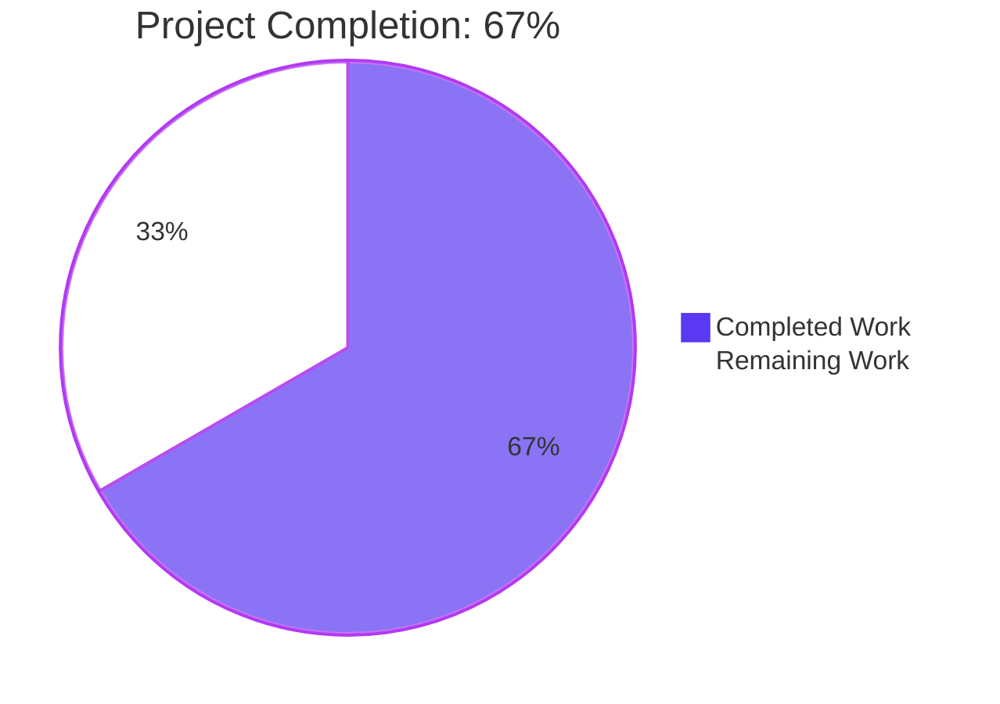

# 1. Executive Summary

## 1.1 Project Overview

This repository holds two small, dependency-free JavaScript programs and the documentation that explains them to someone who has never opened it. `Welcome.js` prints one line and exits; `server.js` starts a small web server answering every request with `Hello, World!` as plain text on `127.0.0.1:3000`. It now describes itself: a header comment in each program, a comment above every statement in `server.js`, and a five-section README covering what the project is, what to install, and how to run, check and stop each program. No behaviour changed.

## 1.2 Completion Status



| Metric | Hours |
|---|---|
| Total Project Hours | 30.0 |
| Completed Hours (AI + Manual) | 20.0 |
| Remaining Hours | 10.0 |

**Completion: 67%** — 20.0 completed hours of 30.0 total (20.0 ÷ 30.0 = 0.667). All sixteen documentation units the request scoped are delivered and verified; the ten remaining hours are the five follow-ups in Section 1.4. Colours: Completed = Dark Blue (#5B39F3), Remaining = White (#FFFFFF).

## 1.3 Key Accomplishments

- **Greeting documented** — `Welcome.js` states its purpose, the exact command and the result to expect (`Welcome.js:1-3`).
- **Every server statement explained** — a header comment plus one comment above each of its nine statements (`server.js:1-26`).
- **Quick-start written** — `README.md` holds the five fixed sections, from what the project is to how to stop the server (`README.md:4-74`).
- **Documented values reproduced at runtime** — the 18-byte greeting and its exit status, the confirmation line, the `200` / `text/plain` / `Hello, World!` reply for every path and method, the browser rendering and the stop.
- **Documentation-only change** — 15 added comment lines, five appended sections, no code line changed and no file added or deleted; each run command at exactly two sites, identically worded.
- **Zero-install posture preserved** — nothing to install, build or configure; no manifest, dependency or tooling added.

## 1.4 Critical Unresolved Issues

Five open items remain: one against the sixteen units the request scoped (README section 4's module-not-found element) and four path-to-production follow-ups — 1 of the 17 scoped items, four outside it. None blocks the documentation.

| Issue | Impact | Owner | ETA |
|---|---|---|---|
| README section 4 states the repository-root requirement and its rationale but does not name the failure a reader meets when running the command from another folder, nor the remedy (`README.md:36`) | A newcomer who ignores the instruction meets an unexplained runtime error | Repository owner | ≤1 day |
| No automated check guards the documented values; the recurring gate is a syntax check over both programs plus a byte-exact greeting run | A future edit to either program can silently contradict the README | Maintainer | ≤2 days |
| The repository's generated record still describes a superseded state (the greeting file as one comment-free line; the README and the server file as unchanged surfaces) | A reader who trusts that record meets figures the tree no longer shows | Repository owner | ≤1 day |
| The greeting's wording departs from the applicable user rule's shorthand, and the decision is recorded nowhere in the repository | The next maintainer has no in-repository explanation of the wording | Repository owner | ≤1 day |
| The listen address and port are hardcoded with no override and no message when the bind fails (`server.js:8-10, :23`) | The program cannot be re-addressed or co-hosted, and a second instance fails without explanation | Maintainer | ≤2 days |

## 1.5 Access Issues

| System/Resource | Type of Access | Issue Description | Resolution Status | Owner |
|---|---|---|---|---|
| Loopback TCP port 3000 on the host | Local network port | The server binds a hardcoded, host-global port with no override, so two instances cannot share one host and an unrelated process holding 3000 prevents the delivered file from binding | Open — mitigated by stopping the process holding the port; a configurable port is a remaining task | Repository owner |

No other access issue exists: neither program needs a credential, API or secret, and the `DB_HOST` the environment exposes is unread.

## 1.6 Recommended Next Steps

1. **[High]** Add a repeatable regression check over the documented values — greeting output and exit status, the confirmation line, the reply's status, content type and body, and the port released on stop (3.0h).
2. **[High]** Settle README section 4's module-not-found element — name the failure and the remedy, or record the exclusion (1.0h).
3. **[High]** Make the listen address and port configurable, document the setting, and report a failed bind (3.0h).
4. **[Medium]** Reconcile or retire the repository's generated record (1.5h), record the settled greeting-wording decision (1.0h) and pin the verified runtime (0.5h).

# 2. Project Hours Breakdown

## 2.1 Completed Work Detail

| Component | Hours | Description |
|---|---|---|
| `Welcome.js` in-file documentation | 2.0 | Three-line header comment stating the program's purpose, the exact command that runs it and the result to expect — the greeting printed, then a success status — placed above the unchanged one-line statement [AAP R1] |
| `server.js` in-file documentation | 4.0 | Three-line header comment plus one inline comment directly above each of the nine statements: the built-in `http` load, the host and port constants, the server creation with its per-request callback, the response status, the content type, the body, the `listen` call and the ready log line — in execution order and at each statement's own indentation [AAP R2] |
| README five-section newcomer quick-start | 7.0 | What the project is; the file table with its pointer to the generated-documentation folder; prerequisites naming the verified Node.js lines with the `node --version` check; both run procedures with their fenced expected output, the check and the stop instruction; every technical term explained where it first appears [AAP R3, R6, R7, R8, R16] |
| Runtime verification of every documented value | 5.0 | Each quoted value reproduced on both documented Node.js lines: the 18-byte greeting and its exit status, the confirmation line, the reply's status, content type and body for every path and method, the browser rendering at the documented address, the stop releasing the port, and concurrency and hostile-input checks [AAP R9, R10, R12] |
| Mechanical acceptance verification | 2.0 | Diff shape (additions only, every added line a comment), documentation-unit counts, the four-path file inventory, the two-place command census, and the byte-identity of the out-of-scope generated record [AAP R11, R13, R14, R15] |
| **Total** | **20.0** | |

## 2.2 Remaining Work Detail

| Category | Hours | Priority |
|---|---|---|
| **Repeatable regression check over the documented values** — greeting output and exit status, confirmation line, reply status/content type/body, port released on stop; the repository ships no test tooling, so nothing detects drift today [path to production] | 3.0 | High |
| **README section 4 — settle the module-not-found element**: add one sentence naming the failure a reader meets when the command is run from another folder and the remedy, or record the exclusion in the repository [AAP R5, inferred-need element] | 1.0 | High |
| **Configurable listen address and port with a clear message when the bind fails** — today both are hardcoded and a second instance fails silently [path to production] | 3.0 | High |
| **Reconcile or retire the in-repository generated record** that still describes a superseded state [path to production] | 1.5 | Medium |
| **Record the settled greeting-wording decision in the repository**, so the next maintainer can see the wording, its source and its reason [AAP rule divergence D1] | 1.0 | Medium |
| **Pin the runtime the repository is verified on**, so the supported Node.js line is declared where a maintainer will see it [path to production] | 0.5 | Low |
| **Total** | **10.0** | |

Priority split of the ten remaining hours: High 7.0h, Medium 2.5h, Low 0.5h.

## 2.3 Total Project Hours

| Item | Hours |
|---|---|
| Completed hours (Section 2.1) | 20.0 |
| Remaining hours (Section 2.2) | 10.0 |
| **Total project hours** | **30.0** |

Completion = completed hours ÷ total project hours = 20.0 ÷ 30.0 = 0.667, reported as **67%**. Every hour above traces either to one of the sixteen documentation requirements the request fixed or to a named path-to-production need; no hour is counted for work outside that universe.

# 3. Test Results

No test framework ships with this repository — it has no manifest, no dependencies and no runner — so the checks below are the gates and harnesses that were actually executed against the delivered tree. Each row reports the definitive pass for that area; across every pass run against the tree, **779 runtime checks were executed and none failed**. The counts are cases run, not test files.

| Area / Category | Framework | Tests | Passed | Failed | Coverage | What This Proves |
|---|---|---|---|---|---|---|
| Repository gate — static parse | Node.js v22.23.3 and v24.21.0 | 4 (2 files × 2 runtime lines) | 4 | 0 | n/a — no coverage tooling exists | Both programs are valid JavaScript and parse under every runtime line the README names |
| Repository gate — byte-exact greeting run | `node` with byte-level capture | 1 | 1 | 0 | n/a | The greeting writes exactly 18 bytes to standard output, nothing to standard error, and exits 0 |
| Greeting program — runtime contract | Node.js CLI, byte and exit-status capture | 33 | 33 | 0 | n/a | `node Welcome.js` from the repository root prints `Welcome to Blitzy` and exits 0, reads no argument, standard input, environment value or file, and fails predictably when run from another folder |
| HTTP server — response contract | `curl.exe`, raw TCP sockets, HTTP/1.0 and 1.1 | 96 | 96 | 0 | n/a | Every path and method returns `200` with `Content-Type: text/plain` and the 14-byte `Hello, World!` body; the body hash is identical across all variants |
| Server process — lifecycle and observability | CLI start/stop cycles, listener census, real desktop console | 64 | 64 | 0 | n/a | One confirmation line printed once when the server is ready, a loopback-only listener, the port released on stop, and no per-request logging |
| Security posture — hostile input and binding | `curl.exe`, raw TCP, non-loopback connection attempts, secret scan | 130 | 130 | 0 | n/a | Ten injection payloads and malformed or oversized requests leave the reply byte-identical with no internals, version banner or secret disclosed, and the listener refuses non-loopback connections |
| README quick-start executed as instructions | Terminal, `curl.exe`, headless Chrome, desktop console | 25 | 25 | 0 | n/a | Every documented command and expected value in the five sections reproduces exactly as written, including the browser check and the stop keystroke |
| Preservation and zero-install posture | Git diff and inventory, before/after captures | 40 | 40 | 0 | n/a | The change adds comment lines and prose only: three modified paths, no addition, deletion or rename, no manifest or tooling, and identical program behaviour before and after |

### Not Covered

- **No automated test tooling.** The repository ships no runner, no coverage measurement and no security tooling, so no pass rate or coverage figure can be produced for the README prose or for the comment text; the recurring gate is a syntax check over both programs plus the byte-exact greeting run. A human should add a repeatable check over the documented values before relying on them staying accurate (Section 2.2).
- **Production behaviour.** Load, scaling and multi-client use were exercised only up to 100 concurrent and 200 sequential requests from a single host; nothing beyond that was measured, and no performance verdict exists for this repository.
- **The exit status an interrupt produces** is asserted nowhere — the README states that Ctrl+C stops the server, not what status the process reports.
- **A failed bind.** Starting a second instance while the port is held produces no confirmation line and exits with an unhandled bind error; the delivered code has no error handling for it and the README deliberately says nothing about a port already in use.
- **Surfaces the design does not have.** No database, session, authentication, authorization, TLS, routing or content-negotiation surface exists, so none could be tested; the handler reads nothing from the request and holds no state.

# 4. Runtime Validation & UI Verification

Every line below was driven against the running programs and the documented procedures, from the repository root, on both runtime lines the README names.

- ✅ **Clean start** — both programs run directly from a fresh checkout with nothing installed, built or configured.
- ✅ **Greeting program** — `node Welcome.js` writes exactly 18 bytes (`Welcome to Blitzy` plus a newline), nothing to standard error, exit status 0, byte-identical on both documented runtime lines.
- ✅ **Server startup** — one confirmation line, `Server running at http://127.0.0.1:3000/`, byte-exact, printed once when the server becomes ready, with standard error empty.
- ✅ **Listener binding** — loopback only (`127.0.0.1:3000`); requests to non-loopback addresses on that port are refused and the process holds no other socket.
- ✅ **HTTP reply** — `200`, `Content-Type: text/plain` and the 14-byte `Hello, World!` body for every path and method tested, with one identical body hash across all variants.
- ✅ **Documented terminal check** — `curl.exe -s http://127.0.0.1:3000/` prints `Hello, World!`; the response headers read `HTTP/1.1 200 OK` and `Content-Type: text/plain`.
- ✅ **Documented browser check** — `http://127.0.0.1:3000/` renders `Hello, World!` in a real browser as a plain-text document: status 200, no console messages, no failed requests.
- ✅ **Documented stop** — Ctrl+C in a real console echoes `^C`, returns the prompt and releases the port; a second start-and-stop cycle ends in an identical state.
- ✅ **Concurrency and edge input** — 20, 50 and 100 concurrent requests and 200 sequential requests all returned byte-identical replies with no transport errors; malformed and oversized requests were answered or refused cleanly with no internal detail.
- ✅ **Environment independence** — with `DB_HOST` set, cleared or changed, output, reply and lifecycle are identical; neither program reads an argument, standard input, environment value or file.

**Never exercised at runtime:** the server's behaviour under production load, across multiple hosts or with many simultaneous clients beyond the burst sizes above; the exit status an interrupt produces; a failed bind as an asserted requirement (observed only, and unhandled by the code); and any database, session, authentication, TLS, routing or content-negotiation surface, none of which the design has. There is no user interface: the entire observable surface is one terminal line and one plain-text HTTP response, so the only rendering checked is the browser's plain-text view of the documented address.

# 5. Compliance & Quality Review

## 5.1 Compliance Matrix

| Deliverable | Benchmark | Status | Evidence |
|---|---|---|---|
| `Welcome.js` header comment (purpose, exact run command, expected result) | Functional completeness | ✅ PASS | `Welcome.js:1-3` above the unchanged statement at :4; additions-only diff (3/0) |
| `server.js` header comment plus one comment above each of its nine statements | Functional completeness | ✅ PASS | `server.js:1-26`: comments at 4/7/9/12/14/16/18/22/24 above statements 5/8/10/13/15/17/19/23/25; closing braces left uncommented |
| README five sections in the fixed order, under the kept heading | Functional completeness | ✅ PASS | `README.md:1-2` intact; five `##` headings at 4/12/22/34/50, no sixth |
| README must-state content (file table and pointer, prerequisites with both version lines and the version check, both run procedures with fenced expected output, check and stop) | Completeness | ✅ PASS | `README.md:14-20`, `:24-32`, `:34-48`, `:50-74` |
| Comment and prose convention: plain `//` lines, ASCII only, no JSDoc tags, every technical term explained | Style conformance | ✅ PASS | Zero block comments and zero JSDoc tags; zero non-ASCII bytes; terminal, LTS, module, exit status, loopback address, port, plain text, status 200 and Ctrl+C each explained at first use |
| Claim accuracy — every documented value equals the code that owns it, nothing unverifiable asserted | Accuracy | ✅ PASS | Values verified line by line and reproduced at runtime; production, load, repository-name meaning, interrupt exit status and busy-port behaviour asserted nowhere |
| No functional change — comment lines the only edit to either program | Change discipline | ✅ PASS | 3/0 and 12/0 additions-only diffs; zero non-comment added lines; original blank separators intact |
| No new files, dependencies, scripts, configuration or tooling | Change discipline | ✅ PASS | Four tracked paths; three modified paths and no addition, deletion or rename; no manifest, lockfile, module tree or CI file |
| Existing content preserved and built on | Change discipline | ✅ PASS | README heading and description text unchanged; every code line of both programs unchanged |
| Cross-surface consistency — each run command in exactly two places, shared literals equal to the code | Maintainability | ✅ PASS | `node Welcome.js` at `Welcome.js:2` and `README.md:39`; `node server.js` at `server.js:2` and `README.md:55`; all shared literals match |
| Out-of-scope generated record untouched | Change discipline | ✅ PASS | `blitzy/documentation/Project Guide.md` absent from the diff and byte-identical |
| Automated regression coverage over the documented values | Testability | ⚠ PARTIAL | The repository ships no runner, coverage or security tooling by design; the recurring gate is a syntax check over both programs plus the byte-exact greeting run, and a repeatable check is outstanding (Section 2.2) |

## 5.2 AAP & Rule Divergences and Gaps

Two divergences stand in the delivered tree; no other departure from the agreed specification or from the user's rules was found.

| What the AAP/Rule Required | What Was Delivered Instead | Why It Diverged | Impact | Remediation |
|---|---|---|---|---|
| **Rule `Ajit_Welcome_Rule`** — create a "Welcome Blitzy" message and share it in the relevant format, keeping the code simple and crisp | The message exists exactly once, as `console.log('Welcome to Blitzy');` (`Welcome.js:4`), stated in that file's header comment and quoted at `README.md:8` and `:45`; the literal was not changed | The agreed specification fixes the delivered literal as the acceptance criterion and forbids the functional change that matching the rule's shorthand would require; the specification ranks above the user's rules | The rule's intent is met — the message is created and shared, and the change adds no construct, dependency, configuration or file — but its wording differs from the rule's shorthand. No behaviour changes | None required to ship. **Sanctioned** — the specification outranks the user's rules. Recording the decision in the repository is the 1.0h item in Section 2.2 |
| **Agreed specification — inferred need**: the README should say that running the command from elsewhere fails because the runtime cannot find the file, which motivates the repository-root instruction | `README.md:36` states the repository-root requirement and its rationale ("node looks for the file in the folder you are in") but names neither the failure nor its remedy | The specification excludes troubleshooting material from the README's fixed five sections: the runtime's own error text carries the loader internals and the absolute working directory, so quoting it would assert a string the code does not establish and would drift with the runtime and the path | A newcomer who ignores the instruction meets an unexplained runtime error; a reader who follows section 4 never meets it | Add one sentence to section 4 naming the failure and the remedy, or record the exclusion in the repository (1.0h, Section 2.2) |

**The greeting's wording.** `Welcome.js` prints, and the README quotes, one literal: `Welcome to Blitzy` (`Welcome.js:4`; `README.md:8`, `:45`, `:44-46`). The applicable rule names the message "Welcome Blitzy". Both cannot hold by editing, because changing the string is the functional change the request fixed as out of bounds, and the specification settles the conflict by fixing the delivered literal and ranking above the rules. The rule's substance is met: the message is created once, stated in the file's header comment and shared in the section that owns the program, with the code left simple and crisp. The only open question is whether the wording should ever move to the shorthand, which would be a code change.

**The module-not-found element.** The agreed specification's inferred needs name the failure a reader meets when `node Welcome.js` is run from a folder that does not hold the file — the runtime reports that it cannot find the module — as the reason section 4 sends the reader to the repository root. The delivered section keeps the instruction and its rationale and stops there. The failure is real and reproducible (run from another folder it exits 1), but the runtime's text carries Node's loader internals and the absolute working directory, so quoting it would assert a string the code does not establish; the element's counterpart is the repository's generated record, reached from the pointer sentence at `README.md:20`. A maintainer should add one sentence naming the failure and the remedy, or record the exclusion visibly.

# 6. Risk Assessment

Risks below are forward-looking: what could still go wrong for a reader or an operator of this repository. Everything recorded here is either open work (Section 2.2) or an accepted property of the design.

| Risk | Category | Severity | Probability | Mitigation | Status |
|---|---|---|---|---|---|
| The repository's generated record still describes a superseded state — the greeting file as one comment-free line, the README and the server file as unchanged surfaces — so a reader who trusts it meets figures the tree no longer shows | Technical (documentation) | Medium | High (already true) | Reconcile or retire the record so the repository holds one accurate description | Open |
| No automated check guards the documented values; the recurring gate is a syntax check over both programs plus a byte-exact greeting run | Technical | Medium | High | Add the repeatable check in Section 2.2 and run it on every change to the three files | Open |
| The documented values are quoted in two places by design — each run command in the program's header comment and in the README section that owns it — so an edit to one leaves the two surfaces disagreeing | Technical | Low | Medium | Keep the pair in step; the proposed check covers both sites, and today every quoted value matches character for character | Open (monitored) |
| Nothing in the repository declares the runtime it is verified on, although the README names a supported floor and a reference line | Operational | Low | Low | Pin the supported Node.js line in the repository and keep it in step with the README | Open |
| The listen address and port are hardcoded with no override, and a failed bind produces no explanation — a second instance simply prints no confirmation line and exits | Operational | Medium | Medium | Make both configurable, document the setting, and report why a bind failed | Open |
| The endpoint's inertness rests on its fixed `Content-Type: text/plain` and on the handler deriving nothing from the request; the reply is a constant, never escaped | Security | Low | Medium | If request reflection or HTML responses are ever introduced, add the HTML-level protections this design deliberately lacks | Open (monitored) |
| The listener carries no TLS, authentication, authorization, security headers or rate limiting | Security | Low | Low | Acceptable while it is bound to loopback and serves one constant plain-text string with no state or data path; revisit only if exposure changes | Accepted by design |
| The deployment environment exposes `DB_HOST`, which neither program reads, so an operator may infer a database dependency that does not exist | Integration | Low | Medium | The README states that nothing else is required; document the variable as unused before deploying | Open |

No risk arises from dependencies, credentials or external services: the repository has none, the only import is Node's built-in `http` module, and no secret, token or key appears anywhere in the tracked files.

# 7. Visual Project Status


Completed = Dark Blue (#5B39F3) · Remaining = White (#FFFFFF) · headings and accents Violet-Black (#B23AF2)

### Remaining hours by category

| Category | Hours |
|---|---|
| Repeatable regression check over the documented values | 3.0 |
| Configurable listen address and port with a clear bind-failure message | 3.0 |
| Reconcile or retire the in-repository generated record | 1.5 |
| README section 4 — settle the module-not-found element | 1.0 |
| Record the settled greeting-wording decision in the repository | 1.0 |
| Pin the runtime the repository is verified on | 0.5 |
| **Total remaining** | **10.0** |

### Priority distribution of the remaining work

| Priority | Hours |
|---|---|
| High | 7.0 |
| Medium | 2.5 |
| Low | 0.5 |

The two charts and the table agree with Section 1.2 and Section 2.2: 20.0 completed hours, 10.0 remaining hours, 30.0 total hours, 67% complete.

# 8. Summary & Recommendations

**What was delivered.** The repository now explains itself. `Welcome.js` opens with a three-line header comment naming its purpose, the exact command that runs it and the result to expect; `server.js` opens with the same kind of header and then gives one plain comment directly above each of its nine statements, from loading Node's built-in `http` module to the line that prints the address it is serving; and `README.md` grew from a two-line stub into a 74-line quick-start with five sections — what the project is, the files and what each is for, prerequisites, how to run the greeting, and how to run, check and stop the server. Fifteen comment lines and five prose sections were added, no code line was touched, and no file, dependency, script or configuration was created. Four tracked paths remain, and each run command appears in exactly two places — the program's own header comment and the README section that owns it — with identical wording.

**How it was verified.** Every value the documentation quotes was reproduced against the running programs: the greeting's exact 18-byte output, empty standard error and success status; the server's single confirmation line printed once when it becomes ready; the `200` / `Content-Type: text/plain` / `Hello, World!` reply for every path and method tested, with one identical body hash across all variants; the reply opened in a real browser at `http://127.0.0.1:3000/`; the documented terminal check returning the body and the two documented headers; and Ctrl+C in a real console ending the process and releasing the port. Alongside those, 779 checks ran green with no failures — including 100 concurrent and 200 sequential requests, ten injection payloads, malformed and oversized requests, and a listener that refuses every non-loopback connection — and both documented Node.js lines produced byte-identical results. The repository itself ships no test runner, no coverage measurement and no security tooling by design, so the recurring gate is a syntax check over both programs plus the byte-exact greeting run; a repeatable check over the documented values is the first item of remaining work.

**What remains.** Five items are open, worth 10.0 hours, which is why the project reports **67% complete** (20.0 completed hours of 30.0 total) even though all sixteen documentation units the request scoped are delivered and verified. Three are high priority: a repeatable regression check over the documented values (3.0h), one sentence or one recorded exclusion to settle the module-not-found element in README section 4 (1.0h), and making the listen address and port configurable with a clear message when the bind fails (3.0h). Two are medium (1.5h to reconcile or retire the repository's generated record, which still describes a superseded state; 1.0h to record the settled greeting-wording decision) and one is low (0.5h to pin the runtime the repository is verified on). That ordering is the critical path to production: the configuration change removes the last deployment obstacle, and the regression check is what keeps the documentation honest afterwards.

**Production readiness.** For what it is — two dependency-free scripts and their documentation — the delivered state is production-ready and verified end to end: nothing to install, build or configure; a fresh checkout runs both programs; and the only network surface is a loopback listener answering a constant plain-text string with no state, no input handling and no data path, which is why it needs no authentication, TLS or security headers. Two operational caveats should be accepted deliberately rather than discovered: the port is fixed and host-global, so the delivered file cannot be co-hosted or re-addressed without the change listed above; and the repository's own generated record no longer matches the tree, so a maintainer should reconcile or retire it before treating it as documentation of record.

| Metric | Value |
|---|---|
| Completion (AAP-scoped, hours-based) | 67% (20.0 of 30.0 hours) |
| Documentation units delivered and verified | 16 of 16 |
| Checks executed | 779, with 0 failures |
| Programs changed functionally | 0 (comments and prose only; 3 modified paths, 0 additions, deletions or renames) |
| Tracked paths / dependencies / configuration | 4 / 0 / 0 |
| Open items | 5 (1.0 of 17 scoped items; 4 path-to-production follow-ups) |

# 9. Development Guide

Everything below was executed on this repository from its root. There is no build, no install and no configuration step: the repository is two JavaScript programs and their documentation, and it runs as it stands.

## System prerequisites

- **Node.js**, a supported LTS release. The repository is verified on **v24.21.0** (reference line) and **v22.23.2** (supported floor).
- **No other software.** No package manager step, no database, no container, no web server, no environment variable and no credential is required. The programs use only modules Node.js already provides, and the server's only network activity is a listener it creates on this machine.
- A terminal to type commands in, and a browser if you want to use the documented check for the server.

Verify the runtime:

```bash
node --version
# prints the version you have; the supported floor is v22.23.2
```

```bash
cd <repository root>
node Welcome.js
# Welcome to Blitzy
```

Exact captures, byte for byte (Windows PowerShell re-encodes redirected output, so let the shell's own command processor write the file):

```powershell
cmd /c "node Welcome.js > out.bin 2> err.bin"
# out.bin is exactly 18 bytes: 57 65 6c 63 6f 6d 65 20 74 6f 20 42 6c 69 74 7a 79 0a
# err.bin is 0 bytes. To inspect it: Format-Hex out.bin
```

## Environment setup

None. Set `DB_HOST` if your platform provides it — neither program reads it, so any value (or none) works. No `.env` file, no configuration file and no build output location exists; every command runs from the repository root, where the three source files sit.

## Application startup

The greeting runs to completion in one command:

```bash
cd <repository root>
node Welcome.js
```

The server runs in the foreground until you stop it:

```bash
cd <repository root>
Get-NetTCPConnection -LocalPort 3000 -State Listen -ErrorAction SilentlyContinue   # expect no rows
node server.js
# Server running at http://127.0.0.1:3000/
```

Open a **second** terminal for anything you want to run while the server is up.

## Verification steps

| What to verify | Command (run from the repository root) | Expected result |
|---|---|---|
| Both programs are valid JavaScript | `foreach ($f in git ls-files '*.js') { node --check $f }` | No output; exit status 0 for each file |
| The greeting's exact output | `cmd /c "node Welcome.js > out.bin 2> err.bin"` | `out.bin` 18 bytes `Welcome to Blitzy` + newline; `err.bin` 0 bytes; exit status 0 |
| The port is free before starting | `Get-NetTCPConnection -LocalPort 3000 -State Listen -ErrorAction SilentlyContinue` | No rows |
| The server is listening | `Get-NetTCPConnection -LocalPort 3000 -State Listen` | One row, `127.0.0.1:3000`, owned by the pid you started |
| The reply body | `curl.exe -s http://127.0.0.1:3000/` | `Hello, World!` (14 bytes including the newline) |
| The reply headers | `curl.exe -sI http://127.0.0.1:3000/` | `HTTP/1.1 200 OK` then `Content-Type: text/plain` |
| Any path answers the same way | `curl.exe -s http://127.0.0.1:3000/anything/at/all` | `Hello, World!` |
| The browser view | Open `http://127.0.0.1:3000/` | A plain-text page showing `Hello, World!` |
| The port is released after the stop | `Get-NetTCPConnection -LocalPort 3000 -State Listen -ErrorAction SilentlyContinue` | No rows |

## Example usage

```bash
# Terminal 1 — start the server
cd <repository root>
node server.js
# Server running at http://127.0.0.1:3000/
```

```bash
# Terminal 2 — check it, then stop the first terminal with Ctrl+C
curl.exe -s http://127.0.0.1:3000/
# Hello, World!
curl.exe -sI http://127.0.0.1:3000/
# HTTP/1.1 200 OK
# Content-Type: text/plain
```

On Linux, macOS or Git Bash the plain name works instead: `curl -s http://127.0.0.1:3000/`. On Windows PowerShell 5.1 the name `curl` is an alias for a different built-in command, so `curl.exe` is the one that returns the body; on PowerShell 7 both work.

**Stopping the server.** Press **Ctrl+C** in the terminal running it — the prompt returns and the port is released. If you started it detached with `Start-Process -PassThru`, stop it by the pid you captured, never by process name:

```powershell
$p = Start-Process -FilePath node -ArgumentList 'server.js' -WorkingDirectory (Get-Location) -PassThru -NoNewWindow
Stop-Process -Id $p.Id
```

## Troubleshooting

| Symptom | Cause | Resolution |
|---|---|---|
| `Error: Cannot find module '…\Welcome.js'` (or the same for `server.js`), exit status 1 | The command was run from a folder that does not hold the file; `node` looks for the file in the folder you are in | Change to the repository root first (`cd <repository root>`), or pass the file's full path |
| `Error: listen EADDRINUSE: address already in use 127.0.0.1:3000`, thrown as an unhandled error event, with no confirmation line printed | Another process already holds port 3000 — a second instance of this server, or an unrelated program | Find and stop the holder: `Get-NetTCPConnection -LocalPort 3000 -State Listen` gives the pid, then `Stop-Process -Id <pid>`. The address and port are hardcoded, so there is no setting to change yet |
| `curl http://127.0.0.1:3000/` prints nothing useful or a response object instead of the body | In Windows PowerShell 5.1, `curl` is an alias for a different built-in command | Use `curl.exe http://127.0.0.1:3000/` on Windows PowerShell; `curl` is correct on Linux, macOS, Git Bash and PowerShell 7 |
| Output files from a redirected run are garbled or larger than expected | PowerShell's `>` re-encodes what it writes | Capture through `cmd /c "node Welcome.js > out.bin 2> err.bin"` or `Start-Process -RedirectStandardOutput` |
| The server prints nothing at all and exits immediately | The bind failed (see the port-in-use row above); the confirmation line is only printed once the server is actually ready | Free port 3000 and start again |
| No test, coverage or lint command exists | The repository ships no test runner, coverage tooling, linter or manifest, by design | Use the verification table above; the recurring gate is the syntax check over both programs plus the byte-exact greeting run |

## Command reference (all verified on this repository)

```bash
node --version                                     # v22.23.3 on this host; floor v22.23.2
node --check Welcome.js                            # no output, exit 0
node --check server.js                             # no output, exit 0
node Welcome.js                                    # Welcome to Blitzy, exit 0
node server.js                                     # Server running at http://127.0.0.1:3000/
curl.exe -s http://127.0.0.1:3000/                 # Hello, World!
curl.exe -sI http://127.0.0.1:3000/                # HTTP/1.1 200 OK / Content-Type: text/plain
Get-NetTCPConnection -LocalPort 3000 -State Listen # the listener and its owning pid
# Ctrl+C in the server's terminal                  # stops it and releases the port
```

# 10. Appendices

## A. Command Reference

| Purpose | Command | Expected result |
|---|---|---|
| Check the runtime | `node --version` | `v22.23.3` on this host (floor `v22.23.2`, reference line `v24.21.0`) |
| Parse a program without running it | `node --check Welcome.js` / `node --check server.js` | No output; exit status 0 |
| Parse every tracked program | `foreach ($f in git ls-files '*.js') { node --check $f }` | No output; exit status 0 for both files |
| Run the greeting | `node Welcome.js` | Prints `Welcome to Blitzy`; exit status 0 |
| Capture the greeting byte-exactly | `cmd /c "node Welcome.js > out.bin 2> err.bin"` | `out.bin` 18 bytes, `err.bin` 0 bytes, exit status 0 |
| Start the server | `node server.js` | Prints `Server running at http://127.0.0.1:3000/` and keeps running |
| Check the port is free | `Get-NetTCPConnection -LocalPort 3000 -State Listen -ErrorAction SilentlyContinue` | No rows when free |
| Identify the listener's process | `Get-NetTCPConnection -LocalPort 3000 -State Listen` | `127.0.0.1:3000` with its owning pid |
| Fetch the reply body | `curl.exe -s http://127.0.0.1:3000/` | `Hello, World!` |
| Fetch the reply headers | `curl.exe -sI http://127.0.0.1:3000/` | `HTTP/1.1 200 OK`, `Content-Type: text/plain` |
| Stop a foreground server | **Ctrl+C** in its terminal | Prompt returns; port released |
| Stop a detached server | `Stop-Process -Id <pid you spawned>` | Process ends; port released |
| Inspect the change shape | `git diff --numstat 39974fd...HEAD` | `73 1 README.md`, `3 0 Welcome.js`, `12 0 server.js` |
| List the tracked tree | `git ls-files` | Four paths |
| Census the two documentation surfaces | `Select-String -Path README.md,Welcome.js,server.js -Pattern 'node (Welcome|server)\.js'` | Four hits: `Welcome.js:2`, `README.md:39`, `server.js:2`, `README.md:55` |

## B. Port Reference

| Port | Used by | Binding | Notes |
|---|---|---|---|
| 3000 | `server.js` | `127.0.0.1` (loopback) only, hardcoded (`server.js:10`) | Host-global: two instances cannot share it, and there is no override. No firewall rule or external exposure is involved. |

No other port is opened by either program; the greeting program opens no socket at all.

## C. Key File Locations

| Path | Lines | Purpose |
|---|---|---|
| `README.md` | 74 | The repository quick-start: what the project is, the file table, prerequisites, and both run procedures with their expected output, check and stop instructions |
| `Welcome.js` | 4 | The greeting program: a three-line header comment above a single `console.log` writing `Welcome to Blitzy` |
| `server.js` | 26 | The web server: a three-line header comment plus one comment above each of its nine statements; binds `127.0.0.1:3000` and answers every request identically |
| `blitzy/documentation/Project Guide.md` | 381 | The repository's generated record of an earlier acceptance state; unchanged by the documentation work and no longer matching the tree (Section 1.4, Section 2.2) |

## D. Technology Versions

| Technology | Version | Where it applies |
|---|---|---|
| Node.js | v22.23.3 (installed) | Runtime used for every check in this guide; above the supported floor |
| Node.js | v22.23.2 | Supported floor named in `README.md:26` |
| Node.js | v24.21.0 | Reference line named in `README.md:26`; both programs behave byte-identically on it |
| Node `http` module | Built in — versioned with the runtime | The server's only import (`server.js:5`) |
| `curl.exe` | System binary, version tracks the operating system | The documented terminal check; on Windows PowerShell 5.1 the bare name `curl` is an alias for a different command |
| Git | Any recent version | Inspecting the diff and the tracked tree |
| Test runner, coverage tool, linter, package manager | None | The repository has no manifest and no tooling by design |

## E. Environment Variable Reference

| Variable | Read by | Effect |
|---|---|---|
| `DB_HOST` | Nothing | Present in some environments but referenced nowhere in the repository; set, clear or change it and output, reply and lifecycle are identical. The README states that nothing beyond Node.js is required. |

No secret, token, key or credential is used or stored anywhere in the repository.

## F. Developer Tools Guide

| Task | Tool / command | Notes |
|---|---|---|
| Edit the documentation | Any text editor | `README.md` is Markdown; the two programs carry `//` line comments |
| Parse-check your edits | `node --check <file>` | The repository's only static gate; it is fast and has no dependencies |
| Confirm documented output | `cmd /c "node Welcome.js > out.bin 2> err.bin"` then compare the bytes | PowerShell's `>` re-encodes output, so let `cmd` write the file |
| Drive the server by hand | `curl.exe -s` / `curl.exe -sI`, or a browser at `http://127.0.0.1:3000/` | The handler answers every path and method the same way |
| Watch the listener | `Get-NetTCPConnection -LocalPort 3000 -State Listen` | Shows the owning pid, which is what you should stop the process by |
| Inspect the change | `git diff <base>...HEAD`, `git diff --numstat` | Confirms comment-only additions and the three modified paths |
| Keep the two documentation surfaces in step | Search both: `Select-String -Path README.md,Welcome.js,server.js -Pattern 'node (Welcome\|server)\.js'` | Each run command must appear at exactly two sites with identical wording |

## G. Glossary

| Term | Meaning in this repository |
|---|---|
| **Repository root** | The folder that holds `README.md`, `Welcome.js` and `server.js`; both commands must be run from it, because `node` resolves a file name against the folder you are in |
| **Module** | A piece of code the runtime supplies; `server.js` loads Node's built-in `http` module and needs nothing else |
| **Loopback address** | `127.0.0.1`, meaning "this computer"; the server binds it, so it accepts requests only from the local machine |
| **Port** | The numbered channel a server listens on; this server uses `3000` |
| **Plain text** | A reply that is not a formatted web page; the server's `Content-Type` is `text/plain` |
| **Status 200** | The HTTP status meaning the request succeeded; it is the only status this handler sets |
| **Exit status** | The number a program reports when it finishes; the greeting reports 0, meaning success |
| **Ctrl+C** | The keystroke that interrupts a foreground program; it is the documented way to stop the server |
| **MODULE_NOT_FOUND** | The runtime's error when the file named on the command line is not in the current folder |
| **EADDRINUSE** | The runtime's error when the port is already held by another process; this server does not handle it |
| **Zero-install posture** | The repository runs with nothing installed or built: no manifest, no dependencies, no configuration |
