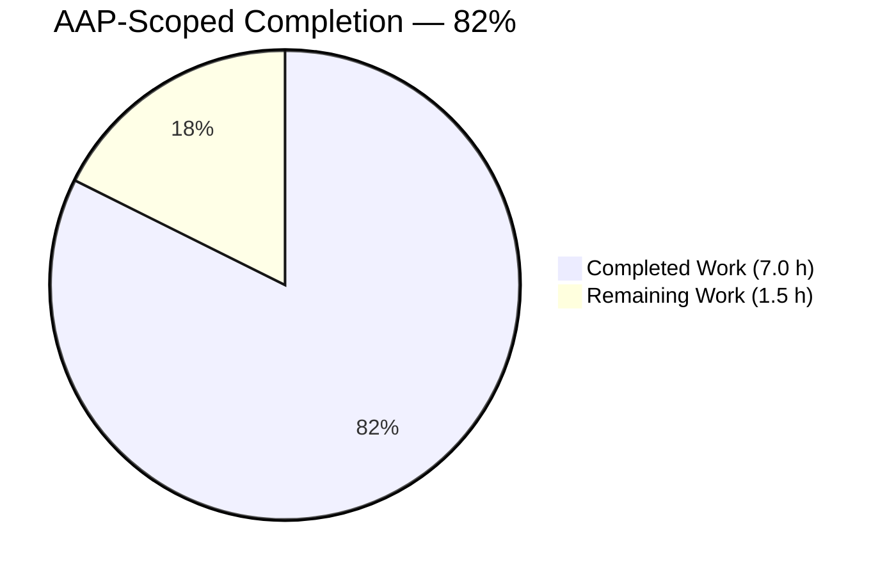
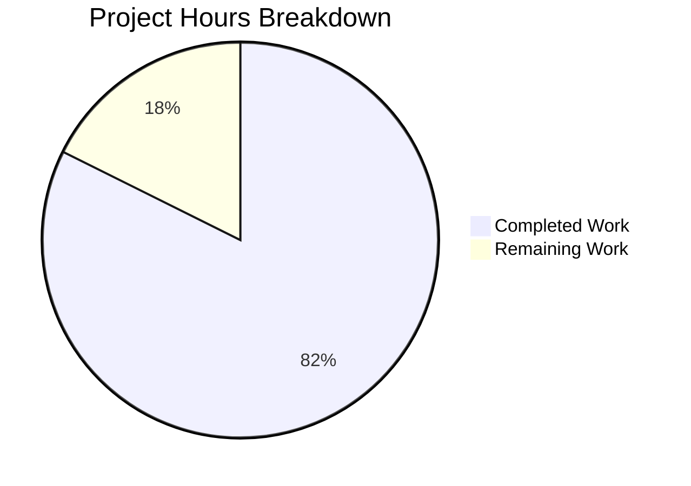
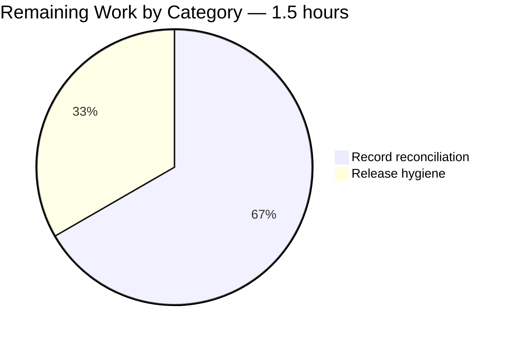

# 1. Executive Summary

## 1.1 Project Overview

`hao-backprop-test` is a dependency-free Node.js demonstration repository: a loopback HTTP service in `server.js` and a one-line greeting in `Welcome.js`. This revision is a documentation pass — a summary comment above the request handler, and a five-line `README.md` giving the project name, the install answer and both run commands. Runtime behaviour is unchanged, no dependency or build step is added, and two of the four tracked paths change. It serves a developer picking the repository up cold, who should not have to read three statements to learn what a caller receives.

## 1.2 Completion Status



Colour key — Completed Work: Dark Blue `#5B39F3` · Remaining Work: White `#FFFFFF`.

| Metric | Value |
|---|---|
| Total Hours | 8.5 |
| Completed Hours (AI + Manual) | 7.0 |
| Remaining Hours | 1.5 |
| Completion | 82% |

7.0 ÷ 8.5 × 100 = **82%**. Eighteen of nineteen tracked items are complete; the remaining 1.5 hours are the two release actions in Section 2.2.

## 1.3 Key Accomplishments

- ✅ A one-line summary above the request handler (`server.js:6`) stating the status, media type and body a caller receives.
- ✅ A five-line `README.md` naming the project, answering the install question with "none", and giving both run commands.
- ✅ The install answer holds under execution: four tracked paths, no manifest, no lockfile, no dependency, and both commands run as written.
- ✅ The served contract exercised end to end: seven methods and seven paths answer `200` `text/plain` with the 14-byte body.
- ✅ Lifecycle and browser delivery exercised: documented startup line, loopback-only bind, `SIGTERM` exit at 143, port released, and plain-text rendering with zero console messages.
- ✅ Change containment: two paths changed, five lines added and one removed; `Welcome.js` and the dated record byte-identical.

## 1.4 Critical Unresolved Issues

**1 of 19 tracked items remains open** — release readiness — carrying two actions:

| Issue | Impact | Owner | ETA |
|---|---|---|---|
| The repository's dated project record still describes `README.md` as a two-line unmodified stub and `server.js` as unmodified, calling both "read-only throughout, and byte-identical afterwards" (`blitzy/documentation/Project Guide.md:345`, `:346`, `:381`) | A reader who treats the record as current is misled about both files and about which paths this revision changed | Repository owner | 1.0 h |
| Twelve untracked PNG verification captures sit under `blitzy/screenshots/` | A wildcard stage would publish non-source artifacts; the tracked tree must remain exactly its four paths | Release engineer | 0.5 h |

## 1.5 Access Issues

No access issues identified. The revision needs no credential, service account, database or third-party API; its only host resources are a Node.js runtime and one free loopback port.

## 1.6 Recommended Next Steps

1. **[High]** Stage only the two changed paths; delete the untracked captures under `blitzy/screenshots/` (0.5 h).
2. **[Medium]** Reconcile the dated project record with the delivered tree (1.0 h).
3. **[Medium]** Re-read `server.js:6` whenever `res.end(...)` at `server.js:10` changes.
4. **[Low]** To serve non-local clients, change the `hostname` and `port` constants with the README's run line.
5. **[Low]** After a Node.js upgrade, re-run the contract in Section 9.

# 2. Project Hours Breakdown

Hours are estimated from the work the revision scoped for itself and the verification needed to put it into service. Every component below traces to a named requirement, and no hour is claimed for work outside that scope — no test suite, linter, manifest, hardening or dependency was built, and none was in scope.

## 2.1 Completed Work Detail

| Component | Hours | Description |
|---|---|---|
| Handler comment authoring and placement | 1.0 | One `/** … */` summary line directly above the request handler at `server.js:6`, worded to report the caller-visible response rather than the three statements beneath it (R1, §0.5.2–§0.5.3). |
| README rewrite | 1.5 | Five-line `README.md` that names the project, answers the install question with "none", and gives both run commands — inside the line ceiling, in the repository's plain-Markdown voice, with the excluded sections and the old charter sentence omitted (R2–R5, §0.5.2–§0.5.4, §0.6.2). |
| Two-path change surface and continuity | 0.5 | Keeping the change to `README.md` and `server.js` with no create, delete or rename, leaving `Welcome.js` and the dated record byte-identical, and confirming the served behaviour is unaffected (§0.1.3, §0.4.2, §0.6.1). |
| Dependency, environment and execution-route determination | 0.5 | Establishing that the tree holds no manifest, lockfile or dependency, that Node.js is the only prerequisite, and that neither file needs a build, preview, generation or deployment step (§0.7, §0.9, §0.10). |
| Static conformance to the fixed text | 1.0 | Byte-exact comparison of both files against the specified text, the comment's form and the line ceilings, the absence of every excluded artifact, and the removal of the charter sentence (§0.5.2–§0.5.4, §0.6.2, §0.8.2). |
| Runtime verification of the documented commands and HTTP contract | 2.0 | Parse gates on both scripts, both documented commands run from a clean tree, seven methods and seven paths, response headers and body bytes, loopback-only binding, a concurrency burst, and the `SIGTERM` lifecycle. |
| Browser-delivered rendering verification | 0.5 | Three navigations and two fetch flows in headless Chrome, with console and network inspected and the captures retained under `blitzy/screenshots/`. |
| **Total** | **7.0** | |

## 2.2 Remaining Work Detail

| Category | Hours | Priority |
|---|---|---|
| Reconcile the repository's dated project record with the delivered tree — mark the statements that both files are unmodified and read-only as superseded, and record the delivered shapes (5 lines / 156 bytes for `README.md`; 15 lines / 424 bytes and one comment for `server.js`) | 1.0 | Medium |
| Release hygiene — stage only the four tracked paths and discard the twelve untracked captures under `blitzy/screenshots/` | 0.5 | High |
| **Total** | **1.5** | |

Hours reconciliation: completed 7.0 h (Section 2.1) + remaining 1.5 h (Section 2.2) = 8.5 h total, and 7.0 ÷ 8.5 = 82% complete, the figure carried in Sections 1.2, 7 and 8.

# 3. Test Results

The repository carries no test suite, runner, manifest or coverage configuration, so the evidence below is the executable verification that was run against the delivered tree: the parse gates, both documented commands, the HTTP contract across methods and paths, the process lifecycle, browser delivery, and the change-set arithmetic. Every count is an assertion that was executed and its result observed.

| Area / Category | Framework | Tests | Passed | Failed | Coverage | What This Proves |
|---|---|---|---|---|---|---|
| Syntax and parse gates | Node.js 22 `node --check` | 2 | 2 | 0 | n/a — no coverage tooling exists | Both entry points parse and load cleanly as delivered |
| Documented commands | Node.js 22 runtime | 3 | 3 | 0 | n/a | `node Welcome.js` prints `Welcome to Blitzy` and exits 0; `node server.js` starts and serves with nothing installed |
| HTTP request contract | curl, 7 methods × 7 paths | 21 | 21 | 0 | n/a | Every method and path answers `200` `text/plain` with the 14-byte body; `HEAD` returns headers with no body; the service logs its documented address, binds loopback only, and a second instance fails loudly rather than silently |
| Lifecycle and concurrency | curl 50 concurrent requests, POSIX signals | 3 | 3 | 0 | n/a | `SIGTERM` exits 143, the port is released, and a restart reproduces the same startup line and response |
| Browser-delivered rendering | Headless Chrome 157 | 7 | 7 | 0 | n/a | Root, deep path and `.css` path all render as plain text with zero console messages and no request at or above `400` |
| Change surface and continuity | git diff, numstat, blob comparison | 6 | 6 | 0 | n/a | Exactly two paths changed, five lines added and one removed; the untouched paths are byte-identical |
| **Total** | | **42** | **42** | **0** | | |

**Not Covered**

- **No automated regression suite.** The tree holds no test file, runner, manifest, `.npmrc` or coverage configuration, and adding one is outside this revision's scope. Nothing automatically enforces that the comment tracks `res.end(...)` at `server.js:10`, or that the README's install answer and run commands stay true if a manifest or a third entry point is ever added.
- **No linter, formatter or type checker.** `node --check` is the only static gate, so a style or type-level regression in either script would not be caught automatically.
- **No coverage figure.** With no runner, no manifest and two scripts there is nothing to measure coverage with, and none is claimed.
- **Only Node.js v22.23.5 was exercised.** The `400` on malformed request lines, the `431` on an oversized target, the silent close on `CONNECT` and the absent `Content-Length` on `HEAD` are that runtime's parser behaviour; no other Node.js line was run.
- **No TLS, non-loopback client, multi-process or container deployment, and no soak or load test** beyond a single 50-request concurrent burst.
- **No security scanning beyond static review.** There is no dependency surface to audit — `npm audit` cannot run without a manifest — and the code exposes no input, credential or session path to attack.
- **What a human should exercise before release:** the comment against the handler after any change to `res.end(...)`; both README commands after any change to the tree; and the port-conflict failure mode if the service will run on a shared host.

# 4. Runtime Validation & UI Verification

The service was exercised as a running process rather than read: started from the repository root, driven over HTTP as a client would drive it, and loaded in a real browser. Status reflects what was observed on the delivered tree.

- ✅ **Startup and bind** — `node server.js` prints `Server running at http://127.0.0.1:3000/` and listens on loopback only; a request to `127.0.0.2` on the same port is refused.
- ✅ **Documented request contract** — `GET`, `POST`, `PUT`, `PATCH`, `DELETE` and `OPTIONS` return `200`, `text/plain`, and the 14-byte body `Hello, World!`; `HEAD` returns the headers with zero body bytes.
- ✅ **Path independence** — `/`, `/foo`, `/a/b/c`, `/hello.css`, a query string, an encoded `../` target and an unknown deep path all return the same `200` response; there is no router, by design.
- ✅ **Both documented commands from a clean tree** — `node Welcome.js` prints `Welcome to Blitzy` and exits 0; `node server.js` serves, with no install step performed at any point.
- ✅ **Lifecycle** — `SIGTERM` exits 143, the port stops answering, and a restart reproduces the same startup line and the same response bytes.
- ✅ **Browser delivery** — three navigations and two fetch flows in headless Chrome render `Hello, World!` as plain text: `document.contentType` is `text/plain`, `scripts.length` and `styleSheets.length` are 0, console messages are zero, and no request returned a status at or above 400 (`blitzy/screenshots/verify-root-render.png`).
- ⚠ **Port contention** — a second instance on a held port exits 1 with an uncaught `EADDRINUSE` error; the service carries no error handler, which is outside this revision's scope.
- ⚠ **Protocol edges** — a malformed request line and a header without a colon are answered `400`, a 20,000-character target `431`, and `CONNECT` or an empty request line are closed with no response; `HEAD` carries no `Content-Length`. All are Node.js parser defaults that no code in this repository governs.

**Never exercised at runtime:** any interface other than loopback, any TLS termination, any multi-process or container deployment, any load beyond a 50-request concurrent burst, and any Node.js version other than v22.23.5. There is no interactive UI to drive: the response is a single `text/plain` body with no HTML, CSS or JavaScript, so the only UI surface is the browser's own plain-text rendering of it, which was verified on three paths and two request flows.

# 5. Compliance & Quality Review

The revision is judged against the requirements it set for itself and the engineering benchmarks those requirements imply: specification conformance, documentation accuracy against the tree, change minimality, regression safety, dependency hygiene, scope discipline, secure defaults and release readiness. Its single open item — release readiness — shows up as the two partial rows below: the repository's dated record, and the state of the tree to be published.

## 5.1 Compliance Matrix

| Deliverable | Benchmark | Status | Indicator |
|---|---|---|---|
| Handler summary comment (`server.js:6`) | Comment quality — describes what the code does, in one line, and earns its place | PASS | ✅ Complete |
| Comment text and form | Specification conformance — exact text, single indicative sentence, no tags, no continuation line | PASS | ✅ Complete |
| README project name, install answer and run commands | Documentation completeness and accuracy — every claim true against the tree | PASS | ✅ Complete |
| README shape and omissions | Specification conformance — five lines, one trailing newline, excluded sections and the old charter sentence absent | PASS | ✅ Complete |
| Change surface and minimal diff | Change control — two paths changed, five lines added, one removed, no create/delete/rename | PASS | ✅ Complete |
| Continuity of untouched paths | Regression safety — `Welcome.js` and the dated record byte-identical, served output unchanged | PASS | ✅ Complete |
| Dependency and build governance | Supply-chain hygiene — no manifest, lockfile, dependency or build step | PASS | ✅ Complete |
| Scope discipline | Exclusion control — no test suite, licence, changelog, docs folder, badge, 404/error handler or environment-variable configuration introduced | PASS | ✅ Complete |
| Security posture | Secure defaults — zero dependencies, zero advisory surface, no secret, credential or input sink | PASS | ✅ Complete |
| Verification evidence | Test evidence — parse gates, request contract, lifecycle and browser delivery all exercised | PASS | ✅ Complete |
| Documentation integrity across the repository | Record accuracy — every tracked document describes the delivered tree | PARTIAL | ⚠ Open, 1.0 h |
| Release state | Release readiness — the published tree holds only its source paths | PARTIAL | ⚠ Open, 0.5 h |

## 5.2 AAP & Rule Divergences and Gaps

No user-specified rules exist for this revision, so the only rule in play is the repository's own recorded continuity statement. Three departures were identified; each is sanctioned by the directive that requested the work, and none is a defect.

| What the AAP/Rule Required | What Was Delivered Instead | Why It Diverged | Impact | Remediation |
|---|---|---|---|---|
| **Sanctioned.** "Create a short README.md containing only: the project name, the install command (if any), and the run command." | An in-place update of the already-tracked `README.md`: same path, H1 retained, body replaced (`README.md:1-5`, four insertions and one deletion) | `README.md` already existed at that path — one line and the charter sentence, 58 bytes — so a new file at the same path could not be created without discarding the existing document; the request was treated as an update to it | None functional: a reader sees the name, the install answer and both run commands, which is the whole of what was asked for | None required |
| **Sanctioned.** The repository's recorded continuity statement: `README.md` and `server.js` are "present before this work, read-only throughout, and byte-identical afterwards" (`blitzy/documentation/Project Guide.md:381`) | Both files changed: one added comment line in `server.js`, the README body replaced | The directive asks for exactly those two edits, and it outranks a statement written for an earlier delivery; the dated record was deliberately left unedited so it keeps describing the tree it observed | The dated record now misdescribes `README.md` and `server.js` at `:345`, `:346` and `:381`, and a reader who treats it as current is misled about both files | Reconcile the record with the delivered tree — 1.0 h, Section 2.2 |
| **Sanctioned.** The comment states the response body accurately | The comment quotes the body as `"Hello, World!"` while the served body is 14 bytes ending in a newline (`server.js:6` against `server.js:10`) | The comment text was specified verbatim as the acceptance criterion for this revision, and the escaped newline was deliberately left out of it | Cosmetic only: the quoted text is what a reader sees rendered, and all four claims the comment makes hold at runtime | None required; revisit the comment with any change to `res.end(...)` |

Reconciling the dated record with the delivered tree is the one departure a human must close. The record at `blitzy/documentation/Project Guide.md:345` and `:346` still describes `server.js` as a 14-line file unmodified by earlier work and `README.md` as a two-line stub for an unrelated project; `:381` goes further and calls both "read-only throughout, and byte-identical afterwards". Against the delivered tree those statements are false: `server.js` is 15 lines with the summary comment at `:6`, and `README.md` is 5 lines naming the project, the install answer and both run commands. Leaving the record untouched was deliberate, but nothing now prevents it from being read as current, so the owner should mark those statements superseded and record the new shapes — the 1.0 h entry in Section 2.2.

The other two departures are recorded so the reader is not surprised by them and need no action. Updating `README.md` in place rather than creating it was the only workable reading of a request naming a path that was already tracked, and it removed only the charter sentence, which is not one of the three permitted items. Quoting the body as `"Hello, World!"` without its trailing newline is the wording this revision pins; every claim the comment makes — every request, `200 OK`, `text/plain`, that body — was confirmed against the running service, so a reader comparing the comment with a byte-level capture should expect the newline and nothing more.

# 6. Risk Assessment

| Risk | Category | Severity | Probability | Mitigation | Status |
|---|---|---|---|---|---|
| The one-line comment drifts from the handler if `res.end(...)` at `server.js:10` changes, leaving `server.js:6` describing a body that is no longer served | Technical | Medium | Medium | Re-read the comment with any change to the body; the repository has no automated check and none is in scope | Open — accepted |
| No automated regression net of any kind: no test suite, linter, CI or manifest, so `node --check` is the only executable gate over either script | Technical | Medium | Medium | Human review of every change to the two scripts; the manual contract in Section 9 is the fallback gate | Open — accepted |
| The repository's dated record contradicts the delivered tree, so a reader or an audit that trusts it draws the wrong conclusion about `README.md` and `server.js` | Operational | Medium | High — present today | Reconcile the record; 1.0 h in Section 2.2 | Open |
| Port 3000 is a hardcoded constant with no `'error'` listener, so a second instance exits 1 with an uncaught `EADDRINUSE` error and no guidance | Operational | Medium | Medium | Free the port, or change `server.js:4`; the failure mode is documented in Section 9 | Open — accepted |
| Untracked verification captures under `blitzy/screenshots/` can be published by a wildcard stage, putting non-source artifacts in the tracked tree | Operational | Low | Medium | Stage the two changed paths explicitly; 0.5 h in Section 2.2 | Open |
| Protocol-level behaviour is the runtime's, not the repository's — `400` on malformed request lines, `431` on oversized targets, silent close on `CONNECT`, no `Content-Length` on `HEAD` | Technical | Low | Low | Re-run the documented contract after any Node.js upgrade; no code here governs these paths | Open — accepted |
| The service binds `127.0.0.1` only, so no client on another host or container can reach it | Integration | Low | Certain for any non-local consumer | Change the `hostname` constant at `server.js:3`, and update the README's run line with the address if it changes | Open — accepted |
| Responses carry no charset parameter, so a browser falls back to `windows-1252` for the document | Technical | Low | Certain | Harmless for the ASCII payload; declare a charset if the body ever carries non-ASCII text | Open — accepted |

# 7. Visual Project Status



Colour key — Completed Work: Dark Blue `#5B39F3` · Remaining Work: White `#FFFFFF`. Total 8.5 hours; **82% complete**.



| Remaining Category | Hours | Priority |
|---|---|---|
| Record reconciliation | 1.0 | Medium |
| Release hygiene | 0.5 | High |
| **Total** | **1.5** | |

# 8. Summary & Recommendations

The revision did what it set out to do. `server.js` now opens the request handler with a one-line summary of what a caller receives — `200 OK`, a `text/plain` body of `Hello, World!` — and `README.md` is five lines that name the project, answer the install question with "none", and give both run commands. Nothing else moved: exactly two of the repository's four tracked paths changed, five lines were added and one removed, `Welcome.js` and the dated record are byte-identical, and the served response is the same 14 bytes it was before.

What the evidence covers is broader than the diff. Both scripts parse, both documented commands run from a clean tree with nothing installed, and the service was driven as a client drives it: seven methods and seven paths, response headers and body bytes, loopback-only binding, a 50-request concurrent burst, and the `SIGTERM` lifecycle through to port release and restart. A real browser then loaded three paths and issued two non-GET flows: every response rendered as plain text, `document.contentType` was `text/plain`, no script or stylesheet was created, no console message was emitted, and nothing returned a status at or above 400.

Against the scope this revision defined for itself, **82%** of the work is complete — 7.0 of 8.5 hours, with eighteen of nineteen tracked items closed. The remaining 1.5 hours are two release actions rather than missing functionality: reconciling the repository's dated record, which still calls both files unmodified and read-only, and publishing a tree that holds only its four source paths. Neither changes a line of code.

| Production Readiness | Assessment |
|---|---|
| Functional completeness | Complete for the revision's scope: comment and README delivered as specified |
| Verified behaviour | Parse gates, request contract, lifecycle and browser delivery all exercised |
| Documentation accuracy | README true against the tree; the dated repository record is stale and needs the 1.0 h reconciliation |
| Dependency and supply chain | Zero dependencies, zero advisory surface, no build step |
| Deployability | Starts on its documented loopback address with no configuration; port and host are constants |
| Residual operational risk | No automated regression net; port contention and comment drift are accepted, documented risks |

The critical path to production is short and administrative: stage the two changed paths, discard the untracked captures, reconcile the dated record, and merge. The success measures for release are the ones exercised here — both documented commands work from a clean checkout, every method and path answers the documented `200` `text/plain` 14-byte response, the process exits cleanly on `SIGTERM` and restarts reproducibly, and the README's three claims remain true. Production readiness for the capability the revision added is complete; the two open actions are about the repository's own record-keeping, not about the code that ships.

# 9. Development Guide

## 9.1 System Prerequisites

- **Node.js** 20.20.2 or newer on the 20.x line, or 22.12.0 or newer on the 22.x line. Verified here on `v22.23.5`.
- **git** to obtain the tree, and **curl** for the HTTP checks (any recent release).
- A POSIX shell. Nothing else: no package manager, database, cache, container runtime, environment variable or secret is involved.

## 9.2 Environment Setup

Run every command from the repository root — the one directory holding `README.md`, `server.js` and `Welcome.js`. There is nothing to configure: neither script reads an environment variable, and the tracked tree holds no configuration file, dotenv, `.npmrc` or `.nvmrc`.

```bash
cd /path/to/hao-backprop-test
ls README.md Welcome.js server.js
```

## 9.3 Dependency Installation

**None.** `README.md:3` states it and the tree confirms it — no `package.json`, lockfile, `node_modules` or `.npmrc` exists, and `server.js:1` loads only Node's built-in `http` while `Welcome.js` uses only the `console` global. Do not run `npm install`, and do not create a package manifest.

## 9.4 Running the Application

```bash
# One-line greeting: writes to stdout and exits 0
node Welcome.js

# HTTP service: binds 127.0.0.1:3000 in the foreground
node server.js
```

The greeting prints `Welcome to Blitzy`. The service prints `Server running at http://127.0.0.1:3000/` and answers every request on that address. Stop it with `Ctrl+C` or `kill -TERM <pid>`; it exits with status 143.

## 9.5 Verification Steps

```bash
cd /path/to/hao-backprop-test

# 1. Runtime and syntax gates
node --version
node --check server.js && node --check Welcome.js && echo "syntax OK"

# 2. The greeting command
node Welcome.js; echo "exit=$?"          # Welcome to Blitzy / exit=0

# 3. Start the service and probe the documented address
node server.js & SRV=$!
sleep 1
curl -s -o /dev/null -w '%{http_code} %{content_type}\n' http://127.0.0.1:3000/   # 200 text/plain

# 4. Full headers and the exact body
BODY=$(mktemp)
curl -sS -D - http://127.0.0.1:3000/ -o "$BODY"
wc -c < "$BODY"                           # 14
sha256sum "$BODY"                         # c98c24b677eff44860afea6f493bbaec5bb1c4cbb209c6fc2bbb47f66ff2ad31

# 5. Every method, and a few unrelated paths
for M in GET POST PUT PATCH DELETE OPTIONS HEAD; do
  curl -s -o /dev/null -X "$M" -w "$M %{http_code} %{content_type} %{size_download}\n" http://127.0.0.1:3000/
done
for P in /foo /some/deep/path?x=1 /hello.css; do
  curl -s -o /dev/null -w "$P %{http_code} %{content_type} %{size_download}\n" "http://127.0.0.1:3000$P"
done

# 6. Clean shutdown
kill -TERM $SRV; wait $SRV; echo "exit=$?"   # exit=143
```

Expected: `200 text/plain`; a 14-byte body; `200 text/plain 14` for every method except `HEAD`, which reports `200 text/plain 0`; the same `200 text/plain 14` for every path; and exit status 143 on `SIGTERM`, after which the port stops answering.

## 9.6 Example Usage

```bash
# The greeting in a pipeline
node Welcome.js | tr '[:upper:]' '[:lower:]'          # welcome to blitzy

# Assert the documented contract
[ "$(curl -s http://127.0.0.1:3000/)" = "Hello, World!" ] && echo "contract ok"

# Headers only
curl -sI http://127.0.0.1:3000/

# Any path answers identically — there is no router
curl -s http://127.0.0.1:3000/does-not-exist
```

## 9.7 Troubleshooting

- **`Error: listen EADDRINUSE: address already in use 127.0.0.1:3000`, preceded by `throw er; // Unhandled 'error' event`, exit status 1** — another process holds the port. Stop it, or run the service on a private port from a scratch copy, leaving the tracked file untouched:

  ```bash
  PORT=3910
  sed "s/^const port = 3000;$/const port = $PORT;/" server.js > "$HOME/server.$PORT.js"
  node "$HOME/server.$PORT.js"          # Server running at http://127.0.0.1:3910/
  ```

- **`Cannot find module …/server.js` (a `node:internal/modules/cjs/loader` stack)** — the commands are repository-root relative. Return to the repository root, or pass an absolute path.
- **A request to another interface or host is refused** — expected: `server.js:3` binds `127.0.0.1`. Change that constant to `0.0.0.0` only if the service must be reachable off-host, and update `README.md:5` with the new address.
- **Every path returns `200`, including `/hello.css` and unknown paths** — expected: one catch-all handler, no static layer, no 404 handler.
- **`HEAD` returns no body and no `Content-Length`** — expected: Node.js omits the header when the response carries no body.
- **No lint result** — no ESLint configuration exists in the repository, so `node --check` is the only static gate available.
- **After a Node.js upgrade**, re-run the whole verification block: `400` on malformed request lines, `431` on oversized targets and the silent close on `CONNECT` are the runtime's parser behaviour and can change with the runtime.

# 10. Appendices

Reference material for operating, verifying and changing the repository. Every command shown was executed against the delivered tree.

## A. Command Reference

| Command | Purpose | Expected Result |
|---|---|---|
| `node --version` | Confirm the runtime | `v22.23.5` on the verified host; 20.20.2+ or 22.12.0+ |
| `node --check server.js` | Parse gate for the service | No output, exit 0 |
| `node --check Welcome.js` | Parse gate for the greeting | No output, exit 0 |
| `node Welcome.js` | Run the greeting | stdout `Welcome to Blitzy`, exit 0 |
| `node server.js` | Run the HTTP service | stdout `Server running at http://127.0.0.1:3000/`, process stays in the foreground |
| `curl -s -o /dev/null -w '%{http_code} %{content_type}\n' http://127.0.0.1:3000/` | One-line contract check | `200 text/plain` |
| `curl -sS -D - http://127.0.0.1:3000/ -o "$BODY"` | Headers plus body to a file | `HTTP/1.1 200 OK`, `Content-Type: text/plain`, `Content-Length: 14` |
| `curl -s -X POST -d '{}' http://127.0.0.1:3000/submit` | Any method, any path | `Hello, World!` — the request body is ignored |
| `curl -sI http://127.0.0.1:3000/` | Headers only (`HEAD`) | `200`, `text/plain`, no body, no `Content-Length` |
| `kill -TERM <pid>` | Stop the service | Exit status 143, port released |
| `git diff --numstat <base> HEAD` | Change-set arithmetic | `4 1 README.md` and `1 0 server.js` |
| `git diff --name-status <base> HEAD` | Which paths changed | `M README.md`, `M server.js` |
| `grep -n 'res.end' server.js` | Locate the body the comment describes | `server.js:10` |

## B. Port Reference

| Port | Protocol | Bound Address | Owner | Notes |
|---|---|---|---|---|
| 3000 | HTTP | `127.0.0.1` | `server.js:4` (`const port = 3000`) | The only port the repository uses. Loopback only, so nothing off-host can reach it, and a second instance on the same port exits 1 with `EADDRINUSE`. |
| 3000 + 10·n | HTTP | `127.0.0.1` | Scratch copy | Pattern for running the service alongside another instance: copy `server.js` outside the checkout, rewrite line 4 only, and start the copy. Verified on `3870`, `3890` and `3910`. |

No outbound connection is made by either script, and no other listener is opened.

## C. Key File Locations

| Path | Size | Role |
|---|---|---|
| `README.md` | 5 lines / 156 bytes | Project name, the install answer and both run commands — the whole documentation surface a new reader needs |
| `server.js` | 15 lines / 424 bytes | Single catch-all HTTP service: summary comment at `:6`, handler at `:7-11`, `listen` and startup log at `:13-15` |
| `Welcome.js` | 1 line / 34 bytes | One-line greeting, run by `node Welcome.js`; unchanged by this revision |
| `blitzy/documentation/Project Guide.md` | 381 lines / 35,992 bytes | The repository's dated project record; its statements about `README.md` and `server.js` need reconciling with the delivered tree (Section 2.2) |
| `blitzy/screenshots/` | twelve PNG captures, untracked | Browser verification evidence; must not be published with the source |

## D. Technology Versions

| Component | Version | Notes |
|---|---|---|
| Node.js | v22.23.5 (verified) | The only runtime prerequisite; the supported floor is 20.20.2 on the 20.x line or 22.12.0 on the 22.x line |
| npm | not used | No manifest exists and no install step is required; do not run `npm install` |
| Node.js `http` module | Built into the runtime | The only module either script loads |
| curl | Verified with the host's release | Used for every HTTP check in Section 9 |
| Headless Chrome | 157 | Used to verify browser delivery; launch with `--no-sandbox --disable-dev-shm-usage` in a container |
| git | Verified with the host's release | Used for the change-set arithmetic in Appendix A |
| Third-party dependencies | None | Zero advisory surface; `npm audit` cannot run without a manifest |

## E. Environment Variable Reference

No environment variable is read by either script, and none is required to run or verify the service.

| Variable | Read By | Required | Notes |
|---|---|---|---|
| — (none) | — | — | `server.js` declares `hostname` and `port` as literal constants at `:3` and `:4`; `Welcome.js` reads nothing |
| `PORT`, `HOST`, `NODE_ENV` | — | — | Setting them has no effect on this repository: the constants are literals, not environment lookups. Changing the bound address means editing `server.js:3-4` |

## F. Developer Tools Guide

**Static gate.** `node --check <file>` is the only static check the repository supports; there is no ESLint, Prettier, TypeScript or test-runner configuration, and this revision adds none.

```bash
node --check server.js && node --check Welcome.js && echo "syntax ok"
```

**HTTP probing.** curl covers the whole contract, because one handler answers everything.

```bash
curl -s -o /dev/null -w '%{http_code} %{content_type}\n' http://127.0.0.1:3000/   # 200 text/plain
curl -sS -D - http://127.0.0.1:3000/                                              # headers + body
curl -s -X DELETE -w '\n%{http_code}\n' http://127.0.0.1:3000/anything            # same 200 response
```

**Change-set arithmetic.** Use the pre-revision commit as the base so the two changed paths can be measured.

```bash
git diff --numstat <base> HEAD            # 4 1 README.md / 1 0 server.js
git diff --name-status <base> HEAD        # M README.md / M server.js
git diff --quiet HEAD -- Welcome.js       # silence proves the file is untouched
git ls-files | wc -l                      # 4 tracked paths
```

**Browser delivery without a driver.** Headless Chrome renders the response and dumps the DOM, which is enough to confirm the payload, the media type and the absence of scripting.

```bash
google-chrome --headless --no-sandbox --disable-dev-shm-usage \
  --dump-dom http://127.0.0.1:3000/          # <pre …>Hello, World!</pre>, no <script>
google-chrome --headless --no-sandbox --disable-dev-shm-usage \
  --window-size=1024,768 --screenshot="$HOME/render.png" http://127.0.0.1:3000/
```

**Signal handling.** `kill -TERM <pid>` stops the service cleanly with exit status 143, so a restart on the same port is immediate.

## G. Glossary

| Term | Meaning |
|---|---|
| Catch-all handler | The single request function passed to `http.createServer` at `server.js:7`. It reads nothing from the request, so every method and every path receives the same response. |
| JSDoc summary comment | A single `/** … */` line summarising what the code beneath it does; here, the one added at `server.js:6`. No `@param`, `@returns` or `@example` tags accompany it. |
| Loopback address | `127.0.0.1`, the interface a process reaches on its own host. The service binds it at `server.js:3`, so clients on other hosts cannot connect. |
| `EADDRINUSE` | The error raised when a process tries to listen on a port another process already holds. Here it surfaces as an uncaught `'error'` event and exit status 1, because no error handler exists. |
| `SIGTERM` | The signal used to stop the service gracefully. Node.js exits with status 143 (128 + 15) and releases the port. |
| Parse gate | `node --check`, which parses a script without running it. The repository's only static check. |
| `numstat` | `git diff --numstat`, which prints added and deleted line counts per path — the measure used to show the change is five insertions and one deletion across two files. |
| Tracked / untracked path | A tracked path is one `git ls-files` reports; the repository has four. Untracked files, such as the verification captures under `blitzy/screenshots/`, are not part of the published tree. |
| Charter sentence | The line `test project for backprop integration.`, removed from `README.md` because it is not one of the three permitted items. |
| Dated record | `blitzy/documentation/Project Guide.md`, the repository's own account of an earlier delivery. It still describes `README.md` and `server.js` as unmodified and read-only, which is the discrepancy Section 2.2 closes. |
