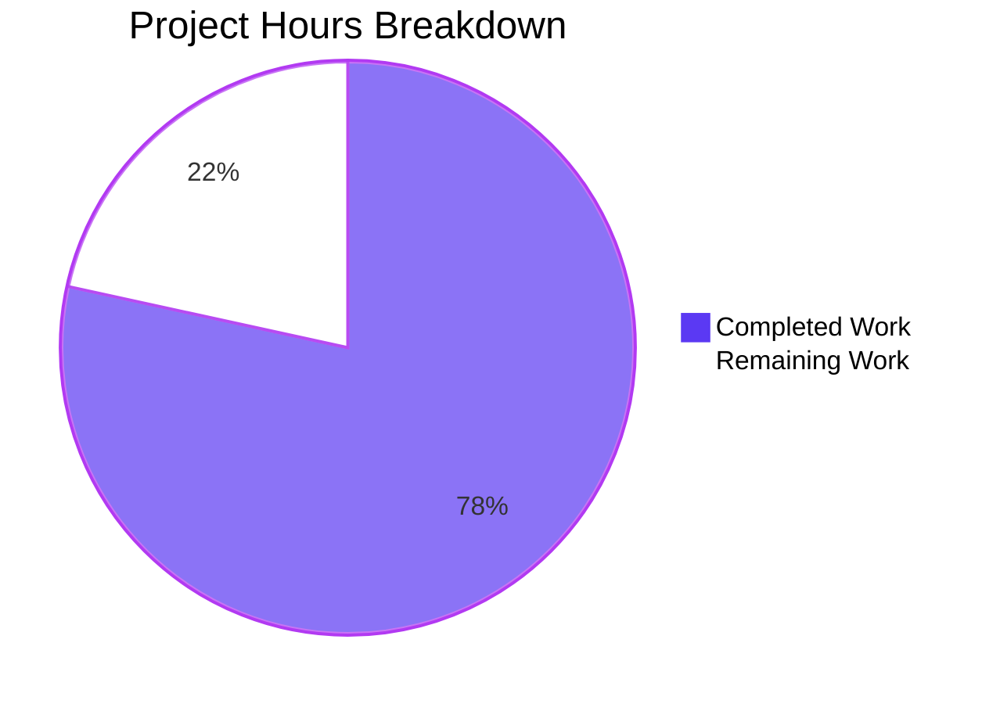

# 1. Executive Summary

## 1.1 Project Overview

`welcome.py` is a single-file Python program whose only job is to write the fixed line `Welcome to Blitzy` to standard output and exit with status 0 — 18 bytes, byte-exact, on any Python 3.11-or-later interpreter on Linux or macOS. Its readers are reviewers wanting one deterministic smoke check that an interpreter and a checkout work, and automation needing a fixed byte-and-status contract. The delivered scope is that program, a committed standard-library suite of ten tests, a test package marker and a README stating the run command, expected output, interpreter floor and failed-write behaviour. No dependency, no build step, no service, no port.

## 1.2 Completion Status

Every planned deliverable is complete and verified; the outstanding hours are hardening, documentation alignment and platform verification.



**78% complete — 40.0 of 51.0 hours.** Completion is `40.0 / (40.0 + 11.0) x 100 = 78%`.

| Metric | Hours |
|---|---:|
| Total Hours | 51.0 |
| Completed Hours (AI + Manual) | 40.0 |
| Remaining Hours | 11.0 |

## 1.3 Key Accomplishments

- **Byte-exact output** — 18 bytes, sha256 `2dc7e85a…1951`, empty standard error, exit 0, on every run.
- **A fixed failure contract** — one diagnostic line, exit status 1, never a traceback (`welcome.py:15-53`).
- **Argument and input agnosticism** — no argument, standard input, environment or network is read.
- **A silent import** — importing writes nothing on either stream (`welcome.py:73-74`).
- **A committed standard-library suite** — ten exact-equality tests in three classes (`tests/test_welcome.py`).
- **Discovery that cannot pass silently** — the zero-byte `tests/__init__.py` marker.
- **Documentation that matches the code** — `README.md` carries every required statement.
- **Failure paths that survive resource limits** — exhaustion and stream-less states still exit 1.

## 1.4 Critical Unresolved Issues

**4 open items — 3 of the 28 items the work was scoped against (4 file deliverables and 24 requirements) and 1 pre-existing document outside the plan's mapped set.**

| Issue | Impact | Owner | ETA |
|---|---|---|---|
| The hardened failure-path branches (descriptor exhaustion, the compound unwritable-stream state, the redirection guard's rejection branch) are exercised at run time but carry no committed test. | A future regression in those branches would not be caught by `python -m unittest discover`. | Repository owner | 4 h |
| The repository's only narrative guide, `blitzy/documentation/Project Guide.md`, still documents the removed JavaScript product: it publishes `node Welcome.js`, records an inventory that no longer exists and reports a completion figure for the wrong stack. | A reader who trusts the repository's own guide runs a command that fails. | Repository owner (decision: retire or regenerate) | 3 h |
| The Python 3.11 and 3.12 interpreter lines were never exercised. | The stated interpreter floor is unproven on the branches it names. | Repository owner / CI | 1 h |
| The macOS terminal was never exercised. | The second supported platform is unproven. | Repository owner | 1 h |

Two further categories need a decision but block nothing: the quality-gate posture and tree hygiene (Section 2.2).

## 1.5 Access Issues

| System/Resource | Type of Access | Issue Description | Resolution Status | Owner |
|---|---|---|---|---|
| Python 3.11/3.12 interpreters and a macOS host | Test environment | No interpreter of those versions and no macOS host are available, so the interpreter floor and the second platform are verified by inspection only. | Open — scheduled in Section 2.2 (2 h) | Repository owner |

No repository permissions, credentials or third-party API access are required: the product reads no secret and calls no service.

## 1.6 Recommended Next Steps

1. **[High]** Add committed tests for the hardened failure branches and the redirection guard, and move the suite statement in `README.md` with them (4 h).
2. **[High]** Retire or regenerate the superseded guide at `blitzy/documentation/Project Guide.md` (3 h).
3. **[Medium]** Run the suite and the acceptance checks on Python 3.11/3.12 and on macOS (2 h).
4. **[Low]** Record the standing quality-gate posture (1 h).
5. **[Low]** Remove the empty capture directories and settle the pre-existing `server.js` (1 h).

# 2. Project Hours Breakdown

## 2.1 Completed Work Detail

| Component | Hours | Description |
|---|---:|---|
| Program module — greeting constant, `main()` and the write path (F1–F3, N3, I9) | 4.0 | `MESSAGE` as the 17-character literal, `main()` writing it plus one LF and flushing, and the `__main__` guard that keeps imports silent (`welcome.py:10`, `56-70`, `73-74`). |
| Argument agnosticism and the absence of every input channel (F4, F5, I8) | 2.0 | No `sys.argv` read anywhere, and no standard input, file, environment or network read in the program. |
| Failed-write contract on both documented routes (F6, N4) | 4.5 | The `sys.stdout is None` route for a descriptor closed at exec and the `OSError` route for a broken pipe or a rejecting device, both reaching one diagnostic line and exit status 1 (`welcome.py:61-70`). |
| Failure-path resilience for resource-limited and stream-less states | 4.5 | A guarded descriptor retarget, a guarded diagnostic write and flush, and close fallbacks, with the single `raise SystemExit(1)` outside every guard so the fixed status survives descriptor exhaustion and a reader-less standard error (`welcome.py:15-53`). |
| Committed test suite — three classes, ten methods, both spawn helpers, exact-equality assertions (I2–I5, I7, N8) | 8.0 | `tests/test_welcome.py`: the in-process checks, the spawned process checks, both failed-write routes and both input states, with every output assertion an equality comparison. |
| Test-harness hardening — the redirection allow-list and the closed-descriptor invariant | 2.5 | Only the three supported shell redirections reach the command line, an unsupported value raising `ValueError` before the command is built; both pipe ends are closed on every path. |
| Test package marker and discovery wiring (I1) | 1.0 | The zero-byte `tests/__init__.py` that makes root-level discovery import the suite as `tests.test_welcome`. |
| README documentation contract (D4, I6, N2) | 2.0 | Run command, expected output with the 18-byte note, the Python 3.11-or-later floor, the test command with its run-from-root requirement, the ignored-arguments note and the failed-write behaviour. |
| Runtime verification of the behaviour contract and the acceptance evidence | 6.0 | Byte and digest checks, both failure routes, the argument and input matrices, the environment-independence run and the repeatability loop. |
| Style, docstring and comment conformance, with standard-library compilation checks (0.12.1, 0.12.2) | 2.5 | PEP 8 by inspection, module and `main()` docstrings, comments on the two non-obvious steps only, and warning-strict compilation of all three modules. |
| Deletion of the superseded JavaScript duplicate and tree-wide reference verification | 1.5 | `Welcome.js` removed from disk and index with no executable consumer left anywhere in the tree. |
| Delivery-record integrity for the pre-existing guide | 1.5 | `blitzy/documentation/Project Guide.md` present and byte-identical to its as-found content (381 lines, 35992 bytes, sha256 `a5575764aaf4146149c5f591abf214d3a4c3c3f061662e7701af8e88bb9804d5`). |
| **Total** | **40.0** | Equals Completed Hours in Section 1.2. |

## 2.2 Remaining Work Detail

| Category | Hours | Priority |
|---|---:|---|
| Documentation alignment — retire the superseded guide that documents the removed JavaScript product, or regenerate it for the delivered Python program. | 3.0 | High |
| Test coverage — add committed tests for the hardened failure-path branches (descriptor exhaustion, the compound unwritable-stream state) and the redirection guard's rejection branch, and move the README's suite statement with them. | 4.0 | Medium |
| Platform and interpreter verification — exercise the Python 3.11/3.12 lines and a macOS terminal. | 2.0 | Medium |
| Quality-gate decision — settle whether the project stays inspection-only for style and typing, or adopts a gate, and record the decision. | 1.0 | Low |
| Tree hygiene — remove the empty capture directories and document or remove the pre-existing `server.js`. | 1.0 | Low |
| **Total** | **11.0** | Equals Remaining Hours in Section 1.2 and the Remaining Work value in Section 7. |

# 3. Test Results

| Area / Category | Framework | Tests | Passed | Failed | Coverage | What This Proves |
|---|---|---:|---:|---:|---|---|
| Greeting constant | `unittest` (in-process) | 1 | 1 | 0 | Not measured | `MESSAGE` is exactly the fixed 17 characters, with no padding or embedded newline. |
| Greeting write path | `unittest` (in-process, redirected streams) | 3 | 3 | 0 | Not measured | `main()` writes exactly the expected 18 bytes, returns `None`, leaves standard error empty and is repeatable across calls. |
| Spawned process contract and arguments | `unittest` (`subprocess`, `sys.executable`) | 2 | 2 | 0 | Not measured | A fresh interpreter run produces exactly the expected 18 bytes, exit status 0 and empty standard error, and an argument-bearing run is identical to the plain one. |
| Silent import | `unittest` (`subprocess`) | 1 | 1 | 0 | Not measured | Importing the module writes nothing on either stream. |
| Failed write — closed pipe | `unittest` (`subprocess` over `os.pipe`) | 1 | 1 | 0 | Not measured | With no reader left, the process exits 1 and writes exactly the 51-byte diagnostic line to standard error. |
| Failed write — descriptor closed at exec | `unittest` (`subprocess` through the POSIX shell) | 1 | 1 | 0 | Not measured | The `sys.stdout is None` route reaches the same single diagnostic line and exit status 1. |
| Input independence | `unittest` (`subprocess`, two subTests) | 1 | 1 | 0 | Not measured | Binding standard input to the null device or closing it changes neither the output nor the status. |
| **Total** | — | **10** | **10** | **0** | — | Command: `python -m unittest discover` from the repository root — `Ran 10 tests` / `OK` / exit 0. |

Coverage is reported as not measured because the project permits no coverage tooling: it is standard library only, so behavioural coverage is demonstrated by the named assertions above, which between them reach every state the behaviour contract fixes.

**Not Covered**

- The hardened failure-path branches of `_fail_stdout()` — descriptor exhaustion, the compound state where both streams have no reader, and the two close fallbacks. They are exercised at run time but have no committed test, because the committed suite is fixed at three classes and ten methods; a human should add that coverage before relying on it as a regression net (Section 2.2, 4 h).
- The rejection branch of the suite's redirection guard, which raises `ValueError` for an unsupported redirection. Also runtime-proven only.
- The Python 3.11 and 3.12 interpreter lines. No interpreter of those versions is present, so the "3.11 or later" floor rests on the API surface being 3.11-safe by inspection; a human should run `python -m unittest discover` and the acceptance block on a 3.11 and a 3.12 interpreter.
- The macOS terminal. Every check ran on Linux; a human should repeat the suite and the acceptance block on macOS to confirm the platform half of the claim.
- The interpreter-below-the-floor state. It is documentation by design — `README.md:9` states that the program contains no version check — so there is no behaviour to test.
- The pre-existing `server.js`, which has no test and was never started; and `blitzy/documentation/Project Guide.md`, which is inert Markdown that no code path reads.

# 4. Runtime Validation & UI Verification

- ✅ **Program start-up and greeting** — `python welcome.py` writes exactly 18 bytes (sha256 `2dc7e85a734de043468d7beb8ee5294e0c04440f23fd89b69fd8ea0ee7971951`), with empty standard error and exit status 0.
- ✅ **Argument handling** — `python welcome.py ignored-argument` is byte-identical to the plain run, with the same status and empty standard error.
- ✅ **Import path** — `python -c "import welcome"` writes nothing on either stream and exits 0; `python -c "import welcome; print(welcome.MESSAGE)"` prints exactly `Welcome to Blitzy`.
- ✅ **Failed write, closed pipe** — a reader-less pipe exits 1 with exactly the 51-byte diagnostic line and no traceback (`python welcome.py | true`).
- ✅ **Failed write, descriptor closed at exec** — `python welcome.py >&-` exits 1 with the identical single line.
- ✅ **Failed write, rejecting device** — standard output directed at `/dev/full` exits 1 with the same single line.
- ✅ **Compound stream failure** — standard output and standard error both on a reader-less pipe exits 1 (`python welcome.py 2>&1 | head -c 0`).
- ✅ **Resource exhaustion** — with no free descriptor available, the handler still reaches its diagnostic and exit status 1.
- ✅ **Repeatability and environment independence** — repeated runs produce one digest, and `env -i python -I -S welcome.py` still writes the 18 bytes.
- ⚠ **Platform coverage** — verified on Linux with CPython 3.13.18; the Python 3.11/3.12 lines and macOS were not exercised.

**Never exercised at runtime.** The product has no browser, HTTP or graphical surface — its whole interface is the terminal's standard streams and the process exit status — so no screen, route, form or client-side flow was driven, and browser console or network activity does not apply. The pre-existing `server.js` was never started, because it binds a host-global port and belongs to no part of this deliverable; it is only parse-checked. `blitzy/documentation/Project Guide.md` is inert Markdown that no code path reads. The states in which no writable stream remains can only be observed as exit status 1 with empty standard error: no implementation can deliver a diagnostic line when no stream can carry it.

# 5. Compliance & Quality Review

## 5.1 Compliance Matrix

| # | Deliverable / Benchmark | Verified Status | Progress |
|---|---|---|---|
| 1 | `welcome.py` — functional contract (fixed greeting constant, argument-agnostic write, silent import) | PASS — `welcome.py:10`, `56-70`, `73-74` | ✅ Complete |
| 2 | Program structure and public interface (`MESSAGE`, `main()`, the `__main__` guard, no module-scope call) | PASS — one constant pair, one private helper, one callable, one guard | ✅ Complete |
| 3 | Output byte-exactness — 18 bytes, case-sensitive ASCII, one LF, nothing else ever on that stream | PASS — sha256 `2dc7e85a…1951`; the only stdout write is `welcome.py:64` | ✅ Complete |
| 4 | Failure disclosure and exit-status contract — one diagnostic line, status 1, no traceback, on both documented routes | PASS — `welcome.py:15-53`; two committed spawn-based tests | ✅ Complete |
| 5 | Standard-library-only constraint, no packaging metadata, no dependency manifest | PASS — imports are `os` and `sys`; no manifest, lock file, CI or container in the tree | ✅ Complete |
| 6 | Test package marker and discovery integrity (root-level discovery cannot collect nothing) | PASS — zero-byte `tests/__init__.py`; discovery runs ten tests | ✅ Complete |
| 7 | Committed suite and assertion standard — ten methods in three classes, exact-equality comparisons only | PASS — 25 `assertEqual`, 1 `assertIsNone`, no membership assertion (`tests/test_welcome.py`) | ✅ Complete |
| 8 | Documentation contract — run command, expected output, interpreter floor, test command, arguments and failure notes | PASS — `README.md` (all six statements present and matching observed behaviour) | ✅ Complete |
| 9 | Style and annotation standard — PEP 8 by inspection, docstrings on the public interfaces, comments only where they earn their place | PASS — ≤79 columns, no tabs or trailing whitespace, two comment blocks in the program | ✅ Complete |
| 10 | Security posture — no input, no secret, no file beyond the null device on the failure path, no dynamic evaluation, no network, no traceback disclosure | PASS — verified by tree sweep and by the failure-route runs | ✅ Complete |
| 11 | Platform and interpreter conformance — Linux and macOS terminals, Python 3.11 or later | PARTIAL — Linux with CPython 3.13.18 verified; the 3.11/3.12 lines and macOS unexercised | ⚠ Partial |
| 12 | Repository hygiene and documentation continuity | PARTIAL — the superseded guide is still published, two capture directories are empty and `server.js` is undocumented | ⚠ Partial |

## 5.2 AAP & Rule Divergences and Gaps

| What the AAP/Rule Required | What Was Delivered Instead | Why It Diverged | Impact | Remediation |
|---|---|---|---|---|
| The working directory holds no repository at all, so every file in the tree is a creation and "no existing file is modified, renamed or deleted"; code generation commits exactly the four mapped paths and nothing else. | A six-path change set: `welcome.py`, `tests/__init__.py` and `tests/test_welcome.py` created; `README.md` updated in place; `Welcome.js` deleted; `blitzy/documentation/Project Guide.md` present, byte-identical to its as-found content. `server.js` and the guide remain in the tree. | The checkout held pre-existing tracked content, which the plan's premise denies; the plan's operation set for the four deliverables and the on-disk state govern. | No delivered behaviour depends on it. The plan's description of the repository is inaccurate, so a reader applying it literally would expect a different operation set. | None in code. If the plan is reused, correct its premise about the checkout. |
| `README.md` mode CREATE — the plan maps the path as a pure creation. | Updated in place (`+49/-2`) over the tracked 58-byte stub for an unrelated project; no line of the stub survives. | The path already existed in the checkout. | None: every required statement is present and matches observed behaviour. | None. |
| Four mapped files, and no file the plan does not map reaches the user; nothing is deleted. | `Welcome.js` (one line, 34 bytes, `console.log('Welcome to Blitzy');`) deleted, with no replacement file added in its place; `server.js` and the guide remain in the tree. | The file was a stale JavaScript duplicate of the Python deliverable and the plan's operation set for this change removed it; it produced the identical 18 bytes, so no behaviour was lost. | None on behaviour. The tree carries two paths the plan does not map, one of which misdescribes the product. | Accept as delivered, and settle the pre-existing children (Section 2.2). |
| The failure helper's steps — make the descriptor safe, write the one line, exit 1 — and the requirement that the failure produce exactly one stderr line with no traceback. | The same three steps with every step guarded by `except OSError` (the only type caught), descriptor 2 retargeted when the diagnostic cannot be flushed, and the undeliverable buffered output discarded and the stream closed when no descriptor can be retargeted (`welcome.py:15-53`). | The bare three-step form loses the fixed line and the fixed exit status in resource-limited and stream-less states, while the requirement is that both hold in every state the handler is reached in. | None on any documented state, which are byte-identical; states outside the behaviour contract reach exit status 1 instead of an escaping exception. | None — the requirement is met; recorded for transparency. |
| A standing process rule asks for a no-fix linter pass over each modified file. | No linter, formatter, type checker or coverage tool was run; style was established by inspection and standard-library checks. | The standard-library-only constraint forbids third-party tooling and installation, and no linter is present; the plan's own quality standard directs inspection instead. **Sanctioned by the plan.** | Style assurance rests on inspection plus the committed suite, so drift cannot be caught mechanically. | Decide and record the gate posture (Section 2.2, 1 h). |
| Pre-existing files are left untouched, and the project produces no report or analysis beyond its four deliverables. | `blitzy/documentation/Project Guide.md` left exactly as found, including its 56 references to the deleted `Welcome.js` and its 18 `node Welcome.js` run commands. | The path is pre-existing content the deliverable set does not map, and its recorded disposition is "left untouched"; retiring it would edit a path the work does not own. | A reader who trusts the repository's only narrative document is sent to a command that fails and to a completion figure for the removed stack. **Blocks release.** | Retire it or regenerate it for the delivered Python program (Section 2.2, 3 h). |

**Divergence 1 — the plan's premise about the checkout (needs an owner decision).** The plan states that no repository is present, that all four files are creations and that nothing is modified or deleted. The checkout carried four pre-existing tracked paths, so `README.md` was updated in place, `Welcome.js` — a stale JavaScript duplicate of the delivered program — was deleted, and the pre-existing guide stands at its as-found content. The delivered artefacts match the plan's file plan exactly; only its description of the repository differs. The change set is therefore six paths rather than four, and two of them are paths the plan does not map. A human should record that the delivered operation set is the accepted one, and correct the premise if the plan is reused.

**Divergence 2 — `README.md` delivered as an update, not a creation (needs an owner decision).** The plan maps `README.md` as a creation, and it was instead rewritten in place over a tracked 58-byte stub belonging to an unrelated project (`# hao-backprop-test`). No line of that stub survives, and every statement the plan requires is present: the run command, the expected output with its 18-byte note, the Python 3.11 floor as a project requirement the program does not check, the test command with its run-from-root requirement, the ignored-arguments note and the failed-write behaviour. The reason is simply that the path was already occupied, and replacing its content was the only way to deliver the documentation contract. The owner needs only to note that the file's history begins with a stub replacement rather than a creation.

**Divergence 3 — a pre-existing JavaScript duplicate was deleted (needs an owner decision).** `Welcome.js` held one line, `console.log('Welcome to Blitzy');`, and produced the same 18 bytes as the delivered program; it was removed as part of the plan's operation set, and no replacement file was added in its place. Because the plan maps four files and states that nothing is deleted, the change set is one path wider than the plan describes. Nothing in the tree references the deleted file, no behaviour was lost, and the deletion is recoverable from history. Two pre-existing children the plan does not map — `server.js`, an HTTP demo binding a host-global port, and the guide discussed below — remain in the tree and should be accepted or documented deliberately.

**Divergence 4 — the superseded guide still ships (blocks release).** `blitzy/documentation/Project Guide.md` is 381 lines describing the removed JavaScript product: it names `Welcome.js` as the deliverable (line 5), publishes `node Welcome.js` as the run command (18 occurrences, now failing with `MODULE_NOT_FOUND`), records the inventory `README.md Welcome.js server.js`, keys its acceptance gate on the deleted file, asserts that the pre-existing `README.md` is untouched, and reports 83% completion for a stack the repository no longer contains. It is inert Markdown — no code path reads it and it holds no credential — which is why it is a documentation defect rather than a functional one. The owner must decide whether to retire it or regenerate it for the delivered program before release.

# 6. Risk Assessment

| Risk | Category | Severity | Probability | Mitigation | Status |
|---|---|---|---|---|---|
| A future change to the failure path could regress the resource-limited and stream-less branches, which no committed test covers. | Technical | Medium | Medium | Add the missing committed tests (Section 2.2, 4 h); until then treat `welcome.py:15-53` as change-sensitive and re-run the failure-route checks by hand. | Open |
| The repository's only narrative document still sends a reader to the removed JavaScript product and publishes a completion figure for it. | Operational / documentation | High | High | Retire or regenerate `blitzy/documentation/Project Guide.md` (Section 2.2, 3 h). | Open |
| Byte-exactness depends on the stream encoding the environment hands the interpreter, so a non-ASCII-compatible encoding changes the byte count while the characters stay correct. | Technical / integration | Low | Low | Take the acceptance digest in the ASCII-compatible environment `README.md` describes, and treat the encoding as the documented boundary of the 18-byte guarantee. | Accepted, documented boundary |
| The Python 3.11 floor and the macOS half of the platform claim rest on inspection, since only CPython 3.13.18 on Linux was exercised. | Technical | Medium | Medium | Run the suite and the acceptance block on 3.11, 3.12 and macOS (Section 2.2, 2 h). | Open |
| A non-`OSError` stream failure still surfaces as a traceback with exit status 1, because the catch is deliberately limited to `OSError`. | Technical | Low | Low | Accept the boundary or take a deliberate decision to widen the catch; widening it is not permitted by the current contract, which fixes the single catch type. | Accepted by design |
| No style, type or coverage gate exists, so drift is caught only by inspection and by the committed suite. | Technical / process | Low | Medium | Settle and record the gate posture (Section 2.2, 1 h). | Accepted by design |
| The pre-existing `server.js` binds a host-global port (`127.0.0.1:3000`) and is documented nowhere. | Operational | Low | Low | Never start it in a shared environment, as every check in this delivery did; document or remove it (Section 2.2, 1 h). | Open |
| Running the suite leaves untracked bytecode directories in the checkout, and no `.gitignore` may be added. | Operational | Low | Medium | Keep `__pycache__` out of commits and run with `PYTHONDONTWRITEBYTECODE=1`; clear the directories after edits made within the same second. | Accepted |

**Security assessment.** No live exposure exists: the program reads no input, holds no secret, opens no file other than the null device on its failure path, performs no dynamic evaluation, makes no network access and discloses no traceback on any documented route. The suite's shell spawn quotes both path operands and admits only three fixed redirection operators, so no injection path is reachable. The only security-adjacent residuals are the encoding lever and the catch boundary, both accepted rather than open defects. **Integration assessment.** There is no external integration: the product's whole interface is the terminal's standard streams and the process exit status, and no service, database, queue, credential or API key is involved anywhere in it.

# 7. Visual Project Status


**Completed = 40.0 h (dark blue, `#5B39F3`) · Remaining = 11.0 h (white, `#FFFFFF`) · 78% complete.**

| Remaining Category | Hours | Priority |
|---|---:|---|
| Documentation alignment — retire or regenerate the superseded guide | 3.0 | High |
| Test coverage — committed tests for the hardened failure branches and the redirection guard | 4.0 | Medium |
| Platform and interpreter verification — Python 3.11/3.12 and macOS | 2.0 | Medium |
| Quality-gate posture | 1.0 | Low |
| Tree hygiene — empty capture directories and the undocumented `server.js` | 1.0 | Low |
| **Total** | **11.0** | — |

Priority distribution of the remaining work: 3.0 h High, 6.0 h Medium, 2.0 h Low.

# 8. Summary & Recommendations

The repository now holds a complete, verified small program. `welcome.py` writes the fixed line `Welcome to Blitzy` followed by one line feed — 18 bytes, sha256 `2dc7e85a734de043468d7beb8ee5294e0c04440f23fd89b69fd8ea0ee7971951` — leaves standard error empty and exits 0; it reads no argument, no standard input, no environment variable and no file, and importing it writes nothing on either stream. When standard output cannot be written, on either of the two routes the contract fixes, it writes exactly one diagnostic line and exits 1 with no traceback. A committed standard-library suite of ten tests in three classes proves the exact bytes, the exit statuses, the argument and input cases, the silent import, the repeatability and both failed-write routes, with every output comparison an exact-equality assertion. `README.md` states the run command, the expected output, the interpreter floor, the test command and the failure behaviour, and nothing in the repository requires an install, a build, a service or a port.

Verification was exercised end to end rather than argued: `python -m unittest discover` from the repository root reports `Ran 10 tests` / `OK` / exit 0; the greeting is 18 bytes with the digest above; the argument-bearing run is byte-identical to the plain one; the import is silent; `python welcome.py >&-` and a reader-less pipe each exit 1 with exactly the 51-byte diagnostic line; a rejecting device, descriptor exhaustion and the compound case where neither stream has a reader also reach exit status 1; repeated runs produce one digest; and a scrubbed environment still writes the same 18 bytes. The project stands at **78% complete** against its AAP-scoped work universe — 40.0 of 51.0 hours — with every planned deliverable and every fixed requirement met; the remaining 11.0 hours are hardening, documentation alignment and verification this environment cannot perform.

Three items carry the critical path to release. The first is the superseded guide at `blitzy/documentation/Project Guide.md`: it still presents the removed JavaScript product as the deliverable, publishes `node Welcome.js` as the run command and reports a completion figure for a stack the repository no longer contains, so a reader who trusts the repository's own narrative is misdirected; retiring it or regenerating it for the delivered program is 3 hours of work and the sole release-blocking divergence. The second is regression protection for the hardened failure branches and the redirection guard, which are exercised at run time but carry no committed test; adding that coverage and moving the suite statement in `README.md` with it is 4 hours. The third is platform verification — the Python 3.11/3.12 lines and a macOS terminal — at 2 hours. Two further hours cover a quality-gate decision and tree hygiene.

| Metric | Value |
|---|---|
| AAP-scoped completion | 78% (40.0 of 51.0 hours) |
| Planned deliverables complete | 4 of 4 |
| Committed tests, all passing | 10 of 10 (`python -m unittest discover`, exit 0) |
| Output bytes and digest | 18 bytes, sha256 `2dc7e85a734de043468d7beb8ee5294e0c04440f23fd89b69fd8ea0ee7971951` |
| Mapped items delivered | 28 of 28 (4 deliverables and 24 requirements), 3 of them carrying an open thread |
| Open items | 4 (3 mapped items plus one pre-existing document) |
| Remaining hours | 11.0 (3.0 High, 6.0 Medium, 2.0 Low) |

**Production readiness: ready to adopt, with one release-blocking documentation decision outstanding.** The delivered program does exactly what its contract fixes, on evidence that can be reproduced with two commands from the repository root, and it carries no dependency, no configuration, no secret and no external integration to manage. Adopting it means accepting the two partial rows in Section 5.1: the platform claim is verified on one interpreter line on one platform, and the repository still publishes a superseded guide alongside the delivered product. Neither affects the program's behaviour; both are settled by the short tasks in Section 2.2, and the documentation decision — retire or regenerate that guide — should be taken before anyone accepts the repository from its own narrative.

# 9. Development Guide

## 9.1 System Prerequisites

- **Interpreter:** Python 3.11 or later on `PATH` as `python` (an alias `python3` is equivalent on most systems). Verified on CPython 3.13.18 — `python --version` prints `Python 3.13.18`.
- **Platform:** a Linux or macOS terminal. Windows is not a supported target.
- **Shell:** any POSIX shell (`/bin/sh`, `bash`, `zsh`).
- **Anything else:** nothing. No package manager step, no build tool, no compiler, no database, no container runtime, no service to start and no port to open.

## 9.2 Environment Setup

Clone the repository and change into it — that is the whole setup:

```bash
git clone <your-remote> && cd <repository>
python --version          # expect Python 3.11 or later
```

Do not create a virtual environment inside the checkout, and do not run `pip install`, `npm install` or any packaging command: the project declares no dependency, carries no manifest and must not gain one. The program's imports are `os` and `sys` only, and the suite's are standard library modules, so neither command needs anything installed.

## 9.3 Dependency Installation

None. There is no dependency to resolve, no manifest, no lock file and no installation step. If a step appears to require one, the checkout is not the one described here.

## 9.4 Application Startup Sequence

The program runs in place, from the repository root:

```bash
cd <repository>
python welcome.py
```

Expected result: `Welcome to Blitzy` on standard output, nothing on standard error, and exit status 0. There is no start-up order to follow, no background process, no configuration to load and no service to wait for — the interpreter running `welcome.py` is the whole application.

## 9.5 Verification Steps

```bash
# Step 1 — every module parses and compiles
python -m py_compile welcome.py tests/__init__.py tests/test_welcome.py   # expect exit 0, no output

# Step 2 — the committed suite, which is the project's verification gate
python -m unittest discover        # expect: Ran 10 tests ... OK, exit 0

# Step 3 — the output contract, byte for byte
python welcome.py | wc -c                              # expect 18
python welcome.py 2> err.bin; wc -c < err.bin          # expect 0; then delete err.bin
python welcome.py > out.bin && sha256sum out.bin       # expect 2dc7e85a734de043468d7beb8ee5294e0c04440f23fd89b69fd8ea0ee7971951

# Step 4 — arguments and import are inert
python welcome.py ignored-argument                     # identical output, exit 0
python -c "import welcome"                             # no output, exit 0
python -c "import welcome; print(welcome.MESSAGE)"     # prints Welcome to Blitzy
```

## 9.6 Example Usage

Run the program and check the status in one line:

```bash
python welcome.py; echo "exit=$?"        # Welcome to Blitzy  /  exit=0
```

Use it as a smoke check that an interpreter and a checkout work:

```bash
python welcome.py > /dev/null && echo "interpreter OK"
```

Exercise the failure contract, which the program owns:

```bash
python welcome.py >&- ; echo "exit=$?"   # one diagnostic line on stderr, exit=1
python welcome.py | true; echo "${PIPESTATUS[0]}"   # 1
```

## 9.7 Troubleshooting

| Symptom | Cause and resolution |
|---|---|
| `ImportError: Failed to import test module: test_welcome` … `ModuleNotFoundError: No module named 'welcome'` | The suite was started from inside `tests/`, so the repository root is not on `sys.path`. Run `python -m unittest discover` from the repository root, as `README.md` instructs. |
| The suite fails on the exact-stderr assertions immediately, before any test body runs | A noisy interpreter start-up is writing to standard error. The apt-installed Python 3.14 line prints a 297-byte traceback from `distutils-precedence.pth` at every start-up; use the `python`/`python3` on `PATH` (3.13.18 here), or prepend `SETUPTOOLS_USE_DISTUTILS=stdlib` if that interpreter must be used. |
| `__pycache__/` appears in `git status` after a test run | Normal interpreter behaviour, and the project ships no `.gitignore` and must not gain one. Run with `PYTHONDONTWRITEBYTECODE=1`, keep the directories out of commits, and clear them after editing a module twice within the same second so stale bytecode cannot shadow the edit. |
| The digest check fails while the output text looks right | A non-ASCII-compatible stream encoding changes the byte count of the same 17 characters. Take the digest in the ASCII-compatible locale `README.md` describes; do not set `PYTHONIOENCODING` to an unusual codec. |
| The suite reports `Ran 0 tests` | The `tests/__init__.py` marker is missing or the command is being run from the wrong directory. It must be run from the repository root with the marker present. |
| `python: command not found` | Some systems install only `python3`. Use `python3 welcome.py` and `python3 -m unittest discover`; the code itself is identical under either name. |

# 10. Appendices

## A. Command Reference

All commands run from the repository root. Every one was executed against the delivered tree.

| Command | Purpose | Expected result |
|---|---|---|
| `python --version` | Confirm the interpreter floor | `Python 3.11` or later |
| `python -m py_compile welcome.py tests/__init__.py tests/test_welcome.py` | Parse and compile every module | exit 0, no output |
| `python -m unittest discover` | Run the committed suite — the project's verification gate | `Ran 10 tests` … `OK`, exit 0 |
| `python -m unittest tests.test_welcome` | Run the suite by module name | `Ran 10 tests` … `OK` |
| `python -m unittest discover -s tests -t .` | Run discovery with the package root stated explicitly | `Ran 10 tests` … `OK` |
| `python welcome.py` | Run the program | `Welcome to Blitzy`, exit 0 |
| `python welcome.py \| wc -c` | Byte-count the output | `18` |
| `python welcome.py > out.bin && sha256sum out.bin` | Verify the exact output bytes | `2dc7e85a734de043468d7beb8ee5294e0c04440f23fd89b69fd8ea0ee7971951` |
| `python welcome.py 2> err.bin; wc -c < err.bin` | Confirm standard error stays empty | `0` |
| `python welcome.py ignored-argument` | Confirm arguments are ignored | identical output, exit 0 |
| `python -c "import welcome"` | Confirm the import is silent | no output, exit 0 |
| `python -c "import welcome; print(welcome.MESSAGE)"` | Inspect the greeting constant | `Welcome to Blitzy` |
| `python welcome.py >&-` | Exercise the descriptor-closed failure route | exit 1, exactly the 51-byte diagnostic line on standard error |
| `python welcome.py \| true` | Exercise the broken-pipe failure route | `PIPESTATUS[0]` = 1 |
| `python welcome.py 2>&1 \| head -c 0` | Exercise the compound failure route | `PIPESTATUS[0]` = 1 |

## B. Port Reference

The project binds no TCP or UDP port, starts no service, database, broker or container, and needs no port reservation in any environment. One caveat: the pre-existing `server.js` hardcodes `127.0.0.1:3000` with no override and is not part of this deliverable — never start it, especially not in a shared environment where that port is host-global.

## C. Key File Locations

| Path | Role |
|---|---|
| `welcome.py` | The program: `MESSAGE`, `STDOUT_FAILURE`, `_fail_stdout()`, `main()` and the `__main__` guard. |
| `tests/__init__.py` | Zero-byte package marker; makes root-level discovery reach the suite. |
| `tests/test_welcome.py` | The committed suite: three classes, ten tests, the two spawn helpers and the redirection allow-list. |
| `README.md` | The documentation contract: run command, expected output, interpreter floor, test command, arguments and failure notes. |
| `server.js` | Pre-existing HTTP demo, unmodified and unstarted; not part of the deliverable. |
| `blitzy/documentation/Project Guide.md` | Pre-existing document describing a removed JavaScript product; inert, and the subject of the open documentation decision in Section 1.4. |

## D. Technology Versions

| Component | Version | Note |
|---|---|---|
| Python | 3.11 or later required; verified on CPython 3.13.18 | The floor is declared in `README.md:7` and is not checked by the program (`README.md:9`). |
| Standard library modules | `os`, `sys` (program); `io`, `os`, `shlex`, `subprocess`, `sys`, `unittest`, `contextlib`, `pathlib` (tests) | Every one predates 3.11 and none is deprecated. |
| Third-party dependencies | none | No manifest, lock file or install step exists. |
| Build tooling | none | Nothing is built, bundled or published. |
| Test runner | `unittest` from the standard library | Invoked as `python -m unittest discover`. |

## E. Environment Variable Reference

The program reads no environment variable — `welcome.py` consults neither `os.environ` nor the command line. The variables below are interpreter controls that change how the delivered commands behave, and are worth knowing when a check appears to fail for environmental reasons.

| Variable | Effect |
|---|---|
| `PYTHONIOENCODING` | Sets the standard-stream encoding. An ASCII-compatible value (the default in the supported locales) keeps the output at 18 bytes; a non-ASCII-compatible codec changes the byte count while the characters stay correct. |
| `PYTHONDONTWRITEBYTECODE` | Set it to `1` to stop the interpreter writing `__pycache__` directories into the checkout when running the suite. |
| `PYTHONUTF8` | Forces UTF-8 for the standard streams; harmless for this output, which is pure ASCII. |
| `SETUPTOOLS_USE_DISTUTILS` | Only relevant if the apt-installed Python 3.14 line is used: set it to `stdlib` to suppress that interpreter's start-up traceback from `distutils-precedence.pth`. |

## F. Developer Tools Guide

- **Interpreter as the whole toolchain.** `python -m py_compile` for a syntax gate and `python -m unittest discover` for behaviour are the two commands the project needs; both ship with the interpreter.
- **No linter, formatter, type checker or coverage tool.** The project is standard library only, so none may be installed. Style is held by inspection against PEP 8 — four-space indentation, imports one per line at the top, two blank lines around top-level definitions, `snake_case` names, lines within 79 columns, no tabs, no trailing whitespace, one trailing newline — and by the committed suite.
- **Editing the program.** Keep the greeting to the single `MESSAGE` literal and the diagnostic to `STDOUT_FAILURE`, keep every non-greeting write off standard output, and leave `raise SystemExit(1)` outside any guard so the fixed exit status cannot be lost. Comments belong only on steps whose reason is not visible in the code.
- **Editing the suite.** Use `sys.executable` for spawns, resolve the program through `ROOT` rather than the working directory, close the pipe's read end before the spawn so a broken pipe is reproducible, and assert `returncode`, `stdout` and `stderr` together with exact comparisons. New shell redirections must be added to the allow-list tuple rather than passed as raw text.
- **Keeping the checkout clean.** Running anything leaves `__pycache__` directories behind and no `.gitignore` may be added, so remove them or export `PYTHONDONTWRITEBYTECODE=1` before committing.

## G. Glossary

| Term | Meaning here |
|---|---|
| AAP | The plan of record for this project: its requirements, its deliverables and the acceptance evidence they answer to. |
| Byte-exact | The output is compared byte for byte, not as a substring: 18 bytes, case-sensitive ASCII, one trailing LF. |
| Exit status | The process's return code: 0 on a successful run, 1 when standard output cannot be written. |
| Descriptor | The operating-system handle behind a standard stream — 1 for standard output, 2 for standard error. |
| Closed pipe | A standard output whose reader has gone; writing to it raises `BrokenPipeError`, a subclass of `OSError`. |
| `/dev/null` | The null device, written to on the failure path so the interpreter's shutdown flush of a dead stream cannot raise again. |
| Diagnostic line | The single fixed message `welcome.py: error: cannot write to standard output` — the whole of the product's standard-error output. |
| Silent import | Importing the module writes nothing on any stream and performs no other side effect, so the message stays testable. |
| Exact-equality assertion | `assertEqual`/`assertIsNone` comparisons, never a membership or truthiness check, so a partial match cannot pass. |
| Discovery | `python -m unittest discover`, which walks the repository root for test modules; the zero-byte `tests/__init__.py` marker is what lets it reach this suite. |
