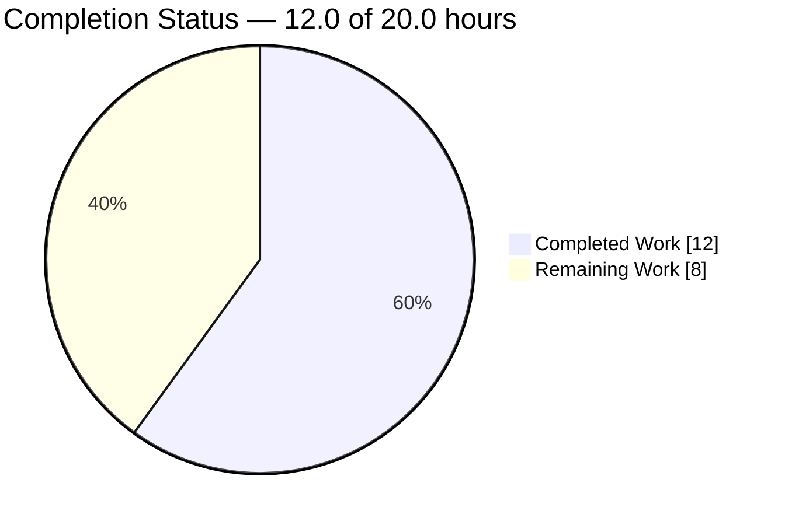
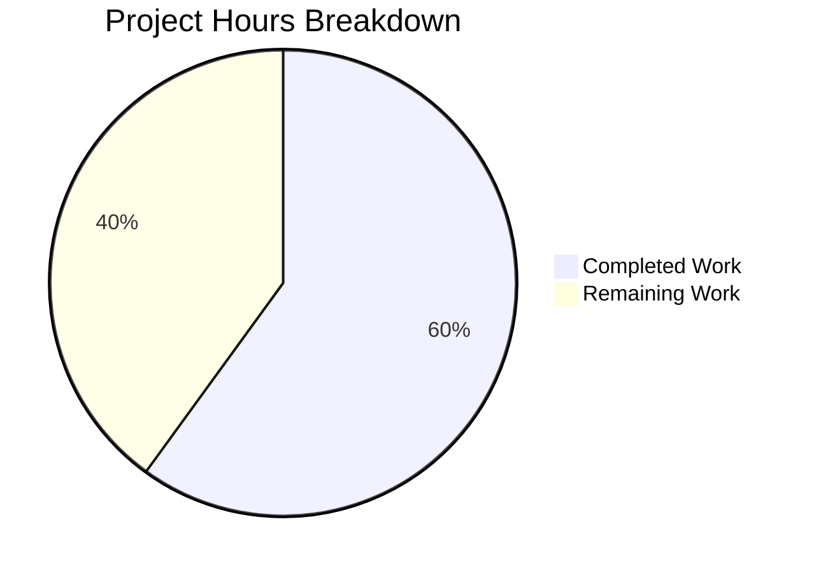

# 1. Executive Summary

## 1.1 Project Overview

The repository is one small Python program and the tests that pin it. `welcome.py` writes `Welcome to Blitzy` and exits 0, or writes one 51-byte diagnostic and exits 1 when that stream cannot be written; ten cases in three classes hold every byte and status in place, and a pre-existing Node script answers every request on `127.0.0.1:3000` with a reply nothing references. This work made the checkout readable without opening the code: nine documentation lines inside three existing files cover the module docstring, the demo header and both test helpers' contracts, with no output byte, exit status, name or signature changed.

## 1.2 Completion Status



**60% complete** — 12.0 hours delivered of 20.0 total, computed as 12.0 ÷ 20.0 × 100 = 60.0%.

| Metric | Value |
|---|---|
| Total Hours | 20.0 |
| Completed Hours (Baseline: Human with agentic-assist) | 12.0 |
| Remaining Hours | 8.0 |
| Percent Complete | 60.0% |

Every documentation unit and gate row is verified; the remaining 8.0 hours close the gaps costed in Section 2.2.

## 1.3 Key Accomplishments

- Ten of ten documentation units complete — `welcome.py:5`, `server.js:1-5`, `tests/test_welcome.py:39,81-82`.
- Documentation-only change: 9 insertions, 0 deletions, three existing files, nothing added or deleted.
- Invariance proven: docstring-stripped syntax trees identical to the pre-delivery commit; demo code lines byte-identical.
- Contract re-measured: 18 bytes, matching checksum, exit 0; failed write → one 51-byte diagnostic, exit 1.
- Suite green: 10 tests in 3 classes, `OK`, exit 0 from the repository root.
- Style by inspection: ≤77 columns, no tabs, no trailing whitespace, RST double backticks, plain quoted JavaScript.
- No dependency, tooling or configuration change; the header-bearing script still parses under `node --check`.
- Reference contracts verified, not rewritten: `README.md`'s six headings and the 0-byte package marker.

## 1.4 Critical Unresolved Issues

Five open items, none an outstanding deliverable: all 27 requirements and all ten documentation units are complete. Each is a gap the request excluded, costed in Section 2.2.

| Issue | Impact | Owner | ETA |
|---|---|---|---|
| `blitzy/documentation/Project Guide.md` still publishes `node Welcome.js`, a file deleted in commit `0e0430f`, in 56 references | A reader following the repository's own record gets `MODULE_NOT_FOUND` | Repository owner | Next release |
| The failure-path fallbacks at `welcome.py:32-35`, the `sys.stderr is None` branch at `:36`, and `:45-53` are exercised by no test | The documented fallbacks can regress unnoticed | Maintainer | Next sprint |
| No `timeout=` on the four subprocess spawns (`tests/test_welcome.py:52,63,92,150`) | A wedged child hangs the only release gate instead of failing it | Maintainer | Next sprint |
| The documented `ValueError` guard in `run_program_through_shell` (`tests/test_welcome.py:84-88`) is never exercised | A regression in the redirection allow-list would pass the suite | Maintainer | Next sprint |
| `blitzy/documentation/Project Guide - d45b6a30-593e-4d39-b896-975c37bb7086.md` still states `server.js` "is documented nowhere" | The tracked record contradicts the delivered header | Repository owner | Backlog |

## 1.5 Access Issues

No access issues identified. Nothing needs a credential, service, database or environment variable; every check runs in the checkout on the standard library and one Node built-in.

## 1.6 Recommended Next Steps

1. **[High]** Retire or regenerate the record that publishes `node Welcome.js` (3.0 h).
2. **[High]** Test the three unexercised failure branches of `welcome.py` (2.5 h).
3. **[Medium]** Bound the suite's four spawns with `timeout=` (1.0 h).
4. **[Medium]** Add an `assertRaises` case for the redirection allow-list (0.5 h).
5. **[Low]** Reconcile the second record's stale statements and record the verified runtime versions and the shell the suite requires in `README.md` (1.0 h).

# 2. Project Hours Breakdown

## 2.1 Completed Work Detail

| Component | Hours | Description |
|---|---|---|
| Documentation inventory and gap analysis | 3.0 | Ten documentation units audited across the four in-boundary files, four gaps isolated (G1–G4), twenty by-decision symbols confirmed as needing no docstring, and the repository's own convention read off `welcome.py` and `tests/test_welcome.py` (§0.2.2, §0.3.2–§0.3.4, §0.4.1). |
| Module docstring completion (`welcome.py:5`) | 0.5 | One line naming the role of `MESSAGE` and `STDOUT_FAILURE`, added inside the existing module docstring before its closing delimiter (G1, §0.4.3). |
| Demo-server file header (`server.js:1-5`) | 1.5 | Five comment lines directly above `const http = require('http');`, stating the bound address and port, the response returned for every request, the start command, and that nothing in `welcome.py`, the test suite or `README.md` refers to the file; no purpose asserted (G2, §0.4.3, §0.6.2). |
| Test-helper docstrings (`tests/test_welcome.py:39,81-82`) | 0.5 | One line stating what `run_program`'s `*args` carries and two lines naming `run_program_through_shell`'s returned tuple (G3, G4, §0.4.3). |
| Diff-invariance harness and release gate | 3.5 | Docstring-stripped syntax-tree equality for both Python files, comments-only composition of the JavaScript addition, diff inventory and zero-deletion checks, line-length/tab/whitespace inspection, and the gate ordering that measures the diff before any commit (§0.5.1–§0.5.3). |
| Gate execution and contract re-verification | 2.0 | Ten-test suite run from the repository root, the 18-byte success payload with its checksum and exit status 0, the 51-byte diagnostic with exit status 1, and the JavaScript parse gate (§0.5.2 checks 1–3, §0.11.1). |
| Reference-contract verification | 1.0 | `README.md`'s byte, status and test-count claims re-checked against observed behaviour, the zero-byte package marker confirmed absent from the diff, and the two excluded narrative records left byte-identical (§0.4.4, §0.7.1). |
| **Total Completed** | **12.0** | |

## 2.2 Remaining Work Detail

| Category | Hours | Priority |
|---|---|---|
| Retire or regenerate the tracked record that publishes `node Welcome.js`, a file deleted in `0e0430f` (path to production) | 3.0 | High |
| Test the three unexercised `welcome.py` failure branches: stdout-close fallback (`:32-35`), `sys.stderr is None` (`:36`), stderr retarget/close (`:45-53`) (path to production) | 2.5 | High |
| Bound the suite's four subprocess spawns with `timeout=` (`tests/test_welcome.py:52,63,92,150`) (path to production) | 1.0 | Medium |
| Exercise the documented `ValueError` guard in `run_program_through_shell` (`tests/test_welcome.py:84-88`) with an `assertRaises` case (path to production) | 0.5 | Medium |
| Reconcile the second tracked record's stale `server.js` statements, and bring `README.md` up to date with the verified interpreter and Node versions and the shell the suite requires (path to production) | 1.0 | Low |
| **Total Remaining** | **8.0** | |

Hours validation: Section 2.1 sums to 12.0, Section 2.2 sums to 8.0, and 12.0 + 8.0 = 20.0 total project hours, giving 12.0 ÷ 20.0 × 100 = 60.0% complete — the same figures stated in Section 1.2 and plotted in Section 7. The five remaining categories are repository-level path-to-production needs around a documentation deliverable that is itself complete; none of them is an undelivered requirement of the work.

# 3. Test Results

Every figure below was observed in this assessment by running the project's own gate from the repository root.

| Area / Category | Framework | Tests | Passed | Failed | Coverage | What This Proves |
|---|---|---|---|---|---|---|
| Program contract — exact bytes, exit status, argument indifference, silent import, failed write (`tests/test_welcome.py`) | Python `unittest`, standard library | 10 | 10 | 0 | Not measurable: no coverage tool is installed or permitted on this standard-library-only project | Every output byte, exit status and silent-import guarantee `README.md` makes holds when the program is executed as a process, including both failure routes the suite can reach |
| JavaScript parse gate (`server.js`) | Node.js `node --check` | 1 file | 1 | 0 | Not applicable — a syntax check, not a behavioural test | The five-line header leaves the demo script syntactically valid and its code lines unchanged |

Suite detail observed: `Ran 10 tests in 0.102s`, `OK`, exit status 0. The ten cases are `MessageConstantTests` (1 case, the greeting constant is exact and unpadded), `MainCallableTests` (3 cases: exact bytes, nothing on standard error, repeatability) and `ProcessBehaviourTests` (6 cases: exit status with exact stdout, ignored command-line arguments, silent import, an unwritable pipe, a closed standard-output descriptor, and empty or absent standard input).

Program contracts re-measured alongside the suite: `python welcome.py` writes 18 bytes with sha256 `2dc7e85a734de043468d7beb8ee5294e0c04440f23fd89b69fd8ea0ee7971951` and exits 0; `python welcome.py >&-` and `python welcome.py >/dev/full` each exit 1 with exactly one 51-byte diagnostic on standard error and no traceback.

## Not Covered

The following were delivered or documented but are exercised by no test. Each is a human check before release.

- **`welcome.py` failure-path fallbacks.** `welcome.py:32-35` (the stream close after a failed `/dev/null` retarget), the `sys.stderr is None` branch at `:36` (descriptor 2 closed), and `:45-53` (the stderr retarget and close after an undeliverable diagnostic) are reached by no committed test. The two routes that are reachable — a closed standard-output descriptor and an unwritable pipe — are both covered.
- **`server.js` behaviour.** The demo script has no test and was never started, because starting it binds the host-global `127.0.0.1:3000`. Its header describes a response nothing has observed at runtime; only its syntax has been checked.
- **The assertion at `tests/test_welcome.py:162`.** It compares the helper's stdout against the `b""` that the helper itself returns on that branch, so it cannot fail; the other two assertions in that case are genuine.
- **The `ValueError` guard at `tests/test_welcome.py:84-88`.** The redirection allow-list is documented but never exercised: the suite contains no `assertRaises`.
- **The nine documentation lines as prose.** No test asserts documentation text. Their accuracy rests on the syntax-tree comparison (which proves no executable statement changed) and on reading each sentence against the line that establishes it; a wording defect would pass every automated check.
- **Any coverage percentage.** No coverage tool exists and none may be installed, so no coverage number can be stated for this project.
- **Non-POSIX platforms.** The suite reaches the closed-descriptor route through the shell's `exec` builtin and the `>&-` and `<&-` redirections (`tests/test_welcome.py:26-28,89-94`), so it is POSIX-only and has been exercised on no other platform.
- **Untested human check before release:** decide whether the demo script earns its place at all, and if it does, exercise it on an isolated host where port 3000 is not shared.

# 4. Runtime Validation & UI Verification

Runtime checks were driven directly from the repository root; each line states what was observed.

- ✅ **Program startup and success path** — `python welcome.py` writes 18 bytes (`Welcome to Blitzy` plus one line feed), writes nothing to standard error, and exits 0.
- ✅ **Failed write, closed descriptor** — `python welcome.py >&-` exits 1 with exactly one 51-byte diagnostic line on standard error and no traceback.
- ✅ **Failed write, full device** — `python welcome.py >/dev/full` exits 1 with the same single 51-byte diagnostic.
- ✅ **Argument indifference** — `python welcome.py ignored-argument` produces output byte-identical to the bare run.
- ✅ **Silent import** — `python -c "import welcome"` produces no output on any stream and exits 0.
- ✅ **Test suite** — `python -m unittest discover` from the repository root reports `Ran 10 tests`, `OK`, exit 0.
- ✅ **Discovery scope** — the same command run from inside `tests/` fails on the import, which is the run-from-root requirement `README.md` documents.
- ✅ **JavaScript parse gate** — `node --check server.js` exits 0 with no output, so the header-bearing script parses.
- ⚠ **Demo HTTP surface** — never started: it binds the host-global `127.0.0.1:3000`, so no request has been sent and its status-200, `text/plain`, `Hello, World!` response has never been observed at runtime; only its syntax is verified.
- ❌ **UI / browser** — no interface exists in this project. There is no screen, route, client asset or endpoint a browser could drive, so no browser verification applies.

No service, container, database or external integration was started or contacted: the project has none. The three standard streams, both exit statuses and both failure routes are the entire runtime surface, and each was exercised above.

# 5. Compliance & Quality Review

## 5.1 Compliance Matrix

| Deliverable | Benchmark | Status | Progress |
|---|---|---|---|
| Module docstring names the role of both constants (`welcome.py:5`) | Documentation completeness — every item the request names for the unit | Pass | ✅ 100% |
| Existing `_fail_stdout()` and `main()` docstrings and the four reason-bearing comment blocks | No reflow of documentation that already reads correctly | Pass | ✅ 100% |
| Demo-server header, five comment lines (`server.js:1-5`) | Documentation completeness with a five-line cap | Pass | ✅ 100% |
| Suite module docstring and the three class invariants | Confirmed complete and left byte-identical | Pass | ✅ 100% |
| `run_program` documents what `*args` carries (`tests/test_welcome.py:39`) | Helper contract completeness | Pass | ✅ 100% |
| `run_program_through_shell` documents its return value (`tests/test_welcome.py:81-82`) | Helper contract completeness | Pass | ✅ 100% |
| Package marker stays at zero bytes (`tests/__init__.py`) | Repository hygiene — packaging semantics preserved | Pass | ✅ 100% |
| `README.md` verified against observed behaviour, unmodified | User-facing contract accuracy | Pass | ✅ 100% |
| Documentation-only change surface: 9 insertions, 0 deletions, 3 existing files | Change discipline — no file created, renamed or deleted | Pass | ✅ 100% |
| Behaviour invariance: docstring-stripped syntax trees identical, demo code lines byte-identical | No output byte, exit status, name, signature or runtime behaviour changed | Pass | ✅ 100% |
| Style: ≤79 columns, no tabs, no trailing whitespace, single trailing newline, RST double backticks, plain quoted text in JavaScript | The repository's own inspection standard | Pass | ✅ 100% |
| Deferred repository gaps: failure-branch tests, spawn timeouts, two stale narrative records | Release readiness of the surrounding repository | Open — outside the requested boundary | ⚠ 0% |

Eleven of twelve rows pass. The single open row is the five path-to-production items of Section 2.2, none of which the request placed in scope.

## 5.2 AAP & Rule Divergences and Gaps

Two divergences were identified, both against the plan that specified this work and neither against a user rule: the project was given no user-specified rules, so no rule could be departed from.

| What the AAP/Rule Required | What Was Delivered Instead | Why It Diverged | Impact | Remediation |
|---|---|---|---|---|
| §0.4.3's literal header text wraps the start command in backticks: ``// Start it with `node server.js`.`` | `server.js:4` reads `// Start it with 'node server.js'.  Nothing in welcome.py, the test suite or` — single quotes, no backticks | The same plan's §0.11.3 Format requires "No Markdown" and §0.6.3 requires plain quoted text inside the JavaScript comment, where backticks would read as code. No text satisfies all three clauses, so the two explicit format clauses govern and the literal is superseded in its two quoting characters only. | Two characters differ from the plan's verbatim block. No behavioural, parse or style consequence: header backtick count 0, line 4 is 76 columns, `node --check server.js` exits 0, and every code line is identical to the pre-delivery baseline. | Sanctioned by the governing format clauses. No code change is needed; align the plan's literal to single quotes when it is next regenerated. |
| §0.8.1 records "CPython 3.12.3" and "Node.js v22.23.4" as the environment the work runs in | The delivery host reports CPython 3.13.18 for both `python` and `python3` (a second interpreter line reports 3.14.4) and Node v22.23.5; no CPython 3.12 exists on the host | The table's cells are measurements taken when the plan was written. No repository file carries either value, and the plan forbids creating a file to carry a correction — the same instruction that keeps the diff documentation-only. | A reader of the plan may target an interpreter the project never ran on. The project's actual requirement — Python 3.11 or later, `README.md:7`, with no version check in the program — is met by every interpreter present, and the contract reproduces identically on 3.13.18 and 3.14.4. | No code change. Read versions from the host; record the verified interpreter and Node versions in `README.md` when the surrounding records are reconciled (Section 2.2, 1.0 h). |

**Divergence 1 — the demo header's quoting.** The header is the only documentation in the checkout that a reader can check against a written specification character for character, and it differs from that specification in two characters. The evidence is `server.js:1-5`: backtick count 0, single quotes on line 4, two spaces after the sentence-ending period, and `const http = require('http');` on line 6 with no blank line between. The plan itself is the source of the conflict — §0.4.3 fixes one literal while §0.6.3 and §0.11.3 fix the format that literal breaks — so no implementer could satisfy both. Nothing in the repository needs to change; the decision a reader must make is to read the delivered line as the compliant form, and to align the plan's literal the next time the plan is regenerated.

**Divergence 2 — the recorded runtime versions.** The plan's dependency inventory names CPython 3.12.3 and Node v22.23.4; the host that ran and re-verified every gate command reports 3.13.18 and v22.23.5. No tracked file contains either literal, so nothing in the checkout is wrong; the record is. The evidence a reader can open is `README.md:7`, which states the only version requirement the project has — Python 3.11 or later — and `welcome.py`, which contains no version check at all, so the floor cannot silently drift with an interpreter change. The decision this needs is about the record, not the code: stop quoting the plan's cells as environment facts, and state the versions the project was verified against somewhere a reader can find them, which Section 2.2's Low-priority task does.

No divergence from a user-specified rule was identified, and none could be: the project was supplied with no rules, so the only constraints on the work were the plan's own instructions and the repository's documented inspection standard.

# 6. Risk Assessment

Risks below are forward-looking: what can still go wrong once this checkout is in use.

| Risk | Category | Severity | Probability | Mitigation | Status |
|---|---|---|---|---|---|
| A reader follows the tracked record at `blitzy/documentation/Project Guide.md` to `node Welcome.js`, which no longer exists, and meets `MODULE_NOT_FOUND` | Operational | Medium | High — the record already contradicts the tree | Retire or regenerate the record (Section 2.2, 3.0 h) | Open |
| The failure-path fallbacks at `welcome.py:32-35`, the `sys.stderr is None` branch at `:36` and `:45-53` regress without any test noticing | Technical | Medium | Medium | Add the three tests (Section 2.2, 2.5 h) | Open |
| A wedged child hangs the only release gate instead of failing it, because the four spawns pass no `timeout=` (`tests/test_welcome.py:52,63,92,150`) | Operational | Medium | Low | Bound each spawn with `timeout=` (Section 2.2, 1.0 h) | Open |
| The suite runs only where a POSIX shell provides `exec`, `>&-` and `<&-` (`tests/test_welcome.py:26-28,89-94`), and nothing states that requirement | Integration | Medium | Medium — any non-POSIX runner fails | State the requirement in `README.md` alongside the verified runtime versions (Section 2.2, 1.0 h) | Open |
| The assertion at `tests/test_welcome.py:162` compares the helper's output against the constant it returns, so it cannot fail and cannot catch a regression on the pipe route | Technical | Low | Medium | No change planned: that case's other two assertions are genuine and the other five process cases cover the failure routes, one of which exercises the same pipe path through a separate spawn. Revisit only if the pipe route needs tighter observation. | Accepted |
| `server.js` binds host-global `127.0.0.1:3000`, has no consumer, no authentication, no body limit and no request timeout; starting it on a shared host collides with any other listener | Security | Medium | Low — it is never started today | Keep the never-start rule in force; the file should be claimed by an owner or removed | Accepted |
| The header's "answers every request … with status 200" is handler-scoped: Node answers malformed or oversized requests itself with 400 or 431 before the handler runs | Technical | Low | Low | Read the sentence as handler-scoped; correct the wording if the file is ever given a purpose | Accepted |
| A command run without `PYTHONDONTWRITEBYTECODE=1` writes `__pycache__` into a checkout that ships no `.gitignore`, and a later commit can pick it up | Operational | Low | Medium | Every documented command exports the variable; delete caches before committing (Section 9) | Mitigated |

Security posture of the delivered change: the nine added lines are comment and docstring content, so they introduce no entry point, input path, sink, deserialization, path handling or cryptographic call; the diff contains no secret, credential, token or internal address beyond the loopback literal the code already held. The one security-relevant surface in the checkout is the unstarted demo server: its shape — constant reply, no authentication, no request limits — is inert while nothing starts it, and becomes blocking the moment it gains a consumer, so it should either be claimed by an owner or removed, and must not be started in the meantime.

# 7. Visual Project Status



Completed work is shown in Blitzy Dark Blue (`#5B39F3`) and remaining work in White (`#FFFFFF`): **12.0 hours complete of 20.0, or 60.0%.**

Remaining hours by priority — 8.0 in total, matching Section 2.2:

| Priority | Hours | Items |
|---|---|---|
| High | 5.5 | Retire or regenerate the record publishing `node Welcome.js` (3.0); test the three unexercised failure branches (2.5) |
| Medium | 1.5 | Bound the four spawns with `timeout=` (1.0); exercise the redirection guard (0.5) |
| Low | 1.0 | Reconcile the second record's stale statements and record the verified runtime versions and the shell requirement in `README.md` (1.0) |
| **Total** | **8.0** | |

Delivered state by area, as a proportion of each area's own scope:

| Area | State |
|---|---|
| Documentation units (10) | ✅ 10 of 10 complete |
| Release gate rows (8) | ✅ 8 of 8 satisfied |
| Existing documentation preserved | ✅ 6 of 6 units byte-identical |
| By-decision symbols left undocumented as required | ✅ 20 of 20 |
| Repository-level gaps outside the request's boundary | ⚠ 0 of 5 closed (8.0 h) |

# 8. Summary & Recommendations

The documentation objective was met in full. Every in-boundary source file now explains itself where a reader meets it: the program's module docstring names the role of both of its constants (`welcome.py:5`), the demo script carries a five-line header stating what it binds, what it answers and that nothing refers to it (`server.js:1-5`), and both test helpers state what their arguments carry and what they return (`tests/test_welcome.py:39,81-82`). Ten of ten documentation units are complete, the four gaps the analysis isolated are closed, and the twenty symbols deliberately left without a docstring — the two constants, the eight suite constants and the ten test methods — remain so, because a constant's value is its contract and a test method's name is its specification.

What was exercised to prove it works: the diff is nine insertions and zero deletions across three existing files, with nothing created, renamed or deleted; the docstring-stripped syntax trees of both Python files are identical to the pre-delivery commit, and every code line of the demo script is byte-identical, so no name, signature, constant or statement order moved; the ten-test suite reports `OK` with exit 0 from the repository root; the program writes 18 bytes with a matching checksum and exits 0, and both reachable failure routes exit 1 with exactly one 51-byte diagnostic; and the header-bearing JavaScript passes `node --check`. The one thing no check can prove is the wording of the nine added lines, which rests on reading each sentence against the line that establishes it.

The gaps that remain are around the deliverable, not in it, and they are what the 8.0 remaining hours buy: a tracked record still directs readers to `node Welcome.js`, a file deleted in `0e0430f`; three failure-path branches of `welcome.py` and the shell helper's redirection guard are exercised by no test; the suite's four spawns carry no timeout; the suite is POSIX-only without saying so; and a second tracked record still describes `server.js` as undocumented. None of these was in the request's scope, and each is a small, self-contained task.

| Metric | Value |
|---|---|
| Requirements delivered | 27 of 27; 10 of 10 documentation units; 8 of 8 gate rows |
| Tests observed | 10 run, 10 passed, 0 failed, exit 0 |
| Behaviour changes | 0 — output bytes, exit statuses, names and signatures unchanged |
| Change surface | 9 insertions, 0 deletions, 3 existing files, 0 files created |
| Completion (AAP-scoped plus path to production) | 60.0% — 12.0 of 20.0 hours |
| Repository-level gaps open | 5, worth 8.0 hours |

Production readiness: **ready to merge as a documentation-only change, with follow-ups**. The change cannot alter runtime behaviour — that is proven rather than asserted — and it is guarded by a suite that runs with nothing installed. The critical path to a clean release is short and entirely about the surrounding repository: retire the record that publishes the deleted command first, since it is the only item that actively misleads a reader today; then close the three untested failure branches so the newly documented fallbacks are actually protected; then add the spawn timeouts, the redirection-guard case, and the record and version reconciliation. Completing those five tasks raises the completion figure to 100% and leaves a checkout whose documentation, tests and gate agree with each other.

# 9. Development Guide

Every command below was run from the repository root and prints the output quoted.

## 9.1 System Prerequisites

- **CPython 3.11 or later** on `PATH` as `python` (and `python3`). This is `README.md`'s floor; the program contains no version check, so any interpreter at or above it runs the file unchanged. Verified on CPython 3.13.18 and, as a second line, 3.14.4.
- **Node.js** only to syntax-check the demo script. Verified on Node v22.23.5. Nothing in the project depends on a Node version.
- A **POSIX shell** (`sh`/`bash`) is required by the test suite, which reaches one failure route through the shell's `exec` builtin and the `>&-` and `<&-` redirections.
- No operating-system packages, browser, container, database or service.

```bash
python --version     # Python 3.13.18
node --version       # v22.23.5
```

## 9.2 Environment Setup

There is nothing to install and nothing to configure. The project is standard-library only: no `package.json`, `requirements.txt`, `pyproject.toml`, lock file, virtual environment, `.gitignore`, `.env` or CI configuration exists, the program imports only `os` and `sys`, the suite only standard library modules, and `server.js` only Node's built-in `http`. No environment variable is read by any code path.

```bash
git status --porcelain -uall      # empty on a clean checkout
git ls-files                       # 7 tracked files
```

Export one variable for hygiene rather than configuration. Python writes `__pycache__` into the directory it imports from, and this repository deliberately ships no `.gitignore`:

```bash
export PYTHONDONTWRITEBYTECODE=1
```

## 9.3 Dependency Installation

None. Do not create a virtual environment inside the checkout, and do not run `pip install`, `npm install` or any packaging command: no dependency exists to install, and a manifest or cache committed into the tree would change the delivered file set.

```bash
find . -name __pycache__ -o -name '*.pyc' | wc -l   # 0
```

## 9.4 Running the Program

```bash
python welcome.py
```

Expected output, and nothing else:

```text
Welcome to Blitzy
```

Exit status 0, empty standard error, 18 bytes in total (17 characters plus one line feed):

```bash
python welcome.py | wc -c      # 18
python welcome.py > /dev/null; echo $?   # 0
```

The program takes no arguments and ignores any it is given, so `python welcome.py ignored-argument` behaves identically. Importing the module runs nothing.

## 9.5 Verification Steps

Run the suite from the repository root. `tests/__init__.py` is the package marker that lets discovery import the program, so a run from inside `tests/` fails on that import:

```bash
python -m unittest discover
```

Expected:

```text
..........
----------------------------------------------------------------------
Ran 10 tests in 0.102s

OK
```

Check the failure contract — a closed standard-output descriptor must produce one diagnostic line and exit 1, never a traceback:

```bash
python welcome.py >&- ; echo "exit=$?"
```

Expected on standard error (`welcome.py: error: cannot write to standard output`), 51 bytes, `exit=1`. A full device behaves the same way: `python welcome.py >/dev/full; echo "exit=$?"` prints `exit=1`.

Syntax-check the demo script without starting it:

```bash
node --check server.js; echo "exit=$?"
```

Expected `exit=0` with no other output. A fuller gate when files have changed — the cache prefix keeps `__pycache__` out of the checkout:

```bash
PYTHONPYCACHEPREFIX="$(mktemp -d)" \
  python -m py_compile welcome.py tests/__init__.py tests/test_welcome.py
node --check server.js
rm -rf __pycache__ tests/__pycache__
```

Both checks exit 0 with no output, and `git status` stays clean.

## 9.6 Example Usage

Exercise the contract from your own automation — exact bytes, exit status, silence on import:

```bash
python welcome.py | sha256sum
python -c "import welcome"; echo "import exit=$?"
python welcome.py one two | cmp - <(python welcome.py) && echo "identical to bare run"
```

Expected output:

```text
2dc7e85a734de043468d7beb8ee5294e0c04440f23fd89b69fd8ea0ee7971951  -
import exit=0
identical to bare run
```

## 9.7 Troubleshooting

- **`ModuleNotFoundError: No module named 'welcome'`, or `FAILED (errors=1)` with one test.** You ran discovery from inside `tests/`. Run `python -m unittest discover` from the repository root.
- **`__pycache__` shows up in `git status`.** A command ran without `PYTHONDONTWRITEBYTECODE=1`. Delete the caches before committing — `rm -rf __pycache__ tests/__pycache__` — since the repository ships no `.gitignore` and none may be added.
- **`wc -c` prints 19 instead of 18 in an interactive terminal.** A pty translates the line feed into carriage-return plus line feed. Measure through a pipe rather than a terminal capture.
- **`welcome.py: error: cannot write to standard output` when you expected output.** Standard output is closed or unwritable — a piped command whose reader exited early, a closed descriptor, or a full device. This is the documented failure contract: exit 1, one diagnostic, no traceback.
- **`EADDRINUSE` or an unexpected listener on port 3000.** `server.js` binds `127.0.0.1:3000`, a host-global port. Do not start it: it is referenced by nothing in the project, and it exists only as a pre-existing demo. `node --check server.js` is the only check it needs.
- **A test run never returns.** The suite passes no timeout to its four child processes, so a wedged child hangs the run; interrupt it and re-run. Bounding those spawns is one of the five open tasks in Section 2.2.

# 10. Appendices

## A. Command Reference

All commands run from the repository root.

| Purpose | Command | Expected |
|---|---|---|
| Run the program | `python welcome.py` | `Welcome to Blitzy`, exit 0 |
| Measure the payload | `python welcome.py \| wc -c` | `18` |
| Check the payload's checksum | `python welcome.py \| sha256sum` | `2dc7e85a734de043468d7beb8ee5294e0c04440f23fd89b69fd8ea0ee7971951` |
| Verify the exit status | `python welcome.py > /dev/null; echo $?` | `0` |
| Verify the failure contract | `python welcome.py >&-` | exit 1, one 51-byte diagnostic |
| Verify argument indifference | `python welcome.py ignored-argument \| wc -c` | `18` |
| Verify the silent import | `python -c "import welcome"` | no output, exit 0 |
| Run the suite | `PYTHONDONTWRITEBYTECODE=1 python -m unittest discover` | `Ran 10 tests`, `OK`, exit 0 |
| Run the suite verbosely | `PYTHONDONTWRITEBYTECODE=1 python -m unittest discover -v` | ten `... ok` lines across three classes |
| Syntax-check Python | `PYTHONPYCACHEPREFIX="$(mktemp -d)" python -m py_compile welcome.py tests/__init__.py tests/test_welcome.py` | no output, exit 0 |
| Syntax-check JavaScript | `node --check server.js` | no output, exit 0 |
| Clear bytecode caches | `rm -rf __pycache__ tests/__pycache__` | nothing left for `git status` to report |

## B. Port Reference

| Port | Owner | Status |
|---|---|---|
| `127.0.0.1:3000` | `server.js`, the pre-existing demo script | **Reserved and unused.** The script binds this host-global loopback port and must not be started in a shared environment; nothing else in the project opens a socket, and `node --check` is the only check it needs. |

The program and the suite bind no port at all.

## C. Key File Locations

| Path | Role |
|---|---|
| `welcome.py` | The whole product: module docstring, `MESSAGE`, `STDOUT_FAILURE`, `_fail_stdout()`, `main()` |
| `tests/test_welcome.py` | The executable specification: two spawn helpers, three test classes, ten cases |
| `tests/__init__.py` | Zero-byte package marker that lets root-level discovery import `welcome` |
| `server.js` | Pre-existing loopback demo with a five-line documentation header; referenced by nothing |
| `README.md` | The user-facing contract: requirements, run, test, arguments, failed-write behaviour |
| `blitzy/documentation/Project Guide.md` | Tracked narrative record that still describes a deleted `Welcome.js` (Section 2.2, 3.0 h to retire or regenerate) |
| `blitzy/documentation/Project Guide - d45b6a30-593e-4d39-b896-975c37bb7086.md` | Tracked narrative record that still calls `server.js` undocumented |

## D. Technology Versions

| Component | Version | Role |
|---|---|---|
| CPython (`python`, `python3`) | 3.13.18 | Runs the program and the suite; the project's floor is 3.11 or later |
| CPython (second interpreter line) | 3.14.4 | Runs the program identically; useful as a forward-compatibility check |
| Node.js | v22.23.5 | Syntax-checks `server.js`; nothing depends on the version |
| Python `unittest` | standard library | The only test framework in the project |
| Third-party packages | none | No manifest, lock file or installed dependency exists |

These are the versions this checkout was verified against, not requirements: the only version requirement the project states is Python 3.11 or later (`README.md:7`), and the program contains no version check.

## E. Environment Variable Reference

The project reads no environment variable, secret or credential: `welcome.py` imports only `os` and `sys` and reads neither `argv` nor `environ`, and nothing in the suite or `server.js` consults the environment.

| Variable | Status | Note |
|---|---|---|
| Project configuration variables | None | There is no `.env` file, no configuration template and no endpoint to point the project at. |
| `PYTHONDONTWRITEBYTECODE` | Toolchain hygiene, not configuration | Set it to `1` so Python writes no `__pycache__` into a checkout that ships no `.gitignore`. The program's behaviour is identical either way. |
| `PYTHONPYCACHEPREFIX` | Toolchain hygiene, not configuration | Points bytecode written by `python -m py_compile` outside the checkout. |

## F. Developer Tools Guide

The project deliberately carries no tooling, and its inspection standard forbids adding any, so the whole tool chain is the language runtimes:

- **Test runner:** `python -m unittest discover` from the repository root. There is no pytest, tox, nox or Makefile, and nothing may be installed.
- **Syntax checks:** `python -m py_compile` with `PYTHONPYCACHEPREFIX` pointed outside the checkout, and `node --check server.js`.
- **Diff inspection:** `git diff --numstat` to confirm the change surface, and `git diff --check` for whitespace errors.
- **Deliberately absent:** linters, formatters, type checkers and coverage tools are not installed and must not be. Style is held by inspection — ≤79 columns, no tabs, no trailing whitespace, one trailing newline — and no coverage percentage can be produced for this project.
- **Cache hygiene:** every Python command should run with `PYTHONDONTWRITEBYTECODE=1` exported, because the repository ships no `.gitignore` and caches must be deleted rather than ignored.
- **Never start the demo:** `node server.js` is absent from every workflow here on purpose; it binds a host-global port and nothing depends on it.
