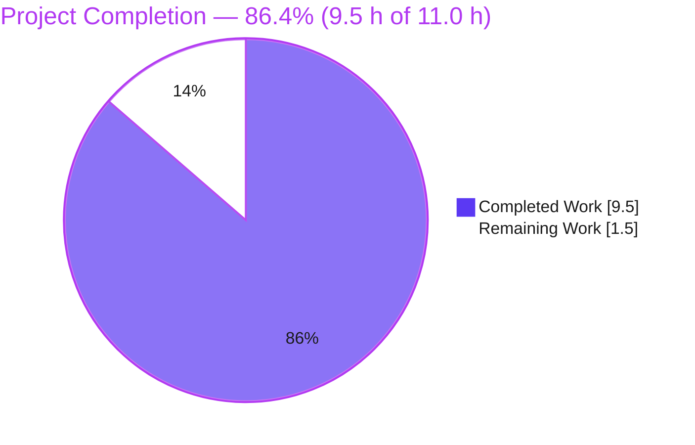
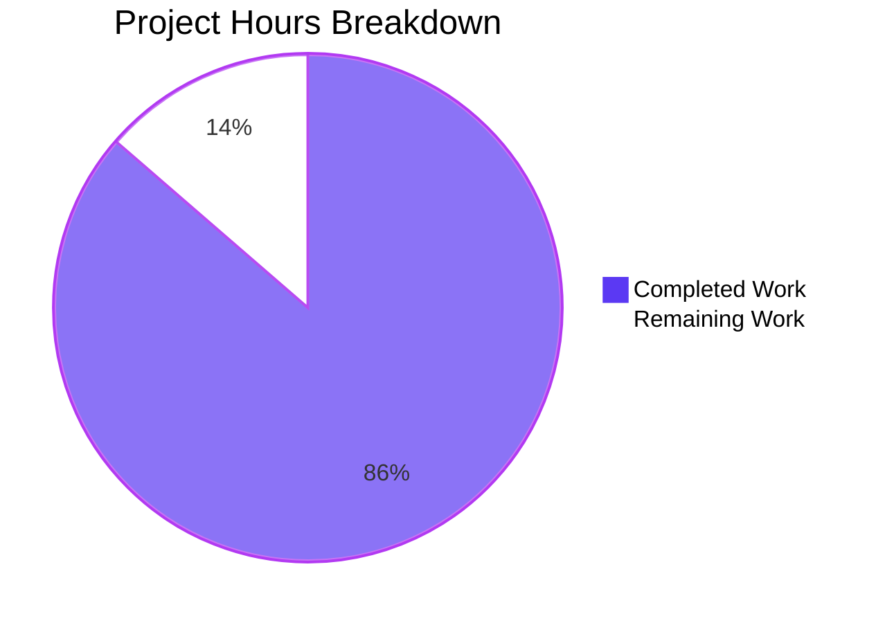

# 1. Executive Summary

## 1.1 Project Overview

This project adds one Python 3 console script to a repository whose only executable artefact was a JavaScript one-liner. `welcome.py` at the repository root holds one statement and writes the fixed greeting `Welcome to Blitzy` to standard output: 18 bytes, an empty standard error, exit status 0, nothing to install, build or configure. Its scope is one added path, a byte-identical four-path tree, a byte-exact output contract and a hand-run acceptance gate.

## 1.2 Completion Status

All twelve stated requirements are delivered and verified; one supporting statement holds for ASCII-compatible codecs only (Section 5.2, divergence 3).

| Metric | Hours |
|---|---|
| Total Hours | 11.0 |
| Completed Hours (AI + Manual) | 9.5 |
| Remaining Hours | 1.5 |

Hours-based and scoped to the Agent Action Plan (AAP): **9.5 ÷ (9.5 + 1.5) = 9.5 ÷ 11.0 = 86.4% complete**.



Dark blue (#5B39F3) marks completed work; white (#FFFFFF) outlined in violet-black marks remaining work.

## 1.3 Key Accomplishments

- ✅ `welcome.py` added at the root: one statement, 1 line, 27 bytes, mode 644.
- ✅ Output byte-exact: 18 bytes (`Welcome to Blitzy\n`, hex `57 65 6c 63 6f 6d 65 20 74 6f 20 42 6c 69 74 7a 79 0a`).
- ✅ Empty standard error, exit status 0 by natural completion, stable across repeats.
- ✅ Arguments, a foreign working directory and an empty environment change nothing.
- ✅ Locale and codec variants, isolation modes, closed or piped input and 20 concurrent runs change nothing.
- ✅ `node Welcome.js` and `python3 welcome.py` emit byte-identical streams.
- ✅ One path added, five tracked paths, the other four blobs unchanged.
- ✅ No import, manifest, lockfile, declaration, install step, network access or test artefact.

## 1.4 Critical Unresolved Issues

All 12 stated requirements are delivered and verified; four items remain open, none blocking use of the script.

| Issue | Impact | Owner | ETA |
|---|---|---|---|
| Rule 1's prose calls the message "Welcome Blitzy"; the delivered literal is "Welcome to Blitzy" | A literal compliance read shows a wording mismatch; no functional effect | Project owner | 0.5 h |
| The repository's existing record (`blitzy/documentation/Project Guide.md`) lists three tracked paths, asserts no Python artefact exists, and carries its own unreconciled rule clause | A maintainer relying on that record alone is misled | Project owner | 0.5 h |
| No automated check guards the 18-byte contract or the frozen-path guarantees | A later edit to either one-line script is caught by nothing | Dev team | 0.5 h |
| The byte contract depends on the interpreter's stdout text layer and on descriptor availability | A byte-sensitive consumer must control the codec and keep stdout open until exit | Consumer / owner | Accepted |

## 1.5 Access Issues

No access issues identified: the script reads no credential, secret or environment variable, needs no service or database, and the Python 3 interpreter it requires is present.

## 1.6 Recommended Next Steps

1. [Medium] Settle Rule 1's wording against the delivered literal (0.5 h).
2. [Medium] Refresh the repository's own record: file listing and rule-clause status (0.5 h).
3. [Medium] Add one command that re-runs the byte, stream, status and repository checks (0.5 h).
4. [Low] Note at the consumer that the codec stays ASCII-compatible and stdout stays open until exit, and leave `server.js` untouched unless it enters scope.

# 2. Project Hours Breakdown

## 2.1 Completed Work Detail

Each row traces to requirements the AAP states, and the hours reflect the engineering the delivered, verified scope actually cost — design of the byte contract, the acceptance gate, the variation and host-independence coverage, the repository-state proofs, and the quality and security baseline of the file.

| Component | Hours | Description |
|---|---|---|
| Greeting script content and convention fidelity | 1.0 | `welcome.py` at the repository root: one top-level statement `print('Welcome to Blitzy')`, single-quoted literal, no comment, no abstraction, mirroring the flat single-file convention of `Welcome.js` (AAP requirements: one new Python file; one statement printing the fixed literal; the file at the root; the repository's script convention) |
| Stdout byte contract and byte accounting | 1.0 | The 18-byte output contract: the 17-character literal plus `print`'s default terminator, verified against the recorded hex sequence and a constructed reference; source accounting 6 + 1 + 17 + 2 + 1 = 27 bytes on one line |
| Stream and exit-status behaviour | 0.5 | Empty standard error and status 0 by natural interpreter completion, with no exit call, timer, handler or error branch |
| Acceptance gate construction and execution | 2.0 | The read-only command set that proves the contract: byte counts, byte dumps and hex from captured streams, stream isolation, unpiped status reads, capture discipline, repeat stability and a residue sweep |
| Invocation-variation and host-independence coverage | 1.5 | Arguments, a foreign working directory and an empty environment (each read three ways), plus locale and codec variants, interpreter isolation modes, closed and piped standard input, 20-way concurrency and both installed interpreter lines |
| Contract parity with the existing deliverable | 0.5 | Byte-for-byte equality with `Welcome.js` output in every shared condition, and parity of the no-install, invoke-from-the-root posture |
| Repository-state and frozen-path proof | 1.0 | One added path, tracked count 4 → 5, per-path proofs that `Welcome.js`, `server.js`, `README.md` and `blitzy/documentation/Project Guide.md` are untouched, and the `Welcome.js` digest anchor |
| Static quality and security baseline | 1.0 | Source-shape inspection, AST inventory, placeholder/stub sweep, secret and injection sweeps, permission and ignore-rule checks |
| Rule discharge, governance handling and scope discipline | 1.0 | Rule 1's message and simplicity obligations discharged inside the one file, the wording override recorded rather than hidden, the repository's record left byte-identical by design, and the manual acceptance posture respected |
| **Total** | **9.5** | Matches Completed Hours in Section 1.2 |

## 2.2 Remaining Work Detail

| Category | Hours | Priority |
|---|---|---|
| Owner decisions and documentation refresh — rule wording ("Welcome Blitzy" prose vs the delivered "Welcome to Blitzy"); the repository's own record (`blitzy/documentation/Project Guide.md`: tracked-path listing and its unreconciled rule clause); and recording the interpreter-level caveats where the 18-byte contract is consumed | 1.0 | Medium |
| Byte-contract regression guard — one command (a small shell check or a minimal test) that re-runs the byte, stream, status and repository checks, wired into the pipeline. It adds a path, so it needs the owner's go-ahead: the delivered scope required the tree to gain exactly one path and no test artefact | 0.5 | Low |
| **Total** | **1.5** | Matches Remaining Hours in Section 1.2 |

Hours reconciliation: completed 9.5 + remaining 1.5 = 11.0 total project hours; 9.5 ÷ 11.0 = 86.4% complete. Nothing else is outstanding: the delivered scope has no un-implemented requirement, no open defect, and no deployment, provisioning or configuration step — the script runs directly from the interpreter with nothing installed.

# 3. Test Results

Every case below was executed against this repository from the repository root, read-only, with byte counts taken from pipes or captured streams and exit statuses read from unpiped invocations. Totals: **53 cases run, 53 passed, 0 failed**. Coverage is not instrumented because the repository holds no coverage tooling — the gate is a command set, and each case is one command with one expected value.

| Area / Category | Framework | Tests | Passed | Failed | Coverage | What This Proves |
|---|---|---|---|---|---|---|
| Source shape and static content | Shell (`wc`, `od`), Python AST | 10 | 10 | 0 | Not instrumented | The file is one 27-byte statement with no import, guard, comment or abstraction, mode 644, and the working copy is byte-identical to the committed blob |
| Standard output byte contract | Shell (`wc`, `od`, `cmp`) | 6 | 6 | 0 | Not instrumented | Every run writes exactly the 18 contract bytes (`Welcome to Blitzy\n`, hex `57 65 6c 63 6f 6d 65 20 74 6f 20 42 6c 69 74 7a 79 0a`), identical to a constructed reference |
| Stream and exit status | Shell | 5 | 5 | 0 | Not instrumented | Standard error is empty and the process exits 0 by natural interpreter completion, stably across repeated runs |
| Invocation variations and host independence | Shell | 14 | 14 | 0 | Not instrumented | Extra arguments, a foreign working directory, an empty environment, locale and ASCII-superset codec variants, interpreter isolation modes, closed and piped standard input and 20-way concurrency all leave 18 bytes / empty stderr / status 0 on both interpreter lines |
| Repository and frozen-path state | `git`, `sha256sum` | 15 | 15 | 0 | Not instrumented | Exactly one path was added; the tracked set is five paths; `Welcome.js`, `server.js`, `README.md` and `blitzy/documentation/Project Guide.md` are blob-identical to the base commit; no manifest and no test artefact exists |
| Cross-runtime parity | `node`, `bash` | 3 | 3 | 0 | Not instrumented | `node Welcome.js` and `python3 welcome.py` emit byte-identical messages, and both JavaScript sources parse |
| **Total** | — | **53** | **53** | **0** | — | The delivered contract holds end to end on this host |

## Not Covered

- **The write-failure class.** No test asserts what happens when standard output cannot be written; the behaviour is the interpreter's own default and was observed rather than asserted (Section 4).
- **Non-ASCII-compatible stdout codecs.** Byte identity does not hold under them, so no test asserts it; a consumer that forces such a codec changes the transport, not the characters.
- **Hosts whose text layer translates newlines.** The 18-byte contract is asserted on this POSIX host only; a Windows text layer would emit CRLF and measure 19 bytes. No platform-specific handling exists.
- **Import-time behaviour.** No test asserts what a module importer sees; the guard-free top-level statement means `import welcome` writes the message.
- **The pre-existing demo service at runtime.** `server.js` was never started — it binds a host-global loopback port — so its listening, error handling and shutdown behaviour are untested and, as a pre-existing surface outside this scope, unchanged.
- **Any user interface.** The deliverable has no screen, endpoint or rendered surface, so no interface test exists and the project's banner image is not a rendering target.
- **Regression protection for either one-line script.** The repository deliberately holds no test suite, runner, CI configuration or coverage tooling, so nothing catches a later edit. A human should re-run the acceptance gate in Section 9 after any change to `welcome.py` or `Welcome.js`; adding an automated guard is Section 2.2's second item.

# 4. Runtime Validation & UI Verification

The deliverable is a console script, so "runtime validation" means driving the process and reading its streams, status and repository effect. Everything below was executed on this host from the repository root, on both installed interpreter lines (`/usr/local/bin/python3` = Python 3.13.18 and `/usr/bin/python3` = Python 3.14.4).

- ✅ **Plain run** — `python3 welcome.py` writes `Welcome to Blitzy` on one line, 18 bytes, with an empty standard error and exit status 0; identical under both interpreters.
- ✅ **Invocation variations** — extra arguments (`alpha --beta`, plus option-like and hostile argument sets), a working directory other than the repository root, and an empty environment each leave 18 bytes / 0 bytes / status 0, read three ways.
- ✅ **Environment, locale and codec variants** — `LC_ALL=C`, `PYTHONIOENCODING` set to an ASCII-superset codec (`utf-8`, `ascii`, `latin-1`, `cp1252`), interpreter isolation modes (`-I -S -E -B`), closed standard input and piped standard input all leave the output unchanged.
- ✅ **Concurrency and repetition** — 20 concurrent invocations and 10 sequential runs produced one distinct output hash, all 18 bytes, all status 0.
- ✅ **Cross-runtime parity** — `diff <(node Welcome.js) <(python3 welcome.py)` produces no output; both deliverables emit the same 18 bytes and each equals a constructed reference.
- ✅ **Repository effect** — one added path, five tracked paths, the four frozen paths blob-identical to the base commit, a clean working tree and no byte-code cache left behind by any probe.
- ⚠ **Write-failure path (observed, never asserted)** — standard output directed to a full device exits 120 with a diagnostic on standard error (86 bytes), the same unwritten run with buffering disabled exits 1 with a traceback naming `welcome.py`, and a consumer that closes the pipe leaves the writer at 120 with `BrokenPipeError` on standard error. The message is lost and the code does nothing to detect it: the failure path is deliberately left to the interpreter.
- ⚠ **Standard output closed before execution** — the process exits 0 having written nothing, with an empty standard error, because the interpreter presents `sys.stdout` as `None` and the print call is a documented no-op. A caller that mis-wires its descriptor cannot tell the greeting was never written.
- ⚠ **Non-ASCII-compatible stdout codec** — `PYTHONIOENCODING=utf-16` emits 36 bytes and `utf-32` emits 72 on this host (the characters are unchanged); an invalid codec name stops the interpreter at startup with status 1 and 256 bytes on standard error before any user code runs.
- ❌ **Never exercised at runtime** — the pre-existing demo service `server.js` was not started (it binds the host-global loopback port 3000 and is outside this scope), no user interface or rendered surface exists to drive, the project's banner image is not a rendering target, and the host's own tooling baseline (interpreter and utility versions) is recorded rather than exercised.

# 5. Compliance & Quality Review

## 5.1 Compliance Matrix

Every row states where the deliverable stands now, verified by the checks in Sections 3 and 4.

| # | AAP Deliverable | Status | Progress | Verified By |
|---|---|---|---|---|
| 1 | One new Python 3 file at the repository root, no second path, package, manifest or declaration file | ✅ PASS | ██████████ 100% | Change set is `A welcome.py` alone; tracked set is five paths; manifest sweep returns 0 |
| 2 | One statement printing the fixed literal `Welcome to Blitzy`, exiting by natural interpreter completion | ✅ PASS | ██████████ 100% | AST is a single expression calling `print` with one string argument and no keywords; no exit call; status 0 observed |
| 3 | Standard output holds exactly the 18 bytes `Welcome to Blitzy\n` | ✅ PASS | ██████████ 100% | `\| wc -c` → 18; `od -c` final offset `0000022`; hex `57 65 6c 63 6f 6d 65 20 74 6f 20 42 6c 69 74 7a 79 0a`; `cmp` identical to a reference |
| 4 | Standard error empty; process exits with status 0 | ✅ PASS | ██████████ 100% | 0 bytes on stderr; exit status 0 on unpiped runs under both interpreters |
| 5 | Flat single-file script convention: one top-level statement, no abstraction, single-quoted literal, no comment | ✅ PASS | ██████████ 100% | 1 line / 27 bytes / one LF; 0 occurrences of import, def, class, guard, comment or terminator; mirrors `Welcome.js` |
| 6 | Contract parity with the recorded behaviour: no install, manifest or build step; invoked from the repository root | ✅ PASS | ██████████ 100% | 0 manifests; runs with nothing installed and under `env -i`; output byte-identical to `Welcome.js` |
| 7 | No input surface: the program accepts, reads and validates nothing | ✅ PASS | ██████████ 100% | Hostile arguments, piped and closed standard input, and every environment variant leave the output and status unchanged |
| 8 | Byte-exact output from another working directory and under an empty environment; arguments change nothing | ✅ PASS | ██████████ 100% | Three variations, each read three ways, all 18 bytes / empty stderr / status 0 |
| 9 | Repository state: one new script and no modification to `Welcome.js`, `server.js`, `README.md` or the existing product record | ✅ PASS | ██████████ 100% | Path-scoped status and diff empty; all four blobs identical to the base commit; `Welcome.js` digest matches its recorded value |
| 10 | Standard library and interpreter only; nothing installed, no registry contacted, no change outside the new file | ✅ PASS | ██████████ 100% | Zero imports and zero dependency declarations; change set is one insertion, no deletions |
| 11 | No automated test file added; the manual acceptance posture preserved | ✅ PASS | ██████████ 100% | No test-like path, runner, conftest or CI configuration exists in the tree |
| 12 | Blitzy quality benchmarks: no placeholder, stub or deferred work; security baseline clean; evidence traceable; brand and documentation conventions observed | ✅ PASS | ██████████ 100% | Placeholder/stub sweep returns 0; secret and injection sweeps return 0; every claim in this guide cites a repository path, a commit or an observed command; brand colours applied in Section 1.2 and Section 7 |

Rule 1 (`Ajit_Welcome_Rule`) is honoured in both of its clauses: the message is produced in the repository's relevant format, and the code's simplicity is measurable rather than asserted (1 statement, 1 line, 27 bytes, no import, guard, comment or abstraction). Its prose wording of the message is the one override, recorded as divergence 1 in 5.2.

## 5.2 AAP & Rule Divergences and Gaps

| # | What the AAP/Rule Required | What Was Delivered Instead | Why It Diverged | Impact | Remediation |
|---|---|---|---|---|---|
| 1 | Rule 1: create the "Welcome Blitzy" message in the relevant format, with simple, crisp code (the rule names no language, file or framework) | The message `Welcome to Blitzy`, produced by one statement in `welcome.py:1` inside the repository's flat single-file root-script format | The request that governs this product states the output as a byte-level equality (`Welcome to Blitzy\n`, exactly 18 bytes); the request outranks the rule's prose name for that value, and the plan records the resolution. **Sanctioned.** | A literal compliance read shows a wording difference of one word; no functional, security or performance effect | Owner decision: reword the rule to match, or record that the request's literal governs for this product. 0.5 h |
| 2 | The repository's existing product record (`blitzy/documentation/Project Guide.md`) was to remain byte-identical, and nothing was to be settled about the rule clause it records | The file is byte-identical (blob `9339cbea86be`), so its tracked-path listing still shows three paths, its line 148 still reads "no Python artifact exists in the tree", and its §5.2 divergence 1 still leaves the language clause to an owner decision | The plan froze that file so the earlier deliverable's recorded contract would survive untouched, and it states explicitly that this work settles nothing about the clause | A maintainer who consults that record alone is misled about the tracked set, and the rule clause stays unreconciled | Owner decision plus a refresh of that record: rule wording/waiver, and its file listing brought up to date. 0.5 h |
| 3 | The plan's §0.3.3 claim that the message is pure ASCII "so no stdout encoding setting can alter its bytes" | The characters are invariant under every condition exercised, but the transport byte count is not: `PYTHONIOENCODING=utf-16` emitted 36 bytes, `utf-32` 72, and an invalid codec name stopped the interpreter with status 1 and 256 bytes on standard error before user code ran | The byte count is produced by the interpreter's stdout text layer, and the plan forbids the encoding handling that could change it; the delivered code is exactly what the plan specifies | A consumer that asserts 18 bytes must not force a non-ASCII-compatible codec; the message characters are never wrong | Accept and state the constraint where the contract is consumed, or relax the plan's wording. No code change is available within the plan's constraints. 0.25 h (folded into item 1 of Section 2.2) |
| 4 | The plan's §0.3.5 description of the failure path: an uncaught write error exits 1 with a traceback on standard error, and a failed final flush changes the status to 120, with no handler added | Both defaults appear as described (status 120 for a full device, status 1 with buffering disabled, status 120 for a closed pipe), and the delivered code adds no handler — but a third interpreter default exists that the description does not cover: a stdout descriptor closed before execution yields status 0, nothing written and an empty standard error | The plan describes the failure class in outline and correctly leaves it to the interpreter; the delivered artefact neither adds nor removes behaviour here | A caller that closes stdout before execution cannot detect that the greeting was never written | Caller-side discipline (do not close stdout before execution) or a note wherever the greeting is consumed; the plan's constraints forbid handling it in code. No hours charged |
| 5 | The plan's §0.8 recorded host baseline: `python3` at `/usr/bin/python3` version 3.12.3, GNU coreutils 9.4 whose `od -An -t x1` renders one line, and git 2.43.0 | This host runs `python3` at `/usr/local/bin/python3` = Python 3.13.18 and `/usr/bin/python3` = 3.14.4; coreutils are uutils 0.10.0, whose `od -An -t x1` wraps at 16 bytes; git is 2.56.0 | The recorded figures were captured on a different host and toolchain, and the repository deliberately declares and pins no version at all | A reviewer re-running the recorded gate verbatim sees an apparent mismatch on the hex-rendering row although every byte value is correct | Compare bytes rather than a rendered string, or add `-w32` (Section 9). No code change; 0 h |

**Divergence 1 — rule wording.** The rule was written before this product's literal was fixed. Rule 1 asks for the message in the relevant format and for simple, crisp code, and names that message "Welcome Blitzy"; the request governing this product fixes the output as an 18-byte equality and therefore the literal `Welcome to Blitzy`. The delivered file follows the request, so the difference is one word and nothing else (`welcome.py:1`, verified by capture). No code change could close it without breaking the byte contract. What is left to you is textual: reword the rule so the two agree, or record that the request's literal governs per product. Budget 0.5 h either way.

**Divergence 2 — the repository's own record.** The repository already carries its record of the earlier JavaScript deliverable at `blitzy/documentation/Project Guide.md`, and that record states a project rule requiring new products in Python, marks the clause "NOT MET, by recorded decision" (line 148) and leaves it to an owner decision ("No code change can close it", lines 154-160). It also lists three tracked paths and asserts that no Python artefact exists — statements the added `welcome.py` makes false, and which were left as they stand because the plan required that file to stay byte-identical. Your decision: reword or waive the clause, and refresh the record's file listing so it describes the tree you now have. 0.5 h.

**Divergence 3 — byte invariance under hostile encodings.** The plan's byte-invariance claim is stronger than any interpreter guarantees. The characters are invariant: the literal is a source constant and nothing the program reads can change it. The byte count on the wire, however, belongs to the interpreter's stdout text layer. Forcing a non-ASCII-compatible codec re-encodes the same characters (`utf-16` emitted 36 bytes here, `utf-32` 72), and an invalid codec name aborts the interpreter before any user code runs (status 1, 256 bytes on standard error). No code change can settle this within the plan's constraints, which forbid defensive code. Decide whether to accept it as stated or to record the constraint wherever the 18-byte contract is consumed.

**Divergence 4 — an undescribed failure default.** The plan describes the failure path as two non-zero interpreter defaults — an uncaught write error exiting 1, a failed final flush changing the status to 120 — and the delivered code correctly adds no handling, so both appear as described (120 for a full device, 1 when buffering is disabled, 120 for a closed pipe). A third default exists that the description does not cover: with standard output closed before execution the process exits 0 having written nothing and with an empty standard error. A caller in that state cannot detect the loss, and the remedy is caller-side rather than code.

# 6. Risk Assessment

Risks are forward-looking: what could still go wrong now that the deliverable is in the repository. None of the eight is a defect of the delivered script.

| Risk | Category | Severity | Probability | Mitigation | Status |
|---|---|---|---|---|---|
| Nothing guards the byte contract or the frozen-path guarantees against a later edit to either one-line script | Technical | Low | Medium | Add the one-command guard in Section 2.2 and run it on every change to `welcome.py` or `Welcome.js` | Open (accepted) |
| The 18-byte output depends on the interpreter's stdout text layer: a non-ASCII-compatible codec re-encodes the stream (`utf-16` → 36 bytes, `utf-32` → 72 here) and an invalid codec name stops the interpreter with status 1 before user code runs | Technical | Low | Low | Assert on the decoded characters, or neutralise `PYTHONIOENCODING` wherever the contract is consumed | Open (accepted) |
| The interpreter expectation is undeclared — no manifest, lockfile or interpreter-declaration path exists — so a future interpreter line that changed print's default terminator would break the contract silently | Technical | Low | Low | Record the tested lines (3.13.18 and 3.14.4) and let the guard assert the 18-byte count | Open (accepted) |
| The guard-free top-level statement executes on import, so any future tooling that imports the file writes the message to that process's standard output | Technical | Low | Low | Invoke it as a script, never import it | Accepted (deliberate simpler form) |
| A stdout descriptor closed before execution yields status 0 with nothing written and an empty standard error, so a mis-wired caller cannot detect the loss | Operational | Medium | Low | Do not close stdout before execution; check the greeting at the consumer | Open (interpreter default; the plan's constraints forbid handling it in code) |
| The repository's own record (`blitzy/documentation/Project Guide.md`) no longer describes the tracked set and still carries its unreconciled rule clause | Operational | Low | High (already true) | Owner decision plus a refresh of that record (Section 2.2, first item) | Open |
| The pre-existing demo service (`server.js`) binds a hardcoded `127.0.0.1:3000` on a host-global port, with no listener error handler and no shutdown drain; a second concurrent start fails with `EADDRINUSE` | Integration | Medium | Medium | Make the port configurable, add an `'error'` listener and a shutdown drain before that service is used anywhere shared | Open (outside the delivered scope; untouched) |
| The program has no input, network, dependency, credential or data surface; its only security-relevant behaviour is what the interpreter's own environment decides before the message is written | Security | Low | Low | Run it under the isolation modes (`-I -S -E`) in untrusted environments; nothing in the file needs patching | Accepted (recorded for completeness) |

# 7. Visual Project Status

Completed work is dark blue (#5B39F3); remaining work is white (#FFFFFF), outlined in violet-black so it remains visible against the page.



The chart mirrors Section 1.2 and Section 2.2: 9.5 h completed of 11.0 h total — **86.4% complete** — with 1.5 h remaining.

Remaining hours, and the share of each priority band, are:

| Priority | Remaining Work | Hours | Share of Remaining |
|---|---|---|---|
| Medium | Owner decisions and documentation refresh (rule wording; the repository's own record) | 1.0 | 66.7% |
| Low | Byte-contract regression guard | 0.5 | 33.3% |
| **Total** | — | **1.5** | **100%** |

There is no high-priority remaining work: nothing is blocked, and the delivered script runs and meets its contract as it stands.

# 8. Summary & Recommendations

**What was delivered and verified.** The repository gains one file, `welcome.py` at the repository root, holding a single top-level statement. Running it writes the 18 bytes `Welcome to Blitzy\n` to standard output, nothing to standard error, and exits 0. That is not a claim on paper: 53 acceptance cases were executed first-hand — byte counts, byte dumps and hex from captured streams, stream isolation, unpiped status reads, the three required variations read three ways, locale and codec variants, interpreter isolation modes, closed and piped standard input, 20-way concurrency, cross-runtime parity with `Welcome.js`, and the repository-state proofs. All 53 passed. The change is purely additive: one added path, five tracked paths, and `Welcome.js`, `server.js`, `README.md` and `blitzy/documentation/Project Guide.md` byte-identical to their pre-change blobs. Against the AAP's scope, the project stands at **86.4% complete** — 9.5 h of 11.0 h.

| Success Metric | Result |
|---|---|
| Acceptance cases executed / passed | 53 / 53 |
| Standard output | Exactly 18 bytes, hex `57 65 6c 63 6f 6d 65 20 74 6f 20 42 6c 69 74 7a 79 0a`, identical to a constructed reference and to `node Welcome.js` |
| Standard error / exit status | 0 bytes / status 0 on both installed interpreter lines |
| Paths added | 1 (`welcome.py`) |
| Frozen paths changed | 0 |
| Dependencies, installs, manifests | 0 |
| Security findings | 0 (no input surface, no network, no credential, no dependency) |

**What remains.** Four items are open, none of which blocks use of the script: the rule's prose wording versus the delivered literal; the repository's own record, which still lists three tracked paths, asserts no Python artefact exists and carries its unreconciled rule clause; the absence of any automated guard over the byte contract; and the interpreter-level caveats a byte-sensitive consumer must respect. The first two are owner decisions costing about half an hour each, the third is a half-hour engineering task, and the fourth is acceptance plus a note.

**Critical path to production.** There is no deployment step to run: the deliverable is a script with no dependency, no configuration, no service and no state, so "production" is any environment where a Python 3 interpreter is reachable as `python3`, and the invocation is `python3 welcome.py` from the repository root. The path is therefore short and entirely administrative — decide the rule wording, refresh the repository's own record, and add the guard so the contract cannot drift. Everything else the project was scoped against is complete and verified.

**Production readiness.** Ready as delivered, within its declared scope. The single observable surface is one line on standard output and the whole contract is checkable by hand in one command set. The caveats to carry forward are the recorded risks rather than defects: the 18-byte guarantee is a POSIX claim and a property of the interpreter's text layer; a stdout descriptor closed before execution loses the message silently; nothing guards a later edit; the interpreter expectation is undeclared; and the repository's own record needs updating. Close the four open items and the repository is fully signed off.

**Recommended order of work.** First the two owner decisions in one sitting, because they touch the same rule text and the same record; then the guard; then a single line wherever the greeting is consumed, noting that the codec must stay ASCII-compatible and stdout must not be closed beforehand. That sequence needs about 1.5 h in total and leaves the repository with no open item other than the pre-existing demo service, which stays out of scope until someone brings it in.

# 9. Development Guide

Everything below was executed on this host from the repository root, and the expected output shown is what each command printed. Copy the blocks as they stand; nothing needs installing, starting or tearing down.

## 9.1 System Prerequisites

- A POSIX host with a Python 3 interpreter reachable as `python3`. On this host: `/usr/local/bin/python3`, Python 3.13.18. A second interpreter, `/usr/bin/python3`, Python 3.14.4, is also present and was used for the empty-environment check.
- `git` for the repository-state checks (2.56.0 here), plus the POSIX tools `wc`, `od`, `cmp`, `diff`, `sha256sum` and `env`.
- Node.js only if you intend to exercise the pre-existing JavaScript deliverable or the demo service. On this host: `/usr/bin/node`, v22.23.4.
- No database, cache, message broker, container or network service is involved.

## 9.2 Environment Setup

There is none to perform. The deliverable reads no environment variable, no secret and no configuration file, so the checkout is ready to run as it stands:

```bash
cd "$(git rev-parse --show-toplevel)"
command -v python3 && python3 --version      # /usr/local/bin/python3
                                             # Python 3.13.18
```

If you compile or import anything, keep the byte-code cache out of the checkout so the tracked tree stays exactly as it is — point the prefix at any directory outside the repository:

```bash
export PYTHONPYCACHEPREFIX="$(mktemp -d)/welcome-pycache"
```

## 9.3 Dependency Installation

Nothing to install. There is no manifest, lockfile, requirements file, virtual environment, interpreter-declaration file or build step, and adding one would change the repository's tracked set — which is part of what the delivered work guarantees today. Do not run `npm install`, `pip install` or `apt-get install` for this project.

## 9.4 Running the Script

```bash
python3 welcome.py
# Welcome to Blitzy
```

The message appears on one line, nothing before or after it. The process exits 0 and the script has no start-up step, no service and no shutdown — it runs and returns.

## 9.5 Verifying It

Run these from the repository root. Byte counts and byte dumps must come from a pipe or a captured stream, never from a terminal (see 9.8).

```bash
python3 welcome.py | wc -c                          # 18
python3 welcome.py | od -c                          # ... y \n   (final offset 0000022)
python3 welcome.py | od -An -t x1 -w32              # 57 65 6c 63 6f 6d 65 20 74 6f 20 42 6c 69 74 7a 79 0a
python3 welcome.py 2>&1 >/dev/null | wc -c          # 0      (standard error empty)
python3 welcome.py >/dev/null; echo "exit=$?"       # exit=0 (read on an unpiped run)
python3 welcome.py alpha --beta | wc -c             # 18     (arguments change nothing)
( cd / && python3 "$OLDPWD/welcome.py" | wc -c )    # 18     (foreign working directory)
env -i /usr/bin/python3 welcome.py | wc -c          # 18     (empty environment)
diff <(node Welcome.js) <(python3 welcome.py) && echo byte-identical   # byte-identical
```

Reference bytes, for comparison by hand: the message plus one newline is exactly 18 bytes, hex `57 65 6c 63 6f 6d 65 20 74 6f 20 42 6c 69 74 7a 79 0a`.

Repository state:

```bash
git ls-files                                        # README.md Welcome.js blitzy/documentation/Project Guide.md server.js welcome.py
git show --name-status --oneline HEAD               # a1a2077 ... / A<tab>welcome.py
git status --porcelain -uall                        # (no output)
sha256sum Welcome.js                                # 5c7ac141d94f92056efb756f17335252c31e3d08d509e641d76512f73112c1fc
python3 -m py_compile welcome.py                    # exit 0 (with PYTHONPYCACHEPREFIX set outside the checkout)
```

## 9.6 Example Usage

Shell out for the greeting and compare bytes rather than trusting the exit status:

```bash
msg=$(python3 welcome.py)
[ "$msg" = "Welcome to Blitzy" ] && echo "greeting OK"

out=$(mktemp)
python3 welcome.py > "$out"
cmp "$out" <(printf 'Welcome to Blitzy\n') && echo "18-byte contract holds"
```

Expected: `greeting OK` and `18-byte contract holds`.

## 9.7 The Pre-existing Demo Service

`server.js` is a pre-existing loopback HTTP demo, untouched by this work. It hardcodes `127.0.0.1:3000` (lines 3-4) on a host-global port, has no listener `'error'` handler and no shutdown drain:

```bash
node --check server.js      # exit 0 — syntax check only
node server.js              # prints: Server running at http://127.0.0.1:3000/
curl -s http://127.0.0.1:3000/     # Hello, World!
```

Do not start it in a shared environment: the port is global and a second concurrent start exits 1 with `EADDRINUSE`. If you start it locally, stop exactly that process (its own pid or job) and nothing else. It was not started during this project's verification, so its runtime behaviour is untested here.

## 9.8 Troubleshooting

- **A byte count of 19 instead of 18.** You measured through a terminal. A tty translates the newline to CRLF; take the count from a pipe (`python3 welcome.py | wc -c`) or from a captured file.
- **`od -An -t x1` printed two lines.** This host's `od` (uutils coreutils 0.10.0) wraps at 16 bytes per line. Add `-w32` for the single-line form, or compare bytes rather than a formatted string.
- **The exit status looks wrong.** A pipeline reports its last stage's status, not the script's. Read the status from an unpiped invocation (`python3 welcome.py >/dev/null; echo $?`), or use `PIPESTATUS`.
- **The output is 36 or 72 bytes.** A non-ASCII-compatible stdout codec is in force (`PYTHONIOENCODING=utf-16` or `utf-32`). The characters are unchanged; the transport is not. Unset the variable or use an ASCII-superset codec.
- **The interpreter refuses to start (status 1, a message about an unknown encoding).** `PYTHONIOENCODING` names a codec that does not exist; the failure happens before any user code runs. Unset it.
- **Nothing is printed and the status is 0.** Standard output was closed before the process started (for example `python3 welcome.py 1>&-`). The interpreter makes the print call a no-op; nothing in the code can detect it. Check how the caller wires its descriptors.
- **`import welcome` prints the message.** Expected: the statement sits at module top level by design, which is the simpler of the two forms the specification allowed. Invoke the file as a script.
- **`EADDRINUSE` from `server.js`.** Another process holds port 3000; stop the one you started, or leave the demo service alone.
- **No tests were collected.** `python3 -m unittest discover` exits 5 and `node --test` reports zero tests because the repository deliberately holds no test suite. The command set in 9.5 is the acceptance gate; adding an automated guard is Section 2.2's second item.
- **A stale byte-code cache appeared in the checkout.** Set `PYTHONPYCACHEPREFIX` outside the checkout before compiling or importing, and remove the cache if one was written.

# 10. Appendices

## Appendix A. Command Reference

| Command (from the repository root) | Purpose | Expected Output |
|---|---|---|
| `python3 welcome.py` | Run the deliverable | `Welcome to Blitzy` |
| `python3 welcome.py \| wc -c` | Count output bytes | `18` |
| `python3 welcome.py \| od -c` | Dump the output bytes | message followed by one `\n`, final offset `0000022` |
| `python3 welcome.py \| od -An -t x1 -w32` | Single-line hex dump | `57 65 6c 63 6f 6d 65 20 74 6f 20 42 6c 69 74 7a 79 0a` |
| `python3 welcome.py 2>&1 >/dev/null \| wc -c` | Standard error size | `0` |
| `python3 welcome.py >/dev/null; echo "exit=$?"` | Exit status on an unpiped run | `exit=0` |
| `python3 welcome.py alpha --beta \| wc -c` | Argument variation | `18` |
| `( cd / && python3 "$OLDPWD/welcome.py" \| wc -c )` | Foreign working directory | `18` |
| `env -i /usr/bin/python3 welcome.py \| wc -c` | Empty environment | `18` |
| `diff <(node Welcome.js) <(python3 welcome.py)` | Cross-runtime parity | no output |
| `git ls-files` | Tracked paths | five paths, including `welcome.py` |
| `git show --name-status --oneline HEAD` | The delivered change set | the delivery commit, then `A  welcome.py` |
| `git status --porcelain -uall` | Working-tree residue | no output |
| `sha256sum Welcome.js` | Frozen-sibling digest | `5c7ac141d94f92056efb756f17335252c31e3d08d509e641d76512f73112c1fc` |
| `node --check Welcome.js` / `node --check server.js` | JavaScript parse gate | exit 0 |
| `python3 -m py_compile welcome.py` | Python parse gate (set `PYTHONPYCACHEPREFIX` outside the checkout first) | exit 0 |

## Appendix B. Port Reference

| Port | Owner | Bind | Protocol | Notes |
|---|---|---|---|---|
| 3000 | `server.js` (pre-existing demo service) | `127.0.0.1` | TCP/HTTP | Hardcoded; host-global, so a second concurrent start fails with `EADDRINUSE`. Not started during this project's verification. |
| — | `welcome.py` | — | — | The deliverable binds no port, opens no socket and contacts no network. |

## Appendix C. Key File Locations

| Path | Role | Size |
|---|---|---|
| `welcome.py` | The deliverable — one statement writing the greeting to standard output | 1 line, 27 bytes |
| `Welcome.js` | The pre-existing one-line JavaScript deliverable, and the convention the new file mirrors | 1 line, 34 bytes |
| `server.js` | The pre-existing loopback HTTP demo service; untouched by this work | 14 lines, 342 bytes |
| `README.md` | Pre-existing identity stub for the repository; untouched | 1 line, 58 bytes |
| `blitzy/documentation/Project Guide.md` | The repository's existing record of the earlier deliverable; byte-identical, and its tracked-path listing and rule-clause status are out of date (Section 5.2, divergence 2) | 381 lines, 35992 bytes |

## Appendix D. Technology Versions

| Technology | Version on this host | Where it is used |
|---|---|---|
| CPython (`python3`) | 3.13.18 at `/usr/local/bin/python3` | Runs the deliverable; the version that produced the verified results |
| CPython (`/usr/bin/python3`) | 3.14.4 | Ran the empty-environment and second-interpreter checks with identical results |
| Node.js (`node`) | v22.23.4 at `/usr/bin/node` | Runs `Welcome.js` for the cross-runtime parity check, and the demo service |
| git | 2.56.0 | Repository-state checks |
| coreutils | uutils 0.10.0 (`wc`, `od`, `cmp`, `sha256sum`, `env`) | Byte counts, dumps, comparisons and digests. Note `od -An -t x1` wraps at 16 bytes per line unless `-w32` is given. |
| Declared by the repository | none | No manifest, lockfile or interpreter-declaration path exists, so no version is pinned |

## Appendix E. Environment Variable Reference

The deliverable reads no environment variable, and none is required. The variables below affect only the interpreter that runs it:

| Variable | Effect on a run | Recommended setting |
|---|---|---|
| `PYTHONIOENCODING` | Chooses the stdout codec. ASCII-superset codecs (`utf-8`, `ascii`, `latin-1`, `cp1252`) keep the output at 18 bytes; `utf-16` and `utf-32` re-encode the stream (36 and 72 bytes here); an invalid name stops the interpreter with status 1 before user code runs | Leave unset for the 18-byte contract |
| `PYTHONPYCACHEPREFIX` | Redirects byte-code caches away from the checkout | Point it outside the repository if you compile or import the file |
| `PYTHONUNBUFFERED` | Disables buffering, changing which failure path a write error takes (status 1 with a traceback instead of status 120) | Leave unset |
| `LC_ALL` / `LANG` | Locale; verified to change nothing about the output | Any value |
| `PYTHONPATH`, `PYTHONSTARTUP`, `PYTHONHOME` | Interpreter-level startup configuration; can affect the process before the message is written | Leave unset, or use `-I -S -E` isolation |

## Appendix F. Developer Tools Guide

- **Measuring bytes.** `python3 welcome.py | wc -c` for the count, `od -c` for the byte dump, `od -An -t x1 -w32` for a single-line hex listing, and `cmp` against a constructed reference for identity. Always from a pipe or a captured file — a tty reports 19 bytes for this correct 18-byte output.
- **Reading the exit status.** Use an unpiped invocation (`python3 welcome.py >/dev/null; echo $?`). In a pipeline the status belongs to the last stage; on a shell with `pipefail` set it belongs to the rightmost non-zero stage, so use `PIPESTATUS` when you need a specific stage.
- **Parse and syntax gates.** `python3 -m py_compile welcome.py` (cache outside the checkout) and `node --check <file>` are the read-only syntax checks this repository uses in place of a build step.
- **Repository state.** `git ls-files`, `git show --name-status --oneline HEAD`, path-scoped `git status --porcelain -- <path>` and `git diff --name-only -- <path>` prove both the added path and the untouched ones; `sha256sum` anchors a file to a recorded digest.
- **Isolation modes.** `python3 -I -S -E -B welcome.py` runs the script with site packages, user site, environment influence and byte-code writing all disabled — useful when you want to prove the script needs nothing from its environment.
- **Probe hygiene.** Keep scratch files, captures and caches outside the checkout, then confirm with `git status --porcelain -uall` and a search for `__pycache__` that the tree gained nothing.

## Appendix G. Glossary

- **Byte contract** — the exact bytes the program must write: 18 bytes on standard output (`Welcome to Blitzy` plus one newline), 0 bytes on standard error, exit status 0.
- **Natural interpreter completion** — the process ends because the program ran out of statements, with no explicit exit call, timer or handler; this is what produces the 0 status.
- **Standard output / standard error** — file descriptors 1 and 2. The deliverable writes only to descriptor 1.
- **Captured stream** — output read from a pipe or a file rather than a terminal, which is the only trustworthy way to count these bytes.
- **ASCII-superset codec** — a text encoding in which the 17 message characters and the newline each occupy one byte (`utf-8`, `ascii`, `latin-1`, `cp1252`). Non-superset codecs such as `utf-16` change the byte count without changing the characters.
- **Isolation mode** — interpreter flags (`-I`, `-S`, `-E`, `-B`) that disable site packages, user site, environment influence and byte-code writing.
- **Frozen path** — a tracked file this work must leave byte-identical: `Welcome.js`, `server.js`, `README.md` and `blitzy/documentation/Project Guide.md`.
- **Digest** — a hash used as an anchor, here `sha256sum Welcome.js` = `5c7ac141d94f92056efb756f17335252c31e3d08d509e641d76512f73112c1fc`.
- **Byte-code cache** — the `__pycache__` directory or `.pyc` file Python may write when it compiles a module; redirect it with `PYTHONPYCACHEPREFIX` so the tracked tree stays unchanged.
- **Guarded vs guard-free statement** — a guard-free top-level statement runs whenever the file is executed *or* imported; the guarded form (`if __name__ == "__main__":`) runs only when executed. This deliverable is guard-free by design.
