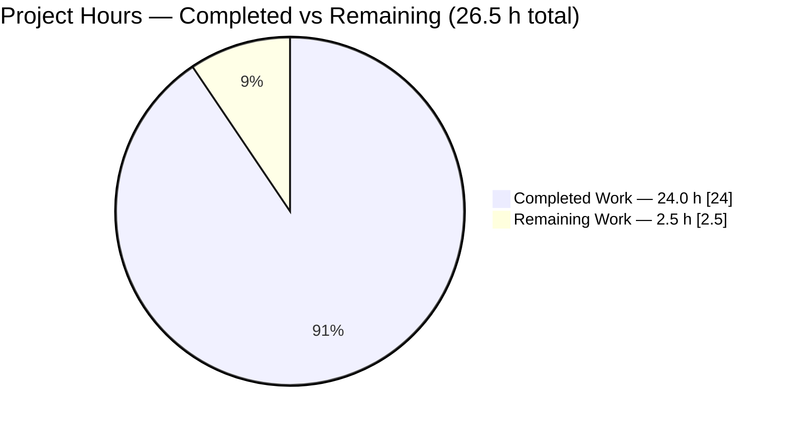
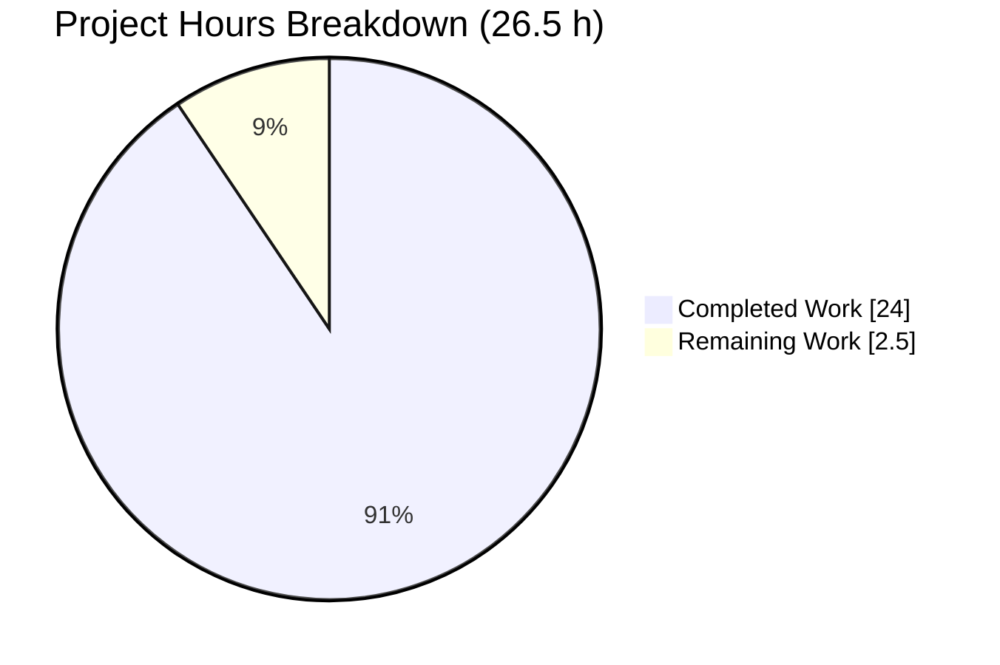

# 1. Executive Summary

## 1.1 Project Overview

`hao-backprop-test` is a five-file Node.js fixture at one repository root: a one-line greeting script, a fourteen-line HTTP server on loopback, a two-line identity README, the quick-start delivered here, and a delivery record. `PROJECT.md` is a 55-line orientation that carries a reader who has never seen the repository from "what is this" to running both executables and comparing their output character for character, with nothing to install and nothing to build. It serves developers and reviewers confirming the fixture in minutes. No executable was modified.

## 1.2 Completion Status

**91% complete — 24.0 hours delivered of 26.5 hours in scope.**



| Metric | Hours |
|---|---:|
| Total Hours | 26.5 |
| Completed Hours (AI + Manual) | 24.0 |
| Remaining Hours | 2.5 |

Completion = 24.0 ÷ 26.5 × 100 = 90.6%, stated as 91%. Scope counted: the quick-start and the path-to-production work after it.

## 1.3 Key Accomplishments

- A first-time reader runs both executables from `PROJECT.md` alone and compares output character for character.
- The greeting writes exactly 18 bytes, exits 0 and keeps stderr empty (`Welcome.js:1`).
- The service answers `200` with `text/plain` and a 14-byte body on `127.0.0.1:3000` (`server.js:1-14`).
- Seven methods and six paths all answer identically — nothing routes.
- Ctrl+C exits 130 and frees the port; a second start exits 1.
- Nine bare `File:line` citations tie every claim to its source line.
- 55 lines / 1,981 bytes inside the 60 / 3,000 ceiling, five headings, four fences.
- Four pre-existing files keep their recorded digests; one path added.

## 1.4 Critical Unresolved Issues

Three open items against the five units and five success criteria in scope.

| Issue | Impact | Owner | ETA |
|---|---|---|---|
| Scope unit 5 of 5 — the closing check states the footprint for the committed tree rather than the untracked-tree expectation the brief gave (1 open item) | Nothing false is stated and both commands verify silent, but a reader comparing wording to the brief meets a different sentence | Repository owner | Before merge — 0.5 h |
| Test posture of the tree — no automated suite covers either executable (1 open item) | A later edit to either script would not be caught by any test | Maintainer | Next change to either script |
| Repository record at `blitzy/documentation/Project Guide.md` — its path count and change figure are superseded by this five-path tree (1 open item) | A reader of that record meets counts that no longer match | Maintainer | Next documentation pass — 1.0 h |

## 1.5 Access Issues

No access issues identified. No credential, external service, network egress or configuration value is involved; the only host resource is one loopback port (3000), and the branch is published.

## 1.6 Recommended Next Steps

1. [High] Review the quick-start against the commands it publishes, then merge the delivery branch (1.0 h).
2. [Medium] Refresh `blitzy/documentation/Project Guide.md` so its path count and change figure match the delivered tree (1.0 h).
3. [Low] Decide whether the closing check keeps its tree-state-true wording or returns to the specified literal (0.5 h).
4. [Low] Re-run both documented commands whenever either script changes, and update the pinned literals.

# 2. Project Hours Breakdown

## 2.1 Completed Work Detail

| Component | Hours | Description |
|---|---:|---|
| Discovery and measurement of the tree and both executables | 3.0 | Six asset-class sweeps, both commands executed, byte counts, four digests, the bound-port failure, argument and stdin behaviour |
| Content design and drafting of the five units | 5.0 | Exact literals, heading order, line budget, citation form, containment decisions |
| Composition, citation and module-relationship pass | 3.0 | Nine bare `File:line` references, the two-line fixture statement, the executables' independence sentence, the second-terminal instruction |
| Footprint, size, structure and currency pass | 4.0 | Both tree states exercised, staged-state views, size and structure measured, superseded record figures excluded |
| Runtime validation | 3.0 | Greeting contract, banner, headers, body, method and path breadth, stop, port release, bound-port failure |
| Preserved-file continuity and digest proofs | 1.5 | `server.js` against its base commit, `Welcome.js` line count, four digests |
| Containment and currency audit | 2.0 | Prohibitions swept, silence preferred to invention on versions/tests/packaging, record figures never echoed |
| Final acceptance and publication | 2.5 | Whole-tree gate, integration of the landing, publication of the branch |
| **Total** | **24.0** | |

## 2.2 Remaining Work Detail

| Category | Hours | Priority |
|---|---:|---|
| Human review and merge of the delivery branch (path to production) | 1.0 | High |
| Reconcile `blitzy/documentation/Project Guide.md` with the delivered tree — its `:240` path count and `:330` change figure predate this work (path to production) | 1.0 | Medium |
| Closing-check wording decision, the residual of the one partially completed unit | 0.5 | Low |
| **Total** | **2.5** | |

# 3. Test Results

The project ships no automated test suite. `CI=true node --test` prints `1..0`, `# tests 0`, `# pass 0`, `# fail 0` and exits 0, and no test file exists in the tree. Verification is therefore the acceptance harness: the commands the quick-start publishes and the document's own gates, executed against the delivered tree on Node.js v22.23.5 with curl 8.7.1. Every count below is a check that was executed and whose result was observed.

| Area / Category | Framework | Tests | Passed | Failed | Coverage | What This Proves |
|---|---|---:|---:|---:|---|---|
| Automated suite (`node --test`) | node:test, TAP output | 0 | 0 | 0 | none — the tree holds no test file | The runner completes cleanly on the empty suite this fixture ships by design |
| Greeting contract | bash + Node.js v22.23.5 | 3 | 3 | 0 | the script's entire surface (1 line) | stdout is exactly 18 bytes, the process exits 0, and stderr stays empty |
| HTTP response contract | bash + curl 8.7.1 | 5 | 5 | 0 | the handler's entire surface | Requests answer `200` with `text/plain`, `Content-Length: 14` and the stated 14-byte body |
| Method and path invariance | bash + curl 8.7.1 | 13 | 13 | 0 | 7 methods, 6 distinct paths | Nothing routes by method or path; every request receives the same body |
| Process lifecycle | bash + Node.js signals | 4 | 4 | 0 | start, stop and bound-port paths | Ctrl+C exits 130 and frees the port; a second start exits 1 while the port is bound |
| Document gates | bash (`wc`, `grep`, `git`) | 9 | 9 | 0 | every structural rule the document must satisfy | 55 lines / 1,981 bytes, 5 headings, 4 balanced fences, one added path, both status commands silent |
| Preserved-file continuity | bash (`shasum`, `git diff`) | 6 | 6 | 0 | all four pre-existing files | Four digests unchanged, `server.js` identical to its base commit, `Welcome.js` still one line |
| Claim fidelity of the quick-start | manual read against source (`od`, `cmp`) | 14 | 14 | 0 | every literal the document states | Each command, banner, status, content type, body, limit and cited path resolves to its source line |

54 checks executed, 54 passed, 0 failed, alongside the empty automated suite.

**Not Covered**

- No automated regression test guards either executable. Every result above comes from executing the documented commands, not from a suite; a human should add a minimal `node:test` file asserting the greeting bytes, the exit status and the response body before either script is edited under a policy that expects regression protection.
- Request bodies, headers and protocol edge cases are exercised only far enough to reach the handler: oversized, malformed, chunked, pipelined and slow requests are untested.
- Concurrency is untested — no load, no parallel clients, no long-lived keep-alive sessions.
- The runtime is fixed at Node.js v22.23.5; no other version has been exercised, and the repository declares no version floor.
- No deployment or packaging path exists to test: nothing is built, containerised or published.

# 4. Runtime Validation & UI Verification

Every flow below was driven on the delivered tree; the status is what was observed.

- ✅ **Greeting script** — `node Welcome.js` exits 0, writes the exact 18-byte line to stdout, writes nothing to stderr, and repeats byte-identically across runs.
- ✅ **HTTP service start** — `node server.js` prints `Server running at http://127.0.0.1:3000/`, leaves stderr empty, and holds a listener on `127.0.0.1:3000`.
- ✅ **Response contract** — the response is `HTTP/1.1 200 OK`, `Content-Type: text/plain`, `Content-Length: 14`, with the body `Hello, World!` followed by one newline.
- ✅ **Method invariance** — GET, POST, PUT, PATCH, DELETE and OPTIONS each answer `200` / `text/plain` / 14 bytes; HEAD answers `200` with the protocol's empty body.
- ✅ **Path invariance** — `/index.html`, `/a/b/c`, `/server.js`, `/?x=1&y=2`, `/does-not-exist` and `//double` all answer `200` / 14 bytes with an identical body digest.
- ✅ **Stop and port release** — Ctrl+C exits 130, no listener remains, and a later request fails to connect.
- ✅ **Bound-port failure** — a second start while the port is bound exits 1 on the unhandled `'error'` event for `127.0.0.1:3000`.
- ⚠ **No user interface** — the only response is `text/plain` and nothing renders HTML, CSS or JavaScript, so no browser or desktop verification applies to any screen.
- ⚠ **Never exercised at runtime** — concurrent clients, oversized or malformed requests, TLS, HTTP/2, any interface other than loopback, and any Node.js version other than v22.23.5.

# 5. Compliance & Quality Review

## 5.1 Compliance Matrix

| # | Deliverable / Requirement | Benchmark | Status | Evidence |
|---:|---|---|---|---|
| 1 | Five-unit content contract, delivered in the briefed order | Documentation completeness | ✅ Pass | `PROJECT.md:1-55`; headings at lines 1, 11, 25, 39, 46 |
| 2 | Literal exactness against measured behaviour | Accuracy | ✅ Pass | 14 stated literals compared byte for byte with their sources |
| 3 | Citation and claim traceability | Traceability | ✅ Pass | 9 bare `File:line` references, each resolving to a real line |
| 4 | Size and format gates | Budget discipline | ✅ Pass | 55 lines / 1,981 bytes within 60 / 3,000; four balanced fences; single terminating newline |
| 5 | Single-path footprint with the other four files intact | Change containment | ✅ Pass | `A PROJECT.md` only; four digests unchanged |
| 6 | Zero-install, no-dependency posture | Operational simplicity | ✅ Pass | No manifest, lockfile, `node_modules` or build step in the tree |
| 7 | Prohibitions: no install/build advice, no test claim, no version policy, no annotation | Content containment | ✅ Pass | Sweeps clean across every tracked file |
| 8 | Currency against the committed tree | Accuracy over time | ✅ Pass | Neither superseded record figure (`:240`, `:330`) appears |
| 9 | Runnability of every documented command | Usability | ✅ Pass | Both blocks copy-pasteable from the root; request and stop commands stated |
| 10 | Quality-gate posture — no suite, and none claimed | Testability | ⚠ Partial | The suite is empty by design; both contracts rest on execution alone |
| 11 | Closing-check wording against the briefed expectation | Specification fidelity | ⚠ Partial | `PROJECT.md:48-50` states the committed-tree result, not the briefed literal |
| 12 | Working-budget adherence (58 lines / 1,576 bytes) | Planning accuracy | ⚠ Partial | 55 lines / 1,981 bytes — inside both hard ceilings, above the planning budget |

## 5.2 AAP & Rule Divergences and Gaps

| What the AAP/Rule Required | What Was Delivered Instead | Why It Diverged | Impact | Remediation |
|---|---|---|---|---|
| §0.3.2 Unit 5: the closing sentence states flatly that `git status --porcelain --untracked-files=all` prints `?? PROJECT.md` and nothing else, and that `git diff --stat` prints nothing | `PROJECT.md:48-50` states that both commands print nothing because `PROJECT.md` is committed and no other tracked file changed; the `?? PROJECT.md` expectation does not appear | The deliverable is committed on the branch, so the untracked-tree expectation cannot reproduce. §0.1.1 criterion 5 and §0.7.1 Check 5 require every claim to be reproducible by a command, and Check 3 itself records that expectation as tree-state dependent — an internal conflict settled in favour of reproducibility | No false statement reaches the reader and both commands verify silent; the briefed literal is absent, so the wording differs from the specification | Optional: keep the delivered sentence (recommended) or restore the literal and accept a claim that cannot reproduce. 0.5 h — carried in Section 2.2 |
| §0.4.1 and §0.5.2: a working budget of 58 lines and 1,576 bytes | 55 lines and 1,981 bytes | §0.4.1 makes the 60-line and 3,000-byte ceilings the pass condition and calls the 58/1,576 pair a draft measurement; the required literals, nine citations and the independence sentence set the delivered length | None — inside both ceilings with 5 lines and 1,019 bytes spare, and no required literal was dropped | None |
| §0.3.2 Unit 4: the review check expects `git ls-files` to return exactly the four named paths | Four flat bullets naming those four paths, with no sentence about the fifth path the tree now holds | Committing the deliverable makes a fifth tracked path unavoidable, and the same unit fixes the map at exactly four bullets — so no sentence in the map counts paths relative to the delivery | A reader comparing map to tree sees one extra entry — the document in their hands. Nothing is misdescribed | None; a fifth bullet would break the four-bullet contract |

**Unit 5's footprint wording (needs an owner decision, not a fix).** The closing section is where the document invites the reader to prove the work is intact, and where the delivered wording departs from the specification. The specified sentence — that the status command prints `?? PROJECT.md` — describes a tree where the file is not yet tracked and cannot reproduce once `PROJECT.md` is committed. The delivered sentence, `PROJECT.md:48-50`, states what this branch shows: both commands silent, because the file is committed and no tracked file differs. Both were run and print nothing, and the single-path footprint is provable from the base commit (`git diff --stat 39974fd..HEAD` → one file, 55 insertions). The owner decides whether to keep it as delivered or restore the literal.

**Working budget against hard ceilings (no action).** The delivery closed at 55 lines and 1,981 bytes, above the 58-line / 1,576-byte planning figure and well inside the 60-line / 3,000-byte gate that the same section names as the pass condition. The extra bytes are the content the contract itself requires: nine `File:line` references, the two-line fixture statement, the independence sentence naming all five exclusions, and the second-terminal instruction the reader needs to complete the `curl` comparison. Nothing was padded and no required literal was cut to fit the smaller number, so the divergence is one of planning accuracy rather than of delivery.

**File map against the tracked tree (no action).** Four flat bullets name the four files that existed before this work, each with a citation that resolves. `git ls-files` now returns five, because the quick-start is itself tracked. A fifth bullet, or a sentence counting paths relative to the delivery, would either break the four-bullet shape the content contract fixes or go stale the moment another path lands; the map therefore keeps its four bullets, and a reader who runs `git ls-files` sees the document they are reading as the fifth entry. Nothing is misdescribed.

**Rule divergences: none.** This project carries no user-specified rules, so no rule could be departed from; the only constraints in force were the specification's own, and the three departures above are the complete set.

# 6. Risk Assessment

| Risk | Category | Severity | Probability | Mitigation | Status |
|---|---|---|---|---|---|
| The quick-start pins the 18-byte output, the banner text, the port, the 14-byte body and the exit statuses; editing either script silently falsifies it and no build or test fails | Technical | Medium | Medium | Treat those five literals as a contract and re-run both documented commands whenever either script changes | Open |
| No automated regression coverage exists; both documented contracts rest on manual execution | Technical | Medium | Medium | Add a minimal `node:test` file asserting stdout bytes, exit status and response body if the zero-install posture is ever relaxed | Accepted by design |
| The runtime is undeclared — no manifest, `.nvmrc` or engine field — and behaviour is verified only on Node.js v22.23.5 | Technical | Low | Low | Appendix D records the validated runtime; confirm the host runtime before relying on the documented output | Open |
| The repository record at `blitzy/documentation/Project Guide.md` states three tracked paths and a one-insertion change, both superseded by this five-path tree | Technical | Low | High | Refresh the record (Section 2.2); the quick-start repeats none of its figures | Open |
| Port 3000 is hardcoded and non-configurable, so a second instance or any local service on it makes the documented start exit 1 | Operational | Medium | High | Keep one instance per host, free the port first, and rely on the documented failure mode rather than editing `server.js` | Open |
| No signal handling: the process ends only by signal (Ctrl+C → 130) or the unhandled `'error'` event (→ 1), with no graceful shutdown path | Operational | Low | Medium | None needed for a stateless local fixture; revisit if the service ever holds state | Accepted |
| The endpoint is unauthenticated, unlogged and answers every path and method, which is safe only while bound to loopback | Security | Medium | Low | Keep `server.js:3` at `127.0.0.1`; add authentication, logging and request validation before any exposure | Accepted with caveat |
| The closing check presumes a clean committed checkout; a reader with any local modification sees ` M PROJECT.md` rather than silence | Integration | Low | Low | The sentence states the condition it holds under, and the footprint is provable from the base commit | Accepted |

# 7. Visual Project Status



**Completion: 91%** — 24.0 of 26.5 hours.

| Status | Hours | Share |
|---|---:|---:|
| Completed work | 24.0 | 91% |
| Remaining work | 2.5 | 9% |

| Remaining category | Hours | Priority |
|---|---:|---|
| Human review and merge of the delivery branch | 1.0 | High |
| Reconciliation of `blitzy/documentation/Project Guide.md` with the delivered tree | 1.0 | Medium |
| Closing-check wording decision | 0.5 | Low |
| **Total** | **2.5** | |

# 8. Summary & Recommendations

The delivery is one document: `PROJECT.md`, a 55-line quick-start at the repository root that takes a reader from the repository's identity to running both executables and checking their output character for character. It closes the gaps that made the fixture opaque — no run instruction, no stated expected output, no statement that nothing needs installing, no map of the other files, no stop instruction for the server, and no single place to confirm the work is intact. The two pre-existing scripts, the identity README and the repository's own record are byte-identical to their recorded digests, and the change footprint is exactly one added path.

Verification was execution, not inspection. Both documented commands were run from the root and compared against the literals the document states: the greeting writes exactly 18 bytes and exits 0 with an empty stderr, and the service answers `200` with `text/plain` and a 14-byte body on `127.0.0.1:3000`. Seven methods and six paths returned the same response, so the document's "no routing" limit holds. Ctrl+C exits 130 and frees the port, and a second start exits 1 on the bound port, which is exactly the failure the document describes. Fifty-four checks passed with no failure, and each of the fourteen literals in the document resolves to the line of source that supports it.

Completion stands at **91%** — 24.0 of 26.5 in-scope hours. The 2.5 hours that remain are not missing functionality: they are the human review and merge of the branch (1.0 h), a refresh of the repository's own delivery record so its path count and change figure match this five-path tree (1.0 h), and a 0.5-hour decision on whether the closing check keeps its tree-state-true wording or returns to the wording the specification gave. That wording is the single specification departure that touches the reader, and it exists because the specified sentence cannot reproduce once the document is committed.

Success is measurable in the reader's own terms: the document exists inside both size ceilings, every published command runs as printed, every claim traces to a source line, and the change touches nothing else. Production readiness for this work is **ready**, with one caveat worth stating plainly: the fixture ships no automated tests, so both behaviour contracts are protected by documentation and manual re-execution rather than by a suite. Adding that protection is the one change that would materially raise confidence, and it belongs to whoever next edits `Welcome.js` or `server.js` under a policy that expects regression cover.

# 9. Development Guide

Every command below was executed and its output verified before it was written down. The verified environment is macOS with Node.js v22.23.5, git 2.56.1, curl 8.7.1 and bash 3.2.57; the same commands apply unchanged on Linux.

## 9.1 System Prerequisites

- **Node.js v22.23.5** on `PATH` — confirm with `node --version`. This is the runtime both scripts were verified on.
- **A POSIX shell** (bash 3.2 or newer) for the verification commands.
- **git 2.56.1** — needed only for the footprint and continuity checks, not to run the scripts.
- **curl 8.7.1** — needed only for the HTTP check; any HTTP client will do.
- **One free loopback TCP port, 3000.** No package manager, container runtime, database, Python or Java component is involved, and no special hardware is required.

## 9.2 Environment Setup

- Place the repository anywhere on disk. No virtual environment, environment variable, secret or configuration file is created or read by either script.
- Confirm the zero-install posture before starting:

```bash
ls package.json package-lock.json node_modules 2>/dev/null | wc -l   # expected: 0
```

- Work from the **repository root**: both documented commands assume it, and running the greeting from a subdirectory fails with `Cannot find module`.

## 9.3 Dependency Installation

There is nothing to install. No `npm install`, `npm init`, `npm ci`, lockfile or `node_modules` exists or should be added — the zero-install posture is part of what this fixture demonstrates. `Welcome.js` requires nothing and `server.js` requires only Node's built-in `http` module.

## 9.4 Application Startup

Run the greeting first; it completes on its own:

```bash
node Welcome.js
# stdout: Welcome to Blitzy   (18 bytes including the newline)
# exit status: 0
# stderr: empty
```

Start the service **in one terminal** and leave it running:

```bash
node server.js
# stdout: Server running at http://127.0.0.1:3000/
```

From a **second terminal**, request it:

```bash
curl -i http://127.0.0.1:3000/
# HTTP/1.1 200 OK
# Content-Type: text/plain
# Content-Length: 14
# body: Hello, World!   (followed by one newline)
```

Stop it with **Ctrl+C** in the terminal that owns it: the process exits 130 and releases port 3000. A later request then fails with `curl: (7) Failed to connect`.

## 9.5 Verification Steps

Each command below is taken from the delivered quick-start and its expected result was verified on the environment above.

```bash
node --check Welcome.js && node --check server.js    # silent, exit 0
CI=true node --test                                  # 1..0, # tests 0, exit 0
node Welcome.js | wc -c                              # 18
node Welcome.js 2>&1 >/dev/null | wc -c              # 0  (nothing on stderr)

node server.js &                                     # banner in the background
curl -sS -o /dev/null -w 'code=%{http_code} type=%{content_type} size=%{size_download}\n' \
  http://127.0.0.1:3000/                             # code=200 type=text/plain size=14
kill -INT %1                                         # exit 130, port released

wc -l -c PROJECT.md                                  # 55 1981   (ceiling: 60 lines, 3,000 bytes)
grep -c $'^\x60\x60\x60' PROJECT.md                  # 8   (four balanced fenced blocks)
grep -cE '^#{1,2} ' PROJECT.md                       # 5   (one title, four sections)
git status --porcelain --untracked-files=all         # silent on a clean checkout
git diff --stat                                      # silent on a clean checkout
shasum -a 256 Welcome.js server.js README.md "blitzy/documentation/Project Guide.md"
```

The four digests must be:

```text
5c7ac141d94f92056efb756f17335252c31e3d08d509e641d76512f73112c1fc  Welcome.js
332fc2d04eb5b8f3cb230855457af80d0dfc246f958d6e49615610d656acc2e0  server.js
2c907195c3aabc9616d6dda07b61af3da480287eb5b5dde62974df6a182d7b45  README.md
a5575764aaf4146149c5f591abf214d3a4c3c3f061662e7701af8e88bb9804d5  blitzy/documentation/Project Guide.md
```

## 9.6 Example Usage

```bash
# Assert the greeting in a script
msg=$(node Welcome.js)
[ "$msg" = "Welcome to Blitzy" ] && echo ok        # ok

# Check the response contract without printing the body
curl -sS -o /dev/null -w 'code=%{http_code} type=%{content_type} size=%{size_download}\n' \
  http://127.0.0.1:3000/                          # code=200 type=text/plain size=14

# Confirm nothing routes by path
curl -sS -o /dev/null -w '%{http_code} %{size_download}\n' \
  http://127.0.0.1:3000/anything                  # 200 14

# Compare the body byte for byte, including its trailing newline
curl -sS http://127.0.0.1:3000/ | od -c | tail -3
```

## 9.7 Troubleshooting

| Symptom | Cause | Resolution |
|---|---|---|
| `Error: Cannot find module '.../Welcome.js'`, exit 1 | The command was run from a subdirectory | Run it from the repository root, or use a relative path such as `node ../Welcome.js` |
| Start exits 1 with `Unhandled 'error' event` and `Error: listen EADDRINUSE: address already in use 127.0.0.1:3000` | Port 3000 is already bound — another instance or an unrelated local service | Find the holder with `lsof -nP -iTCP:3000 -sTCP:LISTEN`, stop your own instance, and do not signal a process you did not start |
| `curl: (7) Failed to connect to 127.0.0.1 port 3000` | The server is not running | Start it in another terminal and leave it running |
| `cat: illegal option -- A` | `cat -A` does not exist on macOS | Use `od -c`, which shows the trailing newline the document's byte counts rely on |
| `wc -l README.md` prints 1 for a file with two visible lines | The second line carries no terminating newline | Inspect with `od -c`; the byte count (58) is the exact figure |
| `timeout: command not found` | GNU `timeout`/`gtimeout` are not installed on macOS | Run the server as a background job and stop it with `kill -INT` |
| The service is unreachable from another machine | The host is the literal `127.0.0.1` at `server.js:3` | Expected: the fixture is loopback-only and has no configuration to widen it |

# 10. Appendices

## A. Command Reference

| Command | Run from | Purpose | Expected result |
|---|---|---|---|
| `node Welcome.js` | repository root | Run the greeting script | `Welcome to Blitzy`, exit 0, empty stderr, 18 bytes of stdout |
| `node server.js` | repository root | Start the HTTP service | Banner `Server running at http://127.0.0.1:3000/`, stays in the foreground |
| `curl -i http://127.0.0.1:3000/` | any | Request the service | `200 OK`, `Content-Type: text/plain`, `Content-Length: 14`, body `Hello, World!` plus newline |
| Ctrl+C (SIGINT) | the server's terminal | Stop the service | Exit 130, port 3000 released |
| `node --check Welcome.js` / `node --check server.js` | repository root | Syntax-check both scripts | Silent, exit 0 |
| `CI=true node --test` | repository root | Run the (empty) test suite | `1..0`, `# tests 0`, `# fail 0`, exit 0 |
| `wc -l -c PROJECT.md` | repository root | Size gate | `55 1981` (ceilings: 60 lines, 3,000 bytes) |
| `git status --porcelain --untracked-files=all` | repository root | Footprint, unstaged view | Silent on a clean checkout |
| `git diff --stat` | repository root | Confirm no tracked file changed | Silent |
| `git diff --stat 39974fd..HEAD` | repository root | Prove the change against the base commit | `1 file changed, 55 insertions(+)` |
| `shasum -a 256 <file>` | repository root | File identity | Digest shown in Section 9.5 |
| `lsof -nP -iTCP:3000 -sTCP:LISTEN` | any | Find the process holding the port | No output when the port is free |

## B. Port Reference

| Port | Interface | Bound by | Configurable | Note |
|---:|---|---|---|---|
| 3000 | `127.0.0.1` (loopback only) | `server.js:3-4`, hardcoded literals | No | One instance per host; a second start exits 1 with `EADDRINUSE` |

## C. Key File Locations

| Path | Lines / bytes | Role |
|---|---|---|
| `PROJECT.md` | 55 / 1,981 | The delivered quick-start: identity, both executables, file map, closing check |
| `Welcome.js` | 1 / 34 | The greeting script — one `console.log`, no imports |
| `server.js` | 14 / 342 | The HTTP service — builtin `http`, fixed response, hardcoded host and port |
| `README.md` | 2 visible lines / 58 | Project identity and one-sentence charter; second line unterminated |
| `blitzy/documentation/Project Guide.md` | 381 / 35,992 | The repository's delivery and verification record |
| `blitzy/screenshots/`, `blitzy/screen_recordings/` | empty | Evidence directories; nothing renders, so both stay empty |

## D. Technology Versions

| Component | Version | Declared by the repository | Note |
|---|---|---|---|
| Node.js | v22.23.5 | No — no manifest, `.nvmrc` or engine field exists | The runtime both scripts were verified on |
| git | 2.56.1 | No | Used for the footprint and continuity checks |
| curl | 8.7.1 (libcurl 8.7.1, LibreSSL 3.3.6) | No | Used for the HTTP checks |
| bash | 3.2.57 | No | Shell used for every verification command |
| Application dependencies | none | — | `Welcome.js` requires nothing; `server.js` requires only the built-in `http` module |

## E. Environment Variable Reference

None. No environment variable, secret, credential or configuration file is read by either script, and none is required to run or verify the project. `server.js` takes its host and port from string and number literals at lines 3–4, and the greeting script reads nothing at all.

## F. Developer Tools Guide

| Tool class | Present | What to use instead |
|---|---|---|
| Package manifest, lockfile, `node_modules` | No | Run the scripts directly with `node`; nothing to install |
| Build system, bundler, transpiler | No | None needed — both files run as written |
| Test runner or test file | No | `CI=true node --test` prints an empty suite; verify by re-running the documented commands |
| Linter, formatter, type checker | No | Structural checks: `wc -l -c` for the size gate, a fence count for balanced blocks, a heading count for the outline |
| CI workflow, container, orchestration | No | Verification is the command set in Section 9.5, run locally |
| Documentation generator, diagram renderer, link checker | No | The document is plain Markdown read as written; no link is used inside it |

## G. Glossary

| Term | Meaning in this project |
|---|---|
| AAP | The technical specification this work was delivered against |
| Quick-start | The reader-facing document that takes someone from the repository's identity to running both executables |
| Zero-install posture | The property that the project runs from a bare checkout with no manifest, dependency, install or build step |
| Loopback / `127.0.0.1` | The local-only network interface the service binds to, unreachable from other hosts |
| Footprint | The set of paths a change adds, modifies or deletes — here exactly one added path |
| Digest | The SHA-256 hash used to prove a file's content is unchanged |
| Bare `File:line` citation | A reference written as `server.js:1-14`, with no hyperlink, badge or bracket wrapper |
| Working budget vs ceiling | The planning estimate (58 lines / 1,576 bytes) against the pass condition (60 lines / 3,000 bytes) |
| TAP | The line-oriented test output format `node --test` prints (`1..0`, `# tests 0`) |
| `EADDRINUSE` | The runtime error raised when the port is already bound; the service has no handler for it, so the process exits 1 |
