# Technical Specification

# 1. Introduction

## 1.1 Executive Summary

The `welcome` repository delivers one artifact: `welcome.py`, a 74-line, standard-library-only Python program at the repository root that writes the fixed line `Welcome to Blitzy` to standard output and exits with status 0 (`welcome.py:10`, `welcome.py:56-70`, `README.md:3`). That write is byte-exact — 17 characters plus one line feed, 18 bytes, sha256 `2dc7e85a734de043468d7beb8ee5294e0c04440f23fd89b69fd8ea0ee7971951` — and the program owns a second, equally fixed contract for the case when the write cannot happen: exactly one diagnostic line on standard error and exit status 1, never a traceback (`welcome.py:15-53`, `README.md:41-49`). Nothing is installed, built, configured, started or opened to use it. The tracked tree holds seven files and no manifest, lock file, CI pipeline, container definition, configuration file or data file (`git ls-files`), and the program's entire import list is `os` and `sys` (`welcome.py:7-8`).

**Core Business Problem**

The deliverable answers a verification need rather than a product-market one: it is the smallest reproducible proof that an interpreter and a checkout both work, with a contract an automated check can assert without parsing prose. Its predecessor in this repository, `Welcome.js` — one statement, `console.log('Welcome to Blitzy');` (34 bytes), added in commit `1cef465` and deleted in commit `0e0430f` — left three gaps that the Python program closes.

| Gap in the superseded artifact | Evidence | How `welcome.py` closes it |
|---|---|---|
| No automated regression net; `node --test` collected zero tests and all 42 checks were manual | `blitzy/documentation/Project Guide.md`, §3 "Automated test suite" row and "Not Covered" | Ten committed `unittest` cases in three classes, all exact-equality assertions (`tests/test_welcome.py:95-183`) |
| A rejected stream lost the message silently: `console.log` does not raise, so the process still exited 0 | `blitzy/documentation/Project Guide.md`, §3 "Stream-failure behaviour is not asserted" | Unwritable standard output becomes one fixed diagnostic line plus exit 1 (`welcome.py:15-53`, verified on `>&-`, a reader-less pipe, `/dev/full` and the compound route) |
| The project rule asks for products in Python; the JavaScript artifact could not satisfy it | `blitzy/documentation/Project Guide.md`, §5.1 row 12 ("NOT MET, by recorded decision") | The deliverable is Python 3.11-or-later source (`README.md:7`) |

**Key Stakeholders and Users**

| Stakeholder | What they need from the system | Evidence |
|---|---|---|
| Reviewers and acceptance testers | One command, one expected line, one exit status, so a checkout can be accepted without reading code | `README.md:11-25`; `python welcome.py` prints 18 bytes and exits 0 |
| Automation and pipeline authors | A fixed byte-and-status contract to assert, with no parser and no dependency install | `README.md:25`; the digest and 18-byte count are stable across runs, `env -i` and repeated invocations |
| Repository owner | A complete, adoptable deliverable plus a bounded list of remaining items to approve | `blitzy/documentation/Project Guide - d45b6a30-593e-4d39-b896-975c37bb7086.md`, §1.4 and §2.2 (4 open items, 11.0 h) |
| Maintainers editing the program or suite | Invariants that must not move: the two constants, the single catch type, the exit status, the exact-equality assertions | `welcome.py:10-12`, `welcome.py:53`; the editing rules recorded in that guide, §10.F |
| Delivery-report authors (`Blitzy Agent`, `blitzy-qa[bot]`) | A behavior contract stable enough to report completion against | `git log`: the Python era is commits `2200db0`–`41dd10f`, merged in `e539882` |

**Expected Business Impact and Value Proposition**

| Benefit | What makes it hold | Evidence |
|---|---|---|
| Zero-install adoption | Standard library only; no manifest, lock file or build step exists in the tree | `welcome.py:7-8`; `git ls-files` |
| Byte-exact, digestible output | One write of `MESSAGE + "\n"` followed by an explicit flush, so the bytes are not left in a block buffer | `welcome.py:64-68`; 18 bytes, sha256 `2dc7e85a…1951` |
| Deterministic failure instead of a lost message | Guarded diagnostic write with descriptor retarget, and a single `raise SystemExit(1)` outside every guard | `welcome.py:15-53`; exit 1 with a 51-byte diagnostic on four failure routes |
| Import-safe reuse | The `__main__` guard keeps importing the module silent on both streams | `welcome.py:73-74`; `python -c "import welcome"` writes nothing |
| A regression net anyone can run | Ten `unittest` cases, no third-party runner, discovery from the repository root only | `tests/test_welcome.py`; `README.md:27-35` |
| No operational surface to own | No socket, port, service, credential, environment variable or configuration key | `welcome.py` reads no `sys.argv`, `os.environ`, standard input or file |

The measurable impact is deliberately small and total: one command reproduces the whole acceptance case, the program adds no runtime dependency to any environment that has Python 3.11 or later, and the only outstanding release decision is documentation — the repository still ships a superseded narrative guide alongside the delivered program, as recorded in §1.4 of the current-era report.


## 1.2 System Overview

The system is a single-process command-line program, `welcome.py`, together with the committed suite that pins its behavior and the README that specifies it. There is no server, no daemon, no datastore, no background job and no configuration layer anywhere in the tracked tree: the interpreter running `welcome.py` is the whole application. All executable code in the repository is 271 lines across three files — `welcome.py` (74 lines), `tests/test_welcome.py` (183 lines) and the pre-existing `server.js` (14 lines) — plus a zero-byte package marker, `tests/__init__.py`.

### 1.2.1 Project Context

**Business Context and Market Positioning**

The repository is an internal engineering artifact, not a commercial product, and it has no market positioning to describe. It lives in a single GitHub repository (`origin` → `ajitblitzy/Ajit_GH_Repo-12-Mar-26`) on one branch, `main`, with 14 commits and no tags. Its history shows three distinct eras:

| Era | Commit and date | Content |
|---|---|---|
| Upload | `1484182`, 2026-03-12, Ajitkumar Bhangale | Added a 58-byte README stub (`# hao-backprop-test`) and `server.js`; `server.js` has been byte-identical ever since |
| JavaScript greeting | `1cef465`, `6c16ea2`, 2026-09-22 (merged in `39974fd`, PR #15) | Added `Welcome.js`, one statement, 34 bytes, no test suite |
| Python greeting | `2200db0`–`41dd10f`, 2026-11-03 (merged in `e539882`, PR #23) | Added `welcome.py`, the test package and the README contract; deleted `Welcome.js` in `0e0430f` |

Two governing statements shape the artifact. The delivered request fixed a message, a language-agnostic "write it and exit" behavior and an absence of dependencies; the project rule recorded in `blitzy/documentation/Project Guide.md` §5.1 (row 12) reads "Create a product in Python clearly separating each flow and feature. Ensure the performance of the application is not impacted by this code." The Python era satisfies the language clause that the JavaScript era recorded as knowingly unmet, and deliberately separates its two flows — the successful write and the failed one — into `main()` and `_fail_stdout()` (`welcome.py:15-70`).

Positioning inside the repository is equally narrow and explicit: `welcome.py` is the repository's reference for the smallest correct Python program with a fixed byte-and-status contract, and the documented use is a smoke check ("Use it as a smoke check that an interpreter and a checkout work", `blitzy/documentation/Project Guide - d45b6a30-593e-4d39-b896-975c37bb7086.md`, §9.6). It is not a library: no module in the tree imports it (`tests/test_welcome.py:17` is its only importer).

**Current System Limitations — What the Program Replaced**

`Welcome.js` was superseded rather than extended, and the limitations recorded against it are the requirements the Python program answers.

| Limitation of the superseded artifact | Evidence | How the current program answers it |
|---|---|---|
| No automated verification: `node --test` collected zero tests and 42 checks were run by hand | `blitzy/documentation/Project Guide.md`, §3, rows "Automated test suite" and "Not Covered" | Ten committed `unittest` cases, discoverable with one command (`README.md:27-35`) |
| A rejected output stream was indistinguishable from success: `console.log` does not raise, so the process exited 0 with the message lost | `blitzy/documentation/Project Guide.md`, §3 "Stream-failure behaviour is not asserted" | An unwritable standard output produces the fixed diagnostic and exit 1 (`welcome.py:15-53`) |
| Language-rule conflict: a `.js` file could not satisfy the project's Python mandate | `blitzy/documentation/Project Guide.md`, §5.1 row 12 | Python 3.11-or-later source (`README.md:7`) |
| No documentation of the artifact's own contract in `README.md` | `blitzy/documentation/Project Guide.md`, §1.3 (README untouched by the JavaScript era) | Six README sections: purpose, requirements, run, test, arguments, failed write (`README.md:1-49`) |

One limitation of the replaced artifact survives as a documented defect rather than a fixed one: the JavaScript-era report itself, `blitzy/documentation/Project Guide.md`, is still tracked. It contains 56 references to `Welcome.js` and 18 occurrences of the command `node Welcome.js` — a command that now fails with `MODULE_NOT_FOUND` — and reports 83% completion for a stack the repository no longer contains. No code path reads it; the file is inert Markdown, and its retirement or regeneration is the one release-blocking item in the current-era report (`blitzy/documentation/Project Guide - d45b6a30-593e-4d39-b896-975c37bb7086.md`, §5.2 divergence 4).

**Integration With the Existing Enterprise Landscape**

There is none to integrate with, and that absence is a property of the design rather than an omission. The program's complete external interface is the three standard streams and the process exit status.

| Candidate integration surface | Status | Evidence |
|---|---|---|
| HTTP/REST, database, message broker, third-party API | Absent — no client library, no URL, no credential, no schema | `welcome.py:7-8` imports only `os` and `sys`; no such code exists in the tree |
| Network listener or port | Absent from the program; it binds nothing | `welcome.py` contains no socket, bind or listen call; the current-era report §10.B states the project reserves no port |
| Filesystem | One fixed path only, and only on the failure path: `os.devnull` opened `O_WRONLY` to retarget a dead descriptor | `welcome.py:26`, `welcome.py:45` |
| Build, package registry, CI or container runtime | Absent — no manifest, lock file, workflow, Dockerfile or `.gitignore` in the tree | `git ls-files` lists only `.md`, `.py` and `.js` files |
| Pre-existing `server.js` HTTP demo | Present in the tree but unconnected: it serves its own `Hello, World!` body on `127.0.0.1:3000` and no code path links it to `welcome.py` | `server.js:3-14`; started here and observed to answer `200`, `text/plain`, 14-byte `Hello, World!\n` to both `GET /` and `POST /anything` |
| Host interpreter | The only runtime dependency, declared as a floor rather than checked | `README.md:7-9`: Python 3.11 or later, with no `sys.version_info` check in the program |

Consumers integrate at the shell: a pipeline asserts the 18 bytes, the digest or the exit status, and nothing else about the environment has to be arranged.

### 1.2.2 High-Level Description

**Primary System Capabilities**

| Capability | Behavior | Evidence |
|---|---|---|
| Fixed greeting on standard output | Writes `MESSAGE` (17 characters) plus one line feed, flushed immediately; 18 bytes, exit 0, empty standard error | `welcome.py:10`, `welcome.py:63-68` |
| Fixed failure disclosure | When standard output is `None` or its write raises `OSError`, writes exactly one 51-byte diagnostic line to standard error and exits 1, with no traceback | `welcome.py:12`, `welcome.py:15-53` |
| Silent import | Importing the module performs no write on any stream and registers no side effect, so the message stays testable in process | `welcome.py:73-74`; `tests/test_welcome.py:146-154` |
| Argument and input agnosticism | Reads no command-line argument, no standard input, no environment variable and no file; extra arguments change nothing | `python3 welcome.py ignored-argument` produces the same 18 bytes and exit 0 as a plain run |
| Repeatable, environment-independent output | Three successive in-process calls each emit exactly the expected bytes; a scrubbed environment (`env -i … -I -S`) emits the same 18 bytes | `tests/test_welcome.py:121-126`; verified here under `env -i` |
| Committed regression net | Ten `unittest` cases in three classes covering constants, in-process writes, spawned-process contract, silent import, both failed-write routes and input states | `tests/test_welcome.py:95-183` |

**Major System Components**

| Component | Role | Evidence |
|---|---|---|
| `welcome.py` | The product: two module constants, one private failure helper, one public entry point, one `__main__` guard | `welcome.py:10-74` |
| `tests/test_welcome.py` | The behavior contract as executable assertions: two spawn helpers, a redirection allow-list, three test classes, ten test methods | `tests/test_welcome.py:19-183` |
| `tests/__init__.py` | Zero-byte package marker whose only role is packaging semantics — it makes root-level `unittest discover` collect `tests.test_welcome` | `tests/__init__.py` (empty); without it discovery reaches nothing from the root |
| `README.md` | The user-facing specification and the only documentation of the contract | `README.md:1-49` |
| `server.js` | Pre-existing Node HTTP demo, untouched by this work and connected to nothing | `server.js:1-14`; byte-identical to commit `1484182` |
| `blitzy/documentation/` | Two narrative delivery reports, one per era; inert Markdown that no code path reads | `blitzy/documentation/Project Guide.md`, `blitzy/documentation/Project Guide - d45b6a30-593e-4d39-b896-975c37bb7086.md` |

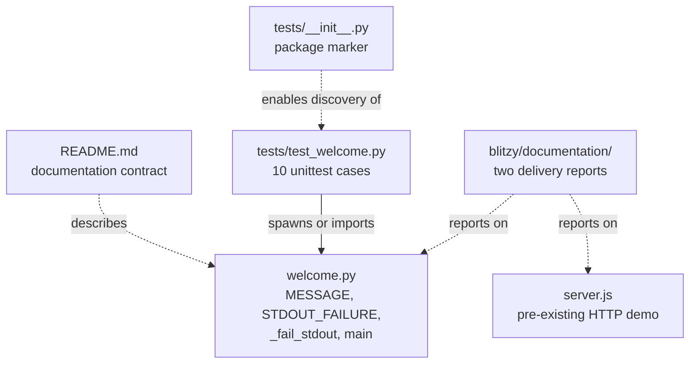

The only edge in that graph that carries executable dependency is the suite's; `server.js` shares no symbol, no process and no output with `welcome.py`.

**Core Technical Approach**

The program holds the contract in two constants and keeps every non-greeting write off standard output:

```python
MESSAGE = "Welcome to Blitzy"
STDOUT_FAILURE = "welcome.py: error: cannot write to standard output"
```

Three implementation decisions carry the guarantees. First, `main()` writes and then explicitly flushes inside the `try`, because standard output is block-buffered when it is not a terminal and the flush is what surfaces a failed write inside the handler instead of at interpreter shutdown (`welcome.py:63-68`). Second, `_fail_stdout()` retargets the dead descriptor at `os.devnull` before writing its diagnostic, so the interpreter's own shutdown flush cannot add a second notice beside the single line (`welcome.py:25-34`), and the same defence is applied to descriptor 2 (`welcome.py:35-52`). Third, the single `raise SystemExit(1)` sits outside every guard (`welcome.py:53`), so the exit status survives descriptor exhaustion and a standard error that cannot be written.

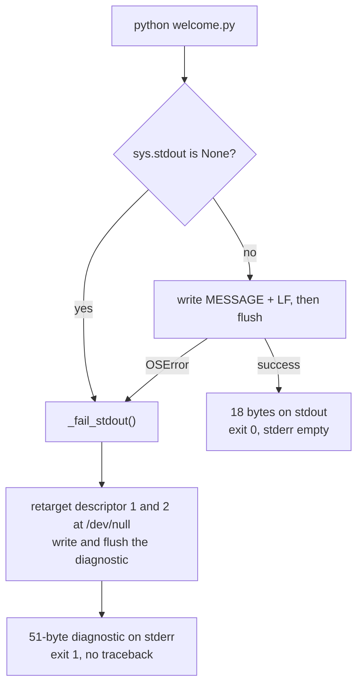

The verification architecture mirrors that split. In-process tests redirect `sys.stdout` and `sys.stderr` into `io.StringIO` to assert the write path cheaply (`tests/test_welcome.py:103-126`); the out-of-process tests spawn a fresh interpreter through `sys.executable` so the process-level contract can be observed at all. Reaching the two distinct failure routes requires two distinct mechanisms: a reader-less `os.pipe()` produces the `OSError` route (`tests/test_welcome.py:36-63`), while only a shell redirection applied by `exec` before the interpreter starts can produce the `sys.stdout is None` route (`tests/test_welcome.py:66-92`). The suite therefore admits exactly three redirection tokens through an allow-list tuple and rejects anything else with `ValueError` before a command line is built (`tests/test_welcome.py:26-33`, `tests/test_welcome.py:81-85`), which is what keeps a shell spawn free of injection surface.

The technology posture is deliberately minimal: Python 3.11 or later with only the standard library (`README.md:5-9`); no packaging metadata, no dependency manifest, no build tooling, no test framework beyond `unittest`, and no coverage, lint or type-check gate anywhere in the repository.

### 1.2.3 Success Criteria

**Measurable Objectives**

Every objective below was executed against the delivered tree in this environment (CPython 3.12.3 on Linux) and is independently reproducible from the repository root.

| Objective | Measure and command | Observed result |
|---|---|---|
| The greeting is byte-exact | `python welcome.py \| wc -c` | `18`; sha256 `2dc7e85a734de043468d7beb8ee5294e0c04440f23fd89b69fd8ea0ee7971951` |
| A successful run is silent on standard error and exits 0 | `python welcome.py > out.bin; echo $?` | exit `0`, standard error empty |
| Arguments are inert | `python welcome.py ignored-argument` | Identical 18 bytes, exit 0 (`od` confirms `Welcome to Blitzy\n`) |
| The import is silent | `python -c "import welcome"` | No output on either stream, exit `0` |
| A closed descriptor 1 reaches the diagnostic | `python welcome.py >&-` | exit `1`, exactly the 51-byte diagnostic line |
| A reader-less pipe reaches the diagnostic | `python welcome.py \| true` | `PIPESTATUS[0]` = `1` |
| A rejecting device reaches the diagnostic | `python welcome.py > /dev/full` | exit `1`, same 51-byte diagnostic line |
| A compound stream failure keeps the status | `python welcome.py 2>&1 \| head -c 0` | `PIPESTATUS[0]` = `1` |
| The committed suite is green | `python -m unittest discover` | `Ran 10 tests` … `OK`, exit `0` |
| The contract holds without an environment | `env -i python -I -S welcome.py` | Same 18 bytes |

**Critical Success Factors**

| Factor | Why the objective depends on it | Evidence |
|---|---|---|
| Standard-library-only source | Any dependency would break the zero-install claim and forbid the unverified install step the contract excludes | `welcome.py:7-8`; no manifest in the tree |
| A single catch type (`OSError`) around the write and its flush | Broadening it would convert unrelated defects into the diagnostic line and contradict the fixed contract | `welcome.py:69`, `welcome.py:27`, `welcome.py:43` |
| `raise SystemExit(1)` outside every guard | Inside a guard, an exhausted descriptor could replace the fixed status with the interpreter's own | `welcome.py:53` |
| The zero-byte `tests/__init__.py` marker | Without it, root-level discovery collects nothing, so the regression net silently disappears | `tests/__init__.py`; discovery from inside `tests/` fails with `import welcome` unresolved |
| README parity with observed behavior | The README is the only specification a consumer reads; a drift between it and the program is a contract defect | `README.md:3-49`, each statement re-verified above |

**Key Performance Indicators**

The current-era delivery report is the repository's own scoring record; its figures are reproduced here as reported, with the independently verified measures marked.

| KPI | Target | Observed | Source |
|---|---|---|---|
| Greeting bytes and digest | 18 bytes, one fixed digest | Met — verified directly | `welcome.py:64`; measured here |
| Committed tests passing | 10 of 10 | Met — `Ran 10 tests` / `OK` | `tests/test_welcome.py`; measured here |
| Planned deliverables complete | 4 of 4 | Met — program, suite, package marker, README | `blitzy/documentation/Project Guide - d45b6a30-….md`, §8 |
| Mapped requirements delivered | 28 of 28 (4 deliverables + 24 requirements) | Met, with 3 items carrying an open thread | same report, §8 |
| Reported completion | — | 78% (40.0 of 51.0 hours) | same report, §1.2 |
| Open items | — | 4 (hardened-failure tests 4 h, stale guide 3 h, Python 3.11/3.12 1 h, macOS 1 h) | same report, §1.4 |
| Runtime dependencies | 0 | Met — standard library only | `welcome.py:7-8` |
| Platform coverage | Linux and macOS terminals | Partial — Linux verified on CPython 3.12.3 here and 3.13.18 in the report; macOS and the 3.11/3.12 lines unexercised | `README.md:7`; report §5.1 row 11 |


## 1.3 Scope

The scope of this specification is the tracked contents of the `welcome` repository at `main` (`e539882`): one Python program, its committed test package, its README, and the two artifacts the tree carries without owning — the pre-existing `server.js` demo and the two narrative delivery reports under `blitzy/documentation/`. Everything outside that boundary, including the 60-plus dated and UUID-suffixed branches visible on `origin`, is out of scope.

### 1.3.1 In-Scope

**Core Features and Functionalities — Must-Have Capabilities**

| Must-have capability | Fixed contract | Evidence |
|---|---|---|
| Emit the greeting | `Welcome to Blitzy` followed by exactly one line feed on standard output; 18 bytes; nothing else ever on that stream | `welcome.py:10`, `welcome.py:64`; `README.md:19-25` |
| Exit successfully | Status 0 with an empty standard error after a successful write | `welcome.py:56-70`; `README.md:25` |
| Disclose an unwritable standard output | Exactly one line, `welcome.py: error: cannot write to standard output`, on standard error; status 1; no traceback; standard output empty | `welcome.py:12`, `welcome.py:15-53`; `README.md:41-49` |
| Survive resource-limited failure states | Descriptor retarget at `/dev/null` and close fallbacks keep the single diagnostic and the fixed status even when no descriptor can be acquired | `welcome.py:26-34`, `welcome.py:44-52`, `welcome.py:53` |
| Import without side effects | Importing the module writes nothing on either stream and returns control to the caller | `welcome.py:73-74`; `tests/test_welcome.py:146-154` |
| Ignore arguments and inputs | No read of `sys.argv`, standard input, `os.environ` or any file | `welcome.py` (no such call); `README.md:37-39` |
| Prove the contract | Ten committed `unittest` cases, all exact-equality assertions, runnable with one standard-library command | `tests/test_welcome.py:95-183`; `README.md:27-35` |
| Specify the contract for its user | README sections for purpose, requirements, run, test, arguments and failed write | `README.md:1-49` |

**Primary User Workflows**

| Workflow | Command | Expected outcome |
|---|---|---|
| Run and accept the checkout | `python welcome.py` | `Welcome to Blitzy`, exit 0, nothing on standard error |
| Verify the behavior contract | `python -m unittest discover` from the repository root | `Ran 10 tests` … `OK`, exit 0 |
| Smoke-check an interpreter or environment | `python welcome.py > /dev/null && echo "interpreter OK"` | The sentinel prints only when the run succeeded |
| Assert the bytes in a pipeline | `python welcome.py > out.bin && sha256sum out.bin` | `2dc7e85a734de043468d7beb8ee5294e0c04440f23fd89b69fd8ea0ee7971951` |
| Exercise the failure contract | `python welcome.py >&- ; echo $?` | One diagnostic line on standard error, `1` |
| Reuse the message in process | `python -c "import welcome; print(welcome.MESSAGE)"` | `Welcome to Blitzy`, exit 0 |

**Essential Integrations**

| Integration point | Mechanism | Constraint |
|---|---|---|
| Host process interface | Standard output, standard error and the process exit status; nothing else crosses the boundary | The whole of the product's observable surface (`welcome.py:56-70`) |
| Test discovery | `python -m unittest discover` reaches `tests.test_welcome` because `tests/__init__.py` marks the package | Must be run from the repository root; run from inside `tests/`, the suite errors because `import welcome` cannot resolve |
| Failure-route harness | `subprocess` spawns of `sys.executable`, one over a deliberately reader-less `os.pipe()` and one through a POSIX shell `exec` with an allow-listed redirection | Only the three tokens in `SUPPORTED_REDIRECTIONS` are accepted (`tests/test_welcome.py:29-33`) |
| Device files | `/dev/null` on the failure path; `/dev/full` as a rejecting device in manual verification | Fixed paths, no configuration (`welcome.py:26`, `welcome.py:45`) |

**Key Technical Requirements**

| Requirement | Value | Evidence |
|---|---|---|
| Language and floor | Python 3.11 or later, declared as a project requirement and not checked at runtime | `README.md:5-9`; no `sys.version_info` comparison in `welcome.py` |
| Dependencies | Standard library only — `os` and `sys` in the program; `io`, `os`, `shlex`, `subprocess`, `sys`, `unittest`, `contextlib`, `pathlib` in the suite | `welcome.py:7-8`; `tests/test_welcome.py:8-17` |
| Encoding and byte count | Pure ASCII output; 18 bytes only while the standard-stream encoding is ASCII-compatible | `welcome.py:10,64`; encoding stated as the boundary of the byte guarantee in the current-era report, §6 |
| Error handling surface | `except OSError` only; no broad catch, no traceback emitted | `welcome.py:27`, `welcome.py:43`, `welcome.py:69` |
| Packaging | None — no manifest, lock file, entry point, version field or build step | `git ls-files`; `README.md:1-49` |

**Implementation Boundaries**

| Dimension | Boundary | Evidence |
|---|---|---|
| System boundary | One short-lived process started by an interpreter, ending when `main()` returns or `SystemExit(1)` is raised; no daemon, server, scheduler or datastore | `welcome.py:56-74`; `python3 welcome.py` exits immediately with status 0 |
| User groups covered | Reviewers and acceptance testers, automation and pipeline authors, repository maintainers and the repository owner; no end-user or tenant population exists | `blitzy/documentation/Project Guide - d45b6a30-….md`, §1.1, §9 |
| Geographic and market coverage | No locale, region or market dimension: output is fixed ASCII with no translation, no time zone, no currency and no formatting rule; supported on Linux and macOS terminals, with Windows named as an unsupported target | `README.md:19-25`; report §9.1 |
| Data domains included | The fixed greeting (18 bytes), the fixed diagnostic (51 bytes), the test constants that assert them (`EXPECTED`, `DIAGNOSTIC`), and the three redirection tokens; no persistent data, no PII, no secret, no user record | `welcome.py:10-12`; `tests/test_welcome.py:21-33` |

### 1.3.2 Out-of-Scope

**Explicitly Excluded Features and Capabilities**

| Excluded capability | Status in the tree | Consequence for a reader |
|---|---|---|
| Configurable or parameterized message | Absent — `MESSAGE` is a single literal (`welcome.py:10`); arguments are ignored (`README.md:37-39`) | The greeting cannot be changed at run time; changing it means editing the constant and the three test constants that assert it |
| Command-line options, flags, help or version output | Absent — nothing reads `sys.argv` | No `--help`, no `--version`, no usage text |
| Configuration, environment variables or profiles | Absent — no config file, no `os.environ` read | Behavior cannot be tuned without a code change |
| Standard-input processing | Absent — the program never reads stdin | Piping data in changes nothing (`tests/test_welcome.py:172-183`) |
| Logging, telemetry, metrics emission or tracing | Absent | The only observable evidence of a run is the byte count, the digest and the exit status |
| Network service, port or endpoint | Absent from the program | Nothing to bind, firewall or health-check |
| File persistence of any kind | Absent except the `/dev/null` retarget on the failure path | The program writes no output file and holds no state between runs |
| Localization, internationalization, non-ASCII output | Absent | Output is fixed ASCII; a non-ASCII-compatible stream encoding changes the byte count while the characters stay correct |
| Packaging, distribution, publishing or versioning | Absent — no manifest, entry point or install step | The program is used in place, out of the checkout |
| Continuous integration, coverage, lint, format or type-check gating | Absent — no workflow file, no tooling, and third-party tooling is precluded by the standard-library-only constraint | Assurance rests on the committed suite plus inspection |
| Windows support | Not a supported target | Platform behavior on Windows is unverified and out of scope |
| A test for the hardened failure branches and the redirection guard's rejection branch | Runtime-proven but uncommitted | A future regression in `welcome.py:26-52` would not be caught by the suite; recorded as 4 h of remaining work |
| Repair of the superseded JavaScript-era report | Not performed — `blitzy/documentation/Project Guide.md` is left as found | That guide still publishes `node Welcome.js` (18 occurrences) and 56 references to a deleted file; recorded as 3 h of remaining work |

**Future Phase Considerations**

The current-era report carries the remaining work universe as 11.0 hours across five categories; none of it changes delivered behavior.

| Future item | Hours | Priority |
|---|---|---|
| Committed tests for the hardened failure branches (descriptor exhaustion, the compound unwritable-stream state) and the redirection guard's rejection branch, with the README suite statement moved with them | 4.0 | Medium |
| Retire or regenerate `blitzy/documentation/Project Guide.md` so the repository's own narrative describes the Python program | 3.0 | High |
| Exercise the Python 3.11 and 3.12 interpreter lines and a macOS terminal | 2.0 | Medium |
| Settle and record the quality-gate posture (inspection-only versus an adopted gate) | 1.0 | Low |
| Tree hygiene: the empty capture directories and a deliberate decision on the undocumented `server.js` | 1.0 | Low |

**Integration Points Not Covered**

| Integration point | Why it is out of scope | Evidence |
|---|---|---|
| The `server.js` HTTP surface | It is a pre-existing demo, unmodified and connected to nothing in the deliverable; it binds the host-global `127.0.0.1:3000` and carries no test | `server.js:3-14`; report §10.B ("never start it, especially not in a shared environment") |
| Consumption of `welcome.py` as a library or package | No module in the tree imports it in production; its only importer is the test module | `tests/test_welcome.py:17` |
| The deleted JavaScript artifact and any Node pipeline | `Welcome.js` was removed in `0e0430f` with no replacement; nothing in the tree references it outside the stale report | `git log --diff-filter=D`; grep for `Welcome.js` finds the stale guide only |
| Any external system — API, database, queue, identity provider, object store | No client, credential, endpoint or schema exists anywhere in the tracked tree | `welcome.py:7-8`; `git ls-files` |

**Unsupported Use Cases**

| Use case | Why it is unsupported |
|---|---|
| Treating the exit status alone as proof the greeting was delivered | On a closed descriptor or a reader-less pipe the status is 1 by contract, but a consumer that ignores standard error cannot distinguish that from any other non-zero exit; assert the bytes or the digest |
| Expecting a diagnostic when no stream can carry one | When both standard output and standard error are unwritable, the only observable outcome is exit status 1 with empty standard error; no implementation can deliver a line with no stream |
| Relying on non-`OSError` stream failures being reported as the fixed diagnostic | The catch is deliberately limited to `OSError`; any other exception surfaces as a traceback with a non-zero status (report §6, "Accepted by design") |
| Following the superseded report's run command | `node Welcome.js` fails with `MODULE_NOT_FOUND` because the file was deleted in `0e0430f`; the supported command is `python welcome.py` |
| Running the suite from inside `tests/` | `import welcome` cannot resolve there; the suite requires the repository root as the working directory (`README.md:35`) |
| Reusing the message text as a configurable banner or localization source | The literal is fixed ASCII, duplicated across the program and the test constants by design, with no formatting or translation hook |
| Running the pre-existing `server.js` as part of acceptance | It is not part of the deliverable, has no automated coverage, and should not be started in a shared environment |


## 1.4 References

- `README.md` — the only user-facing specification: purpose, the Python 3.11-or-later floor as an unchecked requirement, the run command and 18-byte expectation, the test command with its run-from-root requirement, argument agnosticism, and the failed-write behavior.
- `welcome.py` — the product: `MESSAGE` (line 10), `STDOUT_FAILURE` (line 12), `_fail_stdout()` with its descriptor retarget and close fallbacks (lines 15-53), `main()` with the write and explicit flush (lines 56-70), and the silent-import guard (lines 73-74).
- `tests/test_welcome.py` — the executable contract: repository-root and expectation constants (lines 19-33), the `os.pipe` spawn helper (lines 36-63), the shell-redirection helper with its allow-list (lines 66-92), and ten tests in three classes (lines 95-183).
- `tests/__init__.py` — zero-byte package marker whose packaging semantics make root-level `unittest discover` collect `tests.test_welcome`.
- `server.js` — the pre-existing Node HTTP demo (`127.0.0.1:3000`, always `200 text/plain` with `Hello, World!`), byte-identical since commit `1484182` and connected to nothing.
- `blitzy/documentation/Project Guide.md` — the superseded JavaScript-era delivery report: the 83% completion record, the 42 manual checks, the "no automated suite" and "stream-failure not asserted" limitations, the project's Python rule (row 12 of its compliance matrix), and the 56 `Welcome.js` / 18 `node Welcome.js` references that make it stale.
- `blitzy/documentation/Project Guide - d45b6a30-593e-4d39-b896-975c37bb7086.md` — the current Python-era delivery report: the 78% completion figure (40.0 of 51.0 hours), the 4 open items with hours and owners, the 10/10 test results, the compliance matrix row for platform coverage, the risk register (including the encoding boundary and the `OSError`-only catch), the supported-platform statement in §9.1, the port-free statement in §10.B, and the editing rules in §10.F.
- `tests/` — the complete automated test surface: a package marker and one module; no fixtures, no third-party runner.
- `blitzy/` and `blitzy/documentation/` — the only documentation folder in the tree; two delivery reports, no code, no configuration, no assets.
- Repository root (`""`) — seven tracked files and no manifest, lock file, CI workflow, container definition, `.gitignore`, license or data file; confirmed by `ls -a` and `git ls-files`.
- Git metadata (`.git/`) — history and provenance: `main` as the only local branch, 14 commits, the `1484182` README stub (`# hao-backprop-test`) and `server.js`, the JavaScript era (`1cef465`, `6c16ea2`, merged in `39974fd`), the Python era (`2200db0`–`41dd10f`, merged in `e539882`), and the deletion of `Welcome.js` in `0e0430f`.

No web sources were used; every claim in this section rests on the files, the git history and the executed verification commands listed above.


# 2. Product Requirements

## 2.1 Feature Catalog

The catalog holds eight features. Each is a delivered, observable behaviour of the tracked tree at `main` (`e539882`), and each corresponds one-to-one with a must-have capability fixed in §1.3.1: emit the greeting, exit successfully, disclose an unwritable standard output, survive resource-limited failure states, import without side effects, ignore arguments and inputs, prove the contract, and specify the contract. No feature is proposed, planned or aspirational.

Three artifacts in the tree are deliberately not features. The pre-existing `server.js` HTTP demo is an unconnected surface excluded by §1.3.2 and serves its own `Hello, World!` body (`server.js:1-14`). `blitzy/documentation/Project Guide.md` and `blitzy/documentation/Project Guide - d45b6a30-593e-4d39-b896-975c37bb7086.md` are narrative delivery reports that no code path reads. `tests/__init__.py`, a zero-byte package marker, is a packaging precondition of F-007 rather than a feature of its own.

| ID | Feature | Category | Priority · Status |
|---|---|---|---|
| F-001 | Fixed greeting emission | Core output | Critical · Completed |
| F-002 | Successful-run process semantics | Process contract | Critical · Completed |
| F-003 | Unwritable-output disclosure | Failure handling | Critical · Completed |
| F-004 | Resource-limited failure resilience | Failure handling (hardening) | High · Completed |
| F-005 | Silent import | Programmatic interface | High · Completed |
| F-006 | Argument and input agnosticism | CLI interface | Medium · Completed |
| F-007 | Behaviour-contract test suite | Verification | High · Completed |
| F-008 | User-facing contract documentation | Documentation | Medium · Completed |

"Completed" means the behaviour exists in the tracked tree and was reproduced in this environment against `main` (`e539882`); the qualification attached to F-004 and F-007 is that some of their branches are proven at run time but carry no committed test, as recorded in §2.4 and §2.5. Every feature carries requirement baseline **v1.0**, dated to commit `e539882`; no requirement in this section has been reversioned.

### 2.1.1 F-001 — Fixed Greeting Emission

| Attribute | Value | Evidence |
|---|---|---|
| Feature ID | `F-001` | — |
| Feature name | Fixed greeting emission | — |
| Category | Core output (standard output) | — |
| Priority | Critical — the program's entire delivered purpose | `README.md:3` |
| Status | Completed — verified byte-for-byte | 18 bytes, sha256 `2dc7e85a…1951`, exit 0, measured here |

**Overview.** The program writes one fixed line, `Welcome to Blitzy`, followed by a single line feed, to standard output: 17 characters, 18 bytes, nothing else on that stream ever (`welcome.py:10`, `welcome.py:64`).

**Business Value.** The greeting is the artifact an acceptance check asserts. Because the whole output is a constant, a reviewer or a pipeline can compare 18 bytes or their digest instead of parsing prose, which is the value proposition §1.1 records for the deliverable.

**User Benefits.** A reviewer gets one expected line from one command (`README.md:19-25`); a pipeline author gets a stable digest to assert without installing anything (`README.md:25`); an in-process consumer can read the same text from the module constant `MESSAGE` without capturing a stream.

**Technical Context.** The message lives in a single module-level literal and is written once, then explicitly flushed inside the `try` block, because standard output is block-buffered when it is not a terminal and the flush is what makes the transition to F-003 deterministic (`welcome.py:63-68`). No formatting, locale, encoding or configuration input touches the bytes.

| Prerequisite features | System dependencies | External dependencies | Integration requirements |
|---|---|---|---|
| None — F-001 is the base behaviour every other feature is stated against | CPython 3.11 or later (`README.md:7`); standard library `sys` only (`welcome.py:8`) | None — no package, service, port, credential or configuration | A writable standard output; a POSIX shell or the interpreter invocation `python welcome.py` |

### 2.1.2 F-002 — Successful-Run Process Semantics

| Attribute | Value | Evidence |
|---|---|---|
| Feature ID | `F-002` | — |
| Feature name | Successful-run process semantics | — |
| Category | Process contract (exit status) | — |
| Priority | Critical — automation and acceptance both key on the status | §1.3.1 "Exit successfully" |
| Status | Completed — `Ran 10 tests … OK`; `python3 welcome.py; echo $?` → `0` | `tests/test_welcome.py:132-136` |

**Overview.** A successful run ends with exit status 0, an empty standard error and no lingering process: the interpreter running `welcome.py` is the whole application and terminates when `main()` returns (`welcome.py:56-74`).

**Business Value.** The status is the cheapest machine-readable evidence of success, so a smoke check can be a single line (`python welcome.py > /dev/null && echo "interpreter OK"`, report §9.6) with no parser and no test framework.

**User Benefits.** Testers can assert on `$?` alone for the success path; pipelines can gate on it without reading the stream; in-process callers get a plain return instead of a `SystemExit`.

**Technical Context.** On the success path `main()` returns `None` and never raises; `SystemExit(1)` exists only inside the F-003 failure path (`welcome.py:53`). The program registers no handler, thread, socket or temporary file, so nothing outlives the call.

| Prerequisite features | System dependencies | External dependencies | Integration requirements |
|---|---|---|---|
| F-001 — a successful write is what the status reports | The host shell's notion of process exit status; CPython 3.11+ | None | A caller that can observe the wait status (`subprocess.run`, `$?`, `PIPESTATUS[0]`) |

### 2.1.3 F-003 — Unwritable-Output Disclosure

| Attribute | Value | Evidence |
|---|---|---|
| Feature ID | `F-003` | — |
| Feature name | Unwritable-output disclosure | — |
| Category | Failure handling | — |
| Priority | Critical — the second half of the product contract | `README.md:41-49` |
| Status | Completed — verified on four distinct failure routes | exit 1 + exactly 51 diagnostic bytes on `>&-`, reader-less pipe, `/dev/full`, `2>&1 \| head -c 0` |

**Overview.** When standard output cannot be written, the program writes exactly one line, `welcome.py: error: cannot write to standard output`, to standard error, leaves standard output empty, prints no traceback, and exits 1 (`welcome.py:12`, `welcome.py:15-53`).

**Business Value.** It converts a silent data-loss case into a fixed, assertable signal. The superseded JavaScript artifact had the opposite behaviour — `console.log` did not raise, so a rejected stream still exited 0 with the message lost (`blitzy/documentation/Project Guide.md`, §3) — and closing that gap is one of the three reasons §1.1 records for the replacement.

**User Benefits.** An operator sees one line naming the cause instead of a Python traceback; a pipeline author gets a non-zero status that is distinguishable from success without reading either stream; a log consumer gets a single deterministic record rather than one line plus an interpreter shutdown notice.

**Technical Context.** Two routes reach the handler: `sys.stdout is None`, checked before any write (`welcome.py:61-62`), and an `OSError` raised by the write or by the explicit flush (`welcome.py:63-70`). The diagnostic is a second module constant, `STDOUT_FAILURE` (`welcome.py:12`), and the only exception type caught anywhere in the program is `OSError` — six `except OSError` clauses at `welcome.py:27`, `33`, `43`, `46`, `51` and `69`.

| Prerequisite features | System dependencies | External dependencies | Integration requirements |
|---|---|---|---|
| F-001 — the failed write is the write F-001 performs | A standard error stream the process can attempt to write; CPython 3.11+ | `/dev/null` (via `os.devnull`) on the failure path only (`welcome.py:26`, `welcome.py:45`) | A consumer that reads standard error, or that treats exit status 1 as failure |

### 2.1.4 F-004 — Resource-Limited Failure Resilience

| Attribute | Value | Evidence |
|---|---|---|
| Feature ID | `F-004` | — |
| Feature name | Resource-limited failure resilience | — |
| Category | Failure handling (hardening) | — |
| Priority | High — keeps F-003's line and status intact when descriptors are exhausted or both streams are dead | `welcome.py:15-53` |
| Status | Completed — exercised at run time, not covered by a committed test | report §2.1 and §3 "Not Covered"; open item of 4 h |

**Overview.** Every step of the failure handler is guarded, so descriptor exhaustion, a reader-less standard error and a failed `/dev/null` retarget still end in the single diagnostic where one can be delivered and always in exit status 1 (`welcome.py:25-53`).

**Business Value.** The failure contract holds in hostile stream states rather than only in the clean case, so exit status 1 remains a trustworthy signal under resource limits — the property the current-era report lists as "failure paths that survive resource limits" (report §1.3).

**User Benefits.** A consumer never sees the interpreter's own shutdown message in place of the fixed line, and never sees a status other than 1; a caller piping both streams into a closed reader still gets a deterministic status.

**Technical Context.** Three mechanisms carry it: the retarget of descriptor 1 at `os.devnull` before exiting, so the interpreter's shutdown flush of a dead stream cannot raise a second notice (`welcome.py:25-34`); the same defence applied to descriptor 2 after the diagnostic write and flush (`welcome.py:35-52`); and a single `raise SystemExit(1)` outside every guard, so no failure in the handler can replace the fixed status (`welcome.py:53`). When no descriptor can be acquired, the buffered content is discarded and the stream closed so the shutdown flush skips it.

| Prerequisite features | System dependencies | External dependencies | Integration requirements |
|---|---|---|---|
| F-003 — this feature hardens the handler F-003 defines | POSIX descriptor semantics for `os.dup2`, `os.open`, `os.devnull`, `sys.stdout.fileno()` (`welcome.py:26`, `welcome.py:45`) | `/dev/null`; a POSIX platform (Linux or macOS, report §9.1) | A caller that observes only the exit status in states where no stream can carry output |

### 2.1.5 F-005 — Silent Import

| Attribute | Value | Evidence |
|---|---|---|
| Feature ID | `F-005` | — |
| Feature name | Silent import | — |
| Category | Programmatic interface | — |
| Priority | High — keeps the message testable in process and the module side-effect free | `tests/test_welcome.py:146-154` |
| Status | Completed — `python3 -c "import welcome"` writes nothing, exit 0 | measured here; `welcome.py:73-74` |

**Overview.** Importing the module writes nothing on either stream, raises nothing and performs no other side effect: all work sits behind the `if __name__ == "__main__": main()` guard (`welcome.py:73-74`).

**Business Value.** Because the import is inert, the module's constants and `main()` can be exercised inside the test process — `MainCallableTests` calls `main()` directly with redirected streams (`tests/test_welcome.py:103-126`) — which is what lets the suite assert the write path without paying for a subprocess on every case.

**User Benefits.** A consumer can `from welcome import MESSAGE` and obtain the greeting text with no output and no state change (`python -c "import welcome; print(welcome.MESSAGE)"` prints `Welcome to Blitzy`); a test harness can import the module freely.

**Technical Context.** The module's import-time surface is exactly two constants, one private helper and one callable; nothing is invoked at module scope. The import is silent for any importer, not only for the suite, and its only importer in the tree is `tests/test_welcome.py:17`.

| Prerequisite features | System dependencies | External dependencies | Integration requirements |
|---|---|---|---|
| None — the guard is independent of the write path | CPython 3.11+; standard library `os`, `sys` | None | An importer must be able to resolve `welcome` on `sys.path`, which is why the suite requires the repository root as its working directory (`README.md:35`) |

### 2.1.6 F-006 — Argument and Input Agnosticism

| Attribute | Value | Evidence |
|---|---|---|
| Feature ID | `F-006` | — |
| Feature name | Argument and input agnosticism | — |
| Category | CLI interface (input handling) | — |
| Priority | Medium — a fixed part of the CLI contract, though no behaviour depends on the input | `README.md:37-39` |
| Status | Completed — identical tuple with and without an argument | `tests/test_welcome.py:138-144`; measured here |

**Overview.** The program reads no command-line argument, no standard input, no environment variable and no file, so `python welcome.py ignored-argument` behaves exactly like `python welcome.py` (`README.md:37-39`).

**Business Value.** The invocation is uniform: every run has one behaviour, so an acceptance check cannot be perturbed by an argument, a redirected input or a scrubbed environment. A scrubbed environment (`env -i … -I -S`) still produces the same 18 bytes (report §4).

**User Benefits.** Callers can pass arguments freely without changing the outcome, and pipelines can run the program with standard input closed or bound to the null device (`tests/test_welcome.py:172-183`).

**Technical Context.** The absence is structural, not a parsing decision: `welcome.py` contains no reference to `sys.argv`, `os.environ`, `input()`, `open()` or a network call; its only filesystem access is the `/dev/null` retarget on the failure path. The suite pins the property from both directions — out-of-process comparison of an argument-bearing run against a plain one, and two shell redirections that leave status, bytes and standard error unchanged.

| Prerequisite features | System dependencies | External dependencies | Integration requirements |
|---|---|---|---|
| None | The host shell for the redirection cases (`>&-`, `< /dev/null`, `<&-`) | None | Arguments and standard input may be supplied or withheld; neither changes the result |

### 2.1.7 F-007 — Behaviour-Contract Test Suite

| Attribute | Value | Evidence |
|---|---|---|
| Feature ID | `F-007` | — |
| Feature name | Behaviour-contract test suite | — |
| Category | Verification / regression net | — |
| Priority | High — the only automated evidence that the contract holds | `README.md:27-35` |
| Status | Completed — ten tests in three classes, all passing; one coverage gap recorded | `Ran 10 tests … OK` here; report §3 "Not Covered" |

**Overview.** A committed, standard-library-only `unittest` suite pins the exact bytes, the exit statuses, the silent import, argument and input independence and both failed-write routes: ten test methods in three classes, run with `python -m unittest discover` from the repository root (`tests/test_welcome.py:95-183`).

**Business Value.** It replaces the 42 manual checks of the superseded JavaScript era with a committed regression net that anyone can run in one command and no install (`blitzy/documentation/Project Guide.md`, §3; `README.md:35`).

**User Benefits.** A maintainer editing `welcome.py` learns of a contract break in one command; a reviewer sees the specification as assertions rather than prose; a CI job needs nothing beyond the interpreter.

**Technical Context.** Two spawn helpers supply the two mechanisms the process contract needs: a deliberately reader-less `os.pipe()` produces the `OSError` route (`tests/test_welcome.py:36-63`), and a POSIX shell `exec` applies an allow-listed redirection before the interpreter starts, the only way to reach the `sys.stdout is None` route (`tests/test_welcome.py:66-92`). Every output assertion is an exact comparison — 25 `assertEqual` and 1 `assertIsNone`, no membership or truthiness check. The zero-byte `tests/__init__.py` makes root-level discovery reach the module.

| Prerequisite features | System dependencies | External dependencies | Integration requirements |
|---|---|---|---|
| F-001–F-006 — the suite asserts those behaviours | CPython 3.11+; standard library `io`, `os`, `shlex`, `subprocess`, `sys`, `unittest`, `contextlib`, `pathlib`; a POSIX shell for the redirection cases | None — no runner, fixture library or coverage tool | The repository root as working directory, so `import welcome` resolves (`README.md:35`) |

### 2.1.8 F-008 — User-Facing Contract Documentation

| Attribute | Value | Evidence |
|---|---|---|
| Feature ID | `F-008` | — |
| Feature name | User-facing contract documentation | — |
| Category | Documentation | — |
| Priority | Medium — the only specification a consumer reads | `README.md:1-49` |
| Status | Completed — every statement re-verified against observed behaviour | `README.md:3`, `7`, `19-25`, `31-35`, `39`, `43-49` |

**Overview.** `README.md` states the program's purpose, the Python 3.11-or-later floor and the fact that the program does not check it, the run command with its expected 18 bytes, the test command with its run-from-root requirement, argument agnosticism and the failed-write behaviour — six sections in 49 lines (`README.md:1-49`).

**Business Value.** A reader can accept the checkout without reading the program, and the documented contract is the same one F-007 asserts, so documentation drift shows up as a test failure or a review finding.

**User Benefits.** One document answers how to run it, what to expect, how to test it, what arguments do and what a failure looks like — the five questions §1.3.1 records as the primary user workflow.

**Technical Context.** The README is prose with three fenced blocks and no machine-readable metadata; nothing in the tree parses it. Its content was rewritten in place over a 58-byte stub for an unrelated project and now matches the delivered program statement for statement (report §5.2, divergence 2).

| Prerequisite features | System dependencies | External dependencies | Integration requirements |
|---|---|---|---|
| F-001–F-007 — it documents the delivered and asserted contract | Markdown rendering; nothing executable | None | A reader with the checkout; the test command requires the repository root as working directory |


## 2.2 Functional Requirements

34 requirements are enumerated across the eight features. Each carries a `F-XXX-RQ-YYY` identifier, an acceptance criterion that can be decided by a named command or a named test method, a MoSCoW priority and a complexity rating. Complexity measures the implementation and verification effort visible in the code, not business risk: everything here is Low or Medium because the program is 74 lines with two standard-library imports.

Two tables are given per feature. The first states requirement, acceptance criterion, priority and complexity. The second states the requirement's input and output surface, its performance and data properties, and the business rules, data validation, security and compliance constraints that govern it — the three groups of validation rules the requirement owns. Where a requirement is unmet, the row says so and names the repository's own open item.

### 2.2.1 F-001 — Fixed Greeting Emission

| Requirement ID | Description | Acceptance criteria | Priority · Complexity |
|---|---|---|---|
| F-001-RQ-001 | Write the fixed greeting plus exactly one line feed to standard output, and nothing else on that stream | `python3 welcome.py` yields exactly 18 bytes, `Welcome to Blitzy\n`, sha256 `2dc7e85a734de043468d7beb8ee5294e0c04440f23fd89b69fd8ea0ee7971951`; `welcome.py:64` is the only write to standard output in the program; asserted by `test_exit_status_and_exact_stdout` (`tests/test_welcome.py:132-136`) | Must-Have · Low |
| F-001-RQ-002 | Hold the greeting in one unpadded module constant | `welcome.MESSAGE == "Welcome to Blitzy"` and equals its own stripped form; asserted by `test_message_is_exact_and_unpadded` (`tests/test_welcome.py:98-100`); constant declared at `welcome.py:10` | Must-Have · Low |
| F-001-RQ-003 | Flush standard output before returning so the bytes are not left in a block buffer | `python3 welcome.py \| wc -c` reports `18` when standard output is a pipe, not a terminal; explicit flush inside the `try` at `welcome.py:68` | Must-Have · Low |
| F-001-RQ-004 | Produce identical output on repeated invocation, with no state carried between runs or calls | Three successive in-process calls each emit exactly `EXPECTED`; asserted by `test_main_is_repeatable` (`tests/test_welcome.py:121-126`); repeated process runs produce one digest | Should-Have · Low |

| Requirement ID | Input → Output | Performance and data | Validation, security and compliance |
|---|---|---|---|
| F-001-RQ-001 | No input → 18 fixed bytes on standard output, exit 0 | One write and one flush per run; no allocation beyond the literal, no loop, no I/O buffering decision of its own; data is a constant, never derived | Business rule: the message is fixed and is not configurable at run time; security: no untrusted input reaches the stream; compliance: satisfies the delivered request for the exact greeting line |
| F-001-RQ-002 | Module import → `MESSAGE` string available in process | Immutable module-level `str`; 17 characters | Rule: text is ASCII and unlocalised, so the byte count is environment-independent only while the stream encoding is ASCII-compatible (report §6) |
| F-001-RQ-003 | Buffered write → observable bytes before exit | Flush is the only performance-relevant statement; it costs one syscall and removes reliance on interpreter shutdown | Rule: a failed flush must raise inside the handler so the F-003 route is reached rather than a shutdown-time failure |
| F-001-RQ-004 | Repeated invocation → identical bytes | Stateless between runs; no file, cache, environment or counter is consulted or written | Rule: no module-scope mutation, so repeatability cannot degrade over process lifetime |

### 2.2.2 F-002 — Successful-Run Process Semantics

| Requirement ID | Description | Acceptance criteria | Priority · Complexity |
|---|---|---|---|
| F-002-RQ-001 | Exit with status 0 after a successful write | `python3 welcome.py; echo $?` prints `0`; `returncode == 0` asserted in `test_exit_status_and_exact_stdout` (`tests/test_welcome.py:134`) | Must-Have · Low |
| F-002-RQ-002 | Leave standard error empty after a successful run | `stderr == b""` asserted at `tests/test_welcome.py:136` and, in process, at `tests/test_welcome.py:113-119` | Must-Have · Low |
| F-002-RQ-003 | Return normally from `main()` on success, with no `SystemExit` | `main()` returns `None`; `assertIsNone(result)` at `tests/test_welcome.py:110` | Must-Have · Low |
| F-002-RQ-004 | Terminate without leaving a process, thread, socket or temporary file behind | The interpreter is the whole application: no handler, thread, socket or temporary file is registered anywhere in `welcome.py:56-74`, and the command returns immediately with status 0 | Should-Have · Low |

| Requirement ID | Input → Output | Performance and data | Validation, security and compliance |
|---|---|---|---|
| F-002-RQ-001 | Completed write → wait status 0 | Status is set once, by normal termination; `SystemExit(1)` is unreachable on this path | Rule: only the failure path may set a non-zero status; compliance: the status is the contract automation keys on |
| F-002-RQ-002 | Completed write → zero bytes on descriptor 2 | No diagnostic, warning or progress text exists on the success path | Rule: no logging or telemetry channel exists; security: nothing about the environment is disclosed on success |
| F-002-RQ-003 | Direct call of `main()` → `None` | No exception, no return value to interpret | Rule: the function is callable in process, which is what makes the cheap in-process tests possible |
| F-002-RQ-004 | Invocation → prompt termination | No background work, no blocking wait, no resource acquired from the host beyond the three standard streams | Security: no port is bound (report §10.B) and no credential is held |

### 2.2.3 F-003 — Unwritable-Output Disclosure

| Requirement ID | Description | Acceptance criteria | Priority · Complexity |
|---|---|---|---|
| F-003-RQ-001 | Detect an absent standard output before attempting a write and route to the failure handler | `bash -c 'exec python3 welcome.py >&-'` exits 1 with exactly the 51-byte diagnostic; asserted by `test_closed_stdout_descriptor_exits_non_zero_with_one_diagnostic_line` (`tests/test_welcome.py:162-170`); guard at `welcome.py:61-62` | Must-Have · Medium |
| F-003-RQ-002 | Detect an `OSError` raised by the write or by the flush and route to the same handler | A reader-less pipe exits 1 with the same diagnostic; asserted by `test_unwritable_pipe_exits_non_zero_with_one_diagnostic_line` (`tests/test_welcome.py:156-160`); `except OSError` at `welcome.py:69`; also verified against `/dev/full` | Must-Have · Medium |
| F-003-RQ-003 | Emit exactly one fixed diagnostic line, byte for byte, on standard error | `stderr == b"welcome.py: error: cannot write to standard output\n"` (51 bytes), asserted on both routes; constant at `welcome.py:12` | Must-Have · Low |
| F-003-RQ-004 | Exit with status 1 on every failure route | `returncode == 1` asserted at `tests/test_welcome.py:158` and `tests/test_welcome.py:168`; single `raise SystemExit(1)` at `welcome.py:53` | Must-Have · Low |
| F-003-RQ-005 | Emit no traceback and write nothing to standard output on failure | The diagnostic is the whole of standard error on both routes, with no traceback text; `stdout == b""` asserted at `tests/test_welcome.py:159` and `tests/test_welcome.py:169` | Must-Have · Medium |
| F-003-RQ-006 | Catch only `OSError`, never a broader exception class | The program contains six `except OSError` clauses and no other handler (`welcome.py:27`, `33`, `43`, `46`, `51`, `69`); any other exception surfaces as a traceback, an accepted boundary (report §6) | Should-Have · Low |

| Requirement ID | Input → Output | Performance and data | Validation, security and compliance |
|---|---|---|---|
| F-003-RQ-001 | `sys.stdout is None` → one diagnostic line on standard error, exit 1 | Handler runs once, immediately, before any write is attempted | Rule: this route is reachable only when the descriptor is closed before the interpreter starts; security: no input is trusted or parsed |
| F-003-RQ-002 | `OSError` from `write`/`flush` → same single line, exit 1 | The explicit flush is what surfaces the failure inside the handler instead of at shutdown | Rule: `BrokenPipeError` is caught because it subclasses `OSError`; compliance: the fixed line is the product's entire standard-error vocabulary |
| F-003-RQ-003 | Handler entry → 51 fixed bytes on descriptor 2 | One `write` plus one `flush`, guarded by F-004 | Data: the diagnostic is a constant, containing no path, error number, exception text or host detail; security: no information disclosure beyond the fixed sentence |
| F-003-RQ-004 | Handler entry → wait status 1 | Status raised once, from outside every guard | Rule: the status distinguishes failure from success for a consumer that never reads a stream |
| F-003-RQ-005 | Handler entry → empty descriptor 1, no traceback on descriptor 2 | No exception object is printed; the interpreter never gets to render one | Security: no stack, module path, locale or interpreter version is disclosed |
| F-003-RQ-006 | Non-`OSError` failure → unchanged interpreter behaviour (traceback, non-zero status) | Zero overhead on the documented routes | Rule: the catch type is fixed by the contract and must not be widened without a contract change |

### 2.2.4 F-004 — Resource-Limited Failure Resilience

| Requirement ID | Description | Acceptance criteria | Priority · Complexity |
|---|---|---|---|
| F-004-RQ-001 | Retarget descriptor 1 at `os.devnull` before exiting so the interpreter's shutdown flush cannot emit a second notice | The `>&-` route produces exactly one diagnostic line and nothing else on standard error (51 bytes total); retarget at `welcome.py:26` | Should-Have · High |
| F-004-RQ-002 | Fall back to closing `sys.stdout` when the retarget itself raises `OSError` | Close fallback present at `welcome.py:31-34`; the descriptor-exhaustion run recorded in the report still reaches exit 1 (§4) | Should-Have · Medium |
| F-004-RQ-003 | Guard the diagnostic write and flush, and retarget or close descriptor 2 when delivery fails | Retarget at `welcome.py:45`, close fallback at `welcome.py:49-52`; the compound route `python3 welcome.py 2>&1 \| head -c 0` exits 1 with `PIPESTATUS[0]` = 1 | Should-Have · High |
| F-004-RQ-004 | Raise the exit status once, outside every guard, so no handler failure can replace it | `raise SystemExit(1)` at `welcome.py:53`, at function scope after all `try` blocks; status 1 observed in every reached state, including descriptor exhaustion (report §4) | Must-Have · Medium |

| Requirement ID | Input → Output | Performance and data | Validation, security and compliance |
|---|---|---|---|
| F-004-RQ-001 | Dead descriptor 1 → descriptor 1 bound to `/dev/null`; bytes already buffered are never written | Two extra syscalls (`os.open`, `os.dup2`) on the failure path only, with no cost on the success path | Data: the fixed path `os.devnull` is the only filesystem object the program ever opens; security: no user-supplied path is involved |
| F-004-RQ-002 | Failing retarget → closed stream that the shutdown flush skips | Best effort by design: an unacquirable descriptor costs neither the diagnostic nor the status | Rule: a failure inside the handler must never change the fixed outcome |
| F-004-RQ-003 | Undeliverable diagnostic → discarded buffer, closed stream, status 1 | No retry loop, no sleep, no allocation growth; handler cannot block | Rule: when no stream can carry the line, the exit status is the only observable outcome — documented in §1.3.2 |
| F-004-RQ-004 | Any handler state → exit status 1 | Constant work: one raise | Compliance: the exit contract survives descriptor exhaustion and a reader-less standard error, which is the property the report names "failure paths that survive resource limits" |

### 2.2.5 F-005 — Silent Import

| Requirement ID | Description | Acceptance criteria | Priority · Complexity |
|---|---|---|---|
| F-005-RQ-001 | Importing the module writes nothing on either stream | `python3 -c "import welcome"` exits 0 with empty stdout and stderr; asserted by `test_import_writes_nothing` (`tests/test_welcome.py:146-154`) | Must-Have · Low |
| F-005-RQ-002 | Perform no side effect at module scope: all work sits behind the `__main__` guard | `welcome.py:73-74` holds the only call of `main()`; import defines `MESSAGE`, `STDOUT_FAILURE`, `_fail_stdout` and `main` and nothing else | Must-Have · Low |
| F-005-RQ-003 | Expose the greeting constant and the callable to importers without changing behaviour | `python3 -c "import welcome; print(welcome.MESSAGE)"` prints `Welcome to Blitzy`, exit 0 | Should-Have · Low |

| Requirement ID | Input → Output | Performance and data | Validation, security and compliance |
|---|---|---|---|
| F-005-RQ-001 | Import statement → no stream activity, exit 0 | Import cost is module compilation plus two constant assignments | Rule: silence holds for any importer, not only for the suite |
| F-005-RQ-002 | Module load → names defined, no call executed | No I/O, no environment read, no descriptor manipulation at module scope | Security: importing cannot open a descriptor or write to `/dev/null` |
| F-005-RQ-003 | Import + attribute access → greeting text | Public surface is three names plus one helper; nothing is mutated | Rule: the constant stays the single source of the greeting text for both the program and the tests |

### 2.2.6 F-006 — Argument and Input Agnosticism

| Requirement ID | Description | Acceptance criteria | Priority · Complexity |
|---|---|---|---|
| F-006-RQ-001 | Ignore every command-line argument | `python3 welcome.py ignored-argument` returns a `(returncode, stdout, stderr)` tuple identical to the plain run; asserted by `test_command_line_arguments_are_ignored` (`tests/test_welcome.py:138-144`); no `sys.argv` reference exists in `welcome.py` | Must-Have · Low |
| F-006-RQ-002 | Read no standard input | Redirection to `/dev/null` and closure of descriptor 0 each leave exit status 0, the 18 bytes and empty standard error unchanged; asserted by `test_empty_or_absent_input_changes_nothing` (`tests/test_welcome.py:172-183`) | Must-Have · Low |
| F-006-RQ-003 | Read no environment variable and no file | `welcome.py` contains no `os.environ`, `getenv`, `input(` or `open(` call; `env -i python3 -I -S welcome.py` still writes the same 18 bytes (report §4) | Should-Have · Low |

| Requirement ID | Input → Output | Performance and data | Validation, security and compliance |
|---|---|---|---|
| F-006-RQ-001 | Arbitrary argv → identical 18 bytes, exit 0 | Arguments are never parsed, stored or reflected; zero cost | Security: no argument can influence a path, a command line or a decision |
| F-006-RQ-002 | Empty, redirected or closed stdin → unchanged output | Standard input is never opened or read | Rule: piping data in changes nothing — an unsupported use case documented in §1.3.2 |
| F-006-RQ-003 | Scrubbed environment → identical 18 bytes | No configuration, profile or environment-derived default exists | Security: no credential or secret is read; compliance: the only environment lever on the result is the interpreter's stream encoding, recorded as the byte-guarantee boundary (report §6) |

### 2.2.7 F-007 — Behaviour-Contract Test Suite

| Requirement ID | Description | Acceptance criteria | Priority · Complexity |
|---|---|---|---|
| F-007-RQ-001 | Run the whole suite with one standard-library command from the repository root | `python3 -m unittest discover` reports `Ran 10 tests` … `OK` and exits 0 (measured here); documented at `README.md:31-35` | Must-Have · Low |
| F-007-RQ-002 | Keep ten test methods in three classes, with every output comparison an exact equality | Exactly 10 `def test_` methods in `MessageConstantTests`, `MainCallableTests` and `ProcessBehaviourTests` (`tests/test_welcome.py:95`, `103`, `129`); exactly 25 `assertEqual` and 1 `assertIsNone`, no membership or truthiness assertion | Must-Have · Low |
| F-007-RQ-003 | Cover both failed-write routes out of process, each by a mechanism that actually reaches it | `test_unwritable_pipe_exits_non_zero_with_one_diagnostic_line` uses a reader-less `os.pipe()` (`tests/test_welcome.py:36-63`, `156-160`); `test_closed_stdout_descriptor_…` uses a shell `exec` with `>&-` (`tests/test_welcome.py:66-92`, `162-170`) | Must-Have · Medium |
| F-007-RQ-004 | Make discovery incapable of passing silently: a missing collection must fail, not report success | Zero-byte `tests/__init__.py` present; run from inside `tests/`, the suite errors with `ModuleNotFoundError: No module named 'welcome'` rather than reporting zero tests (report §9.7) | Must-Have · Low |
| F-007-RQ-005 | Commit regression coverage for the hardened failure branches (descriptor exhaustion, compound unwritable-stream state, both close fallbacks) and the redirection guard's rejection branch | **Not met.** Those branches are exercised at run time only; the report records 4 h of remaining work and a regression there would not be caught by `python -m unittest discover` (report §3 "Not Covered", §2.2) | Could-Have · Medium |

| Requirement ID | Input → Output | Performance and data | Validation, security and compliance |
|---|---|---|---|
| F-007-RQ-001 | Suite invocation → per-test pass/fail output, exit 0 | Runs in about a tenth of a second here; spawns one interpreter per process-level test | Compliance: no third-party runner, fixture library or coverage tool is used or permitted |
| F-007-RQ-002 | Assertions → pass or fail per comparison | Ten tests, 26 assertions, no shared mutable state between classes | Rule: exact comparisons only, so a partial match cannot pass as a contract |
| F-007-RQ-003 | Spawned child with manipulated descriptors → observable `(status, stdout, stderr)` | Both pipe ends are closed on every path (`tests/test_welcome.py:47-58`), so no descriptor outlives a call | Security: only the three tokens in `SUPPORTED_REDIRECTIONS` reach a command line (`tests/test_welcome.py:29-33`), and the rejection branch raises `ValueError` before any command is built (`tests/test_welcome.py:81-85`) |
| F-007-RQ-004 | Discovery from root → collected module; discovery from `tests/` → import error | Package-marker semantics only; the marker holds no fixture or state | Rule: the root working directory is a hard requirement (`README.md:35`) |
| F-007-RQ-005 | (unmet) future cases → would fail on a regression in `welcome.py:26-52` | Not applicable until the cases exist | Risk: an undetected regression is the report's first named risk (§6) |

### 2.2.8 F-008 — User-Facing Contract Documentation

| Requirement ID | Description | Acceptance criteria | Priority · Complexity |
|---|---|---|---|
| F-008-RQ-001 | State the purpose, the run command and the expected output, including the 18-byte note | `README.md:3` (purpose), `README.md:11-25` (command, expected line, "17 characters followed by a single line feed, 18 bytes in all") | Must-Have · Low |
| F-008-RQ-002 | State the interpreter floor and that the program does not check it | `README.md:5-9`: "Python 3.11 or later", with the explicit note that the program contains no version check | Must-Have · Low |
| F-008-RQ-003 | State the test command and the run-from-root requirement | `README.md:27-35`: `python -m unittest discover`, ten tests, `OK`, exit 0, and why the root directory is required | Must-Have · Low |
| F-008-RQ-004 | State the argument behaviour and the failed-write behaviour | `README.md:37-39` (arguments ignored) and `README.md:41-49` (one diagnostic line, empty standard output, no traceback, exit 1) | Must-Have · Low |
| F-008-RQ-005 | Keep every documented statement identical to observed behaviour | Each statement was re-executed here: 18 bytes and exit 0, `Ran 10 tests`/`OK`, identical output with an argument, diagnostic plus exit 1 on a closed descriptor | Must-Have · Low |

| Requirement ID | Input → Output | Performance and data | Validation, security and compliance |
|---|---|---|---|
| F-008-RQ-001 | Reader → run command and expected result | Prose plus one fenced `bash` block and one fenced `text` block; no machine-readable metadata | Rule: the documented byte count must equal the asserted one, or F-001 and F-008 disagree |
| F-008-RQ-002 | Reader → interpreter floor | Declared requirement, not a runtime check | Rule: the floor is a project requirement; the document must say the program enforces nothing |
| F-008-RQ-003 | Reader → test command and outcome | One command, expected `OK` and exit 0 | Compliance: no install step is documented, because none exists |
| F-008-RQ-004 | Reader → argument and failure semantics | Two short sections, each matching an executable test | Rule: the documented failure line is the exact 51-byte constant |
| F-008-RQ-005 | Documentation ↔ behaviour comparison → no divergence | Six sections, 49 lines | Risk: drift is detected by review only, since no build step compares the README to the program (report §5.2, divergence 2 records the current parity) |


## 2.3 Feature Relationships

Every relationship below is visible in the tracked code as a call, an import, a shared constant or a shared descriptor contract. Nothing here is inferred from intention.

### 2.3.1 Feature Dependencies Map

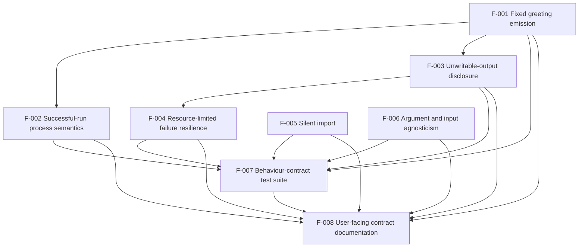

| Dependent feature | Prerequisite | Nature of the dependency | Evidence |
|---|---|---|---|
| F-002 | F-001 | The status reports the outcome of F-001's write; without a write there is no success to signal | `welcome.py:56-70` returns only after the write and flush |
| F-003 | F-001 | The failure handler exists for the write F-001 performs; both routes branch off the same call | `welcome.py:61-70` |
| F-004 | F-003 | Hardening wraps the handler's three steps without changing its output | `welcome.py:15-53` |
| F-007 | F-001–F-006 | The suite asserts each behaviour; six of its ten methods require a spawned or imported program | `tests/test_welcome.py:95-183` |
| F-007 | F-005 | In-process tests call `welcome.main()` only because importing the module is silent and side-effect free | `tests/test_welcome.py:17`, `103-126` |
| F-008 | F-001–F-007 | The README documents exactly the behaviours the suite asserts; each section names one of them | `README.md:3`, `11-25`, `27-35`, `37-39`, `41-49` |

F-005 and F-006 are independent of F-001–F-004: neither the import guard nor the absence of input reads sits on the write path, which is why a failure of the write contract leaves both intact.

### 2.3.2 Integration Points

| Integration point | Direction | Contract carried | Evidence |
|---|---|---|---|
| Standard output (descriptor 1) | Outbound | 18 fixed bytes on success; nothing ever on failure | `welcome.py:64` is the only write to descriptor 1 |
| Standard error (descriptor 2) | Outbound | Empty on success; exactly one 51-byte line on failure | `welcome.py:37-42`, `welcome.py:12` |
| Process exit status | Outbound | 0 on success, 1 on every failure route | `welcome.py:53`; asserted in `tests/test_welcome.py:134`, `158`, `168` |
| In-process import | Inbound (API) | `MESSAGE`, `STDOUT_FAILURE`, `_fail_stdout`, `main`; no side effect on import | `welcome.py:10-74`; `tests/test_welcome.py:17` |
| `/dev/null` | Host filesystem | Descriptor target for the shutdown-flush defence, on the failure path only | `welcome.py:26`, `welcome.py:45` |
| POSIX shell and `subprocess` | Host process interface | Spawned children with manipulated descriptors; only three allow-listed redirections reach a command line | `tests/test_welcome.py:36-92` |
| `unittest` discovery | Test interface | Walks the repository root, imports `tests.test_welcome`, runs ten methods | `tests/__init__.py`; `README.md:31-35` |

### 2.3.3 Shared Components

| Shared component | Consumers | What is shared | Evidence |
|---|---|---|---|
| `MESSAGE` constant (`welcome.py:10`) | F-001 write path; `test_message_is_exact_and_unpadded`; documented output in F-008 | The single source of the greeting text in the program; the suite asserts the constant and separately holds its own `EXPECTED` literal, so the two must be updated together | `welcome.py:10`, `64`; `tests/test_welcome.py:21`, `99`, `111` |
| `STDOUT_FAILURE` constant (`welcome.py:12`) | F-003 diagnostic write; `DIAGNOSTIC` bytes in the suite; documented failure line in F-008 | One fixed sentence, duplicated as bytes in the test module by design | `welcome.py:12`, `37`; `tests/test_welcome.py:22` |
| `_fail_stdout()` (`welcome.py:15-53`) | Both failure routes of F-003 and every hardened step of F-004 | The only failure handler in the product | `welcome.py:62`, `70` |
| `tests/__init__.py` | F-007 discovery | Zero-byte package marker; holds no fixture, helper or state | `tests/__init__.py` |
| Redirection allow-list (`SUPPORTED_REDIRECTIONS`) | Both shell-based tests of F-007 | The only three shell operators the suite will place on a command line | `tests/test_welcome.py:26-33`, `81-85` |

### 2.3.4 Common Services

There are none. The product starts no service, binds no port, opens no connection, consumes no queue, holds no credential and reads no configuration: `welcome.py` imports only `os` and `sys`, and the tracked tree contains no manifest, service definition, container file or environment file. The one shared host facility is the null device, used exclusively on the failure path as described in §2.3.2.


## 2.4 Implementation Considerations

The program's whole toolchain is the interpreter: `python3 -m py_compile welcome.py tests/__init__.py tests/test_welcome.py` exits 0 with no output, and `python3 -m unittest discover` is the verification gate. No linter, formatter, type checker, coverage tool or build step exists anywhere in the tree, and the standard-library-only constraint precludes adding one.

### 2.4.1 F-001 — Fixed Greeting Emission

| Aspect | Consideration | Evidence |
|---|---|---|
| Technical constraints | Python 3.11 or later with `os` and `sys` only; the greeting is a module literal; `welcome.py:64` must remain the sole write to standard output | `welcome.py:7-10`, `64` |
| Performance requirements | One write and one flush per run; 20 sequential runs took 258 ms here (~13 ms each), essentially all of it interpreter start-up | measured here; `welcome.py:63-68` |
| Scalability considerations | Stateless and single-shot: no shared file, handle or counter, so any number of concurrent runs are independent; throughput is bounded only by process start-up | `welcome.py:56-74`; no module-scope state |
| Security implications | No input of any kind reaches the bytes, so there is no injection, deserialization or path surface on this path | `welcome.py` contains no `sys.argv`, `os.environ`, `input(` or `open(` reference |
| Maintenance requirements | A message change touches `MESSAGE`, the suite's `EXPECTED`, the README's byte note and any recorded digest; the 18-byte claim is ASCII-dependent | `welcome.py:10`; `tests/test_welcome.py:21`; `README.md:25`; report §6 encoding boundary |

### 2.4.2 F-002 — Successful-Run Process Semantics

| Aspect | Consideration | Evidence |
|---|---|---|
| Technical constraints | Exit status 0 and empty standard error must hold for every successful run; `SystemExit(1)` must stay off the success path | `welcome.py:53`, `56-70` |
| Performance requirements | The status costs nothing extra: it is a normal interpreter exit after `main()` returns | `welcome.py:73-74` |
| Scalability considerations | No process-level resource is acquired, so runs can be parallelised without contention — there is no port to collide on and no file to lock | report §10.B (no port reserved) |
| Security implications | Nothing about the host, interpreter or environment is disclosed on success; standard error carries no banner or version text | `README.md:25`; `welcome.py:63-68` |
| Maintenance requirements | Any new diagnostic text on success breaks `test_main_writes_nothing_to_stderr` and `test_exit_status_and_exact_stdout` | `tests/test_welcome.py:113-119`, `132-136` |

### 2.4.3 F-003 — Unwritable-Output Disclosure

| Aspect | Consideration | Evidence |
|---|---|---|
| Technical constraints | Exactly one 51-byte line on standard error, empty standard output, no traceback, status 1; only `OSError` is caught, the exclusive catch type across six clauses | `welcome.py:12`, `27`, `33`, `43`, `46`, `51`, `69` |
| Performance requirements | The handler runs at most once per process: one guarded write, one guarded flush, up to two retargets | `welcome.py:15-53` |
| Scalability considerations | No retry, no backoff, no queue: an unwritable stream fails immediately rather than accumulating work | `welcome.py:35-52` |
| Security implications | The diagnostic is a fixed sentence with no path, errno, exception text or host detail, so a failure cannot leak environment information; a non-`OSError` failure still shows a traceback by design | `welcome.py:12`; report §6 "Accepted by design" |
| Maintenance requirements | The catch type and the two strings are contract: widening the catch or editing the line breaks `DIAGNOSTIC` equality in two tests and the README's §Behaviour on a failed write | `tests/test_welcome.py:156-170`; `README.md:41-49` |

### 2.4.4 F-004 — Resource-Limited Failure Resilience

| Aspect | Consideration | Evidence |
|---|---|---|
| Technical constraints | POSIX descriptor semantics for `os.dup2`, `os.open`, `os.devnull` and `fileno()`; `raise SystemExit(1)` must stay outside every guard | `welcome.py:26`, `45`, `53` |
| Performance requirements | Two extra syscalls at most, on the failure path only; the success path is untouched | `welcome.py:25-34` |
| Scalability considerations | The handler cannot block or loop, so a failure under descriptor exhaustion cannot amplify | `welcome.py:15-53` |
| Security implications | The only path opened is the fixed `os.devnull`; descriptor manipulation is confined to the process's own descriptors 1 and 2; no user-supplied path is involved | `welcome.py:26`, `45` |
| Maintenance requirements | Highest change-sensitivity in the program: these branches carry no committed test, so the report's first risk applies and the handler must be re-verified by hand on any edit (4 h of pending coverage) | `welcome.py:15-53`; report §3 "Not Covered", §6 risk 1 |

### 2.4.5 F-005 — Silent Import

| Aspect | Consideration | Evidence |
|---|---|---|
| Technical constraints | No module-scope side effect; the only call of `main()` sits behind the `__main__` guard | `welcome.py:73-74` |
| Performance requirements | Import costs compilation plus four definitions — about 14 ms here, all interpreter start-up | measured here |
| Scalability considerations | Import is idempotent and holds no state, so repeated imports in one process are free after the first | `welcome.py:10-74`; no mutable module state |
| Security implications | Importing cannot open a descriptor, write to `/dev/null` or touch a stream, so an embedding host gains no side effect from importing the module | `welcome.py:15-70` (all behaviour inside functions) |
| Maintenance requirements | Any top-level statement added outside the guard breaks `test_import_writes_nothing`, the cheapest and most load-bearing test of the contract | `tests/test_welcome.py:146-154` |

### 2.4.6 F-006 — Argument and Input Agnosticism

| Aspect | Consideration | Evidence |
|---|---|---|
| Technical constraints | No read of `sys.argv`, standard input, `os.environ` or any file; the absence is structural rather than a parsing policy | `welcome.py` (no such reference); `README.md:37-39` |
| Performance requirements | Zero: no argument parsing, no input buffering, no environment lookup | `welcome.py:56-70` |
| Scalability considerations | Behaviour cannot vary with the call site, so any number of differently-invoked runs produce one result | `tests/test_welcome.py:138-144` |
| Security implications | No secret or configuration value can be read, because none is read at all; the only environment lever on the result is the interpreter's stream encoding | report §6; report §10.E |
| Maintenance requirements | Introducing any input channel is a contract change that requires updating `README.md` §Arguments and the suite's argument and input cases | `tests/test_welcome.py:138-144`, `172-183` |

### 2.4.7 F-007 — Behaviour-Contract Test Suite

| Aspect | Consideration | Evidence |
|---|---|---|
| Technical constraints | `unittest` from the standard library; `sys.executable` for spawns; the program resolved through `ROOT`, not the working directory; the redirection allow-list must be extended rather than bypassed | `tests/test_welcome.py:19-33`, `36-92` |
| Performance requirements | Ten tests in about 0.1 s here, dominated by three spawned interpreters | `Ran 10 tests in 0.102s` |
| Scalability considerations | Hermetic and order-independent; no fixture, no shared state, no external service, so cases can be added without coupling | `tests/test_welcome.py:95-183` |
| Security implications | Shell spawns quote both path operands and admit only three fixed redirection tokens, raising `ValueError` for anything else before a command line exists | `tests/test_welcome.py:81-88` |
| Maintenance requirements | The suite must run from the repository root — run from inside `tests/`, it errors because `import welcome` cannot resolve; the hardened failure branches and the guard's rejection branch still need committed cases (4 h open item) | `README.md:35`; report §3 "Not Covered", §2.2 |

### 2.4.8 F-008 — User-Facing Contract Documentation

| Aspect | Consideration | Evidence |
|---|---|---|
| Technical constraints | Plain Markdown with three fenced blocks; nothing parses or validates it, so parity rests on review | `README.md:1-49` |
| Performance requirements | Not applicable — documentation has no runtime cost or path. | `README.md` is inert text |
| Scalability considerations | Six fixed sections covering one behaviour set; new behaviour would need a new section and a matching test | `README.md:1`, `5`, `11`, `27`, `37`, `41` |
| Security implications | No credential, endpoint, host or file path is published beyond the commands the user runs | `README.md:1-49` |
| Maintenance requirements | Every statement must move with the code; the repository also still ships a superseded JavaScript-era guide whose 18 `node Welcome.js` commands now fail, the one release-blocking item of 3 h | report §5.2 divergence 4; `blitzy/documentation/Project Guide.md` |


## 2.5 Traceability Matrix

Every requirement in §2.2 is traced below to the capability it answers, the artifact that proves it and its status at baseline v1.0. Verification named as a test method is committed and runs under `python3 -m unittest discover`; verification named as a command was executed against `main` (`e539882`) in this environment.

### 2.5.1 Feature-to-Capability Traceability

| Feature | §1.3.1 must-have capability | Requirements | Verified by |
|---|---|---|---|
| F-001 | Emit the greeting | F-001-RQ-001…004 | 18 bytes and digest measured; `test_message_is_exact_and_unpadded`, `test_main_is_repeatable`, `test_exit_status_and_exact_stdout` |
| F-002 | Exit successfully | F-002-RQ-001…004 | `test_exit_status_and_exact_stdout`, `test_main_writes_exact_bytes_to_stdout`, `test_main_writes_nothing_to_stderr` |
| F-003 | Disclose an unwritable standard output | F-003-RQ-001…006 | `test_unwritable_pipe_exits_non_zero_with_one_diagnostic_line`, `test_closed_stdout_descriptor_exits_non_zero_with_one_diagnostic_line` |
| F-004 | Survive resource-limited failure states | F-004-RQ-001…004 | Runtime runs recorded in report §4; no committed test |
| F-005 | Import without side effects | F-005-RQ-001…003 | `test_import_writes_nothing`; `python3 -c "import welcome; print(welcome.MESSAGE)"` |
| F-006 | Ignore arguments and inputs | F-006-RQ-001…003 | `test_command_line_arguments_are_ignored`, `test_empty_or_absent_input_changes_nothing`; `env -i` run |
| F-007 | Prove the contract | F-007-RQ-001…005 | `python3 -m unittest discover` → `Ran 10 tests … OK`; source counts; one requirement open |
| F-008 | Specify the contract for its user | F-008-RQ-001…005 | `README.md` line-by-line inspection against re-executed behaviour |

### 2.5.2 Requirement Traceability Matrix

| Requirement ID | Verification | Status |
|---|---|---|
| F-001-RQ-001 | `python3 welcome.py \| wc -c` → 18; sha256 `2dc7e85a…1951`; `test_exit_status_and_exact_stdout` | Met |
| F-001-RQ-002 | `test_message_is_exact_and_unpadded` | Met |
| F-001-RQ-003 | `python3 welcome.py \| wc -c` → 18 through a pipe | Met |
| F-001-RQ-004 | `test_main_is_repeatable` (three successive calls) | Met |
| F-002-RQ-001 | `test_exit_status_and_exact_stdout`; `python3 welcome.py; echo $?` → 0 | Met |
| F-002-RQ-002 | `test_main_writes_nothing_to_stderr`, `test_exit_status_and_exact_stdout` | Met |
| F-002-RQ-003 | `test_main_writes_exact_bytes_to_stdout` (`assertIsNone`) | Met |
| F-002-RQ-004 | Command returns immediately; no handler, thread, socket or temp file in source | Met |
| F-003-RQ-001 | `test_closed_stdout_descriptor_exits_non_zero_with_one_diagnostic_line`; `bash -c 'exec python3 welcome.py >&-'` | Met |
| F-003-RQ-002 | `test_unwritable_pipe_exits_non_zero_with_one_diagnostic_line`; `>/dev/full` run | Met |
| F-003-RQ-003 | Equals `DIAGNOSTIC` in both committed tests; 51 bytes measured | Met |
| F-003-RQ-004 | `returncode == 1` in both committed tests | Met |
| F-003-RQ-005 | `stdout == b""` in both committed tests; no traceback in either capture | Met |
| F-003-RQ-006 | Source inspection: six `except OSError`, no other handler | Met |
| F-004-RQ-001 | Single diagnostic, no shutdown notice, on the `>&-` route (report §4) | Met — uncommitted |
| F-004-RQ-002 | Close fallback present; descriptor-exhaustion run reaches status 1 (report §4) | Met — uncommitted |
| F-004-RQ-003 | `python3 welcome.py 2>&1 \| head -c 0` → `PIPESTATUS[0]` = 1 (report §4) | Met — uncommitted |
| F-004-RQ-004 | `raise SystemExit(1)` at function scope outside every `try`; status 1 in every reached state | Met |
| F-005-RQ-001 | `test_import_writes_nothing`; `python3 -c "import welcome"` | Met |
| F-005-RQ-002 | Source inspection of the module-level surface | Met |
| F-005-RQ-003 | `python3 -c "import welcome; print(welcome.MESSAGE)"` → `Welcome to Blitzy` | Met |
| F-006-RQ-001 | `test_command_line_arguments_are_ignored` | Met |
| F-006-RQ-002 | `test_empty_or_absent_input_changes_nothing` (two subTests) | Met |
| F-006-RQ-003 | Source sweep for `os.environ`/`getenv`/`open(`; `env -i python3 -I -S welcome.py` → same 18 bytes | Met |
| F-007-RQ-001 | `python3 -m unittest discover` → `Ran 10 tests` / `OK` / exit 0 | Met |
| F-007-RQ-002 | Static count: 10 test methods, 25 `assertEqual`, 1 `assertIsNone` | Met |
| F-007-RQ-003 | The two named failed-write tests, one per mechanism | Met |
| F-007-RQ-004 | Zero-byte marker; run from `tests/` fails with `ModuleNotFoundError` instead of reporting zero tests | Met |
| F-007-RQ-005 | None — no committed case exists for the hardened branches or the rejection branch | **Open** (4 h, report §2.2) |
| F-008-RQ-001 | `README.md:3`, `README.md:11-25` | Met |
| F-008-RQ-002 | `README.md:5-9` | Met |
| F-008-RQ-003 | `README.md:27-35` | Met |
| F-008-RQ-004 | `README.md:37-39`, `README.md:41-49` | Met |
| F-008-RQ-005 | Every README statement re-executed and matched | Met |

Coverage of the matrix: 34 requirements, 33 met, 1 open. Of the 33 met, 30 are proven by a committed test or by execution in this environment, and 3 — F-004-RQ-001, F-004-RQ-002 and F-004-RQ-003 — rest on runtime evidence with no committed case.

### 2.5.3 Cross-References to Related Specification Sections

| Feature | Related section | Related diagram or record |
|---|---|---|
| F-001 | §1.2.2 Primary System Capabilities; §1.3.1 core features | §1.2.2 write-path flowchart (`sys.stdout is None?` → write → 18 bytes) |
| F-002 | §1.2.3 Measurable Objectives | §1.2.2 write-path flowchart, success branch |
| F-003 | §1.2.2 Major System Components; §1.3.2 Unsupported Use Cases | §1.2.2 write-path flowchart, failure branch |
| F-004 | §1.3.1 "Survive resource-limited failure states" | §2.3.1 dependency map (F-003 → F-004) |
| F-005 | §1.2.2 Primary System Capabilities | §1.2.2 component graph (suite imports the program) |
| F-006 | §1.3.2 Excluded capabilities (stdin, configuration, options) | §2.3.1 dependency map (F-006 independent of the write path) |
| F-007 | §1.2.2 verification architecture; §1.3.1 "Prove the contract" | §1.2.2 component graph (`tests/__init__.py` enables discovery) |
| F-008 | §1.3.1 primary user workflows; §1.1 stakeholder table | §2.3.1 dependency map (F-007 → F-008) |

### 2.5.4 Requirement Version Tracking

| Version | Baseline | Change | Requirement count |
|---|---|---|---|
| v1.0 | `main` at `e539882` (merge of PR #23) | Initial recorded set: 34 requirements across 8 features | 34 |

No requirement has been reversioned. F-007-RQ-005 is recorded at v1.0 with status Open; the repository's own open-item list prices it at 4 h (report §2.2).


## 2.6 Assumptions and Constraints

The assumptions below hold for every requirement in §2.2 and are re-stated here because a violation changes what a requirement means rather than whether it is met. The constraints are properties of the delivered artifact that any change must preserve.

### 2.6.1 Assumptions

| ID | Assumption | Impact if violated | Evidence |
|---|---|---|---|
| A-01 | A CPython 3.11 or later interpreter is available as `python` or `python3` | The program cannot run; the documented floor is a project requirement, not a runtime check | `README.md:5-9`; report §9.1 |
| A-02 | A POSIX shell is available to the suite's redirection tests | `test_closed_stdout_descriptor_…` cannot reach the `sys.stdout is None` route, so one half of the failure contract becomes unprovable | `tests/test_welcome.py:66-92` |
| A-03 | The standard-stream encoding is ASCII-compatible | The characters stay correct but the byte count changes, so the 18-byte and digest criteria no longer hold | report §6, §10.E (`PYTHONIOENCODING`) |
| A-04 | The suite is run from the repository root | `import welcome` cannot resolve from inside `tests/`, so discovery errors instead of passing | `README.md:35`; report §9.7 |
| A-05 | `/dev/null` exists and is writable | The shutdown-flush defence degrades to the close fallback; the exit status and the single diagnostic still hold | `welcome.py:26`, `31-34`, `45`, `49-52` |
| A-06 | The target platform is a Linux or macOS terminal; Windows is not supported | Platform behaviour on Windows is unverified and outside the contract | report §9.1 |
| A-07 | No third-party tooling is installed or installable | A lint, type or coverage gate cannot be adopted without a contract change | report §5.2 divergence on the linter rule; §10.F |
| A-08 | The greeting text is fixed by the delivered request and is not a user parameter | If it became configurable, F-001, F-006 and F-008 would all change meaning | `README.md:3`; `welcome.py:10` |
| A-09 | The Python 3.11 and 3.12 interpreter lines and macOS behave as the verified Linux/CPython 3.13 line does | The claim is currently supported by inspection only; a divergence would invalidate the platform row of the compliance matrix | report §5.1 row 11 (PARTIAL); report §1.4 |
| A-10 | `blitzy/documentation/Project Guide.md` remains pre-existing inert content that no code path reads | Retiring or regenerating it is a documentation decision, not a functional change; leaving it blocks release from the repository's own narrative | report §5.2 divergence 4; `blitzy/documentation/Project Guide.md` |

### 2.6.2 Constraints

| ID | Constraint | Why it binds | Evidence |
|---|---|---|---|
| C-01 | Standard library only; no manifest, lock file, CI workflow, container file or build step may be added | The zero-install posture is the deliverable's stated value, and no dependency resolution path exists | `welcome.py:7-8`; `git ls-files` |
| C-02 | The only exception type caught anywhere is `OSError` | A broader catch would turn unrelated defects into the fixed diagnostic and contradict the contract | six `except OSError` clauses in `welcome.py`; report §6 |
| C-03 | `welcome.py:64` remains the sole write to standard output, and the greeting remains a literal | Any additional write breaks the 18-byte guarantee and the "nothing else ever on that stream" rule | `welcome.py:10`, `64`; `README.md:25` |
| C-04 | `raise SystemExit(1)` stays outside every guard | Inside a guard, descriptor exhaustion could replace the fixed status with the interpreter's own | `welcome.py:53` |
| C-05 | `tests/__init__.py` stays present and zero-byte | Without the marker, root-level discovery collects nothing and the regression net disappears silently | `tests/__init__.py`; `README.md:31-35` |
| C-06 | Only the three allow-listed shell redirections may reach a command line | Keeps the shell spawn free of injection surface; a new redirection must be added to the tuple | `tests/test_welcome.py:26-33`, `81-85` |
| C-07 | No `.gitignore` may be added; `__pycache__` must be kept out of commits by hand | Running the suite writes bytecode directories into the checkout | report §9.7, §10.F |
| C-08 | `server.js` must not be started in a shared environment, and it carries no test | It binds the host-global `127.0.0.1:3000` and belongs to no part of the deliverable | `server.js:3-14`; report §10.B |
| C-09 | Windows is not a supported target | Behaviour outside Linux and macOS is unverified | report §9.1 |
| C-10 | The two narrative guides are not part of the product's executable surface | Neither is read by any code path, so neither can affect a requirement's outcome | `blitzy/documentation/`; `git ls-files` |


## 2.7 References

- `welcome.py` — the product under every feature: `MESSAGE` (line 10), `STDOUT_FAILURE` (line 12), `_fail_stdout()` with its guarded retargets and close fallbacks (lines 15-53), `main()` with the write and explicit flush (lines 56-70), the `__main__` guard (lines 73-74), the six `except OSError` clauses (lines 27, 33, 43, 46, 51, 69), the single `raise SystemExit(1)` (line 53), and the absence of any `sys.argv`, `os.environ`, `input(` or `open(` reference.
- `README.md` — the documentation contract behind F-008 and the declared behaviour behind F-001, F-002, F-006 and F-003: purpose (line 3), the Python 3.11-or-later floor with its no-check caveat (lines 5-9), the run command and 18-byte expectation (lines 11-25), the test command with the run-from-root requirement (lines 27-35), argument agnosticism (lines 37-39), the failed-write behaviour (lines 41-49).
- `tests/test_welcome.py` — the executable contract behind F-007: `ROOT`/`PROGRAM`/`EXPECTED`/`DIAGNOSTIC` and the redirection allow-list (lines 19-33), the reader-less-pipe spawn helper (lines 36-63), the shell-`exec` helper with its `ValueError` guard (lines 66-92), and ten tests in three classes (lines 95-183) with 25 `assertEqual` and 1 `assertIsNone`.
- `tests/__init__.py` — zero-byte package marker whose packaging semantics make root-level `unittest discover` collect `tests.test_welcome`, the precondition of F-007-RQ-004.
- `server.js` — the pre-existing Node HTTP demo on `127.0.0.1:3000` answering `200 text/plain` with a 14-byte `Hello, World!` body (lines 1-14); cited only to establish that it is not a feature and must not be started in a shared environment.
- `blitzy/documentation/Project Guide - d45b6a30-593e-4d39-b896-975c37bb7086.md` — the current Python-era delivery report: the 78% completion figure (40.0 of 51.0 hours) and 4/4 deliverables (§1.2), the eight key accomplishments (§1.3), the four open items with owners and hours (§1.4), the component-hour itemization (§2.1) and remaining work catalogue (§2.2), the ten-test result table and the "Not Covered" list (§3), the runtime validation matrix including the four failure routes and descriptor exhaustion (§4), the twelve-row compliance matrix and the superseded-guide divergence (§5.1, §5.2 divergence 4), the risk register including the encoding boundary and the `OSError`-only catch boundary (§6), the completion summary (§8), and the platform, port, environment-variable and editing rules (§9.1, §10.B, §10.E, §10.F).
- `blitzy/documentation/Project Guide.md` — the superseded JavaScript-era report: the 83% completion record, the 42 manual checks, the "no automated suite" and "stream-failure not asserted" limitations cited as the gaps `welcome.py` closes (§3), the project rule mandating Python products (row 12 of its compliance matrix, §5.2), and the 56 `Welcome.js` references and 18 `node Welcome.js` commands that make it stale.
- `tests/` — the complete automated test surface: one package marker and one module, no fixtures, no third-party runner, no data file.
- `blitzy/documentation/` and `blitzy/` — the repository's only documentation folder: two narrative delivery reports, no code, no configuration, no assets.
- Repository root (`""`) — seven tracked files and no manifest, lock file, CI workflow, container definition, `.gitignore`, license or data file; the source of the zero-install and standard-library-only constraints in §2.6.
- Git metadata (`.git/`) — provenance and status basis for every feature's `Completed` status: `main` as the only local branch, the `1484182` upload that introduced `server.js` and a README stub, the JavaScript era (`1cef465`, `6c16ea2`), the Python era (`2200db0`–`41dd10f`, merged in `e539882`), and the deletion of `Welcome.js` in `0e0430f`.

No web sources were used; every claim in this section rests on the files, the git history and the commands executed against `main` (`e539882`) in this environment (CPython 3.12.3, Linux).


# 3. Technology Stack

## 3.1 Programming Languages

The repository is written in two languages with disjoint purposes. Python 3 carries the product (`welcome.py`) and its verification suite (`tests/test_welcome.py`, `tests/__init__.py`); JavaScript carries one pre-existing HTTP demo (`server.js`) that nothing imports and that no part of the deliverable serves. Markdown carries the specification (`README.md`) and two narrative delivery reports under `blitzy/documentation/`. No compilation, transpilation, type-checking or packaging step exists anywhere in the tree, so the languages are used only as the host interpreters execute them.

### 3.1.1 Language Inventory by Platform and Component

| Component | Path | Language and dialect | Declared version floor | Executing runtime | Evidence |
|---|---|---|---|---|---|
| Product program | `welcome.py` | Python 3 — module docstring, two module constants, one private helper, one public entry point, `__main__` guard | Python 3.11 or later | CPython, invoked as `python` or `python3` | `README.md:5-9`; `welcome.py:1-75` |
| Behaviour-contract suite | `tests/test_welcome.py` | Python 3 — three `unittest.TestCase` classes, ten test methods, two spawn helpers | Same floor as the program under test | CPython, both in process and as spawned children | `tests/test_welcome.py:1-184` |
| Test package marker | `tests/__init__.py` | Python package marker, zero bytes, no statement | Same floor | CPython import machinery | Zero-byte file; `git ls-files` |
| Pre-existing HTTP demo | `server.js` | JavaScript (CommonJS) using ES2015 syntax — `const`, arrow functions, one template literal | Node.js LTS; v24.21.0 recorded as the reference line and v22.23.2 as the supported floor | Node.js | `server.js:1-14`; `blitzy/documentation/Project Guide.md` §9.1, §10.D |
| User-facing specification | `README.md` | Markdown — prose plus three fenced code blocks, no executable content | Not applicable | None | `README.md:1-49` |
| Delivery records | `blitzy/documentation/Project Guide.md`, `blitzy/documentation/Project Guide - d45b6a30-593e-4d39-b896-975c37bb7086.md` | Markdown — narrative chapters, tables, Mermaid charts | Not applicable | None | `git ls-files` |

No compiled language, no TypeScript, no native mobile or desktop language (Swift, Kotlin, Objective-C) and no transpiled source exists in the tree. The JavaScript that once carried the greeting (`Welcome.js`) was deleted in commit `0e0430f` ("Remove Welcome.js, superseded by the Python welcome.py program") and is absent from both the working tree and `git ls-files`.

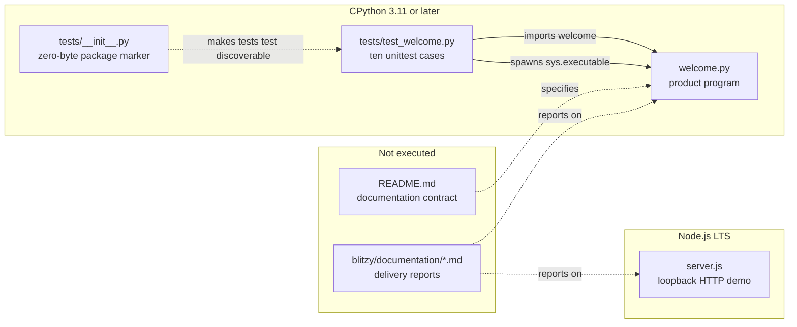

Only the two edges between `tests/test_welcome.py` and `welcome.py` carry an executable dependency; `server.js` shares no symbol, process or output with the product.

### 3.1.2 Selection Criteria and Justification

**Python governs new product code.** The project rule recorded in the JavaScript-era report reads "Create a product in Python clearly separating each flow and feature. Ensure the performance of the application is not impacted by this code" (`blitzy/documentation/Project Guide.md` §5.1, row 12). The JavaScript era recorded that clause as knowingly unmet; the Python era satisfies it by delivering `welcome.py`. The rule's second clause — separated flows — is visible in the program's structure: `main()` owns the successful write (`welcome.py:56-70`) and `_fail_stdout()` owns the failed one (`welcome.py:15-53`).

**The standard library is sufficient for the fixed contract.** The program needs stream objects, an exact `OSError` boundary and POSIX descriptor manipulation to survive a dead standard output; `os` and `sys` supply all three (`welcome.py:7-8`, `26`, `45`). Choosing a language whose runtime ships those primitives keeps the dependency count at zero, which is the deliverable's stated value (`blitzy/documentation/Project Guide - d45b6a30-593e-4d39-b896-975c37bb7086.md` §9.3).

**Python makes the failed-write contract expressible.** The defect that motivated the language change is recorded against the JavaScript era: `console.log` does not raise when the stream cannot accept the write, so a rejected output was indistinguishable from success. Python's `write` plus an explicit `flush` surfaces the failure inside the `try` (`welcome.py:63-68`), and `raise SystemExit(1)` outside every guard fixes the status (`welcome.py:53`).

**Python's module semantics make the silent-import guarantee testable.** Because importing a module could otherwise execute top-level behavior, the program deliberately confines all behavior behind functions and the `__main__` guard (`welcome.py:73-74`), and the suite asserts the silence out of process (`tests/test_welcome.py:146-154`).

**JavaScript remains only as pre-existing content.** `server.js` arrived in commit `1484182` before the greeting work, has been byte-identical since, binds loopback `127.0.0.1:3000` and serves its own `Hello, World!\n` body (`server.js:3-14`). It is not rewritten in Python because it belongs to no part of the deliverable and no code path links it to the product (`1.2 System Overview`).

### 3.1.3 Version Constraints and Compatibility Notes

| Constraint | Detail | Evidence |
|---|---|---|
| The floor is policy, not enforcement | `README.md` declares "Python 3.11 or later" and states explicitly that the program contains no version check, no `sys.version_info` comparison and no interpreter warning | `README.md:5-9` |
| The API surface is older than the floor | The most recent standard-library API in use is `subprocess.run(..., capture_output=True)` (Python 3.7); `unittest` sub-tests and `pathlib` date from 3.4; no f-string is used and no 3.11-only construct appears (no `tomllib`, `ExceptionGroup`, `except*`, `match`, `typing.Self`, `StrEnum`, `TaskGroup`) | `tests/test_welcome.py:62`, `90`, `150`, `177`; `welcome.py:37`, `64`; tree-wide grep |
| POSIX descriptor semantics are required | The failure handler retargets descriptors 1 and 2 at `os.devnull` with `os.open`/`os.dup2` (`welcome.py:26`, `45`), and the suite reaches the `sys.stdout is None` route only through a POSIX shell's `exec` redirection (`tests/test_welcome.py:66-92`). Linux and macOS are the supported platforms; Windows is not a supported target | `blitzy/documentation/Project Guide - d45b6a30-593e-4d39-b896-975c37bb7086.md` §9.1 |
| The stream encoding is part of the byte contract | The 18-byte guarantee assumes an ASCII-compatible standard-stream encoding; a non-ASCII-compatible codec changes the byte count while the characters stay correct, and `PYTHONIOENCODING` is the lever that moves it | `README.md:25`; Python-era report §10.E |
| Interpreter lines verified | CPython 3.13.18 is the line the delivery report verified; this checkout executes the suite green on CPython 3.12.3 (`Ran 10 tests` / `OK`). The report still lists the 3.11 and 3.12 lines as unexercised at the time it was written, so the floor rests on inspection plus the 3.12.3 execution recorded here | Python-era report §5.1 row 11, §1.4; executed here |
| JavaScript version sensitivity | `server.js` uses only ES2015-level syntax and a single CommonJS `require`, so no Node.js version-specific syntax constrains it; the JavaScript-era report verified byte-identical behavior on v24.21.0 and v22.23.2 and records that the 22.x line reaches end of life on 30 April 2027 | `server.js:1-13`; `blitzy/documentation/Project Guide.md` §1.3, §6 |
| Interpreter cache tag | Running the suite or importing the module writes `__pycache__` artifacts stamped with the interpreter line (`welcome.cpython-312.pyc` here), so bytecode in a checkout identifies the interpreter that produced it | `__pycache__/`, `tests/__pycache__/` in the working tree |


## 3.2 Frameworks &amp; Libraries

No application framework, no web framework and no third-party library is present or referenced anywhere in the tree. Everything the product and its suite use comes from the Python standard library; the single JavaScript file uses one Node.js built-in module. The absence is a standing constraint rather than an unfinished adoption: constraint C-01 in §2.6 forbids a manifest, lock file, CI workflow, container file or build step, and the JavaScript-era report forbids `npm install`/`npm init`/`npm ci` in the checkout for the same reason.

### 3.2.1 Core Frameworks

| Framework category | Candidate | Status here | Why it is absent |
|---|---|---|---|
| Application / web framework | Flask, Django, FastAPI | Not used | The product has no HTTP surface, routing, request lifecycle, configuration or port. Its complete interface is the standard streams and the exit status (`welcome.py:56-74`). A framework would add a dependency graph and an install step the contract forbids |
| Test framework | `unittest` (standard library) | Used — the only test framework in the project | It ships with the interpreter, so the ten-case gate runs with nothing installed (`README.md:27-35`) |
| AI / agent framework | Langchain | Not used | No model, prompt, embedding or inference exists; the program's entire payload is the fixed literal `MESSAGE` (`welcome.py:10`) |
| Frontend frameworks | React, React Native, TailwindCSS, ElectronJS, TypeScript | Not used | The repository has no UI, browser, mobile or desktop surface; the only client interaction is a POSIX pipe |
| Database driver / ORM | MongoDB driver, any ORM | Not used | No datastore exists (§3.5) |
| Authentication library | Auth0 SDK or any OIDC/JWT library | Not used | No identity, session or credential exists (§3.4) |

The contract the deliverable must satisfy — 18 bytes on standard output, exit status 0, one 51-byte diagnostic and exit status 1 otherwise — is met by two standard-library modules, which is why no framework was adopted rather than deferred.

### 3.2.2 Standard-Library Inventory

| Module | Used by | Role in the system | Introduced |
|---|---|---|---|
| `os` | `welcome.py:7`, used at `26`, `45` | Open `os.devnull` write-only and `os.dup2` it onto descriptors 1 and 2 so the interpreter's shutdown flush cannot raise again after a failed write | Long-standing |
| `sys` | `welcome.py:8` | Holds the `stdout`/`stderr` stream objects, `stdout.fileno()`, and `sys.executable` used by the suite to spawn the same interpreter | Long-standing |
| `io` | `tests/test_welcome.py:8` | `io.StringIO` buffers receive the in-process writes so exact bytes can be asserted | 3.0 |
| `shlex` | `tests/test_welcome.py:10` | Quoting both path operands of the shell spawn, so no unquoted text reaches a command line | `shlex.quote` in 3.3 |
| `subprocess` | `tests/test_welcome.py:11` | Spawns fresh interpreters for the process-level contract; `capture_output` collects both streams | `run` in 3.5, `capture_output` in 3.7 |
| `unittest` | `tests/test_welcome.py:13` | The project's only test framework; `subTest` drives the two input-redirection cases | 3.4 for `subTest` |
| `contextlib` | `tests/test_welcome.py:14` | `redirect_stdout`/`redirect_stderr` route in-process writes into the `StringIO` capture | 3.4 |
| `pathlib` | `tests/test_welcome.py:15` | Resolves `ROOT` and `PROGRAM` from `__file__` so the suite does not depend on the working directory | 3.4 |
| `os.pipe`, `os.close` | `tests/test_welcome.py:48`, `50`, `58` | Produce a reader-less standard output so the `OSError` route is deterministic | Long-standing |
| `http` (Node.js built-in) | `server.js:1` | Creates the pre-existing demo server on `127.0.0.1:3000` | Built into every Node.js LTS |

No optional C extension, no platform-specific module beyond `os`'s POSIX calls, and no deprecated module appears. The only module imported from the repository itself is `welcome`, resolved from the repository root (`tests/test_welcome.py:17`).

### 3.2.3 Compatibility Requirements

| Requirement | Detail | Evidence |
|---|---|---|
| Interpreter floor | Python 3.11 or later as a project requirement; the code would in fact run on 3.7 or later because `subprocess.run(..., capture_output=True)` is its newest API | `README.md:5-9`; `tests/test_welcome.py:62` |
| Nothing is pinned | No version range, constraint file or lock file exists, because no package is resolved at install, build or run time | `git ls-files`; §3.3 |
| The suite runs through a POSIX shell | `run_program_through_shell` builds `exec <python> <program> <redirection>` and admits only three redirection tokens, so a `/bin/sh`, `bash` or `zsh` must exist | `tests/test_welcome.py:66-92` |
| Spawns reuse the running interpreter | `sys.executable` is the spawned interpreter, so the suite tests whichever Python runs it rather than whatever `python` resolves to on `PATH` | `tests/test_welcome.py:46`, `87`, `148` |
| The tree must stay manifest-free for `server.js` | A `package.json` declaring `"type": "module"` in or above the repository would break the CommonJS `require` in `server.js` at run time while leaving the Python side unaffected | `server.js:1`; `blitzy/documentation/Project Guide.md` §6 |
| Python and Node.js are independent | No Python code reads, spawns or otherwise depends on Node.js, and no JavaScript reads the Python program; the two runtimes share only the operating system | `welcome.py:7-8`; `server.js:1` |


## 3.3 Open Source Dependencies

The project has zero open-source dependencies beyond the Python and Node.js runtimes the host supplies. Nothing is declared, resolved, pinned, vendored or vendorable in the checkout, and no package registry is contacted at install, build or run time.

### 3.3.1 Dependency Inventory

The inventory below is exhaustive: every `import` and `require` statement in the repository, at any depth, is listed in §3.2.2, and all of them resolve to the standard library, one built-in Node.js module, or the repository's own `welcome` module.

| Ecosystem | Declared dependencies | Manifest or lock file | Registry contacted | Evidence |
|---|---|---|---|---|
| Python / PyPI | None — imports are `os`, `sys` in the program and ten standard-library names plus local `welcome` in the suite | None: no `requirements.txt`, `pyproject.toml`, `setup.py`, `Pipfile`, `poetry.lock`, `*.cfg`, `*.ini` or `*.toml` exists in the checkout | None | `welcome.py:7-8`; `tests/test_welcome.py:8-17`; full-tree `find` |
| Node.js / npm | None — the only `require` is the built-in `http` module | None: no `package.json`, `package-lock.json`, `yarn.lock`, `pnpm-lock.yaml` or `node_modules` directory exists in the repository or any ancestor | None | `server.js:1`; full-tree `find` |
| Vendored source | None — no third-party file, submodule or copied library is tracked | Not applicable | Not applicable | `git ls-files` lists seven paths, all first-party or generated documentation |
| Container and toolchain images | None — no `Dockerfile`, `docker-compose.yml` or `.dockerignore` | None | None | full-tree `find` |

The only third-party code the system executes is the CPython interpreter running `welcome.py` and the tests, and — for the disconnected demo — the Node.js runtime running `server.js`. Both are supplied by the host operating system rather than fetched by this repository, which is why the delivery report can state "Third-party dependencies: none; no manifest, lock file or install step exists".

### 3.3.2 Registries, Pinning, and Supply-Chain Posture

| Aspect | Position in this repository | Evidence |
|---|---|---|
| Registry use | PyPI and the npm registry are never contacted. There is no install step to contact them from, and the delivery guide forbids `pip install` or `npm install` inside the checkout | Python-era report §9.2, §9.3 |
| Version pinning | Nothing is pinned, ranged or locked; the only version statement in the repository is the interpreter floor in `README.md:7` | `README.md:5-9` |
| Transitive exposure | Zero: with no dependency graph there is no transitive advisory surface to audit, and the JavaScript-era report states exactly that for the earlier artifact | `blitzy/documentation/Project Guide.md` §5, "Security posture" |
| Patch path | Security updates arrive with the host's interpreter or Node.js install, not with a lock-file bump; the maintenance surface is the runtime's own support lifecycle | JavaScript-era report §6, §8 |
| Growth control | Adding any dependency is a scope change, not a refactor: constraint C-01 in §2.6 forbids a manifest, and the risk register of the JavaScript-era report records that a future dependency would create a security surface the product does not have today | `blitzy/documentation/Project Guide.md` §6 |
| Generated artifacts to watch | Running the suite writes `__pycache__` bytecode directories that are not tracked and cannot be excluded by a `.gitignore` (constraint C-07), so they must be kept out of commits by hand or suppressed with `PYTHONDONTWRITEBYTECODE=1` | Working tree; Python-era report §9.7, §10.E |


## 3.4 Third-Party Services

No third-party service is called, no credential is held, and no external system participates in a successful or a failed run. The program's entire external interface is the three standard streams and the process exit status, and that interface terminates at the host, not at a network peer.

### 3.4.1 External APIs and Integrations

| Service category | Present | Evidence |
|---|---|---|
| Outbound HTTP, REST, GraphQL, gRPC or webhook calls | None — no client library, URL literal, socket call or DNS name appears in any code file | `welcome.py` and `tests/test_welcome.py` contain no `socket`, `urllib`, `http` or `requests` reference; `server.js` issues no outbound request |
| Inbound network service | One pre-existing loopback demo only, belonging to no part of the deliverable | `server.js:3-14` binds `127.0.0.1:3000`, answers every method and path with `200`, `text/plain` and `Hello, World!\n` |
| Message broker, event bus, queue or scheduler | None | No client, no topic, no connection string in the tree |
| Email, SMS, push or notification provider | None | No provider SDK, key or endpoint exists |
| Cloud platform (AWS or other) | None — no SDK, no region, no resource identifier, no IaC file | Full-tree `find` shows no `*.tf`, `*.tfvars` or cloud configuration; no cloud SDK import |
| Package registry as a service | None at run time; registries are not contacted at all (§3.3) | `git ls-files`; delivery report §9.3 |

Because the program reads no input of any kind, there is no inbound payload to validate and no callback to receive; because it writes only to its own descriptors, there is no outbound payload to authenticate.

### 3.4.2 Authentication, Authorization, and Secrets

| Concern | Status | Evidence |
|---|---|---|
| Authentication provider (Auth0 or any OAuth/OIDC service) | Absent — no SDK, no tenant, no client ID, no callback route | No such import, URL or configuration in the tree |
| Token handling (JWT, bearer, session, mTLS) | Absent — no token is read, minted, refreshed or validated | No such code path exists; the only strings are `MESSAGE` and `STDOUT_FAILURE` (`welcome.py:10`, `12`) |
| Secrets and environment configuration | Absent — no `.env`, `.ini`, `.cfg`, `.toml`, secret file or environment lookup; the program reads no environment variable at all | Python-era report §10.E ("The program reads no environment variable"); tree-wide audit |
| Credentials in tracked files | None. The repository's only credential-adjacent artifact is the clone-time HTTPS token embedded in the untracked `.git/config` remote URL, which is Git transport configuration and is never read by any code path | `.git/config`; `git ls-files` |
| Access control surface | None — the product exposes nothing that could be authorized, and the loopback demo in `server.js` has no authentication of its own and must not be started in a shared environment (constraint C-08) | `server.js:3-14`; §2.6 |

### 3.4.3 Monitoring, Telemetry, and Diagnostics

| Concern | Status | Evidence |
|---|---|---|
| APM agent, error tracker (Sentry or similar), metrics endpoint | Absent | No SDK, agent, DSN or scrape endpoint exists; the tree holds no logging configuration |
| Structured logging or log shipping | Absent — the program writes nothing but the greeting on standard output and, on failure, one fixed 51-byte diagnostic line on standard error | `welcome.py:37`, `64`, `12` |
| Health check or readiness probe | Absent — a run is a single write and an immediate exit, so liveness is the exit status itself | `welcome.py:56-74` |
| Observability available to operators | The process's own artifacts: 18 bytes on standard output, empty standard error and status 0 on success; one diagnostic line and status 1 on failure. Pipelines read them directly, for example `python welcome.py \| true; echo "${PIPESTATUS[0]}"` yields `1` | `README.md:19-25`, `41-49`; delivery report §9.5 |

### 3.4.4 Integration Requirements

| Counterpart | Requirement | Notes |
|---|---|---|
| Host interpreter | A CPython 3.11 or later on `PATH` as `python` or `python3` | The only mandatory integration. Nothing must be installed beside it (`README.md:5-9`; delivery report §9.1) |
| POSIX shell | A `/bin/sh`-compatible shell | Needed to run the suite's redirection case and to consume the output in a pipeline (`tests/test_welcome.py:66-92`) |
| Node.js | A Node.js LTS, only to run the pre-existing `server.js` | The product never needs it; the loopback demo is not part of the deliverable |
| Anything else — endpoint, API key, certificate, DNS name, firewall rule, port reservation | None | Delivery report §10.B: the project binds no port and needs no reservation |

Consumers therefore integrate at the shell boundary: they invoke the interpreter against the checkout and assert the bytes and the exit status. No handshake, registration or provisioning step exists.


## 3.5 Databases &amp; Storage

The system has no database, no cache, no object store and no persistence layer of any kind. The single datum it holds is the greeting literal in source, and the only state that leaves a run is the byte stream on the standard descriptors together with the exit status.

### 3.5.1 Databases and Caching

| Store category | Present | Evidence |
|---|---|---|
| Relational database (PostgreSQL, MySQL, SQLite) | Absent — no driver import, connection string, schema or migration exists | Tree-wide audit: no `sqlite3`, no driver module, no `.sql` file, no manifest to declare one |
| Document database (MongoDB) | Absent — no client library, URI or collection | No such import or literal in `welcome.py`, `tests/` or `server.js` |
| Key-value store or cache (Redis, Memcached) | Absent — nothing is cached, and nothing exists whose cost would justify a cache | No client, no host, no TTL configuration in the tree |
| Object or blob storage | Absent — no bucket, key or upload path | No SDK import, no URL |
| Message store or queue | Absent | No producer, consumer or broker configuration |
| Search index or embedded store | Absent | No index directory, no embedded engine, no data file |

A datastore is not deferred here but excluded by the design: the program has one fixed literal to emit, no records to read or write, and a determinism requirement that a shared external store would undermine. Its interface is deliberately narrower than a storage client's — a run performs one write and exits (`welcome.py:56-74`).

### 3.5.2 Data Persistence Strategy

| Question | Answer | Evidence |
|---|---|---|
| What is persisted between runs? | Nothing. There is no durable state, no cursor, no counter and no marker file; any number of runs are mutually invisible | `welcome.py` holds no module-scope mutable state; the suite asserts three successive calls each emit the expected bytes (`tests/test_welcome.py:121-126`) |
| Where does the application's data live? | In source, as two module constants: `MESSAGE` (the payload) and `STDOUT_FAILURE` (the diagnostic) | `welcome.py:10`, `12` |
| How does state leave the process? | As 18 bytes on standard output with status 0, or as one 51-byte diagnostic line on standard error with status 1 — nothing else crosses the boundary | `welcome.py:64`, `37`, `53`; `README.md:19-49` |
| Is there a backup, migration or retention concern? | None — there is no store to back up, migrate or retain, and no schema version to coordinate | Delivery report §9.3: no dependency, no manifest, no installation step |
| What makes repeatability safe? | Statelessness. Because nothing is read or carried forward, an identical invocation always produces identical bytes, which is what the byte-contract tests assert | `tests/test_welcome.py:132-144`; `README.md:25` |

### 3.5.3 Filesystem Interaction and Storage Side Effects

| Path | Access | Purpose | Evidence |
|---|---|---|---|
| `os.devnull` (`/dev/null`) | Opened `O_WRONLY` and duplicated onto descriptors 1 and 2 | Retarget a dead stream so the interpreter's shutdown flush cannot emit a second notice beside the single diagnostic line, or replace the fixed exit status | `welcome.py:26`, `45` |
| Standard output | `write` then explicit `flush` | The product's entire payload — the only write on the success path | `welcome.py:64`, `68` |
| Standard error | `write` then `flush` | The single fixed diagnostic on the failure path | `welcome.py:37`, `42` |
| An anonymous pipe | `os.pipe()` in the suite, both ends closed in `finally` | Gives the child a standard output with no reader, producing the `OSError` route deterministically | `tests/test_welcome.py:48-58` |
| `__pycache__/*.pyc` | Written by CPython, not by the application | Bytecode cache created whenever the module is imported or the suite is run — the only persistent artifact a checkout acquires. Three such files exist in this working tree (`__pycache__/welcome.cpython-312.pyc`, `tests/__pycache__/__init__.cpython-312.pyc`, `tests/__pycache__/test_welcome.cpython-312.pyc`); they are untracked, may not be excluded via `.gitignore` (constraint C-07) and can be suppressed with `PYTHONDONTWRITEBYTECODE=1` | Working tree; Python-era report §9.7, §10.E |

The null device is the only path any code in the tree opens, and it is opened on the failure path only; no user-supplied, configured or discovered path is ever constructed. That narrow surface is what allows §2.6 to state that the product holds no file-access risk beyond the fixed device node.


## 3.6 Development &amp; Deployment

Development, verification and delivery are all performed with the interpreter the program already requires. There is no build system, no container image, no infrastructure definition and no continuous-integration pipeline in the tree, so the development toolchain is deliberately the same software the target host must have anyway.

### 3.6.1 Development Tools

| Tool | Version | Role | Evidence |
|---|---|---|---|
| CPython interpreter | 3.11 or later required; 3.13.18 verified by the delivery report and 3.12.3 verified in this checkout | Runs the program, provides the two gates (`-m py_compile` for syntax, `-m unittest discover` for behavior) and provides the `unittest` framework itself | `README.md:5-9`, `27-35`; Python-era report §10.F |
| `unittest` | Ships with the interpreter | The project's only test framework and its only automated gate; ten cases in three classes | `tests/test_welcome.py:95-183` |
| Node.js | LTS; v24.21.0 recorded as reference and v22.23.2 as the floor, v22.23.4 present in this environment | Runs the pre-existing `server.js` and supplies `node --check` as its parse gate | `blitzy/documentation/Project Guide.md` §9.1, §10.D, §10.F |
| Git and GitHub | Not version-bound | The sole history and distribution mechanism; `origin` is the GitHub repository `ajitblitzy/Ajit_GH_Repo-12-Mar-26` | `git remote -v`; 14 commits on `main` |
| Absent by design: linter, formatter, type checker, coverage tool, debugger configuration, editor configuration, pre-commit hook, package manager | — | No such file or configuration exists, and constraint A-07 forbids installing third-party tooling | Full-tree `find`; Python-era report §10.F; §2.6 |

Style is held by inspection rather than by a linter: four-space indentation, one import per line at the top, two blank lines around top-level definitions, `snake_case` names, lines within 79 columns, no tabs, no trailing whitespace and a single trailing newline. The delivery report records this substitution explicitly, together with the reasoning that the standard-library-only constraint leaves no tooling installable.

### 3.6.2 Build System

There is no build. Nothing is compiled ahead of time, bundled, transpiled, minified or published: the checkout contains no `setup.py`, `pyproject.toml`, `Makefile`, `package.json`, `tsconfig.json` or bundler configuration, and the source runs in place from the repository root (`blitzy/documentation/Project Guide - d45b6a30-593e-4d39-b896-975c37bb7086.md` §9.4). The closest thing to a build step is CPython's own compilation of the module to bytecode, which is a cache side effect (`__pycache__`, see §3.5.3) rather than a produced artifact. Consequently there is no artifact repository, no versioned build output and no reproducible-build surface to manage.

### 3.6.3 Containerization and Infrastructure as Code

| Concern | Present | Evidence |
|---|---|---|
| Container definition (`Dockerfile`, `docker-compose.yml`, `.dockerignore`) | None | Full-tree `find` |
| Orchestration or deployment manifest (Kubernetes, Helm, Nomad) | None | Full-tree `find` |
| Infrastructure as code (Terraform `*.tf`/`*.tfvars`, CloudFormation, Pulumi, Ansible) | None | Full-tree `find` |
| Environment provisioning scripts | None | Full-tree `find` |

Containerization is excluded on the same reasoning as every other layer above the interpreter: the delivery unit is one Python source file whose only requirement is an interpreter already present on the target, so an image would add a build, a registry and a publish pipeline to an artifact that needs none. The prescribed default stack's Docker and Terraform tiers therefore have no counterpart here.

### 3.6.4 CI/CD and Deployment Model

No pipeline exists: the repository contains no `.github/workflows`, `Jenkinsfile`, `.gitlab-ci.yml`, `.circleci`, `azure-pipelines.yml` or `.travis.yml`. GitHub is used as a remote for history and pull requests only. Deployment is `git clone` (or `git pull`) followed by running the program in place from the repository root — no install, no service start, no port, no migration (`blitzy/documentation/Project Guide - d45b6a30-593e-4d39-b896-975c37bb7086.md` §9.2, §9.4).

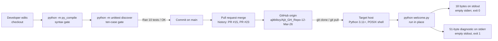

The gate is manual and reproducible rather than automated: the delivery report publishes the acceptance command block as the definition of done and records that no CI job enforces it. The report also lists the unexercised Python 3.11/3.12 interpreter lines as an item owned jointly by the repository owner and CI, so a pipeline is a recorded gap rather than a rejected option.

### 3.6.5 Environment and Version Matrix

| Component | Requirement | Recorded verification | Verification in this checkout |
|---|---|---|---|
| Python | 3.11 or later on `PATH` as `python` or `python3` | CPython 3.13.18 (Python-era report §9.1) | CPython 3.12.3; `python3 -m py_compile welcome.py` clean, `python3 -m unittest discover` → `Ran 10 tests` / `OK` |
| Node.js | LTS line, CommonJS resolution | v24.21.0 reference and v22.23.2 floor (JavaScript-era report §1.3, §9.1) | v22.23.4 |
| Operating system | Linux or macOS terminal; Windows not supported | Linux (both reports) | Linux |
| Shell | POSIX shell for the suite's redirection route and for pipeline consumption | `/bin/sh`, `bash`, `zsh` all acceptable | present |
| Hardware | None beyond what the runtime needs | One write and an exit | — |
| Ports | None reserved by the product; `server.js` would occupy host-global `127.0.0.1:3000` if started | Python-era report §10.B | — |

**Integration requirements between components.** The suite requires three things of its environment: the interpreter that runs it must be the one exposed as `sys.executable` for its spawns (`tests/test_welcome.py:46`, `87`), the working directory must be the repository root so `import welcome` resolves (`README.md:35`), and the zero-byte `tests/__init__.py` must remain so root-level discovery reaches the suite (constraint C-05). The program itself requires only a writable standard output; `server.js` requires a Node.js LTS with CommonJS resolution, which the absence of a `package.json` guarantees. No component requires configuration, a service, a credential or an ordering constraint relative to another.


## 3.7 References

- `welcome.py` — the product program: `import os` / `import sys` (lines 7-8), the two constants `MESSAGE` and `STDOUT_FAILURE` (10, 12), the `/dev/null` descriptor retargets (26, 45), the guarded write and explicit flush (64, 68), the single `raise SystemExit(1)` (53) and the `__main__` guard (73-74); established the language, the standard-library-only dependency set, the POSIX coupling and every write target in the system.
- `tests/test_welcome.py` — the behaviour-contract suite: the standard-library import list (8-17), `sys.executable` spawns (46, 87, 148), `subprocess.run(..., capture_output=True)` (62, 90, 150), `self.subTest` (177), the redirection allow-list and POSIX-shell spawn (26-33, 66-92), and the in-process capture helpers; established the test framework, the API version floor of the code and the shell prerequisite.
- `tests/__init__.py` — zero-byte package marker; established the packaging requirement that root-level `unittest discover` depends on.
- `server.js` — the pre-existing Node.js demo: `require('http')` (1), loopback binding on `127.0.0.1:3000` (3-4, 12) and ES2015-level syntax (6, 13); established the repository's only JavaScript runtime requirement and its only network surface.
- `README.md` — the documentation contract: "Python 3.11 or later" as a project requirement with no in-program version check (5-9), the 18-byte output claim (19-25), the `unittest` test command run from the repository root (27-35) and the failed-write behaviour (41-49).
- `blitzy/documentation/Project Guide - d45b6a30-593e-4d39-b896-975c37bb7086.md` — the Python-era delivery report: §9.1 system prerequisites (Python 3.11+ verified on CPython 3.13.18, POSIX shell, Linux/macOS only, nothing else), §9.2 environment setup (no virtualenv, no `pip install`/`npm install`), §9.3 dependency installation (none), §9.4 application startup sequence (runs in place), §9.5 verification steps, §9.7 troubleshooting, §10.B port reference, §10.D technology versions, §10.E environment-variable reference (`PYTHONIOENCODING`, `PYTHONDONTWRITEBYTECODE`, `PYTHONUTF8`), §10.F developer tools guide (no linter/formatter/type checker/coverage tool; PEP 8 by inspection).
- `blitzy/documentation/Project Guide.md` — the JavaScript-era delivery report: Node.js v24.21.0 reference line and v22.23.2 supported floor with the 30 April 2027 end-of-life record (§1.3, §6, §9.1, §10.D), the prohibition on `npm install`/`npm init`/`npm ci` (§9.2, §9.3), the zero-dependency security posture (§5), the project rule mandating Python for new products (§5.1 row 12) and the risk that a `package.json` with `"type": "module"` would break `server.js` (§6).
- `blitzy/documentation/` — the folder holding both delivery reports; established that the narrative record is inert Markdown with no runtime role.
- `tests/` — the folder holding the package marker and the suite; established the repository's complete automated verification surface.
- `__pycache__/` and `tests/__pycache__/` — generated working-tree directories (`welcome.cpython-312.pyc`, `__init__.cpython-312.pyc`, `test_welcome.cpython-312.pyc`); established the interpreter cache tag and the only persistent artifact a run leaves behind.
- `.git/config` — the untracked repository configuration; established the GitHub `origin` remote and that the sole credential-adjacent artifact in the checkout is transport configuration, never read by code.
- No web source was used. The external lifecycle question (current Python and Node.js support windows) could not be verified because the search tool's domain policy excluded `python.org` and `nodejs.org`, so all lifecycle statements in this section are attributed to the repository's own delivery reports rather than to vendor sources.


# 4. Process Flowchart

## 4.1 System Workflows

The tracked tree at `main` (`e539882`) contains two executable surfaces that never meet: the command-line program `welcome.py` with the suite that pins it (`tests/test_welcome.py`), and the pre-existing `server.js` HTTP demo. Five workflows account for every executable path in the repository. Four belong to the greeting program and its verification; the fifth belongs to the demo, which shares no symbol, process, port or output with the program (`server.js:1-14`, `welcome.py:1-74`).

The greeting program has no server, no daemon, no datastore, no configuration layer, no queue, no scheduler and no third-party client. Its complete external interface is the three standard streams plus the process exit status, so every workflow below is either a terminal invocation or a test-harness invocation of the same program.

### 4.1.1 Workflow Inventory

| ID | Workflow | Trigger | Terminal states |
|---|---|---|---|
| WF-01 | Successful greeting emission (F-001, F-002, F-006) | `python welcome.py`, with or without arguments | 18 bytes on stdout, empty stderr, exit 0 |
| WF-02 | Unwritable-output disclosure (F-003, F-004) | `sys.stdout is None`, or `OSError` from the write or its flush during WF-01 | Empty stdout, one 51-byte diagnostic where stderr is writable, exit 1 |
| WF-03 | Silent import (F-005) | `import welcome` by a test process or an in-process caller | Four names bound, no stream activity, exit 0 |
| WF-04 | Behaviour-contract verification (F-007) | `python -m unittest discover` from the repository root | `Ran 10 tests` … `OK`, exit 0; any contract break fails the run |
| WF-05 | HTTP demo request/response (unconnected to F-001–F-008) | `node server.js`, then any HTTP request to `127.0.0.1:3000` | `200` with a 14-byte body; a second instance exits 1 on `EADDRINUSE` |

Feature identifiers are those of §2.1 and requirement identifiers follow the `F-XXX-RQ-YYY` scheme of §2.2.

The following workflow classes are absent rather than undocumented, and their absence is confirmed by the tracked file list (`git ls-files` returns seven files, all Markdown, Python or JavaScript) and by a pattern scan of the four code files (`welcome.py`, `server.js`, `tests/test_welcome.py`, `tests/__init__.py`), which finds no socket client, HTTP client, database driver, queue client, scheduler, thread, `async`/`await`, environment read or logging call.

| Absent class | Reason it cannot occur |
|---|---|
| Scheduled or batch processing | No scheduler, cron, loop or timer exists in any file; `welcome.py` performs one write and one flush per process |
| Event or message processing | No broker, topic, listener or callback chain exists; the only callback in the tree is the per-request handler at `server.js:6-10` |
| Outbound API integration | No URL, host, credential or client library appears in any code file |
| Stateful session processing | No session, cookie, token, cache or datastore exists |
| Deployment or migration workflow | No manifest, lockfile, container definition, CI configuration or migration script is tracked |

### 4.1.2 Core Process — End-to-End Greeting Journey (WF-01)

The successful run is the product's whole business process. It is a straight-line journey with one early decision and one late one, both of which divert to WF-02 rather than terminating in place.

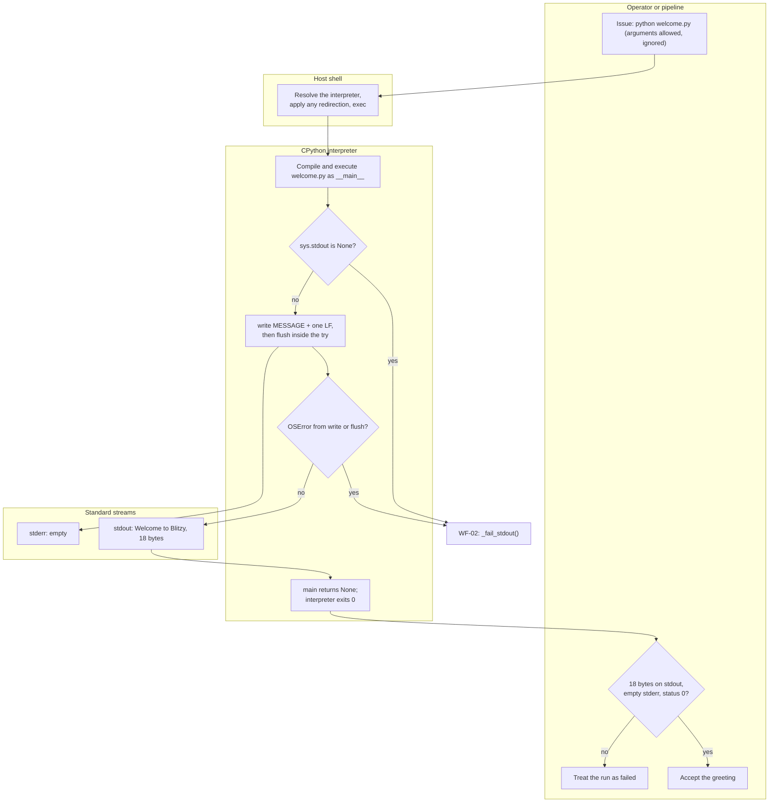

| Step | Actor | Action and rule enforced | Evidence |
|---|---|---|---|
| 1 | Operator or pipeline | Issues the invocation from the repository root; arguments are permitted and ignored | `README.md:11-17`, `README.md:37-39` |
| 2 | Host shell | Resolves the interpreter and `exec`s it, applying any redirection before the process starts | observed; `tests/test_welcome.py:86-91` |
| 3 | Interpreter | Compiles and executes the module; imports only `os` and `sys`; no version gate runs, so the Python 3.11 floor is a project requirement rather than a check | `welcome.py:7-8`, `README.md:7-9` |
| 4 | Module scope | Binds `MESSAGE` and `STDOUT_FAILURE`; performs no I/O and calls nothing | `welcome.py:10-12` |
| 5 | Module scope | The `__main__` guard is the only call of `main()`, which is what keeps WF-03 silent | `welcome.py:73-74` |
| 6 | `main()` | Decides on `sys.stdout is not None` before any write: decision D-01 | `welcome.py:61-62` |
| 7 | `main()` | Writes `MESSAGE + "\n"` and flushes inside one `try`, so a rejected stream surfaces here rather than at interpreter shutdown | `welcome.py:63-68` |
| 8 | `main()` | Catches `OSError` only; any other exception would surface as a traceback, an accepted boundary | `welcome.py:69` |
| 9 | Interpreter | Returns from `main()` with `None`, leaving nothing buffered and no resource open, then exits 0 | `welcome.py:70`, `README.md:25` |
| 10 | Consumer | Asserts the 18 bytes (or their sha256 `2dc7e85a…1951`), the empty stderr and the zero status | `README.md:19-25`; measured here |

Two data facts shape the flow. The payload is a module constant, so step 7 computes nothing and consults no locale, environment variable or argument (`welcome.py:10`, `welcome.py:64`). The explicit flush is load-bearing, not stylistic: standard output is block-buffered when it is not a terminal, and without the flush a rejected stream would fail at interpreter shutdown, outside the `except` clause that produces the contract's diagnostic (`welcome.py:65-68`).

### 4.1.3 Failure Workflow — Unwritable-Output Disclosure (WF-02)

WF-02 has two entry predicates and one exit. Both predicates converge on `_fail_stdout()` (`welcome.py:15-53`), which recovers in three rungs — retarget the descriptor at `os.devnull`, else close the stream, else swallow — and always ends in `raise SystemExit(1)` outside every guard so no failure inside the handler can replace the fixed status.

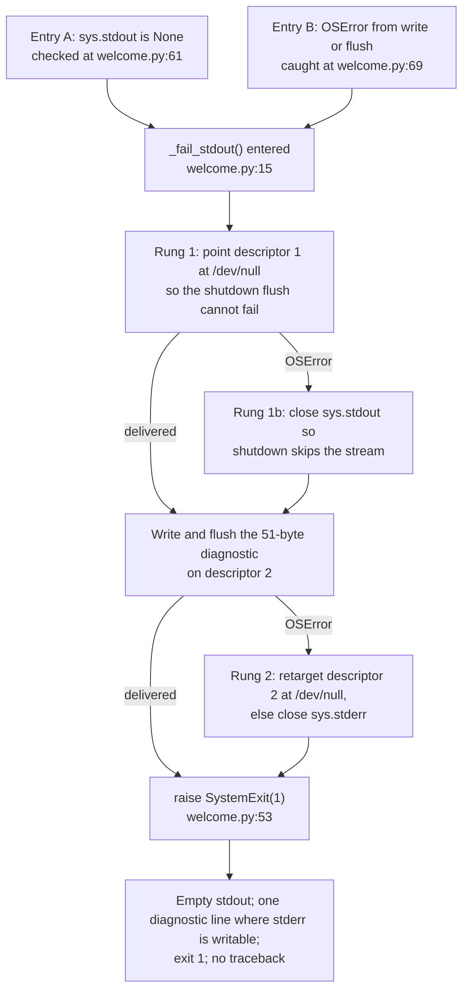

| Failure route | How it is reached | Observed outcome | Covered by |
|---|---|---|---|
| Absent stream | Descriptor 1 closed before the interpreter starts (`exec … >&-`) | exit 1, exactly the 51-byte diagnostic | `test_closed_stdout_descriptor_exits_non_zero_with_one_diagnostic_line` (`tests/test_welcome.py:162-170`) |
| Reader-less pipe | Write or flush raises `BrokenPipeError`, a subclass of `OSError` | exit 1, same diagnostic | `test_unwritable_pipe_exits_non_zero_with_one_diagnostic_line` (`tests/test_welcome.py:156-160`) |
| Rejecting device | stdout bound to `/dev/full` | exit 1, same diagnostic | verified here; report §4 |
| Compound stream failure | stdout and stderr both on a reader-less pipe | exit 1, no line deliverable | verified here (`PIPESTATUS[0]` = 1); report §4 |
| Descriptor exhaustion | No descriptor available for the retarget | exit 1, close fallbacks engaged | `welcome.py:31-34`, `welcome.py:49-52`; report §4 |

The last two rows have no committed regression test; §2.2 records that gap as `F-007-RQ-005` (unmet, 4 h of recorded work).

### 4.1.4 Programmatic Workflow — Silent Import and In-Process Call (WF-03)

Import is a workflow because the suite depends on it: `tests/test_welcome.py:17` imports the module inside the test process, and the import must produce no output for any assertion that captures a stream to remain valid.

| Step | Action | Rule | Evidence |
|---|---|---|---|
| 1 | Import machinery loads and executes the module body | Import cost is compilation plus two constant assignments | `welcome.py:7-12` |
| 2 | The `__main__` guard evaluates false | No call, no descriptor manipulation, no environment read at module scope | `welcome.py:73-74` |
| 3 | Importer receives `MESSAGE`, `STDOUT_FAILURE`, `_fail_stdout`, `main` | Public names are available without side effect | `welcome.py:10-56`; `python3 -c "import welcome"` exits 0 silently |
| 4 | Optional: caller invokes `main()` under a redirected stream | The write path is exercised with no subprocess | `tests/test_welcome.py:103-126` |
| 5 | `main()` returns `None` on success | Repeatable: three successive calls each emit exactly the expected bytes | `tests/test_welcome.py:121-126` |

One integration consequence follows from the code and matters to an in-process caller: because `_fail_stdout()` ends in `raise SystemExit(1)` (`welcome.py:53`), a caller that supplies an unwritable stream receives `SystemExit` inside its own process rather than a return value. The committed tests only call `main()` with `io.StringIO` targets, which cannot raise, so this path is reachable in process but unexercised there.

### 4.1.5 Verification Workflow — Behaviour-Contract Suite (WF-04)

`python -m unittest discover` from the repository root is the project's only automated gate (`README.md:31-35`). Discovery reaches `tests.test_welcome` because the zero-byte `tests/__init__.py` makes the folder an importable package; the module then imports `welcome` from the root, which is why the working directory is a hard requirement.

| Step | Action | Evidence |
|---|---|---|
| 1 | Runner discovers `tests.test_welcome` from the root working directory | `tests/__init__.py`; `README.md:35` |
| 2 | Module constants resolve the program path and the two expected byte strings | `tests/test_welcome.py:19-22` |
| 3 | `MessageConstantTests` and `MainCallableTests` assert in process with `redirect_stdout`/`redirect_stderr` | `tests/test_welcome.py:95-126` |
| 4 | `ProcessBehaviourTests` spawns fresh interpreters: `subprocess.run` with captured streams, a deliberately reader-less `os.pipe()`, and a shell `exec` with one allow-listed redirection | `tests/test_welcome.py:36-92`, `129-183` |
| 5 | Assertions compare exact values — 25 `assertEqual` and 1 `assertIsNone`, no membership or truthiness check | `tests/test_welcome.py:95-183` |
| 6 | Runner reports `Ran 10 tests` … `OK` and exits 0 | measured here (0.101 s) |

| Workflow asserted | Test methods |
|---|---|
| WF-01 (F-001, F-002, F-006) | `test_exit_status_and_exact_stdout`, `test_command_line_arguments_are_ignored`, `test_empty_or_absent_input_changes_nothing`, `test_main_writes_exact_bytes_to_stdout`, `test_main_writes_nothing_to_stderr`, `test_main_is_repeatable` |
| WF-02 (F-003) | `test_unwritable_pipe_exits_non_zero_with_one_diagnostic_line`, `test_closed_stdout_descriptor_exits_non_zero_with_one_diagnostic_line` |
| WF-03 (F-005) | `test_import_writes_nothing`, `test_message_is_exact_and_unpadded` |

The suite's own safety rule is part of the workflow: `run_program_through_shell` accepts only the three tokens in `SUPPORTED_REDIRECTIONS` and raises `ValueError` before a command line is built, so no arbitrary shell text can reach `subprocess.run(..., shell=True)` (`tests/test_welcome.py:29-33`, `81-85`).

### 4.1.6 Integration Workflows

**Data flow between systems.** There is no system to integrate with. The program's entire outbound surface is three channels, and one inbound state — descriptor 1 being closed or unusable.

| Channel | Payload | Direction | Evidence |
|---|---|---|---|
| Standard output | 18 bytes, `Welcome to Blitzy\n` | Program → consumer | `welcome.py:10`, `welcome.py:64`; measured |
| Standard error | 51 bytes, `welcome.py: error: cannot write to standard output\n` | Program → consumer, failure path only | `welcome.py:12`, `welcome.py:37` |
| Process exit status | `0` on success, `1` on every failure route | Program → caller | `welcome.py:53`; `README.md:25`, `README.md:49` |
| Filesystem | `/dev/null` opened `O_WRONLY` for a descriptor retarget | Program → host, failure path only | `welcome.py:26`, `welcome.py:45` |

**API interactions.** None from the CLI. The single HTTP surface in the tree is `server.js`, which answers every request with the same response regardless of method, path, query, headers or body — verified here for `GET /`, a query string, and `POST` with a body.

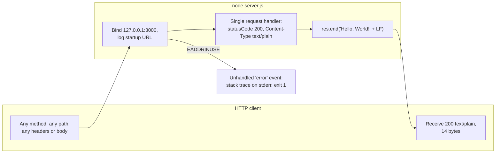

Observed behaviour, for completeness: the startup callback logs `Server running at http://127.0.0.1:3000/` after a successful bind (`server.js:12-14`); responses carry `Content-Type: text/plain` and `Content-Length: 14`; a second instance started while the port is held fails with `Error: listen EADDRINUSE: address already in use 127.0.0.1:3000`, prints a stack trace and exits 1 while the first instance keeps serving — the file registers no `error` listener and no signal handler, so the Node default applies.

**Event and batch processing.** Neither exists. No event emitter chain, subscription, polling loop, timer or job queue appears in any tracked file, and the program's one operation completes in a single pass with no continuation.

**Consumer-side integration patterns.** Integration happens at the shell: gate on the status, or assert the bytes or digest. The two mechanisms the suite uses are the reference implementations of the two shapes available to any consumer — capturing a spawned child's streams (`tests/test_welcome.py:62-63`) and applying a redirection through `exec` before the interpreter starts (`tests/test_welcome.py:86-91`).


## 4.2 Flowchart Requirements

Every diagram in this section is drawn from the five workflows of §4.1 and is complete at the level of the code: the program's control flow has no loops and no deferred callbacks, so no branch of the flow has been omitted or summarized. Where a diagram shows a lane or a boundary, that lane and boundary appear in §4.2.1; where it shows a decision, the predicate is listed in §4.2.2 with the source line that implements it.

### 4.2.1 Actors, Swim Lanes and System Boundaries

| Lane | Actor or system | Role in the flow | Appears in |
|---|---|---|---|
| `Caller` | Operator at a terminal, or a pipeline or CI step | Issues the invocation and judges the outcome by bytes and status | WF-01, WF-02 |
| `HostShell` | POSIX shell | Resolves the interpreter and applies redirections before the child starts; the only party able to close descriptor 1 ahead of execution | WF-01, WF-02 (absent-stream route) |
| `Interp` | CPython 3.11+ interpreter | Compiles and executes the module, owns the shutdown flush, sets the exit status | WF-01, WF-02, WF-03 |
| `Streams` | Descriptors 1 and 2 | The program's only output surface; a channel that may be absent, full or reader-less | WF-01, WF-02 |
| `Runner` | `unittest` runner process | Discovers and executes the suite, imports the program, reports pass/fail and exits with its own status | WF-04 |
| `Child` | Fresh interpreter spawned by the suite | Supplies the observable process contract that in-process assertions cannot | WF-04 |
| `NodeProc` / `ClientSide` | `node server.js` and an HTTP client | Pre-existing demo surface, unconnected to the greeting program | WF-05 |

Three boundaries separate these lanes, and each boundary is where a failure mode lives.

| Boundary | Crossing mechanism | What can fail across it | Evidence |
|---|---|---|---|
| Shell → interpreter (process boundary) | `exec` of `python welcome.py` | Descriptor 1 can already be closed, so `sys.stdout` arrives as `None` | `welcome.py:61`; `tests/test_welcome.py:86-91` |
| Program → consumer (stream boundary) | `write` + `flush` on descriptor 1, `write` + `flush` on descriptor 2 | A write can raise `OSError`; a diagnostic can be undeliverable | `welcome.py:26-52`, `welcome.py:64-70` |
| Runner → child (test-process boundary) | `subprocess.run`, `os.pipe`, `shell=True` with an allow-listed token | Descriptor and argument construction; injection if unvalidated | `tests/test_welcome.py:36-92` |
| Host → network (server demo only) | `server.listen(3000, '127.0.0.1')` | Port already bound; the bind is loopback-only, so the listener is unreachable from other hosts | `server.js:3-4`, `server.js:12-14` |

The greeting program crosses no network boundary: no socket, connect, bind or listen call exists in `welcome.py`, and the only filesystem object it ever opens is `os.devnull` on the failure path (`welcome.py:26`, `welcome.py:45`).

### 4.2.2 Start and End Points, Process Steps and Decision Points

| Workflow | Start point | End points |
|---|---|---|
| WF-01 | `python welcome.py` at the shell | exit 0 with 18 bytes on stdout; or hand-off to WF-02 |
| WF-02 | `sys.stdout is None` at `welcome.py:61`, or `OSError` at `welcome.py:69` | exit 1 with one diagnostic line where deliverable; exit 1 with no deliverable line in compound failure |
| WF-03 | `import welcome` | four bound names, exit 0, no stream activity |
| WF-04 | `python -m unittest discover` at the repository root | `Ran 10 tests` … `OK`, exit 0; or a named failure and non-zero status |
| WF-05 | `node server.js` | serving loop answering `200`; or exit 1 on bind failure |

The program contains no loop and no recursive call, so each decision below is evaluated at most once per run. The two decision points that route work between workflows are D-01 and D-02.

| ID | Predicate | Implemented at | True branch | False branch | Asserted by |
|---|---|---|---|---|---|
| D-01 | `sys.stdout is None` | `welcome.py:61` | `_fail_stdout()` → WF-02 | proceed to write | `test_closed_stdout_descriptor_…` (`tests/test_welcome.py:162-170`) |
| D-02 | `OSError` raised by `write`/`flush` | `welcome.py:69` | `_fail_stdout()` → WF-02 | `main()` returns `None` | `test_unwritable_pipe_…` (`tests/test_welcome.py:156-160`); success side at `132-136` |
| D-03 | `sys.stdout is not None` inside the handler | `welcome.py:17` | attempt the descriptor-1 retarget | skip to the stderr guard | code path only |
| D-04 | Retarget attempt raised `OSError` | `welcome.py:25-27` | close `sys.stdout`, swallowing `OSError` | continue | code path only |
| D-05 | `sys.stderr is not None` | `welcome.py:35` | write and flush the diagnostic | release the exit status without a line | code path only |
| D-06 | Diagnostic write or flush raised `OSError` | `welcome.py:36-43` | retarget descriptor 2, else close `sys.stderr` | fall through to the status | compound-failure run (`PIPESTATUS[0]` = 1); report §4 |
| D-07 | `__name__ == "__main__"` | `welcome.py:73` | call `main()` | silent import → WF-03 | `test_import_writes_nothing` (`tests/test_welcome.py:146-154`) |
| D-08 | Redirection token in `SUPPORTED_REDIRECTIONS` | `tests/test_welcome.py:81` | build and run the shell command | raise `ValueError` before any command exists | rejection branch not asserted by a committed test |
| D-09 | `server.listen` succeeded | `server.js:12` | log the startup URL, serve requests | unhandled `'error'` event, stack trace, exit 1 | verified here on `EADDRINUSE` |

The only iteration anywhere in the executable code is test-side: three successive calls in `test_main_is_repeatable` (`tests/test_welcome.py:122`) and a two-iteration `subTest` loop in `test_empty_or_absent_input_changes_nothing` (`tests/test_welcome.py:173-183`). The product itself executes one pass from guard to exit.

### 4.2.3 User Touchpoints

| Touchpoint | What the user does or sees | Guarantee and evidence |
|---|---|---|
| Command line | `python welcome.py`, optionally with arguments | Arguments are ignored; the invocation is identical in effect with or without them (`README.md:37-39`) |
| Standard output | The single line `Welcome to Blitzy` | Exactly 18 bytes, no banner, no blank line (`README.md:19-25`; measured) |
| Standard error | Silence on success; one diagnostic line on failure | Empty on success; exactly 51 bytes on failure, no traceback (`welcome.py:12`, `welcome.py:37`; `README.md:41-49`) |
| Exit status | `0` or `1` | Set once per run; `1` survives every failure state (`welcome.py:53`) |
| Documentation | `README.md` | Six sections describing purpose, interpreter floor, run, test, arguments and failure (`README.md:1-49`) |
| Test command | `python -m unittest discover` from the root | Ten tests, `OK`, exit 0 (`README.md:27-35`; measured) |

There is no interactive touchpoint, no prompt, no progress indicator, no confirmation and no partial-output mode: the program either emits its one line and exits 0, or emits its one diagnostic and exits 1.

### 4.2.4 Error States and Recovery Paths

| ID | Error state | Detectable by | Recovery path in the flow | Evidence |
|---|---|---|---|---|
| E-01 | Standard output absent before start | `sys.stdout is None` | Descriptor 1 retargeted at `/dev/null`; diagnostic on descriptor 2; exit 1 | `welcome.py:17-34`, `61-62` |
| E-02 | Write rejected (reader-less pipe) | `BrokenPipeError` (an `OSError`) | Same handler; buffered bytes are discarded by the retarget; exit 1 | `welcome.py:26-34` |
| E-03 | Flush rejected (device full) | `OSError` from `flush()` | Same handler; nothing reaches the reader; diagnostic; exit 1 | `welcome.py:68-69`; verified against `/dev/full` |
| E-04 | Diagnostic undeliverable | `OSError` in the handler's own write or flush | Rung 2: descriptor 2 retargeted at `/dev/null`, else closed; exit 1 with no line | `welcome.py:35-52` |
| E-05 | No descriptor available for a retarget | `OSError` from `os.open`/`os.dup2` | Close the stream so the shutdown flush skips it; exit 1 | `welcome.py:31-34`, `49-52`; report §4 |
| E-06 | Non-`OSError` exception | Any exception outside the caught type | Not recovered by design: interpreter traceback and its own non-zero status | `welcome.py:69`; boundary accepted in report §6 |
| E-07 | Import cannot resolve `welcome` | `ModuleNotFoundError` in the runner | Re-run from the repository root, which is the documented requirement | `README.md:35`; `tests/test_welcome.py:19-20` |
| E-08 | Suite redirection token unsupported | `ValueError` raised by the helper | Pass one of the three allow-listed tokens | `tests/test_welcome.py:81-85` |
| E-09 | Demo port already bound | `EADDRINUSE` on `listen` | None in code: unhandled `'error'` event, stack trace, exit 1; operator stops the incumbent | `server.js:12-14`; verified here |

E-01 through E-05 are the states in which the contract's two constants are the whole communication. In E-04 and E-05 no stream can carry the line, so the exit status is the only observable outcome — the residual that §2.2 records as `F-004-RQ-003`.

### 4.2.5 Timing and SLA Considerations

| Timing property | Value and mechanism | Evidence |
|---|---|---|
| Output operations per successful run | One write and one flush on descriptor 1 | `welcome.py:64-68` |
| Failure-path overhead | Up to two `os.open`/`os.dup2` pairs plus one write and flush on descriptor 2 | `welcome.py:26`, `welcome.py:37-45` |
| Retries, backoff, sleeps, timeouts | None exist in any tracked file | pattern scan of the four code files; `welcome.py` contains no `sleep`, `retry` or timer |
| Blocking calls | Only `write`/`flush` on the two streams, and the descriptor calls on the failure path | `welcome.py:25-52`, `63-69` |
| Measured run cost | mean 12.1 ms wall for spawn plus run over 20 runs on CPython 3.12.3, dominated by interpreter startup; import-only 11.9 ms | measured here |
| Measured suite cost | `Ran 10 tests in 0.101s` | measured here |
| Demo listener timing | Startup log emitted from the `listen` callback, so it appears only after a successful bind; responses advertise `Keep-Alive: timeout=5` with no idle policy of the file's own | `server.js:12-14`; observed headers |

No service-level objective applies, because no service exists: the program's obligations are determinism of bytes and status, not latency. The three timing consequences a diagram reader should carry are that a run has exactly one attempt at the write (no retry budget exists), that there is no external dependency whose latency could be inherited, and that the two streams are independent descriptors, so the relative arrival order of a stdout line and a stderr line is determined by the consumer's redirection, not by the program.

### 4.2.6 Validation Rules

**Business rules enforced at each step.**

| Step | Rule | Enforcement mechanism |
|---|---|---|
| Bind the message | The greeting is a fixed, unpadded constant, never configured at run time | `MESSAGE` literal (`welcome.py:10`); `test_message_is_exact_and_unpadded` |
| Write | Exactly one line is written to descriptor 1, and never anything else | single write site (`welcome.py:64`) |
| Flush | The bytes must leave the process before exit | explicit `flush()` inside the `try` (`welcome.py:68`) |
| On failure | Exactly one diagnostic line, no traceback, and no bytes on descriptor 1 | `STDOUT_FAILURE` literal (`welcome.py:12`); `stdout == b""` and `stderr == DIAGNOSTIC` asserted on both routes |
| Error classification | Only `OSError` is caught — six `except OSError` clauses, no other handler | `welcome.py:27`, `33`, `43`, `46`, `51`, `69` |
| Status | One `raise SystemExit(1)` at function scope, outside every guard | `welcome.py:53` |
| Harness execution | Only three redirection tokens may reach a shell | `SUPPORTED_REDIRECTIONS` and the `ValueError` guard (`tests/test_welcome.py:29-33`, `81-85`) |

**Data validation.** There is no data to validate. The program reads no `sys.argv`, no standard input, no environment variable and no file, and it derives nothing from the host: `env -i /usr/bin/python3 -I -S welcome.py` still emits 18 bytes (measured; report §4). The only input-like state that can change behaviour is the usability of descriptor 1, and that state is tested rather than parsed — a `None` check at `welcome.py:61` and an `OSError` catch at `welcome.py:69`. Downstream, validation is the consumer's: the suite validates by exact equality, and a pipeline validates by byte count, digest or status (`README.md:25`).

**Authorization checkpoints.** None exist, and none can exist: the program has no principal, no credential, no permission check, no privileged operation and no per-user data. Nothing is gated, so there is no authorization branch to draw. Two controls occupy the nearest equivalent position and are worth distinguishing: the loopback bind in `server.js:3` keeps the demo listener off external interfaces, and the redirection allow-list in `tests/test_welcome.py:29-33` is an input gate that prevents a shell spawn from carrying attacker-chosen text. Neither authenticates anything; the first limits network reach, the second limits command-line content.

**Regulatory and compliance checks.** None are implemented, and the artifact makes none necessary: no personal data is read, written, logged or transmitted; nothing is persisted; no telemetry channel exists. The diagnostic is a constant that names neither path, error number, exception text nor host detail (`welcome.py:12`), so a failure discloses nothing about the environment beyond the fixed sentence. The one documented boundary on the byte guarantee is the stream encoding — the 18-byte and 51-byte counts hold so long as the stream encoding is ASCII-compatible, which is the boundary the delivery report records under §6.


## 4.3 Technical Implementation

The greetings program holds no mutable module state, opens no durable resource and performs no asynchronous work, so its technical implementation is short enough to state exhaustively. The pre-existing `server.js` is the opposite case in one respect only: it holds one long-lived object, the listening socket, and its state machine is a bind-then-serve loop with a single failure transition.

### 4.3.1 State Transitions and State Management

The program's state is the state of the process plus the state of the two stream objects. Nothing else is carried, and nothing survives the process.

| State | Meaning | Entered by | Exit conditions | Evidence |
|---|---|---|---|---|
| S0 | Not started: no process exists | — | Invocation | — |
| S1 | Module executing: `os` and `sys` imported, `MESSAGE` and `STDOUT_FAILURE` bound, guard evaluated | interpreter start | guard true → S2; guard false → S7 | `welcome.py:7-12`, `73-74` |
| S2 | Entry decision: is descriptor 1 usable | `main()` call | `sys.stdout is None` → S4; otherwise → S3 | `welcome.py:61-62` |
| S3 | Writing and flushing the greeting | S2, S3 | `OSError` → S4; success → S5 | `welcome.py:63-68` |
| S4 | Failure handling: descriptor retarget, diagnostic, status | S2, S3 | unconditional → S6 | `welcome.py:15-53` |
| S5 | Success terminal: `main()` returned `None`, buffer empty | S3 | interpreter exits 0 | `welcome.py:70`; `README.md:25` |
| S6 | Failure terminal: `SystemExit(1)` raised outside every guard | S4 | interpreter exits 1 | `welcome.py:53` |
| S7 | Silent-import terminal: names bound, nothing written | S1 | importer continues, process exits 0 | `welcome.py:73-74`; `tests/test_welcome.py:146-154` |

Inside S4 the handler has three sub-states, each entered only if the previous one failed, and each of which changes what the interpreter's own shutdown will attempt.

| Sub-state | Action | On success | On `OSError` |
|---|---|---|---|
| H1 | `os.dup2(os.open(os.devnull, O_WRONLY), sys.stdout.fileno())` — descriptor 1 now points at the null device | shutdown flush writes to `/dev/null` harmlessly | H1b: `sys.stdout.close()`, swallowing `OSError`; a closed stream is skipped by the shutdown flush |
| H2 | `sys.stderr.write(STDOUT_FAILURE + "\n")` then `flush()` | the one diagnostic is delivered | H2b: retarget descriptor 2 at `/dev/null`, else `sys.stderr.close()` |
| H3 | `raise SystemExit(1)` at function scope | status 1 | not reachable — no guard encloses it |

Three state-management properties follow, and each is a design decision rather than an accident.

| Property | Consequence | Evidence |
|---|---|---|
| No module-level mutation | Repeatability cannot degrade over a process's lifetime; three successive `main()` calls each emit exactly the expected bytes | `welcome.py:10-12`; `tests/test_welcome.py:121-126` |
| No cross-run state | Each invocation is independent, so concurrent invocations cannot interfere except through a shared terminal | no file, lock, counter or cache exists in `welcome.py` |
| Descriptor state is the only mutable state | The handler's whole job is to leave descriptors in a state where the interpreter's shutdown cannot contradict the fixed contract | `welcome.py:25-52` |

### 4.3.2 Data Persistence, Caching and Transaction Boundaries

**Persistence points.** The program persists nothing. Its only durable-side-effect candidate is the bytecode cache CPython writes when the module is imported, which belongs to the interpreter and to WF-03/WF-04 rather than to the program: executing `python welcome.py` writes no cache for the main script, while importing `welcome` from the suite produces `__pycache__/welcome.cpython-312.pyc` and `tests/__pycache__/…`, both observed untracked in `git status`.

| Store | Written by | Content | Evidence |
|---|---|---|---|
| Descriptor 1 | `main()` success path | 18 fixed bytes, flushed before exit | `welcome.py:64-68` |
| Descriptor 2 | `_fail_stdout()` | 51 fixed bytes, only on the failure path | `welcome.py:37-42` |
| `/dev/null` | `_fail_stdout()` | Nothing stored; a descriptor target that swallows later writes | `welcome.py:26`, `welcome.py:45` |
| `__pycache__/` | CPython, on import only | Bytecode for the imported module and the tests | observed untracked; not produced by a direct run |

**Caching requirements.** One value is effectively pre-computed and reused: `MESSAGE` is a module-level literal bound once per process, so the greeting is never derived, formatted or looked up (`welcome.py:10`). There is no application cache, no memoization, no invalidation rule and no cache-coherence concern, because no input can change between calls. Cross-process caching is entirely the interpreter's bytecode cache, which the program neither reads nor controls.

**Transaction boundaries.** The unit of work is the process invocation: nothing is committed before the flush and nothing is rolled back after a failure.

| Boundary | Commit point | Abort behaviour | Consumer-visible result |
|---|---|---|---|
| WF-01 unit of work | Successful `flush()` of descriptor 1 | `OSError` aborts into S4; the retarget discards buffered bytes rather than retrying them | 18 bytes and status 0, or no bytes and status 1 |
| WF-02 unit of work | `SystemExit(1)` | The diagnostic is best effort; the status is unconditional | Status 1 always; one line when a stream can carry it |
| Atomicity of the greeting | A single `write` of 18 bytes, below POSIX `PIPE_BUF`, so a pipe reader sees all of the line or none of it | No partial line is expected on a pipe; a short write on a regular file is theoretically possible and was never observed | — |

There is no two-phase behaviour, no compensating action, no journal and no reconciliation step: the absence of state is what removes the need for them.

### 4.3.3 Retry Mechanisms and Fallback Processes

**Retry.** There is no retry, and this is deliberate. The program attempts the write exactly once (`welcome.py:64`), contains no loop, no `sleep`, no timer and no backoff, and treats any `OSError` as final. Retrying would contradict the contract in two ways: the diagnostic must appear exactly once, and the exit status must be decided by one attempt rather than by an unbounded sequence of them. Retry is therefore left to the caller, where it is safe — because a run is idempotent (same 18 bytes, same status, no persisted state), re-invoking `python welcome.py` after a fixed stream is indistinguishable from a first run.

**Fallback ladder.** Fallback happens only inside the failure handler, and each rung exists to protect one guarantee.

| Rung | Trigger | Fallback | Guarantee it protects | Evidence |
|---|---|---|---|---|
| 1 | Handler entered with a non-`None` `sys.stdout` | Retarget descriptor 1 at `os.devnull` | The single diagnostic line, by preventing a second notice from the interpreter's shutdown flush | `welcome.py:25-27` |
| 1b | The retarget raised `OSError` (descriptor exhaustion) | Close `sys.stdout`, swallowing `OSError` | The same, via a stream the shutdown flush skips | `welcome.py:31-34` |
| 2 | Diagnostic write or flush raised `OSError` | Retarget descriptor 2 at `os.devnull` | Exit status 1, by stopping descriptor 2 from failing again at shutdown | `welcome.py:43-45` |
| 2b | That retarget also raised `OSError` | Close `sys.stderr`, swallowing `OSError` | Exit status 1, with the line abandoned | `welcome.py:49-52` |
| Final | Reached from every rung | `raise SystemExit(1)`, outside every guard | The status can never be replaced by an interpreter-generated one | `welcome.py:53` |

The ordering matters: the descriptor-1 defence runs before the diagnostic is written, so the diagnostic is never the statement that fails twice, and the `SystemExit(1)` sits after all guards rather than inside one.

### 4.3.4 Error Notification Flows

Notification is one fixed line on one fixed channel, followed by one fixed status. No logging framework, metric, alert, exit-code taxonomy beyond `0`/`1`, or per-error message exists in the program.

| Stage | Mechanism | Invariant | Evidence |
|---|---|---|---|
| Detection | `sys.stdout is None` check, and `except OSError` around the write and flush | At most one classification decision per run | `welcome.py:61`, `welcome.py:69` |
| Classification | Only `OSError` is caught, which includes `BrokenPipeError`; no other exception type is handled | A non-`OSError` defect surfaces as a traceback rather than as the contract line | six `except OSError` clauses (`welcome.py:27`, `33`, `43`, `46`, `51`, `69`) |
| Notification channel | Descriptor 2, never descriptor 1 | Standard output stays empty on every failure route | `welcome.py:37`; `stdout == b""` asserted at `tests/test_welcome.py:159`, `169` |
| Notification content | The constant `welcome.py: error: cannot write to standard output` plus one LF — 51 bytes, no interpolation, no path, no errno, no exception text | Byte-identical on every route | `welcome.py:12`; `DIAGNOSTIC` at `tests/test_welcome.py:22` |
| Status | `1` | Independent of whether the line was deliverable | `welcome.py:53` |
| Suppression of noise | Retarget or close both descriptors so the interpreter adds no ignored-exception notice beside the line | Exactly one line on stderr in the closed-descriptor and reader-less-pipe routes | `welcome.py:25-52`; tests at `tests/test_welcome.py:156-170` |

The demo surface has no notification flow at all: a bind failure escapes as an unhandled `'error'` event with a stack trace on stderr and exit status 1, and a request can never produce a non-`200` response (`server.js:6-14`).

### 4.3.5 Recovery Procedures

Because nothing is persisted and no lock, temporary file, socket or background task is created, recovery never requires cleanup. Each procedure below is therefore a diagnosis followed by a re-run.

| Situation observed | Diagnosis step | Recovery |
|---|---|---|
| Exit 1 with the diagnostic line | Inspect where descriptor 1 points: a closed descriptor, a dead pipe reader, a full filesystem or `/dev/full` | Fix the stream and re-run; no state to repair |
| Exit 1 with no stderr line | Both streams were unusable (E-04/E-05); consult the caller's own record | Restore a writable stream and re-run |
| Traceback instead of the diagnostic | A non-`OSError` defect (E-06); the traceback names the failing line | Fix the code; the handler intentionally does not mask it |
| `ModuleNotFoundError: No module named 'welcome'` from the suite | The runner was started outside the repository root | Re-run `python -m unittest discover` from the root (`README.md:35`) |
| `ValueError` from the test helper | An unsupported redirection token was passed | Use `>&-`, `< /dev/null` or `<&-` (`tests/test_welcome.py:29-33`) |
| `EADDRINUSE` from the demo | Another process holds `127.0.0.1:3000` | Stop the incumbent listener; nothing in `server.js` retries or rebinds |

Verification after any recovery is one command whose result is self-describing: `python -m unittest discover` exercises every workflow above, including both failure routes, and reports `OK` with exit 0 when the contract holds (measured here: ten tests in 0.101 s).


## 4.4 Required Diagrams

The five diagrams below are the required set: one high-level workflow view, one detailed flow per feature group, one guard-level error-handling chart, three integration sequence diagrams and two state machines. Each is drawn in Mermaid so it renders in the specification and can be edited alongside the code it describes. Lane identifiers match the actor table in §4.2.1 and decision identifiers match the catalog in §4.2.2.

### 4.4.1 High-Level System Workflow

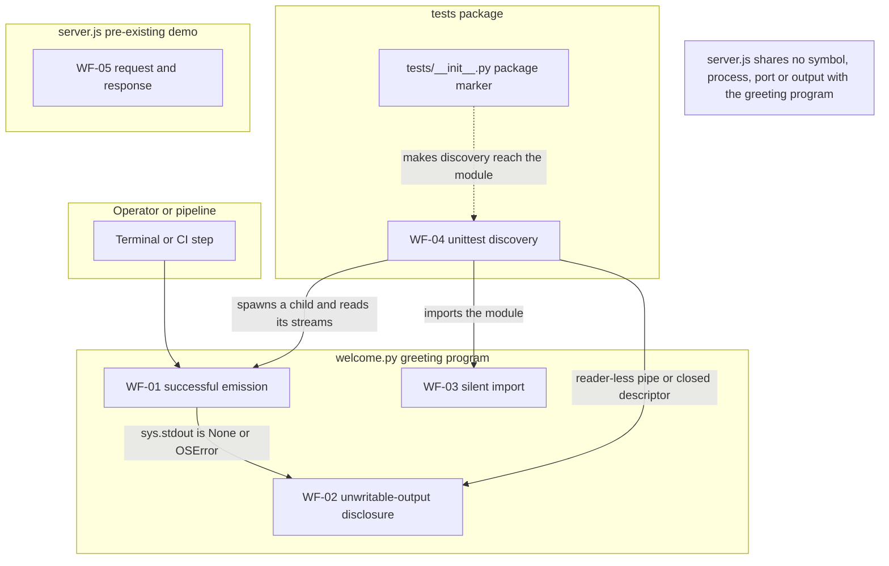

WF-05 is drawn in its own lane and connected to nothing because that is the repository's actual topology: `server.js` is byte-identical to its first upload and no code path in the tree references it.

### 4.4.2 Detailed Process Flows per Core Feature

**F-001 and F-002 — greeting emission and successful-run semantics (WF-01).**

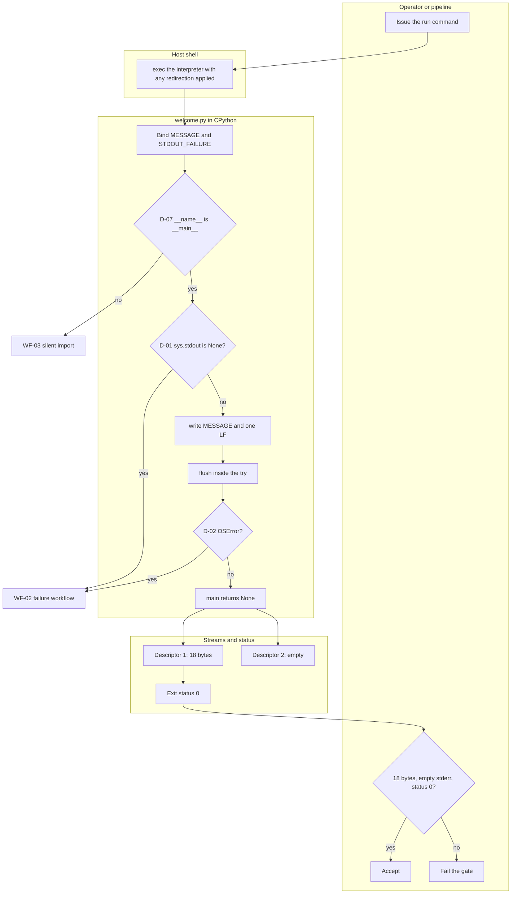

**F-005 and F-006 — silent import and argument/input agnosticism (WF-03).** The inputs drawn outside the module are drawn without edges because no read site exists for any of them.

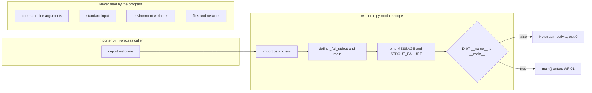

**F-007 — behaviour-contract verification (WF-04).**

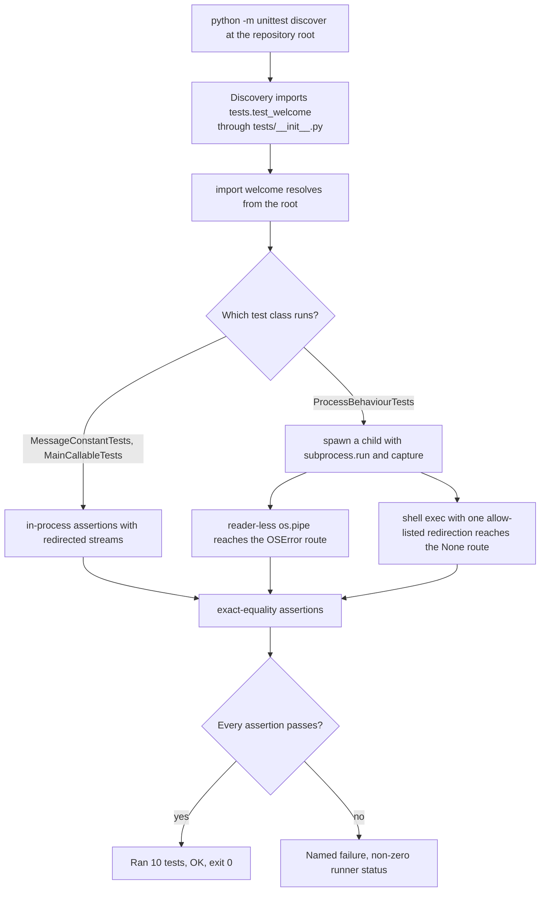

F-003 and F-004 have no separate chart here because their flow is the guard-level ladder of §4.4.3; F-008 documents the other flows in prose (`README.md:1-49`) and has no runtime path to draw.

### 4.4.3 Error Handling Flowchart

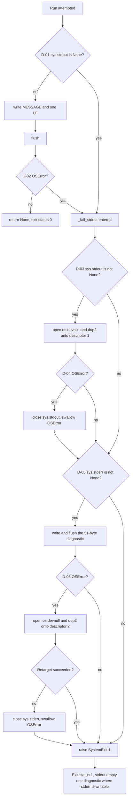

The chart has no retry edge, no timer and no loop, which is what makes it a complete picture of error handling rather than a summary: every `OSError` travels down the ladder exactly once, and the last node is unconditional.

### 4.4.4 Integration Sequence Diagrams

**Consumer integration over streams (WF-01, with redirection deciding whether WF-02 is reached).**

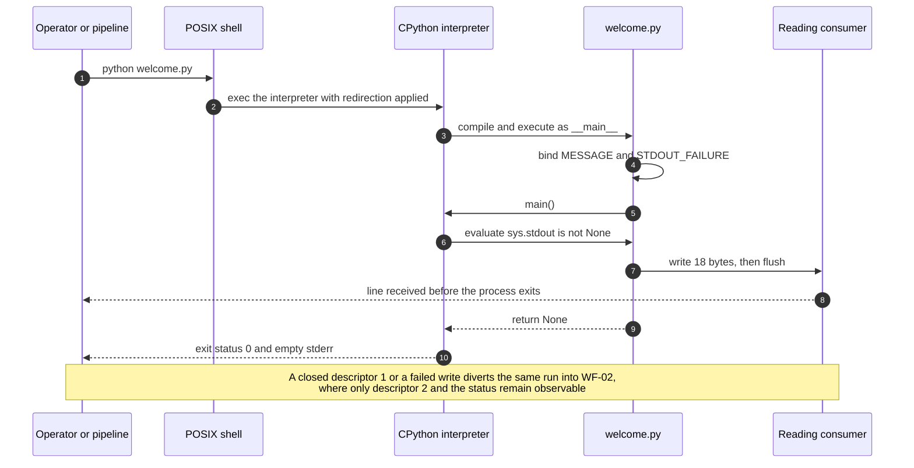

**Verification harness integration (WF-04), including both failure routes.**

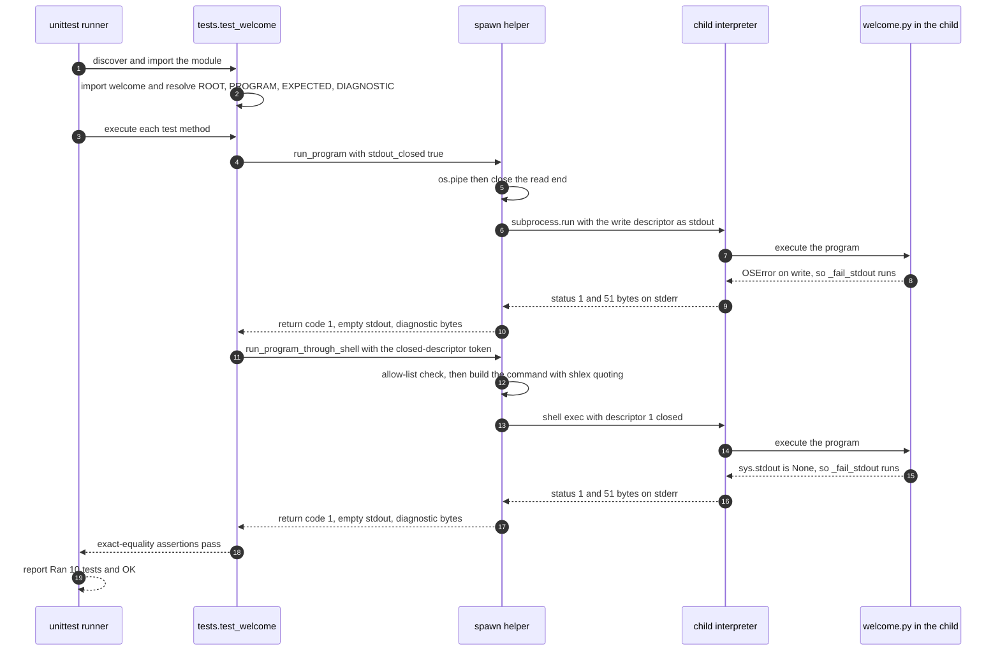

**HTTP demo integration (WF-05), the only network sequence in the tree.**

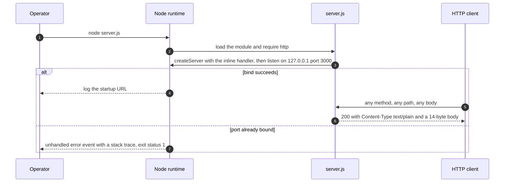

### 4.4.5 State Transition Diagrams

**Run lifecycle (WF-01 through WF-03).**

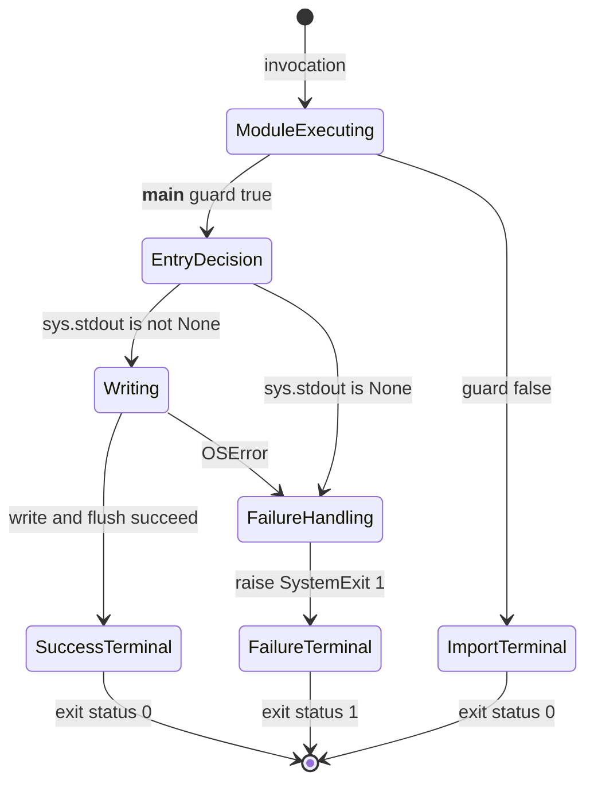

**Failure-handler sub-states (WF-02), showing the fallback ladder as transitions.**

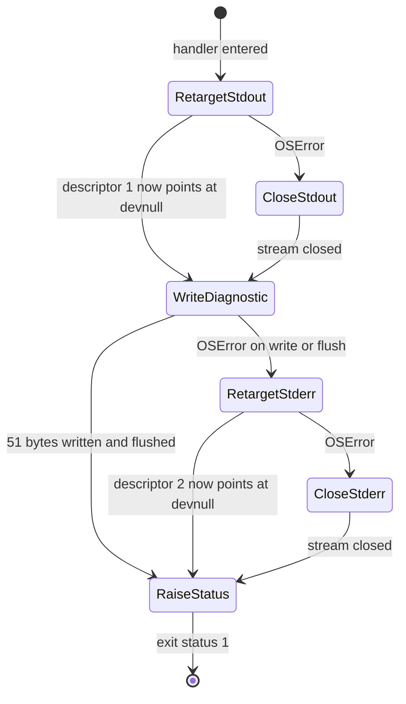

### 4.4.6 Diagram-to-Workflow Traceability

| Diagram | Workflows and features | Requirements exercised |
|---|---|---|
| §4.4.1 high-level workflow | WF-01 to WF-05; F-001 to F-007 | `F-001-RQ-001`, `F-005-RQ-001`, `F-007-RQ-001` |
| §4.4.2 F-001 and F-002 flow | WF-01; F-001, F-002, F-006 | `F-001-RQ-001` to `F-001-RQ-004`, `F-002-RQ-001` to `F-002-RQ-003` |
| §4.4.2 F-005 and F-006 flow | WF-03; F-005, F-006 | `F-005-RQ-001` to `F-005-RQ-003`, `F-006-RQ-001` to `F-006-RQ-003` |
| §4.4.2 F-007 flow | WF-04; F-007 | `F-007-RQ-001` to `F-007-RQ-004`; gap `F-007-RQ-005` |
| §4.4.3 error handling chart | WF-02; F-003, F-004 | `F-003-RQ-001` to `F-003-RQ-006`, `F-004-RQ-001` to `F-004-RQ-004` |
| §4.4.4 consumer sequence | WF-01, WF-02; F-001, F-002, F-003 | `F-001-RQ-001`, `F-002-RQ-001`, `F-003-RQ-004` |
| §4.4.4 harness sequence | WF-04; F-007 | `F-007-RQ-002`, `F-007-RQ-003` |
| §4.4.4 HTTP sequence | WF-05; unconnected to F-001 to F-008 | none — excluded surface |
| §4.4.5 run lifecycle | WF-01 to WF-03 | `F-002-RQ-003`, `F-005-RQ-002` |
| §4.4.5 handler sub-states | WF-02; F-004 | `F-004-RQ-001` to `F-004-RQ-004` |


## 4.5 References

- `welcome.py` — the program under documentation: constants `MESSAGE` (line 10) and `STDOUT_FAILURE` (line 12), the `_fail_stdout()` handler (lines 15-53), `main()` (lines 56-70) and the `__main__` guard (lines 73-74); source of every state, decision and fallback in this section.
- `server.js` — the pre-existing HTTP demo: `http.createServer` handler (lines 6-10), loopback host and port constants (lines 3-4), `listen` callback (lines 12-14); basis of WF-05 and the `EADDRINUSE` failure path.
- `tests/test_welcome.py` — the behaviour contract: spawn helpers `run_program` and `run_program_through_shell` (lines 36-92), the `SUPPORTED_REDIRECTIONS` allow-list (lines 29-33), and the three test classes with ten methods (lines 95-183) that establish which workflow each assertion covers.
- `tests/__init__.py` — zero-byte package marker responsible for discovery reaching `tests.test_welcome` from the repository root (WF-04, step 1).
- `README.md` — the user-facing contract: purpose (line 3), interpreter floor (lines 7-9), run command and 18-byte expectation (lines 11-25), test command and root requirement (lines 27-35), argument behaviour (lines 37-39), failed-write behaviour (lines 41-49).
- `blitzy/documentation/Project Guide - d45b6a30-593e-4d39-b896-975c37bb7086.md` — the Python-era delivery report: §4 runtime validation (the `/dev/full`, compound-stream and descriptor-exhaustion routes), §6 the encoding boundary on the byte guarantee, §9.4 the absence of any startup sequence or configuration load.
- `tests/` — the verification package; its two files are the complete automated gate charted in §4.4.2.
- `blitzy/documentation/` — documentation-only folder in the tracked tree, containing the delivery reports cited above; no executable content.
- Repository root (`""`) — confirmed the tracked tree is seven files with no manifest, lockfile, configuration file, CI workflow, container definition or migration script, which is the evidence for the absent workflow classes in §4.1.1.

No web sources were used: every claim about external treatment of the program (exit statuses, atomic pipe writes, `EADDRINUSE`) rests on POSIX and Node.js behaviour observed directly in this environment. Runtime measurements quoted in §4.2.5 and §4.3.5 — 12.1 ms mean spawn plus run, 11.9 ms import-only, `Ran 10 tests in 0.101s`, the 18-byte and 51-byte counts, and the exit statuses on all five failure routes — were executed against `main` (`e539882`) on CPython 3.12.3 and Node v22.23.4.


# 5. System Architecture

## 5.1 High-Level Architecture

### 5.1.1 System Overview

The repository holds no distributed system and no service. Its architecture is a **single-file, stateless, one-shot command-line processor** in the pipe-and-filter family: one interpreter process per invocation, one fixed write to standard output, and a termination the caller observes through an exit status (`welcome.py:56-74`). Everything else tracked is either the verification harness for that process (`tests/test_welcome.py`, `tests/__init__.py`), the written specification of its contract (`README.md`), a narrative delivery report (`blitzy/documentation/`), or a pre-existing HTTP demo that shares no symbol, process, port or output with it (`server.js:1-14`).

**Architecture style and rationale.** The style follows from the contract rather than from a preference. The deliverable's complete observable surface is 18 bytes on standard output and an exit status (`README.md:19-25`, `README.md:41-49`), so the smallest correct architecture is a straight-line program with no tiers to cross. A layered, service-oriented or plug-in design would each imply dependency resolution, a manifest, configuration and a longer-lived process — all excluded by the zero-install, manifest-free constraint recorded in §3.2.1 (constraint C-01 in §2.6) and confirmed absent by a filesystem sweep that finds no `package.json`, lock file, `pyproject.toml`, `setup.py`, container file, workflow YAML, `.env` or `.gitignore` anywhere in the tree.

| Style attribute | How it manifests | Evidence |
|---|---|---|
| Deployment unit | One source file executed by the host interpreter; no build, package or install step | `welcome.py:1-74`; no manifest in the tree |
| Lifetime | One write and one flush per process; nothing outlives the invocation | `welcome.py:63-68` |
| State | Stateless — no datastore, cache, session, temp file or environment read | no `sys.argv`, `os.environ`, `open()` or socket reference in `welcome.py` |
| Coupling | The operating system's three standard streams and the process exit status, and nothing else | `welcome.py:7-8` imports `os` and `sys` only |
| Configuration | None; the payload and the diagnostic are module constants | `welcome.py:10`, `welcome.py:12` |
| Extension model | None inside the product; behaviour is changed only by editing the constant or the handler | `welcome.py:10-70` |
| Topology | Zero network hops in the product; the only listener in the tree belongs to the unconnected demo | `welcome.py` (no bind/listen), `server.js:12-14` |

**Key architectural principles.** Each principle is visible as a specific construct, not as intent:

- **Contract as data.** Both observable strings are module-level constants, so the bytes a consumer sees are a literal rather than a computed result (`welcome.py:10`, `welcome.py:12`).
- **Flow separation.** The success flow and the failure flow occupy separate functions — `main()` for the write, `_fail_stdout()` for the disclosure — which is the "clearly separating each flow" clause the governing project rule asks for and the split §4.1 documents as WF-01 and WF-02 (`welcome.py:15-70`).
- **Single exit-status authority.** Exactly one `raise SystemExit(1)` exists, at `welcome.py:53`, outside every guard, so no failure inside the handler can substitute the interpreter's status for the contract's.
- **No ambient input.** The program consults no argument, environment variable, standard input or file, so a run is reproducible from its source alone (`README.md:37-39`).
- **Import inertness.** All work sits behind the `__main__` guard, so importing the module is a pure name-binding operation (`welcome.py:73-74`).
- **Boundary hardening.** The handler defends the descriptor layer before it defends its own output, because the interpreter flushes standard streams again at shutdown (`welcome.py:18-34`).
- **Standard library only.** Two imports, both built in; the harness adds six more, all built in (`welcome.py:7-8`, `tests/test_welcome.py:8-15`).

**System boundaries and major interfaces.** The process boundary is the only boundary the product has, and it has exactly four crossings: the invocation, the standard output stream, the standard error stream, and the exit status. Two of those are conditional — standard error carries bytes only on the failure path, and the sole filesystem touch is `os.devnull` used to re-point a dead descriptor (`welcome.py:26`, `welcome.py:45`).

| Boundary | Crossing mechanism | Direction | Contract observed |
|---|---|---|---|
| Caller ↔ process | `python welcome.py` through the host shell; `argv` accepted and ignored | Inbound | No argument, input or environment value changes the outcome (`README.md:37-39`; measured identical bytes and status with and without an argument) |
| Process → standard output | Block-buffered text stream, fd 1, explicitly flushed inside the `try` | Outbound | Exactly 18 bytes, `Welcome to Blitzy` + one LF; sha256 `2dc7e85a…1951` |
| Process → standard error | Text stream, fd 2, failure path only | Outbound | Exactly 51 bytes, `welcome.py: error: cannot write to standard output` + one LF, or nothing at all |
| Process → caller | `SystemExit(1)` on every failure route; implicit 0 on success | Outbound | `0` or `1`, never a traceback (`welcome.py:53`, `welcome.py:70`) |
| Process → host filesystem | `os.open(os.devnull, os.O_WRONLY)` and `os.dup2` onto fds 1 and 2 | Outbound, conditional | One fixed device path; no file is created, read or modified |

**Layers the system deliberately does not have.** They are absent by design, and their absence is why the component inventory in §5.1.2 is short:

| Absent layer | Why it cannot exist here |
|---|---|
| Presentation / API tier | No request is accepted; the program's output is a constant, not a response to input |
| Business-logic or domain tier | The single rule — "print this line, or disclose why not" — fits in two functions (`welcome.py:56-70`, `welcome.py:15-53`) |
| Persistence tier | No datastore, ORM, migration or state file exists; nothing is stored between runs |
| Integration / messaging tier | No client library, URL, credential, queue or scheduler appears in any tracked code file |
| Configuration layer | No config file, environment lookup or flag parser exists; constants are compiled in |
| Runtime topology beyond loopback | The only listening socket in the tree belongs to `server.js` on `127.0.0.1:3000` and is unrelated to the product |

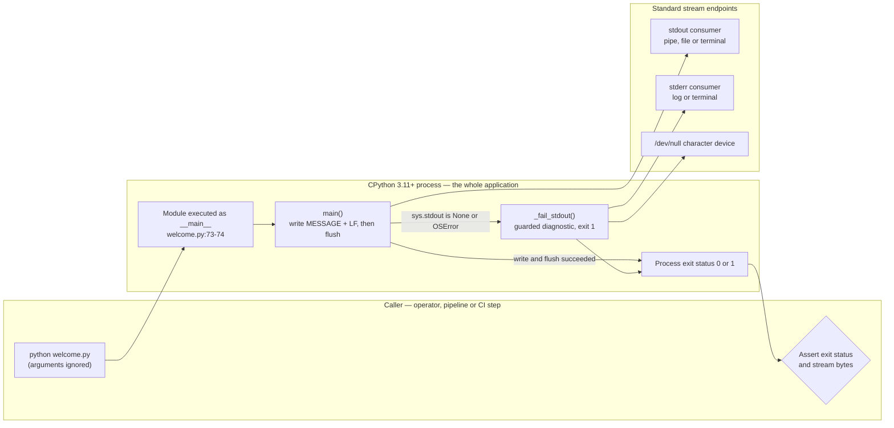

The diagram is the system's entire runtime topology: no database node, no queue, no cache, no port, and no second process is omitted from it.

### 5.1.2 Core Components Table

Seven components carry the tracked tree. Six belong to the greeting deliverable and its evidence; the seventh is the pre-existing demo, listed because it is the repository's only network surface and must not be mistaken for part of the product. Component identifiers are used again in §5.2.

| Component | Primary Responsibility | Key Dependencies | Integration Points & Critical Considerations |
|---|---|---|---|
| **CMP-01** Greeting program core — `welcome.py:10`, `56-70`, `73-74` | Hold the two contract constants and perform the single write-then-flush of `MESSAGE + "\n"` on the success path | CPython 3.11+; stdlib `sys`; a writable fd 1 | Invoked by the shell, spawned by the suite, imported silently by tests and consumers. Critical: the flush must sit inside the `try`, or a rejected stream fails at interpreter shutdown outside the handler |
| **CMP-02** Failure-disclosure handler — `welcome.py:15-53` | Convert an unusable standard output into one 51-byte diagnostic on fd 2 and exit status 1, with no traceback and no interpreter shutdown notice | stdlib `os` (`devnull`, `open`, `dup2`, `O_WRONLY`) and `sys`; `/dev/null` | Entered from `main()`'s guard or its `except OSError`; terminated by the single `raise SystemExit(1)`. Critical: every step is guarded so descriptor exhaustion still yields status 1 |
| **CMP-03** Behaviour-contract suite — `tests/test_welcome.py:19-183` | Pin the observable contract as ten exact-equality assertions across three classes, spawned and in-process | stdlib `io`, `os`, `shlex`, `subprocess`, `sys`, `unittest`, `contextlib`, `pathlib`; a POSIX shell; the module `welcome` | Imports `welcome` (`tests/test_welcome.py:17`) and spawns `sys.executable` on `welcome.py`. Critical: reaching both failure routes requires two distinct mechanisms — a reader-less `os.pipe()` and a shell `exec` redirection |
| **CMP-04** Discovery marker — `tests/__init__.py` (0 bytes) | Make `tests/` an importable package so root-level `unittest discover` collects the suite | None | Read only by the discovery machinery. Critical: without it, discovery from the repository root collects nothing and the regression net disappears silently |
| **CMP-05** Contract documentation — `README.md:1-49` | State purpose, interpreter floor, run command, expected bytes, test command, argument behaviour and failed-write behaviour | Markdown only; nothing executes it | Read by humans and by no code path. Critical: it is the only specification a consumer sees, so drift against CMP-01/CMP-02 is a contract defect |
| **CMP-06** Pre-existing HTTP demo — `server.js:1-14` | Serve a constant `Hello, World!\n` body on `127.0.0.1:3000` for any request | Node.js built-in `http` | Binds loopback only; shares nothing with CMP-01. Critical: no `'error'` listener and no signal handler, so a second instance exits 1 on `EADDRINUSE` with a stack trace |
| **CMP-07** Delivery reports — `blitzy/documentation/` | Narrate scope, hours, verification and open items for each implementation era | Markdown only | No code path reads them. Critical: the JavaScript-era report still describes a deleted file, so it cannot be treated as current specification |

### 5.1.3 Data Flow Description

Three data flows carry executable behaviour, one carries verification, and one belongs to the unconnected demo. Every flow that touches the product is a single pass with no parsing, no serialization and no persistence.

| Flow | Producer → consumer | Payload and transformation | Evidence |
|---|---|---|---|
| **DF-01** Greeting | `main()` → fd 1 → caller's capture | `MESSAGE` (17 ASCII characters) concatenated with one `"\n"` at the moment of writing, encoded by the text layer, written and flushed; 18 bytes total | `welcome.py:10`, `welcome.py:64-68`; measured 18 bytes, sha256 `2dc7e85a…1951` |
| **DF-02** Diagnostic | `_fail_stdout()` → fd 2 → operator or log | `STDOUT_FAILURE` plus one `"\n"`, written once and flushed; 51 bytes total, produced only after fd 1 has been neutralised | `welcome.py:12`, `welcome.py:37-42`; measured 51 bytes on all four failure routes |
| **DF-03** Descriptor re-point | `_fail_stdout()` → kernel | `os.open(os.devnull, os.O_WRONLY)` result duplicated onto fd 1, then onto fd 2 if the diagnostic itself failed; no payload, only channel state | `welcome.py:26`, `welcome.py:45` |
| **DF-04** Verification | Suite → spawned child → suite's captures | Arguments and redirections flow inward; the child's stdout, stderr and status flow back as `(returncode, stdout, stderr)` tuples compared for exact equality | `tests/test_welcome.py:36-63`, `66-92`, `129-183` |
| **DF-05** Demo request/response | HTTP client → `server.js` handler → client | Request method, path, headers and body are read by nobody; the handler writes a fixed status, one header and a 14-byte body | `server.js:6-10`; measured `200`, `text/plain`, `Content-Length: 14` for `GET /` and `POST /anything` |

**Transformation points.** There are exactly two, both trivial and both observable: the string concatenation `MESSAGE + "\n"` in `main()` (`welcome.py:64`) and the corresponding `STDOUT_FAILURE + "\n"` in the handler (`welcome.py:37`). Nothing tokenises, parses, formats, interpolates a variable or consults a locale, which is why the byte count is stable across environments — a scrub (`env -i … -I -S`) reproduces the same 18 bytes and the same digest. The **durability point** is the explicit flush: because standard output is block-buffered when it is not a terminal, the flush inside the `try` is what surfaces a rejected stream while `except OSError` can still catch it (`welcome.py:65-68`).

**Integration patterns and protocols.** Data crosses the process boundary as bytes on file descriptors — POSIX streams, not a protocol. Ordering is guaranteed by the fact that the process yields only after the flush returns; there is no retry, no batching, no acknowledgement and no back-pressure mechanism beyond the blocking semantics of the underlying descriptor. The consumer's only acknowledgement channel is the exit status (`0` after a successful flush, `1` on every failure route).

**Key data stores and caches.** None, and the absence is structural rather than pending:

| Store or cache class | Status | Consequence for the architecture |
|---|---|---|
| Relational or document database | Absent — no driver, no schema, no connection string | No consistency, migration or backup concern exists |
| In-memory cache or session store | Absent — the process holds two constants and never runs long enough to warm anything | No invalidation or eviction strategy is required; the payload is a compile-time literal |
| Message broker or queue | Absent — no producer, consumer, topic or acknowledgement | No delivery guarantee to design |
| Filesystem store | Only `os.devnull`, opened write-only on the failure path | The program can neither corrupt nor depend on repository state |
| Log file or trace emitter | Absent — standard error is the only diagnostic channel and it is used once per failed run | Observability is delegated to the caller's capture (§5.4.1) |

### 5.1.4 External Integration Points

The product integrates with five external surfaces, four of which belong to the operating system. Each row states what actually crosses the boundary, in what form, and what the system promises — which, in every case, is a fixed byte count and an exit status rather than an availability target.

| System | Integration Type & Protocol/Format | Data Exchange Pattern | SLA Requirements |
|---|---|---|---|
| Caller shell, pipeline or CI step | Process invocation (fork/exec), POSIX `argv`, wait status; plain-ASCII streams | Synchronous, one-shot: one invocation, one response, immediate termination | None contractual. Measured wall time 0.012 s for a full run; the caller may pass arguments, which are ignored (`README.md:37-39`) |
| Standard output consumer (pipe, file, terminal) | Byte stream over fd 1; UTF-8-safe ASCII text terminated by one LF | Single write plus flush; blocking semantics; a dead reader raises `BrokenPipeError` | None contractual; the invariant is exactly 18 bytes or the failure path. A terminal's newline translation is a consumer-side artifact, not a change to the bytes |
| Standard error consumer (log, terminal, capture) | Byte stream over fd 2; ASCII text terminated by one LF | At most one write plus flush, failure path only | None contractual; the invariant is exactly 51 bytes, or zero bytes when the stream is unusable and only the status survives |
| `/dev/null` character device | POSIX device file, opened `O_WRONLY` through `os.devnull` | Descriptor retarget via `os.dup2`; no data of interest is written | Local kernel device; no SLA. Absence is tolerated — the handler closes the stream instead (`welcome.py:31-34`, `welcome.py:46-52`) |
| Host CPython interpreter | Runtime host and in-process API (`import welcome` exposes `MESSAGE`, `STDOUT_FAILURE`, `_fail_stdout`, `main`) | Import-time binding only; no callback, hook or entry point is registered | Documented floor is Python 3.11 or later and is not checked by the program (`README.md:5-9`); exercised here on CPython 3.12.3 |
| `unittest` runner (verification only) | `python -m unittest discover` CLI, standard-library runner | Discovery, ten assertions, aggregate result on stdout, exit status 0 or 1 | Requires the repository root as the working directory so `import welcome` resolves (`README.md:31-35`); measured `Ran 10 tests … OK` in 0.105 s |
| Node.js runtime and loopback HTTP client (demo only) | `http` server bound to `127.0.0.1:3000`; HTTP/1.1 request/response | Stateless: any request yields the same 14-byte body | None; no listener options, no timeout configuration, no `'error'` listener. Unconnected to CMP-01 and excluded from the product's scope |

No third-party API, SaaS endpoint, identity provider, message broker or payment service appears in any tracked file, and no credential, token or environment variable is read anywhere in the tree. Consumers therefore integrate in exactly two ways: gate on the exit status, or compare the captured bytes against the expected 18-byte string (or its sha256).


## 5.2 Component Details

### 5.2.1 CMP-01 — Greeting Program Core

**Purpose and responsibilities.** The core is `welcome.py` minus its failure helper: the two contract constants and `main()`, which performs the product's single successful action. It owns four duties — hold the message as a literal (`welcome.py:10`), decide before any write whether a stream exists at all (`welcome.py:61-62`), write and flush the line (`welcome.py:63-68`), and hand control to CMP-02 on the one exception it recognises (`welcome.py:69-70`). It parses nothing, reads nothing and returns `None`; every input it might have consulted is absent from the source by construction (`README.md:37-39`).

**Technologies and frameworks.** Plain CPython 3.11-or-later source, standard library only, one import of `os` and one of `sys` for the whole module (`welcome.py:7-8`). No framework, no packaging metadata, no type annotations, no logging call and no third-party dependency — the module-level import cost is compilation plus two constant assignments.

**Key interfaces and APIs.**

| Interface | Kind | Contract | Consumers |
|---|---|---|---|
| `MESSAGE` | module constant, `str` | Exactly `Welcome to Blitzy` — 17 characters, no padding, no embedded newline | `main()` at `welcome.py:64`; asserted by `test_message_is_exact_and_unpadded` (`tests/test_welcome.py:98-100`) |
| `main()` | public function, no parameters | Writes 18 bytes, returns `None`, leaves standard error untouched; raises `SystemExit(1)` only by way of CMP-02 | `if __name__ == "__main__": main()` (`welcome.py:73-74`); `MainCallableTests` calls it in process (`tests/test_welcome.py:103-126`) |
| `python welcome.py [args]` | process interface | 18 bytes on stdout, empty stderr, exit 0; or the failure contract of §5.2.2. Arguments are accepted and ignored | Operators, pipelines and CI steps (`README.md:11-25`, `README.md:37-39`) |
| `import welcome` | import interface | Binds `MESSAGE`, `STDOUT_FAILURE`, `_fail_stdout`, `main`; performs no I/O and no state change | `tests/test_welcome.py:17`, and any consumer wanting the literal without capturing a stream |

```python
try:
    sys.stdout.write(MESSAGE + "\n"); sys.stdout.flush()   # flush inside the try
except OSError:
    _fail_stdout()
```

The flush is structural, not cosmetic: standard output is block-buffered when it is not a terminal, so without it a rejected stream would fail at interpreter shutdown, outside the `except` clause that produces the contract's diagnostic.

**Data persistence requirements.** None. The core opens no file, holds no buffer across calls and writes nothing outside fd 1; repeated calls in one process are independent because the only state is the immutable constant (`test_main_is_repeatable`, `tests/test_welcome.py:121-126`).

**Scaling considerations.** Scaling is per process and needs no coordination: there is no shared state, lock, connection pool or cache, so N concurrent invocations are independent. Fifty concurrent runs measured here produced a single distinct sha256 across all fifty outputs. Cost per run is dominated by interpreter start-up — 0.012 s wall measured for a full invocation — and the resources that bound concurrency are the operating system's descriptor table and pipe buffers, not the program. Horizontal scaling is therefore "run it more often"; vertical scaling is meaningless for a workload of one 18-byte write.

### 5.2.2 CMP-02 — Failure-Disclosure Handler

**Purpose and responsibilities.** `_fail_stdout()` (`welcome.py:15-53`) converts an unusable standard output into the contract's second observable outcome: exactly one 51-byte diagnostic line on standard error, an empty standard output, no traceback, and exit status 1 (`README.md:41-49`). It has two entry predicates and one exit, and it never returns.

**Technologies and frameworks.** Standard library only: `os` for `devnull`, `open`, `dup2` and `O_WRONLY` (`welcome.py:26`, `welcome.py:45`), `sys` for the stream objects and `fileno()`. No signal handler, no `atexit` hook and no logging module is involved.

**Key interfaces and APIs.**

| Interface | Kind | Contract | Entry/exit evidence |
|---|---|---|---|
| `_fail_stdout()` | private function, no parameters | Never returns; always ends in `SystemExit(1)`; emits at most one diagnostic line | Definition `welcome.py:15`; terminal raise `welcome.py:53` |
| Entry A: `sys.stdout is None` | pre-write predicate | Descriptor 1 was closed before the interpreter started, so no stream object exists | Guard at `welcome.py:61-62` |
| Entry B: `OSError` from write or flush | exception path | The stream exists but rejects the write — a reader-less pipe, a full device, a revoked descriptor | `except OSError` at `welcome.py:69` |
| Diagnostic format | byte contract | `welcome.py: error: cannot write to standard output` + one LF = 51 bytes on fd 2 | `STDOUT_FAILURE` at `welcome.py:12`, written at `welcome.py:37` |

The handler is three guarded rungs on each stream:

- **Rung 1 — neutralise fd 1.** `os.dup2(os.open(os.devnull, os.O_WRONLY), sys.stdout.fileno())` points descriptor 1 at the null device so the interpreter's own shutdown flush cannot fail again (`welcome.py:25-27`).
- **Rung 1b — close instead.** If the retarget raises `OSError`, `sys.stdout.close()` discards the buffered content and marks the stream closed, which the shutdown flush skips (`welcome.py:31-34`).
- **Rung 2 — deliver, then defend fd 2.** The diagnostic is written and flushed; if either raises `OSError`, descriptor 2 is retargeted at `/dev/null`, else closed (`welcome.py:35-52`). Only then does `raise SystemExit(1)` execute.

Two properties keep the contract intact. First, `OSError` is the only exception type caught anywhere in the program — six `except OSError` clauses at `welcome.py:27`, `33`, `43`, `46`, `51` and `69`, with no bare `except` and no `Exception`. Second, the single `raise SystemExit(1)` sits outside every guard (`welcome.py:53`), so descriptor exhaustion or an unwritable standard error still yields status 1 rather than the interpreter's substitute status.

**Data persistence requirements.** None beyond a transient write-only handle on `os.devnull`, used solely to re-point a descriptor. Nothing is created, read or left behind, and the handler is idempotent in effect: a run can emit at most one diagnostic line because the first thing it does is destroy the channel that could produce a second.

**Scaling considerations.** The handler is on the failure path only, so it adds nothing to a successful run. Under resource pressure it degrades predictably instead of failing differently: exhausted descriptors, a dead standard error and both streams unwritable all end at status 1 with the diagnostic emitted where a channel remains. Verified here on four routes — `>&-`, a reader-less pipe, `>/dev/full` and `2>&1 | head -c 0` — each returning status 1 and, where stderr was writable, exactly 51 bytes.

### 5.2.3 CMP-03 — Behaviour-Contract Test Suite

**Purpose and responsibilities.** `tests/test_welcome.py` (183 lines) is the repository's only automated gate. It turns the README's prose contract into ten exact-equality assertions across three classes, covering the constant, the in-process write path, the spawned-process contract, argument and input independence, the silent import and both failed-write routes (`tests/test_welcome.py:95-183`).

**Technologies and frameworks.** Standard-library `unittest` only, with `io`, `os`, `shlex`, `subprocess`, `sys`, `contextlib` and `pathlib` (`tests/test_welcome.py:8-15`). No pytest, no fixture library, no mock library, no coverage tool and no `conftest.py` — the gate runs with nothing installed (`README.md:27-35`).

**Key interfaces and APIs.**

| Interface | Kind | Contract | Evidence |
|---|---|---|---|
| `run_program(*args, stdout_closed=False)` | helper | Returns `(returncode, stdout_bytes, stderr_bytes)` from a fresh interpreter; with `stdout_closed` the pipe's read end is closed before the spawn, so writes fail with `BrokenPipeError` | `tests/test_welcome.py:36-63` |
| `run_program_through_shell(redirection)` | helper | Applies one allow-listed redirection through `exec` before the interpreter starts — the only way to reach the `sys.stdout is None` route | `tests/test_welcome.py:66-92` |
| `SUPPORTED_REDIRECTIONS` | module constant, allow-list | Exactly `>&-`, `< /dev/null`, `<&-`; any other value raises `ValueError` before a command line is built | `tests/test_welcome.py:24-33`, enforced at `81-85` |
| `MessageConstantTests`, `MainCallableTests`, `ProcessBehaviourTests` | test classes | 1 + 3 + 6 methods: constant exactness; in-process write, stderr silence and repeatability; spawned status/bytes, argument indifference, silent import, reader-less pipe, closed descriptor, two input states | `tests/test_welcome.py:95-183` |
| `python -m unittest discover` | runner interface | 10 tests, `OK`, exit 0 from the repository root | Measured here: `Ran 10 tests in 0.105s`, `OK` |

The suite holds 26 assertions — 25 `assertEqual` and 1 `assertIsNone` — and every output comparison is exact equality; no membership, truthiness or substring check exists, so a drift of one byte fails the run. Its own safety rule is architectural rather than incidental: `shell=True` is used exactly once, with both path operands passed through `shlex.quote` (`tests/test_welcome.py:86-88`) and the redirection constrained to the allow-list, so no caller-supplied text can reach the command line.

**Data persistence requirements.** None. The suite writes no file, creates no fixture and uses no temporary directory; every pipe it opens is closed on all paths, including the failure path of the `try/finally` at `tests/test_welcome.py:49-58`, so no descriptor outlives a test.

**Scaling considerations.** The suite is sequential by design and takes 0.105 s wall for ten tests, dominated by four interpreter spawns; there is no shared state between methods, so the suite is safe to run concurrently in separate working copies. Its coverage boundary is explicit and recorded: the descriptor-exhaustion and compound-failure branches of `_fail_stdout()` (`welcome.py:31-34`, `46-52`) are exercised at run time but carry no committed test, which §2.4 and §5.4.1 record as an open gap rather than a claim of full coverage.

### 5.2.4 CMP-04 Discovery Marker and CMP-05 Contract Documentation

**Purpose and responsibilities.** These two components carry no runtime logic; they make the product discoverable and its contract readable. `tests/__init__.py` is a zero-byte file whose only role is packaging semantics: it makes `tests/` a regular package so root-level discovery imports the suite as `tests.test_welcome` instead of skipping the directory. `README.md` (49 lines, six sections) is the user-facing specification: purpose, interpreter floor, run command with expected bytes, test command with the run-from-root requirement, argument agnosticism and failed-write behaviour (`README.md:1-49`).

**Technologies and frameworks.** Markdown for the README, with three fenced blocks and no machine-readable metadata; an empty Python file for the marker. Nothing in the tree parses either.

**Key interfaces and APIs.**

| Interface | Kind | Contract | Evidence |
|---|---|---|---|
| Package marker | zero-byte module | Contributes no symbol and no import cost; enables `unittest` discovery from the repository root | `tests/__init__.py`; `README.md:35` |
| README §Run | documented process contract | `python welcome.py` produces exactly `Welcome to Blitzy`, 18 bytes, with no banner or blank line, exit 0 and empty stderr | `README.md:11-25` |
| README §Test | documented verification contract | `python -m unittest discover` from the repository root reports `OK` over ten tests with nothing installed | `README.md:27-35` |
| README §Behaviour on a failed write | documented failure contract | One diagnostic line, empty standard output, no traceback, exit 1 | `README.md:41-49` |

**Data persistence requirements.** None; both are read-only artifacts. Their persistence requirement is the inverse — they are the only records a consumer consults before running the program, so drift against `welcome.py` is a contract defect even though no code path enforces parity.

**Scaling considerations.** Not applicable in the runtime sense. Their scaling cost is review effort: the README must be re-read on any change to the constants or the handler, and the marker's presence is a precondition of the only automated gate, so its deletion would silently remove the regression net rather than fail loudly.

### 5.2.5 CMP-06 — Pre-existing HTTP Demo (`server.js`)

**Purpose and responsibilities.** A 14-line Node.js program that answers every request on `127.0.0.1:3000` with a constant `Hello, World!\n` body (`server.js:1-14`). It is a pre-existing artifact, excluded from the greeting product's scope and connected to nothing in it: no symbol, process, port, configuration or output is shared with `welcome.py`.

**Technologies and frameworks.** Only the Node.js built-in `http` module (`server.js:1`); no manifest, no `require` of anything else, no framework, no middleware. The two literals `hostname = '127.0.0.1'` and `port = 3000` are module constants (`server.js:3-4`).

**Key interfaces and APIs.**

| Interface | Kind | Contract | Evidence |
|---|---|---|---|
| TCP listener | `server.listen(port, hostname, cb)` | Loopback-only bind; the callback logs `Server running at http://127.0.0.1:3000/` after a successful bind | `server.js:12-14`; observed |
| Request handler | inline `(req, res)` callback | Sets `statusCode 200` and `Content-Type: text/plain`, ends with a 14-byte body; method, path, headers and body are ignored | `server.js:6-10`; measured on `GET /` and `POST /anything` |
| Startup failure | Node default `'error'` event | No listener is registered, so a second instance exits 1 with an unhandled-error stack trace while the first keeps serving | observed: second instance exit 1, first unaffected |

**Data persistence requirements.** None — the handler is stateless, opens no file and holds no session.

**Scaling considerations.** One process, one event loop, HTTP keep-alive at the Node default of 5 s, no clustering, no worker threads and no graceful-shutdown drain; the port is hardcoded with no override (`server.js:4`). Any real load requirement would need changes outside this repository's delivered scope, which is why the demo is documented as an unconnected surface rather than a service.

### 5.2.6 CMP-07 — Delivery Reports (`blitzy/documentation/`)

**Purpose and responsibilities.** Two narrative reports record scope, hours, verification and open items for the two implementation eras. `Project Guide - d45b6a30-….md` describes the current Python era (ten-test suite, byte-exact output, open hardening items); `Project Guide.md` describes the superseded JavaScript era and still cites a `Welcome.js` file that commit `0e0430f` deleted. Neither is read by any code path, and neither is part of the runtime architecture.

**Technologies and frameworks.** Markdown with embedded Mermaid diagrams; no executable content.

**Key interfaces and APIs.** None. They are non-authoritative input to reviewers, not an interface of the system.

**Data persistence requirements.** None; the files are inert. Their architectural relevance is limited to a hazard worth stating: the JavaScript-era report's commands now fail (`node Welcome.js` → `MODULE_NOT_FOUND`), so a reader who treats it as current specification will expect a stack the repository no longer contains.

**Scaling considerations.** Not applicable.

### 5.2.7 Component Interaction Diagram

The graph below is the complete interaction set of the tracked tree. Every edge that carries executable dependency is drawn solid; documentation relationships are dashed because no code path reads the Markdown.

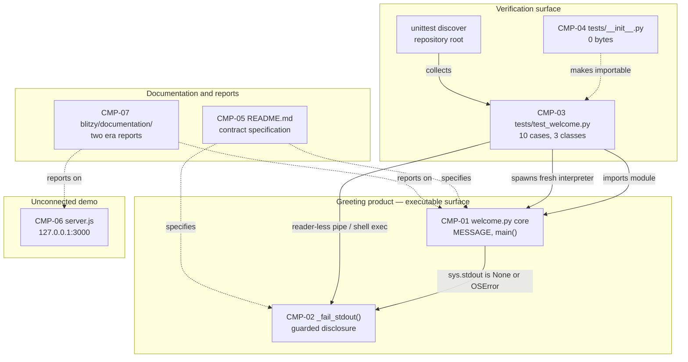

There is no edge between the greeting product and `server.js`: they share only the operating system, and a change to either has no runtime effect on the other.

### 5.2.8 State Transition Diagram

A run of `welcome.py` has a small, fully enumerable state space: five states on the success side, five on the disclosure side, and one import terminal state that produces no output at all.

```mermaid
stateDiagram-v2
    [*] --> ModuleLoad
    ModuleLoad --> ImportTerminal: __main__ guard false (import)
    ModuleLoad --> Dispatch: __main__ guard true
    Dispatch --> WriteGreeting: sys.stdout is not None
    Dispatch --> Retarget: sys.stdout is None
    WriteGreeting --> ExitZero: write and flush return
    WriteGreeting --> Retarget: OSError from write or flush
    Retarget --> EmitDiagnostic: fd 1 now points at /dev/null
    Retarget --> CloseStdout: OSError acquiring fd
    CloseStdout --> EmitDiagnostic
    EmitDiagnostic --> ExitOne: diagnostic written and flushed
    EmitDiagnostic --> NeutraliseStderr: OSError from write or flush
    NeutraliseStderr --> ExitOne: dup2 at /dev/null, else close
    ImportTerminal --> [*]: no output on any stream, exit 0
    ExitZero --> [*]: 18 bytes on fd 1, exit 0
    ExitOne --> [*]: 51 bytes on fd 2 where writable, exit 1
```

Two properties of the diagram matter architecturally. `Retarget` is entered from both entry predicates and is unconditional on the disclosure side, which is what makes the single diagnostic idempotent. And `ExitOne` has three inbound edges — delivered diagnostic, neutralised stderr, failed retarget — all converging on the one `raise SystemExit(1)` outside every guard, so no state can terminate with an interpreter-supplied status.

### 5.2.9 Sequence Diagrams for Key Flows

**Success flow (WF-01).** The caller observes the outcome through the exit status; the bytes are a corollary of the successful flush.

```mermaid
sequenceDiagram
    autonumber
    participant Op as Caller shell or CI
    participant Py as CPython process
    participant Core as main()
    participant Out as stdout consumer
    Op->>Py: python welcome.py [args ignored]
    Py->>Core: __main__ guard invokes main()
    Note over Core: sys.stdout is not None
    Core->>Out: write("Welcome to Blitzy" + LF)
    Core->>Out: flush()
    Out-->>Core: 18 bytes accepted
    Core-->>Py: return None
    Py-->>Op: exit status 0, stderr empty
```

**Failure flow (WF-02).** Both entry predicates converge on the handler, which neutralises the dead channel before it speaks on the live one.

```mermaid
sequenceDiagram
    autonumber
    participant Op as Caller shell or CI
    participant Py as CPython process
    participant Core as main()
    participant Fail as _fail_stdout()
    participant Dev as /dev/null
    participant Err as stderr consumer
    Op->>Py: python welcome.py with fd 1 closed or piped to a dead reader
    Py->>Core: main()
    Note over Core: sys.stdout is None, or OSError from write or flush
    Core->>Fail: _fail_stdout()
    Fail->>Dev: open os.devnull, dup2 onto fd 1
    alt retarget succeeded
        Fail->>Err: write and flush 51-byte diagnostic
    else retarget raised OSError
        Fail->>Core: close sys.stdout, then deliver diagnostic
        Fail->>Err: write and flush 51-byte diagnostic
    end
    alt diagnostic delivered
        Fail-->>Py: raise SystemExit(1)
    else diagnostic raised OSError
        Fail->>Dev: dup2 onto fd 2, else close sys.stderr
        Fail-->>Py: raise SystemExit(1)
    end
    Py-->>Op: exit status 1, stdout empty, no traceback
```

**Verification flow (WF-04).** The suite reaches both failure routes only by supplying the descriptor state before the child starts, which is why it needs two spawn mechanisms rather than one.

```mermaid
sequenceDiagram
    autonumber
    participant Runner as unittest discover
    participant Suite as tests.test_welcome
    participant Child as spawned interpreter
    participant Kernel as pipe or shell redirection
    Runner->>Suite: collect tests.test_welcome (root working directory)
    Suite->>Child: subprocess.run([sys.executable, welcome.py], cwd=ROOT)
    Child-->>Suite: (0, b"Welcome to Blitzy\n", b"")
    Suite->>Kernel: os.pipe(), close read end before spawn
    Child-->>Suite: (1, b"", 51-byte diagnostic)
    Suite->>Kernel: exec python welcome.py >&-
    Child-->>Suite: (1, b"", 51-byte diagnostic)
    Suite-->>Runner: 26 exact-equality assertions pass
    Runner-->>Runner: "Ran 10 tests" then "OK", exit 0
```


## 5.3 Technical Decisions

### 5.3.1 Architecture Style: Single-File CLI over a Library, Service or Package

The first decision fixes everything after it: the deliverable is a program, not a library, a service or an installable package. Each rejected alternative would have required an install step, a manifest, a resident process or a host — all excluded by the zero-install constraint recorded in §3.2.1 (constraint C-01 in §2.6) and by the fact that the observable contract is 18 bytes plus an exit status (`README.md:19-25`).

| Decision | Alternatives considered | Tradeoff accepted | Evidence |
|---|---|---|---|
| One file, `welcome.py`, run directly by the interpreter | Importable library with `main()` as the only entry point; HTTP endpoint; installable distribution with `pyproject.toml` | No packaging story: the program is not pip-installable and must be run from a checkout, with the repository root as working directory for the suite | `welcome.py:1-74`; no manifest in the tree; `README.md:11-35` |
| Standard library only, two imports | Any CLI framework, logging library or argument parser | Parsing, logging and configuration must be done by hand — which the contract makes trivial, because there is nothing to parse or configure | `welcome.py:7-8`; six standard-library modules in the suite (`tests/test_welcome.py:8-15`) |
| Flow separation inside the file: `main()` for success, `_fail_stdout()` for failure | A single function with nested conditionals; a class hierarchy with a strategy per outcome | The two outcomes are reachable only through different mechanisms, so the suite needs two spawn helpers rather than one | `welcome.py:15-70`; `tests/test_welcome.py:36-92` |

### 5.3.2 Communication Pattern: Standard Streams and Exit Status

The program communicates over the three standard streams and the process wait status, and it uses no other channel: no file, no socket, no environment variable, no signal and no IPC.

| Decision | Alternatives considered | Tradeoff accepted | Evidence |
|---|---|---|---|
| Payload on fd 1, disclosure on fd 2, outcome in the exit status | One stream for everything; a log file; a status file; a socket response | Two channels must be captured and composed by the consumer, but payload integrity is preserved: a failure never contaminates the 18-byte stream | `welcome.py:64`, `welcome.py:37`, `welcome.py:53` |
| Fixed strings, no formatting or interpolation | Template with arguments, version stamp, timestamp | The bytes are reproducible and digest-assertable, at the cost of carrying no provenance about the interpreter or run | `welcome.py:10`, `welcome.py:12`; sha256 `2dc7e85a…1951` |
| Synchronous, one-shot, terminating process | Long-lived daemon answering repeated requests; batch mode with a manifest of messages | Per-invocation start-up cost (~0.012 s measured) is paid every run, and there is no way to amortise it | `welcome.py:56-74`; no loop, timer, thread or `async` in the tree |
| Explicit flush before returning | Rely on the interpreter's shutdown flush; `print()` | One extra system call per run buys deterministic error attribution, since the shutdown flush happens outside the handler | `welcome.py:63-68`, comment at `65-68` |

### 5.3.3 Data Storage: No-Datastore Decision

The system stores nothing. The only filesystem interaction in the product is `os.devnull`, opened `O_WRONLY` and duplicated onto a dead descriptor during failure disclosure (`welcome.py:26`, `welcome.py:45`).

| Decision | Alternatives considered | Tradeoff accepted | Evidence |
|---|---|---|---|
| No database, no schema, no migration, no file output | SQLite file and a table per run; JSONL append log | No queryable history: a consumer wanting a record must capture the stream itself | No driver import, no `open()` call and no path literal other than `os.devnull` in `welcome.py` |
| No configuration store | `.env`, INI/TOML file, environment variables, CLI flags | Behaviour cannot be changed without editing source — deliberate, since changing the message would break the contract | `README.md:37-39`; no `os.environ`, `sys.argv` or file read in `welcome.py` |
| Nothing written to the repository | Temp file, report artifact, cache directory | No state to clean up, no lock to manage, no risk of a run mutating the checkout | `git ls-files` lists the same seven paths before and after runs; only untracked `__pycache__/` appears |

### 5.3.4 Caching Strategy: Constant Payload, No Cache

There is no application cache to justify, and the reason is architectural rather than an omission. The payload is a module-level literal, so it is compiled into the code object once and costs a reference plus a concatenation at run time; a cache would sit in front of an operation that is already the cheapest step in the program.

| Decision | Alternatives considered | Tradeoff accepted | Evidence |
|---|---|---|---|
| Treat the message as a compile-time constant | Compute or memoise the line; load it from a file or resource | Changing the greeting requires a source edit and a new commit — which is the point, because the bytes are the contract | `welcome.py:10` |
| No in-process cache, memoisation or session state | Lazy singleton holding the line; reuse across invocations | Each process pays the full cost again, which is negligible for one write | `welcome.py:56-70`; measured 0.012 s per run |
| No cache invalidation strategy | TTL cache, version-keyed cache | Nothing to invalidate, and no stale-content failure mode can exist | No cache construct anywhere in the tree |
| Accept CPython's own bytecode cache as the only cache in the system | Disable bytecode writing (`-B`), commit `__pycache__` | Import of `welcome` by the suite leaves an untracked `__pycache__/` directory; it affects nothing at run time and is not part of the delivered tree | `git status` shows `__pycache__/` and `tests/__pycache__/` untracked; `git ls-files` does not list them |

### 5.3.5 Security Mechanism Selection

The security posture is enumerable rather than sampled, because the program's entire input surface is one piece of state — whether descriptor 1 is writable — and its entire output surface is two fixed strings. The mechanisms below are the ones the code actually implements; nothing else was needed, and adding more would create surface rather than remove it.

| Mechanism | Threat or failure addressed | Implementation | Evidence |
|---|---|---|---|
| No untrusted input path at all | Injection, traversal, deserialization and argument-confusion attacks | No argument, environment, stdin or file read; no `eval`, `exec`, `pickle`, dynamic import or `subprocess` call in the product | `welcome.py:1-74`; imports limited to `os` and `sys` |
| Single exception type, `OSError` | A broad `except` masking defects as contract behaviour | Six `except OSError` clauses, no bare `except`, no `except Exception` | `welcome.py:27`, `33`, `43`, `46`, `51`, `69` |
| Exit-status integrity under hostile stream states | A descriptor failure inside the handler replacing the contract's status | `raise SystemExit(1)` outside every guard; guarded retarget and close fallbacks | `welcome.py:31-34`, `46-52`, `53` |
| Redirection allow-list in the test harness | Arbitrary shell text reaching `subprocess.run(..., shell=True)` | `SUPPORTED_REDIRECTIONS` admits exactly three tokens and raises `ValueError` before a command line is built | `tests/test_welcome.py:24-33`, `81-85` |
| Quoted operands in the shell spawn | Word splitting or metacharacter injection through the interpreter or program path | Both path operands pass through `shlex.quote` | `tests/test_welcome.py:86-88` |
| Fixed device path only | Path traversal or file clobbering on the failure path | `os.devnull` is the only path the product opens, always `O_WRONLY` | `welcome.py:26`, `welcome.py:45` |
| Zero third-party dependencies | Supply-chain and advisory exposure; dependency-confusion attacks | No manifest, lock file, `node_modules` or vendored code anywhere in the tree | filesystem sweep; §3.2 |
| Default file permissions | World-writable source or unexpected execution bit | `welcome.py` is `0644` (owner read/write, no execute bit) | `ls -l` on the delivered files |

### 5.3.6 Decision Tree

The tree records the sequence in which the decisions above were forced by the contract; each leaf names the architecture decision record that captures it.

```mermaid
flowchart TD
    Q1{"Is the contract a fixed byte string<br/>plus an exit status?"}
    Q1 -- yes --> Q2{"Must it be observable<br/>with nothing installed?"}
    Q2 -- yes --> D1["ADR-001: single-file CLI,<br/>standard library only"]
    Q1 -- no --> X1["Out of scope:<br/>library or service design"]
    Q2 -- no --> X2["Out of scope:<br/>packaged distribution"]
    D1 --> Q3{"Does a failure share the stream<br/>that carries the payload?"}
    Q3 -- "never: payload integrity wins" --> D2["ADR-002: payload on fd 1,<br/>disclosure on fd 2"]
    D2 --> Q4{"Would a shutdown-time failure<br/>be catchable in the handler?"}
    Q4 -- no --> D3["ADR-003: explicit flush inside the try"]
    D3 --> Q5{"Can the interpreter flush a dead<br/>stream again at shutdown?"}
    Q5 -- yes --> D4["ADR-004: retarget fd 1 and fd 2<br/>at /dev/null before raising"]
    Q4 -- yes --> D3
    D4 --> Q6{"Can a guarded failure change<br/>the exit status?"}
    Q6 -- yes --> D5["ADR-005: one raise SystemExit(1)<br/>outside every guard"]
    D5 --> Q7{"Is the process contract observable<br/>in the test process?"}
    Q7 -- no --> D6["ADR-006/ADR-007: spawn fresh<br/>interpreters, two mechanisms"]
    Q7 -- yes --> D6
    D6 --> Q8{"Is there state worth persisting<br/>or caching?"}
    Q8 -- no --> D7["ADR-008: no datastore,<br/>no cache, no configuration"]
```

### 5.3.7 Architecture Decision Records

| ID and status | Context | Decision and alternatives rejected | Consequences |
|---|---|---|---|
| **ADR-001** Single-file, standard-library CLI — Accepted | The contract is 18 bytes on stdout plus an exit status, and the tree must stay manifest-free | A CLI of one module. Rejected: importable library, HTTP service, pip-installable package | No install step and no supply chain; the program cannot be imported as a distribution and must run from the checkout |
| **ADR-002** Two-channel disclosure — Accepted | The diagnostic must never be mixed into the payload stream, because the payload's byte count is asserted | Payload on fd 1, one diagnostic line on fd 2. Rejected: single stream, log file, status file | Consumers must capture both streams to see the failure; the 18-byte channel stays clean under every route |
| **ADR-003** Flush inside the `try` — Accepted | Standard output is block-buffered when it is not a terminal, so a failed write surfaces at shutdown, outside any handler | Explicit `write` then `flush` inside one `try` catching `OSError`. Rejected: `print()` alone; relying on the shutdown flush | Deterministic attribution of a failed write; one extra syscall per run |
| **ADR-004** Neutralise dead descriptors at `/dev/null` — Accepted | The interpreter flushes standard streams again at shutdown, and a second failure there would add an "exception ignored" notice beside the single diagnostic and could displace the status | `os.dup2(os.open(os.devnull, O_WRONLY), fd)` before raising, with a close fallback. Rejected: leaving the dead stream for shutdown; skipping cleanup | POSIX assumption (`os.dup2`, `os.devnull`); the fix is what keeps the failure output to exactly one line |
| **ADR-005** One exit-status authority — Accepted | Three inbound edges reach the failure terminal, and any one of them could raise before the status is set | Single `raise SystemExit(1)` outside every guard. Rejected: raising inside the retarget guard; `sys.exit` calls per branch | Status 1 survives descriptor exhaustion and an unwritable stderr; the handler's control flow is one-way |
| **ADR-006** Import-inert module — Accepted | The suite must import the module and call `main()` in process without spurious output | All work behind `if __name__ == "__main__": main()`. Rejected: top-level call; `atexit` registration | Import is a pure binding operation; consumers can read `MESSAGE` without capturing a stream |
| **ADR-007** Verification by spawned processes — Accepted | Two failure routes cannot be reached from the same mechanism, and the process contract must be observed as bytes plus status | `subprocess.run` with `sys.executable`; a reader-less `os.pipe()` for the `OSError` route and an allow-listed shell `exec` redirection for the `sys.stdout is None` route. Rejected: in-process fakes only; `preexec_fn` descriptor surgery; a single spawn helper for both | Four child spawns per run, ~0.105 s total; the suite depends on a POSIX shell and on the repository root as working directory |
| **ADR-008** No datastore, cache or configuration — Accepted | A one-shot process writing a constant line has no state to keep, and any store would add a failure mode and a cleanup obligation | Nothing persisted; the message is a compile-time literal; no environment, flag or config file is read. Rejected: SQLite/JSONL record of runs, TTL cache, `.env` | Zero operational surface; a consumer wanting history must capture the stream; behaviour can change only by editing source |


## 5.4 Cross-Cutting Concerns

### 5.4.1 Monitoring and Observability

The system emits no metrics, exposes no health or readiness endpoint, registers no probe and writes no telemetry. Observability is delegated in full to the caller, and the complete set of signals a caller can observe is the standard output bytes, the standard error bytes and the exit status — the same four crossings §5.1.1 records as the system's only boundary.

| Signal | Where it comes from | What it can distinguish | Limit |
|---|---|---|---|
| Exit status `0` | Implicit return from `main()` (`welcome.py:70`) | A successful write and flush | Says nothing about whether the consumer received or kept the bytes |
| Exit status `1` | `raise SystemExit(1)` (`welcome.py:53`) | Every failure route, with no further granularity | All four routes collapse into one status by design (§5.2.2) |
| 18 bytes on fd 1 | `welcome.py:64` | Byte-exact success, assertable by length or digest | Requires the caller to capture or redirect the stream |
| 51 bytes on fd 2 | `welcome.py:37` | Which stream failed, in words | Undeliverable when stderr is also unusable; then only the status remains |

Observability primitives that are deliberately absent, and the consequence of each absence:

| Absent primitive | Consequence | Why it is absent |
|---|---|---|
| Metrics endpoint, counters, timers | No rate, latency or error series exists; a caller must derive them from exit codes | No resident process to scrape and no port to bind (§5.1.1) |
| Health/readiness probe | Liveness is the process's own existence; a completed run is the readiness signal | Process-per-invocation: there is no long-lived state to be unready |
| Structured events or audit trail | No record survives a run unless the caller captures a stream | No datastore, no log sink (§5.3.3) |
| Distributed tracing hooks | Nothing to trace: one process, one hop, no outbound call | No client, no span context, no propagation surface |

The practical monitoring pattern for this system is therefore a consumer-side wrapper that captures both streams, compares the 18 bytes or their sha256 `2dc7e85a…1951`, and records the exit status — which is exactly what the committed suite does for the same reason (`tests/test_welcome.py:132-136`).

### 5.4.2 Logging and Tracing Strategy

There is no logger, no log level, no log file, no timestamp, no correlation identifier and no trace context anywhere in the product; `welcome.py` imports only `os` and `sys` (`welcome.py:7-8`) and never references the `logging` module. The program's single diagnostic record is its entire logging strategy.

| Log record | When emitted | Channel and format | Evidence |
|---|---|---|---|
| Greeting | Every successful run | fd 1; `Welcome to Blitzy` + one LF; 18 bytes; this is product output, not a log line | `welcome.py:10`, `welcome.py:64` |
| Standard-output failure | On any failure route, at most once per run | fd 2; `welcome.py: error: cannot write to standard output` + one LF; 51 bytes, prefixed with the program name in the conventional `name: error: message` shape | `welcome.py:12`, `welcome.py:37` |
| Traceback | Never on a contracted route | — | The handler converts the `OSError` route into the fixed line; no traceback is printed (`README.md:49`) |
| Interpreter shutdown notice | Never on a contracted route | — | Suppressed by the `/dev/null` retarget or the stream close (`welcome.py:25-34`, `35-52`) |

Three consequences follow, and the first two are deliberate:

- **No severity levels.** There is exactly one severity of failure worth distinguishing, and the exit status carries it.
- **No metadata.** The line names the program and the failed stream and nothing else: no version, timestamp, PID or host, which is what keeps the diagnostic byte-exact and comparable with `assertEqual` (`tests/test_welcome.py:160`, `170`).
- **Where the record goes is the caller's decision.** Redirecting fd 2 to a file, a journal or a collector is the whole of the log-routing configuration; the program participates in no rotation, retention or shipping policy.

Tracing in any meaningful sense does not exist. A run has no spans, no parent-child relationships and no outbound requests; a caller wanting to correlate runs must supply its own identity at the invocation site, since the program reads none.

### 5.4.3 Error Handling Patterns

The program implements one pattern, applied consistently: **single-fault disclosure with channel neutralisation** — detect the one fault class it recognises, destroy the channel that could report it twice, report once on the surviving channel, and terminate with a fixed status that no later failure can change. The exception type caught is `OSError` and nothing else, in six clauses (`welcome.py:27`, `33`, `43`, `46`, `51`, `69`).

| Error class | Detection point | Handling | Observed outcome |
|---|---|---|---|
| Standard output absent | `sys.stdout is None` before any write (`welcome.py:61-62`) | `_fail_stdout()`; the `sys.stdout is None` branch skips the retarget | exit 1, 51 bytes on fd 2, stdout empty |
| Write rejected (reader-less pipe) | `OSError`/`BrokenPipeError` from `write` or `flush` (`welcome.py:69`) | Retarget fd 1, then disclose | exit 1, same 51 bytes |
| Write rejected (device full) | Same clause, raised by the flush (`welcome.py:68`) | Retarget fd 1, then disclose | exit 1, same 51 bytes |
| Diagnostic undeliverable | `OSError` inside the handler (`welcome.py:43`) | Retarget fd 2 at `/dev/null`, else close the stream | exit 1; the diagnostic may be lost, the status is not |
| Descriptor unavailable for retarget | `OSError` from `os.open`/`os.dup2` (`welcome.py:27`, `46`) | Close the stream so the shutdown flush skips it | exit 1, close fallback engaged |
| Any non-`OSError` exception | Not caught anywhere | Propagates, prints a traceback, and the interpreter's own status applies | Accepted boundary: the contract covers stream failure, not defects |

| Pattern property | How it is implemented | Evidence |
|---|---|---|
| Fail fast, single attempt | No retry, no backoff, no fallback path that continues after a failed write | `welcome.py:56-70` |
| Idempotent disclosure | fd 1 is neutralised before the diagnostic is attempted, so at most one line can ever be produced | `welcome.py:25-34` |
| Fixed vocabulary | Two constants bound the entire message set; no exception text reaches a stream | `welcome.py:10`, `welcome.py:12` |
| Guarded cleanup, unguarded status | Every stream operation is wrapped; the single `raise SystemExit(1)` is not | `welcome.py:15-53` |
| Boundary honesty | Non-`OSError` defects surface as tracebacks rather than being disguised as contract output | `welcome.py:69`; §2.1.3 |

The one error-handling element outside the product is the harness's own defensive rule: `run_program_through_shell` rejects any redirection outside its allow-list with `ValueError` before a command line exists (`tests/test_welcome.py:81-85`), so a malformed test input fails as a test error rather than becoming a shell command.

### 5.4.4 Authentication and Authorization Framework

There is none, and the absence is total rather than partial: no identity, no credential, no token, no session, no role, no permission check and no cryptographic operation appears in any tracked file. The program executes with exactly the rights of the caller who invoked it and requests nothing further — no privileged port, no setuid bit, no capability and no writable path beyond `os.devnull` (`welcome.py:26`, `welcome.py:45`).

| Control area | Status in the product | Basis |
|---|---|---|
| Authentication (who is calling) | Not implemented and not needed | The caller is the process's own parent; identity is an operating-system concern the program never inspects |
| Authorization (what may be done) | Not implemented | The program offers exactly one action, available to anyone able to execute the file |
| Secrets or key management | None | No environment read, no config file, no credential literal anywhere in the tree |
| Transport security | Not applicable | No network surface in the product; nothing leaves the process except bytes on local descriptors |
| File-system permissions | Default `0644` on the source, no execute bit | `ls -l` on the tracked files |
| Network exposure (pre-existing demo only) | Loopback-only bind, no authentication | `server.js:3`, `server.js:12`: `127.0.0.1:3000` is unreachable from off-host, which is the demo's only access boundary; it authenticates nothing and authorizes every request identically |

Any future requirement for authentication would be a scope change to the architecture, not a configuration change: it would introduce the first credential, the first environment read and the first network dependency into a program whose value is that it has none.

### 5.4.5 Performance Requirements and SLAs

No SLA, SLO or latency target is stated anywhere in the delivered artifacts, because the workload is a single write: `README.md` specifies byte counts and exit statuses (`README.md:19-25`, `41-49`) and never a timing figure. What can be stated is measured behaviour on the reference environment used throughout this specification (CPython 3.12.3, Linux, containerised).

| Characteristic | Measured or structural value | Basis |
|---|---|---|
| Wall time per invocation | 0.012 s real, 0.008 s user, 0.003 s system | `time python3 welcome.py >/dev/null`; dominated by interpreter start-up |
| Bytes written on success | 18, one write plus one flush | `welcome.py:64-68`; measured |
| Bytes written on failure | 51, one write plus one flush, plus up to two descriptor operations | `welcome.py:37-42`; measured |
| Memory and descriptor footprint | Two imports, two constants, three standard descriptors; no allocation that scales with input | `welcome.py:7-12` |
| Concurrency behaviour | 50 concurrent invocations produced one distinct sha256 across all 50 outputs | measured here; no shared state to contend on |
| Throughput ceiling | Bounded by process creation rate and the descriptor table, not by the program | structure of a process-per-invocation design (§5.3.1) |

The only performance requirement that exists is negative and inherited from the governing project rule — the code must not impact the performance of the application around it (§1.2, §3.2). It holds structurally rather than by tuning: the greeting program is a standalone short-lived process that `server.js` never imports, spawns or references, so the demo's request latency cannot be affected by it. Verified here in the other direction as well: `server.js` answered every request with `200`, `text/plain` and 14 bytes while the program and its suite ran repeatedly.

The contract-bearing performance invariants are therefore byte counts rather than times: 18 bytes and only 18 bytes on fd 1, 51 bytes and only 51 on fd 2 in a failure, one diagnostic line maximum, and no traceback. Those are the figures a consumer can gate on, and they are constant across load.

### 5.4.6 Disaster Recovery

There is no infrastructure to recover. The system holds no persistent state at any layer (§5.3.3), so its recovery point objective is structurally zero: nothing has to be restored for a rerun to be correct, because correctness is a function of the source and the interpreter alone. Recovery is therefore source-control recovery plus a byte comparison.

| Scenario | Impact | Recovery procedure | Recovery evidence |
|---|---|---|---|
| A run fails or produces the diagnostic | None beyond that invocation; no state was written | Re-run with a writable fd 1 (e.g. redirect to a file or a live consumer); expect 18 bytes and exit 0 | `python3 welcome.py > out.bin`; 18 bytes, sha256 `2dc7e85a…1951` |
| Host or container lost | No data loss; the checkout is the whole system | Clone the repository and run the interpreter; no install or configuration step exists | `git clone` then `python welcome.py` |
| Source file corrupted or reverted locally | The contract changes; the failure is caught by the gate | `git checkout -- welcome.py`, then `python -m unittest discover` → `Ran 10 tests … OK` | `welcome.py` is tracked and unmodified at `main` (`e539882`) |
| Interpreter missing or too old | Nothing runs; there is no runtime fallback | Install CPython 3.11 or later; the program performs no version check, so an older interpreter fails at import or run rather than warning | `README.md:5-9` |
| Regression introduced by an edit | Bytes, status or silence change | Re-run the ten-case gate; a one-byte drift fails an exact-equality assertion | `tests/test_welcome.py:95-183`; measured `OK` |
| Repository documentation drifts from the code | A reader follows a stale instruction | Compare against the executed examples in §5.4.5 and §4.1; the JavaScript-era report under `blitzy/documentation/` must not be used as current specification | `blitzy/documentation/Project Guide.md` still cites the deleted `Welcome.js` |
| Demo port already in use | The second instance exits 1 with a stack trace; the first keeps serving | Stop the holding process; the demo registers no `'error'` listener and no signal handler, so there is no graceful path | observed: second instance exit 1 on `EADDRINUSE`, first unaffected |

Two properties make this posture credible rather than merely minimal. First, recovery never depends on a backup of machine state, only on a commit: the delivered tree at `main` (`e539882`) is reproducible from the repository, and the byte contract is verifiable in one command. Second, the verification net is itself the recovery check — `python -m unittest discover` is simultaneously the regression gate and the post-recovery acceptance test, so a restored environment is proven correct the moment the suite reports `OK`.

### 5.4.7 Error Handling Flow

```mermaid
flowchart TD
    START["main() entered"] --> P1{"sys.stdout is None?"}
    P1 -- yes --> H["_fail_stdout()"]
    P1 -- no --> W["write MESSAGE + LF, then flush"]
    W -- "returns" --> OK["main returns None<br/>exit 0, 18 bytes on fd 1"]
    W -- "OSError" --> H
    H --> G1["Rung 1: os.open(os.devnull, O_WRONLY)<br/>and os.dup2 onto fd 1"]
    G1 -- "succeeded" --> D["write and flush the 51-byte diagnostic on fd 2"]
    G1 -- "OSError" --> C1["Close sys.stdout so the<br/>shutdown flush skips it"]
    C1 --> D
    D -- "delivered" --> X["raise SystemExit(1)<br/>outside every guard"]
    D -- "OSError" --> G2["Rung 2: os.dup2 /dev/null onto fd 2"]
    G2 -- "succeeded or OSError" --> C2["Else close sys.stderr"]
    C2 --> X
    X --> END["exit 1<br/>stdout empty, no traceback,<br/>one diagnostic where fd 2 is writable"]
```


## 5.5 References

| Path | What it established in this section |
|---|---|
| `welcome.py` | The product's whole architecture: `MESSAGE` (line 10), `STDOUT_FAILURE` (12), `_fail_stdout()` with its guarded retarget/close rungs and single terminal raise (15-53), `main()` with the pre-write guard, write, flush and `except OSError` (56-70), the `__main__` guard (73-74), and the six `OSError` clauses at 27, 33, 43, 46, 51 and 69 |
| `tests/test_welcome.py` | The verification architecture: `run_program` (36-63) and `run_program_through_shell` (66-92) helpers, the `SUPPORTED_REDIRECTIONS` allow-list and its `ValueError` guard (24-33, 81-85), `shlex.quote` usage (86-88), the three test classes and ten methods (95-183), and the 25 `assertEqual` plus 1 `assertIsNone` census |
| `tests/__init__.py` | The zero-byte package marker whose presence makes root-level `unittest discover` collect the suite |
| `server.js` | The unconnected Node.js HTTP demo: `hostname`/`port` constants (3-4), the single per-request handler (6-10), the startup log (12-14), and the absence of an `'error'` listener or signal handler |
| `README.md` | The documented contract: interpreter floor and its non-enforcement (5-9), run command and expected 18 bytes (11-25), test command and root-working-directory requirement (27-35), argument agnosticism (37-39), failed-write behaviour (41-49) |
| `blitzy/documentation/` | The two narrative delivery reports and their currency: the Python-era report describes the current architecture; the JavaScript-era report still cites the deleted `Welcome.js` and cannot serve as current specification. Neither is read by any code path |
| `blitzy/documentation/Project Guide - d45b6a30-593e-4d39-b896-975c37bb7086.md` | Era context for the current implementation: byte-exact output expectation, the ten-test suite's shape, and the recorded open items on hardening coverage |
| `blitzy/documentation/Project Guide.md` | The superseded JavaScript-era record, cited only as evidence of the stale-report hazard and of the language-rule context referenced from §5.1.1 |

**Runtime evidence.** No external source was consulted. Every measured figure in this section was produced in this environment (CPython 3.12.3, Node.js v22.23.4, Linux): 18 bytes at sha256 `2dc7e85a734de043468d7beb8ee5294e0c04440f23fd89b69fd8ea0ee7971951` with exit 0 and 0.012 s wall time; 51 bytes plus exit 1 on each of the four failure routes (`>&-`, reader-less pipe, `/dev/full`, `2>&1 | head -c 0`); identical output under `env -i`; 50 concurrent runs yielding one distinct digest; `Ran 10 tests in 0.105s … OK`; and the demo answering `200`/`text/plain`/14 bytes to `GET /` and `POST /anything` while a second instance exited 1 on `EADDRINUSE`.

**Cross-referenced specification sections.** §1.2 (system overview and runtime inventory), §2.1 (feature identifiers F-001–F-008), §3.2 (standard-library inventory and constraint C-01), §4.1 (workflow identifiers WF-01–WF-05).


# 6. SYSTEM COMPONENTS DESIGN

## 6.1 Core Services Architecture

### 6.1.1 Applicability Determination

**Core Services Architecture is not applicable for this system.** The delivered product is a single-file, one-shot command-line program — `welcome.py`, 74 lines, importing only `os` and `sys` (`welcome.py:7-8`) — whose entire observable behaviour is 18 bytes on file descriptor 1 and an exit status (§5.1.1, §5.1.3 DF-01/DF-02). The checkout contains no resident service, no independently deployable second unit, no decomposable domain, no inter-process communication and no service-operational configuration. The only listening socket in the repository belongs to `server.js` (14 lines; `server.js:12`), a pre-existing loopback demo that §1.3.2 excludes from the product's scope and §5.1.1 records as sharing no symbol, process, port or output with `welcome.py`.

| Requirement of a core services architecture | Status in this repository | Evidence |
|---|---|---|
| Independently deployable units that invoke one another | Absent — one executable unit, created and destroyed per invocation | `welcome.py:56-74`; no second entry point in `git ls-files` |
| Network surface in the product (listener, HTTP client, RPC) | Absent — the sole `listen()` call in the tree is the out-of-scope demo | no `socket`/`bind`/`connect` in `welcome.py` or `tests/`; `server.js:12-14` |
| Service registry, discovery or runtime configuration | Absent — payload and diagnostic are module constants; nothing is looked up | `welcome.py:10`, `welcome.py:12` |
| Orchestrator, autoscaler, container or infrastructure definition | Absent — no such file exists anywhere in the tree | §3.6.3, §3.6.4 |
| Health, readiness or metrics endpoints | Absent — the signal set is exit status plus stream bytes | §5.4.1 |

**Why the question does not arise.** Five structural facts remove every premise a service architecture would address:

- **The workload is a single write.** `main()` writes `MESSAGE + "\n"` and flushes it once (`welcome.py:63-68`); there is no request to route, no domain to partition and no tier to cross (§5.1.1).
- **The lifetime is one invocation.** Nothing survives the process: no cache warm-up, no connection pool, no scheduled work, no long-lived object except in the demo (`welcome.py:56-74`; §4.3.2).
- **There is no shared state to coordinate.** No datastore, broker, lock, session or temporary file exists, so no service boundary is needed to isolate state (§5.1.3, §3.5).
- **Deployment is `git clone` followed by running the file in place.** There is no build, image, registry, manifest or pipeline, and therefore no topology to design (§3.6.2–§3.6.4).
- **The service-architecture vocabulary is absent from every artifact.** A tree-wide search of all `.py`, `.js` and `.md` files returns zero matches for *microservice*, *service mesh*, *load balancing*, *circuit breaker*, *service discovery*, *auto-scaling*, *Kubernetes*, *replica*, *failover*, *disaster recovery*, *health check*, *horizontal scaling* and *high availability* — including the two delivery reports under `blitzy/documentation/`.

**How the requested areas are answered.** The prompt's areas remain fully covered: each is resolved either as a mechanism that exists in process scope or as a documented absence with its evidence, so a reader cannot mistake silence for an undesigned layer.

| Requested area | Answer for this system | Documented in |
|---|---|---|
| Service components | One product deployment unit (a per-invocation process) with four boundary crossings; discovery, load balancing and circuit breaking absent | §6.1.2 |
| Scalability design | Process-level scale-out only; no auto-scaler, no allocation code, capacity set by interpreter start-up and the descriptor table | §6.1.3 |
| Resilience patterns | Fail-fast single attempt, a four-rung in-process degradation ladder, and an exit-status contract that no later failure can change | §6.1.4 |
| Required diagrams | Service interaction, scalability and resilience diagrams, each labeled and scoped to what exists | §6.1.5 |

The two runtime artifacts that do exist — the greeting process and, separately, the loopback demo — are therefore described in the following sub-sections as **deployment units with process-level behaviour**, not as services: they hold no address, publish no interface over a network, and are scaled by being invoked more often (§5.2.1, §6.1.3).


### 6.1.2 Service Components

Three artifacts in the tree can be run, and only one of them is in the product's scope. The inventory below fixes what each is, how long it lives and whether it carries a product responsibility; the component-level breakdown of each is in §5.2.

| Deployment unit | Type and lifetime | Responsibility | Scope |
|---|---|---|---|
| **DU-01** `welcome.py` greeting process | Short-lived CPython process, one per invocation, ~12 ms measured; no listener | Emit the 18-byte greeting and exit 0, or disclose an unusable standard output and exit 1 (`welcome.py:15-74`) | In scope — the whole product |
| **DU-02** `unittest` verification run | Developer or CI process that spawns child interpreters and exits | Pin the contract as ten exact-equality assertions (`tests/test_welcome.py:95-183`) | Verification surface; never deployed |
| **DU-03** `server.js` loopback demo | Long-lived Node.js process holding one listening socket | Answer any request with a constant `Hello, World!\n` body (`server.js:6-10`) | Out of scope (§1.3.2, §5.2.5); shares nothing with DU-01 |

**Service boundaries and responsibilities.** DU-01 has exactly one boundary — the process boundary — and four crossings, each with a fixed contract and no negotiation phase (§5.1.1).

| Boundary | Responsibility holder | Crossing and contract |
|---|---|---|
| Caller ↔ process | Caller's shell, pipeline or CI step | `fork`/`exec` with `argv` accepted and ignored; no argument or environment value changes the outcome (`README.md:37-39`) |
| Process → descriptor 1 | `main()` on the success path | Exactly 18 bytes, one write plus one flush, sha256 `2dc7e85a…1951` (`welcome.py:64-68`) |
| Process → descriptor 2 | `_fail_stdout()` on the failure path only | Exactly 51 bytes, or none when descriptor 2 is unusable (`welcome.py:37-42`) |
| Process → caller | Single authority at `welcome.py:53` | Status `0` or `1`, never a traceback on a contracted route |

**Inter-service communication patterns.** No inter-service channel exists, because there is no second service. The two channels that do carry data are operating-system streams, not protocols.

| Pattern class | Status | Evidence |
|---|---|---|
| Synchronous request/response, RPC, gRPC, HTTP client | Absent — no client library, URL literal or outbound call in any tracked code | `welcome.py:7-8` imports `os`, `sys` only; no `urllib`/`requests`/`http` reference |
| Message queue or event bus | Absent — no producer, consumer, topic or acknowledgement | no broker client or configuration in the tree |
| Shared datastore as integration channel | Absent — no driver, schema or connection string | §5.1.3, §3.5 |
| POSIX stream handoff (fd 1 / fd 2) | Present — the product's only data channel | `welcome.py:37`, `welcome.py:64` |
| Exit-status signalling | Present — the caller's only acknowledgement | `welcome.py:53`; implicit `0` at `welcome.py:70` |

The single parent-child process relation in the repository is the test harness spawning the program (`subprocess` at `tests/test_welcome.py:11`, `51`, `62`, `89`, `147`). It is one-way and capture-based — the parent passes arguments and redirections in, reads `(returncode, stdout, stderr)` out — and belongs to verification, not to runtime integration (§5.2.3).

**Service discovery mechanisms.** None, in the sense the term requires: there is no registry, no name resolution, no heartbeat and no address to discover. The nearest analogue is filesystem and import resolution, both static and both resolved before any work begins — the suite locates the program by path (`ROOT = Path(__file__).resolve().parents[1]`, `PROGRAM = ROOT / "welcome.py"`, `tests/test_welcome.py:19-21`) and `import welcome` succeeds only when the working directory is the repository root (`README.md:35`). The tree's only address literal is the demo's hardcoded `hostname = '127.0.0.1'` and `port = 3000` (`server.js:3-4`), with no override and no registry lookup (§5.2.5).

**Load balancing strategy.** Absent, and unnecessary: DU-01 instances share no resource, so N concurrent invocations are independent rather than balanced. Measured here, fifty concurrent runs produced exactly one distinct payload (`sha256 2dc7e85a…1951`) and zero stderr bytes, which is what a design with no shared state and no lock predicts (§5.2.1, §5.4.5). Distribution across concurrent runs is the operating system's `fork`/`exec` scheduler; choosing how many runs to launch belongs to the calling pipeline, not to the program. For DU-03 there is no balancing option at all: one process, one event loop, no `cluster` module, no worker threads, and a hardcoded port, so a second instance cannot even coexist — it exits 1 on `EADDRINUSE` with an unhandled `'error'` event while the first keeps serving (`server.js:12-14`; observed).

**Circuit breaker patterns.** Absent. A breaker requires state carried across calls — a counter that opens the circuit after repeated failures and half-opens it to probe recovery — and DU-01 holds no state across invocations and makes exactly one attempt per invocation (`welcome.py:63-70`; §4.3.1). The nearest construct is the per-invocation degradation ladder of §6.1.4, which is a single-fault disclosure rather than a breaker: it decides nothing about future runs, and it would be wrong for it to do so, because the only dependency it could vote on is descriptor 1 supplied by the caller.

**Retry and fallback mechanisms.** Retry is absent by design: the write is attempted exactly once, with no loop, no sleep and no backoff, because the contract requires exactly one diagnostic line and a status decided by one attempt (§4.3.3). Retry is instead delegated to the caller, where it is safe — a run persists nothing, so re-invoking `python welcome.py` against a repaired stream is indistinguishable from a first run. Fallback exists only inside the failure handler, and each rung protects one guarantee.

| Rung | Trigger | Action | Evidence |
|---|---|---|---|
| 1 | Handler entered with a non-`None` `sys.stdout` | `os.dup2(os.open(os.devnull, O_WRONLY), `fd 1`)` so the interpreter's shutdown flush cannot emit a second notice | `welcome.py:25-27` |
| 1b | Rung 1 raised `OSError` (descriptor exhausted) | Close `sys.stdout`, swallowing `OSError`; a closed stream is skipped at shutdown | `welcome.py:31-34` |
| 2 | Diagnostic write or flush raised `OSError` | Re-point descriptor 2 at `/dev/null`, else close `sys.stderr` | `welcome.py:43-52` |
| Final | Reached from every rung | `raise SystemExit(1)`, outside every guard | `welcome.py:53` |

Every element of the requested service-component area is therefore resolved: responsibilities and boundaries exist and are fixed by the process interface, while discovery, load balancing, circuit breaking and retry are absent for stated structural reasons rather than left undesigned.


### 6.1.3 Scalability Design

Scaling here is a property of the caller's invocation pattern, not of the code: DU-01 holds no state, opens no durable resource and performs one write, so the unit of scale is the process itself (§5.2.1). The table below states each requested dimension against what the tree actually contains.

| Dimension | Approach that exists | Basis |
|---|---|---|
| Horizontal scaling | Run the program more often; N invocations are fully independent | No shared state, lock, cache or pool anywhere in `welcome.py:1-74`; fifty concurrent runs produced one distinct payload digest and zero stderr bytes |
| Vertical scaling | Not applicable — nothing in the program consumes resources in proportion to workload | One 18-byte write and one flush per process (`welcome.py:63-68`); cost is interpreter start-up, not the code |
| Scaling of the demo (DU-03) | None available in code: one process, one event loop, hardcoded port, no `cluster`, no worker threads | `server.js:1-14`; a second instance exits 1 on `EADDRINUSE` while the first keeps answering `200` |

**Measured cost of one unit of scale** (CPython 3.12.3, Linux, this checkout):

| Metric | Measured value | How obtained |
|---|---|---|
| Wall time per invocation | 12.0 ms (20 sequential runs completed in 257 ms) | `python3 welcome.py` loop timed with the shell's nanosecond clock |
| Peak resident memory per invocation | 11 840 KB (~11.6 MiB) | `resource.getrusage(RUSAGE_CHILDREN).ru_maxrss` around a spawned run |
| Output and status under repetition | 18 bytes, exit 0, zero stderr on every run | 20-run loop and the 50-run concurrency check |
| Write atomicity margin | 18-byte write against a 4096-byte `PIPE_BUF` | `getconf PIPE_BUF /`; a pipe reader therefore sees the whole line or nothing |

**Auto-scaling triggers and rules.** None are implemented, and none can be: the repository contains no orchestrator, no container runtime, no metrics endpoint and no scaling policy (§3.6.3, §5.4.1). The only signals a *caller-side* controller could scale on are the ones the process already exposes, and each is external to this repository.

| Available signal | Source | Constraint for an external controller |
|---|---|---|
| Exit status `0`/`1` | `welcome.py:53`, `welcome.py:70` | Binary only; all four failure routes collapse to `1` (§5.4.1) |
| Wall time per run | Caller's own measurement | Baseline 12 ms; growth beyond it indicates host contention, not program work |
| Stream byte counts or digest | fd 1 / fd 2 captures | Success is exactly 18 bytes, sha256 `2dc7e85a…1951`; failure is 51 bytes on fd 2 |

**Resource allocation strategy.** There is no allocation code, and the resources the design needs are fixed: descriptors 0, 1 and 2 plus one transient write-only handle on `/dev/null` during a failure (`welcome.py:26`, `welcome.py:45`); memory that does not grow with input because there is no input; and CPU bounded by interpreter start-up rather than by data volume. Concurrency is therefore capped by host-level limits — the process table and the descriptor table — not by anything the program reserves. In this environment the open-descriptor limit is 1 048 576, three orders of magnitude beyond any plausible fan-out for a greeting.

**Performance optimization techniques.** Every technique present is structural and observable in the source; there is no tuning layer, no benchmark harness and no profiling configuration.

| Technique | How it is implemented | Evidence |
|---|---|---|
| Payload as a compile-time literal | The greeting is a module constant, never formatted, looked up or translated | `welcome.py:10`; asserted exact and unpadded by `tests/test_welcome.py:98-100` |
| One write, one flush | The line is assembled once and flushed once, inside the guarded block | `welcome.py:64-68` |
| No startup work | Two standard-library imports, two constant bindings; no config parse, no dependency import, no logging setup | `welcome.py:7-12` |
| Import inertness as an amortization path | `import welcome` binds `MESSAGE` and performs no I/O, so a host process can reuse the literal instead of paying process start-up per emission | `welcome.py:73-74`; §5.2.1 |

Because start-up dominates the 12 ms, the only meaningful optimisation for high-volume use is amortisation — importing the module once and reusing `MESSAGE` in-process, which the silent-import contract permits (`tests/test_welcome.py:146-154`). No such consumer exists in the repository.

**Capacity planning guidelines.** Each rule below follows from a measured or structural value rather than from a target.

| Capacity driver | Value | Planning rule |
|---|---|---|
| CPU per invocation | ~12 ms, dominated by interpreter start-up | Expect roughly 83 sequential runs per core-second (1000 ms ÷ 12 ms, derived) and plan cores accordingly; the program itself consumes a negligible fraction |
| Memory per concurrent invocation | ~11.6 MiB peak RSS | Size host memory as concurrent-runs × 11.6 MiB (about 1.2 GB at 100 concurrent runs, derived) |
| Concurrency ceiling | Host process and descriptor limits (1 048 576 descriptors here) | No in-program limit applies; the binding constraint is how many processes the caller launches |
| Stored state to back up or size | None | No capacity may be allocated for a datastore, cache or queue — none exists (§5.1.3) |
| Demo request capacity (DU-03) | One event loop, HTTP keep-alive `timeout=5`, hardcoded `127.0.0.1:3000` | Capacity cannot be added by configuration; a second instance fails to bind, and the demo is outside scope (§1.3.2) |

No latency target, throughput SLO or concurrency limit is stated in any delivered artifact: `README.md` fixes byte counts and exit statuses (`README.md:19-25`, `README.md:41-49`) and states no timing figure (§5.4.5). The figures above are measurements of this checkout, not commitments.


### 6.1.4 Resilience Patterns

The resilience posture of this system is **fail-fast with single-fault disclosure** (§5.4.3): the program recognises one fault class, treats it as final, neutralises the channel that could report it twice, reports once on the surviving channel and terminates with a status that no later failure can replace. Resilience is therefore a property of one process invocation; nothing spans invocations, and no infrastructure-level availability mechanism exists.

**Fault tolerance mechanisms.** Every tolerated fault is a stream or descriptor failure reaching one of six `except OSError` clauses (`welcome.py:27`, `33`, `43`, `46`, `51`, `69`); nothing else is caught, so a genuine defect surfaces as a traceback instead of being disguised as contract output.

| Fault | Detection point | Tolerance mechanism | Observed outcome |
|---|---|---|---|
| Standard output absent (descriptor 1 closed before start) | `sys.stdout is None` guard before any write | `_fail_stdout()` — the `sys.stdout is None` path skips the retarget | Exit 1, 51 bytes on fd 2, stdout empty |
| Write rejected (reader-less pipe) | `OSError`/`BrokenPipeError` from write or flush | Re-point fd 1 at `/dev/null`, then disclose | Exit 1, same 51 bytes, no traceback |
| Device or filesystem rejecting writes | Same clause, raised by the explicit flush | Same as above | Exit 1, same 51 bytes |
| Diagnostic undeliverable | `OSError` inside the handler | Re-point fd 2 at `/dev/null`, else close `sys.stderr` | Exit 1; the line may be lost, the status is not |
| Descriptor unavailable for any retarget | `OSError` from `os.open`/`os.dup2` | Close the stream so the interpreter's shutdown flush skips it | Exit 1, status preserved |
| Any non-`OSError` defect | Not caught anywhere | Propagates as a traceback with the interpreter's own status | Accepted boundary, not a fault-tolerance gap (§5.4.3) |

Two structural properties make this tolerance credible rather than incidental. The single `raise SystemExit(1)` sits outside every guard (`welcome.py:53`), so descriptor exhaustion cannot substitute an interpreter-generated status for the contract's. And the **blast radius is one invocation**: no lock, temporary file, socket, background task or counter survives a failure, so a failed run cannot degrade a later one (§4.3.5).

**Disaster recovery procedures.** There is no infrastructure to recover and no state to restore, so recovery is source-control recovery followed by a byte comparison (§5.4.6). At the deployment-unit level the posture is:

| Attribute | Posture | Basis |
|---|---|---|
| Recovery point objective | Structurally zero — no data is written outside fd 1 and fd 2 | `welcome.py:64`, `welcome.py:37`; §5.1.3 |
| Recovery time objective | Clone plus one run — no install, build, migration or service start | `git clone` then `python welcome.py` (§3.6.2, §3.6.4) |
| Recovery procedure | Re-check out the tracked source, run the program, then run the ten-case gate | `README.md:11-35`; measured `Ran 10 tests … OK` |
| Post-recovery acceptance test | `python -m unittest discover` from the repository root | Ten exact-equality assertions; a one-byte drift fails the run (§5.2.3) |

Nothing in the repository defines a standby environment, an image to republish or an infrastructure definition to re-apply; the recovery unit is the commit itself (`main` at `e539882`).

**Data redundancy approach.** No operational data exists, so redundancy applies only to the source and its history.

| Data class | Redundancy present | Evidence |
|---|---|---|
| Tracked source | Git history on `main`; the remote `github.com/ajitblitzy/Ajit_GH_Repo-12-Mar-26` with numerous date-named branches; no tags | `git remote -v`, `git branch -a`, `git tag` (0 tags) |
| Declared backup or mirror policy | None in the repository — no mirror remote, no backup workflow, no runbook | no workflow, script or runbook file exists in the tree (§3.6.4) |
| Bytecode cache (`__pycache__/`) | Disposable; regenerated on import | observed untracked in `git status`; §3.5.3 |
| Database, cache, session or file store | None — nothing to replicate | absent by construction (§5.1.3) |

**Failover configurations.** No failover configuration exists in the product, and none is needed: a run that fails leaves nothing to take over, and a re-invocation is indistinguishable from a first run because no state carries over — the failover mechanism is therefore the caller's retry, which §4.3.3 places deliberately outside the program. There is no standby process, no replicas, no leader election and no DNS or proxy failover anywhere in the tree. DU-03 exhibits the absence sharply: with the port held, a second instance exits 1 on an unhandled `'error'` event and the incumbent keeps serving, so the demo has no failover path at all (`server.js:12-14`; observed).

**Service degradation policies.** Degradation is confined to the failure handler and follows a fixed ladder: degrade the *channel*, never the *status*. Each level below is reachable and was exercised in this environment except where noted.

| Degradation level | Condition | Behaviour | Consumer-visible result |
|---|---|---|---|
| Full service | Descriptor 1 writable | Greeting written and flushed | 18 bytes on fd 1, exit 0 |
| Degraded disclosure | Descriptor 1 unusable, descriptor 2 writable | fd 1 neutralised, diagnostic written once | 51 bytes on fd 2, exit 1 |
| Status-only degradation | Both descriptors unusable | Diagnostic abandoned, status retained | No bytes, exit 1 |
| No degradation by design | Non-`OSError` defect | Traceback on stderr, interpreter status applies | Diagnosable failure, outside the contract |

Two limits on this policy are recorded rather than claimed away. The descriptor-exhaustion rungs (`welcome.py:31-34`, `46-52`) are exercised by run-time verification — closed descriptor, dead pipe, `>/dev/full`, `2>&1 | head -c 0` all returned status 1 — but carry no committed test, which §2.4 and §5.4.1 record as an open item. And platform coverage is Linux only in this checkout; the macOS and Python 3.11/3.12 lines remain unexercised per the delivery report under `blitzy/documentation/`.


### 6.1.5 Required Diagrams

Three diagrams cover the section's required views. Because no load balancer, autoscaler, registry or inter-service link exists, each diagram depicts process-level structure and marks absence explicitly instead of inventing topology.

| Figure | Title | What it establishes | Referenced from |
|---|---|---|---|
| 6.1.5.1 | Deployment-unit interaction | The four crossings of the product's only boundary, and that the demo has no edge to it | §6.1.2 |
| 6.1.5.2 | Scalability architecture | Process-level scale-out with no control plane and no shared state | §6.1.3 |
| 6.1.5.3 | Resilience pattern implementation | The fail-fast write, the four-rung degradation ladder and the single exit authority | §6.1.4 |

**Figure 6.1.5.1 — Deployment-unit interaction diagram.** The greeting process appears with its two collaborating functions; the demo is drawn but deliberately unconnected, since a change to either unit has no runtime effect on the other.

```mermaid
flowchart LR
    subgraph CallerDomain["Caller domain — operator, pipeline or CI runner"]
        INVOKE["Invocation<br/>fork/exec, argv ignored"]
        GATE{"Gate on exit status<br/>and 18-byte digest"}
    end
    subgraph DU01["DU-01 welcome.py process — one per invocation"]
        CORE["main()<br/>welcome.py:56-70"]
        HANDLER["_fail_stdout()<br/>welcome.py:15-53"]
        CORE -- "sys.stdout is None or OSError" --> HANDLER
    end
    subgraph StreamEndpoints["Kernel stream endpoints"]
        FD1["fd 1 stdout"]
        FD2["fd 2 stderr"]
        DEVNULL["/dev/null"]
    end
    subgraph DU03["DU-03 server.js demo — out of scope, isolated"]
        LISTENER["http listener<br/>127.0.0.1:3000"]
    end
    INVOKE --> CORE
    CORE --> FD1
    HANDLER --> FD2
    HANDLER --> DEVNULL
    CORE --> GATE
    HANDLER --> GATE
```

**Figure 6.1.5.2 — Scalability architecture.** Scale is N independent invocations; the dashed edges mark the absence of coordination that a service tier would otherwise require, and the control-plane box marks the auto-scaling that this repository does not contain.

```mermaid
flowchart TB
    WORK["Work arrives as N independent invocations"]
    subgraph Host["Host — process-level scale-out only"]
        PROC1["process 1<br/>12 ms, ~11.6 MiB"]
        PROC2["process 2<br/>12 ms, ~11.6 MiB"]
        PROCN["process N<br/>12 ms, ~11.6 MiB"]
        KERNEL["Kernel resources<br/>descriptor table, fd 1 and fd 2,<br/>pipe buffer 4096 bytes"]
    end
    subgraph ControlPlane["Scaling control — absent from the repository"]
        NOSCALE["No orchestrator, no metrics endpoint,<br/>no autoscaling rule; caller chooses N"]
    end
    subgraph SharedState["Shared state"]
        NOSTATE["None — no cache, queue, lock or datastore"]
    end
    NOSCALE -. "decides invocation count externally" .-> WORK
    WORK --> PROC1
    WORK --> PROC2
    WORK --> PROCN
    PROC1 --> KERNEL
    PROC2 --> KERNEL
    PROCN --> KERNEL
    PROC1 -. "no coordination" .- NOSTATE
    PROCN -. "no coordination" .- NOSTATE
```

**Figure 6.1.5.3 — Resilience pattern implementation.** One attempt on the success path; on failure the handler degrades the channel in four rungs and always reaches the same unguarded exit, so no fault can change the status the caller gates on.

```mermaid
flowchart TD
    ENTRY["Invocation<br/>welcome.py:73-74"]
    PRED{"sys.stdout is None?<br/>welcome.py:61"}
    WRITE["Single attempt: write then flush<br/>welcome.py:64-68"]
    OK["Exit 0<br/>18 bytes on fd 1"]
    RUNG1["Rung 1: re-point fd 1 at /dev/null<br/>welcome.py:25-27"]
    RUNG1B["Rung 1b: close sys.stdout<br/>welcome.py:31-34"]
    DIAG["Rung 2: write and flush the<br/>51-byte diagnostic<br/>welcome.py:37-42"]
    RUNG2B["Rung 2b: re-point fd 2 at /dev/null,<br/>else close sys.stderr<br/>welcome.py:43-52"]
    EXIT1["SystemExit(1) outside every guard<br/>welcome.py:53"]
    DEGRADED["Degraded outcome<br/>status preserved, channel given up"]
    ENTRY --> PRED
    PRED -- "no" --> WRITE
    PRED -- "yes" --> RUNG1
    WRITE -- "returns" --> OK
    WRITE -- "OSError" --> RUNG1
    RUNG1 -- "succeeded" --> DIAG
    RUNG1 -- "OSError" --> RUNG1B
    RUNG1B --> DIAG
    DIAG -- "delivered" --> EXIT1
    DIAG -- "OSError" --> RUNG2B
    RUNG2B --> EXIT1
    EXIT1 --> DEGRADED
```

A load-balancer topology, an auto-scaling policy diagram and a failover sequence diagram are not provided because the mechanisms they would depict do not exist in the repository; §6.1.2 and §6.1.3 record each absence with its evidence. The state-transition and sequence views of the same two flows appear in §5.2.8 and §5.2.9, and the error-handling flow in §5.4.7.


### 6.1.6 References

Every claim in this section rests on the tracked files below, on repository metadata, or on behaviour observed while executing the delivered programs in this checkout (CPython 3.12.3, Node.js v22.23.4, Linux).

- `welcome.py` — the whole product: module constants `MESSAGE` (`:10`) and `STDOUT_FAILURE` (`:12`), `main()` (`:56-70`), the `_fail_stdout()` degradation ladder (`:15-53`) with its single `raise SystemExit(1)` (`:53`), and the `__main__` guard (`:73-74`); imports only `os` and `sys` (`:7-8`), proving no socket, thread, configuration or retry exists.
- `server.js` — the tree's only network listener: hardcoded `127.0.0.1` and port `3000` (`:3-4`), a single `listen()` call (`:12-14`), a constant `Hello, World!\n` responder (`:6-10`), no `'error'` listener, no clustering.
- `tests/test_welcome.py` — the ten-case behaviour gate: path and constant definitions (`:19-33`), the two spawn helpers (`:36-92`), and the `ProcessBehaviourTests` class (`:129-183`) that pins the exit-status and stream contracts.
- `tests/__init__.py` — zero-byte package marker that makes the suite discoverable from the repository root.
- `tests/` — verification surface only; the sole parent-child `subprocess` relation in the tree.
- `README.md` — the documented run, test and failed-write contracts (`:11-49`), the interpreter floor (`:5-9`) and argument agnosticism (`:37-39`); states no timing, capacity or availability target.
- `blitzy/documentation/Project Guide - d45b6a30-593e-4d39-b896-975c37bb7086.md` — the current-era delivery report; source of the unexercised Python 3.11/3.12 and macOS lines and of the open item covering the untested descriptor-exhaustion branches.
- `blitzy/documentation/Project Guide.md` — the superseded JavaScript-era report, cited only for the standing project rule and to show it is stale.
- Repository metadata (`git ls-files`, `git remote -v`, `git branch -a`, `git tag`, `git log`) — seven tracked files, single local branch `main` at `e539882`, zero tags, origin `github.com/ajitblitzy/Ajit_GH_Repo-12-Mar-26`; no `.blitzyignore` exists anywhere in the checkout.

**Measured evidence produced for this section.** Twenty sequential runs in 257 ms (≈12 ms each, 11 840 KB peak RSS, 18 bytes, exit 0); fifty concurrent runs yielding one distinct payload digest and zero stderr bytes; `getconf PIPE_BUF` = 4096 against an 18-byte write; a second `node server.js` instance exiting 1 on an unhandled `'error'` event while the incumbent kept answering `HTTP/1.1 200` with `Content-Length: 14` and `Keep-Alive: timeout=5`. A tree-wide search of all `.py`, `.js` and `.md` files returned zero matches for microservice, service mesh, load balancing, circuit breaker, service discovery, auto-scaling, Kubernetes, replica, failover, disaster recovery, health check, horizontal scaling and high availability, and zero matches in code for environment, configuration, cache or datastore access.

**External sources.** None — no web source was consulted; every statement derives from the files and measurements listed above. Related specification sections cited here: §1.3.2, §2.4, §3.5, §3.6, §4.3, §5.1, §5.2, §5.4.


## 6.2 Database Design

### 6.2.1 Applicability Determination

**Database Design is not applicable to this system.** The delivered product is a single-file, one-shot command-line program — `welcome.py`, 74 lines, importing only `os` and `sys` (`welcome.py:7-8`) — whose entire datum is two source literals and whose entire write surface is the standard descriptors (§3.5.1, §5.1.3). The checkout contains no database engine, no driver, no schema, no DDL, no migration, no connection string, no ORM, no cache and no file store. The one path any code opens is the fixed device node `/dev/null`, on the failure path only (`welcome.py:26`, `45`).

| Requirement of a database design | Status in this repository | Evidence |
|---|---|---|
| Persistent store (relational, document, key-value, object) | Absent — no driver import, URI, host or data file | tree-wide search of every `.py`/`.js` file returns no datastore reference; `find` for `*.db`, `*.sqlite*`, `*.json`, `*.yaml`, `*.csv`, `*.sql` returns no file |
| Schema, DDL or migration set | Absent — no `.sql` file, no migration directory, no metadata table | `git ls-files` lists seven files, none of them data or schema |
| Durable row written by the program | Absent — every write targets descriptor 1 or descriptor 2 | `welcome.py:37`, `64`; §3.5.3 |
| File opened at run time | Exactly one, fixed and failure-only: `/dev/null` opened `O_WRONLY` | `welcome.py:26`, `45`; audit-hook trace below |
| State shared between runs | Absent — no module-scope mutable state, no cursor, no marker file | `tests/test_welcome.py:121-126` asserts three successive calls emit identical bytes |
| Backup, replication, retention or audit configuration | Absent — no configuration file of any kind exists | `git ls-files`; §3.6.2 |

**Why the question does not arise.** Four structural facts remove every premise a database design would answer:

- **The datum is a literal, not a record.** The payload is bound at compile time in `MESSAGE = "Welcome to Blitzy"` (`welcome.py:10`) and the diagnostic in `STDOUT_FAILURE` (`welcome.py:12`); neither is read, joined, filtered or updated, so there is nothing a store could hold that the source does not already hold exactly.
- **The lifetime is one invocation.** A run writes and exits (`welcome.py:56-74`); no cursor, counter, lock, temporary file or open handle outlives it (§3.5.2).
- **The write surface is exhausted by the standard streams.** Success is 18 bytes on descriptor 1, failure is 51 bytes on descriptor 2, and the descriptor re-point at `/dev/null` is the only other filesystem effect (`welcome.py:25-27`, `43-45`).
- **There is no input to persist.** `argv` is accepted and ignored (`README.md:37-39`), standard input is never read (`tests/test_welcome.py:172-183` proves `/dev/null` and a closed descriptor 0 change nothing), and no environment value is consulted — `welcome.py` imports only `os` and `sys` and never references `environ`.

The claim is not inferred from the source alone. An audit hook installed on `open`, `os.mkdir`, `socket.connect` and `subprocess.Popen` recorded **zero events** across a success run, and exactly **one** event — `open('/dev/null', None, 524289)`, i.e. `O_WRONLY` — on the failure path forced by redirecting descriptor 1 to a rejecting device. In the same interpreter, `sqlite3`, `dbm`, `shelve`, `json`, `pickle`, `socket` and `http` were never imported. Running the program in an empty directory left that directory empty.

**How the requested areas are answered.** Each area below is resolved as a documented absence with its evidence, so silence cannot be mistaken for an undesigned layer.

| Requested area | Answer for this system | Documented in |
|---|---|---|
| Schema design | No schema, no entity and no relationship; zero indexes and zero constraints; the only data structures are two constants and two fixed byte records | §6.2.2 |
| Data management | No migration, version identifier or archive; storage is the source file and retrieval is the caller's capture of the streams; no cache beyond the interpreter's bytecode cache | §6.2.3 |
| Compliance considerations | Nothing retained, no personal data touched, no audit trail, no access control beyond filesystem permissions; fault tolerance is the exit status | §6.2.4 |
| Performance optimization | No query to plan, no cache to warm, no pool to size, no read/write split and no batch: one record per process | §6.2.5 |
| Required diagrams | An explicit non-ERD data model, a data flow diagram with the absent persistence hop marked, and a replication view showing N independent processes and no shared store | §6.2.6 |

The product's "schema" is therefore a prose contract plus ten exact-equality assertions rather than a data dictionary: `README.md:19-25` and `README.md:41-49` fix the two byte records, and `tests/test_welcome.py:95-183` pins them. That is the artefact a data dictionary would otherwise supply, and it is enforced on every test run rather than at insert time.


### 6.2.2 Schema Design

#### 6.2.2.1 Entity Relationships

There is no entity, and therefore no relationship, no cardinality, no key, no referential constraint and no join. What the repository holds instead are two module-level constants, each with exactly one consumer and no duplicate.

| Data holder | Kind and immutability | Size | Read by |
|---|---|---|---|
| `MESSAGE` | module-level `str` constant; immutable; bound at import | 17 characters, 17 ASCII bytes | `main()` at `welcome.py:64` |
| `STDOUT_FAILURE` | module-level `str` constant; immutable; bound at import | 50 characters, 51 bytes with its line feed | `_fail_stdout()` at `welcome.py:37` |

Both bindings exist for the life of one process and are never reassigned, so the relationship graph is two isolated literals with one edge each — literal to call site — and no edge between them. Nothing in the tree composes them, indexes them, orders them or relates them; `main()` concatenates `MESSAGE` with `"\n"` and `_fail_stdout()` concatenates `STDOUT_FAILURE` with `"\n"`, which are the only two expression-level uses of either value (`welcome.py:37`, `64`).

The only record-shaped structure anywhere in the tree is an in-memory tuple produced by the test helpers — `(returncode, stdout_bytes, stderr_bytes)` (`tests/test_welcome.py:39-40`, returned at `:61` and `:63`). It is a transient Python object built for an assertion, never serialized, never written to disk and never shared between processes, so it carries no schema and implies no relationship beyond positional order.

#### 6.2.2.2 Data Models and Structures

Two data models exist, both fixed at authoring time: an **in-memory model** of two immutable `str` constants, and a **wire model** of two fixed-length ASCII records. Neither is derived from input, so neither can vary in shape at run time.

| Record | Channel and condition | Total bytes | Layout |
|---|---|---|---|
| Greeting | descriptor 1, success path only | 18 | bytes 0–16 `Welcome to Blitzy`; byte 17 `0x0A` |
| Diagnostic | descriptor 2, failure path only | 51 | bytes 0–49 `welcome.py: error: cannot write to standard output`; byte 50 `0x0A` |

Properties common to both records:

| Property | Value | Evidence |
|---|---|---|
| Encoding | US-ASCII, single byte per character | `welcome.py:10`, `12`; the suite compares against `EXPECTED.encode("ascii")` and exact `bytes` (`tests/test_welcome.py:135`, `160`) |
| Framing | no header, no length prefix, no field separator, no escaping; one terminating `0x0A` | `welcome.py:64`, `37` |
| Records per run | exactly one — the greeting, or the diagnostic, never both | `welcome.py:25-34` neutralises descriptor 1 before the diagnostic is attempted |
| Greeting digest | `sha256 2dc7e85a734de043468d7beb8ee5294e0c04440f23fd89b69fd8ea0ee7971951` | measured; identical across separate runs and across 50 concurrent runs |
| Mutability | none — the same two literals define every record ever emitted | `welcome.py:10`, `12`; no assignment to either name exists |

There is no DDL, so the nearest equivalent to a schema definition is the pair of constant declarations at `welcome.py:10` and `welcome.py:12` together with the prose contract that fixes their encoding and framing: `README.md:19-25` specifies the 17 characters plus one line feed (18 bytes, no banner, no blank line) and `README.md:41-49` specifies the single diagnostic line. Ten exact-equality assertions turn that prose into an executable specification (`tests/test_welcome.py:95-183`).

#### 6.2.2.3 Indexing Strategy

Zero indexes and zero constraints exist. The inventory below is therefore complete rather than abbreviated.

| Constraint class | Count | Basis |
|---|---|---|
| `PRIMARY KEY`, `FOREIGN KEY`, `UNIQUE` | 0 | no table, column or row exists anywhere in the tree |
| `CHECK`, `NOT NULL`, `DEFAULT` | 0 | no DDL and no ORM model in any tracked file |
| B-tree, hash, partial, covering, full-text index | 0 | no store to index; no index definition file, no `CREATE INDEX` statement |

Data invariants are not absent, only relocated: they are enforced at verification time by the committed suite rather than at insert time by a store. That substitution is what keeps the contract exact — an assertion on bytes is stricter than any column constraint.

| Invariant | Enforced at | Assertion |
|---|---|---|
| Payload exact and unpadded | in-process, on import | `welcome.MESSAGE == "Welcome to Blitzy"` and equal to its own stripped form (`tests/test_welcome.py:98-100`) |
| Exactly 18 bytes, empty stderr, status 0 | out-of-process | `tests/test_welcome.py:132-136` |
| Exactly one diagnostic line, status 1 | out-of-process | `tests/test_welcome.py:156-170` |
| No accumulating state across calls; input-independent | in-process and out-of-process | `tests/test_welcome.py:121-126`, `172-183` |

#### 6.2.2.4 Partitioning Approach

No partitioning scheme exists: no range, list, hash or composite partitioning, no vertical split, no functional shard key and no sharding tier. A run holds one record in memory and writes it once, so there is no relation large enough to divide and no key on which to divide it.

The only sense in which work is spread is process-level, and it divides by invocation rather than by key: N concurrent runs are N independent operating-system processes sharing no file, lock, cache or descriptor, which is why 50 concurrent invocations produced one distinct payload digest and zero stderr bytes (§5.4.5, §6.1.3). Partitioning decisions on the caller's side — for example splitting a batch of emissions across hosts — are external to the program and visible nowhere in the code.

#### 6.2.2.5 Replication Configuration

No replication of any kind is configured: no primary, no replica, no synchronous or asynchronous mode, no quorum, no leader election, no log shipping and no conflict-resolution rule. There is no data to replicate out of the process, and the only channel a replica could read is the descriptor the caller already owns.

| Replication concern | Status | Basis |
|---|---|---|
| Primary/replica topology, sync or async mode | Absent | no store and no client; `welcome.py` imports only `os` and `sys` (`welcome.py:7-8`) |
| Quorum, leader election, failover promotion | Absent | no coordination primitive, no lock, no registry in the tree (§5.1.3) |
| Read replicas or lag handling | Absent | the program has no read path at all |

The one artefact that is in fact replicated is the source itself. `welcome.py` is tracked in git with a single local branch `main` at `e539882`, no tags, and a GitHub origin hosting the same content; each clone is a byte-identical replica, and the digest above makes that identity checkable. Replication of the *output* does not exist either: each run emits to its own descriptor, so there is no replica stream to reconcile.

#### 6.2.2.6 Backup Architecture

No backup job, schedule, retention window, snapshot, restore procedure or off-site copy exists in the repository, and none is needed: the recovery point objective is structurally zero because no operational data is written at any layer (§5.4.6). Recovery is source-control recovery followed by a byte comparison.

| Element of a backup architecture | Status | Basis |
|---|---|---|
| Backup target and schedule | Absent — no job, workflow, script or cron entry in the tree | `git ls-files`; §3.6.4 |
| Restore procedure | `git clone`, then run the file in place — no install, build or migration step | §5.4.6 |
| Restore verification | `python -m unittest discover` from the repository root; ten exact-equality assertions, `OK` | `README.md:27-35`; measured `Ran 10 tests … OK` |
| Data with no backup requirement | everything the program emits; the caller's own capture is its only record | `welcome.py:64`, `37` |

The only backup-relevant asset is the commit history, which git itself replicates to the origin remote. The bytecode directories `__pycache__/` and `tests/__pycache__/` present in this working tree are interpreter-generated, disposable and untracked, and are deliberately not backed up (§3.5.3).


### 6.2.3 Data Management

#### 6.2.3.1 Migration Procedures

There are no migration procedures, because there is no schema to migrate, no migration tool in the tree (no Alembic, Django, Flyway, Liquibase or hand-written `.sql` set) and no metadata table that would record an applied version. A change to the data model is a change to source: edit `welcome.py`, then prove it with the suite.

| Change class | Procedure that exists | Evidence |
|---|---|---|
| Schema change (DDL, column, type) | Not possible — no schema exists | no `.sql` file, no model class, no ORM import in any tracked file |
| Change to the payload or diagnostic | Edit the constant, then run the ten-case gate; the exact-equality assertions fail on any one-byte drift | `welcome.py:10`, `12`; `tests/test_welcome.py:98-100`, `132-170` |
| Change of runtime era | Replace the program in a commit and stop referencing the old artefact | commit `0e0430f`, *Remove Welcome.js, superseded by the Python welcome.py program* — 1 file changed, 1 deletion |
| Rollback of a bad change | `git checkout -- welcome.py`, then re-run the gate | §5.4.6 |

The single migration the repository has actually performed was of this second, era-changing kind: the JavaScript one-liner `Welcome.js` was deleted in favour of `welcome.py`, and no data was converted because none existed. Its residue is documentary rather than structural — `blitzy/documentation/Project Guide.md` still describes the JavaScript artefact and must not be read as current specification (§5.4.6).

#### 6.2.3.2 Versioning Strategy

No schema version, no data-format version and no `user_version`-style marker exists. The output carries no version string, banner or trailing text (`README.md:25`), so a consumer cannot negotiate a format version and does not need to: the format has one revision. The version identity of the system is the commit.

| Version concern | Status | Basis |
|---|---|---|
| Schema or data-format version identifier | Absent — nothing in the program emits or reads one | 18-byte payload is the greeting and one line feed only (`README.md:19-25`) |
| Application version string | Absent — no `__version__`, no `-V` flag, no metadata file | `welcome.py` defines only `MESSAGE` and `STDOUT_FAILURE` (`welcome.py:10`, `12`) |
| Release marker | Absent — zero tags, so a release is a commit id on `main` | `git tag` returns nothing; `main` at `e539882` |
| Compatibility check available to a consumer | exact byte count or digest only: 18 bytes or `sha256 2dc7e85a…1951` | `tests/test_welcome.py:135`; measured |

Two consequences are worth stating plainly. A consumer detects a format change only by the byte contract failing, which is precise but silent — there is no advisory channel. And because `README.md:7` declares a Python 3.11 floor that the program never checks (`README.md:9`), the interpreter version is a deployment variable that the program itself does not version-gate.

#### 6.2.3.3 Archival Policies

Nothing is archived by the program: there is no log file, no rotation, no history table, no cold-storage tier and no purge job, because no record is ever written to a medium the program controls. Whatever outlives a run outlives it in the caller's capture — a file, a pipeline, a journal — and the retention of that byte is entirely the caller's policy (§5.4.2).

| Artefact | Retained? | Note |
|---|---|---|
| Greeting or diagnostic bytes | Only if the caller redirects a descriptor | the program keeps no copy (`welcome.py:64`, `37`) |
| Source and its history | Yes — git commits on `main`, zero tags | the durable archive is the repository itself |
| `blitzy/documentation/*.md` | Yes — two Markdown delivery reports | inert prose; the JavaScript-era one is stale (§5.4.6) |
| `__pycache__/*.pyc` | Until deleted; untracked and regenerable | §6.2.3.5 |

#### 6.2.3.4 Data Storage and Retrieval Mechanisms

Storage is the source file; retrieval is a single in-memory read followed by a single write. The chain below is the whole of the mechanism, and its audit-hook trace is empty of file opens on the success path.

| Step | Mechanism | Evidence |
|---|---|---|
| Storage | two `str` literals in the module body; the compiled form is cached in `__pycache__` | `welcome.py:10`, `12` |
| Retrieval | `import`/`exec` binds the constants once; `main()` formats them by string concatenation | `welcome.py:64`; no file read, no query, no deserialization |
| Write | one `write` of 18 bytes then an explicit `flush`; on failure one `write` of 51 bytes on the other descriptor | `welcome.py:63-68`, `37-42` |
| Read path in the program | none — the program never reads data, only writes it | no `open` on the success path; audit hook recorded zero events |
| Caller-side capture | the only retrieval a consumer can perform: capture fd 1/fd 2 and compare to 18 bytes or the digest | `tests/test_welcome.py:132-136` |

The explicit `flush` at `welcome.py:68` is the one storage-adjacent detail that matters operationally: standard output is block-buffered when it is not a terminal, so without that flush a rejected write would surface at interpreter shutdown rather than inside the handler, and the diagnostic would be replaced by an ignored-exception notice.

#### 6.2.3.5 Caching Policies

There is no application cache: no memoization decorator, no in-memory store with a time-to-live, no read-through or write-behind layer, no HTTP cache header. The only cache the system has is CPython's bytecode cache, which the interpreter writes and the program neither knows about nor manages.

| Property of the bytecode cache | Value observed | Basis |
|---|---|---|
| Location and files | `__pycache__/welcome.cpython-312.pyc`, `tests/__pycache__/__init__.cpython-312.pyc`, `tests/__pycache__/test_welcome.cpython-312.pyc` | working tree; untracked in `git status` |
| Invalidation rule | timestamp and size comparison against the source | `.pyc` header records source mtime `1794812998` and size `2735`, matching `welcome.py` exactly |
| Eviction and lifetime | none by the program; disposable and regenerated on any import | safe to delete; §3.5.3 |
| Suppression | `PYTHONDONTWRITEBYTECODE=1` or `python -B` | no `.gitignore` may be added to hide it (constraint C-07, §3.5.3) |
| Application-level amortization | importing the module reuses `MESSAGE` without paying process start-up, which the silent-import contract permits | `tests/test_welcome.py:146-154`; §6.1.3 |


### 6.2.4 Compliance Considerations

#### 6.2.4.1 Data Retention Rules

No retention rule is configured or enforceable inside the system, because the system retains nothing: a run writes to the caller's descriptors and exits, leaving no log, table, spool or temporary file (§3.5.2, §5.4.2). Retention is therefore wholly a caller-side policy applied to captured bytes, and the repository states no period for it.

| Data class | Retained by the program | Retention obligation |
|---|---|---|
| Greeting bytes (18 per success) | No | Caller's policy on the captured stream; nothing in the tree states a period |
| Diagnostic bytes (51 per failure) | No | As above |
| Source, tests and documentation | Yes — tracked in git | Indefinite, by git; zero tags, so no release is pinned |
| `__pycache__/*.pyc` | Until deleted | None; regenerable, untracked, deliberately not hidden by a `.gitignore` |

The retained footprint is trivially bounded in the only dimension that matters for retention cost: each run contributes at most 51 bytes, and the records are fixed-length, so a retention window can be expressed in exact byte volume rather than in estimates. No personal data is ever in scope, so no erasure procedure is required.

#### 6.2.4.2 Backup and Fault Tolerance Policies

Fault tolerance is a property of one invocation: one write attempt, one recognised fault class (`OSError`), one fixed diagnostic and one exit authority (`welcome.py:53`), as §5.4.3 and §6.1.4 record. Backup policy is source-control policy, because the system writes no state that a backup could restore.

| Policy | Value for this system | Basis |
|---|---|---|
| Recovery point objective | Structurally zero — nothing is written outside descriptor 1 and descriptor 2 | `welcome.py:64`, `37`; audit-hook trace in §6.2.1 |
| Recovery time objective | Clone plus one run; no install, build, migration or service start | §5.4.6; §3.6.2 |
| Fault-tolerance mechanism | fail-fast single attempt with channel neutralisation; status cannot be overwritten by a later failure | `welcome.py:15-53`; §5.4.3 |
| Post-incident verification | `python -m unittest discover` → ten exact-equality assertions, `OK` | `README.md:27-35` |

No standby, replica, snapshot or restore runbook exists, and none is required: a failed run leaves nothing to reconcile, and a re-invocation against a repaired descriptor is indistinguishable from a first run because no state carries forward (§4.3.5).

#### 6.2.4.3 Privacy Controls

The system collects no personal data of any kind, so it holds no privacy control surface: no consent record, no masking, no pseudonymisation, no encryption at rest, no data-subject export and no erasure path. The privacy posture is structural — the program has no channel through which personal data could enter.

| Data category | Collected | Evidence |
|---|---|---|
| Personally identifiable information, user identity, session | No | no identity concept anywhere; the program inspects neither its parent nor its caller (§5.4.4) |
| Command-line arguments, standard input, environment | No | `argv` accepted and ignored (`README.md:37-39`); stdin never read (`tests/test_welcome.py:172-183`); `os.environ` never referenced |
| Secrets, credentials, tokens | No | no environment read, no configuration file, no credential literal in the tree |
| Telemetry, analytics, device or host identifiers | No | no network client, no logging module, no metrics call (§5.4.1) |
| Files or records of any kind | No | the only path opened is `/dev/null`, on the failure path only (`welcome.py:26`, `45`) |

The one artefact that leaves the process is itself privacy-neutral by construction: the diagnostic names only the program and the failed stream — no path, user, host, process id or timestamp — so it discloses nothing about the environment it ran in (`welcome.py:12`). The out-of-scope `server.js` demo logs its own startup URL and answers every request identically with a constant body, holding no request data (`server.js:6-14`); §1.3.2 excludes it from the product's scope.

#### 6.2.4.4 Audit Mechanisms

There is no audit trail. No event record is persisted, no field of any record carries a timestamp, sequence number, host or principal, and nothing in the tree can reconstruct a history of runs after they end (§5.4.1, §5.4.2). What an auditor can establish rests entirely on artefacts the caller or git preserved.

| Audit capability | Status | Basis |
|---|---|---|
| Runtime event log, tamper-evidence, retention of events | Absent — no log sink, no severity levels, no timestamped record | `welcome.py:12` is the only diagnostic, and it carries no metadata |
| Post-hoc trace of a run | Only through the caller's captured streams plus exit status `0`/`1` | `tests/test_welcome.py:132-170` demonstrates the pattern |
| Change audit | Present — every change to the contract is a git commit on `main`, and the delivery reports record verification results | `git log`; `blitzy/documentation/` |
| Proof that the contract held | Reproducible: 18 bytes with `sha256 2dc7e85a…1951` on success, 51 bytes on failure | measured; `tests/test_welcome.py:135`, `160` |

The audit gap is real and should be stated rather than glossed: a run whose output nobody captured left no record at all. That is a direct consequence of a program with no store, and it is why §5.4.1 places observability wholly on the caller.

#### 6.2.4.5 Access Controls

The system implements no authentication and no authorization: no credential, token, role, permission check or session exists in any tracked file (§5.4.4). Access control is inherited entirely from the operating system and the repository host.

| Control | Value | Evidence |
|---|---|---|
| Source file permissions | `-rw-r--r--` (0644), no execute bit | `ls -l` on the tracked files |
| Privileges requested by the program | None — no privileged port, no setuid bit, no capability, no writable path beyond `/dev/null` | `welcome.py:26`, `45` |
| Effective identity | The invoking caller's; the program never inspects it | §5.4.4 |
| Desktop and daemon exposure | None in the product; the only listener in the tree is the out-of-scope loopback demo on `127.0.0.1:3000` | `server.js:3-4`, `12`; §1.3.2 |

One genuine control exists outside the datastore question and belongs here because it protects the verification surface: the suite's shell helper refuses any redirection outside its three-value allow-list, raising `ValueError` before a command line is assembled, so no caller-supplied text can reach a shell (`tests/test_welcome.py:81-85`). Any future requirement for identity or permissions would be a scope change rather than a configuration change, because it would introduce the first credential and the first network dependency into a program whose value is that it has neither.


### 6.2.5 Performance Optimization

#### 6.2.5.1 Query Optimization Patterns

No query exists to optimize: there is no SQL, no stored procedure, no query builder, no planner hint, no prepared statement, no join order and no index to be chosen, because the program performs no data access at all (§6.2.3.4). The measurable cost of one unit of work is therefore entirely interpreter start-up plus a single 18-byte write.

| Pattern that a store would supply | Status here | Substitute used |
|---|---|---|
| Index selection, covering scans, join reordering | Absent | the datum is a compile-time literal (`welcome.py:10`) — no lookup to plan |
| Prepared statements, statement caching | Absent | string concatenation of one constant and `"\n"` (`welcome.py:64`) |
| N+1 elimination, result-set pagination | Absent | exactly one record per run, never a set |
| Bulk write, batch commit | Absent | one `write` and one explicit `flush` (`welcome.py:64-68`) |

Measured on this checkout (CPython 3.12.3, Linux): 20 sequential runs completed in 261 ms, about **13 ms each**, with a peak child resident set of **11 576 KB**. Both figures are dominated by process creation and interpreter start-up; the program's own work — two imports, two constant bindings, one concatenation, one write — is a rounding error inside them (§5.4.5, §6.1.3). That is the reason no tuning layer exists: the only lever with measurable effect is amortisation, importing the module once and reusing `MESSAGE` instead of paying start-up per emission, which the silent-import contract permits (`tests/test_welcome.py:146-154`).

#### 6.2.5.2 Caching Strategy

There is no application cache at any tier — no result cache, no session cache, no read-through cache, no write-behind queue and no edge cache, since there is no network and no store (§6.2.3.5). Only the interpreter's bytecode cache exists, and it accelerates start-up of the process rather than any data access.

| Cache tier | Present | Effect |
|---|---|---|
| Application-level cache (result, object, session) | No | nothing to cache: the value is a literal already in memory |
| Interpreter bytecode cache (`__pycache__`) | Yes, written by CPython | removes compilation from repeat imports; invalidated by source mtime and size |
| Operating-system page cache | Not controlled by the program | incidental; the only file involved is a 2 735-byte source |
| Distributed or shared cache | No | no client, no host, no TTL configuration in the tree |

A cache would in fact be counterproductive here. The payload is deterministic and already resident as an immutable constant, so any cache lookup would cost strictly more than the concatenation it replaced, and any shared cache would introduce the only mutable shared state the design deliberately lacks (§3.5.1).

#### 6.2.5.3 Connection Pooling

Nothing is pooled, because nothing connects. The program opens no socket, no database connection and no file except the null device, holds no threads and starts no workers; its complete resource set is the three inherited standard descriptors plus one transient write-only handle on `/dev/null` during a failure (`welcome.py:26`, `45`).

| Resource a pool would manage | Count per run | Note |
|---|---|---|
| Database or socket connections | 0 | `welcome.py` imports only `os` and `sys` (`welcome.py:7-8`); the tree's only `listen()` is the out-of-scope demo (`server.js:12`) |
| File descriptors in use | 3 inherited, plus 1 transient | the descriptor returned by `os.open` is consumed by `os.dup2` and left to process exit, which costs nothing in a per-invocation process |
| Threads or workers | 0 | no `threading`, `asyncio`, `multiprocessing` or worker module anywhere |

Descriptor discipline does exist where it matters — in the verification harness, which acquires an anonymous pipe and closes both ends in a `finally` block so no descriptor outlives a test call (`tests/test_welcome.py:48-58`). Capacity is not a constraint in any case: with a per-process descriptor limit of 1 048 576 measured in this environment, four descriptors use 0.0004 % of the table, and concurrency is bounded by the caller's process table rather than by anything the program reserves.

#### 6.2.5.4 Read/Write Splitting

There is no read/write split, no primary/replica routing, no read-only connection and no write-behind path, because the program has exactly one write destination and no read source (§6.2.2.5). Every run writes to the descriptor the caller chose and reads nothing.

| Concern | Status | Basis |
|---|---|---|
| Write path | Single: one `write` and one `flush` to descriptor 1, or to descriptor 2 on failure | `welcome.py:64-68`, `37-42` |
| Read path in the program | None | audit hook recorded no `open` on the success path (§6.2.1) |
| Replica routing or lag tolerance | Absent | no replicas exist; 50 concurrent runs produced one digest with no coordination |
| Consumer-side read | The only read in the system: the caller captures the stream and compares bytes or digest | `tests/test_welcome.py:132-136` |

#### 6.2.5.5 Batch Processing Approach

No batch processing exists inside the program: one invocation emits one record and exits, so there is no batch window, no chunk size, no commit boundary, no partial-failure reconciliation and no checkpoint. Batching is entirely a caller-side concern — a loop, a shell pipeline or a fan-out of processes — and the program's contribution to it is that each unit is independent.

| Batch property | Value for this system | Basis |
|---|---|---|
| Unit of work | One process emitting one 18-byte record | `welcome.py:56-74` |
| Batch boundary and failure semantics | Per process: status `0` or `1` describes exactly one record, so a failed item never corrupts another | `welcome.py:53`, `70` |
| Measured sequential rate | 20 runs in 261 ms ≈ 13 ms per record, ≈ 77 records per core-second (derived) | measured here |
| Measured concurrent behaviour | 50 concurrent runs produced one distinct payload digest and zero stderr bytes | measured (§5.4.5) |

The practical consequence for a high-volume consumer is that throughput scales by adding processes rather than by batching inside one, and that retry is safe at any granularity because a re-run leaves no residue that a second attempt could double-count (§4.3.3).


### 6.2.6 Required Diagrams

Three diagrams cover the section's required views. Because no table, store, replica or backup target exists, each diagram depicts the data structures and channels that do exist and marks the absent component explicitly rather than inventing a schema.

| Figure | Title | What it establishes |
|---|---|---|
| 6.2.6.1 | Data model (ERD-equivalent) | Two literals feed two fixed-length wire records; zero entities, keys, constraints and indexes |
| 6.2.6.2 | Data flow with the persistence tier marked absent | Every byte leaves through a descriptor; no arrow crosses a store |
| 6.2.6.3 | Replication architecture | N independent processes fed by clones of one commit; no primary, replica or shared store |

#### 6.2.6.1 Database Schema Diagram

An entity-relationship diagram requires entities, keys and relationships; this system has none (§6.2.2.1). The figure is therefore an **explicit non-ERD**: it shows the two immutable literals that hold all data, the two fixed-length records they produce, and a box listing the ERD components whose count is zero.

```mermaid
flowchart TB
    subgraph DataHolders["Data holders — literals, not entities"]
        MSG["MESSAGE<br/>str constant welcome.py:10<br/>17 chars / 17 bytes<br/>no key, no index"]
        DIAG["STDOUT_FAILURE<br/>str constant welcome.py:12<br/>50 chars / 51 bytes with LF<br/>no key, no index"]
    end
    subgraph WireRecords["Wire records — fixed length, no schema"]
        R1["Record 1: greeting<br/>18 bytes on fd 1"]
        R2["Record 2: diagnostic<br/>51 bytes on fd 2"]
    end
    subgraph AbsentSchema["ERD components present"]
        NONE["0 entities, 0 persisted attributes,<br/>0 primary keys, 0 foreign keys,<br/>0 constraints, 0 indexes"]
    end
    MSG -- "concat with LF, welcome.py:64" --> R1
    DIAG -- "concat with LF, welcome.py:37" --> R2
    R1 -. "never persisted" .- NONE
    R2 -. "never persisted" .- NONE
```

#### 6.2.6.2 Data Flow Diagram

Every path through the system ends at a descriptor. The persistence tier is drawn but unconnected, which is the diagram's point: no read, write or lookup crosses it in either direction (§6.2.3.4).

```mermaid
flowchart LR
    subgraph CallerDomain["Caller domain"]
        INV["Invocation<br/>python welcome.py"]
        CAP["Capture and compare<br/>18 bytes or sha256 2dc7e85a…1951"]
    end
    subgraph ProductProcess["DU-01 process — one per invocation"]
        SRC["Module constants<br/>MESSAGE, STDOUT_FAILURE"]
        CORE["main()<br/>write + flush"]
        HANDLER["_fail_stdout()<br/>neutralise fd 1, disclose"]
    end
    subgraph KernelEndpoints["Kernel stream endpoints"]
        FD1["fd 1 stdout"]
        FD2["fd 2 stderr"]
        NULLDEV["/dev/null, write-only"]
    end
    subgraph PersistenceTier["Persistence tier"]
        ABSENT["No database, no cache, no file store,<br/>no queue — no edge reaches this box"]
    end
    INV --> CORE
    SRC --> CORE
    CORE -- "18 bytes, status 0" --> FD1
    CORE -- "OSError" --> HANDLER
    HANDLER -- "51 bytes, status 1" --> FD2
    HANDLER -- "os.dup2 retarget" --> NULLDEV
    FD1 --> CAP
    FD2 --> CAP
    CORE -. "no write; RPO 0" .- ABSENT
```

#### 6.2.6.3 Replication Architecture

The only replicated artefact is the source, and the only thing that scales out is the process. The absent-mechanisms box lists what a database replication architecture would contain and this repository does not (§6.2.2.5).

```mermaid
flowchart TB
    subgraph SourceOfTruth["Replicated artefact — source only"]
        COMMIT["commit e539882 on main<br/>welcome.py, tests, README.md"]
        CLONE1["clone A"]
        CLONE2["clone B"]
        CLONEN["clone N"]
    end
    subgraph IndependentRuns["N independent invocations — no shared state"]
        P1["process 1<br/>18 bytes, status 0"]
        P2["process 2<br/>18 bytes, status 0"]
        PN["process N<br/>18 bytes, status 0"]
    end
    subgraph AbsentMechanisms["Replication mechanisms absent"]
        NONE["No primary or replica, no leader election,<br/>no log shipping, no quorum,<br/>no read replica, no conflict resolution"]
    end
    COMMIT --> CLONE1
    COMMIT --> CLONE2
    COMMIT --> CLONEN
    CLONE1 --> P1
    CLONE2 --> P2
    CLONEN --> PN
    P1 -. "no coordination" .- NONE
    PN -. "no coordination" .- NONE
```

A partitioning diagram and a backup/restore topology diagram are not provided, because neither mechanism exists to depict; §6.2.2.4 and §6.2.2.6 record each absence with its evidence. The state-transition and sequence views of the same flows appear in §4.3 and §5.2.8, and the failure flow in §5.4.7.


### 6.2.7 References

Every claim in this section rests on the tracked files below or on behaviour measured in this checkout (CPython 3.12.3, Linux). No web source was consulted.

- `welcome.py` — the whole product and the entire data surface: `MESSAGE` (`:10`) and `STDOUT_FAILURE` (`:12`), the single write-and-flush (`:64-68`), the failure handler with its two `/dev/null` retargets (`:26`, `:45`) and the single `raise SystemExit(1)` (`:53`), `main()` (`:56-70`), the `__main__` guard (`:73-74`), and imports of only `os` and `sys` (`:7-8`) proving no driver, socket or environment read.
- `tests/test_welcome.py` — the executable substitute for a data dictionary: constants and redirection allow-list (`:19-33`), the `(returncode, stdout, stderr)` helper contract (`:36-63`), the allow-list guard raising `ValueError` before a command line exists (`:81-88`), the exact-equality assertions (`:98-100`, `132-136`, `156-170`), repeatability with no accumulating state (`:121-126`), and input independence for `/dev/null` and a closed descriptor 0 (`:172-183`).
- `tests/__init__.py` — zero-byte package marker that makes the suite discoverable from the repository root.
- `tests/` — the verification surface; the only `subprocess` parent-child relation in the tree, and the only place a descriptor is explicitly closed (`:48-58`).
- `server.js` — the tree's only listener and its only stateful-looking surface: loopback bind `127.0.0.1:3000` (`:3-4`, `:12`) and a constant `Hello, World!\n` responder with no routing or storage (`:6-10`); out of product scope (§1.3.2).
- `README.md` — the prose contract that stands in for a schema definition: byte counts and exit status (`:19-25`), run and test procedure (`:11-35`), argument agnosticism (`:37-39`), the failed-write contract (`:41-49`), and the unenforced Python 3.11 floor (`:5-9`).
- `blitzy/documentation/Project Guide - d45b6a30-593e-4d39-b896-975c37bb7086.md` — current-era delivery report: verification results, the open items, and the statement that no service, database, queue, credential or API key is involved.
- `blitzy/documentation/Project Guide.md` — superseded JavaScript-era report; cited only to show that its `Welcome.js` instructions are stale history, not current specification.
- `__pycache__/`, `tests/__pycache__/` — the only persistent artefacts a checkout acquires: interpreter-written bytecode, untracked, with a header recording source mtime `1794812998` and size `2735` for `welcome.py`.
- Repository metadata (`git ls-files`, `git log`, `git show 0e0430f --stat`, `git tag`, `git status`, `git branch`) — seven tracked files, zero tags, single local branch `main` at `e539882`, and the one-file deletion that removed `Welcome.js`.

**Measured evidence produced for this section.** An audit hook on `open`, `os.mkdir`, `socket.connect` and `subprocess.Popen` recorded zero events on a success run and exactly one `open('/dev/null', O_WRONLY)` on the `/dev/full` failure path, with none of `sqlite3`, `dbm`, `shelve`, `json`, `pickle`, `socket` or `http` ever imported; a run in an empty directory created no file; two separate runs produced identical 18-byte output with `sha256 2dc7e85a734de043468d7beb8ee5294e0c04440f23fd89b69fd8ea0ee7971951`; 20 sequential runs completed in 261 ms (≈13 ms each) with 11 576 KB peak child resident memory; `getconf PIPE_BUF /` returned 4096 against an 18-byte write; the descriptor limit was 1 048 576.

Related specification sections cited here: §1.3.2, §3.5, §3.6, §4.3, §5.1, §5.2, §5.4, §6.1.


## 6.3 Integration Architecture

### 6.3.1 Applicability Determination

**Integration Architecture is not applicable for this system.** The delivered product is a single-file, one-shot command-line program — `welcome.py`, importing only `os` and `sys` (`welcome.py:7-8`) — whose whole external interface is the three inherited standard descriptors and the process exit status (§5.1.1, §6.1.1). No external system is called, no external system calls it, and no tracked artifact names a counterparty, endpoint, credential, broker, gateway or published schema. The only listening socket in the checkout belongs to `server.js` (`server.js:12`), the pre-existing loopback demo that §1.3.2 excludes from the product's scope and §5.2.5 documents as CMP-06.

| Requirement of an integration architecture | Status in this repository | Evidence |
|---|---|---|
| Inbound endpoint in the product (HTTP, RPC, webhook, callback) | Absent — no server, socket, bind, route or listener in `welcome.py`; the sole `listen()` in the tree is the out-of-scope demo | `welcome.py:1-75` imports only `os`, `sys`; `server.js:12`; §1.3.2 |
| Outbound client call (HTTP, REST, GraphQL, gRPC, SOAP, vendor SDK) | Absent — zero matches for `socket`, `urllib`, `http`, `requests`, `fetch`, `axios`, `grpc` in any tracked code file | `welcome.py:7-8`; `tests/test_welcome.py:8-17`; `server.js:1` requires only `http` for its own listener |
| Message broker, event bus, queue or scheduler | Absent — zero matches for Kafka, RabbitMQ, AMQP, MQTT, "message queue" or "event bus"; no client, topic, exchange or connection string | tree-wide search of all seven tracked files |
| Identity provider, token service or credential store | Absent — zero matches for JWT or OAuth; no token, key, secret file or environment read | `welcome.py` never references `environ`; §3.4.2 |
| API gateway, reverse proxy, TLS terminator or CORS layer | Absent — zero matches for gateway, proxy, nginx, TLS or CORS; no configuration file of any kind exists in the tree | `git ls-files` (seven files, none a config) |
| Versioned external API or published interface description | Absent — zero matches for OpenAPI, Swagger, RAML, AsyncAPI or JSON Schema; no tracked file has an extension outside `.py`, `.js`, `.md` | `git ls-files`; §6.3.2.5 |
| Third-party runtime dependency | Absent — no manifest, lockfile or dependency declaration; standard library only on both language sides | `welcome.py:7-8`; `tests/test_welcome.py:8-17`; `server.js:1` |
| Contract with an external counterparty (SLA, quota, envelope, retry policy) | Absent — no latency, throughput, availability or quota target is stated in any artifact | §6.1.3, §6.3.4.4, §5.4.5 |

**What does exist at a boundary.** Four interfaces touch something outside their own source file, and none of them is a system-to-system integration.

| Interface | Counterpart | Nature of the exchange | Documented in |
|---|---|---|---|
| Process interface (DU-01) | Caller's shell, pipeline or CI step | One-way and terminal: argv in (ignored), bytes out on fd 1 or fd 2, status out | §6.3.2.1, §6.3.3.1 |
| Verification harness (DU-02) | `unittest` runner spawning child interpreters | Synchronous parent-to-child capture of `(status, stdout, stderr)` | §6.3.3.2 |
| Loopback HTTP listener (DU-03) | Any process on the same host | Request/response over plaintext HTTP; outside product scope | §6.3.2.1, §6.3.4.3 |
| Delivery channel | git remote `origin` | Source transport only; no runtime role | §6.3.4.2 |

**Why the question does not arise.** Five structural facts remove every premise an integration architecture would address:

- **There is no counterparty.** The product's interaction ends at the kernel side of descriptors 1 and 2; the peer is the terminal, file or pipe the caller chose, not a service with an address (`welcome.py:63-68`).
- **The exchange is one-way and terminal.** One record and one exit status per run; there is no response to read, no session, no handshake, no correlation identifier and no retry channel (§4.3.1, §6.1.2).
- **The payload is a compile-time literal.** `MESSAGE` (`welcome.py:10`) and `STDOUT_FAILURE` (`welcome.py:12`) are never fetched, formatted or negotiated, so there is no data contract to agree with another party (§6.2.2.2).
- **Nothing is deployed.** The repository holds no image, manifest, port reservation, proxy rule or infrastructure definition, so there is no network topology to integrate (§3.6.2–§3.6.4, §6.1.3).
- **The vocabulary is absent from every artifact.** A tree-wide search of all seven tracked files returns zero matches for *webhook*, *gateway*, *rate limit*, *throttling*, *OpenAPI*, *Swagger*, *JSON Schema*, *JWT*, *OAuth*, *Kafka*, *RabbitMQ*, *AMQP*, *MQTT*, *message queue*, *event bus*, *retry*, *idempotency*, *circuit breaker*, *CORS*, *TLS*, *proxy*, *nginx* and *reverse proxy*. The single occurrence of "API key" is the delivery report's own negative finding: "no service, database, queue, credential or API key is involved anywhere in it" (`blitzy/documentation/Project Guide - d45b6a30-593e-4d39-b896-975c37bb7086.md:187`).

**How the requested areas are answered.** Each area of the section prompt is resolved below — either as an interface that exists in the product's process scope or as a documented absence carrying the evidence that establishes it — so silence cannot be mistaken for an undesigned layer.

| Requested area | Answer for this system | Documented in |
|---|---|---|
| API design | No service API. The programmable interface is the process contract (argv, fd 1/fd 2, exit status); the only HTTP interface is the out-of-scope demo, which has no routing, authentication, authorization, rate limiting, versioning or machine-readable description | §6.3.2 |
| Message processing | No middleware. One fixed-length record is written and flushed inside one process; the exit status is the acknowledgement; batching exists only caller-side | §6.3.3 |
| External systems | No third-party service, no gateway, no legacy interface in service. The legacy surfaces are a deleted JavaScript artifact and an unconnected retained demo, both recorded with their compatibility stance | §6.3.4 |
| Required diagrams | Integration-flow, API-architecture and message-flow diagrams, plus three sequence diagrams, each marking the absent tier explicitly rather than inventing topology | §6.3.5 |

The rest of this section therefore documents the two interfaces that do exist — the process interface in full, and the loopback HTTP interface for completeness — and records every requested integration mechanism as an absence with its evidence.


### 6.3.2 API Design

The product publishes no API in the service sense: nothing listens, nothing routes and nothing authenticates. Two interfaces do exist and are specified here in full — the **process interface** that every consumer actually uses, and the **loopback HTTP interface** the repository carries out of scope — followed by the five cross-cutting API concerns the section prompt requires, each resolved with the file and line that settles it.

#### 6.3.2.1 Protocol Specifications

**Process interface (DU-01) — the product's real API.** The protocol is the operating system's: `fork`/`exec`, three inherited descriptors, one terminal status. It has one revision, no negotiation phase and no error envelope beyond a fixed line.

| Element | Specification | Evidence |
|---|---|---|
| Transport | Descriptors 0, 1 and 2 inherited from the caller; no socket, address, name or port | `welcome.py:61-68`; §5.1.1 |
| Request | `argv` accepted verbatim and ignored; standard input never read; no environment variable consulted | `README.md:37-39`; `tests/test_welcome.py:139-144`, `172-183` |
| Success record | Exactly 18 bytes, US-ASCII, `Welcome to Blitzy` plus one LF, on fd 1 only | `welcome.py:10`, `64`; `README.md:19-25` |
| Failure record | Exactly 51 bytes, US-ASCII, `welcome.py: error: cannot write to standard output` plus one LF, on fd 2 only | `welcome.py:12`, `37`; `README.md:41-49` |
| Status codes | `0` on success; `1` on every contracted failure; nothing else is emitted | `welcome.py:53`; implicit `0` when `main()` returns (`welcome.py:70`) |
| Framing and session | One record per run, never both records, then process exit; no handshake, no keep-alive, no correlation id, no idempotency key | `welcome.py:25-34` neutralises fd 1 before the diagnostic is written |
| Ordering | Total by construction — a run emits at most one record | same |

**Loopback HTTP interface (DU-03, out of scope).** One listener, one anonymous callback, no router. The callback never reads its `req` argument, so method, path, query, headers and body cannot influence the response (`server.js:6-10`).

| Element | Specification | Evidence |
|---|---|---|
| Listener and transport | `127.0.0.1:3000`, hardcoded, plaintext HTTP/1.1 over Node's built-in `http` module; unreachable from another host | `server.js:1`, `3-4`, `12`; observed |
| Protocol handling | HTTP parsing by Node, not by the application; no body parsing, no content negotiation, no compression | `server.js:6-10` |
| Response status | `200` for every well-formed request, including `HEAD`, `OPTIONS` and any path | `server.js:7`; observed on `GET /`, `POST /arbitrary/path`, `OPTIONS /`, `HEAD /` |
| Response headers | `Content-Type: text/plain` (no charset), `Content-Length: 14`, Node-added `Date`, `Connection: keep-alive`, `Keep-Alive: timeout=5` | observed |
| Response body | `Hello, World!` plus one LF, 14 bytes, written in a single `res.end()` — no chunked or streaming response | `server.js:9`; observed |
| Malformed request | Node's default handler replies `HTTP/1.1 400 Bad Request` with `Connection: close`; the demo registers no `clientError` handler | observed with a raw-socket garbage request; `server.js:1-14` |

**Protocols absent by inspection.** No gRPC, SOAP, GraphQL, WebSocket, server-sent events, AMQP, MQTT or SMTP endpoint exists, and no protocol-version header is emitted or inspected; the tree-wide search in §6.3.1 returned zero matches for each of those names.

#### 6.3.2.2 Authentication Methods

No authentication mechanism exists on either interface. The program never inspects its caller, its own identity, its arguments or its environment (`welcome.py:1-75`), and the demo ignores the `Authorization` header along with every other header.

| Mechanism | Present | Evidence |
|---|---|---|
| Caller authentication (mTLS, API key, bearer token, basic auth, signed request) | None | no credential comparison, hash or signature verification in any tracked code path |
| Credential material in source or configuration | None | the only string literals in the program are `MESSAGE` (`welcome.py:10`) and `STDOUT_FAILURE` (`welcome.py:12`) |
| Token minting, validation or refresh | None | zero matches for JWT or OAuth in all seven tracked files |
| Demo request authentication | None — a request carrying `Authorization: Bearer x` received the identical `200`, `text/plain`, 14-byte response | observed; `server.js:6-10` never reads `req` |
| Transport security | None on the demo — plaintext HTTP on the loopback interface, no TLS module, no certificate | `server.js:1`; observed |
| Credential used anywhere in the workflow | One: the clone-time HTTPS token embedded in the untracked `.git/config` remote URL, read by git transport and by no code path | §3.4.2 |

Two consequences follow. The demo has no authentication of its own and must not be started in a shared environment (constraint C-08, §2.6). And any future requirement for identity would be a scope change rather than a configuration change, because it would introduce the first credential into a program whose value is that it has none (§6.2.4.5).

#### 6.3.2.3 Authorization Framework

There is no authorization framework: no principal model, no roles, no scopes, no claims, no policy decision point and no tenancy. Access control is inherited whole from the operating system and the repository host.

| Authorization element | Status | Basis |
|---|---|---|
| Principal, role, scope or claim model | Absent | no identity concept anywhere; the program inspects neither its parent nor its caller (§5.4.4) |
| Policy decision and enforcement points | Absent | no policy file, middleware, decorator or guard in the tree |
| Tenant or resource isolation | Absent | the program owns no resource beyond the descriptors the caller handed it |
| Effective access control | Inherited: caller's UID, descriptor permissions granted at `fork`/`exec`, and file mode `0644` on the tracked sources | `ls -l` on the tracked files; §6.2.4.5 |
| Network reachability control | The loopback bind is the only one: `127.0.0.1` keeps the demo off every other interface, and no gateway or ACL exists to extend it | `server.js:3-4`, `12` |
| Privileges requested | None — no privileged port, no setuid bit, no capability | `server.js:4` binds 3000 as an unprivileged port; `welcome.py:26`, `45` open only `/dev/null` |
| Audit of access decisions | None | no log sink or decision record exists (§5.4.2, §6.2.4.4) |

#### 6.3.2.4 Rate Limiting Strategy

No limiter exists in the product and none exists on the demo. Nothing counts requests, nothing enforces a quota, and no throttle response can be produced because the product's status set is exactly `{0, 1}` and the demo's is exactly `{200, 400}`.

| Limiter | Present | Substitute or observed behaviour |
|---|---|---|
| Token bucket, leaky bucket, sliding window, concurrency cap in the product | Absent | Concurrency is bounded by the host's process table and descriptor table, not by the program (§6.1.3) |
| Quota, plan or per-client limit | Absent | No identity exists to key a quota on (§6.3.2.3) |
| Throttle response (`429`, `503` with `Retry-After`) | Absent | no such status is constructible in either interface |
| Demo request limiting | Absent | 50 back-to-back requests returned 50 × `200` in this checkout; the handler has no branch that could refuse one (`server.js:6-10`) |
| Bulkhead against a dead consumer | Present, as fail-fast rather than as a limiter | A reader-less pipe makes the single write fail and the run exit 1 with the 51-byte diagnostic instead of buffering (`welcome.py:69-70`; `tests/test_welcome.py:156-170`) |
| Record-level flow control | Present, structurally | The 18-byte write sits far inside the 4096-byte `PIPE_BUF` measured here, so a record is atomic and cannot interleave with another writer's |
| Incidental bounds on the demo | Present, from Node defaults | `Keep-Alive: timeout=5` observed; one event loop, one thread, and a second instance cannot even bind the port (§5.2.5) |

The practical statement for an integrator is that pacing is the caller's responsibility: neither interface will slow a client down, and an over-driven caller experiences interpreter start-up contention rather than throttling.

#### 6.3.2.5 Versioning Approach

No versioning scheme of any kind is applied to either interface. There is no version segment in a route (the demo answers `/` and `/arbitrary/path` identically), no version header in a response (the observed header set is `Date`, `Content-Type`, `Content-Length`, `Connection`, `Keep-Alive`), no media-type version, and no interface description that could carry one.

| Versioning dimension | Status | Basis |
|---|---|---|
| URI path or query versioning | Absent | every path reaches the same callback (`server.js:6-10`); observed on `/arbitrary/path` |
| Header or media-type versioning, content negotiation | Absent | `req` is never read, so no `Accept` or `Accept-Version` value can be seen |
| Response version identifier | Absent | observed headers only; the 18-byte payload has no banner or trailing text (`README.md:25`) |
| Interface description version | Absent | zero matches for OpenAPI, Swagger, RAML or AsyncJSON descriptions of any kind |
| Product version string, `--version`, release tag | Absent | `welcome.py` defines only `MESSAGE` and `STDOUT_FAILURE`; `git tag` returns nothing, `main` at `e539882` (§6.2.3.2) |
| Compatibility gate for a consumer | Exact bytes and status: 18 bytes with `sha256 2dc7e85a…1951` on success, 51 bytes on failure | `tests/test_welcome.py:132-136`, `156-170`; measured |
| Interpreter version gate | Declared floor Python 3.11 (`README.md:5-9`) and never checked at run time | no `sys.version_info` comparison in `welcome.py` |

Two consequences matter to an integrator. The unit of version identity is the commit, so a consumer pins the checkout rather than a contract number. And a format change is detected only when the byte assertion fails — precise, but silent, since no advisory channel exists.

#### 6.3.2.6 Documentation Standards

No formal interface-description standard is adopted. The contract is published as prose plus an executable specification, and the only automated enforcement of the documentation is the test suite itself.

| Artifact | What it documents | Machine-readable or enforced |
|---|---|---|
| `README.md` (six sections) | Purpose, interpreter floor, run command with expected bytes, test command, argument indifference, failed-write behaviour (`README.md:1-49`) | Prose only; indirectly enforced by the suite, which duplicates its constants |
| `welcome.py` docstrings | Module contract — running writes the greeting and exits 0, importing writes nothing on any stream (`welcome.py:1-5`) — plus `_fail_stdout()` and `main()` contracts | None; purely narrative |
| `tests/test_welcome.py` | The executable specification: ten cases, 26 exact-equality assertions over the constant, both streams and the exit status (`tests/test_welcome.py:95-183`) | Yes — this is the gate |
| `server.js` | Nothing: no comment, no JSDoc, no mention in `README.md` | None; §1.3.2 records the undocumented demo as an open item |
| Interface description formats (OpenAPI, Swagger, JSON Schema, RAML, AsyncAPI, `.proto`) | Absent — zero matches; no non-`.py`/`.js`/`.md` file is tracked | Not applicable |
| Change record | git history on `main` plus two narrative reports under `blitzy/documentation/`, one of which is stale (§5.2.6) | Reader-beware; the stale report publishes a deleted command |

A consistent documentation convention is observable even without a standard: every claim about output is exact and testable, expressed as a byte count rather than as a sample, and no artifact states a timing, capacity or availability figure (§6.1.3, §5.4.5).


### 6.3.3 Message Processing

The repository contains no messaging middleware, no event broker and no stream processor. The message path it does implement is a single in-band write inside one short-lived process, whose "message" is a fixed-length record and whose acknowledgement is an exit status. Each area of the prompt is answered below against that path.

#### 6.3.3.1 Event Processing Patterns

Six events exist in the product's life cycle, and each is a synchronous step in one process rather than a message on a bus.

| Event | Emitter | Channel | Handling |
|---|---|---|---|
| Invocation | Caller's shell, pipeline or CI step | `fork`/`exec` | `__main__` guard calls `main()` (`welcome.py:73-74`) |
| Stream absent before any write | Interpreter start-up | `sys.stdout is None` | Guard hands off to the failure handler (`welcome.py:61-62`) |
| Record written | `main()` | fd 1 | One `write` followed by one explicit `flush` (`welcome.py:63-68`) |
| Write rejected | Kernel or device | `OSError` | `except OSError` hands off to the failure handler (`welcome.py:69-70`) |
| Fault disclosed | `_fail_stdout()` | fd 2 | Exactly one 51-byte line, then `SystemExit(1)` (`welcome.py:37-53`) |
| Completion | Process teardown | Exit status | Caller gates on `0` or `1` (`welcome.py:53`, `70`) |

| Pattern | Present | Note |
|---|---|---|
| Publish/subscribe, topic fan-out, event sourcing, CQRS | Absent | zero matches for these names in all seven tracked files |
| Webhook or callback delivery | Absent | no URL literal, no HTTP client, no retry channel (§6.3.4.1) |
| At-most-once disclosure | Present, by construction | fd 1 is neutralised before the diagnostic is attempted, so one fault cannot yield two notices (`welcome.py:25-34`) |
| Idempotent re-delivery | Delegated to the caller | a re-run leaves no residue, so re-invoking is indistinguishable from a first run (§4.3.3, §4.3.5) |
| Dead-letter or poison-message handling | Absent | no inbound record exists that could be malformed (§6.3.3.2) |
| Event correlation, tracing or ordering keys | Absent | a run emits at most one record; there is nothing to correlate (`welcome.py:12` carries no metadata) |

The state-transition and sequence views of the same events appear in §5.2.8 and §5.2.9, and the success and disclosure workflows in §4.1.

#### 6.3.3.2 Message Queue Architecture

No queue, topic, exchange, partition, consumer group, offset, acknowledgement or dead-letter queue exists, because the system has no broker client: `welcome.py` imports only `os` and `sys` (`welcome.py:7-8`), and the entire tree returns zero matches for Kafka, RabbitMQ, AMQP or MQTT.

| Queue element | Status | Basis |
|---|---|---|
| Broker endpoint and client library | Absent | no import, no connection string, no configuration file in the tree |
| Producer | The program itself, writing one record | `welcome.py:64` |
| Transfer buffer | The kernel's pipe buffer when the caller pipes output; `PIPE_BUF` measured at 4096 bytes against an 18-byte record | `getconf PIPE_BUF /`; §6.1.3 |
| Acknowledgement | Replaced by the exit status — synchronous, binary, no correlation id | `welcome.py:53`; `tests/test_welcome.py:132-170` |
| Backlog, redelivery, visibility timeout | Absent | a vanished reader fails the write instead of requeueing (`welcome.py:69-70`) |
| Fan-out or competing consumers | Caller-side only | N independent processes; 50 concurrent runs produced one distinct payload digest and zero stderr bytes (§5.4.5) |
| Consumer contract in this repository | A single consumer: the test harness, which receives `(returncode, stdout_bytes, stderr_bytes)` | `tests/test_welcome.py:36-63` |

#### 6.3.3.3 Stream Processing Design

The product is stream-oriented without being a stream processor: it writes one record to a descriptor the caller chose and holds no operator state, window, watermark or checkpoint.

| Stream concept | Value for this system | Basis |
|---|---|---|
| Records per process | Exactly one — the greeting, or the diagnostic, never both | `welcome.py:25-34`, `64` |
| Windowing, aggregation, joins, operator state, watermark, checkpoint | Absent | no such structure or call exists in `welcome.py` |
| Buffering behaviour | fd 1 is block-buffered when it is not a terminal, so the explicit `flush` inside the guarded block is what makes a rejected write surface in the handler instead of at interpreter shutdown | `welcome.py:65-68` and its comment |
| Back-pressure | None required: one write, then exit; the only reaction to resistance is fail-fast | `welcome.py:69-70` |
| Ordering and partitioning | Total and trivial — at most one record per stream per run | same |
| Encoding boundary | US-ASCII; the 18-byte guarantee holds only while the stream encoding is ASCII-compatible (§1.3.1) | `welcome.py:10`; §3.3 |
| Streaming response on the demo | None — a single `res.end()` with a 14-byte body, no chunking | `server.js:9`; observed `Content-Length: 14` |

#### 6.3.3.4 Batch Processing Flows

No batch job exists inside the program: one invocation is the unit of work, and batching is entirely a caller-side loop, pipeline or fan-out.

| Batch property | Value for this system | Basis |
|---|---|---|
| Unit of work and failure boundary | One process emitting one record; status `0` or `1` describes exactly that record | `welcome.py:56-74` |
| Orchestration | Caller-side; the repository contains no script, workflow, cron entry or scheduler | `git ls-files` (seven files) |
| Measured sequential cost | ≈12–13 ms per run (20 sequential runs in 257–261 ms), dominated by interpreter start-up | measured here; §6.1.3 |
| Derived throughput | ≈77–83 records per core-second | derived from the figure above |
| Measured concurrent behaviour | 50 concurrent runs → one distinct payload digest, zero stderr bytes | measured; §5.4.5 |
| Failure isolation and retry granularity | Per item; a failed item cannot corrupt another, and re-running one item is safe because nothing persists | `welcome.py:15-53`; §4.3.3 |
| Checkpoint, resume, partial-failure reconciliation | Unnecessary — no partial state can exist | no store, no temporary file (§6.2.3.4) |

A caller-side batch therefore looks like this, with the exit status as the per-item result:

```bash
for i in $(seq 1 1000); do
  python welcome.py >> out.txt || echo "record $i failed" >&2
done
```

Throughput scales by adding processes rather than by batching inside one, which is why no batch API, chunk size or commit boundary exists to document.

#### 6.3.3.5 Error Handling Strategy

The strategy is fail-fast with single-fault disclosure: one attempt, one recognised exception class (`OSError`, six clauses at `welcome.py:27`, `33`, `43`, `46`, `51`, `69`), one fixed diagnostic, and one exit authority outside every guard (`welcome.py:53`).

| Failure class | Detection | Handling | Observable outcome |
|---|---|---|---|
| fd 1 closed before start | `sys.stdout is None` | Handler entered directly, retarget skipped | Exit 1; 51 bytes on fd 2; fd 1 empty |
| Write or flush rejected (dead pipe, full device, revoked descriptor) | `OSError` at `welcome.py:69` | fd 1 re-pointed at `/dev/null` (or closed), then disclosed | Exit 1; 51 bytes on fd 2; no traceback |
| Diagnostic undeliverable | `OSError` inside the handler | fd 2 re-pointed at `/dev/null`, else closed | Exit 1; bytes may be lost, status is not |
| Descriptor unavailable for the retarget | `OSError` from `os.open`/`os.dup2` | Stream closed so the shutdown flush skips it | Exit 1 preserved |
| Defect other than `OSError` | Not caught anywhere | Traceback with the interpreter's own status | Outside the contract, accepted by design (§5.4.3) |
| Demo bind failure (port held) | Node `'error'` event with no listener registered | Unhandled-error termination | Exit 1 with a stack trace; the incumbent process keeps serving (§5.2.5) |
| Demo malformed request | Node HTTP parser | Node's default | `HTTP/1.1 400 Bad Request`, `Connection: close` (observed) |

| Strategy element | Status | Basis |
|---|---|---|
| Retry, backoff, jitter | Absent — the write is attempted exactly once; retry belongs to the caller | `welcome.py:63-70`; §4.3.3 |
| Circuit breaker | Absent — no state survives an invocation to vote with | §6.1.2 |
| Fallback | Present, but only for the *channel*: four degradation rungs, never a different status | `welcome.py:25-52`; §6.1.4 |
| Dead-letter queue or compensation | Absent | there is no inbound message to quarantine |
| Alerting, escalation or error budget | Absent | no telemetry or notification path exists (§5.4.1) |
| Logging of the failure | Only the single fixed diagnostic line, carrying no timestamp, host, path or principal | `welcome.py:12`; §6.2.4.4 |

The error surface is therefore complete but narrow: three contracted outcomes (success, disclosed failure, status-only failure) and one explicitly accepted boundary where a genuine defect surfaces as a traceback rather than as contract output (§5.4.3, §5.4.7).


### 6.3.4 External Systems

No external system participates in a successful or a failed run (§3.4). This sub-section records the third-party integration patterns that are absent, the two legacy surfaces the tree still carries, the gateway configuration that does not exist, and the contracts the system actually offers and depends on.

#### 6.3.4.1 Third-Party Integration Patterns

| Pattern | Present | Evidence |
|---|---|---|
| Synchronous request/response to a remote service | Absent | no client library, URL literal, DNS name or socket call in any tracked code file; `welcome.py:7-8` imports only `os` and `sys` |
| Asynchronous messaging, pub/sub or webhook | Absent | zero matches for webhook, queue, event bus or broker names (§6.3.1) |
| File drop or shared-filesystem exchange | Absent | the only path any code opens is the fixed `os.devnull`, write-only, on the failure path (`welcome.py:26`, `45`) |
| Shared database as an integration channel | Absent | no driver, schema or connection string (§6.2.1) |
| Embedded vendor SDK or licensed component | Absent | no manifest, lockfile or dependency declaration; standard library only on both language sides |
| Cloud resource, managed service or infrastructure-as-code | Absent | no `*.tf`, cloud SDK or resource identifier in the tree |
| Package registry contacted at install or run time | Absent | nothing is installed; the program runs from the checkout in place (`README.md:11-17`) |
| **Process invocation with stream capture** | **Present** — the one integration pattern the product implements | a pipeline or CI step spawns the interpreter, captures fd 1/fd 2 and gates on the status (`tests/test_welcome.py:36-63` demonstrates the pattern; §4.1) |

The only pattern a third party can adopt is therefore the last row: treat the program as a synchronous, side-effect-free step that returns 18 bytes and a status. No polling endpoint, callback URL or credential hand-off is involved at any stage.

#### 6.3.4.2 Legacy System Interfaces

Two legacy surfaces remain in the tree, and neither is an interface an external system can call today.

| Legacy interface | Current state | Compatibility stance | Evidence |
|---|---|---|---|
| `Welcome.js` — the JavaScript-era one-liner (`console.log('Welcome to Blitzy')`) | Deleted in commit `0e0430f`; `node Welcome.js` now fails with `MODULE_NOT_FOUND` | No shim, no alias, no deprecation window; `welcome.py` is the sole implementation of the greeting | `git log`; §5.2.6, §1.3.2 |
| `blitzy/documentation/Project Guide.md` — the superseded report | Still publishes the deleted `node Welcome.js` command and describes a file that no longer exists | Left as found, explicitly non-authoritative; recorded as 3.0 h of remaining work | §1.3.2, §5.2.6 |
| `server.js` — the pre-existing Node HTTP demo | Unmodified, unconnected and untested; answers every method and path with the same 14-byte body | Retained for continuity, excluded from acceptance and from the deliverable; must not be started in a shared environment (C-08) | `server.js:1-14`; §5.2.5; §2.6 |
| Python 3.11 interpreter floor | Declared as a project requirement and never checked at run time | The program does not version-gate itself; a host with an older interpreter is undetected until it runs | `README.md:5-9`; no `sys.version_info` in `welcome.py` |
| Node.js runtime for the demo | Any LTS; observed working on v22.23.4 in this checkout | Not required by the product at all | `node --version`; §3.4.4 |

The compatibility promise that does exist is narrow and exact: the byte contract of §6.3.4.4. There is no deprecation policy, no migration guide and no supported-version matrix for any consumer, because no consumer-facing interface was ever versioned (§6.3.2.5).

#### 6.3.4.3 API Gateway Configuration

No gateway, reverse proxy or edge component is configured, because the repository contains no configuration file of any kind: the seven tracked files are `.py`, `.js` and `.md` only.

| Gateway function | Present | Substitute |
|---|---|---|
| Routing or path dispatch | Absent | one callback for every request (`server.js:6-10`) |
| TLS termination, certificate management | Absent | plaintext HTTP on the loopback interface (`server.js:1`, `12`) |
| Authentication or authorization offload | Absent | none exists to offload (§6.3.2.2, §6.3.2.3) |
| Edge rate limiting or quota | Absent | the handler has no branch that could refuse a request (§6.3.2.4) |
| Header normalization, CORS, compression | Absent | `req` and its headers are never read; no CORS header observed |
| Access logging, metrics, tracing | Absent | the only log line is the post-bind startup URL (`server.js:13`) |
| Upstream pooling, health checks, circuit breaking | Absent | one in-process listener with a hardcoded address (`server.js:3-4`) |

The boundary control that does exist is the bind address itself: `127.0.0.1` (`server.js:3`) confines the listener to the host's loopback interface, so no remote client and no gateway could reach it without a source change. That constraint, plus the instruction never to start the demo in a shared environment (C-08, §2.6), is the whole of the edge policy.

#### 6.3.4.4 External Service Contracts

With no counterparty, the contracts that matter are the ones the system **offers** to a consumer and the host contracts it **depends on**. Both lists are complete for this checkout.

**Contracts offered.**

| Contract | Terms | Enforcement |
|---|---|---|
| Greeting record | Exactly 18 bytes, US-ASCII, `Welcome to Blitzy` + one LF, on fd 1, success path only | `tests/test_welcome.py:132-136`; `README.md:19-25` |
| Diagnostic record | Exactly 51 bytes, `welcome.py: error: cannot write to standard output` + one LF, on fd 2, failure path only | `tests/test_welcome.py:156-170`; `README.md:41-49` |
| Exit status | `0` success, `1` failure; no other status is part of the contract | `tests/test_welcome.py:132-136`, `156-170` |
| Argument indifference and silent import | Any `argv` yields the identical outcome; `import welcome` writes nothing on any stream and raises nothing | `tests/test_welcome.py:139-144`, `146-154`; `README.md:37-39` |
| Demo response | `200`, `text/plain`, 14 bytes, for every well-formed request regardless of method or path | Observed; no test exists (§5.2.5) |

**Contracts depended on.**

| Dependency | Requirement | Failure mode if unmet |
|---|---|---|
| CPython 3.11 or later on `PATH` | The only mandatory integration; nothing installs beside it | Behaviour below the floor is unverified; the program performs no check, so failure surfaces as a plain runtime error |
| POSIX standard descriptors and a writable `/dev/null` | fd 1 and fd 2 supplied by the caller; the null device available for the retarget | Retarget raises `OSError`, the stream is closed instead, and the status still ends at 1 (`welcome.py:27-34`, `43-52`) |
| A POSIX shell | `/bin/sh`-compatible shell for the suite's `exec … >&-` case | The `sys.stdout is None` route cannot be reached by that harness, leaving one documented route unexercised (`tests/test_welcome.py:66-92`) |
| git and the `origin` remote | Delivery of the checkout; recovery is source-control recovery | No checkout to run and no recovery path beyond the commit (§6.1.4) |
| Node.js LTS | Only to run `server.js`; irrelevant to the product | The demo cannot start; the product is unaffected (§3.4.4) |

No external service contract carries a service-level agreement, availability target, latency budget, quota or support window: no tracked artifact states one (§6.1.3, §5.4.5). The only quantitative commitments in the system are the two record lengths and the two exit statuses above, and both are checked on every test run.


### 6.3.5 Required Diagrams

Three structural diagrams and three sequence diagrams cover the section's required views. Each marks the absent integration tier explicitly instead of drawing a counterparty that does not exist.

| Figure | Title | What it establishes |
|---|---|---|
| 6.3.5.1 | Integration flow | Every byte and status that leaves the system, and that no arrow reaches a remote service |
| 6.3.5.2 | API architecture | The process interface and the loopback HTTP interface side by side, with the absent API controls named |
| 6.3.5.3 | Message flow | One fixed-length record from literal to consumer assertion, with the disclosure branch |
| 6.3.5.4–6.3.5.6 | Sequence diagrams | A greeting run, a failure disclosure and a demo request, as each party observes them |

#### 6.3.5.1 Integration Flow Diagram

The product's exchange begins and ends in the caller's domain. The absent-integration box is drawn so the reader can see that it has no inbound or outbound edge, and the demo is drawn unconnected because it shares no symbol, process, port or output with the product (§5.2.7, §6.1.2).

```mermaid
flowchart LR
    subgraph CallerDomain["Caller domain — operator, pipeline or CI runner"]
        INVOKE["Invocation<br/>fork and exec, argv ignored"]
        CAPTURE["Capture fd 1 and fd 2"]
        GATE{"18 bytes and status 0?"}
    end
    subgraph ProductProcess["DU-01 welcome.py process — one per invocation"]
        CORE["main()<br/>welcome.py:56-70"]
        FAILH["_fail_stdout()<br/>welcome.py:15-53"]
    end
    subgraph KernelStreams["Kernel stream endpoints"]
        FD1["fd 1 stdout"]
        FD2["fd 2 stderr"]
        NULLDEV["/dev/null, write-only"]
    end
    subgraph AbsentIntegration["Integration tier absent from the repository"]
        NONE["No remote service, no broker, no gateway,<br/>no identity provider, no schema registry"]
    end
    subgraph DemoSurface["DU-03 server.js demo — out of scope"]
        LISTEN["http listener<br/>127.0.0.1:3000"]
    end
    INVOKE --> CORE
    CORE -- "18 bytes, status 0" --> FD1
    CORE -- "OSError or stdout absent" --> FAILH
    FAILH -- "51 bytes, status 1" --> FD2
    FAILH -- "os.dup2 retarget" --> NULLDEV
    FD1 --> CAPTURE
    FD2 --> CAPTURE
    CAPTURE --> GATE
    CORE -. "no outbound call" .- NONE
    LISTEN -. "no edge to the product" .- NONE
```

#### 6.3.5.2 API Architecture Diagram

Two interfaces, one in scope and one not, and the controls that neither of them has: no routing, no authentication, no authorization, no rate limiting, no interface description and no gateway (§6.3.2).

```mermaid
flowchart TB
    subgraph ProcessAPI["Process interface — product, in scope"]
        P_IN["Invocation<br/>argv accepted and ignored"]
        P_CORE["main(): one write, one flush<br/>welcome.py:64-68"]
        P_OUT["fd 1: 18-byte greeting record"]
        P_ERR["fd 2: 51-byte diagnostic"]
        P_STATUS["Exit status 0 or 1"]
    end
    subgraph HttpAPI["HTTP interface — DU-03 demo, out of scope"]
        H_LISTEN["Listener 127.0.0.1:3000<br/>HTTP/1.1 plaintext"]
        H_HANDLER["Single callback, req never read<br/>server.js:6-10"]
        H_RES["200, text/plain, Content-Length 14<br/>Hello, World! plus one LF"]
    end
    subgraph AbsentControls["API controls that do not exist"]
        A_ROUTE["Routing and versioning"]
        A_AUTH["Authentication and authorization"]
        A_LIMIT["Rate limiting and quotas"]
        A_SCHEMA["OpenAPI or any interface description"]
        A_GW["Gateway, TLS termination, CORS"]
    end
    P_IN --> P_CORE
    P_CORE --> P_OUT
    P_CORE --> P_STATUS
    P_CORE --> P_ERR
    H_LISTEN --> H_HANDLER
    H_HANDLER --> H_RES
    H_HANDLER -. "consults no control" .- A_ROUTE
    H_HANDLER -. "consults no control" .- A_AUTH
    H_HANDLER -. "consults no control" .- A_LIMIT
    A_SCHEMA -. "absent for both interfaces" .- P_OUT
    A_GW -. "absent for both interfaces" .- H_LISTEN
```

#### 6.3.5.3 Message Flow Diagram

The message is assembled from a compile-time literal, written once to a caller-supplied descriptor, and acknowledged only by the exit status. The failure branch neutralises fd 1 before it speaks on fd 2, which is what keeps a fault to a single notice (§6.3.3.1).

```mermaid
flowchart LR
    subgraph Producer["Producer — DU-01 process"]
        MSG["MESSAGE constant<br/>welcome.py:10"]
        FRAME["Concatenate with one LF"]
        WRITE["write and flush<br/>welcome.py:64-68"]
    end
    subgraph Transport["Transport — descriptor chosen by the caller"]
        PIPE["Pipe or file<br/>PIPE_BUF 4096 against 18 bytes"]
    end
    subgraph Consumer["Consumer — caller capture"]
        RECV["Read the captured bytes"]
        ASSERT{"Bytes exact and status 0?"}
        ACCEPT["Accept the record"]
    end
    subgraph Disclosure["Disclosure branch"]
        NEUTRAL["Neutralise fd 1<br/>welcome.py:25-34"]
        DIAG["Write 51 bytes to fd 2<br/>welcome.py:37-42"]
        EXIT1["Exit 1<br/>welcome.py:53"]
    end
    MSG --> FRAME
    FRAME --> WRITE
    WRITE -- "one record" --> PIPE
    PIPE --> RECV
    RECV --> ASSERT
    ASSERT -- "yes" --> ACCEPT
    ASSERT -- "no or status 1" --> EXIT1
    WRITE -- "OSError" --> NEUTRAL
    NEUTRAL --> DIAG
    DIAG --> EXIT1
```

#### 6.3.5.4 Sequence Diagram — Greeting Run as a Consumer Performs It

This is the integration a pipeline actually performs: invoke, capture, assert. The message is never negotiated; the assertion at the end is the whole of the integration test (WF-01, §4.1).

```mermaid
sequenceDiagram
    autonumber
    participant Op as Caller shell, pipeline or CI
    participant Py as CPython process
    participant Core as main()
    participant Out as fd 1 consumer
    Op->>Py: python welcome.py with arguments ignored
    Py->>Core: __main__ guard invokes main()
    Note over Core: sys.stdout is not None
    Core->>Out: write 18-byte record then flush
    Out-->>Core: bytes accepted
    Core-->>Py: return None
    Py-->>Op: exit status 0, stderr empty
    Op->>Op: assert 18 bytes and sha256 2dc7e85a...1951
```

#### 6.3.5.5 Sequence Diagram — Failure Disclosure Integration Flow

Both entry predicates converge on one handler, which degrades the channel and never the status. A consumer that reads only the status cannot distinguish a disclosed fault from a silent one, which is why §1.3.2 lists that reading as unsupported.

```mermaid
sequenceDiagram
    autonumber
    participant Op as Caller shell, pipeline or CI
    participant Py as CPython process
    participant Core as main()
    participant Fail as _fail_stdout()
    participant Dev as /dev/null
    participant Err as fd 2 consumer
    Op->>Py: python welcome.py, fd 1 closed or piped to a dead reader
    Py->>Core: main()
    Note over Core: sys.stdout is None, or OSError from write or flush
    Core->>Fail: hand off the fault
    Fail->>Dev: open os.devnull and dup2 onto fd 1
    alt retarget succeeded
        Fail->>Err: write and flush the 51-byte diagnostic
    else retarget raised OSError
        Fail->>Fail: close sys.stdout, then disclose
        Fail->>Err: write and flush the 51-byte diagnostic
    end
    alt diagnostic delivered
        Fail-->>Py: raise SystemExit(1)
    else diagnostic raised OSError
        Fail->>Dev: dup2 onto fd 2, else close sys.stderr
        Fail-->>Py: raise SystemExit(1)
    end
    Py-->>Op: exit status 1, fd 1 empty, no traceback
```

#### 6.3.5.6 Sequence Diagram — Loopback Demo Request (Out of Scope)

Recorded to show that the only request/response exchange in the repository has no authentication, no routing and no rate limiting, and that its error path is Node's default rather than application code (`server.js:1-14`).

```mermaid
sequenceDiagram
    autonumber
    participant Cl as HTTP client on the same host
    participant Srv as server.js process
    participant Node as Node http module
    Cl->>Srv: any method, any path, any headers, any body
    Srv->>Node: request event reaches the only callback
    Note over Node: req is never read by the handler
    Node-->>Cl: 200, text/plain, Content-Length 14, Hello, World!
    Cl->>Srv: malformed request line
    Node-->>Cl: 400 Bad Request, Connection close
```

No broker-topology, gateway-configuration or cross-service sequence diagram is provided, because no broker, gateway or second service exists to depict; §6.3.3.2 and §6.3.4.3 record each absence with its evidence. The component-interaction, state-transition and workflow views of the same system appear in §5.2.7–§5.2.9 and §4.1.


### 6.3.6 References

Every claim in this section rests on the seven tracked files below, on repository metadata, or on behaviour observed while running the delivered programs in this checkout (CPython 3.12.3, Node.js v22.23.4, Linux). No web source was consulted.

- `welcome.py` — the whole product and the entire in-scope integration surface: imports of only `os` and `sys` (`:7-8`) proving no client, broker or configuration access; the two literals `MESSAGE` (`:10`) and `STDOUT_FAILURE` (`:12`); the `sys.stdout is None` guard (`:61-62`); the single write-and-flush (`:63-68`); the six `except OSError` clauses (`:27`, `33`, `43`, `46`, `51`, `69`); the `/dev/null` retargets (`:26`, `:45`); the exit authority (`:53`); and the `__main__` guard (`:73-74`).
- `server.js` — the tree's only network interface, out of scope: built-in `http` require (`:1`), hardcoded `127.0.0.1` and `3000` (`:3-4`), the single callback that never reads `req` (`:6-10`), the `listen` call and its startup log (`:12-14`); no `'error'`, `clientError` or request-timeout handler anywhere in the file.
- `README.md` — the published contract: interpreter floor stated as a project requirement (`:5-9`), run command and exact bytes (`:11-25`), test command requiring the repository root (`:27-35`), argument indifference (`:37-39`), failed-write behaviour (`:41-49`); states no timing, capacity, availability or integration requirement.
- `tests/test_welcome.py` — the executable specification and the repository's only consumer: imports proving standard-library-only integration (`:8-17`), path and byte constants (`:19-33`), the `(returncode, stdout, stderr)` capture helper (`:36-63`), the shell `exec` helper and its redirection allow-list (`:66-92`), and the exact-equality assertions (`:98-100`, `132-136`, `146-154`, `156-170`, `172-183`).
- `tests/__init__.py` — zero-byte package marker that makes the suite discoverable from the repository root.
- `tests/` — the verification surface; the only `subprocess` parent-child integration in the tree, and the only place a descriptor is explicitly closed.
- `blitzy/documentation/Project Guide - d45b6a30-593e-4d39-b896-975c37bb7086.md` — current-era delivery report; source of the explicit integration finding at `:187` ("no service, database, queue, credential or API key is involved anywhere in it") and of the open items cited for the unexercised failure branches and the stale JavaScript-era guide.
- `blitzy/documentation/` — the second, superseded report `Project Guide.md`, cited only as the legacy artifact that still publishes the deleted `node Welcome.js` command.
- Repository metadata (`git ls-files`, `git log`, `git remote -v`, `git tag`, `git branch --show-current`) — seven tracked files, no manifest, lockfile, configuration or infrastructure file, no non-`.py`/`.js`/`.md` file, zero tags, single local branch `main` at `e539882`, one `origin` remote used only for source delivery.
- Tree-wide text search of all seven tracked files — zero matches for webhook, gateway, rate limit, throttling, OpenAPI, Swagger, JSON Schema, JWT, OAuth, Kafka, RabbitMQ, AMQP, MQTT, message queue, event bus, retry, idempotency, circuit breaker, CORS, TLS, proxy, nginx and reverse proxy; the single "API key" occurrence is the negative finding above.

**Measured evidence produced for this section.** With `node server.js` running: `GET /`, `POST /arbitrary/path` carrying `Authorization: Bearer x` and a JSON body, `OPTIONS /` and `HEAD /` each returned `HTTP/1.1 200 OK` with `Content-Type: text/plain`, `Content-Length: 14` and `Keep-Alive: timeout=5`, body `Hello, World!`; 50 back-to-back requests returned 50 × `200` with no throttling; a malformed request line sent over a raw socket returned Node's default `HTTP/1.1 400 Bad Request` with `Connection: close`; the process logged only `Server running at http://127.0.0.1:3000/` and the port was released on termination. For the product: an AST parse of `welcome.py` confirmed imports of `os` and `sys` with no `from` imports, 20 sequential runs completed in 257–261 ms (≈12–13 ms each) with an 18-byte payload and empty stderr, 50 concurrent runs produced one distinct `sha256 2dc7e85a…1951`, and `getconf PIPE_BUF /` returned 4096 against the 18-byte record.

Related specification sections cited here: §1.3, §2.6, §3.3, §3.4, §3.6, §4.1, §4.3, §5.1, §5.2, §5.4, §6.1, §6.2.


## 6.4 Security Architecture

### 6.4.1 Applicability Determination

**Detailed Security Architecture is not applicable for this system.** The delivered product is `welcome.py`, a single-file, one-shot command-line program of 75 lines that imports only `os` and `sys` (`welcome.py:7-8`), accepts no input, holds no secret, opens no file except the fixed `/dev/null` on its failure path (`welcome.py:26`, `45`), and communicates nothing beyond 18 bytes on descriptor 1 and an exit status (`welcome.py:53`, `64-68`). There is no identity, credential, token, session, role, permission check or cryptographic operation anywhere in the seven tracked files, and the only listening socket in the checkout belongs to `server.js` (`server.js:12`), the pre-existing loopback demo that §1.3.2 excludes from the product's scope.

Because the requested areas still have to be answered rather than left silent, this section records each of them against what the tree actually contains: the absent mechanisms, the operating-system controls that stand in their place, and the standard practices the project follows instead of a designed security layer.

| Security domain the prompt requires | Status in this repository | Evidence |
|---|---|---|
| Authentication framework (identity, MFA, sessions, tokens, passwords) | Absent and unnecessary: the caller is the process's parent, and identity is never inspected | No credential comparison, hash or signature check in `welcome.py:1-75` or `prepare`-style code; §6.4.2 |
| Authorization system (RBAC, permissions, policies, audit) | Absent: one action is available to anyone permitted to execute the file; access control is inherited whole from the operating system | No principal, role, policy file or guard in the tree; §6.4.3 |
| Data protection (encryption, keys, masking, transport, compliance) | Not applicable beyond host defaults: the payload is a public compile-time literal and no user data exists | `MESSAGE` (`welcome.py:10`) and `STDOUT_FAILURE` (`welcome.py:12`) are the only string literals; §6.4.4 |
| Network exposure | Loopback only, unauthenticated and unencrypted, and outside product scope | `hostname = '127.0.0.1'`, `port = 3000` (`server.js:3-4`, `12-14`); §6.4.7 |

**Standard practices followed instead.** The absence of a security layer is not the absence of a security posture: the properties below are enforced by the source itself and are verifiable on every test run, which is why the delivery report grades the security posture PASS (`blitzy/documentation/Project Guide - d45b6a30-593e-4d39-b896-975c37bb7086.md:151`).

| Standard practice | How it is enforced here | Verification |
|---|---|---|
| Zero-input design — no surface to inject into | `argv` is accepted and ignored (`README.md:37-39`), standard input is never read, and no environment variable is consulted; the program produces identical output under `env -i` | `tests/test_welcome.py:139-144`, `172-183`; measured |
| Zero-dependency design — no supply chain to compromise | Standard library only on both language sides: `os`, `sys` in the program (`welcome.py:7-8`), `unittest`-only in the suite (`tests/test_welcome.py:8-17`); no manifest, lockfile or vendored code | `git ls-files` (seven files, none a manifest) |
| Least privilege | No privileged port, no setuid bit, no capability, no writable path beyond write-only `os.devnull` (`welcome.py:26`, `45`); the demo binds unprivileged port 3000 (`server.js:4`) | `git ls-files -s`; §6.4.3 |
| No secret in the tracked tree | No credential, key, token or password literal in any tracked file; the sole credential in the checkout is the clone-time token in the untracked `.git/config` | tree-wide text search; §6.4.4 |
| No information disclosure on failure | A fixed 51-byte diagnostic and exit 1, never a traceback or `OSError` text, on every contracted failure route | `welcome.py:12`, `37-42`, `53`; `tests/test_welcome.py:156-170`; measured |
| Fail-closed defaults | Unusable standard output yields status 1 rather than a silent zero-status run; the single `raise SystemExit(1)` sits outside every guard (`welcome.py:53`) | `tests/test_welcome.py:156-170`; measured on `>&-`, `/dev/full` and a dead pipe |
| Injection-safe test harness | The one shell invocation quotes both path operands and admits only three fixed redirection tokens, rejecting anything else with `ValueError` before a command line exists (`tests/test_welcome.py:29-33`, `81-91`) | `tests/test_welcome.py:66-92` |
| Host isolation for the network surface | The demo binds `127.0.0.1`, so it is unreachable from another host, and constraint C-08 (§2.6) forbids starting it in a shared environment | `server.js:3`; `blitzy/documentation/Project Guide - d45b6a30-593e-4d39-b896-975c37bb7086.md:184`, `:344` |
| Patchable runtime floor | The only patching obligation is the host interpreter line — Python 3.11 or later (`README.md:5-9`) — plus Node.js for the out-of-scope demo | `README.md:5-9`; §6.4.8 |

Any future requirement for identity, transport security or access control would be a scope change rather than a configuration change: it would introduce the first credential, the first environment read and the first network dependency into a program whose value is that it has none (§5.4.4, §6.3.2.2).


### 6.4.2 Authentication Framework

No authentication framework exists, and none is needed: the product acts on behalf of whoever invokes it, and it inspects neither its caller nor itself. The five areas of the prompt are each resolved below against the source, with the operating-system mechanism that stands in for the missing application-layer control.

| Authentication concern | Status in this system | Basis |
|---|---|---|
| Identity management | Delegated to the operating system. There is no user model, principal, tenant or account: the only identity a run carries is the UID/GID the caller's `fork`/`exec` handed it, and the program never reads it (no `os.getuid`, `os.getlogin`, `getpass` or `os.environ` reference anywhere in `welcome.py:1-75`) | `welcome.py:7-8` imports only `os` and `sys`; the only `os` calls are `os.devnull`, `os.open`, `os.dup2` on the failure path (`welcome.py:26`, `45`) |
| Multi-factor authentication | Absent, because there is no first factor to strengthen: nothing in the tree distinguishes one caller from another, so a second factor would have no subject to bind to | no credential comparison, hash or signature verification in any tracked code file |
| Session management | Absent. The unit of execution is one process per invocation, measured at ~12 ms, which ends at exit; no session identifier is created, stored, transmitted or read, and no state survives to a second run | `welcome.py:56-74`; §6.1.3, §6.2 |
| Token handling | Absent. Nothing mints, validates, refreshes or revokes a token; no JWT, OAuth, OIDC, bearer or API-key handling exists in any tracked file | tree-wide text search of the seven tracked files; §6.3.2.2 |
| Password policies | Absent and not configurable: the product holds no password, no hash, no salt, no iteration count, no complexity rule, no lockout counter and no rotation parameter | the only string literals in the program are `MESSAGE` (`welcome.py:10`) and `STDOUT_FAILURE` (`welcome.py:12`) |

**The one request-bearing interface authenticates nothing.** The loopback demo never reads its `req` argument (`server.js:6-10`), so no header can influence the outcome. Verified in this checkout: a request carrying `Authorization: Bearer x`, `Cookie: session=abc` and `Origin: http://evil.example` received the identical `200`, `text/plain`, `Content-Length: 14`, `Hello, World!\n` response as a plain `GET /` — byte-for-byte the same status, headers (apart from `Date`) and body. The demo therefore provides no authentication, no challenge and no rejection path; the only reason that is tolerable is the loopback bind (`server.js:3`) plus constraint C-08 forbidding its use in a shared environment (§2.6).

**The single credential in the checkout sits outside every code path.** The clone-time HTTPS token embedded as userinfo in the untracked `.git/config` `remote.origin.url` is read by git transport alone; `welcome.py`, `tests/test_welcome.py` and `server.js` never read configuration, environment or credential material. No tracked file records the value, so it is not exposed by the repository's content — but it is a long-lived bearer credential in plain text on the working copy, and the hardening stance recorded for it is to move it to a credential helper or SSH remote and rotate it if the checkout is ever shared (§6.4.4, §6.4.8).

| Authentication mechanism | Present in the product | Present in the demo | Consequence |
|---|---|---|---|
| Caller identity check (mTLS, API key, basic auth, signed request) | No | No | Any process able to execute the file, or reach the loopback port, is served identically |
| Credential store or identity provider | No | No | There is no counterparty to integrate with an IdP (§6.3.4.1) |
| Transport security for credentials | No transport at all | Plaintext HTTP on loopback, no TLS module, no certificate | Nothing to protect because nothing is transmitted (§6.4.4) |
| Failed-authentication handling, lockout, rate limit | No | No | No rejection branch exists; the demo's status set is exactly `{200, 400}` (§6.3.2.4) |

Any requirement for authentication would therefore be an architectural change, not a configuration change: it would add the first credential, the first secret-management obligation and the first trust boundary to a program that currently completes its whole contract with two standard-library imports.


### 6.4.3 Authorization System

There is no authorization system in the product. Access control is inherited whole from the operating system and the repository host: the program offers exactly one action, and whoever the kernel permits to execute the file receives that action unconditionally. The five areas of the prompt are resolved below.

| Authorization concern | Status in this system | Basis |
|---|---|---|
| Role-based access control | Absent. No principal, role, group, scope, claim or tenant concept exists, and no attribute is evaluated to grant or refuse anything | no identity model to hang a role on (§6.4.2) |
| Permission management | Absent from code; effective permissions are the file mode, the caller's UID/GID and the descriptor rights granted at `fork`/`exec` | `git ls-files -s` shows `100644` on all seven tracked files; §6.4.4 |
| Resource authorization | Trivial by construction: the single action (write the greeting and exit) is available to any caller able to start the process. The only resources touched are the three inherited descriptors plus one transient write-only handle on `os.devnull` on the failure path | `welcome.py:26`, `37`, `45`, `64` |
| Policy enforcement points | None in application code — no middleware, decorator, guard, policy file, feature flag or configuration switch in the tree. The operating system is the sole enforcement point: execute permission on `welcome.py`, descriptor permissions at exec, and the right to bind port 3000 | `welcome.py:1-75`; `server.js:4`, `12` |
| Audit logging of decisions | Absent. No access decision is recorded, and no log sink, timestamp, principal or correlation identifier exists in either the product or the demo | `welcome.py:12` carries no metadata (§5.4.2); `server.js:13` logs only the startup URL |

**Effective access control for a product run.** The table below is the complete set of controls a run is subject to; each one is enforced by the kernel or the repository host, never by the program.

| Control | Effective value in this checkout | Enforced by |
|---|---|---|
| Execute and read permission on the program | Mode `0644` `root:root` — readable by all, executable by none directly; the caller must invoke an interpreter against it | file-system permissions; `git ls-files -s` |
| Effective privilege of a run | Exactly the caller's UID/GID; no setuid bit, no capability, no privileged port, no `sudo` requirement | process inheritance |
| Writable resources | None on the success path; on the failure path, one transient write-only handle on `/dev/null` | `welcome.py:26`, `45` |
| Network reachability | The product opens no socket; the demo is reachable only as `127.0.0.1:3000`, i.e. only from the same host | `server.js:3-4`, `12` |
| Configuration-driven access switches | None that could widen or narrow access: the program reads no configuration and no environment | `welcome.py:7-8`; measured under `env -i` |

**The demo makes no per-request authorization decision.** Its callback never reads the request, so method, path, headers and body cannot affect the response. Verified in this checkout: `GET /`, `OPTIONS /`, `POST /arbitrary/path` with a JSON body and a 2000-character path each received `200`, `text/plain`, 14 bytes, `Hello, World!\n`. The only request rejection that exists is Node's own parser reply — `HTTP/1.1 400 Bad Request` with `Connection: close` for a malformed request line — which is protocol validation, not authorization.

**Audit posture.** The program produces one record per failed run — the fixed 51-byte diagnostic `welcome.py: error: cannot write to standard output` with no timestamp, host, PID or principal (`welcome.py:12`, `37-42`) — and nothing at all on success beyond the greeting itself. Any durable audit trail is therefore a caller or host responsibility: redirecting fd 1 and fd 2 into a log, the shell's history, and the host's own process accounting. The repository's change record is the git history on `main`, which is the only tamper-evident audit artefact in the delivery (`git log`; §6.1.4).

| Audit element | Present | Where it lives |
|---|---|---|
| Authentication or authorization decision record | No | no decision exists to record |
| Structured event with principal, time and outcome | No | only the fixed diagnostic, which carries none of these (`welcome.py:12`) |
| Tamper-evident change history | Yes, outside the product | git history on `main` at `e539882`; zero tags |
| Host-level accounting of invocations | Delegated | the caller's shell, pipeline logs or the host's process accounting |

Adding RBAC or per-resource authorization would require the identity layer that §6.4.2 records as absent, and would therefore arrive as a new trust boundary rather than as a policy added to an existing one.


### 6.4.4 Data Protection

No cryptographic operation, key, certificate, cipher suite or masking rule exists in the tree. Data protection here is achieved by the absence of protected data rather than by protecting data: the only payloads the product handles are two compile-time constants, and the only network interface in the checkout carries a third constant. Each area of the prompt is resolved below.

| Data protection concern | Status in this system | Basis |
|---|---|---|
| Encryption standards (at rest and in transit) | None applied. No TLS, cipher, hash, KDF, HMAC or key-derivation call exists in any tracked file: the program's whole system interface is two descriptors, and the demo speaks plaintext HTTP/1.1 over Node's built-in `http` module | `welcome.py:7-8` imports only `os` and `sys`; `server.js:1`; observed headers carry no `Strict-Transport-Security` or TLS artefact |
| Key management | No key, keystore, KMS, vault or rotation policy exists. The only bearer credential in the checkout is the clone-time token in the untracked `.git/config`, read by git transport only and never by code; the hardening stance is to move it to `credential.helper` or an SSH remote and rotate it if the working copy is shared | `git config --local --list`; §6.4.2 |
| Data masking rules | Not required — no personal, confidential or caller-supplied data is read, stored, logged or echoed. The diagnostic is built from a constant and interpolates nothing (`welcome.py:12`, `37`), and the demo returns a constant body without echoing any part of the request (`server.js:9`) | `welcome.py:10`, `12`; `server.js:6-10`; measured with a JSON body and an `Authorization` header, neither of which appeared in the response |
| Secure communication | The product has no communication channel: bytes go to caller-controlled local descriptors, which is the operating system's own protection domain. The demo's plaintext loopback HTTP is confined to `127.0.0.1` and emits no `Access-Control-Allow-Origin`, so a browser blocks cross-origin reads; any local process can still read it | `welcome.py:64`; `server.js:3`, `12`; observed |
| Compliance controls | Technical controls are data minimisation, non-persistence and zero third parties: no datastore, no queue, no external service, no telemetry, no cookie issued | §5.1.3, §6.3.1, §6.4.8 |

**Data classes present.** The complete inventory is four rows, and three of them are constants that exist only in memory and on the stream the caller chose.

| Data class | Where it exists | Protection applied |
|---|---|---|
| Greeting payload | `MESSAGE` constant (`welcome.py:10`), 18 bytes written to fd 1; non-sensitive by nature | None needed; integrity is asserted by exact byte equality and digest `2dc7e85a…1951` (`tests/test_welcome.py:132-136`) |
| Failure diagnostic | `STDOUT_FAILURE` constant (`welcome.py:12`), 51 bytes written to fd 2; contains no path, host, principal, input or exception text | None needed; deliberately disclosure-free, so no traceback or `OSError` detail can leak (§5.4.3) |
| Demo response body | Literal `Hello, World!\n` (`server.js:9`), 14 bytes | None needed; constant and non-sensitive |
| Request material sent to the demo (headers, cookies, body, path) | Read by Node's parser and discarded; the callback never reads `req` (`server.js:6-10`) | Never logged, stored or reflected; no retention path exists |
| Persistent store, cache, session, temporary file, backup | Does not exist | Not applicable — nothing to encrypt, replicate or purge (§6.2.3.4) |

**Encryption and key-management obligations that do exist.** Two are real and both sit outside the code. First, at-rest protection of the working copy: because the source is public by design, the only confidential artefact on disk is the git credential in `.git/config`, which inherits the host file-system and home-directory protection and therefore should not be placed on a shared or world-readable checkout. Second, transport of the source itself: the remote is `https://…@github.com/ajitblitzy/Ajit_GH_Repo-12-Mar-26.git`, so delivery relies on the TLS stack of the `git` client and the host certificate store, not on anything the repository provides or pins.

| Transport path | Protection | Trust anchor |
|---|---|---|
| Product output (fd 1, fd 2) | Local descriptors only; no network hop; protection is the caller's redirect target and its file mode | Operating system |
| Demo request/response | Plaintext HTTP over loopback; no TLS, no certificate, no mutual authentication | Kernel loopback interface and the host's local-user isolation |
| Source delivery (git remote) | HTTPS with a token in the remote URL | Host `git` TLS stack and certificate store |
| Package installation | None performed — nothing is installed, so no registry trust chain applies | Not applicable (`README.md:11-17`) |

No masking, tokenisation, pseudonymisation or redaction control is specified because no field with those needs exists. Should the program ever accept input, the protection model would change completely: the fixed-vocabulary diagnostic (`welcome.py:12`) is currently what prevents caller data from reaching a log, and that property would have to be re-established deliberately (§6.4.8).


### 6.4.5 Authentication Flow Diagram

The authentication path of this system has no authentication step in it. Both interfaces — the product's process interface and the demo's loopback HTTP interface — admit every caller identically, and the identity a run carries is established entirely outside the repository, by the host operating system at login or by git's HTTPS credential at checkout. The diagram below draws that arrangement with the absent components marked, so the reader can see where the boundary really sits rather than inferring a control that does not exist.

```mermaid
flowchart TD
    subgraph CallerZone["Caller zone — operator shell, pipeline or CI runner"]
        CALLER["Invoker<br/>already authenticated to the host outside this system"]
        ARGV["argv supplied and ignored<br/>no environment read"]
    end
    subgraph KernelZone["Kernel mediation — the only real security boundary"]
        READCHECK["Read permission on welcome.py<br/>mode 0644, no execute bit"]
        UID["Run inherits caller UID and GID<br/>no setuid, no capability"]
    end
    subgraph ProductZone["Product zone — DU-01 welcome.py process"]
        MAIN["main()<br/>welcome.py:56-70"]
        OUT["18 bytes on fd 1, exit 0"]
        FAILH["_fail_stdout()<br/>51 bytes on fd 2, exit 1"]
    end
    subgraph DemoZone["Demo zone — DU-03 server.js, loopback only"]
        REQ["Request carrying any Authorization,<br/>Cookie or Origin header"]
        CB["Single callback, req never read<br/>server.js:6-10"]
        RES["200 text/plain, 14 bytes<br/>Hello, World!"]
    end
    subgraph AbsentAuth["Authentication components absent from the repository"]
        NOIDP["No identity provider, no credential store,<br/>no MFA factor, no session store,<br/>no token validation, no password policy"]
    end
    CALLER --> ARGV
    ARGV --> READCHECK
    READCHECK --> UID
    UID --> MAIN
    MAIN -- "write accepted" --> OUT
    MAIN -- "sys.stdout is None or OSError" --> FAILH
    REQ --> CB
    CB --> RES
    UID -. "no credential is checked at this boundary" .- NOIDP
    CB -. "no credential is checked on this path" .- NOIDP
```

| Step in the path | Enforcement that exists | Evidence |
|---|---|---|
| Caller establishes its own identity | Host login, SSH, container identity or the CI runner's own mechanism — none of it in this repository | no identity code in any tracked file |
| Kernel admits the invocation | Read permission on the source plus the ability to start an interpreter; mode `0644` means the file is not directly executable | `git ls-files -s` |
| Program runs | With the caller's UID/GID and nothing more; it inspects neither `argv`, stdin, environment nor its own credentials | `welcome.py:1-75`; measured under `env -i` |
| Demo admits a request | Only the loopback interface, and Node's HTTP parser for well-formedness — no credential, no challenge, no rejection branch | `server.js:3-12`; observed identical responses with and without a bearer token |

Two consequences follow, and both are recorded rather than designed away. First, authentication in this system is entirely a host-level concern, so the effective security of a run is the security of the account and host that invoke it — not of the program. Second, the only rejection an unauthenticated caller can encounter on the demo is protocol-level (`400 Bad Request` from Node for a malformed request line), which is why constraint C-08 forbids starting it in a shared environment (§2.6).


### 6.4.6 Authorization Flow Diagram

The authorization path has exactly one enforcement point, and it is the kernel's: whether the caller may read the source and start a process. Once the process exists, no code consults a policy, because no policy exists — the single action is granted unconditionally for the life of the run. The diagram distinguishes those two decisions and marks the demo's absent policy check.

```mermaid
flowchart TD
    START["Invocation attempt: python welcome.py"] --> PERM{"Kernel: caller may start a process<br/>and read welcome.py and its imports?"}
    PERM -- no --> DENY["Kernel refuses: EACCES on exec or import<br/>the program never runs and writes nothing"]
    PERM -- yes --> PRIV["Process runs with the caller's UID and GID<br/>no setuid, no capability, no privileged port"]
    PRIV --> POLICY{"Any application-layer policy, role,<br/>scope or resource check on this path?"}
    POLICY -- "none exists" --> ACTION["Single action granted: write the greeting"]
    ACTION --> WRITE{"fd 1 writable?"}
    WRITE -- yes --> OK["18 bytes on fd 1, exit 0"]
    WRITE -- no --> DIAG["51-byte diagnostic on fd 2, exit 1<br/>still no authorization decision taken"]
    subgraph DemoAuthz["Demo request path — DU-03, out of scope"]
        REQ["Any request to 127.0.0.1:3000"] --> DECIDE{"Does the handler read method,<br/>path, headers or body?"}
        DECIDE -- "never; server.js:6-10" --> ALLOW["200 text/plain, 14 bytes<br/>every well-formed request allowed"]
        DECIDE -. "malformed request line" .-> BADREQ["Node default 400 Bad Request<br/>Connection: close"]
    end
```

| Authorization decision | Decision point | Outcome |
|---|---|---|
| May this caller start the program at all? | Kernel, on `exec` and on the interpreter's read of the source | Yes for any caller with read access and interpreter access; otherwise `EACCES` and no output |
| May this caller perform the product's action? | Nowhere — the action is not gated after start-up | Always granted; the only variance is whether fd 1 can be written (`welcome.py:61-70`) |
| May this caller reach the demo? | Kernel loopback routing plus the port bind; no application check | Any local process is served identically, as observed with bearer, cookie and Origin headers present |
| May a request be refused? | Node's HTTP parser only | `400 Bad Request` for a malformed request line; no refusal path exists in `server.js:6-10` |
| Is the decision recorded anywhere? | No | no audit record is produced by either interface (§6.4.3) |

The practical reading is that authorization is a deployment property: the operator controls who may run the program by controlling file and interpreter access, and who may reach the demo by never starting it in a shared environment (C-08, §2.6). Neither control is expressed in the repository's code, so neither is enforced by the regression gate.


### 6.4.7 Security Zone Diagram

The deployment has no network perimeter to draw, so the meaningful zones are process-level: the caller's domain, the product process, the kernel endpoints it touches, the loopback listener, and the source-delivery channel that carries the token. The only zone the demo shares with the outside world is the host's loopback interface, and the only zone holding a credential is the source-delivery channel.

```mermaid
flowchart TB
    subgraph OffHost["Zone A — off-host networks: no route in"]
        REMOTEHOST["Any remote client, scanner or attacker"]
    end
    subgraph LoopHost["Zone B — host loopback trust zone"]
        LOCALCLIENT["Any local process on the host"]
        DEMOLISTEN["server.js listener 127.0.0.1:3000<br/>plaintext, unauthenticated, every request served"]
    end
    subgraph CallerZone["Zone C — caller domain"]
        SHELL["Shell, pipeline or CI step<br/>already authenticated to the host"]
        DESTS["fd 1 and fd 2 destinations<br/>pipe, file or terminal chosen by the caller"]
    end
    subgraph ProductZone["Zone D — product process (DU-01)"]
        PROC["welcome.py process<br/>caller's UID, 18-byte constant, no socket"]
    end
    subgraph DeviceZone["Zone E — kernel devices"]
        DEVNULL["/dev/null, write-only<br/>opened on the failure path only"]
    end
    subgraph RepoZone["Zone F — source delivery"]
        REMOTE["git remote over HTTPS<br/>clone-time token in untracked .git/config"]
    end
    REMOTEHOST -. "blocked: listener bound to loopback only" .-> DEMOLISTEN
    LOCALCLIENT -- "plaintext HTTP, no credential" --> DEMOLISTEN
    SHELL -- "fork and exec, argv ignored" --> PROC
    PROC -- "18 bytes on success, 51 on failure" --> DESTS
    PROC -- "os.dup2 onto fd 1 or fd 2" --> DEVNULL
    REMOTE -- "clone or fetch, TLS to the host trust store" --> SHELL
```

| Zone | What is inside | Trust level and crossing control |
|---|---|---|
| A — off-host networks | Nothing of this system is exposed here; the demo's `127.0.0.1` bind (`server.js:3`) is what keeps it out | Untrusted, and structurally unreachable: a remote client has no route to a loopback listener |
| B — host loopback | The demo listener and any local process that can reach it | Same-host but not benign: loopback is readable by any local user, and the demo authenticates and authorizes nothing (measured: identical `200` with a bearer token, a cookie and an `Origin` header) |
| C — caller domain | The invoking shell, pipeline or CI step and the descriptors it supplies | Trusted by construction — the caller decides what happens to the bytes; the program inherits this domain's rights and adds none |
| D — product process | One short-lived CPython process holding two string constants and no socket | Least privilege: caller's UID, no setuid, no capability, no writable path beyond `/dev/null` (`welcome.py:26`, `45`) |
| E — kernel devices | The null device, opened `O_WRONLY` only on a failure | Write-only, fixed path, no user-controlled filename, no directory traversal input exists |
| F — source delivery | The git remote and its token | The repository's only credential; protected by the host `git` TLS stack, the host file-system mode on `.git/config`, and not by any repository artefact |

Three zone properties are worth stating plainly. The product never crosses a zone boundary at run time except into Zones C and E, both of which are local and caller-supplied. Zone B is a weaker boundary than it looks — loopback is a host-local perimeter, not a user perimeter — which is why constraint C-08 forbids starting the demo in a shared environment (§2.6) and why the delivery report records the hardcoded bind as an open operational item (`blitzy/documentation/Project Guide - d45b6a30-593e-4d39-b896-975c37bb7086.md:184`, `:344`). And Zone F is the only place where confidential material exists at all, so it is the only zone with a key-management obligation (§6.4.4).


### 6.4.8 Security Control Matrix and Compliance Requirements

Two tables close this section: the control matrix for every security control the prompt names, and the compliance determination for the frameworks a reader is likely to ask about. Both are scoped to what the seven tracked files and the host runtime show; nothing here claims an organizational control this repository does not evidence.

**Security control matrix.**

| Control | Implementation and current state | Evidence |
|---|---|---|
| Authentication | Not implemented and not required; host-level identity only, nothing checked at run time | §6.4.2; `welcome.py:1-75` |
| Authorization | Not implemented; kernel permissions are the only enforcement point, and the single action is granted to any permitted caller | §6.4.3; `git ls-files -s` |
| Input validation | Not applicable by design: `argv` ignored, stdin unread, no environment consulted, no request field read | `README.md:37-39`; `tests/test_welcome.py:139-144`, `172-183` |
| Output handling / disclosure | Fixed 18-byte success record and fixed 51-byte diagnostic; no traceback, no `OSError` text, no request echo | `welcome.py:12`, `37-42`, `53`; `server.js:9`; measured |
| Secret management | No secret in the tracked tree; the one credential is the clone-time token in the untracked `.git/config` — move to a credential helper or SSH remote and rotate if the checkout is shared | `git config --local --list`; §6.4.4 |
| Transport security | No transport in the product; plaintext loopback HTTP in the demo; TLS only on the git remote, provided by the host `git` stack | `server.js:1-14`; observed headers |
| Least privilege | Caller's UID/GID, no setuid, no capability, no privileged port, write-only `/dev/null` as the only file access | `welcome.py:26`, `45`; `server.js:4` |
| Network exposure | Product opens no socket; demo bound to `127.0.0.1:3000`, no CORS header emitted, must not run in a shared environment (C-08) | `server.js:3`, `12`; measured; §2.6 |
| Dependency and supply-chain risk | Zero dependencies on both language sides; no manifest, lockfile, vendored code or registry contact | `welcome.py:7-8`; `tests/test_welcome.py:8-17`; `git ls-files` |
| Audit logging | No decision or access record; one metadata-free diagnostic line per failed run; durable audit delegated to the caller or host | `welcome.py:12`; §5.4.2 |
| Tamper and change control | Git history on `main` at `e539882`; zero tags; no signed commits or branch protection evidence in the repository | `git log`, `git tag` |
| Regression gate | Ten exact-equality tests pin bytes, statuses and stream silence, so a security-relevant behavioural drift fails the suite | `tests/test_welcome.py:95-183`; measured `Ran 10 tests … OK` |
| Injection safety of the harness | Shell invocation quotes both operands and rejects any redirection outside a three-token allow-list before building a command line | `tests/test_welcome.py:29-33`, `81-91` |
| Patch management | Every CVE in the execution path belongs to the host interpreter (Python 3.11 or later, `README.md:5-9`) and the host Node.js runtime for the demo; the repository itself ships nothing to patch | `README.md:5-9`; `blitzy/documentation/Project Guide.md:172` |

**Residual risks and open items.** Each row is a real exposure in this checkout, stated with the stance the evidence supports rather than with a mitigation that does not exist.

| Residual risk | Severity | Stance and owner action |
|---|---|---|
| Clone-time token stored as userinfo in `.git/config` | Medium while the working copy is shared; low otherwise | Replace the URL userinfo with a credential helper or SSH remote, then rotate the token (§6.4.4) |
| Demo reachable by any local user on `127.0.0.1:3000`, unauthenticated, no TLS | Low under C-08; high if started in a shared host | Never start it in a shared environment; document or remove it (§2.6; `Project Guide - d45b6a30-….md:184`) |
| Node.js 22.x runtime line for the demo reaches end of life on 30 April 2027, after which hosts receive no security patches | Low | Move to a later LTS line if the demo is ever operated; no code change needed (`Project Guide.md:172`) |
| The allow-list that guards the harness's single shell invocation has no committed test, so a future edit could weaken it silently | Low | Add a case asserting `ValueError` for an unsupported token; the guard itself is present (`tests/test_welcome.py:81-85`) |
| No `LICENSE` file, so the terms on which others may use the code are unstated | Low (IP compliance, not runtime security) | Add a licence before distributing the repository externally |
| Any future input channel, dependency or integration would create a security surface that does not exist today | Low today, unbounded if added casually | Treat such a change as a scope change requiring a new threat assessment (§6.4.1) |

**Compliance requirements.** The product processes no personal, financial or health data and operates no service, so the obligations below are determined by inspection of the data inventory in §6.4.4 rather than by a certification. This table states applicability, not compliance status.

| Framework or standard | Applicability to this system | Basis |
|---|---|---|
| GDPR / UK GDPR and CCPA/CPRA | Not triggered: no personal data is collected, stored, transmitted or logged, so there is no data subject, no processing purpose and no retention period | §6.4.4 data inventory; `welcome.py:10`, `12` are the only literals |
| PCI DSS | Not applicable: no cardholder data, no payment path, no service that accepts one | no input, no store, no network client |
| HIPAA | Not applicable: no protected health information, and no covered entity relationship in the tree | same |
| SOC 2 / ISO/IEC 27001 | Organizational attestations, not code properties; this repository supplies no control evidence for either, and only the host organization can hold them | no policy, procedure or audit artefact in the tree |
| OWASP Top 10 / ASVS verification | The categories with a technical surface are structurally absent: no injection sink (no input, no query, no shell construction in the product), no broken authentication or session management (none exists), no access-control code, no XXE/deserialisation, no SSRF, no vulnerable components (zero dependencies); security logging and monitoring are the one category the system genuinely forgoes | §6.4.2, §6.4.3, §6.4.8 control matrix; measured probes on the demo |
| Secure-development practice | Present as verification rather than as a standard: a deterministic ten-case gate, exact byte assertions and a fixed failure vocabulary | `tests/test_welcome.py:95-183`; measured `OK` |
| Licence and IP compliance | Unstated: no `LICENSE`, `COPYING` or `NOTICE` file is tracked, so redistribution terms are undefined | `git ls-files` |

The compliance conclusion is narrow and defensible: the system is out of scope of every data-protection regime because it handles no regulated data, and in scope of secure-development practice only to the extent that its committed test gate enforces. The two obligations that survive are operational — patch the host runtime, and keep the checkout's single credential out of shared copies.


### 6.4.9 References

Every claim in this section rests on the seven tracked files below, on repository metadata, or on behaviour observed while executing the delivered artifacts in this checkout (CPython 3.12.3, Node.js, Linux). No web source was consulted.

- `welcome.py` — the whole product and the entirety of its security surface: imports of only `os` and `sys` proving no credential, configuration or network access (`:7-8`); the two literals `MESSAGE` (`:10`) and `STDOUT_FAILURE` (`:12`); the write-only `os.devnull` retargets that are the only file access (`:26`, `:45`); the six `except OSError` clauses (`:27`, `:33`, `:43`, `:46`, `:51`, `:69`); the disclosure-free diagnostic (`:37-42`); the single unguarded `raise SystemExit(1)` (`:53`); and the `main()` guard, write, flush and `__main__` entry (`:56-70`, `:73-74`).
- `server.js` — the tree's only listening socket and therefore its only network exposure: built-in `http` require (`:1`), hardcoded `127.0.0.1` and `3000` (`:3-4`), the single callback that never reads `req` and returns a constant body (`:6-10`), and the `listen` call with its startup log and no `'error'` handler (`:12-14`).
- `README.md` — the published contract that fixes the zero-input posture: interpreter floor stated as a project requirement (`:5-9`), run command and exact bytes (`:11-25`), test command (`:27-35`), argument indifference (`:37-39`) and failed-write behaviour (`:41-49`).
- `tests/test_welcome.py` — the security-relevant defensive control in the tree: standard-library-only imports (`:8-17`), the three-token `SUPPORTED_REDIRECTIONS` allow-list (`:29-33`), the `ValueError` rejection before any command line is built (`:81-85`), `shlex.quote` on both operands (`:87`), and the ten exact-equality assertions that pin bytes, statuses, import silence and the failure path (`:95-183`).
- `tests/__init__.py` — zero-byte package marker that makes the gate discoverable from the repository root; contains no code and no security surface.
- `tests/` — the verification surface: the only parent-child `subprocess` relation in the tree and the only place a descriptor is explicitly closed.
- `blitzy/documentation/Project Guide - d45b6a30-593e-4d39-b896-975c37bb7086.md` — current-era delivery report; source of the graded security-posture row (`:151`), the loopback-bind open item (`:184`), the security assessment covering the quoted, allow-listed shell spawn (`:187`) and the port-binding caveat (`:344`).
- `blitzy/documentation/Project Guide.md` — superseded JavaScript-era report; source of the earlier security-posture statement (`:150`) and of the Node.js 22.x end-of-life note for security patches (`:172`).
- `blitzy/documentation/` — the delivery-report folder; both guides are inert Markdown that no code path reads and that hold no credential.
- Repository metadata (`git ls-files`, `git ls-files -s`, `git log`, `git branch --show-current`, `git tag`, `git config --local --list`) — seven tracked files all at mode `100644`, single branch `main` at `e539882`, zero tags, no `LICENSE`, `COPYING` or `NOTICE`, and a clone-time token present as userinfo in the untracked `.git/config` remote URL with a credential helper configured.
- Tree-wide text search of all seven tracked files for the vocabulary of authentication, authorization, sessions, tokens, passwords, cryptography, TLS, secrets, RBAC and audit — no code match; the only hits are the delivery reports' own negative findings.
- No `.blitzyignore` file exists anywhere in the checkout, so no path was excluded from this analysis.

**Measured evidence produced for this section.** `python3 -m unittest discover` reported `Ran 10 tests … OK`. The greeting produced status 0, 18 bytes, sha256 `2dc7e85a734d…` and empty stderr, identically under `env -i`, confirming no environment dependency; three failure routes (closed descriptor 1 via `exec … >&-`, `>/dev/full`, and a reader-less pipe) each returned status 1 with exactly 51 bytes on stderr and no traceback, confirming fail-closed disclosure. Against a running `node server.js`: a plain `GET /`, a request carrying `Authorization: Bearer x`, `Cookie: session=abc` and `Origin: http://evil.example`, a `POST /arbitrary/path` with a JSON body, an `OPTIONS /`, and a 2000-character path all returned `200` with `Content-Type: text/plain`, `Content-Length: 14`, `Hello, World!\n` and no CORS header, while a malformed request line returned Node's default `HTTP/1.1 400 Bad Request` with `Connection: close`; the process logged only its startup URL and released the port on termination.

Related specification sections cited here: §1.3, §2.6, §5.4, §6.1, §6.2, §6.3.


## 6.5 Monitoring and Observability

### 6.5.1 Applicability Determination

**Detailed Monitoring Architecture is not applicable for this system.** The delivered product is `welcome.py`, a 74-line one-shot program that writes 18 bytes to standard output and exits (`welcome.py:56-70`), importing only `os` and `sys` (`welcome.py:7-8`). It holds no process after the write, opens no port, reads no configuration and emits no record about itself beyond one fixed diagnostic line on the failure path (`welcome.py:12`, `:37`). The only listener in the checkout belongs to `server.js`, the pre-existing loopback demo that §1.3.2 excludes from scope and §6.1.2 records as DU-03. With one short-lived process, one payload and one exit status, there is no scrape target, no second unit to correlate against, no request distribution to observe and no operator surface on which a dashboard or an alert rule could live.

| Monitoring capability | Status in this repository | Evidence |
|---|---|---|
| Metrics collection (agent, exporter, client library, counter, gauge, histogram) | Absent — the program's imports are `os` and `sys` only; no metrics symbol exists in any tracked file | `welcome.py:7-8`; a code-wide search of every `.py` and `.js` file returns exactly one self-reporting statement in the tree, `server.js:13` |
| Log aggregation (logger, level, sink, rotation, retention, shipping) | Absent — two stream writes exist and neither is a log record | `welcome.py:37` (diagnostic), `server.js:13` (startup line); no `logging` reference anywhere |
| Distributed tracing (SDK, span export, context propagation) | Absent — one process, one hop, no outbound call, no trace header read or written | `server.js:1` requires only `http`; `server.js:8` sets only `Content-Type` |
| Alert management (rule file, threshold evaluation, notification channel, on-call) | Absent — no configuration file of any kind exists, so no rule, route or contact can be declared | seven tracked files total (`git ls-files`); §3.6.3, §3.6.4 |
| Dashboard design (dashboard definition, telemetry backend, query layer) | Absent — no metrics store exists to back a panel | no manifest, container, infrastructure or pipeline in the tree (§3.6.2-§3.6.4) |

**Why the requested architecture has no subject matter here.** Five structural facts remove every premise a monitoring architecture would address.

- **The workload is a single write.** `main()` writes `MESSAGE + "\n"` and flushes once (`welcome.py:64-68`); there is no request rate, no queue depth and no latency distribution to summarize.
- **The lifetime is one invocation.** Nothing survives the process — no connection pool, no cache, no background task, no resident loop — so there is nothing to instrument continuously.
- **The observable surface is already exact.** The success signal is 18 bytes with a fixed digest and the failure signal is one fixed 51-byte line (§5.4.1). A counter would be a lossy restatement of a comparison the caller can already make byte for byte.
- **There is no operator surface.** No process stays up to be scraped, no port is bound by the product, and no configuration file exists in which a collector address could be recorded.
- **Third-party runtime cannot be added.** The project is standard library only and its delivery report records that no linter, formatter, type checker or coverage tool may be installed (`blitzy/documentation/Project Guide - d45b6a30-593e-4d39-b896-975c37bb7086.md` §10.F; the same document records "no manifest, lock file, CI or container in the tree" at §5.1 row 5).

**Basic monitoring practices followed instead.** The practices below are the whole of the monitoring regime. Each is executable from the repository root with the interpreter alone, and each is the check the project's own verification block already defines (delivery report §9.5, §10.A; `README.md:11-49`). The results quoted are this checkout's measurements (CPython 3.12.3, Linux).

| Practice | Check performed | Expected result | When it runs |
|---|---|---|---|
| Exit-status gate | `python welcome.py; echo $?` | `0`; any `1` is the system's only failure signal | every run, and as a pipeline stage |
| Payload byte-and-digest check | `python welcome.py > out.bin; wc -c < out.bin; sha256sum out.bin` | `18` bytes, `2dc7e85a734de043468d7beb8ee5294e0c04440f23fd89b69fd8ea0ee7971951` | every acceptance run |
| Silence check on success | `python welcome.py 2> err.bin; wc -c < err.bin` | `0` bytes; measured empty on every run | every acceptance run |
| Failure-disclosure smoke test | `python welcome.py | true`; `python welcome.py >&-` | exit `1` and exactly one 51-byte line on fd 2; measured on both routes | every acceptance run |
| Regression gate | `python -m unittest discover` | `Ran 10 tests` … `OK`, exit `0`; measured `Ran 10 tests in 0.106s` | before any change is accepted |
| Latency spot check | 20 sequential runs timed by the caller | within the 245 ms / 12.25 ms-per-run baseline; measured 245 ms total | when the interpreter or host changes |
| Demo start-up confirmation | start `node server.js`, read its stdout | exactly one line, `Server running at http://127.0.0.1:3000/`, and nothing more | only if the out-of-scope demo is deliberately started |

Two limits of that regime are recorded rather than glossed. Nothing enforces it: the repository contains no pipeline (§3.6.4), so the checks run only when a human or an external pipeline runs them. And the ninth through the eleventh checks of the delivery report's acceptance block — `/dev/full`, descriptor exhaustion, and the compound unwritable-stream state — are runtime-verified but carry no committed test (delivery report §3 "Not Covered", lines 112-119).

**How the requested areas are answered.** Every area the section prompt names is resolved either as a mechanism that exists in process scope or as a documented absence with its evidence, so a reader cannot mistake silence for an undesigned layer.

| Requested area | Answer for this system | Documented in |
|---|---|---|
| Metrics collection, log aggregation, distributed tracing, alert management, dashboard design | Absent as infrastructure; the four signals a caller can capture are the entire telemetry set | §6.5.2 |
| Health checks, performance metrics, business metrics, SLA monitoring, capacity tracking | Process-scoped equivalents exist and are derived by the caller; no endpoint or exporter exists | §6.5.3 |
| Alert routing, escalation, runbooks, post-mortems, improvement tracking | No tooling; the recorded procedures are the delivery report's troubleshooting table, ownership column and risk register | §6.5.4 |
| Required diagrams | Monitoring architecture, alert flows and dashboard layouts, each labeled and scoped to what exists | §6.5.5-§6.5.7 |


### 6.5.2 Monitoring Infrastructure

No monitoring infrastructure exists in the repository: no agent, no exporter, no collector, no backend and no query layer. What exists is a fixed set of bytes and statuses that a caller can capture, and the caller's capture point is therefore the system's entire monitoring boundary (§5.4.1).

**Metrics collection.** There is no metrics library, no counter, timer or histogram, no scrape endpoint and no push target. Collection is the caller's own subprocess capture — the same tuple the committed suite already returns, `(returncode, stdout, stderr)` (`tests/test_welcome.py:36-63`) — and it runs only when a caller runs it. The four fields below are the complete set a collector can obtain from one invocation; no additional field exists to be added because the program emits nothing else.

| Field captured | Origin in code | Type | Value on a healthy run |
|---|---|---|---|
| Exit status | implicit `0` from `main()` (`welcome.py:70`); `1` at `welcome.py:53` | integer, 0 or 1 | `0` |
| Bytes on fd 1 | single write plus flush (`welcome.py:64-68`) | byte count | `18` |
| Digest of fd 1 | same write | sha256 | `2dc7e85a…1951` |
| Bytes on fd 2 | diagnostic write (`welcome.py:37`) | byte count | `0` |

Wall time is a fifth field, but it belongs to the caller's clock rather than to the program: nothing in `welcome.py` reads a clock or reports a duration. The measured baseline is 12.25 ms mean over 20 sequential runs (§6.5.3).

The out-of-scope demo contributes exactly one metric-like line in its lifetime — `Server running at http://127.0.0.1:3000/` (`server.js:13`), emitted once after a successful bind — and no counter of the requests it answers. Five requests to it produced one stdout line and zero bytes on stderr, so it writes no access record at all.

**Log aggregation.** There is no log record, no severity, no timestamp, no process or host identity, no correlation identifier and no sink configuration anywhere in the tree. The whole of the emitted text is the three fixed strings below; the greeting is product output rather than a report about the system, and §5.4.2 records it as such.

| Emitter | Text | Channel | When emitted |
|---|---|---|---|
| `welcome.py` diagnostic | `welcome.py: error: cannot write to standard output` | fd 2 | at most once, only when fd 1 is unusable (`welcome.py:12`, `:37-42`) |
| `welcome.py` greeting | `Welcome to Blitzy` + one LF | fd 1 | every successful run (`welcome.py:10`, `:64`) |
| `server.js` startup line | `Server running at http://127.0.0.1:3000/` | fd 1 | once per process, after a successful bind (`server.js:12-13`) |

Aggregation is therefore not absent by oversight but absent by construction: because no record carries a timestamp, a PID or a host, records from different runs cannot be ordered or joined once captured, and assembling a history requires the caller to stamp each capture as it is taken. Routing is equally the caller's: the destination of fd 2 is whatever the invoking shell, pipeline or CI step attaches — a file, a terminal, a journal or nothing. The program participates in no rotation, retention or shipping policy, and no environment variable it reads changes that, since it reads none (`README.md:37-39`; delivery report §10.E lists the environment variables that matter to the *checks*, all of them interpreter controls).

**Distributed tracing.** There is nothing to trace. A run is one process with no outbound call: `welcome.py` imports `os` and `sys` and nothing else (`welcome.py:7-8`), and the only transport in the tree is the demo's inbound HTTP handler, which reads no header and writes none — `server.js:8` sets `Content-Type: text/plain` and the response carries no trace identifier, no request identifier and no correlation header. A trace of one greeting run would consist of a single span with no parent, no child and no attributes beyond its status; cross-run correlation must be supplied by the caller at the invocation site, because the program accepts no identity to propagate and ignores `argv` entirely (`README.md:37-39`).

**Alert management.** No rule, threshold, silencing policy, notification channel, webhook, contact list or on-call rotation exists, and none can be declared: the repository holds no configuration file of any kind, so there is nowhere an alert definition would live. Alerting exists only as the caller's own gate — a non-zero exit fails a CI stage or a shell `&&` chain, which is the sole mechanism by which this system can raise anything.

| Alerting element | Status | Evidence |
|---|---|---|
| Rule engine or threshold evaluation | Absent — nothing in code compares an observation to a bound | `welcome.py:56-70` performs one write and one flush, with no comparison |
| Notification channel (pager, webhook, mail) | Absent — no configuration file exists in the tree | `git ls-files` returns seven paths, none of them configuration |
| Failure self-report from the demo | Absent — `server.listen` has no `'error'` listener, so a bind failure surfaces as an unhandled `'error'` stack and exit 1 | `server.js:12-14`; measured: a second instance exited 1 with a stack trace while the incumbent kept serving |
| Consumer-side failure signal | Present — exit `1` plus one 51-byte line on fd 2 | `welcome.py:53`, `:37-42`; measured on both failure routes |

**Dashboard design.** No dashboard definition, metrics store or query layer exists, so there is nothing to render. Two views can nevertheless be assembled entirely from artifacts the repository already produces — an acceptance-run panel built from the caller's capture of exit status, byte count, digest and stderr line count, and a delivery-status panel built from the figures published in the delivery report (78% complete, 4 open items, 11.0 remaining hours). §6.5.7 lays both out as layouts rather than as existing screens, and states the data source and refresh trigger of every panel.


### 6.5.3 Observability Patterns

Observability in this system is process-scoped and caller-owned: every pattern below is expressible with data the program already produces, and none of it is collected automatically. Where a pattern has no implementable form, the absence and its consequence are stated.

**Health checks.** No health, readiness, liveness or startup endpoint exists in the product; the demo answers every path identically, which makes an HTTP probe non-discriminating. Liveness and readiness are therefore read from process behaviour rather than from a probe.

| Unit | Liveness indicator | Readiness indicator |
|---|---|---|
| DU-01 `welcome.py` greeting process | the process exists between `fork` and exit, then terminates on its own | exit `0` with 18 bytes on fd 1 and empty fd 2, within the 12.25 ms measured mean |
| DU-02 `unittest` verification run | the runner process exists and returns | exit `0` with `Ran 10 tests` … `OK` (delivery report line 108); measured `Ran 10 tests in 0.106s` |
| DU-03 `server.js` demo (out of scope) | a TCP connection to `127.0.0.1:3000` is accepted | none available — every path returns the same `200` and 14-byte body |

The demo's non-discrimination was measured directly on this checkout, with five requests to a single running instance:

| Probe path | Status | Bytes returned |
|---|---|---|
| `/` | 200 | 14 |
| `/health` | 200 | 14 |
| `/healthz` | 200 | 14 |
| `/metrics` | 200 | 14 |
| `/random/path` | 200 | 14 |

Every response carried the constant body `Hello, World!` (`server.js:6-10`). A probe of `/health` against the demo therefore measures only that the process is bound and the event loop is turning; it can never report that the demo is unhealthy, because there is no unhealthy state it knows how to express. The product itself has no such ambiguity and no such endpoint: its readiness signal *is* the 18 bytes, and its liveness signal *is* the process's existence.

**Performance metrics.** No timing is measured or reported by the program; the figures below are the baselines a caller can reproduce, and no artifact states a timing target (§5.4.5).

| Performance metric | Definition and how obtained | Unit | Measured baseline |
|---|---|---|---|
| Invocation wall time | elapsed time per run, timed by the caller over a loop | ms | 12.25 mean over 20 runs (245 ms total) |
| Peak resident memory per invocation | `resource.getrusage(RUSAGE_CHILDREN).ru_maxrss` around one spawned run | KB | 11 652 |
| Suite wall time | elapsed time of `python -m unittest discover` | ms | 161 (runner reports `0.106s` for the ten tests) |
| Success payload size | bytes on fd 1 | count | 18 |
| Failure payload size | bytes on fd 2 | count | 51 |
| Write atomicity margin | `getconf PIPE_BUF` against the 18-byte write | bytes | 4 096 versus 18, so a pipe reader sees all or none (§6.1.3) |

The memory figure differs from the 11 840 KB recorded in §6.1.3 for the same measurement on the same checkout by about 1.6%; both are single-run maxima of interpreter start-up, and neither varies with workload because the program's allocation does not grow with input.

**Business metrics.** The unit of business work is one greeting emission. No counter for it exists, but four indicators are derivable from the caller's capture, and each has an invariant value that makes a drift visible.

| Business indicator | Derivation | Expected value | Why it is worth tracking |
|---|---|---|---|
| Emissions attempted | invocations the caller starts | caller's own count | the denominator of every ratio below |
| Success ratio | runs with exit `0` ÷ attempts | `1.0` on a healthy host | the product's only defined notion of success |
| Diagnostic ratio | runs emitting the 51-byte line ÷ attempts | `0` when fd 1 is writable | separates a broken output stream from a defect |
| Payload diversity | distinct sha256 values across all runs | exactly `1` | a second digest is a contract break, not a variation |

The single-run form of the same three checks is what the committed suite asserts together — return code, stdout bytes and stderr bytes in one exact-equality comparison (`tests/test_welcome.py:132-136`), with the two failure routes pinned at `:156-170`.

**SLA monitoring and SLA requirements.** No SLA, SLO, availability target or latency percentile is stated in any delivered artifact; `README.md` fixes byte counts and exit statuses (`README.md:19-25`, `:41-49`) and no artifact states a timing figure (§5.4.5). What exists is a set of exact, mechanically checkable service levels, and the ten-case suite is the only thing that monitors them.

| Service level | Requirement the artifacts fix | Verification |
|---|---|---|
| Byte-exact greeting | exactly 18 bytes on fd 1, sha256 `2dc7e85a…1951`, nothing else ever on that stream | `python welcome.py > out.bin && sha256sum out.bin` (`README.md:19-25`; `tests/test_welcome.py:132-136`) |
| Silent success | empty fd 2 and exit status `0` | `python welcome.py 2> err.bin; wc -c < err.bin`; `README.md:25` |
| Failure disclosure | exit `1`, exactly one 51-byte diagnostic line on fd 2, no traceback | `python welcome.py >&-` and `python welcome.py | true` (`README.md:41-49`; `tests/test_welcome.py:156-170`) |
| Import silence | no bytes on either stream from `import welcome` | `python -c "import welcome"` (`tests/test_welcome.py:146-154`) |
| Determinism under repetition | one distinct digest and exit `0` on every run | 20-run loop and 50-run concurrency check (§5.4.5, §6.1.3); one digest, zero stderr |
| Demo bind exclusivity (out of scope) | one process per port; a second instance must fail to bind | measured: second instance exit `1`, incumbent unaffected |

Nothing monitors these autonomously. There is no pipeline to run the suite on a schedule and no backend to hold the result (§3.6.4), so the monitoring loop for every service level above is a human or an external CI job invoking the acceptance block. That is the single largest observability gap in the system, and it is a consequence of the delivery model rather than of the program: the checks are exact, they are just not automated. Availability percentage, latency percentiles and error budgets do not exist as requirements, so they are not monitored.

**Capacity tracking.** No capacity metric is emitted, and none is needed within the program, because nothing it does scales with load. Capacity is a property of the caller's invocation pattern (§6.1.3), and the five drivers below are all that need watching.

| Capacity driver | Measured or structural value | How it is tracked |
|---|---|---|
| CPU per invocation | 12.25 ms mean; dominated by interpreter start-up, not by the write | caller times a 20-run loop against the 245 ms baseline |
| Memory per concurrent run | 11 652 KB peak RSS | `getrusage(RUSAGE_CHILDREN)` around a spawned run |
| Concurrency ceiling | process table and descriptor table; the 1 048 576 soft descriptor limit recorded in §6.1.3 | host inspection, outside the repository |
| Durable state to size | none — no datastore, cache, queue or log sink exists | §5.1.3 |
| Demo request capacity | one event loop on a hardcoded `127.0.0.1:3000` with no override (`server.js:3-4`); a second instance cannot coexist | `node server.js` started twice; second exits `1` |

The absence of any growth term is structural rather than tuned: `main()` writes a module constant and flushes it (`welcome.py:64-68`), reads no input, accumulates nothing and holds no resource across invocations, so capacity per run is constant and total capacity is `concurrent runs × 11 652 KB` plus the caller's own overhead.


### 6.5.4 Incident Response

No incident-response tooling exists: there is no pager, no on-call schedule, no incident tracker, no severity taxonomy in code and no runbook file. The response posture that can be documented is the one the delivery report and `README.md` actually record — a fixed set of diagnosable symptoms, a named owner per open item, and a register of risks with a status column.

**Alert routing.** Routing is entirely outside the repository. The program's only failure output is one line on fd 2 plus exit status `1` (`welcome.py:37-42`, `:53`), so whichever consumer attached fd 2 and read the status is the router, and the repository neither configures nor observes that consumer.

| Signal | Route that exists | Route latency |
|---|---|---|
| Exit status `1` from a greeting run | the invoking shell, `&&` chain or CI stage that gates on it | the caller's own reporting interval |
| 51-byte diagnostic on fd 2 | whatever capture the caller attached: terminal, file, CI log | immediate to that capture, retained by the caller |
| Unhandled `'error'` stack from a second demo instance | the terminal that started it, and nowhere else | immediate, terminal-local, unrecorded (`server.js:12-14`) |
| Suite failure (`Ran N tests … FAILED`) | the developer's terminal | immediate, unrecorded; no notification path exists |

No notification integration of any kind is possible without adding a file the project does not permit: the tree is standard library only, holds no configuration and carries no dependency manifest (§3.6.2, §10.F of the delivery report).

**Escalation procedures.** There is no severity ladder, no response-time commitment, no on-call rotation and no contact channel. The one ownership model recorded anywhere in the repository is the delivery report's open-items table, which names an owner and an estimated effort per item.

| Open item (delivery report §1.4) | Owner recorded | Effort |
|---|---|---|
| Hardened failure-path branches carry no committed test | Repository owner | 4 h |
| The superseded JavaScript-era guide still ships and misdirects readers | Repository owner (retire or regenerate) | 3 h |
| Python 3.11 and 3.12 interpreter lines never exercised | Repository owner / CI | 1 h |
| macOS terminal never exercised | Repository owner | 1 h |

The report's risk table supplies the only severity vocabulary in the repository, and its `Status` column is the only recorded acknowledgement state — `Open`, `Accepted by design` or `Monitored`.

| Severity recorded | Example risk | Status recorded |
|---|---|---|
| High | A reader who trusts the repository's own narrative is sent to a removed product | Open, and marked as blocking release (`Project Guide - d45b6a30-…md` lines 164, 172) |
| Medium | A future change could regress the failure path with no committed test to catch it | Open (lines 178, 181) |
| Low | No style, type or coverage gate exists, so drift is caught only by inspection | Accepted by design (line 183) |

**Runbooks.** No runbook file exists in the tree. The nearest operational procedure is the delivery report's troubleshooting table, which pairs each symptom with its cause and resolution, together with the command reference in its Appendix A and the failure notes in `README.md:41-49`. The table below consolidates those into the runbook a responder actually needs; every row is drawn from the delivery report's own text.

| Symptom | Cause | Resolution |
|---|---|---|
| `ModuleNotFoundError: No module named 'welcome'` when running the suite | discovery started inside `tests/`, so the repository root is not on `sys.path` | run `python -m unittest discover` from the repository root (`README.md:27-35`; report line 311) |
| The suite fails on exact-stderr assertions before any test body runs | a noisy interpreter start-up is writing to stderr | use the `python`/`python3` on `PATH`, or set `SETUPTOOLS_USE_DISTUTILS=stdlib` for the affected 3.14 line (report line 312) |
| The digest check fails while the visible text looks right | a non-ASCII-compatible stream encoding changed the byte count of the same 17 characters | take the digest in an ASCII-compatible locale; do not set an unusual `PYTHONIOENCODING` (report line 314) |
| The suite reports `Ran 0 tests` | the zero-byte `tests/__init__.py` marker is missing or the command ran from the wrong directory | restore the marker and run from the repository root (report line 315) |
| A run exits `1` with the single diagnostic line | fd 1 was closed, reader-less or rejecting writes | re-run with a writable fd 1 — a redirection to a file or a live consumer; expect 18 bytes and exit `0` (§5.4.6) |
| A second `node server.js` exits `1` with an `EADDRINUSE` stack | the demo hardcodes `127.0.0.1:3000` and registers no `'error'` listener | stop the holding process; never start the demo in a shared environment (report line 344) |

Every resolution above is a caller-side action. None requires restarting a service, clearing a queue, restoring a backup or rotating a credential, because the system holds no such resource (§5.4.6).

**Post-mortem processes.** No post-mortem template, incident log, timeline requirement or review cadence is defined. Two properties make a conventional post-mortem inapplicable to the product itself: a failed run destroys nothing and leaves no state, so there is nothing to reconstruct beyond the caller's own capture; and neither the diagnostic line nor the demo's startup line carries a timestamp, a PID or a host name (`welcome.py:12`, `server.js:13`), so a run cannot be identified after the fact unless the caller stamped it.

What the repository does contain is a retrospective record of the delivery: five AAP divergence rows and four numbered divergence narratives, each stating what was required, what was delivered, why it diverged, the impact and the remediation (`Project Guide - d45b6a30-…md` lines 157-172), plus the risk table at lines 176-185. One of those entries is explicitly recorded "for transparency" when nothing needed fixing (line 162), which is the closest the repository comes to a blameless-review practice.

**Improvement tracking.** Improvements are tracked in Markdown inside the delivery report and nowhere else; there is no issue tracker, no ticket identifier and no external backlog. Four artifacts carry the register.

| Tracking artifact | What it tracks | Location |
|---|---|---|
| Remaining-work table | five categories, 11.0 hours, each with a priority | `Project Guide - d45b6a30-…md` lines 88-95 |
| Open-items table | four items, each with an owner and an effort estimate | same document, lines 41-46 |
| Risk table | eight risks, each with severity, mitigation and a status | same document, lines 176-185 |
| Compliance matrix | twelve deliverables marked PASS or PARTIAL | same document, lines 140-153 |

The update mechanism is the tracked document itself: it is a versioned file (`blitzy/documentation/Project Guide - d45b6a30-593e-4d39-b896-975c37bb7086.md`) changed by commit, and the repository's per-change history is its pull-request merges — `e539882` is "Merge pull request #23" and §3.6.4 records PR #15 and PR #23. A reader tracking an improvement therefore diffs that file; nothing generates it, and nothing validates it against the code, so a stale entry is possible and one such staleness is itself the highest-severity open risk in the register (line 179).


### 6.5.5 Monitoring Architecture Diagram

The repository contains no monitoring tier to draw. A conventional monitoring architecture — agent, collector, time-series store, query layer, dashboard, alert router — has no counterpart in the tree, so the figure below draws what exists (one short-lived process, its two stream endpoints, and a caller that captures and gates on them) and marks each absent tier explicitly rather than inventing topology.

**Figure 6.5.5.1 — Monitoring architecture as it exists.** Solid edges carry bytes or statuses the system really produces; dashed edges mark a relationship that would exist only if the absent tier depicted in the `Absent` group were added.

```mermaid
flowchart LR
    subgraph DU01["DU-01 welcome.py — one process per invocation"]
        MAIN["main()<br/>welcome.py:56-70"]
        FAIL["_fail_stdout()<br/>welcome.py:15-53"]
    end
    subgraph Streams["Kernel stream endpoints"]
        FD1["fd 1 — 18 bytes on success<br/>welcome.py:64-68"]
        FD2["fd 2 — 51 bytes on failure<br/>welcome.py:37-42"]
    end
    subgraph Caller["Caller-side observation — the only monitoring surface that exists"]
        CAP["Capture tuple<br/>returncode, stdout, stderr<br/>tests/test_welcome.py:36-63"]
        GATE{"Gate: exit 0 and<br/>18 bytes and digest match?"}
        PASSREC["Record pass"]
        FAILREC["Record failure<br/>plus the 51-byte line"]
    end
    subgraph DU03["DU-03 server.js demo — out of scope"]
        SRV["http listener 127.0.0.1:3000<br/>server.js:12-14"]
        SRVLINE["one startup line<br/>server.js:13"]
    end
    subgraph Absent["Absent from the repository — no artifact defines these"]
        NOMET["No metrics store,<br/>exporter or scrape target"]
        NOLOG["No log collector,<br/>rotation or retention"]
        NOTRACE["No tracing backend<br/>or span exporter"]
        NOALERT["No alert rule,<br/>router or pager"]
        NODASH["No dashboard,<br/>query layer or backend"]
    end
    MAIN --> FD1
    MAIN -- "sys.stdout is None or OSError" --> FAIL
    FAIL --> FD2
    FD1 --> CAP
    FD2 --> CAP
    CAP --> GATE
    GATE -- "yes" --> PASSREC
    GATE -- "no" --> FAILREC
    MAIN -. "no outbound call to trace" .-> NOTRACE
    SRV --> SRVLINE
    SRV -. "answers every path 200,<br/>writes no access record" .-> NOLOG
    PASSREC -. "would publish to" .-> NOMET
    FAILREC -. "would notify through" .-> NOALERT
    NOMET -. "would back" .-> NODASH
```

| Layer | What exists in this repository | Evidence |
|---|---|---|
| Instrumentation inside the observed unit | one write and one flush on fd 1, one optional diagnostic on fd 2; no counter, span or log call | `welcome.py:64-68`, `:37-42`; only self-reporting statement in the tree is `server.js:13` |
| Transport to a backend | none — the streams terminate wherever the caller points them | no client library, no network import (`welcome.py:7-8`) |
| Storage, query and visualisation | none — no store, no query layer, no dashboard definition | no configuration, manifest or container in the tree (§3.6.2-§3.6.4) |
| Evaluation and notification | none in code; the caller's exit-status gate is the whole evaluation path | `welcome.py:53`; `tests/test_welcome.py:132-136` |

Two consequences follow from the shape of that figure. First, the observation path is synchronous with the invocation: there is no sampling interval, no scrape period and no buffering, so a run that nobody captured is a run nobody can observe. Second, the demo's only outbound report is its startup line; because it writes no per-request record, its traffic is invisible to every tier the figure marks absent.


### 6.5.6 Alert Flow Diagrams

No alert rule is implemented in code, and none can be: there is no configuration file in which a rule, a threshold or a destination could be declared. The matrix below is therefore the definition of the checks a caller can perform on data the program already emits. Each threshold is marked with its origin — **contract** where an artifact fixes the value, **baseline** where this section measured it, **recommended** where it is an investigation trigger this section proposes and no artifact states.

| Alert | Signal and condition | Threshold that fires it | Response |
|---|---|---|---|
| A-01 Greeting exit status | caller-observed process status | any value other than `0` (contract) | capture fd 2, then follow the failure runbook in §6.5.4 |
| A-02 Payload size | bytes captured from fd 1 | any value other than `18` (contract) | treat as a contract break; compare the digest before editing anything |
| A-03 Payload digest | sha256 of the fd 1 capture | any value other than `2dc7e85a…1951` (contract) | check locale and `PYTHONIOENCODING` before suspecting the code (delivery report line 314) |
| A-04 Success-path stderr | bytes captured from fd 2 when exit is `0` | any value other than `0` (contract) | look for interpreter start-up noise, e.g. the `distutils-precedence.pth` traceback (line 312) |
| A-05 Failure disclosure | exit `1` combined with the fd 2 capture | not exactly one line of 51 bytes (contract) | escalate: the disclosure contract itself is broken, not the stream |
| A-06 Invocation latency | mean wall time over 20 sequential runs | more than twice the 12.25 ms baseline (recommended) | check host contention; nothing in the program scales with load |
| A-07 Verification gate | `python -m unittest discover` result | exit not `0`, or fewer than 10 tests collected (contract) | run from the repository root and confirm the `tests/__init__.py` marker (lines 311, 315) |
| A-08 Demo bind | second `node server.js` instance | exit `1` on `EADDRINUSE` (contract, informational) | stop the holding process; never start the demo in a shared environment (line 344) |

**Figure 6.5.6.1 — Alert flow for a greeting run.** The decision chain a caller executes with no tooling beyond a capture: exit status first, then payload size, digest, stderr silence, and — on the failure branch — whether the disclosure itself held.

```mermaid
flowchart TD
    RUN["Greeting invocation completes"] --> EXIT{"Exit status"}
    EXIT -- "0" --> LEN{"fd 1 bytes = 18?"}
    EXIT -- "1" --> LINES{"Exactly one line<br/>of 51 bytes on fd 2?"}
    LEN -- "yes" --> DIG{"sha256 = 2dc7e85a…1951?"}
    LEN -- "no" --> A02["A-02 fires<br/>payload size contract broken"]
    DIG -- "yes" --> ERR{"fd 2 bytes = 0?"}
    DIG -- "no" --> A03["A-03 fires<br/>check locale and encoding"]
    ERR -- "yes" --> CLEAR["A-01 to A-04 clear<br/>record pass"]
    ERR -- "no" --> A04["A-04 fires<br/>check interpreter start-up noise"]
    LINES -- "yes" --> CONTRACTED["A-05 clear<br/>contracted failure: re-run<br/>with a writable fd 1"]
    LINES -- "no" --> A05["A-05 fires<br/>disclosure contract broken"]
    A02 --> REC["No router exists:<br/>the caller records the outcome"]
    A03 --> REC
    A04 --> REC
    CONTRACTED --> REC
    A05 --> ESC["Escalate to the repository owner<br/>via the open-items register"]
```

**Figure 6.5.6.2 — Alert flow for the demo probe.** Because every path answers identically, an HTTP probe against `server.js` can only distinguish "bound" from "not bound"; it cannot detect a wrong answer, and it produces no request-level alert.

```mermaid
flowchart TD
    PROBE["HTTP probe to 127.0.0.1:3000"] --> ANY{"Connection accepted?"}
    ANY -- "200, 14 bytes, Hello, World!" --> CANT["A-08 informational:<br/>probe proves the process is bound,<br/>not that it is correct"]
    ANY -- "connection refused or held port" --> REFUSED["A-08 fires"]
    REFUSED --> RUNB["Runbook: stop the holding process;<br/>never start the demo in a shared environment"]
    CANT --> NOLOGGED["No request record exists to escalate with"]
```

Two properties of these flows matter to a responder. The failure branch is short by design: every failure route collapses to exit `1` and the same 51-byte line (§5.4.1), so A-01 and A-05 together carry all the discrimination the system can offer — the four underlying routes (`sys.stdout is None`, broken pipe, rejecting device, compound state) are not distinguishable from the outside. And every terminal node is a human or a pipeline step; the flows end in a record the caller keeps, because nothing in the repository stores an outcome.


### 6.5.7 Dashboard Layouts

No dashboard artifact, metrics store or query layer exists, so there is no rendered screen to reproduce. The layout below is the arrangement of panels that can be built entirely from data the repository already produces — a caller's capture of one run, the verification gate's own output, and the figures published in the delivery report. Every panel is named, positioned and given a data source; each one is a layout specification, not a description of an existing dashboard.

**Figure 6.5.7.1 — Dashboard layout.** Four horizontal rows: the per-invocation acceptance row, the verification-and-drift row, the delivery-status row, and the out-of-scope demo row whose request panel is explicitly unavailable.

```mermaid
flowchart TB
    subgraph Row1["Panel row 1 — acceptance run, per invocation"]
        P1["P-1 Exit status<br/>expected 0"]
        P2["P-2 Payload bytes<br/>expected 18"]
        P3["P-3 Payload sha256<br/>expected 2dc7e85a…1951"]
        P4["P-4 fd 2 line count<br/>0 on success, 1 on failure"]
    end
    subgraph Row2["Panel row 2 — verification and drift"]
        P5["P-5 Suite result<br/>Ran 10 tests / OK"]
        P6["P-6 Mean wall time<br/>baseline 12.25 ms"]
        P7["P-7 Peak RSS<br/>baseline 11 652 KB"]
        P8["P-8 Write atomicity<br/>18 bytes against 4096-byte PIPE_BUF"]
    end
    subgraph Row3["Panel row 3 — delivery status"]
        P9["P-9 Completion<br/>78%, 40.0 of 51.0 h"]
        P10["P-10 Open items<br/>4, with owner and effort"]
        P11["P-11 Risk status<br/>Open / Accepted / Monitored"]
    end
    subgraph Row4["Panel row 4 — demo, out of scope"]
        P12["P-12 Startup line present<br/>exactly 1 line"]
        P13["P-13 Request counters<br/>NOT AVAILABLE — none emitted"]
    end
    Row1 --> Row2
    Row2 --> Row3
    Row3 --> Row4
```

| Panel | Field and expected value | Data source | Refresh trigger |
|---|---|---|---|
| P-1 to P-4 | exit status `0`, `18` bytes, sha256 `2dc7e85a…1951`, fd 2 empty | caller's capture of one `python welcome.py` run (`tests/test_welcome.py:36-63`) | every invocation, or once per acceptance run |
| P-5 | `Ran 10 tests` … `OK`, exit `0` | `python -m unittest discover` (measured `0.106s`, 161 ms wall) | before each accepted change |
| P-6, P-7 | 12.25 ms mean; 11 652 KB peak RSS | caller's 20-run loop and `getrusage(RUSAGE_CHILDREN)` | on interpreter, host or hardware change |
| P-8 | 18 bytes written into a pipe with a 4 096-byte `PIPE_BUF` | `getconf PIPE_BUF` against the payload size (§6.1.3) | static; recheck only if the payload text changes |
| P-9, P-10, P-11 | 78% of 51.0 h; 4 open items with owner and effort; 8 risks by status | delivery report §1.2, §1.4, §6 (lines 18-46, 176-185) | when the tracked report is committed |
| P-12 | exactly one line, `Server running at http://127.0.0.1:3000/` | demo's stdout (`server.js:13`) | each time the demo is deliberately started |
| P-13 | unavailable — the demo writes no per-request record | measured: 5 requests produced 1 stdout line (`server.js:13`) | never |

Three constraints bound this layout. **P-5 through P-8 are not time series**: each is a single value from a run the caller performed, because nothing in the repository stores history, so a trend panel would require the caller to persist captures itself. **P-9 through P-11 are document-derived**, not sensor-derived: they change when the tracked report is edited, and the report is not validated against the code, which is why its highest-severity risk is its own staleness (line 179). **P-13 cannot be filled in at all** — a request-count or latency panel for the demo would need instrumentation the demo does not have (`server.js:6-10`) and a metrics dependency the project forbids installing (delivery report §10.F). The only status view the repository renders today is the delivery report itself, which includes its own completion pie chart (lines 11-16).


### 6.5.8 References

Every claim in this section rests on the tracked files below, on repository metadata, or on behaviour observed while executing the delivered programs in this checkout (CPython 3.12.3, Node.js v22.23.4, Linux).

- `welcome.py` — the whole product: `MESSAGE` (`:10`) and `STDOUT_FAILURE` (`:12`), the single diagnostic write and flush (`:37-42`), the unguarded `raise SystemExit(1)` (`:53`), `main()`'s write-and-flush (`:56-70`), and imports of `os` and `sys` only (`:7-8`), which proves no metrics client, tracer, logger or network call exists.
- `server.js` — the tree's only listener and the only code that reports on itself: `require('http')` (`:1`), hardcoded `127.0.0.1` and port `3000` (`:3-4`), the constant `Hello, World!` responder with a single `Content-Type` header (`:6-10`), and the one startup line plus `listen` with no `'error'` listener (`:12-14`).
- `tests/test_welcome.py` — the verification gate and the only metric-collection code in the repository: the `(returncode, stdout, stderr)` capture (`:36-63`), the redirection-limited shell helper (`:66-92`), and the exact-equality assertions on status and streams (`:132-136`, `:146-154`, `:156-170`).
- `README.md` — the documented contract this section's service levels are drawn from: the 18-byte output (`:19-25`), the run-from-root test command (`:27-35`), argument agnosticism (`:37-39`) and the failed-write behaviour (`:41-49`).
- `tests/__init__.py` — the zero-byte package marker that lets root-level discovery reach the ten tests.
- `tests/` — verification surface only; the sole parent-child process relation in the tree, and the point at which observability data is actually captured.
- `blitzy/documentation/Project Guide - d45b6a30-593e-4d39-b896-975c37bb7086.md` — the current-era delivery record and the source of every documented operational practice here: open items with owners (`:41-46`), remaining work (`:88-95`), the test matrix and its gaps (`:99-119`), runtime validation (`:123-132`), compliance matrix (`:140-153`), divergences (`:157-172`), risk register with status (`:176-185`), verification steps (`:270-284`), troubleshooting table (`:307-316`), command reference (`:320-340`), port reference (`:344`) and the standard-library-only tooling constraint (`:380-384`).
- `blitzy/documentation/Project Guide.md` — the superseded JavaScript-era report; it states nothing about monitoring and is not used as evidence here (see §5.4.6 on its staleness).
- Repository metadata (`git ls-files`, `git log`, `git remote -v`, `git branch -a`, `git tag`) — seven tracked files, zero tags, `main` at `e539882` ("Merge pull request #23"), origin `github.com/ajitblitzy/Ajit_GH_Repo-12-Mar-26`; no `.blitzyignore` exists anywhere in the checkout. These establish that no configuration, manifest, workflow, container or runbook file exists in which monitoring could be declared.

**Measured evidence produced for this section.** Twenty sequential runs completed in 245 ms (12.25 ms mean, all exit `0`, 11 652 KB peak child RSS); one success run produced 18 bytes on fd 1 with sha256 `2dc7e85a734de043468d7beb8ee5294e0c04440f23fd89b69fd8ea0ee7971951`, zero bytes on fd 2 and exit `0`; `python3 welcome.py | true` and `python3 welcome.py >&-` each exited `1` with exactly 51 bytes on fd 2; `python3 -m unittest discover` reported `Ran 10 tests in 0.106s` / `OK` / exit `0` in 161 ms of wall time; and five requests to a single `node server.js` instance on `/`, `/health`, `/healthz`, `/metrics` and `/random/path` all returned `200` with the same 14-byte body while its stdout held exactly one line and its stderr zero bytes, with a second instance exiting `1` on an unhandled `'error'` event.

**External sources.** None — no web source was consulted; every statement derives from the files and measurements listed above. Related specification sections cited here: §1.3.2, §3.6.2-§3.6.4, §5.1.3, §5.4.1, §5.4.2, §5.4.5, §5.4.6, §6.1.2, §6.1.3.


## 6.6 Testing Strategy

### 6.6.1 Testing Approach

**A comprehensive, multi-tier testing strategy is not applicable for this system.** The delivered product is `welcome.py`, a 74-line program that writes 18 bytes to standard output and exits, importing only `os` and `sys` (`welcome.py:7-8`, `:56-70`). It keeps no process alive, binds no port, reads no argument, no standard input, no environment variable and no file, and its only dependency is the interpreter. The repository's entire automated verification surface is one standard-library `unittest` module — `tests/test_welcome.py`, ten cases in three classes (`:95-183`) — with no dependency declaration, no configuration file and no pipeline to extend. There is no service boundary, datastore, API, UI or external integration for the excluded tiers to address, and the project's standard-library-only constraint forbids the tooling those tiers require: coverage measurement, a browser driver, a load generator, a JUnit-XML reporter (`blitzy/documentation/Project Guide - d45b6a30-593e-4d39-b896-975c37bb7086.md` §10.F; §3.6.1).

| Tier | Status in this repository | What stands in for it | Evidence |
|---|---|---|---|
| Unit | **Present, and the primary tier** | Ten `unittest` cases in three classes, exact-equality assertions only | `tests/test_welcome.py:95-183` |
| Integration | **Present only as the process boundary** | Eight spawned interpreters per suite run asserting argv, streams and exit status | `tests/test_welcome.py:36-92`; measured 9 interpreter processes per run |
| End-to-end | **Present only as one CLI invocation** | Six spawned-process cases covering the success contract and both contracted failure routes | `tests/test_welcome.py:129-183` |
| Performance / load | **Absent** | Caller-side timing against a measured baseline; the program does not scale with input | `welcome.py:64-68`; §6.5.3 |
| UI / cross-browser | **Absent** | No UI, no rendered surface, no asset | `welcome.py` has no output channel but the two streams |
| Security | **Present as assertions, not as a separate suite** | Exact-stderr equality refuses a leaked traceback; a redirection allow-list keeps arbitrary shell text off the command line | `tests/test_welcome.py:81-85`, `:160`, `:170` |

What this section therefore documents is the approach that exists, in the detail the request asks for: the unit-testing regime and its process-level extension (§6.6.1.1–§6.6.1.3), the automation that does and does not surround it (§6.6.2), the metrics that are and are not enforced (§6.6.3), and the three required diagrams (§6.6.4). The two commands below are the whole of the enforcement, both run by hand from the repository root; their pass conditions are contractual and were reproduced in this checkout.

| Command | Pass condition | Measured result in this checkout |
|---|---|---|
| `python3 -m py_compile welcome.py tests/__init__.py tests/test_welcome.py` | exit `0`, no output | exit `0`, no output |
| `python3 -m unittest discover` | `Ran 10 tests` … `OK`, exit `0` | `Ran 10 tests in 0.108s`, `OK`, exit `0`, 0.155 s wall |
| `python3 -m unittest tests.test_welcome` | the same ten cases by module name | `Ran 10 tests in 0.100s`, `OK` |
| Manual acceptance block (`README.md:19-49`) | 18 bytes, digest match, both failure routes exit `1` | 18 bytes, `2dc7e85a…1951`, exit `1` on both routes |

#### 6.6.1.1 Unit Testing

**Frameworks and tools.** One framework, no plugin, no runner wrapper, nothing to install.

| Tool / module | Version | Role in the suite | Evidence |
|---|---|---|---|
| `unittest` | Ships with the interpreter | The only framework: `TestCase`, the assertion set, discovery, `subTest`, the `Ran N tests` / `OK` summary and its exit status | `tests/test_welcome.py:13`, `:95-183` |
| CPython | 3.11 or later required; 3.13.18 recorded by the delivery report, 3.12.3 used for the measurements in this section | Runs the suite and supplies `sys.executable`, the interpreter for all eight spawns | `README.md:5-9`; `tests/test_welcome.py:46`, `:87` |
| `io`, `os`, `shlex`, `subprocess`, `sys`, `contextlib`, `pathlib` | Standard library; every module predates 3.11 | Stream capture, pipe construction, spawning, shell-token quoting, root resolution | `tests/test_welcome.py:8-17` |
| POSIX shell | Any of `sh`, `bash`, `zsh` | Applies `>&-`, `<&-` and `< /dev/null` to the interpreter through the `exec` builtin, the only route to the program's `sys.stdout is None` branch | `tests/test_welcome.py:86-91` |
| Absent by design: `unittest.mock`, `pytest`, `tox`, `nox`, `coverage`, property-based testing, a JUnit-XML reporter, a linter, a formatter, a type checker | — | None may be added; the delivery report records that the standard-library-only constraint leaves no third-party tool installable | delivery report §10.F; §3.6.1 |

**Test organization structure.** One package (`tests/`, marked by the zero-byte `tests/__init__.py`) holding one module whose three classes are ordered by distance from the code: constants, then the callable in process, then the program as a program.

| Class | Layer exercised | Cases | Lines |
|---|---|---|---|
| `MessageConstantTests` | Module-level constants, in process | 1 | `:95-100` |
| `MainCallableTests` | `main()` called directly with both streams redirected into `io.StringIO` buffers | 3 | `:103-126` |
| `ProcessBehaviourTests` | A fresh interpreter per case, asserting argv handling, both streams and the exit status | 6 | `:129-183` |

The ten cases, and the contract each one pins:

| Case | Layer | Contract pinned | Lines |
|---|---|---|---|
| `test_message_is_exact_and_unpadded` | in process | `MESSAGE == "Welcome to Blitzy"`, and equals its own stripped form — no padding, no embedded newline | `:98-100` |
| `test_main_writes_exact_bytes_to_stdout` | in process | `main()` returns `None` and writes exactly the 18-byte payload | `:106-111` |
| `test_main_writes_nothing_to_stderr` | in process | stderr stays empty on the success path | `:113-119` |
| `test_main_is_repeatable` | in process | three successive calls each emit exactly the payload — no accumulating state | `:121-126` |
| `test_exit_status_and_exact_stdout` | spawned | exit `0`, exact 18 stdout bytes, empty stderr | `:132-136` |
| `test_command_line_arguments_are_ignored` | spawned ×2 | an argument-bearing run is tuple-identical to the plain run | `:138-144` |
| `test_import_writes_nothing` | spawned | `-c "import welcome"` exits `0` with both streams empty | `:146-154` |
| `test_unwritable_pipe_exits_non_zero_with_one_diagnostic_line` | spawned, reader-less pipe | exit `1`, empty stdout, exactly the 51-byte diagnostic | `:156-160` |
| `test_closed_stdout_descriptor_exits_non_zero_with_one_diagnostic_line` | spawned through the shell with `>&-` | the `sys.stdout is None` route reaches the same diagnostic and exit `1` | `:162-170` |
| `test_empty_or_absent_input_changes_nothing` | spawned ×2 (`< /dev/null`, `<&-`) | input state changes neither output nor status | `:172-183` |

Discovery is positional: `ROOT = Path(__file__).resolve().parents[1]` (`:19`) makes the children's working directory correct wherever the checkout lives, but discovery itself must start at the repository root so that `import welcome` resolves (`:17`; `README.md:29-35`). The package marker is what makes root-level discovery reach the suite; when discovery is started inside `tests/` the measured result is `FAILED (errors=1)` with `ImportError: Failed to import test module: test_welcome`, and when the marker is missing the measure is a silent `Ran 0 tests` (delivery report lines 311, 315).

**Mocking strategy.** No mocking framework is used and none is imported. Every seam is exercised with the real object, and the two failure conditions are produced by the kernel rather than simulated, which is why the suite can assert one exact diagnostic line and the absence of a traceback.

| Seam | Substitute actually used | Why a double is unnecessary | Evidence |
|---|---|---|---|
| Stream capture in process | `io.StringIO` plus `contextlib.redirect_stdout` / `redirect_stderr` | the program writes through `sys.stdout` and `sys.stderr`, both rebindable | `:107-119` |
| Process boundary | real `subprocess.run` with `sys.executable` as argv[0] | the program's contract is its process behaviour, so the real process is the subject | `:46-63` |
| Unwritable stdout (`BrokenPipeError`) | a real `os.pipe()` whose read end is closed before the child starts | only a real pipe yields a real `EPIPE` on write | `:48-61` |
| Missing stdout (`sys.stdout is None`) | a real shell `exec … >&-` | a closed pipe does not produce `None`; the descriptor must be closed before the interpreter starts | `:66-92` |
| Absent or empty standard input | `< /dev/null` and `<&-` through the same shell route | the program reads no input, so the real redirection is the honest test | `:26-28`, `:172-183` |
| Third-party service, network, clock, file corpus | none required | the program imports only `os` and `sys` and touches none of them | `welcome.py:7-8` |

The only substituted object anywhere in the suite is a `StringIO` buffer standing in for a terminal, and no monkeypatching, dependency injection framework or environment-variable toggle exists. The shell helper additionally carries its own safety measure: `SUPPORTED_REDIRECTIONS` (`:29-33`) is an immutable allow-list, and any other value raises `ValueError` before the command string is built (`:81-85`), so no arbitrary shell text can reach a command line. That rejection branch is exercised only by hand and carries no committed test — a gap the delivery report records as an open item (lines 43, 114).

**Code coverage requirements.** No coverage requirement is configured, and no tool exists that could enforce one: the tree holds no configuration file in which a threshold could be written (`git ls-files` returns seven paths, none of them configuration), and the standard-library-only constraint forbids installing `coverage` or any equivalent. Coverage in this project is therefore demonstrated behaviourally rather than instrumentally, which the delivery report states explicitly: "Coverage is reported as not measured because the project permits no coverage tooling" (line 110).

| Coverage measure | Value in this system | Origin |
|---|---|---|
| Required statement-coverage threshold | none — no gate, no configuration, no tool | `git ls-files`; delivery report §10.F, line 183 |
| Measured statement-line coverage of `welcome.py` | 22 of 30 executable statement lines, **73.3 %** | line-level instrumentation of all nine processes of one suite run |
| Uncovered executable lines | `31-34` (the stdout-close fallback) and `44-52` (the entire stderr fallback block: retarget, its `except OSError`, the `close()` fallback and its `except OSError`) | `welcome.py:25-34`, `:43-52` |
| Covered failure routes | both contracted routes: `sys.stdout is None` (`:61-62`) and `OSError` on write or flush (`:69-70`) | `tests/test_welcome.py:156-170` |
| Recorded remediation | committed tests for the hardened branches and the redirection guard's rejection branch: 4 h, owner the repository owner | delivery report lines 43, 60, 91, 114 |

The ten cases reach every state the behaviour contract fixes — the constant, the success write, the silent import, argument agnosticism, input agnosticism and both disclosure routes — and the two nested fallbacks left uncovered exist only to defend the exit status when descriptors are exhausted or a stream cannot even be reopened (delivery report line 115). A change to `welcome.py:15-53` should therefore be treated as change-sensitive until that test debt is paid.

**Test naming conventions.**

| Element | Convention | Example |
|---|---|---|
| Module | `tests/test_<subject>.py`, opening docstring stating the contract and the standard-library-only rule | `tests/test_welcome.py:1-6` |
| Test class | `<subject><Layer>Tests`, docstring stating the invariant in one sentence | `ProcessBehaviourTests` (`:129-130`) |
| Test method | `test_<subject>_<asserted outcome>` in snake_case; no docstring, the name is the specification | `test_unwritable_pipe_exits_non_zero_with_one_diagnostic_line` (`:156`) |
| Helper | verb plus the seam it drives, returning `(returncode, stdout, stderr)` | `run_program` (`:36`), `run_program_through_shell` (`:66`) |
| Constant | `UPPER_SNAKE`, one per asserted literal and per permitted redirection | `EXPECTED`, `DIAGNOSTIC`, `REDIRECTION_STDOUT_CLOSED` (`:21-28`) |

Assertion style is part of the convention: every comparison on an output stream is exact equality — 25 `assertEqual` and one `assertIsNone`, with no membership, substring, regex or truthiness assertion on a stream (delivery report line 148) — one behaviour per method, and multiple data points expressed as `subTest` cases rather than as extra methods (`:177`).

**Test data management.** There is no external test data: no fixture file, golden file, database, seed or generated corpus. The payloads are module constants that are themselves the contract, so a change to `MESSAGE` fails the constant test and every byte assertion in the same run.

| Data | Where it lives | Lifecycle |
|---|---|---|
| Expected success payload, `"Welcome to Blitzy\n"` | module constant `EXPECTED` (`:21`), matching `README.md:19-25` | in memory only; never written by the suite |
| Expected diagnostic, 51 bytes with its line feed | module constant `DIAGNOSTIC` (`:22`), matching `README.md:43-47` | in memory only |
| Redirection tokens | module constants plus the immutable `SUPPORTED_REDIRECTIONS` tuple (`:26-33`) | in memory only; also the command-line allow-list |
| Bytecode cache | `__pycache__` beside `welcome.py` and inside `tests/` (measured: `__init__.cpython-312.pyc`, `test_welcome.cpython-312.pyc`) | generated by every run, untracked; the project ships no `.gitignore`, and the delivery report recommends `PYTHONDONTWRITEBYTECODE=1` (line 313) |

Nothing in the suite reads or writes a file other than through the program under test, sets an environment variable, or depends on the host clock, locale or user identity, so runs cannot contaminate one another and no cleanup step is needed.

**Example test patterns.** The four patterns below are the ones a new case should copy; each is drawn from the committed module.

In-process assertion against a redirected stream (`:106-111`):

```python
stdout = io.StringIO()
with redirect_stdout(stdout):
    self.assertIsNone(welcome.main())
self.assertEqual(stdout.getvalue(), EXPECTED)
```

Spawned-process assertion through the shared helper (`:46-63`):

```python
command = [sys.executable, str(PROGRAM), *args]
completed = subprocess.run(command, cwd=str(ROOT), capture_output=True)
return completed.returncode, completed.stdout, completed.stderr
```

Deterministic failure injection with a real pipe (`:48-58`):

```python
read_fd, write_fd = os.pipe()
os.close(read_fd)          # no reader left: the child's writes fail with BrokenPipeError
# run with stdout=write_fd, stderr=subprocess.PIPE, then close write_fd in finally

```

Data-driven cases through `subTest` (`:172-183`):

```python
for redirection in (REDIRECTION_STDIN_DEVNULL, REDIRECTION_STDIN_CLOSED):
    with self.subTest(redirection=redirection):
        self.assertEqual(run_program_through_shell(redirection), (0, b"Welcome to Blitzy\n", b""))
```

A new case belongs in whichever of the three classes matches its layer, must compare exact values from the capture tuple, and must move the suite statement in `README.md:35` — which currently fixes the count at ten tests — with it (delivery report line 60). The delivery report also records that the committed suite is deliberately fixed at three classes and ten methods, so growth is a documented decision rather than an incidental effect.

#### 6.6.1.2 Integration Testing

There is no service, API, database or third-party integration to test. The system's only integration boundary is the process boundary, and the committed suite already crosses it: eight fresh interpreters are spawned per suite run, and a measured suite run touches nine interpreter processes in total (the runner plus its eight children). The spawned-process cases are therefore both the integration tier and the end-to-end tier of this system, and they are the reason the suite can pin behaviour that an in-process call cannot reproduce.

| Integration concern | Status | What exists instead | Evidence |
|---|---|---|---|
| Service integration | No second service, no socket, no queue, no RPC in the product | one process per invocation whose whole interface is two streams and a status | `welcome.py:7-8`, `:56-70` |
| API testing | No API in scope; `server.js` is a pre-existing loopback demo with no test at all | manual verification only, recorded as an uncovered limitation | `server.js:1-14`; `blitzy/documentation/Project Guide.md:110` |
| Database integration | No datastore, no schema, no migration | nothing is persisted; the only durable side effect is bytecode caching | §3.5; `welcome.py:56-70` |
| External service mocking | No external service to mock | kernel primitives — a reader-less pipe, a closed descriptor, the null device — reproduce every failure condition | `tests/test_welcome.py:48-50`, `:86-88` |
| Test environment management | Manual and documented | the environment contract below, satisfied by the interpreter and a POSIX shell | `README.md:27-35` |

The environment contract is small enough to state completely; each row is a precondition of the suite rather than of the program.

| Environmental requirement | Why the suite needs it | How it is satisfied | Evidence |
|---|---|---|---|
| Working directory is the repository root | `import welcome` must resolve, and every child runs with `cwd=ROOT` | the command in `README.md` is run from the root | `:19`, `:53`; `README.md:29-35` |
| The interpreter is on `PATH` as `python` or `python3` | `sys.executable` supplies the interpreter for all eight spawns | a `README.md` requirement, not a program check | `:46`, `:87`; `README.md:5-9` |
| A POSIX shell exists | `>&-`, `<&-` and `< /dev/null` must be applied by `exec` before the interpreter starts | any of `sh`, `bash`, `zsh` | `:86-91` |
| `/dev/null` exists | one test binds it to stdin; the program's failure path retargets descriptors at it | standard on Linux and macOS | `welcome.py:26`, `:45` |
| The zero-byte `tests/__init__.py` is present | root-level discovery must reach a package | committed marker | `tests/__init__.py` |
| No network, credential, service or writable state | nothing is stood up, seeded or torn down | the program has none of these dependencies | `welcome.py:7-8` |

Isolation is achieved with the smallest possible machinery: a fresh interpreter per spawned case, an in-memory buffer per in-process case, and a private pipe per failure case whose both ends are closed on every path (`:57-58`). There is no container, VM, sandbox, ephemeral database or environment-variable matrix, so an isolated environment is exactly a host with the interpreter and a POSIX shell. The measured consequence is that the suite is order-independent and leaves nothing behind but bytecode caches.

Two environment sensitivities are recorded rather than glossed. First, every `subprocess.run` in the suite is called without `timeout=` (`:51-56`, `:62`, `:89-91`, `:147-151`), so a child that never exits hangs the suite; a caller running the gate in an automated step should wrap it in an external timeout. Second, the exact-stderr assertions fail before any test body when the interpreter itself writes to stderr at start-up — the delivery report records a 297-byte `distutils-precedence.pth` traceback on an apt-installed Python 3.14 line, with `SETUPTOOLS_USE_DISTUTILS=stdlib` as the workaround (line 312).

#### 6.6.1.3 End-to-End Testing

The only end-to-end surface is one CLI invocation, and the suite covers it exhaustively: seven invocation shapes across six cases, each asserted on the triple of exit status, stdout bytes and stderr bytes.

| Scenario | How the suite reaches it | Expected observation |
|---|---|---|
| Plain run | default spawn with `capture_output=True` | exit `0`, exactly 18 bytes on stdout, empty stderr (`:132-136`) |
| Argument-bearing run | the same spawn with `ignored-argument` appended to argv | a tuple identical to the plain run (`:138-144`) |
| Silent import | `-c "import welcome"` | exit `0`, both streams empty (`:146-154`) |
| Unwritable stdout by pipe | spawn with `stdout=` a pipe whose read end is closed | exit `1`, empty stdout, exactly the 51-byte diagnostic (`:156-160`) |
| Closed descriptor 1 at exec | `exec python welcome.py >&-` through the shell | the `sys.stdout is None` route: exit `1`, the same diagnostic (`:162-170`) |
| Null standard input | `exec python welcome.py < /dev/null` | unchanged: exit `0`, 18 bytes, empty stderr (`:172-183`) |
| Closed standard input | `exec python welcome.py <&-` | unchanged: exit `0`, 18 bytes, empty stderr (`:172-183`) |

**UI automation.** Not applicable: the program renders nothing and accepts no interaction, so the asserted interface is the byte-and-status triple above. The nearest UI-like surface in the repository is the out-of-scope `server.js` demo, which answers every method and path with the same 14-byte `Hello, World!` body and has no test (§6.5.3).

**Test data setup and teardown.** There are no fixtures, no `setUp` and no `tearDown` in the module. Setup is per-case construction — a pipe with its read end closed, or a shell command with one allow-listed redirection — and teardown is the `finally` that closes the pipe's write end (`:57-58`) followed by the child's own exit. Manual acceptance runs are the only thing that writes files (`out.bin`, `err.bin` in the caller's directory, as in `README.md:19-25` and delivery report §9.5); the suite itself writes nothing.

**Performance testing requirements.** No performance test is committed and no timing assertion exists — the suite reads no clock, so a timing regression cannot fail it. The baseline a caller can reproduce is measured here: twenty sequential greeting runs in 0.237 s (11.85 ms mean), a suite wall time of 0.155 s (mean of five runs, runner-reported `0.108 s` for the ten tests), and eight spawned interpreters per run. The investigation trigger recorded in §6.5.6 (A-06) is a per-run mean above twice that baseline. The suite's 0.15 s cost is what makes it usable as a pre-change gate with no pipeline.

**Cross-browser testing strategy.** Not applicable: there is no browser, no HTML, no stylesheet and no static asset in the tree. The product's output is consumed by a terminal, a pipe or a file, and the only HTTP responder is the out-of-scope demo whose constant body makes a browser an observer of a single fixed string.


### 6.6.2 Test Automation

No test automation layer exists: there is no pipeline, no hook, no scheduler and no reporting service. The gate is two commands a human or an external job runs from the repository root, and that absence is a recorded property of the delivery model rather than an oversight (§3.6.4). What the suite does provide is the raw material an automation layer needs: a single deterministic entry point, an exit status that is meaningful without interpretation, and no install step.

| Automation capability | Status in this repository | Evidence |
|---|---|---|
| Pipeline definition (GitHub Actions, GitLab CI, Jenkins, CircleCI, Azure Pipelines, Travis) | Absent — no `.github/`, `Jenkinsfile`, `.gitlab-ci.yml`, `.circleci/`, `azure-pipelines.yml` or `.travis.yml` exists | full-tree `find`; §3.6.4 |
| Hook or trigger configuration (pre-commit, pre-push, watch mode) | Absent — no hook file, no `Makefile`, no task runner | full-tree `find`; delivery report line 381 |
| Reporting service or artifact store | Absent — the runner writes its summary to stderr and nothing else | `tests/test_welcome.py` writes no file |
| Parallel execution configuration | Absent — the suite runs serially under `python -m unittest` | measured: one runner, eight children, 0.155 s |
| Retry, quarantine or flake-detection mechanism | Absent by design — no retry loop anywhere in the module | `tests/test_welcome.py:1-183` |
| Deterministic single entry point | **Present** — `python -m unittest discover`, exit `0` or `1` | `README.md:27-35`; measured `OK`, exit `0` |

**CI/CD integration.** There is nothing to integrate: the repository has no pipeline file, and its two pull-request merges — `1cef465`-era PR #15 and `e539882` "Merge pull request #23" — record no automated check (§3.6.4; `git log`). GitHub serves as history and review surface only. The delivery report lists the unexercised Python 3.11/3.12 interpreter lines as an item owned jointly by the repository owner and CI, so a pipeline is a recorded gap rather than a rejected option. The minimum job that would close it needs no build step and no caching strategy: check out, confirm the interpreter version, run `python -m py_compile welcome.py tests/__init__.py tests/test_welcome.py`, then `python -m unittest discover`, then the acceptance block in `README.md:19-49` — roughly 0.2 s of compute plus the runner's own overhead.

**Automated test triggers.** No trigger exists today; the table states each candidate, what happens now, and the mechanism that would implement it without adding a dependency.

| Trigger | Happens today | Mechanism that would provide it |
|---|---|---|
| Save or commit in a developer's checkout | nothing automatic; the README command is run by hand | a pre-commit hook is impossible without installing tooling, and the project permits none (delivery report §10.F) |
| Pull request | no check; merges land on human review alone | an external CI job invoking the two commands (recorded gap, §3.6.4) |
| Merge to `main` | no check | the same job on the default branch |
| Release or tag | no tags exist, so no release trigger has a subject | — |
| Schedule | none | the same job on a cron, which is the only way the Python 3.11/3.12 lines would be exercised continuously |
| Container or environment build | no container, no build | not applicable: the delivery unit is one source file run in place |

**Parallel execution.** The suite is serial: `unittest`'s loader and `TextTestRunner` execute cases one at a time, and no flag, configuration or wrapper enables concurrency. It is nevertheless parallel-safe by construction, which matters because a caller may shard it: each case uses a private pipe or a closed descriptor in its own process tree, no fixed temporary path, no port (`server.js` is never started by the suite), and no shared mutable module state beyond the immutable constants — the only shared artifact is the `__pycache__` directory, which CPython writes atomically per module.

| Parallelism concern | Assessment | Evidence |
|---|---|---|
| Shared filesystem state | none — the suite writes no file | `tests/test_welcome.py` uses no `open`, `tempfile` or path writes |
| Shared process state | none — each spawned case forks its own child, and pipes are per case | `:48-58` |
| Ports or sockets | none — no socket is opened, and the demo is never started | `tests/test_welcome.py` imports no network module |
| Measured sharding result | three class-level runners concurrently: all `OK`, 0.158 s wall versus 0.155 s serial — safe, and without gain, because the cost is interpreter start-up | measured in this checkout |

The absence of gain is the useful finding: with eight child spawns dominating a run of about a tenth of a second, a parallel harness would add tooling without reducing wall time, so serial execution is the correct default for this system.

**Test reporting requirements.** The runner's own output is the report. It goes to stderr, it is textual, and it is consumed by a human or by whatever external job captured it; nothing generates a machine-readable artifact such as JUnit XML, and no reporting dependency may be added.

| Report element | Content | Where it appears |
|---|---|---|
| Progress line | one `… ok` per case under `-v`, dot otherwise | stderr, verified by `python3 -m unittest discover -v` |
| Summary line | `Ran 10 tests in 0.108s` | stderr, final block |
| Verdict line | `OK` on success; `FAILED (failures=N)` or `FAILED (errors=N)` otherwise | stderr, after the summary |
| Exit status | `0` when every case passed, `1` otherwise | process status — the only field an automated consumer should read |

The delivery report's own results table follows the same shape — framework, tests, passed, failed, coverage, and what each group proves (lines 99-108) — and is the documented reporting standard for a change: a change is reported complete only with the summary line reproduced and the exit status stated.

**Failed test handling.** There is no retry, no automatic revert, no quarantine and no notification. A failing case exits `1` with an assertion traceback naming the case, the comparison and both values; the response is the human one recorded in the runbook (§6.5.4).

| Outcome | Runner output | Response the repository defines |
|---|---|---|
| Assertion holds for all ten cases | `OK`, exit `0` | accept the change; the suite is the definition of done (delivery report §9.5) |
| One case fails | `FAILED (failures=1)`, exit `1`, traceback naming the case and the exact values compared | treat as a contract break; compare the digest and the byte count before editing code (§6.5.6, A-02, A-03) |
| A module cannot be imported | `FAILED (errors=1)` with `ImportError: Failed to import test module: test_welcome` | run from the repository root so `import welcome` resolves (delivery report line 311) |
| Zero cases collected | `Ran 0 tests`, exit `0` — a silent pass | restore the zero-byte `tests/__init__.py` marker (delivery report line 315) |

The `Ran 0 tests` row is the one failure mode the exit status cannot catch, because a runner with nothing to run reports success. Discovery integrity therefore rests on the package marker and on the documented run-from-root command, which is why both are treated as part of the test contract rather than as setup detail.

**Flaky test management.** No flake policy exists — no retries, no reruns, no quarantine list — because the suite is designed to be deterministic and the project will not add a runner that could mask a flake. The determinism comes from four deliberate choices, and the two residual risks are named rather than mitigated in code.

| Flake vector | How the suite removes it | Residual risk |
|---|---|---|
| Timing or scheduling | no sleep, no clock read, no timeout, no timing assertion anywhere in the module | a hung child hangs the suite, since no `subprocess.run` passes `timeout=` (`:51-56`, `:62`, `:89-91`, `:147-151`) |
| Randomness or generated input | no `random`, no UUID, no temporary filename; all input is the literal argv or a redirection token | none identified |
| Shared state between cases | fresh interpreter per spawned case, fresh `StringIO` per in-process case, per-case pipe closed in `finally` (`:57-58`) | none identified |
| Output variability | every stream assertion is exact equality, so partial or order-dependent output cannot pass | interpreter start-up noise on stderr fails the exact-stderr cases before any body runs; recorded cause and workaround at delivery report line 312 |
| Filesystem races | the suite writes no file; bytecode caching is the only write and is per-module atomic | a stale `.pyc` can shadow an edit made within the same second (delivery report line 313) |

The practical policy that follows is: never re-run a failure to see whether it passes, read the traceback's exact-values diff instead; treat an unexplained pass on re-run as an environment change and record it, since the suite has no time-dependent assertion that could legitimately flake.


### 6.6.3 Quality Metrics

No quality metric is enforced mechanically: there is no pipeline to fail (§6.6.2), no coverage tool permitted (delivery report §10.F) and no lint, format or type gate (line 381). The metrics below are the ones the repository's own artifacts fix as contractual, together with the values measured in this checkout, and each states honestly whether anything enforces it.

| Quality metric | Requirement in force | Measured in this checkout | Enforcement |
|---|---|---|---|
| Suite success rate | 100 % of the ten cases pass; `Ran 10 tests` … `OK`, exit `0` | ten consecutive runs, all `OK`, exit `0` | manual gate; no pipeline (§3.6.4) |
| Statement-line coverage | no threshold stated; behaviour defined by the contract states | 22 of 30 executable lines of `welcome.py`, 73.3 % | none — no tool may be installed |
| Failure-path coverage | both contracted disclosure routes asserted exactly | both routes covered (`tests/test_welcome.py:156-170`) | manual gate |
| Suite wall time | fast enough to run before every change | 0.155 s mean of five runs; runner-reported `0.108 s` | none |
| Greeting invocation time | no target stated; 2× the baseline is the investigation trigger | 11.85 ms mean over twenty runs (0.237 s total) | none (§6.5.6, A-06) |
| Byte-exact payload | 18 bytes, sha256 `2dc7e85a…1951`, empty stderr | 18 bytes, digest matched, 0 bytes on stderr | suite plus manual acceptance block |

**Code coverage targets.** The project states no coverage target, and the absence is deliberate: a target without a measuring tool would be an aspiration, and the standard-library-only constraint forbids the tool. What can be stated precisely is which parts of the product the committed cases reach, measured by line-level instrumentation of all nine processes of one suite run.

| Product area | Target | Current coverage | Evidence |
|---|---|---|---|
| `main()` success path | asserted exactly | covered — write and flush exercised in process and in a spawned child | `welcome.py:63-70`; `tests/test_welcome.py:106-136` |
| `main()` `sys.stdout is None` route | asserted exactly | covered — reached only through a shell `>&-` | `welcome.py:61-62`; `tests/test_welcome.py:162-170` |
| `main()` `OSError` route | asserted exactly | covered — reached through a reader-less pipe | `welcome.py:69-70`; `tests/test_welcome.py:156-160` |
| `_fail_stdout()` diagnostic and exit | asserted exactly | covered — status `1` and the 51-byte line on both routes | `welcome.py:35-42`, `:53` |
| `_fail_stdout()` nested fallbacks (stdout `close()`, stderr retarget and `close()`) | no target; recorded debt | **not covered** — `welcome.py:31-34` and `:44-52` never execute | measured; delivery report line 114 |
| `server.js` demo | out of scope | 0 % — no test exists | `server.js:1-14`; delivery report (`Project Guide.md:110`) |
| `tests/` itself | not measured | not measured — no self-test of the helpers, including the rejection branch at `:81-85` | delivery report line 43 |

The gap that matters is the last-but-one row: the eight uncovered lines are the code that keeps the exit status at `1` when descriptors are exhausted or a stream cannot be reopened, so a regression there would surface only in a hand-run failure scenario. The delivery report prices the fix at four hours and assigns it to the repository owner (lines 43, 60, 91, 114); until it is paid, `welcome.py:15-53` is the code region every change should be reviewed against most carefully.

**Test success rate requirements.** The requirement is absolute and binary: ten of ten cases pass, the summary reads `OK`, and the process exits `0`. A single failure, error or skipped case fails the gate, because the suite contains no conditional, environment-dependent or best-effort case — there is no `skip`, no `expectedFailure` and no platform branch in the module. Ten consecutive runs in this checkout each reported `Ran 10 tests` … `OK` with exit `0`, and the runner-reported duration varied only between `0.100 s` and `0.110 s`.

**Performance test thresholds.** No performance test is committed and the suite asserts nothing about time. The thresholds below are therefore investigation triggers derived from measured baselines, not gates that fail a run.

| Performance metric | Measured baseline | Threshold that triggers investigation | Source |
|---|---|---|---|
| Greeting invocation wall time | 11.85 ms mean over 20 sequential runs (0.237 s total) | above 2× the baseline mean | measured here; §6.5.6, A-06 |
| Suite wall time | 0.155 s mean of five runs; `0.108 s` runner-reported | a marked rise not explained by added cases | measured here |
| Child processes per suite run | 8 spawned interpreters, 9 processes in total | any change in the count implies a case was added or removed | measured here |
| Peak resident memory per invocation | 11 652 KB recorded for the same checkout | not a gate; reported for capacity only | §6.5.3 |

**Quality gates.** Two gates exist as commands, one exists as a documentation contract, and none is automated. The table is the complete gate set; anything not listed here is not a gate in this repository.

| Gate | Check | Pass condition | Enforced by |
|---|---|---|---|
| Syntax | `python3 -m py_compile welcome.py tests/__init__.py tests/test_welcome.py` | exit `0`, no output (measured) | human or external job |
| Behaviour | `python3 -m unittest discover` from the repository root | `Ran 10 tests` … `OK`, exit `0` (measured) | human or external job |
| Acceptance | byte count, digest, empty stderr, both failure routes (`README.md:19-49`) | 18 bytes, `2dc7e85a…1951`, exit `0`; exit `1` plus the 51-byte line on both routes | human, documented as the definition of done (delivery report §9.5) |
| Documentation | the suite statement and the byte counts in `README.md` must match the code | `README.md:35` says ten tests; `:25` says 18 bytes | review only — the delivery report records that the statement must move with any change to the suite (line 60) |

**Documentation requirements.** Three artifacts are part of the quality regime rather than commentary on it, and each is a thing a change must keep true.

| Document | What it must state | Why it is a requirement |
|---|---|---|
| `README.md` | the run command, the expected 18-byte output, the interpreter floor, the test command with its run-from-root condition, argument agnosticism and the failed-write behaviour | it is the only user-facing contract, and its statements are asserted by the suite (`README.md:11-49`) |
| `blitzy/documentation/Project Guide - d45b6a30-….md` | the test results matrix, the uncovered-branch limitation, the platform gaps and the open items with owners | it is the delivery record of what was and was not verified (lines 99-119, 41-46) |
| `welcome.py` docstrings | the behaviour contract at module level and the reason each failure-path measure exists | the reasons are not inferable from the code alone (`welcome.py:1-5`, `:18-24`, `:65-67`) |

A test-documentation rule follows from the fixed suite size: the delivery report states the committed suite is ten methods in three classes, so adding or removing a case is a documented decision that must move `README.md:35` and the report's results table with it. The report also records that it is not validated against the code, which is why its own staleness is registered as the highest-severity risk in the repository (line 179).

**Test strategy matrix.** Each risk to the product's contract, the control that addresses it, and the residual position after that control.

| Risk | Control in the committed suite | Residual position |
|---|---|---|
| Payload text, padding or a stray newline changes | `MessageConstantTests` plus exact equality on every captured stream | closed — any byte difference fails |
| Exit status stops being `0` on success or `1` on failure | `:132-136`, `:156-160`, `:162-170` | closed for the two contracted routes; nested fallbacks unasserted |
| A traceback or extra notice is printed on the failure path | exact stderr equality on both failure routes (`:160`, `:170`) | closed — any extra byte fails |
| Import acquires a side effect | `:146-154` asserts both streams empty and exit `0` | closed |
| Arguments start changing behaviour | `:138-144` compares the argument-bearing tuple to the plain one | closed for the single argument tested |
| Input state starts changing behaviour | two `subTest` cases at `:172-183` | closed for null and closed stdin |
| The suite silently collects nothing | the zero-byte `tests/__init__.py` marker plus the documented run-from-root command | open by nature — `Ran 0 tests` still exits `0` |
| A hardened fallback regresses | none | open — the eight uncovered lines; four-hour recorded remediation |
| The redirection allow-list admits arbitrary shell text | the guard at `:81-85` rejects any other value before the command is built | open — the rejection branch has no committed test |
| Interpreter or platform variance breaks the contract | none — one interpreter line and one platform exercised | open — Python 3.11/3.12 and macOS unexercised (delivery report lines 54, 116) |


### 6.6.4 Required Diagrams

Three diagrams cover the required views. Each depicts only what the repository contains: no absent tier is invented, and where a step is manual that is drawn rather than implied.

#### 6.6.4.1 Test Execution Flow

**Figure 6.6.4.1 — One suite run from invocation to verdict.** The left branch from the marker decision is the failure mode the exit status cannot catch; the right branch is the ten-case run, whose assertions are collected from all three classes before a single verdict is printed.

```mermaid
flowchart TD
    RUNNER["Developer or external job<br/>at the repository root"] --> CMD["python -m unittest discover"]
    CMD --> DISC["Discovery<br/>start dir '.', pattern test*.py"]
    DISC --> MARKER{"tests/__init__.py<br/>marker present?"}
    MARKER -- "no" --> ZERO["Ran 0 tests, exit 0<br/>silent pass — gate gives no signal"]
    MARKER -- "yes" --> IMPORT["Import tests.test_welcome<br/>which imports welcome from the root"]
    IMPORT --> C1["MessageConstantTests<br/>1 case, in process"]
    IMPORT --> C2["MainCallableTests<br/>3 cases, StringIO streams"]
    IMPORT --> C3["ProcessBehaviourTests<br/>6 cases, 8 spawned interpreters"]
    C1 --> ASSERT["26 exact assertions<br/>25 assertEqual, 1 assertIsNone"]
    C2 --> ASSERT
    C3 --> ASSERT
    ASSERT --> VERDICT{"Every assertion held?"}
    VERDICT -- "yes" --> OK["stderr: Ran 10 tests in 0.108s<br/>OK, exit 0"]
    VERDICT -- "no" --> FAIL["stderr: FAILED with failures or errors<br/>traceback naming case and values, exit 1"]
    OK --> ACCEPT["Change accepted<br/>plus digest and byte checks"]
    FAIL --> HUMAN["Human reads the exact-value diff<br/>no retry, no quarantine"]
```

| Run fact | Value | Source |
|---|---|---|
| Entry point | `python -m unittest discover` from the repository root | `README.md:27-35` |
| Cases collected | 10 in 3 classes | `tests/test_welcome.py:95-183` |
| Processes per run | 9 — one runner plus 8 spawned interpreters | measured with a per-process identity log |
| Assertions per run | 26 — 25 `assertEqual`, 1 `assertIsNone` | `grep` over the module |
| Verdict and status | `OK`, exit `0`; `FAILED`, exit `1` | measured, ten consecutive runs |

The flow's only branch that changes the meaning of a green result is the missing-marker path: a checkout without `tests/__init__.py` reports success with nothing executed, so the marker is part of the test contract rather than packaging detail (delivery report line 315).

#### 6.6.4.2 Test Environment Architecture

**Figure 6.6.4.2 — The environment a suite run needs and the endpoints it creates.** Everything inside the host boundary is created by the suite itself at case level; nothing above the interpreter — container, service, database, fixture store — exists.

```mermaid
flowchart TB
    subgraph RunnerHost["Runner host: Linux or macOS, POSIX shell, interpreter on PATH, no container"]
        subgraph RunnerProc["Runner process — tests/test_welcome.py"]
            ROOT["ROOT = parents[1]<br/>cwd for every child, L19"]
            H1["run_program<br/>L36-63"]
            H2["run_program_through_shell<br/>L66-92"]
        end
        subgraph KernelSurface["Kernel endpoints created per case"]
            PIPE["os.pipe with read end closed<br/>L48-50"]
            NULLDEV["/dev/null as stdin binding<br/>and as the program's retarget"]
            CLOSED1["descriptor 1 closed at exec<br/>via the shell exec builtin"]
            CLOSED0["descriptor 0 closed at exec<br/>via the shell exec builtin"]
        end
        subgraph Children["Eight spawns per run, seven distinct invocations"]
            CH1["plain run"]
            CH2["run with ignored-argument"]
            CH3["import welcome via -c"]
            CH4["reader-less pipe"]
            CH5["exec with stdout closed"]
            CH6["exec with stdin at /dev/null"]
            CH7["exec with stdin closed"]
        end
    end
    subgraph Observed["Asserted surface — the only interface the system has"]
        RC["exit status: 0 or 1"]
        OUT["stdout: 18 bytes or 0 bytes"]
        ERR["stderr: 0 bytes or the 51-byte diagnostic"]
    end
    ROOT --> H1
    ROOT --> H2
    H1 --> CH1
    H1 --> CH2
    H1 --> CH3
    H1 --> CH4
    H2 --> CH5
    H2 --> CH6
    H2 --> CH7
    CH4 --> PIPE
    CH5 --> CLOSED1
    CH6 --> NULLDEV
    CH7 --> CLOSED0
    CH1 --> RC
    CH1 --> OUT
    CH1 --> ERR
```

| Environment element | Requirement | Consequence if it is absent |
|---|---|---|
| Interpreter on `PATH`, exposed as `sys.executable` | Python 3.11 or later (`README.md:5-9`); 3.12.3 measured, 3.13.18 recorded | the spawns cannot start and every spawned case errors |
| POSIX shell for the `exec` route | any of `sh`, `bash`, `zsh` | the `sys.stdout is None` and input redirection cases cannot be expressed |
| `/dev/null` | standard on Linux and macOS | the program's retarget and one stdin case are unavailable |
| Repository root as working directory | `import welcome` must resolve (`:17`, `:19`) | `ImportError`, `FAILED (errors=1)` — measured when started inside `tests/` |
| Zero-byte `tests/__init__.py` | root-level discovery must reach a package | `Ran 0 tests`, exit `0` |

No container, virtual machine, sandbox, database, seed script or environment-variable matrix is part of this environment, and no network access is required by either the suite or the program. Isolation is per case: a fresh interpreter, a fresh `StringIO` buffer, or a private pipe whose both ends are closed (`:57-58`).

#### 6.6.4.3 Test Data Flow

**Figure 6.6.4.3 — Where the expected values come from and how they reach an assertion.** No data file, fixture or generator participates; the expected values are literals that mirror the documented contract, and the observed values arrive as one capture tuple.

```mermaid
flowchart LR
    README["README.md contract<br/>18 bytes and exit 0<br/>51-byte diagnostic and exit 1"] --> CONST["Module constants<br/>EXPECTED L21, DIAGNOSTIC L22"]
    CONST --> ASSERT["Exact-equality assertions<br/>25 assertEqual, 1 assertIsNone"]
    TOKENS["Allow-list SUPPORTED_REDIRECTIONS<br/>L29-33"] --> SHELL["run_program_through_shell<br/>L66-92"]
    SHELL --> GUARD["ValueError before the command is built<br/>L81-85"]
    TOKENS --> GUARD
    SHELL --> PROGRAM["welcome.py in a fresh interpreter"]
    PLAIN["run_program<br/>L36-63"] --> PROGRAM
    PROGRAM --> CAPTURE["Capture tuple<br/>returncode, stdout, stderr"]
    CAPTURE --> ASSERT
    ASSERT --> VERDICT["Verdict and exit status"]
```

| Data item | Flow through the suite | Stored form |
|---|---|---|
| Expected success payload | `README.md:19-25` → `EXPECTED` (`:21`) → byte comparison on stdout | module constant, in memory |
| Expected diagnostic | `README.md:43-47` → `DIAGNOSTIC` (`:22`) → byte comparison on stderr | module constant, 51 bytes |
| Redirection tokens | three module constants → immutable tuple → allow-list check → shell command | module constants; no arbitrary text can enter |
| Observed values | child process → captured stdout, stderr and status → `(returncode, stdout, stderr)` → assertions | returned tuple, never persisted |
| Generated artifacts | none, apart from `__pycache__` bytecode written by the interpreter | untracked cache; no `.gitignore` exists |

The flow is closed in both directions: nothing is read from disk or the environment, and nothing is written, so the same run yields the same comparisons on any host that satisfies the environment table in §6.6.4.2. The only value that can legitimately differ between hosts is elapsed time, which the suite never reads.


### 6.6.5 References

Every claim in this section rests on the tracked files below or on behaviour measured while running the delivered program and its suite in this checkout (CPython 3.12.3, Linux, no third-party package installed).

- `tests/test_welcome.py` — the whole automated verification surface: module docstring and standard-library imports (`:1-17`), `ROOT`/`PROGRAM`/`EXPECTED`/`DIAGNOSTIC` constants (`:19-22`), the redirection allow-list (`:26-33`), `run_program` (`:36-63`) and `run_program_through_shell` (`:66-92`), the `ValueError` guard (`:81-85`), and the ten cases in `MessageConstantTests`, `MainCallableTests` and `ProcessBehaviourTests` (`:95-183`).
- `welcome.py` — the code under test: `MESSAGE` (`:10`), `STDOUT_FAILURE` (`:12`), `_fail_stdout()` with its stdout retarget (`:25-34`), diagnostic write and flush (`:35-42`), stderr fallbacks (`:43-52`), `SystemExit(1)` (`:53`), and `main()`'s guarded write and flush (`:56-70`); the imports at `:7-8` establish that no network, file or configuration dependency exists to test.
- `tests/__init__.py` — the zero-byte package marker that lets root-level discovery reach the suite; its absence produces `Ran 0 tests` with exit `0`.
- `tests/` — the package containing the entire suite; no fixture, golden-data or report directory exists inside it.
- `README.md` — the documented contract the assertions encode: the 18-byte expected output (`:19-25`), the test command with its run-from-root requirement and its "ten tests" statement (`:27-35`), argument agnosticism (`:37-39`) and the failed-write behaviour (`:41-49`); the interpreter floor at `:5-9` is a project requirement the program does not check.
- `server.js` — the pre-existing Node HTTP demo, 14 lines, with no test anywhere in the tree and no reference from the suite; the boundary of what testing covers.
- `blitzy/documentation/Project Guide - d45b6a30-593e-4d39-b896-975c37bb7086.md` — the current-era delivery report and the source of the recorded test posture: open items with owners and effort (`:41-46`), the missing-tests item priced at 4 h (`:43`, `:60`, `:91`), the per-area results matrix (`:99-108`), the statement that coverage is not measured because no tooling is permitted (`:110`), the uncovered hardened branches (`:112-119`), the "no style, type or coverage gate" risk (`:183`), the verification steps (`:270-284`), the troubleshooting rows for discovery, interpreter start-up noise and bytecode staleness (`:307-316`), and the standard-library-only tooling constraint (`:380-384`).
- `blitzy/documentation/Project Guide.md` — the superseded JavaScript-era report; it establishes that the earlier delivery carried no test file at all, with `node --test` reporting zero tests (`:94`, `:104`) and `server.js` recorded as having no automated coverage (`:110`).
- `blitzy/documentation/` — contains only those two Markdown reports; no test plan, results file or report artifact exists.
- Repository root (`""`) and repository metadata — `git ls-files` returns seven tracked paths and `git log` shows the suite arriving in `befaa32`, `64eddfa`, `e8c375b` and `0ec751a` and `Welcome.js` being removed in `0e0430f`; no `.github/`, pipeline file, `pyproject.toml`, `setup.cfg`, `pytest.ini`, `tox.ini`, `package.json`, `Makefile`, container file or `.gitignore` exists, and no `.blitzyignore` exists anywhere in the checkout.

**Measured evidence produced for this section.** `python3 -m unittest discover` from the repository root reported `Ran 10 tests in 0.108s` / `OK` / exit `0` on ten consecutive runs, with wall time 0.149–0.158 s (mean 0.155 s over five timed runs) and nine interpreter processes per run; `python3 -m unittest tests.test_welcome` reported the same ten cases as `OK`; `python3 -m py_compile welcome.py tests/__init__.py tests/test_welcome.py` exited `0` with no output; discovery started inside `tests/` produced `FAILED (errors=1)` with `ImportError: Failed to import test module: test_welcome`; three class-level runners executed concurrently all returned `OK` in 0.158 s, showing the suite is shardable and that parallelism buys nothing; line-level instrumentation of all nine processes of one suite run put `welcome.py` at 22 of 30 executable statement lines covered (73.3 %), with `:31-34` and `:44-52` never executed; twenty sequential greeting runs took 0.237 s (11.85 ms mean) and produced 18 bytes, an empty stderr, exit `0` and sha256 `2dc7e85a734de043468d7beb8ee5294e0c04440f23fd89b69fd8ea0ee7971951`; and `coverage` is not importable in this environment, consistent with the repository's standard-library-only constraint.

**External sources.** None — no web source was consulted, because every statement derives from the tracked files or from direct execution. Related specification sections: §3.5, §3.6.1, §3.6.4, §5.1, §6.1, §6.5.3, §6.5.4 and §6.5.6.


# 7. User Interface Design

## 7.1 UI Requirement Determination

> **No user interface required.**

The repository defines no user interface, so this section records that determination and the evidence behind it rather than a design that does not exist. Its two executable artifacts present text on a stream and nothing more: `welcome.py` writes one fixed line to standard output (`welcome.py:63-68`), and the pre-existing `server.js` answers every HTTP request with a fixed `text/plain` body (`server.js:6-10`). Neither emits markup, neither has a client, and no screen, view, template, stylesheet, component, image or font exists anywhere in the tracked tree.

| UI design element | Status in this repository | Evidence |
|---|---|---|
| Markup, stylesheets, client scripts | None — `git ls-files` lists only `.py`, `.js` and `.md` paths | `git ls-files` lists seven files: `README.md`, `welcome.py`, `server.js`, `tests/__init__.py`, `tests/test_welcome.py` and two Markdown guides |
| Frontend framework | None — recorded as "Not used" for React, React Native, TailwindCSS, ElectronJS and TypeScript | §3.2.1 of this specification |
| Templates or server-side rendering | None — `server.js` sends a 14-byte literal, not a rendered document | `server.js:9` |
| Static asset directory (`static/`, `public/`, `assets/`, `dist/`, `screens/`) | None — the only folders below the root are `tests/` and `blitzy/documentation/` | directory tree of the working tree |
| Screens, routes or navigation | None — `server.js` has no route table and does not inspect method, path or headers | `server.js:6-10` |
| Browser-side code | None — no `document`, `window`, `getElementById` or `innerHTML` appears in any file | whole-tree text search |
| User input capture | None — no `input()`, `argparse`, `click`, `tkinter` or `curses`; command-line arguments are ignored by design | `welcome.py:56-70`; `README.md:37-39` |

A whole-tree search for UI vocabulary (`<html`, `<!doctype`, `stylesheet`, `.css`, `react`, `vue`, `angular`, `svelte`, `bootstrap`, `tailwind`, `template`, `jsx`, `tsx`, `getElementById`, `innerHTML`, `document.`, `window.`) returns exactly one hit, and it is prose: "still renders cleanly in a browser" in `blitzy/documentation/Project Guide.md:210`, a delivery report describing the pre-existing HTTP demo, not code. No file in the repository draws anything.

The absence is a property of the delivered scope, not an unfinished layer. The Python-era delivery contract is a fixed byte-and-status stream interface — "18 bytes, byte-exact … no dependency, no build step, no service, no port" (`blitzy/documentation/Project Guide - d45b6a30-593e-4d39-b896-975c37bb7086.md`, §1.1) — and §1.2 of this specification records that "the interpreter running `welcome.py` is the whole application". The complete human-facing surface is therefore a single line of ASCII text on a stream: 17 characters plus one line feed, with one fixed diagnostic line on standard error when that stream cannot be written.


## 7.2 Core UI Technologies

No presentation framework, template engine, style sheet or client runtime is present. What the project uses instead are the operating system's own text-stream facilities, plus one HTTP media type for the disconnected demo server.

| Layer a UI would occupy | Technology actually present | Evidence |
|---|---|---|
| Rendering target | The terminal's or the consuming program's own text renderer; the repository supplies bytes only | `welcome.py:63-68` |
| Presentation language (HTML/CSS/JS) | None | `git ls-files`; whole-tree search for markup and stylesheet artifacts |
| Client-side runtime | None — the only JavaScript in the tree is a Node.js server, not a browser script | `server.js:1-14` |
| Transport for the one network surface | Node.js built-in `http` module, bound to `127.0.0.1:3000` | `server.js:1-5` |
| Media type of that surface | `text/plain`, declared without a charset parameter | `server.js:8`; measured response header `Content-Type: text/plain` |
| Styling toolkit or design tokens | None — no `.css`, `.scss`, theme, `tailwind.config` or font file exists | whole-tree file inventory |
| Component, state or rendering library | None — no `package.json`, lockfile or import of any UI library | `git ls-files`; §3.2.1 |
| Terminal formatting | None — no ANSI escape sequences and no TTY detection | search of `welcome.py` for `\033`, `\x1b`, `isatty`, `tty`, `ANSI` returns nothing |

The observable presentation stack is therefore three mechanisms:

1. **Standard output as the positive surface.** `main()` writes `MESSAGE + "\n"` and flushes inside the `try`, because standard output is block-buffered when it is not a terminal (`welcome.py:63-68`). Measured: 18 bytes, sha256 `2dc7e85a734de043468d7beb8ee5294e0c04440f23fd89b69fd8ea0ee7971951`.
2. **Standard error and the exit status as the negative surface.** `_fail_stdout()` writes one 50-character diagnostic plus a line feed — 51 bytes, verified with `python3 welcome.py >&-` — then raises `SystemExit(1)` outside every guard so the status survives descriptor exhaustion (`welcome.py:15-53`).
3. **An HTTP media type for the demo server.** A browser or any HTTP client pointed at `127.0.0.1:3000` receives `HTTP/1.1 200 OK`, `Content-Type: text/plain`, `Content-Length: 14` and the body `Hello, World!\n` for every method and path. The plain-text rendering the user sees is the client's default presentation of that media type; the repository contributes no styling, and the response carries no greeting.

```text
MESSAGE = "Welcome to Blitzy"                                       # 17 chars
output = MESSAGE + "\n"                                             # 18 bytes
STDOUT_FAILURE = "welcome.py: error: cannot write to standard output"   # 51 bytes with LF
```


## 7.3 UI Use Cases

Every use case is entered from a shell or a pipeline. None originates from a browser, form, gesture or menu, and none requires a screen to complete.

| ID | Actor and action | Expected presentation | Enforced by |
|---|---|---|---|
| UC-1 | Reviewer or CI runs `python welcome.py` from the repository root | Exactly `Welcome to Blitzy` plus one line feed on standard output; standard error empty; exit 0 | `README.md:11-25`; `tests/test_welcome.py:132-136` |
| UC-2 | Same run with extra arguments, e.g. `python welcome.py ignored-argument` | Byte-for-byte identical to UC-1; the arguments are never read | `README.md:37-39`; `tests/test_welcome.py:138-144` |
| UC-3 | A pipeline asserts the output bytes, digest or exit status (`wc -c`, `sha256sum`, `$?`) | 18 bytes and one stable digest, exit 0 — the presentation is machine-readable with no decoration | measured: `18`; sha256 `2dc7e85a…1951` |
| UC-4 | A run whose standard output cannot be written (reader-less pipe, closed descriptor 1, rejecting device) | Exactly one diagnostic line, 51 bytes, on standard error, no traceback, exit 1 | `README.md:41-49`; `tests/test_welcome.py:156-170`; verified with `python3 welcome.py >&-` |
| UC-5 | A developer imports the module (`python -c "import welcome"`) | Nothing on either stream; exit 0 | `welcome.py:73-74`; `tests/test_welcome.py:146-154` |
| UC-6 | An operator or any HTTP client requests the pre-existing demo server | `200`, `text/plain`, body `Hello, World!\n` (14 bytes) for every method, path and header combination | `server.js:6-10`; measured on `GET /` and `POST /anything` |

UC-1 through UC-5 are one interaction family: a single invocation produces a single line, and the exit status carries the outcome. UC-6 belongs to a separate artifact that shares no process, symbol or output with the greeting (§7.4). No use case reads input, waits for a keystroke, holds in a menu or requires a second interaction to complete, so there is no multi-step flow to design.


## 7.4 UI / Backend Interaction Boundaries

The greeting has no client/server split to bound: the program is the whole application, and the border between presentation and logic is a single write inside `main()` rather than a module, an API or a protocol. `main()` composes the line, writes it and flushes it (`welcome.py:63-68`); there is no separate view layer, no serialization step and no template to bind data into. The demo server does expose a genuine one-hop boundary, but it is disconnected from the greeting: it answers with its own fixed literal, and no code path links it to `welcome.py`.

```mermaid
flowchart LR
    subgraph GreetingChannel["Greeting channel - no client/server split"]
        Shell["Operator shell or pipeline"]
        Prog["welcome.py main()"]
        Streams["Terminal, pipe or file"]
    end
    subgraph HttpChannel["Pre-existing HTTP channel - unconnected"]
        Client["Any HTTP client, including a browser"]
        Srv["server.js on 127.0.0.1:3000"]
    end
    Shell -- "python welcome.py, arguments ignored" --> Prog
    Prog -- "18 bytes plus one LF on stdout" --> Streams
    Prog -- "51-byte diagnostic on stderr, exit 1" --> Streams
    Client -- "any method, path or headers" --> Srv
    Srv -- "200, text/plain, Hello World plus LF" --> Client
    Prog -. "no shared process, symbol or output" .-> Srv
```

| Boundary | Direction | Payload crossing it | Coupling | Evidence |
|---|---|---|---|---|
| Operator to program | Inbound invocation | A command line the program never parses | None; extra arguments change nothing | `welcome.py:56-70`; `README.md:37-39` |
| Program to standard output | Outbound presentation | `MESSAGE` plus one LF, 18 ASCII bytes, flushed immediately | Fixed literal composed in the same function that writes it | `welcome.py:10`, `welcome.py:64-68` |
| Program to standard error | Outbound presentation, failure only | One 51-byte diagnostic line, then exit 1 | Reached only from the `OSError`/`None` routes | `welcome.py:12`, `welcome.py:15-53` |
| Program to filesystem | Outbound, failure path only | `os.devnull` opened write-only and `dup2`-ed onto descriptors 1 and 2 | One fixed path; no user-controlled file access | `welcome.py:26`, `welcome.py:45` |
| HTTP client to demo server | Request | Method, path, headers and body, all ignored | None; the response is identical in every case | `server.js:6-10` |
| Demo server to HTTP client | Response | `200`, `Content-Type: text/plain`, 14-byte `Hello, World!` plus LF | No greeting data, no state, no session | `server.js:7-9`; measured |

No boundary carries identity, a session, a cookie, a token or a rendered document, so there is no authentication, authorization or CSRF concern on a UI channel, and nothing in the repository consumes a backend response into a view. The two runtimes share only the operating system, a property recorded independently in §3.2.3.


## 7.5 UI Schemas

No UI schema exists in any conventional sense: there are no form definitions, field types, validation rules, component props, view models, design tokens, OpenAPI documents or client-side response models, because no client consumes a structured payload. What constrains presentation instead is a set of byte-level output contracts held in module constants and asserted by the committed suite — the functional equivalent of a UI schema for a stream interface.

| Presentation contract | Constraint | Enforced by |
|---|---|---|
| Greeting line | Exactly `Welcome to Blitzy` followed by one line feed; 17 characters, 18 bytes, ASCII only, no banner, no version text, no blank line | `welcome.py:10`; `README.md:19-25`; `tests/test_welcome.py:21`, `106-111`, `132-136`; measured `18` bytes and sha256 `2dc7e85a…1951` |
| Message fidelity | The constant equals the message with no surrounding whitespace | `tests/test_welcome.py:98-100` |
| Diagnostic line | Exactly `welcome.py: error: cannot write to standard output` plus one line feed; 50 characters, 51 bytes, on standard error only, no traceback | `welcome.py:12`, `37-42`; `README.md:43-49`; `tests/test_welcome.py:22`, `156-170` |
| Silent import | No bytes on either stream, and no side effect registered | `welcome.py:73-74`; `tests/test_welcome.py:146-154` |
| Exit status | `0` on a successful write, `1` on any failed write | `welcome.py:53`, `73-74`; `tests/test_welcome.py:134`, `158`, `169` |
| Repeatability | Three successive in-process calls each emit the identical bytes | `tests/test_welcome.py:121-126` |
| HTTP response | `200` with `Content-Type: text/plain`, no charset parameter, and the 14-byte body `Hello, World!` plus LF, independent of method, path and headers | `server.js:7-9`; measured response headers and body |

```text
expected stdout : "Welcome to Blitzy" + LF  -> 18 bytes, exit 0, stderr empty
expected stderr : "welcome.py: error: cannot write to standard output" + LF
                  -> 51 bytes, exit 1, stdout empty
expected HTTP   : 200 / text/plain / "Hello, World!" + LF -> 14 bytes
```

Because the program accepts no input — no argument, no standard input, no environment variable, no configuration key (`README.md:37-39`; `welcome.py:56-70`) — there is nothing to validate and therefore no input schema, constraint catalogue or per-field error message can exist. The single error string is a module constant, not a template, and it carries no variable part.


## 7.6 Screens Required

**Screens required: zero.** The repository contains no screen, view, page, route, dialog or template, and no navigation between them, so there is no screen inventory to specify, no layout to wireframe and no flow to prototype.

| Screen artifact | Count | Evidence |
|---|---|---|
| Screens, pages or views | 0 | no markup or template file in the tree |
| Routes or URL handlers | 0 | `server.js` answers every path identically and never inspects the URL (`server.js:6-10`) |
| Navigation elements (menu, tab bar, breadcrumb, link) | 0 | no markup or client script exists |
| Dialogs, modals, toasts or notifications | 0 | the only user feedback is a line on a stream |
| Asset bundles or image captures | 0 tracked | `git ls-files` lists no binary; the PNG captures the JavaScript-era guide mentions under `blitzy/screenshots/` are not present in the working tree |

The two surfaces that would occupy a screen's place are one line of text each:

| Surface | What the user sees | Evidence |
|---|---|---|
| Terminal after `python welcome.py` | `Welcome to Blitzy` on a single line, then the shell prompt | `welcome.py:64-68`; `README.md:19-25` |
| Terminal after a failed write | `welcome.py: error: cannot write to standard output` on a single line, exit status 1 | `welcome.py:37-42`, `53` |
| Browser pointed at `127.0.0.1:3000` | `Hello, World!` as plain preformatted text rendered by the browser's default `text/plain` presentation | `server.js:7-9`; measured headers and body |

Neither surface scrolls, paginates, resizes or holds state, so no responsive variant, empty state, loading state or error screen is defined anywhere in the repository.


## 7.7 User Interactions

Every interaction is a single non-interactive invocation. The program never blocks on a read, never prompts, never loops and never waits for a second input; one run produces one line and one exit status, and the interaction ends there.

| ID | User interaction | System response | Feedback channel | Test |
|---|---|---|---|---|
| IN-1 | Runs `python welcome.py` | Writes the greeting line and exits 0 | Standard output, then exit status | `tests/test_welcome.py:132-136` |
| IN-2 | Adds arguments, e.g. `ignored-argument` | Byte-identical output; the arguments are never read | Standard output, then exit status | `tests/test_welcome.py:138-144` |
| IN-3 | Redirects output to a file or pipe (`> file`, `| consumer`) | The same 18 bytes land wherever the descriptor points; no TTY detection changes the bytes | The destination the user chose | `welcome.py:63-68`; verified with `wc -c` and `sha256sum` |
| IN-4 | Removes the reader or closes descriptor 1 (`| true`, `>&-`) | One diagnostic line, no traceback, exit 1 | Standard error, then exit status | `tests/test_welcome.py:156-170` |
| IN-5 | Leaves standard input empty or closed (`< /dev/null`, `<&-`) | Unchanged: greeting and exit 0, because standard input is never read | Standard output, then exit status | `tests/test_welcome.py:172-183` |
| IN-6 | Imports the module instead of running it | No output on either stream; exit 0 | None — deliberately silent | `tests/test_welcome.py:146-154` |
| IN-7 | Requests the demo server over HTTP | `200`, `text/plain`, `Hello, World!` plus LF, for any method or path | The HTTP response body | `server.js:6-10`; measured on `GET /` and `POST /anything` |

Three properties shape the whole interaction model:

- **No input affordance exists.** There is no prompt, no prompt library, no terminal-mode switch and no interactive loop; `welcome.py` imports only `os` and `sys` (`welcome.py:7-8`), and command-line arguments are documented as inert (`README.md:37-39`).
- **The only user-controlled variable is where the bytes go.** Redirection changes the destination, never the content: the program's output is identical on a terminal, in a pipe and in a file, which is why the explicit flush inside the handler matters at all (`welcome.py:65-68`).
- **Failure is a presentation, not a crash.** A failed write still speaks in the same register as success — one fixed line, no stack frames, a fixed status — so a user or a script reads the outcome the same way in both cases (`welcome.py:15-53`).

No interaction involves a pointer, a key combination, a hover, a focus change, a drag or a multi-step wizard, and none carries state between runs; the suite asserts three consecutive calls each emit the identical bytes (`tests/test_welcome.py:121-126`).


### 7.7.1 Output-Destination Levers

The user's only lever over presentation is the destination of the file descriptors, and each lever produces a deterministic, tested outcome.

| Lever | Command form | Observable result |
|---|---|---|
| Plain run | `python welcome.py` | Greeting on the terminal, exit 0, standard error empty |
| Redirect to a file | `python welcome.py > out.bin` | `out.bin` holds the same 18 bytes; `wc -c` reports `18` |
| Pipe to a consumer | `python welcome.py \| wc -c` | The consumer receives the same 18 bytes; the writer's status is read from `PIPESTATUS[0]` |
| Reader gone | `python welcome.py \| true` | Writer exits 1; the 51-byte diagnostic is written where standard error points |
| Descriptor 1 closed | `python welcome.py >&-` | Diagnostics path taken: exit 1 and the 51-byte diagnostic on standard error, stdout empty |
| Standard input neutralised | `python welcome.py < /dev/null` or `<&-` | Identical greeting and exit 0; standard input is never read |

Two of these reach structurally different failure routes, which is why the suite needs two mechanisms rather than one: a reader-less `os.pipe()` makes the write raise `OSError` (`tests/test_welcome.py:36-63`), while only a shell redirection applied before the interpreter starts can leave `sys.stdout` as `None` (`tests/test_welcome.py:66-92`). From the user's side both look the same — one line on standard error and exit 1 — which is exactly the presentation guarantee.


## 7.8 Visual Design Considerations

Nothing is drawn, so there is no visual design language to define: no palette, type scale, spacing system, iconography, imagery, corner radius, elevation, animation, theme or dark-mode variant exists in the repository. The visual considerations that do apply are byte-level, and they are stricter than a style guide because they are asserted rather than reviewed.

| Visual concern | Actual consideration | Evidence |
|---|---|---|
| Colour and text decoration | None — no ANSI escape sequence, no colour library, no TTY detection; output is identical on a terminal and in a pipe | search of `welcome.py` for `\033`, `\x1b`, `isatty`, `tty`, `ANSI` returns nothing |
| Typography, spacing, layout | None specified; the terminal's own font and the browser's default plain-text rendering supply all formatting | `welcome.py:63-68`; `server.js:8` |
| Line composition | One line, 17 characters, one trailing line feed, no banner, no version text, no leading or trailing blank line | `README.md:19-25`; measured `18` bytes |
| Character repertoire | ASCII only, so the rendering is independent of font choice, locale and encoding fallback | `welcome.py:10`; `tests/test_welcome.py:135` compares ASCII bytes |
| Whitespace fidelity | The message carries no surrounding whitespace; the constant equals `MESSAGE.strip()` | `tests/test_welcome.py:98-100` |
| Line terminator | A single `\n`; on the supported Linux and macOS terminals that is one LF byte, which is why the digest is stable | `welcome.py:64`; sha256 `2dc7e85a…1951` |
| Failure presentation | One unadorned line on standard error, then exit 1 — no traceback, no stack frames, no second notice from the interpreter's shutdown flush | `welcome.py:15-53` |
| HTTP presentation | `Content-Type: text/plain` with no charset parameter and a pure-ASCII body, so the client's rendering is unambiguous | `server.js:8`; measured header |
| Responsive breakpoints, motion, themes | Not applicable — there is no graphical surface, no viewport and no DOM | whole-tree file inventory |
| Accessibility | Plain single-line ASCII text with no colour-only or layout-dependent meaning: a screen reader reads exactly the bytes a pipeline receives, and the failure path is signalled additionally by a distinct exit status | `welcome.py:10-12` |

The design intent that replaces a style guide is byte exactness: the greeting is the whole of standard output with no decoration, and the one place where the program deliberately spends effort on appearance is the refusal to print anything else — the `/dev/null` retarget exists so that a failed run shows exactly one diagnostic line instead of a second interpreter-supplied notice beside it (`welcome.py:25-34`).


## 7.9 References

- `welcome.py` — the greeting program and the entire interactive surface: `MESSAGE` (`:10`), `STDOUT_FAILURE` (`:12`), `_fail_stdout()` (`:15-53`), `main()` write-and-flush (`:56-70`), `__main__` guard (`:73-74`)
- `server.js` — the pre-existing Node.js HTTP demo: `127.0.0.1:3000`, `200`, `Content-Type: text/plain`, 14-byte `Hello, World!` body for every request (`:1-14`)
- `tests/test_welcome.py` — the presentation contract as assertions: `EXPECTED` and `DIAGNOSTIC` constants (`:21-22`), exact-byte and exit-status tests (`:132-136`), ignored arguments (`:138-144`), silent import (`:146-154`), both failed-write routes (`:156-170`), input-independence cases (`:172-183`)
- `README.md` — the user-facing specification: expected output (`:19-25`), argument indifference (`:37-39`), failed-write behaviour (`:41-49`)
- `tests/__init__.py` — zero-byte package marker; its presence is why the suite is discoverable at all
- `blitzy/documentation/Project Guide - d45b6a30-593e-4d39-b896-975c37bb7086.md` — Python-era delivery report: the scope statement ("no dependency, no build step, no service, no port", §1.1) and the recorded byte contract
- `blitzy/documentation/Project Guide.md` — JavaScript-era delivery report: the only prose in the tree that mentions browser rendering (`:210`) and the `server.js` port table (`:338`, `:345`)
- `tests/` — the test package; sole importer of `welcome` (`tests/test_welcome.py:17`)
- `blitzy/documentation/` — the two narrative guides; the only non-code content in the repository
- Internal cross-references: §1.2 System Overview (single-process scope), §3.2.1 Core Frameworks (frontend frameworks recorded as not used)

No web source was consulted for this section; every claim rests on the files above and on local execution of `python3 welcome.py`, `python3 welcome.py >&-` and `node server.js` with `curl`.


# 8. Infrastructure

## 8.1 Applicability Determination

**Detailed Infrastructure Architecture is not applicable for this system.** The delivered product is `welcome.py`: a 74-line, 2 735-byte, standard-library-only program that writes 18 bytes to standard output and exits, run in place from a checkout by an interpreter the host already has (`welcome.py:7-8`, `:56-74`; `README.md:5-17`). No process survives an invocation, no port is bound, no data is persisted, no configuration is loaded, and no artifact is produced or published. Nothing in the tracked tree declares an environment: across all seven tracked files there is no `Dockerfile`, compose file, Kubernetes or Helm manifest, Terraform or other IaC file, CI workflow, `Makefile`, `pyproject.toml`, `package.json`, lockfile or shell script.

Five structural properties remove every premise an infrastructure section usually addresses:

| Property | What it means for infrastructure | Evidence |
|---|---|---|
| The workload is one short-lived process | Nothing to schedule, scale, keep warm, drain or fail over; a run lives ~12 ms and ends | `welcome.py:56-70`; measured 12.04 ms mean over 20 runs |
| The complete host requirement is an interpreter floor | Provisioning is `python --version` ≥ 3.11 plus a POSIX shell and `/dev/null`; no package manager, compiler, database, broker or container runtime | `README.md:5-9`; delivery report §9.1, §9.3 |
| The interface is three standard streams and an exit status | No listener, no inbound request, no outbound call, no credential, so there is no network or IAM tier to design | `welcome.py:7-8` (imports `os`, `sys` only); measured: no socket symbol in the file |
| There is no state to protect, replicate or restore | No datastore, cache, queue, log sink or durable file; the only path written is `os.devnull` on the failure route | `welcome.py:26`, `:45`; §5.1.3 |
| Delivery is a Git checkout, not a build | The unit that moves between machines is a commit; the tree runs where it is cloned | §3.6.2, §3.6.4; `git ls-files` returns 7 paths |

The one listener in the repository, `server.js`, does not change that determination: it is a pre-existing loopback demo excluded from scope in §1.3.2 and recorded as **DU-03** in §6.1.2. It binds the hardcoded `127.0.0.1:3000` with no override (`server.js:3-4`, `:12-14`), is linked to no other component, and the delivery report states it must never be started in a shared environment (delivery report §10.B). No deployment of it exists or is specified.

**How each requested area is answered.** Every area of the section prompt is resolved either as a mechanism that exists or as a documented absence with its evidence, so no reader can mistake silence for an undesigned layer.

| Requested area | Determination for this system | Documented in |
|---|---|---|
| Deployment environment, target assessment, environment management | Applicable in reduced form: one host type, one environment, one promotion step. Documented as host prerequisites, sizing and backup posture | §8.2 |
| Cloud services | Not used — no provider SDK, endpoint, credential or region appears in the tree | §8.3 |
| Containerization | Not used — no container artifact exists, and the delivery unit needs no build or registry | §8.4 |
| Orchestration | Not applicable — one one-shot process per invocation, nothing to schedule or scale | §8.5 |
| CI/CD pipeline | Applicable as a manual pipeline: two committed gates executed by a human, Git as the trigger and transport | §8.6 |
| Infrastructure monitoring | Applicable as caller-captured signals only: exit status, 18 bytes, one digest, stderr silence | §8.7 |
| Required diagrams | Drawn as the topology that exists, with absent tiers labelled rather than invented | §8.8 |
| Resource sizing, cost estimates, external dependencies | Applicable: measured per-invocation footprint, zero recurring infrastructure cost, four external dependencies | §8.9 |
| Maintenance procedures | Applicable: no scheduled maintenance exists; change, interpreter-upgrade and cache-hygiene procedures are documented | §8.10 |

**What this section therefore specifies.** In place of an infrastructure architecture it specifies the minimal build and distribution requirements the artifact actually imposes: the host prerequisites and measured footprint a target machine must satisfy (§8.2.1, §8.9.1), the environment and recovery posture (§8.2.2), the manual build-and-release path with its two gates and its rollback unit (§8.6), the signals a consumer must capture where a monitoring tier would sit (§8.7), and the external dependencies with their failure modes (§8.9.3). Deployment above that level is the caller's own environment, and the program has no requirement on it beyond what those subsections state.


## 8.2 Deployment Environment

The deployment environment is a single POSIX host that already runs a CPython 3.11-or-later interpreter, holding a Git checkout of this repository. There is no server tier, no staging tier and no infrastructure definition; the environment is whatever machine the consumer clones onto. This subsection records the host properties the artifact actually depends on and the management posture that replaces configuration management, promotion and disaster recovery.

### 8.2.1 Target Environment Assessment

**Environment type.** On-premises, single-host, developer-workstation or CI-runner class. Cloud, hybrid and multi-cloud topologies are absent rather than deferred: no provider SDK, endpoint, region, bucket, credential or IAM construct appears in any tracked file, and the program's only imports are `os` and `sys` (`welcome.py:7-8`).

| Dimension | Value for this system | Evidence |
|---|---|---|
| Environment type | On-premises single host: a POSIX machine with CPython 3.11+ and a Git checkout | `README.md:5-9`, `:11-17`; delivery report §9.1 |
| Operating system | Linux or macOS terminal; Windows unsupported | delivery report §9.1 (line 236) |
| Shell | Any POSIX shell (`/bin/sh`, `bash`, `zsh`) for the run command and the suite's redirection route | delivery report §9.1 (line 237); `tests/test_welcome.py:66-92` |
| Container/VM requirement | None — the tree contains no image, no compose file and no machine definition | full-tree filename search returns nothing |
| Port requirement | None; the project reserves no port, and `server.js` (out of scope) would take host-global `127.0.0.1:3000` if started | delivery report §10.B (line 344) |
| Environment verified | Linux 6.12.105+ with CPython 3.12.3 in this checkout; CPython 3.13.18 recorded in the delivery report | measured; delivery report §9.1, §10.D |

**Geographic distribution.** None is required or expressed. There is no data residency question, no replication, no region pinning, no latency-dependent call and no cross-site consistency concern: a run reads nothing, writes 18 bytes of ASCII to a local stream and exits, so two runs in two continents produce byte-identical results. The only environmental property that can change the output's *size* is the standard-stream encoding — a non-ASCII-compatible codec changes the byte count while the 17 characters remain correct (delivery report §9.7, line 314) — so the geographic requirement reduces to "an ASCII-compatible stream locale", which is the default in the supported locales.

**Resource requirements.** Measured on this checkout against the delivered tree; the sizing derivation from these figures is in §8.9.1.

| Resource | Measured requirement | Measurement basis |
|---|---|---|
| Compute | 12.04 ms mean per invocation (min 10.66, max 13.99) on one core; a bare `python -c pass` costs 11.22 ms, so the program's own share is ~0.8 ms | 20 sequential runs of `python3 welcome.py`, timed with `perf_counter` |
| Memory | 11 736 KB peak child RSS; §6.5.3 recorded 11 652 KB on the same checkout (~0.7% apart, both single-run interpreter maxima) | `resource.getrusage(RUSAGE_CHILDREN).ru_maxrss` |
| Storage | 93 366 bytes of tracked content; 1.89 MiB Git pack; 2.3 MB worktree including untracked `__pycache__` | `git ls-files` piped to `du -cb`, `git count-objects -vH`, `du -sh` |
| Network | Zero bytes on both directions; the program opens no socket and makes no call | `welcome.py` has no socket, bind, listen or HTTP symbol; imports are `os`, `sys` only |
| File descriptors | The three standard streams plus one temporary `/dev/null` descriptor on the failure route | `welcome.py:26`, `:45`; soft limit 1 048 576 recorded in §6.1.3 |
| Persisted state | None — no file, database, cache or queue is written; the only path opened is `os.devnull` | `welcome.py:26`, `:45`; §5.1.3 |

**Compliance and regulatory requirements.** No delivered artifact states a compliance obligation, and none is implied by the code: the program processes no personal data, transmits nothing, holds no secret, reads no environment variable or command-line argument, and retains nothing after exit (`welcome.py` consults neither `os.environ` nor `sys.argv`). What remains is a set of properties an auditor can verify mechanically.

| Audit question | Answer for this system | How it is verified |
|---|---|---|
| What personal or regulated data is processed? | None — the only data is a module constant of 17 ASCII characters | `welcome.py:10`; no input path exists |
| What secrets or credentials are held? | None — no credential read, no configuration file, no key material in the tree | 7 tracked files, none a configuration or secret; `welcome.py:7-8` |
| What data leaves the host? | None — the output goes to the caller's own stream; no network egress | no socket symbol in `welcome.py` |
| What records exist after a run? | None produced by the program; whatever the caller captured, timestamped by the caller | `welcome.py:37-42` (one line, no timestamp or PID) |
| What auditable change history exists? | The Git history: 14 commits on `main`, two merged pull requests, no tags | `git log`, `git rev-list --count`, `git tag` |

Two consequences follow. First, retention, encryption-at-rest and access-control requirements attach to the *host's* stream capture, not to this repository, so the compliance posture of a deployment is the posture of whatever consumes the output. Second, because no emitted record carries a timestamp, a PID or a host name (`welcome.py:12`, `:37`), retrospective attribution is possible only if the caller stamped the capture — the same limitation §6.5.4 records for incident reconstruction.

### 8.2.2 Environment Management

**Infrastructure as Code.** No IaC exists at any layer: no Terraform (`*.tf`/`*.tfvars`), CloudFormation, Pulumi, Ansible, Kubernetes or Helm artifact appears anywhere in the tree, and no provisioning script exists. The environment definition is therefore documentary, not executable, and consists of exactly three statements in `README.md:5-9` and the delivery report §9.1: an interpreter floor, a platform family and a shell.

| IaC concern | Status in this repository | Evidence |
|---|---|---|
| Provisioning description | None; the host requirement is prose in `README.md:5-9` and delivery report §9.1 | 7 tracked files, none declarative infrastructure |
| Inventory of managed resources | None exist; no cloud resource, host group or service is defined or referenced | full-tree search for `.tf`, `.yaml`, `.yml`, `docker-compose*` returns nothing |
| Drift detection and reconciliation | Not applicable; there is no provisioned resource whose state could drift from a declaration | no manifest or state file exists |
| Secret management | Not applicable; the artifact holds no secret and reads none | `welcome.py:7-8`; no credential in the tree |

What functions as the provisioning check is a single comparison against the interpreter floor, which the delivery report already lists in its command reference: `python --version` expecting `Python 3.11` or later (`blitzy/documentation/Project Guide - d45b6a30-593e-4d39-b896-975c37bb7086.md` §10.A, line 326). The program itself does not check: `welcome.py` contains no `sys.version_info` comparison, and `README.md:9` says so explicitly.

**Configuration management.** The program has no configuration surface at all: it reads no file, no environment variable and no argument (`welcome.py:56-70`; `README.md:37-39`). There is consequently nothing to template, layer, validate, encrypt or promote between environments. The four variables below are interpreter controls that change how the *delivered commands* behave, not inputs to the program; the delivery report records them in §10.E (lines 371-376).

| Variable | Effect on the delivered commands | Relevance to infrastructure |
|---|---|---|
| `PYTHONIOENCODING` | Sets the standard-stream encoding; a non-ASCII-compatible codec changes the 18-byte payload size | the only variable that can break the byte contract on a correctly configured host |
| `PYTHONDONTWRITEBYTECODE` | Set to `1`, stops the interpreter writing `__pycache__` into the checkout | keeps a cloned host tree free of untracked directories, since no `.gitignore` may be added |
| `PYTHONUTF8` | Forces UTF-8 standard streams; harmless because the payload is pure ASCII | no effect on the contract |
| `SETUPTOOLS_USE_DISTUTILS` | Set to `stdlib`, suppresses the `distutils-precedence.pth` start-up traceback on an apt-installed Python 3.14 line | prevents a clean run's stderr from becoming non-empty |

**Environment promotion strategy.** There is one environment. A developer's checkout and the machine that runs the program are the same kind of host, separated only by the gates a human executes, so promotion is a commit rather than a build promotion. The staged model below is the whole of it.

| Stage that exists | What it is | Gate to the next stage |
|---|---|---|
| Working tree | A clone on any host with CPython 3.11+ | `python -m py_compile welcome.py tests/__init__.py tests/test_welcome.py` → exit 0, no output |
| Candidate commit | The change committed on `main` after the suite is green | `python -m unittest discover` → `Ran 10 tests` … `OK`, exit 0 |
| Target host | Any host that pulls the commit and runs `python welcome.py` in place | byte, stderr and status checks (§8.6.2) |

No development, staging or production tier is defined, because the program has no environment-dependent behaviour to distinguish: there is no endpoint, database, feature flag or credential that would differ between tiers. The delivery report's open items nonetheless carry a CI-owned line — Python 3.11 and 3.12 interpreter lines and macOS unexercised, 1 hour each — which is the recorded form of the gap that a promotion pipeline would have closed (delivery report §1.4).

**Backup and disaster recovery.** There is no state to back up. The recoverable assets are the tracked files, and their durable copy is the Git remote; the disposable asset is the working tree itself, including the `__pycache__` directories the interpreter writes, which the project can neither commit nor ignore because no `.gitignore` may be added (delivery report §9.7, line 313).

| Asset | Backup mechanism | Recovery procedure |
|---|---|---|
| Source files (7 paths, 93 366 bytes) | Git history on the GitHub remote `ajitblitzy/Ajit_GH_Repo-12-Mar-26` | `git clone`, then checkout the desired commit |
| A bad change on the host | The previous commit on `main` | `git revert` the change or `git checkout <sha> -- <path>` |
| `__pycache__` bytecode | None, and none needed | delete the directory, or export `PYTHONDONTWRITEBYTECODE=1` |
| Runtime state, queues, in-flight work | None exists, so nothing to drain or replay | nothing to restore |

| Recovery property | Value for this system | Basis |
|---|---|---|
| Recovery point objective | Zero for anything committed — every commit exists on the remote before it reaches the host | Git is the only persistence layer for the artifact |
| Recovery time objective | One `git clone` plus one `python welcome.py`; seconds on any host with the interpreter | measured: 18 bytes of output from a clean run in 12.04 ms |
| Verification after recovery | 18 bytes, sha256 `2dc7e85a734de043468d7beb8ee5294e0c04440f23fd89b69fd8ea0ee7971951`, empty stderr, exit 0 | §2 of the delivery report's verification block (line 275-278) |
| Residual single point of failure | The single Git remote: no mirror, no second remote and no tag exists, and the disabled-account risk recorded in the delivery report §1.5 is exactly that exposure | `git remote -v` (one origin), `git tag` (0 tags), delivery report §1.5 |

The single point of failure is the whole disaster-recovery exposure: if the remote is lost, the artifact is lost with it, because no tag, archive or second remote preserves a copy. That risk sits outside the program — which needs no recovery — and inside the repository's hosting arrangement.


## 8.3 Cloud Services

**The system uses no cloud services.** The program's dependency set is the Python standard library (`os`, `sys`), it opens no socket, and no tracked file names a provider, region, endpoint, bucket, queue or managed service. The determination is not a deferral: there is no runtime function a cloud service could perform, because nothing is stored, transmitted, scheduled or shared between invocations.

| Cloud service class | Needed by this system | Why not |
|---|---|---|
| Compute (VM, serverless, managed container) | No | The workload is one 12 ms process on the host that already runs it; a managed compute service would add a deployment surface without removing any work |
| Object or block storage | No | No artifact is produced and no state persists; the repository's tracked content is 93 366 bytes and its durable copy is the Git remote |
| Managed database, cache or queue | No | The program holds no durable state, reads no input and has no consumer to hand work to (§5.1.3) |
| Messaging, event bus or scheduler | No | Nothing is triggered on a schedule or in response to an event; a run exists only because a caller started it |
| Secrets, KMS or IAM service | No | No secret, key or identity is held or read; access is whatever the host's filesystem already grants |
| Observability SaaS, CDN, DNS, load balancer | No | No telemetry is emitted beyond two fixed stream writes and no host name or endpoint is published |

Two hosting-adjacent services do appear in the delivery picture, and neither is a runtime cloud dependency:

| Service | Role | Relationship to the product |
|---|---|---|
| GitHub (`ajitblitzy/Ajit_GH_Repo-12-Mar-26`) | Source-control hosting and the distribution channel for the checkout | Development-time only; the program never contacts it, and a host with a clone needs it only to receive a later commit |
| The target host's package channels | Whatever supplied the CPython interpreter | Outside the repository; the project records no installation step and forbids one inside the checkout (delivery report §9.2) |

Because no cloud resource is declared, the prompt's remaining cloud concerns have no subject matter: there is no provider selection to justify, no service-version matrix to pin, no availability zone to distribute across, no reserved-instance or savings-plan decision to make, and no shared-responsibility split to document. Cost is addressed in §8.9.2, where the recurring infrastructure bill is shown to be zero.


## 8.4 Containerization

**The system is not containerized.** The tree contains no `Dockerfile`, no `docker-compose.yml`, no `.dockerignore`, no build stage and no registry reference; a bounded filename search across the whole checkout for `Dockerfile*`, `*.yml`, `*.yaml` and any compose variant returns nothing.

Containerization is excluded on the same reasoning that excludes every other layer above the interpreter: the delivery unit is a 2 735-byte source file whose only requirement is an interpreter the target already has, so an image would introduce a build step, a registry, an image-tagging scheme, a vulnerability-scanning cadence and a publish pipeline in service of an artifact that needs none. A container runtime would also add nothing to the observable contract — the program's entire interface is already the three standard streams plus an exit status, which is exactly what a container runtime reports to its caller.

| Container concern from the prompt | Status | Evidence |
|---|---|---|
| Container platform selection | None — no platform is referenced by any tracked file | full-tree filename search; 7 tracked files |
| Base image strategy | None — no image is defined or built | no `Dockerfile*` anywhere |
| Image versioning approach | None — no image name, tag or digest appears in the tree | no manifest, no registry reference |
| Build optimization techniques | Not applicable — there is no build, no layer and no cache to optimize | §3.6.2 (no build system exists) |
| Security scanning requirements | None can be imposed on an image that does not exist; the dependency surface that scanning would cover is empty | `welcome.py:7-8`; no manifest, lockfile or third-party package |

Should a consumer later place the program in an image, the constraints below are the ones the existing contract already imposes, and they are stated as constraints rather than as a design this repository contains: the payload must remain 18 bytes with digest `2dc7e85a…1951`, both exit statuses (`0` and `1`) must reach the container runtime unchanged, the 51-byte diagnostic must reach the runtime's stderr, no dependency-manager step may be added, and a writable `/dev/null` plus a functioning file-descriptor 1 and 2 must exist inside the image for the failure path's retarget to work (`welcome.py:26`, `:45`). None of that is implemented or required today.


## 8.5 Orchestration

**The system requires no orchestration.** There is no service to keep running, no replica set to maintain, no health probe to satisfy, no rolling update to coordinate and no scheduling decision to make: a run is one short-lived process that writes 18 bytes and exits, and nothing survives it. No Kubernetes, Helm, Nomad, ECS, Swarm or systemd unit file appears in the tree.

| Orchestration concern from the prompt | Status | Why |
|---|---|---|
| Platform selection | None | No manifest of any orchestrator exists in the tree |
| Cluster architecture | Not applicable | There is no cluster, no node pool and no control plane; the host is whatever machine holds the checkout |
| Service deployment strategy | Not applicable | Nothing is deployed as a service; delivery is a `git pull` (§8.6.2) |
| Auto-scaling configuration | None | Scaling is the caller's own invocation pattern: the program neither knows nor can observe how many copies of itself run |
| Resource allocation policy | None declared | Consumption is fixed per run at ~12 ms CPU and ~11.7 MB RSS, so there is no request/limit pair to tune; sizing derivations are in §8.9.1 |

Two structural facts remove every orchestration premise. First, **there is no long-lived unit**: a scheduler exists to place and restart things that persist, and this process ends by itself within milliseconds. Second, **there is no shared resource to coordinate**: concurrent runs share nothing — no port, no file lock, no datastore, no queue — so correctness does not depend on placement, ordering or affinity, and a hundred parallel invocations behave exactly like one (the write is 18 bytes into a pipe whose `PIPE_BUF` is 4 096, so a reader sees all or none). The only ceiling on concurrency is the host's process and descriptor tables, recorded at a soft descriptor limit of 1 048 576 in §6.1.3.

The single-tenant exception in the tree is `server.js`, whose hardcoded `127.0.0.1:3000` makes a second instance fail to bind. That is a property of the out-of-scope demo (**DU-03**, §6.1.2), and it is handled by not starting the demo rather than by orchestrating it (delivery report §10.B).


## 8.6 CI/CD Pipeline

No automated pipeline exists. The repository contains no `.github/workflows`, `Jenkinsfile`, `.gitlab-ci.yml`, `.circleci`, `azure-pipelines.yml` or `.travis.yml`, and §3.6.4 records the same absence. What exists is a **manual pipeline with two committed gates**: a human runs the syntax gate and the suite, commits, opens a pull request, merges, and pulls the commit onto the target host. Git supplies both the trigger and the transport, and the two gates are the whole of the quality control.

### 8.6.1 Build Pipeline

**Source control triggers.** No trigger is automated. The events that move the artifact forward are all human actions on `main`, which is the only branch and carries 14 commits and 0 tags.

| Trigger | Exists | What it does |
|---|---|---|
| Push to `main` | Yes, by hand | Adds a commit; nothing builds or verifies in response |
| Pull-request merge | Yes — `e539882` "Merge pull request #23", and PR #15 (`39974fd`) | The only review gate; the merge itself is the release |
| Tag or release created | No — `git tag` returns nothing | No version marker, so a commit SHA is the only identifiable release |
| Webhook, cron or repository dispatch | No | No automation platform is configured, so no event can start a job |

**Build environment requirements.** There is no build, so the "build environment" is the environment the two gates need. Each requirement below is enforced by the gate failing rather than by a runner image.

| Requirement | Value | Why it is required |
|---|---|---|
| Interpreter | CPython 3.11 or later, on `PATH` as `python` or `python3` | Floor declared in `README.md:7`; both gates are interpreter modules |
| Working directory | Repository root | `import welcome` in the suite resolves only from the root; running inside `tests/` fails with `ModuleNotFoundError` (delivery report §9.7, line 311) |
| Shell | Any POSIX shell | The suite's `sys.stdout is None` route needs a shell `exec` redirection (`tests/test_welcome.py:66-92`) |
| Package manager, compiler, network | Not required | No dependency, no extension module, no download step |
| Environment variables | None needed; the program reads none | `welcome.py` consults neither `os.environ` nor `sys.argv` |

**Dependency management.** There is nothing to manage. No manifest, lockfile, virtual environment or install step exists or may be added (delivery report §9.2, §9.3), and the project's standard-library-only constraint forbids installing tooling. The complete dependency set is eight standard-library modules, every one of which predates Python 3.11 and none deprecated.

| Module | Required by | Purpose |
|---|---|---|
| `os`, `sys` | `welcome.py:7-8` | Descriptor retargeting, stream access, `SystemExit` |
| `io`, `contextlib` | `tests/test_welcome.py:8`, `:14` | In-process capture buffers and stream redirection |
| `shlex`, `subprocess`, `sys` | `tests/test_welcome.py:10-12` | Quoted shell construction and child-process spawns |
| `unittest`, `pathlib`, `os` | `tests/test_welcome.py:9`, `:13`, `:15` | Test framework, path resolution, descriptor pipes |

Supply-chain exposure is therefore empty in the ordinary sense: no third-party package can be substituted, compromised or pinned. The only substitutable component is the interpreter itself, which is why the interpreter floor and the interpreter-version open item carry the whole of the supply-chain risk (delivery report §1.4).

**Artifact generation and storage.** Nothing is generated. No wheel, sdist, tarball, binary, bundle, image or report is produced, and no artifact repository or registry is referenced.

| Artifact type | Produced | Where it would be stored |
|---|---|---|
| Package or distribution (wheel, sdist, npm package) | No | No registry is configured; no packaging metadata exists |
| Container image | No | No registry reference appears in the tree (§8.4) |
| Compiled binary or bundle | No | Nothing is compiled ahead of time or bundled |
| The distributed unit | The Git commit itself | The GitHub remote `ajitblitzy/Ajit_GH_Repo-12-Mar-26`; 93 366 bytes of tracked content, 1.89 MiB pack |
| Bytecode cache | A side effect of running, not an artifact | `<module>/__pycache__`, untracked and disposable (`PYTHONDONTWRITEBYTECODE=1` suppresses it) |

The closest thing to a build step is `python -m py_compile`, which parses and compiles each module and exits 0 with no output; it writes only the bytecode cache the interpreter would write anyway, and its result is never retained.

**Quality gates.** Two gates exist, both executable and both manual. A third tier of checks — byte count, digest, stderr silence, both failure routes — is defined and reproducible but carries no committed test for three of its routes (delivery report §3, "Not Covered").

| Gate | Command | Expected result | Enforcement |
|---|---|---|---|
| Syntax | `python -m py_compile welcome.py tests/__init__.py tests/test_welcome.py` | exit 0, no output | Manual; no workflow runs it |
| Behaviour | `python -m unittest discover` | `Ran 10 tests` … `OK`, exit 0; measured `0.106s` for the suite | Manual; the only automated assertion in the project |
| Output contract | `python welcome.py \| wc -c`; `sha256sum` of the capture | `18`; `2dc7e85a…1951` | Manual acceptance check, documented in `README.md:19-25` |
| Failure contract | `python welcome.py >&-`; `python welcome.py \| true` | exit `1` with exactly one 51-byte line on fd 2 | Manual acceptance check, documented in `README.md:41-49` |

Nothing enforces the four rows: the repository has no pipeline, so a commit that skips them reaches `main` unchanged. That is the pipeline's single largest gap, and the delivery report names it as such by assigning the unexercised interpreter lines to "Repository owner / CI" (delivery report §1.4).

### 8.6.2 Deployment Pipeline

**Deployment strategy.** Deployment is an in-place checkout update: `git pull` on the host, then run the program where it lies. Blue-green, canary and rolling strategies have no counterpart because there is no traffic to shift, no replica set to stagger and no health probe to gate on. A property of the runtime supplies what those strategies normally provide:

| Property | Consequence for deployment |
|---|---|
| No process persists between invocations | A new commit takes effect on the next run; nothing has to be restarted, drained or signalled |
| Source is compiled at import | A run in flight is unaffected by a file change made during it, so the swap is naturally atomic at the process boundary |
| No cached state or schema | There is no migration, no cache invalidation and no warm-up step |
| Fixed, known output | Correctness after the swap is decidable by comparing 18 bytes and one digest |

The pipeline's one hazard is inherent to a manual `git pull`: the working tree passes through states where some files are updated and others are not. Because `welcome.py` is a single file, a run started after the pull sees the complete new version; the hazard is a pull executed while a *test suite* is running, which can observe a half-updated tree. The practical mitigation is to pull between invocations rather than during one.

**Environment promotion workflow.** The workflow below is the whole pipeline: edit, two gates, commit, pull request, merge, pull on the target, run, validate. It is drawn in §8.8.2; the stage table in §8.2.2 names each gate. No staging environment exists, and no artifact is rebuilt between stages because there is no artifact.

**Rollback procedures.** The previous commit is the rollback artifact, and rollback requires no coordination because nothing holds state.

| Situation | Procedure | Verification |
|---|---|---|
| A change is wrong but not yet merged | Abandon the branch or amend the commit | suite green before re-committing |
| A bad commit is on `main` | `git revert <sha>` and merge the revert, or `git checkout <sha> -- welcome.py` on the host | `python welcome.py` yields 18 bytes and digest `2dc7e85a…1951`, exit 0 |
| Only one file regressed | `git checkout <sha> -- welcome.py` on the target host | same byte-and-digest check plus the failure routes |
| Stale bytecode shadows an edit | delete `__pycache__/` in the affected directory | the interpreter recompiles; delivery report §9.7 line 313 records the two-edits-within-one-second case |

**Post-deployment validation.** The validation block is the delivery report's verification sequence, run from the repository root on the host that pulled the commit (`blitzy/documentation/Project Guide - d45b6a30-593e-4d39-b896-975c37bb7086.md` §9.5, lines 268-284).

| Check | Command | Expected |
|---|---|---|
| Greeting bytes | `python welcome.py \| wc -c` | `18` |
| Digest | `python welcome.py > out.bin && sha256sum out.bin` | `2dc7e85a734de043468d7beb8ee5294e0c04440f23fd89b69fd8ea0ee7971951` |
| Silence on success | `python welcome.py 2> err.bin; wc -c < err.bin` | `0`; exit `0` |
| Failure disclosure | `python welcome.py >&- ; echo $?` | exit `1`, one 51-byte diagnostic line on fd 2 |
| Regression net | `python -m unittest discover` | `Ran 10 tests` … `OK` |

**Release management.** No release process is defined: no version scheme, no semantic-version rule, no changelog, no release notes, no tags and no published package. A release is a commit on `main`, identified by its SHA (`e539882` is the current head, a merge of PR #23), and the only release documentation is the delivery report, which records completion at 78% (40.0 of 51.0 hours), four open items with owners and eight risks by status. Because no version identifier is emitted by the program, a consumer who needs to know which release produced a run must record the SHA at invocation time — no output field carries it (`welcome.py:64` writes a module constant).


## 8.7 Infrastructure Monitoring

No monitoring infrastructure exists: no agent, exporter, collector, time-series store, dashboard, alert rule or audit sink. §6.5 documents the observability architecture in full; this subsection records only what an infrastructure operator would otherwise expect to monitor — host resources, runtime performance, cost, security posture and compliance evidence — and states where each signal comes from.

**Resource monitoring.** Nothing is measured by the program or by the host on its behalf. The program emits no counter and holds no process; a host-level collector would see only a short-lived `python` process per invocation, and there is no endpoint from which to scrape it.

| Resource signal | How it can be obtained | Baseline on this checkout | Collected automatically |
|---|---|---|---|
| CPU time per run | caller times a loop of runs, or the host's process accounting | 12.04 ms mean (min 10.66, max 13.99) over 20 runs | No |
| Peak memory per run | `resource.getrusage(RUSAGE_CHILDREN).ru_maxrss` around a spawn | 11 736 KB | No |
| Disk usage of the deployment | `du -sb` over tracked files; `du -sh` over the worktree | 93 366 bytes tracked; 2.3 MB worktree | No |
| Descriptor consumption | three standard streams plus one temporary `/dev/null` descriptor on the failure route | ~4 descriptors per run | No |
| Network activity | not observable in the product because there is none | 0 bytes | Not applicable |

**Performance metrics.** The four figures that matter are all caller-measured, and three of them are already asserted by the committed suite. The baseline below is from this checkout; the difference from §6.5.3's figures is measurement noise on single-run maxima, not a behaviour change.

| Metric | Value | Source |
|---|---|---|
| Invocation wall time | 12.04 ms mean; 11.22 ms for a bare interpreter, so ~0.8 ms is the program's own cost | 20-run loop timed with `perf_counter` |
| Suite wall time | 161 ms; the runner reports `0.106s` for the ten tests | `python -m unittest discover` |
| Success payload | 18 bytes, sha256 `2dc7e85a…1951`, empty stderr, exit `0` | measured; `tests/test_welcome.py:132-136` |
| Failure payload | exactly 51 bytes on fd 2, empty stdout, exit `1` | measured on both routes; `tests/test_welcome.py:156-170` |

Two properties bound what monitoring could ever add here. Performance does not vary with load: the write is a module constant (`welcome.py:10`, `:64`), no input is read and nothing accumulates, so a latency trend would only track interpreter start-up and host contention. And the payload is exact, so a counter would restate a comparison the caller can already make byte for byte.

**Cost monitoring and optimization.** No cost telemetry is needed beyond arithmetic, because no billable infrastructure is declared: no cloud resource, managed service or licence appears in the tree (§8.3), and the host is one the consumer already operates. The cost model is derived in §8.9.2; its monitoring form is that the recurring infrastructure bill is structurally zero and the only real cost driver is labour.

| Cost driver | Basis | How it is tracked |
|---|---|---|
| Host compute | ~12 ms per invocation on a host that is already paid for; 1 million invocations is ~3.3 CPU-hours | caller's own host accounting; no project resource is billable |
| Storage | 93 366 bytes tracked; 1.89 MiB Git pack | `git count-objects -vH` |
| Network egress | zero — the program transmits nothing | no socket in the product |
| Engineering effort | 40.0 hours completed of 51.0 estimated; 11.0 remaining across four open items | delivery report §1.2, §1.4 (the project's only cost register) |

Three optimization levers exist, and all three are free: run with `PYTHONDONTWRITEBYTECODE=1` where a pristine checkout matters, keep `__pycache__` out of the deployment to avoid untracked directory growth, and do nothing else — there is no idle capacity to right-size, no reserved instance to buy and no data transfer to reduce.

**Security monitoring.** There is no runtime security surface to monitor: the process binds no socket, reads no input, holds no secret and writes no file other than `os.devnull` on the failure route (`welcome.py:26`, `:45`). What can be monitored is the *shape of the tree*, and these are the invariants worth checking, each a one-line command:

| Invariant to watch | Check | Expected |
|---|---|---|
| No dependency was introduced | `git ls-files` | exactly the 7 known paths; no manifest or lockfile |
| No new import reaches outside the standard library | `grep -nE "^(import\|from) " welcome.py` | `os` and `sys` only |
| No new filesystem or network target | `grep -nE "open\(\|socket\|urllib\|http" welcome.py` | only the two `os.devnull` opens |
| No new writable path | review of `welcome.py` | the fixed `/dev/null` retarget remains the only path |

Supply-chain exposure is limited to the interpreter and the operating system, so patch cadence belongs to the host's own update process rather than to this project. Because the project forbids installing third-party tooling, no security scanner can be added inside the checkout; a scan would run in the consumer's environment against the cloned tree.

**Compliance auditing.** No audit log, trail or retention policy is produced by the system — a run leaves no record with a timestamp, a PID or a host name (`welcome.py:12`, `:37`). The two artifacts that function as audit evidence are the Git history and the delivery report's own compliance matrix.

| Evidence | What it establishes | Where it lives |
|---|---|---|
| Git history | who changed what and when, across 14 commits and two merged pull requests | `git log` on `main` |
| Delivery report §5.1 compliance matrix | twelve deliverables recorded PASS or PARTIAL against the plan of record | `blitzy/documentation/Project Guide - d45b6a30-…md` lines 140-153 |
| Delivery report §5.2 divergences | five recorded divergences, each with requirement, deviation and remediation | same document, lines 155-172 |
| Delivery report §1.4 open items | four items with owner and estimated effort, the only ownership record in the repository | same document, lines 41-46 |

The limit of that evidence is stated in the report itself: nothing validates the report against the code, so a stale entry is possible, and its highest-severity open risk is precisely that a reader is sent to a removed artifact. An audit that needs per-run evidence must capture it at the invocation site, because the system keeps nothing.


## 8.8 Required Diagrams

Four diagrams are requested. Each is drawn as the topology that exists, with absent tiers labelled rather than invented: a conventional infrastructure figure would show build, registry, orchestrator and monitoring tiers that no artifact in this repository defines.

### 8.8.1 Infrastructure Architecture Diagram

**Figure 8.8.1.1 — Infrastructure as it exists.** Solid edges carry artifacts or bytes the system really moves; dashed edges originate at layers the repository does not contain.

```mermaid
flowchart TB
    subgraph DevHost["Developer host — the only build environment"]
        WT["Git working tree<br/>7 tracked files, 93 366 bytes"]
        SYN["py_compile gate<br/>exit 0, no output"]
        TST["unittest gate<br/>Ran 10 tests / OK"]
        WT --> SYN
        SYN --> TST
    end
    subgraph Remote["GitHub remote ajitblitzy/Ajit_GH_Repo-12-Mar-26"]
        MAIN["main branch<br/>14 commits, 0 tags, 1.89 MiB pack"]
    end
    subgraph TargetHost["Target host — CPython 3.11+ and a POSIX shell"]
        CHECKOUT["Checkout at the pulled commit"]
        INTERP["python welcome.py<br/>in-place run, ~12 ms"]
        CHECKOUT --> INTERP
    end
    subgraph Streams["Kernel stream endpoints"]
        OUT["fd 1 — 18 bytes on success<br/>sha256 2dc7e85a…1951"]
        ERR["fd 2 — 0 bytes on success<br/>51 bytes on failure"]
    end
    subgraph Absent["Absent — no artifact in the tree defines these"]
        NOCI["No CI workflow or runner"]
        NOCONT["No container image, registry<br/>or image versioning"]
        NOORCH["No orchestrator, cluster<br/>or scheduler"]
        NOCLOUD["No cloud provider, region,<br/>managed service or secret store"]
    end
    TST -- "commit, then pull-request merge" --> MAIN
    MAIN -- "git clone / git pull" --> CHECKOUT
    INTERP --> OUT
    INTERP --> ERR
    TST -. "would publish through" .-> NOCI
    NOCI -. "would build" .-> NOCONT
    NOCONT -. "would be scheduled by" .-> NOORCH
    CHECKOUT -. "requires no provider resource" .-> NOCLOUD
```

| Layer | What exists in this repository | Evidence |
|---|---|---|
| Build environment | A developer host with CPython 3.11+ running two interpreter gates | `README.md:5-9`; delivery report §9.5 |
| Artifact and registry | None; the commit is the delivered unit, held by the Git remote | `git ls-files`, `git count-objects -vH` |
| Distribution | `git clone` / `git pull` over HTTPS | delivery report §9.2, §9.4 |
| Runtime host | One POSIX host per consumer, running the tree in place | `README.md:11-17` |
| Managed tiers (CI, container, orchestration, cloud, monitoring) | Absent; each is labelled `Absent` in the figure and evidenced in §8.3-§8.7 | full-tree filename search; 7 tracked files |

### 8.8.2 Deployment Workflow Diagram

**Figure 8.8.2.1 — Deployment workflow.** Every gate in the chain is executed by a human; there is no automated trigger between the commit and the target host.

```mermaid
flowchart TD
    EDIT["Edit welcome.py or tests/test_welcome.py"] --> SYNGATE{"py_compile<br/>exit 0?"}
    SYNGATE -- "no" --> FIXSYN["Correct the syntax error"]
    FIXSYN --> EDIT
    SYNGATE -- "yes" --> TESTGATE{"unittest discover<br/>10 tests / OK?"}
    TESTGATE -- "no" --> FIXTEST["Correct the behaviour or the assertion"]
    FIXTEST --> EDIT
    TESTGATE -- "yes" --> COMMIT["Commit on main"]
    COMMIT --> PRMERGE["Pull request and merge<br/>PR #15, PR #23"]
    PRMERGE --> PULL["git pull on the target host"]
    PULL --> RUNPROG["python welcome.py"]
    RUNPROG --> VALIDATE{"18 bytes, digest match,<br/>exit 0, stderr empty?"}
    VALIDATE -- "yes" --> ACCEPTED["Commit SHA becomes the release<br/>no tag, no version string emitted"]
    VALIDATE -- "no" --> REVERT["git revert or<br/>git checkout previous SHA"]
    REVERT --> RERUN["Re-run the acceptance block"]
    RERUN --> RESTORED["Known-good state restored"]
```

| Stage | Gate or action | Owner |
|---|---|---|
| Edit | none | developer |
| Syntax | `python -m py_compile welcome.py tests/__init__.py tests/test_welcome.py` | developer |
| Behaviour | `python -m unittest discover` — 10 tests, measured `0.106s` | developer |
| Integrate | commit on `main` plus pull-request merge | repository owner (`ajitblitzy`) |
| Distribute | `git pull` on the target host | consumer |
| Validate | byte, digest, stderr and status checks (§8.6.2) | consumer |
| Recover | `git revert` / `git checkout <sha> -- welcome.py` | consumer or owner |

### 8.8.3 Environment Promotion Flow

**Figure 8.8.3.1 — Promotion flow.** Two environments exist and are the same kind of host; the dashed branches show the tiers a conventional promotion flow would contain and this system does not.

```mermaid
flowchart LR
    subgraph EnvOne["Environment 1 — developer checkout"]
        EDIT2["Uncommitted change"]
        LOCALGATES["Local gates:<br/>py_compile, unittest,<br/>byte and digest checks"]
        EDIT2 --> LOCALGATES
    end
    subgraph EnvTwo["Environment 2 — target host"]
        PULLED["Checkout at the merged commit"]
        INPLACE["In-place run,<br/>next invocation uses the new file"]
        PULLED --> INPLACE
    end
    subgraph Missing["Promotion tiers that do not exist"]
        NODEPLOY["No separate development<br/>deployment"]
        NOSTAGE["No staging environment"]
        NOCONFIG["No environment-specific<br/>configuration to promote"]
    end
    LOCALGATES -- "commit plus merge" --> PULLED
    LOCALGATES -. "no configuration artefact" .-> NOCONFIG
    NOCONFIG -.-> NOSTAGE
    NOSTAGE -.-> NODEPLOY
    INPLACE -. "nothing rebuilt per tier" .-> NOSTAGE
```

| Promotion question | Answer for this system |
|---|---|
| What differs between environments? | Nothing the program can observe: it reads no file, no environment variable and no argument, and emits no environment-specific value |
| What is promoted? | A commit SHA on `main` |
| What must be re-run per environment? | The acceptance block in §8.6.2, because the interpreter line and locale are the only environment variables that can change the result |
| Which environment is verified? | The developer host (gates) and the consumer's host (acceptance); no third tier exists |

### 8.8.4 Network Architecture

**Figure 8.8.4.1 — Network edges in the tree.** The product itself opens no socket: `welcome.py` imports only `os` and `sys` and contains no socket, bind, listen or HTTP symbol. The only two network relationships are Git transport at development time and the out-of-scope loopback demo.

```mermaid
flowchart LR
    subgraph WS["Developer host"]
        GITCLIENT["git client<br/>fetch and push"]
        PRODNONE["welcome.py<br/>no socket, no DNS,<br/>no proxy, no egress"]
    end
    subgraph GITHUB["GitHub — development-time service"]
        REPO["Repository remote<br/>HTTPS, port 443"]
    end
    subgraph TH["Target host"]
        CHECKOUT2["Checkout at pulled commit"]
        RUNPROG2["python welcome.py<br/>local streams only"]
        DEMO["server.js loopback listener<br/>127.0.0.1:3000 — DU-03, out of scope"]
        CHECKOUT2 --> RUNPROG2
    end
    subgraph SINKS["Local sinks the caller attaches"]
        TERM["Terminal, pipe or file"]
    end
    GITCLIENT -- "HTTPS 443" --> REPO
    REPO -- "HTTPS 443 clone / pull" --> CHECKOUT2
    RUNPROG2 -- "fd 1 and fd 2" --> TERM
    DEMO -- "loopback only,<br/>never leaves the host" --> TERM
    PRODNONE -. "no outbound edge exists" .-> REPO
```

| Port | Direction | Owner | Note |
|---|---|---|---|
| None | — | `welcome.py` | The product binds no TCP or UDP port and needs no reservation in any environment (delivery report §10.B) |
| 443 | outbound | Git client only | Development-time clone, fetch and pull; not used by the program |
| 3000 | loopback inbound | `server.js` (**DU-03**, out of scope) | Hardcoded `127.0.0.1:3000` with no override; never start it in a shared environment (delivery report §10.B, line 344) |

The network architecture therefore reduces to the host's own loopback and the consumer's terminal. There is no ingress path to secure, no load balancer, no TLS endpoint, no DNS name and no firewall rule attributable to this system; the only posture question a consumer faces is who may read the stream the program writes to.


## 8.9 Resource Sizing, Cost Estimates and External Dependencies

The measured figures below are the whole of the sizing and cost basis. Each is reproducible from the repository root on any host with CPython 3.11+, and none depends on a cloud price list, because no billable infrastructure is declared (§8.3).

### 8.9.1 Resource Sizing Guidelines

Per-invocation footprint from this checkout: 12.04 ms CPU-dominated wall time, of which 11.22 ms is bare interpreter start-up and ~0.8 ms is the program; 11 736 KB peak RSS; 18 bytes written. Concurrency adds no per-run cost beyond the process itself, because runs share nothing.

| Load profile | CPU requirement | Memory requirement |
|---|---|---|
| One invocation | ~12 ms on one core | ~11.7 MB resident, released on exit |
| 10 concurrent runs | 10 cores busy for ~12 ms, or one core for ~0.12 s | ~117 MB aggregate |
| 100 concurrent runs | process and descriptor tables only; no shared resource to contend for | ~1.2 GB aggregate |
| 1 000 000 sequential runs | ~3.34 CPU-hours | unchanged at any instant; one run resident at a time |

| Sizing dimension | Figure | How to use it |
|---|---|---|
| Deployment footprint, tracked content | 93 366 bytes (README + `welcome.py` + `server.js` + `tests/`), plus 81 401 bytes of delivery documentation | the durable cost of a clone |
| Fresh clone size including history | 2.2 MB (1.89 MiB Git pack) | disk per host holding a checkout |
| Bytecode caches the gates create | 14 123 bytes: 2 819 for `welcome.py`, 11 190 for the suite, 114 for the package marker | suppress with `PYTHONDONTWRITEBYTECODE=1` where a pristine tree is required |
| Host prerequisites | CPython 3.11+; Linux or macOS; any POSIX shell; a writable `/dev/null`; descriptors 0, 1 and 2 usable | the entire provisioning checklist |
| Descriptor ceiling | ~4 descriptors per run against a 1 048 576 soft limit (§6.1.3) | concurrency is bounded by the process table, not by descriptors |

No sizing decision constrains the program's behaviour: it allocates nothing proportional to input, holds no buffer between runs and requests no resource at start-up, so capacity is purely `concurrent runs × 11.7 MB` plus the interpreter the host already runs.

### 8.9.2 Cost Estimates

The recurring infrastructure bill is zero by construction — no cloud resource, managed service, registry, CDN, licence or monitoring subscription is declared or contacted. The table below states every cost line and its basis; only the last line is non-zero, and it is engineering effort rather than infrastructure.

| Cost line | Estimated cost | Basis |
|---|---|---|
| Compute (host, VM, serverless) | 0 incremental | Runs on a host the consumer already operates; one run costs ~12 ms of an already-paid core |
| Storage | ~0 | 93 366 bytes tracked; 2.2 MB per clone; no object store or volume is provisioned |
| Network and egress | 0 | The program transmits nothing; only the developer's Git transport uses the network |
| CI/CD, registry, monitoring | 0 | No workflow runner, registry or observability service is configured (§8.6, §8.7) |
| Source-control hosting | 0 at this scale | A 1.89 MiB repository sits inside any free tier; no paid feature is required by anything in the tree |
| Engineering effort | 40.0 hours spent; 11.0 hours remaining | The delivery report's own register (§1.2, §1.4); four open items at 4 h, 3 h, 1 h and 1 h |

For scale, the only figure that grows with usage is CPU time, and it grows slowly: at 12.04 ms per run, one million invocations consume about 3.34 CPU-hours. Priced at a typical commodity rate of roughly USD 0.03-0.06 per vCPU-hour, a million greetings cost on the order of USD 0.10-0.25 of compute if new capacity must be bought for them, and nothing at all if the work lands on capacity already paid for. No price list is present in the repository, so that range is an illustrative derivation from the measured time, not a recorded estimate.

Cost optimization is therefore trivial and fully realized today: nothing is idle, nothing is over-provisioned, no reserved capacity is held and no data transfer exists to reduce. The lever that remains is scope — retiring the superseded JavaScript-era guide (3 h) and closing the hardened-failure and platform-coverage items (6 h) would eliminate the residual effort without touching infrastructure.

### 8.9.3 External Dependencies

Every external dependency the delivered artifact needs is listed below, with the failure mode when it is absent. Nothing else is required: there is no package, service, credential or peer system in the dependency set.

| Dependency | Constraint | Required by | If absent or wrong |
|---|---|---|---|
| CPython interpreter | 3.11 or later; 3.12.3 and 3.13.18 verified, 3.11/3.12 lines unexercised | `welcome.py` and the suite; the only runtime | Program does not run at all; no lower-bound check exists in the code, so a 3.10 host fails at first syntax or import error rather than with a version message |
| POSIX shell | `/bin/sh`, `bash` or `zsh` | the suite's `sys.stdout is None` route, which needs a shell `exec` redirection | that one failure route cannot be exercised; the program itself is unaffected |
| Linux or macOS kernel with `/dev/null` | a writable null device at the standard path | `welcome.py:26`, `:45` on both failure routes | `os.open` raises `OSError`, the retarget is skipped, and the exit status is still `1` — the diagnostic may be lost to the interpreter's shutdown flush |
| Git | any version able to clone over HTTPS | distribution of the checkout to a host | delivery falls back to a manual copy of the tree; nothing verifies it is the expected revision |
| GitHub remote `ajitblitzy/Ajit_GH_Repo-12-Mar-26` | HTTPS, port 443, credential for push | history, pull-request review and the only durable copy | the repository becomes a single unmirrored copy; the loss scenario is §8.2.2 |
| Node.js | LTS; v22.23.4 present and v24.21.0 recorded | only `server.js`, **DU-03**, excluded from scope by §1.3.2 | the demo cannot start; the product and its suite are unaffected |

| Dependency surface | Value | Evidence |
|---|---|---|
| Third-party packages | 0 | no manifest, lockfile or install step exists (delivery report §9.3) |
| Standard-library modules used | 8 (`os`, `sys` in the program; `io`, `shlex`, `subprocess`, `unittest`, `contextlib`, `pathlib` in the suite) | `welcome.py:7-8`; `tests/test_welcome.py:8-15` |
| Network dependencies at runtime | 0 | no socket symbol in `welcome.py` |
| Credentials or secrets consumed | 0 | the program reads no environment variable and no file other than `/dev/null` |
| Ports reserved | 0 | delivery report §10.B |

The practical consequence for infrastructure is that a target host needs no provisioning beyond the interpreter: no package installation, no environment file, no service account and no network path. A host that can run the interpreter from `PATH` in a POSIX shell satisfies the entire dependency set.


## 8.10 Maintenance Procedures

**No scheduled maintenance exists**, because nothing runs between invocations: no daemon, no cron job, no certificate, no licence, no credential, no log rotation, no cache expiry and no dependency to patch. Maintenance is entirely event-driven, and the events are a planned change, an interpreter upgrade, a dirty checkout and a decommissioning.

| Maintenance task | Trigger | Procedure | Expected result |
|---|---|---|---|
| Change the program or suite | a defect or a requested change | edit → `py_compile` gate → `unittest discover` gate → commit → PR → pull on the host → acceptance block | 18 bytes, digest `2dc7e85a…1951`, empty stderr, exit `0`; failure routes exit `1` |
| Upgrade the interpreter line | host OS update or a new Python release | `python --version` ≥ 3.11, then both gates, then the acceptance block | ten tests `OK`; the byte contract unchanged |
| Clear bytecode caches | after editing a module twice within one second, or before committing | delete `__pycache__/`, or export `PYTHONDONTWRITEBYTECODE=1` for the run | no stale `.pyc` shadows an edit; no untracked directory reaches a commit |
| Re-verify the checkout | before accepting a pulled commit | acceptance block (§8.6.2) | the contract holds on that host |
| Decommission a host | the consumer retires the machine | delete the clone; nothing else to revoke | no residual credential, account, port, DNS record or stored state |

**Editing rules that keep the contract intact.** The delivery report records them as the project's maintenance discipline (delivery report §10.F, lines 380-384): keep the greeting in the single `MESSAGE` literal and the diagnostic in `STDOUT_FAILURE`; keep every non-greeting write off standard output; leave `raise SystemExit(1)` outside any guard so descriptor exhaustion cannot replace the fixed status (`welcome.py:53`); use `sys.executable` for suite spawns and resolve the program through `ROOT` rather than the working directory; add any new shell redirection to the allow-list tuple instead of passing raw text (`tests/test_welcome.py:26-33`).

**Interpreter upgrade procedure.** The floor is declared in `README.md:7` and not checked in code, so an upgrade is validated by observation rather than by a version assertion. Two recorded caveats apply: the apt-installed Python 3.14 line prints a 297-byte `distutils-precedence.pth` traceback at every start-up, which breaks the suite's exact-stderr assertions unless `SETUPTOOLS_USE_DISTUTILS=stdlib` is set (delivery report §9.7, line 312); and a non-ASCII-compatible stream encoding changes the byte count of the same 17 characters (line 314). The Python 3.11 and 3.12 lines and the macOS terminal remain unexercised — the two smallest open items, 1 hour each (delivery report §1.4).

**Checkout hygiene.** Running anything writes `__pycache__` directories, and the project ships no `.gitignore` and may not gain one (delivery report §9.7, line 313). The recorded handling is `PYTHONDONTWRITEBYTECODE=1` for clean runs, keeping the directories out of commits, and clearing them when an edit could be shadowed by same-second bytecode.

| Residual maintenance obligation | Where it sits | Owner recorded |
|---|---|---|
| Hardened failure-path branches carry no committed test (4 h) | repository | repository owner |
| The superseded JavaScript-era guide still ships and misdirects readers (3 h) | repository | repository owner |
| Python 3.11 and 3.12 interpreter lines unexercised (1 h) | host / CI | repository owner / CI |
| macOS terminal unexercised (1 h) | host | repository owner |

**Host maintenance and ownership.** Operating-system patching, disk monitoring and interpreter installation belong to the consumer's own host process; the project states no requirement over them beyond the interpreter floor and the POSIX shell. Because the program holds no credential and binds no port, decommissioning leaves no access to revoke and no firewall rule to remove — the only action is deleting the clone, which is why the residual risk register's items are documentation and test coverage rather than operational duties.


## 8.11 References

Every claim in this section rests on the tracked files below, on repository metadata, or on measurements taken in this checkout (CPython 3.12.3, Node.js v22.23.4, Linux 6.12.105+).

- `welcome.py` — the whole product and the reason detailed infrastructure is not applicable: imports of `os` and `sys` only (`:7-8`), the `MESSAGE` and `STDOUT_FAILURE` constants (`:10`, `:12`), the `/dev/null` retarget on both failure routes (`:26`, `:45`), `raise SystemExit(1)` outside every guard (`:53`), the write-and-flush that produces 18 bytes (`:64-68`), `main()` (`:56-70`) and the `__main__` guard (`:73-74`). The absence of `os.environ`, `sys.argv` or any socket symbol in this file establishes the no-configuration and no-network claims.
- `README.md` — the host requirements and distribution contract: the Python 3.11 floor and the statement that it is not checked (`:5-9`), the run-in-place command (`:11-17`), the 18-byte output contract (`:19-25`), the root-level test command (`:27-35`), argument agnosticism (`:37-39`) and the failed-write contract (`:41-49`).
- `server.js` — the repository's only listener and the out-of-scope demo (**DU-03**): `require('http')` (`:1`), hardcoded `127.0.0.1` and port `3000` (`:3-4`), the constant responder (`:6-10`) and `listen` with no `'error'` handler (`:12-14`).
- `tests/test_welcome.py` — the only automated gate: imports (`:8-17`), the `(returncode, stdout, stderr)` capture helper (`:36-63`), the redirection-restricted shell helper (`:66-92`), the redirection allow-list (`:26-33`) and the ten test methods (`:95-183`).
- `tests/__init__.py` — the zero-byte package marker without which root-level discovery collects nothing.
- `tests/` — the verification surface a promotion gate runs, and the only parent-child process relation in the tree.
- `blitzy/documentation/Project Guide - d45b6a30-593e-4d39-b896-975c37bb7086.md` — the delivery record and the source of every documented operational obligation: open items with owners (`:41-46`), completion at 78% and remaining work (`:7-24`, `:88-95`), the "Not Covered" test gaps (`:99-119`), prerequisites, setup and dependency rules (`:233-253`), startup order (`:255-264`), the verification block (`:266-284`), troubleshooting (`:307-316`), command reference (`:320-340`), port reference (`:344`), technology versions (`:357-365`), environment-variable reference (`:367-376`) and the interpreter-only toolchain rule (`:378-384`).
- `blitzy/documentation/Project Guide.md` — the superseded JavaScript-era report; cited only as the outstanding documentation item that misdirects readers toward a removed artifact.
- `blitzy/documentation/` — the delivery-documentation folder (81 401 bytes), included in the deployment footprint measured in §8.9.1.
- Repository metadata — `git ls-files` (7 tracked paths), `git log` and `git rev-list --count` (14 commits, PR #15 and PR #23 merges), `git tag` (0 tags), `git remote` (one origin, `ajitblitzy/Ajit_GH_Repo-12-Mar-26`), `git count-objects -vH` (1.89 MiB pack) and `git status` (only untracked `__pycache__`). These establish that no configuration, manifest, workflow, container, IaC file or shell script exists anywhere in the tree, and that no `.blitzyignore` exists in the checkout.

**Measured evidence produced for this section.** Twenty sequential `python3 welcome.py` runs completed in 234.7-240.8 ms (11.73-12.04 ms mean; min 10.66, max 13.99) against a bare `python -c pass` mean of 11.22 ms; peak child RSS 11 736 KB; one distinct capture across all runs — 18 bytes, sha256 `2dc7e85a734de043468d7beb8ee5294e0c04440f23fd89b69fd8ea0ee7971951`, 0 bytes on fd 2, exit 0; `python3 welcome.py >&-` and `python3 welcome.py | true` each exited 1 with a 51-byte diagnostic; tracked content 93 366 bytes, fresh clone 2.2 MB, bytecode caches 14 123 bytes; `grep` over `welcome.py` found no `environ`, `argv`, socket or HTTP symbol and only the two `os.devnull` opens.

**External sources.** None — no web source was consulted, and every statement derives from the files and measurements listed above. Related specification sections cited here: §1.3.2, §2.6, §3.5.3, §3.6.2-§3.6.5, §5.1.3, §6.1.2, §6.1.3, §6.5.3, §6.5.4.


### 8.2.2 Environment Management

**Infrastructure as Code.** No IaC exists at any layer: no Terraform (`*.tf`/`*.tfvars`), CloudFormation, Pulumi, Ansible, Kubernetes or Helm artifact appears anywhere in the tree, and no provisioning script exists. The environment definition is therefore documentary, not executable, and consists of exactly three statements in `README.md:5-9` and the delivery report §9.1: an interpreter floor, a platform family and a shell.

| IaC concern | Status in this repository | Evidence |
|---|---|---|
| Provisioning description | None; the host requirement is prose in `README.md:5-9` and delivery report §9.1 | 7 tracked files, none declarative infrastructure |
| Inventory of managed resources | None exist; no cloud resource, host group or service is defined or referenced | full-tree search for `.tf`, `.yaml`, `.yml`, `docker-compose*` returns nothing |
| Drift detection and reconciliation | Not applicable; there is no provisioned resource whose state could drift from a declaration | no manifest or state file exists |
| Secret management | Not applicable; the artifact holds no secret and reads none | `welcome.py:7-8`; no credential in the tree |

What functions as the provisioning check is a single comparison against the interpreter floor, which the delivery report already lists in its command reference: `python --version` expecting `Python 3.11` or later (`blitzy/documentation/Project Guide - d45b6a30-593e-4d39-b896-975c37bb7086.md` §10.A, line 326). The program itself does not check: `welcome.py` contains no `sys.version_info` comparison, and `README.md:9` says so explicitly.

**Configuration management.** The program has no configuration surface at all: it reads no file, no environment variable and no argument (`welcome.py:56-70`; `README.md:37-39`). There is consequently nothing to template, layer, validate, encrypt or promote between environments. The four variables below are interpreter controls that change how the *delivered commands* behave, not inputs to the program; the delivery report records them in §10.E (lines 371-376).

| Variable | Effect on the delivered commands | Relevance to infrastructure |
|---|---|---|
| `PYTHONIOENCODING` | Sets the standard-stream encoding; a non-ASCII-compatible codec changes the 18-byte payload size | the only variable that can break the byte contract on a correctly configured host |
| `PYTHONDONTWRITEBYTECODE` | Set to `1`, stops the interpreter writing `__pycache__` into the checkout | keeps a cloned host tree free of untracked directories, since no `.gitignore` may be added |
| `PYTHONUTF8` | Forces UTF-8 standard streams; harmless because the payload is pure ASCII | no effect on the contract |
| `SETUPTOOLS_USE_DISTUTILS` | Set to `stdlib`, suppresses the `distutils-precedence.pth` start-up traceback on an apt-installed Python 3.14 line | prevents a clean run's stderr from becoming non-empty |

**Environment promotion strategy.** There is one environment. A developer's checkout and the machine that runs the program are the same kind of host, separated only by the gates a human executes, so promotion is a commit rather than a build promotion. The staged model below is the whole of it.

| Stage that exists | What it is | Gate to the next stage |
|---|---|---|
| Working tree | A clone on any host with CPython 3.11+ | `python -m py_compile welcome.py tests/__init__.py tests/test_welcome.py` → exit 0, no output |
| Candidate commit | The change committed on `main` after the suite is green | `python -m unittest discover` → `Ran 10 tests` … `OK`, exit 0 |
| Target host | Any host that pulls the commit and runs `python welcome.py` in place | byte, stderr and status checks (§8.6.2) |

No development, staging or production tier is defined, because the program has no environment-dependent behaviour to distinguish: there is no endpoint, database, feature flag or credential that would differ between tiers. The delivery report's access-issues table records the nearest real gap: no Python 3.11/3.12 interpreter and no macOS host were available, so the interpreter floor and the second supported platform are "verified by inspection only", with each of those items scheduled at 1 hour (delivery report §1.4, §1.5 lines 50-54).

**Backup and disaster recovery.** There is no state to back up. The recoverable assets are the tracked files, and their durable copy is the Git remote; the disposable asset is the working tree itself, including the `__pycache__` directories the interpreter writes, which the project can neither commit nor ignore because no `.gitignore` may be added (delivery report §9.7, line 313).

| Asset | Backup mechanism | Recovery procedure |
|---|---|---|
| Source files (7 paths, 93 366 bytes) | Git history on the GitHub remote `ajitblitzy/Ajit_GH_Repo-12-Mar-26` | `git clone`, then checkout the desired commit |
| A bad change on the host | The previous commit on `main` | `git revert` the change or `git checkout <sha> -- <path>` |
| `__pycache__` bytecode | None, and none needed | delete the directory, or export `PYTHONDONTWRITEBYTECODE=1` |
| Runtime state, queues, in-flight work | None exists, so nothing to drain or replay | nothing to restore |

| Recovery property | Value for this system | Basis |
|---|---|---|
| Recovery point objective | Zero for anything committed — every commit exists on the remote before it reaches the host | Git is the only persistence layer for the artifact |
| Recovery time objective | One `git clone` plus one `python welcome.py`; seconds on any host with the interpreter | measured: 18 bytes of output from a clean run in 12.04 ms |
| Verification after recovery | 18 bytes, sha256 `2dc7e85a734de043468d7beb8ee5294e0c04440f23fd89b69fd8ea0ee7971951`, empty stderr, exit 0 | the delivery report's verification block (lines 275-278) |
| Residual single point of failure | The single Git remote: one `origin`, no mirror and no tag exists, so a loss of that repository loses the artifact and leaves no revision marker to fall back to | `git remote -v` (one origin), `git tag` (0 tags) |

The single point of failure is the whole disaster-recovery exposure: if the remote is lost, the artifact is lost with it, because no tag, archive or second remote preserves a copy. That risk sits outside the program — which needs no recovery — and inside the repository's hosting arrangement.


# 9. Appendices

## 9.1 Additional Technical Information

These registers hold the reference-grade facts that the preceding sections cite but do not tabulate: the tracked artifacts with their digests (§9.1.1), the commit history (§9.1.2), the byte-level payloads (§9.1.3), the toolchain measured in the checkout (§9.1.4), the documentation claims re-verified against the code (§9.1.5), and an index from each artifact to the sections that discuss it (§9.1.6).

Every value was measured on the working tree at `main` = `e539882`, using the interpreters listed in §9.1.4. Nothing below is inferred from a summary.

### 9.1.1 Tracked Artifact Register

`git ls-files` returns exactly seven paths totalling 93 366 bytes. Digests are SHA-256 over the working-tree bytes of each file.

| Path | Bytes | SHA-256 | Role |
|---|---|---|---|
| `welcome.py` | 2 735 | `edb579ca5b1c3f0a3aa8ced3eec21823fc26ce05112d32f65fb689c248828716` | The product: 74 lines, `os`/`sys` only (§1.2, §3.1) |
| `tests/test_welcome.py` | 7 133 | `5966dcec249dd87b2f82b7ffcb6e45243e723a7c9de6e91dc3cab3ec668f0d9e` | The behaviour contract: ten cases in three classes (§6.6) |
| `tests/__init__.py` | 0 | `e3b0c44298fc1c149afbf4c8996fb92427ae41e4649b934ca495991b7852b855` | Zero-byte package marker that makes root-level discovery reach the suite (§6.6.1.1) |
| `README.md` | 1 755 | `d3d2f7883dba6733280682d07bb10fa0853a251946d6dd69655d772d8e3f7313` | The user-facing specification of the contract (§9.1.5) |
| `server.js` | 342 | `332fc2d04eb5b8f3cb230855457af80d0dfc246f958d6e49615610d656acc2e0` | Pre-existing loopback HTTP demo, out of scope as DU-03 (§1.3.2, §6.1.2, §8.1) |
| `blitzy/documentation/Project Guide.md` | 35 992 | `a5575764aaf4146149c5f591abf214d3a4c3c3f061662e7701af8e88bb9804d5` | Superseded JavaScript-era delivery report (§1.2.1, §9.1.5) |
| `blitzy/documentation/Project Guide - d45b6a30-593e-4d39-b896-975c37bb7086.md` | 45 409 | `3f1430ac3d918024adcba6d6e3f65ffc9f8cd2dea6b92031cad1add8587e4cbe` | Current-era delivery report and scoring record (§6.6) |

The empty-file digest on `tests/__init__.py` is itself evidence that the marker holds no statement, import or comment: `e3b0c442…b855` is the SHA-256 of zero-length input.

Three files exist in the checkout but are not tracked — bytecode written by the interpreter that ran these measurements: `__pycache__/welcome.cpython-312.pyc`, `tests/__pycache__/__init__.cpython-312.pyc` and `tests/__pycache__/test_welcome.cpython-312.pyc`. Their `cpython-312` tag identifies the interpreter line that produced them (§9.1.4). No `.gitignore` excludes them, because the repository contains none.

### 9.1.2 Commit Register

The repository has 14 commits on `main`, no tags, and two merge commits authored by `blitzy-qa[bot]`. Dates are commit dates.

| Commit | Date | Author | Subject |
|---|---|---|---|
| `1484182` | 2026-03-12 | Ajitkumar Bhangale | Add files via upload — `README.md` stub and `server.js` |
| `1cef465` | 2026-09-22 | Blitzy Agent | Add Welcome.js: one-line script printing 'Welcome to Blitzy' to stdout |
| `6c16ea2` | 2026-09-22 | Blitzy Agent | Welcome.js: one-line stdout welcome message at the repository root |
| `4d1256c` | 2026-09-22 | Blitzy Agent | Adding Blitzy Project Guide: Project Status and Human Tasks Remaining |
| `39974fd` | 2026-09-22 | blitzy-qa[bot] | Merge pull request #15 |
| `2200db0` | 2026-11-03 | Blitzy Agent | Add welcome.py: write the Blitzy greeting to standard output |
| `0e0430f` | 2026-11-03 | Blitzy Agent | Remove Welcome.js, superseded by the Python welcome.py program |
| `befaa32` | 2026-11-03 | Blitzy Agent | Add the committed test package for welcome.py |
| `64eddfa` | 2026-11-03 | Blitzy Agent | Name the silent import and stdlib-only constraint in the test module docstring |
| `97ae8bb` | 2026-11-03 | Blitzy Agent | Document the welcome.py program in the README |
| `e8c375b` | 2026-11-03 | Blitzy Agent | Cover ignored command-line arguments with a side-by-side check |
| `0ec751a` | 2026-11-03 | Blitzy Agent | Restore the tracked project guide and harden the CLI's failure and test paths |
| `41dd10f` | 2026-11-03 | Blitzy Agent | Adding Blitzy Project Guide: Project Status and Human Tasks Remaining |
| `e539882` | 2026-11-16 | blitzy-qa[bot] | Merge pull request #23 |

```mermaid
flowchart LR
    subgraph EraUpload["Upload era — 2026-03-12"]
        C148["1484182<br/>README stub + server.js"]
    end
    subgraph EraJS["JavaScript era — 2026-09-22"]
        C1CEF["1cef465<br/>add Welcome.js"]
        C6C16["6c16ea2<br/>Welcome.js message"]
        C4D12["4d1256c<br/>JS-era Project Guide"]
        C3997["39974fd<br/>merge PR #15"]
    end
    subgraph EraPy["Python era — 2026-11-03 to 2026-11-16"]
        C2200["2200db0<br/>add welcome.py"]
        C0E04["0e0430f<br/>delete Welcome.js"]
        CBEFA["befaa32<br/>tests package"]
        C64E["64eddfa<br/>module docstring"]
        C97AE["97ae8bb<br/>README contract"]
        CE8C["e8c375b<br/>argument test"]
        C0EC["0ec751a<br/>harden failure paths"]
        C41D["41dd10f<br/>Python-era report"]
        CE539["e539882<br/>merge PR #23"]
    end
    C148 --> C1CEF
    C1CEF --> C6C16
    C6C16 --> C3997
    C4D12 --> C3997
    C3997 --> C2200
    C2200 --> C0E04
    C0E04 --> CBEFA
    CBEFA --> C64E
    C64E --> C97AE
    C97AE --> CE8C
    CE8C --> C0EC
    C0EC --> C41D
    C41D --> CE539
```

Three facts in that history are load-bearing for the rest of this specification. `Welcome.js` exists only in history: `0e0430f` deleted it, so no reimplementation of the JavaScript era is possible from the working tree. `server.js` reached its present bytes in `1484182` and has not changed since — `git log --oneline -- server.js` returns that single commit, which is what "pre-existing" means at commit granularity. And the two merges (`#15`, `#23`) carry no recorded automated check, which is why §6.6.2 documents the gate as manual.

### 9.1.3 Byte-Level Payload Register

Two byte sequences constitute the entire observable output of the product. Both were captured from a run in this checkout.

Success payload — 18 bytes on standard output, produced by `sys.stdout.write(MESSAGE + "\n")` followed by an explicit flush (`welcome.py:64-68`):

```text
57 65 6c 63 6f 6d 65 20 74 6f 20 42 6c 69 74 7a
79 0a
```

Failure diagnostic — 51 bytes on standard error, written once by `_fail_stdout()` (`welcome.py:37-42`):

```text
77 65 6c 63 6f 6d 65 2e 70 79 3a 20 65 72 72 6f
72 3a 20 63 61 6e 6e 6f 74 20 77 72 69 74 65 20
74 6f 20 73 74 61 6e 64 61 72 64 20 6f 75 74 70
75 74 0a
```

| Payload | Bytes | SHA-256 | Where the value is fixed |
|---|---|---|---|
| `Welcome to Blitzy\n` on stdout | 18 | `2dc7e85a734de043468d7beb8ee5294e0c04440f23fd89b69fd8ea0ee7971951` | `welcome.py:10`, `:64`; `EXPECTED` at `tests/test_welcome.py:21`; `README.md:19-25` |
| `welcome.py: error: cannot write to standard output\n` on stderr | 51 | `e1ac8d9f5a4b849c30dce69c0b66c829c6aea059f9847e1295c3c70aa00ab4ea` | `welcome.py:12`, `:37`; `DIAGNOSTIC` at `tests/test_welcome.py:22`; `README.md:43-47` |

Both payloads are pure ASCII, which is why the byte counts survive a change of locale. The guarantee is a property of the codec, not of the program: measured under `PYTHONIOENCODING=latin-1` the greeting is still 18 bytes, while `PYTHONIOENCODING=utf-16` yields 36 bytes because that codec emits a byte-order mark and pairs every code unit. The line terminator is a single `0a` in both payloads; the program performs no newline translation, so the counts hold unchanged on Linux and macOS terminals.

### 9.1.4 Toolchain and Environment Register

The values below are the ones observed in the checkout where every measurement in this specification was taken. They are a record of one host, not a support matrix; the support floor remains the one stated in §3.1.3.

| Item | Observed value | Note |
|---|---|---|
| Interpreter | CPython 3.12.3 (`python3 -V`) | The floor is 3.11 or later (`README.md:7`); the program checks no version |
| Second runtime | Node.js v22.23.4 (`node -v`) | Relevant only to `server.js`; §3.1.3 records v24.21.0 and v22.23.2 as the verified lines |
| Shell | GNU bash 5.2.21 | Supplies the `exec` route with `>&-`, `<&-` and `< /dev/null` that the suite needs (§6.6.1.1) |
| Device nodes | `/dev/null` and `/dev/full` (character device 1,7) | `/dev/full` is the rejecting device used for the `OSError` check of §1.2.3 |
| Version control | git 2.43.0; branch `main`; 14 commits; 0 tags | Remote `origin` is `github.com/ajitblitzy/Ajit_GH_Repo-12-Mar-26` |
| Repository control files | None | No `.gitignore`, `.gitattributes`, `.editorconfig` or `.blitzyignore` exists at any level |
| Build and packaging | None | No `pyproject.toml`, `setup.py`, `package.json`, lockfile, `Makefile` or shell script (§3.6, §8.1) |
| Untracked byproducts | Three `.pyc` files under `__pycache__/` and `tests/__pycache__/` | Written by every run; excluded by nothing, since no ignore file exists |

### 9.1.5 Documentation Drift Register

Each documentation claim that constrains behaviour was re-executed against the code rather than read as authority. The verdict column states whether the artifact and the program still agree.

| Claim | Source | Verified state | Verdict |
|---|---|---|---|
| The suite runs ten tests, reports `OK` and exits 0 | `README.md:35` | `Ran 10 tests` … `OK`, exit 0; ten methods across three classes | Accurate |
| Output is 17 characters plus one line feed, 18 bytes, no blank line | `README.md:25` | 18 bytes, digest `2dc7e85a…1951`, no trailing blank line | Accurate |
| A successful run writes nothing to standard error and exits 0 | `README.md:25` | Standard error empty, exit 0, also under `env -i` | Accurate |
| A failed write prints one diagnostic line, leaves stdout empty, prints no traceback, exits 1 | `README.md:43-49` | 51 bytes on stderr, exit 1 on the closed-descriptor, reader-less-pipe and `/dev/full` routes | Accurate |
| Python 3.11 or later is required | `README.md:7` | No version check, no `sys.version_info` comparison in the program | Requirement, deliberately unenforced |
| `Welcome.js` is the greeting artifact and `node Welcome.js` runs it | `blitzy/documentation/Project Guide.md` — 56 mentions of the file, 18 of the command | File deleted in `0e0430f`; the command now fails with `MODULE_NOT_FOUND` | Stale; the open item recorded in the current-era report |
| `server.js` predates the greeting work and is untouched by it | both delivery reports | Single commit `1484182`; working-tree bytes unchanged; no code path references `welcome.py` | Accurate |
| Seven untracked PNG captures accompany the delivery | `blitzy/documentation/Project Guide.md` | No PNG is tracked and none exists anywhere in the tree | Absent from the repository |
| Completion is 83 % (JavaScript era) and 78 % (Python era) | both delivery reports | Narrative self-assessment; no artifact in the tree encodes these figures | Reported, not reproducible |

The first four rows are the ones a change must keep true, because the suite asserts them. The `Welcome.js` row is the drift the specification's own scope note in §1.2.1 turns on: the narrative reports are historical records, and only the program, the suite and the README describe the current contract.

### 9.1.6 Artifact-to-Section Index

This index exists so a reader can go from a file in the checkout to both its analysis and the register above that pins its bytes.

| Artifact | Analysis in this specification | Register entry here |
|---|---|---|
| `welcome.py` | §1.2 System Overview, §3.1 Programming Languages, §6.6 Testing Strategy, §8.1 Applicability Determination | §9.1.1, §9.1.3 |
| `tests/test_welcome.py` | §3.1, §6.6 (all of §6.6.1–§6.6.4) | §9.1.1 |
| `tests/__init__.py` | §6.6.1.1, §6.6.4.1 (discovery and the `Ran 0 tests` mode) | §9.1.1 |
| `README.md` | §1.2, §6.6.3 (documentation gates) | §9.1.5 |
| `server.js` | §3.1, §8.1 (excluded as DU-03 in §6.1.2, out of scope in §1.3.2) | §9.1.2, §9.1.5 |
| `blitzy/documentation/Project Guide.md` | §1.2.1 (superseded era and its recorded limitations) | §9.1.2, §9.1.5 |
| `blitzy/documentation/Project Guide - d45b6a30-…md` | §6.6 (recorded test posture and open items), §1.2.3 (KPIs) | §9.1.5 |
| Repository root and metadata | §1.2.1, §3.6 Development & Deployment | §9.1.2, §9.1.4 |

## 9.2 Glossary

Terms are defined as this specification uses them, not in their general sense. Where a term names something the repository does not contain, the definition says so.

| Term | Meaning in this document | Anchor |
|---|---|---|
| Acceptance gate | The fixed set of commands whose verdict declares a change done: `py_compile`, `unittest discover` and the README acceptance block. Manual, never automated | §6.6.3, §6.6.2 |
| Allow-list | The immutable tuple of the only three shell redirection tokens the suite will execute (`>&-`, `< /dev/null`, `<&-`); any other value raises `ValueError` before a command line exists | `tests/test_welcome.py:26-33`, `:81-85` |
| Block buffering | Behaviour of standard output when it is not a terminal: bytes accumulate until a buffer fills. The reason `main()` flushes explicitly, so a failed write surfaces inside the handler | `welcome.py:63-68` |
| Byte-exact contract | The greeting is specified as a sequence of bytes, not as text, and asserted by equality on captured streams; a single differing byte fails | §1.2.3, §9.1.3 |
| Delivery report | One of the two narrative Markdown reports under `blitzy/documentation/` recording scope, hours, results and open items. Inert: no code path reads it | §1.2.1 |
| Descriptor (fd) | The small integer a process uses to address an open stream; 0 is standard input, 1 standard output, 2 standard error. The program manipulates 1 and 2 only on the failure path | `welcome.py:26`, `:45` |
| Diagnostic line | The single fixed 51-byte line written to standard error when standard output cannot be written; the whole of the failure disclosure | `welcome.py:12`, `:37` |
| Digest | A SHA-256 checksum over exact bytes, used to pin both payloads and every tracked file in this appendix | §9.1.1, §9.1.3 |
| Discovery | `unittest`'s collection of test modules from a start directory and filename pattern; here it must start at the repository root so `import welcome` resolves | §6.6.1.1 |
| Era | One of the two implementation periods of the same greeting: the JavaScript era (`Welcome.js`, deleted) and the Python era (`welcome.py`, current) | §1.2.1, §9.1.2 |
| Exit status | The integer a finished process returns to its caller. This system contracts exactly two: `0` for a successful write, `1` for an unusable standard output | `welcome.py:53`, `:73-74` |
| Failure path | The branch taken when `sys.stdout` is `None` or a write or flush raises `OSError`; the sole route to the diagnostic line and exit 1 | `welcome.py:15-53`, `:61-70` |
| Flush | Pushing buffered bytes through to the descriptor. Two flushes matter: the explicit one in `main()`, and the interpreter's own flush at shutdown that `_fail_stdout()` defends against | `welcome.py:25-34`, `:42`, `:68` |
| Hermetic suite | A test run that reads no fixture, file, environment variable, clock or network and writes no file, so runs cannot contaminate one another | §6.6.1.1 |
| Minimality | The design rule that the artifact carries nothing beyond what the contract requires: one constant per payload, no argument parsing, no configuration, no dependency | `blitzy/documentation/Project Guide.md`, §10 |
| Module marker | The zero-byte `tests/__init__.py` whose only effect is to make `tests` importable, so root-level discovery reaches `tests.test_welcome`; without it the run reports `Ran 0 tests` and still exits 0 | `tests/__init__.py`; §6.6.4.1 |
| Natural termination | A process that ends when its last statement completes, with no explicit exit call. True of the deleted `Welcome.js`; the Python program instead raises `SystemExit(1)` on the failure path | §1.2.1 |
| Null device | `/dev/null`, which discards every byte written to it. Used twice: to retarget a dead descriptor, and as the `< /dev/null` input state in the suite | `welcome.py:26`, `:45`; `tests/test_welcome.py:27` |
| Payload | The exact byte sequence written to one stream by one code path; this system has two, registered in §9.1.3 | §9.1.3 |
| Pre-existing surface | Files that arrived before the greeting work and are not modified by it: `server.js` and the original `README.md` stub | §1.2.1, §9.1.2 |
| Redirection token | A shell operator string that alters a descriptor before the interpreter starts, the only way to reach the `sys.stdout is None` branch | `tests/test_welcome.py:66-92` |
| Retarget | Re-pointing an existing descriptor at another open file with `os.dup2`, so later writes to it cannot fail again | `welcome.py:26`, `:45` |
| Shutdown flush | The interpreter's final flush of the standard streams at exit. If it failed, Python would print an ignored-exception notice beside the diagnostic and could replace the status — hence the retarget | `welcome.py:18-24` |
| Silent import | Importing `welcome` writes nothing on any stream and exits 0, because all behaviour sits behind functions and the `__main__` guard | `welcome.py:73-74`; `tests/test_welcome.py:146-154` |
| Smoke check | A single cheap execution that proves an interpreter and a checkout work; the documented intended use of the program | current-era delivery report, §9.6 |
| Standard error, standard output | The two output streams the program writes: the 18-byte greeting to the first, the 51-byte diagnostic to the second, never both | `welcome.py:12`, `:64`, `:37` |
| Standard-library-only constraint | The rule that nothing may be installed: no manifest, no dependency, no coverage, lint or type tool. Testing uses `unittest` and nothing else | §6.6.1.1, §3.1.2 |
| Sub-test | `unittest`'s `subTest`, used to run one case over several data points (the null-device and closed-stdin redirections) inside a single test method | `tests/test_welcome.py:172-183` |
| Traceback | The interpreter's stack report on an uncaught exception. The contract forbids it on the failure path, which the suite enforces by exact stderr equality | `tests/test_welcome.py:160`, `:170` |
| Zero-install posture | Nothing is installed to run or verify the program: the interpreter runs it, and `unittest` ships with the interpreter | `README.md:5-35` |

Environment variables that appear in capitals — `PYTHONIOENCODING`, `PYTHONDONTWRITEBYTECODE`, `PYTHONUTF8`, `SETUPTOOLS_USE_DISTUTILS` — are names, not acronyms; their effects are described in §3.1.3 and §6.6.1.2.

## 9.3 Acronyms

| Acronym | Expansion | Context in this document |
|---|---|---|
| API | Application Programming Interface | Named only to record the absence of any exposed interface (§1.2.1, §6.6.1.2) |
| ASCII | American Standard Code for Information Interchange | The character repertoire both payloads are confined to (§9.1.3) |
| CI/CD | Continuous Integration / Continuous Delivery | Documented as absent: no pipeline file exists (§6.6.2, §8.6) |
| CLI | Command-Line Interface | The program's only interface: argv, two streams and an exit status (§6.6.1.3) |
| CPython | The C implementation of Python | The interpreter that runs `welcome.py` and the suite (§9.1.4) |
| EOL | End of Life | Recorded for the Node.js 22.x line, which reaches it on 30 April 2027 (§3.1.3) |
| EPIPE | The POSIX broken-pipe error | What a write to a reader-less pipe raises, and the reason the failure tests use a real pipe |
| ES / ESM | ECMAScript; ECMAScript Module | Describe the deleted `Welcome.js` and its module neutrality (§1.2.1, §3.1.1) |
| HTTP | Hypertext Transfer Protocol | The protocol the pre-existing `server.js` demo speaks (§1.2.1, §8.1) |
| IaC | Infrastructure as Code | Used to record that no Terraform or equivalent file exists (§8.1) |
| IAM | Identity and Access Management | Used to record that there is no identity tier to design (§8.1) |
| IP | Internet Protocol | Only in the loopback address `127.0.0.1` bound by `server.js` (§1.2.1) |
| JSON | JavaScript Object Notation | Listed among the absent integration formats; no schema or payload of any kind exists (§1.2.1, §7.5) |
| KPI | Key Performance Indicator | Heading of the objectives table in §1.2.3 |
| LF | Line Feed (`0x0a`) | The single terminator of both payloads (§9.1.3) |
| LTS | Long-Term Support | The Node.js release line of the out-of-scope demo (§3.1.3) |
| MB | Megabyte | Used for the only memory figure the specification reports (§6.6.3) |
| PEP | Python Enhancement Proposal | Referenced where Python style and packaging conventions are mentioned (§3.1.3) |
| PNG | Portable Network Graphics | The image format of the capture files the JavaScript-era report mentions but the tree does not contain (§9.1.5) |
| POSIX | Portable Operating System Interface | The descriptor and shell semantics both the program and the suite rely on (§3.1.3, §6.6.1.2) |
| PR | Pull Request | The two unverified merges, `#15` and `#23` (§6.6.2, §9.1.2) |
| REST | Representational State Transfer | Listed among the absent integration styles (§1.2.1) |
| SHA-256 | Secure Hash Algorithm, 256-bit | The digest algorithm pinning both payloads and every tracked file (§9.1.1, §9.1.3) |
| TCP | Transmission Control Protocol | The transport beneath the demo's loopback listener (§8.1) |
| TTY | Teletype (a terminal device) | The condition that decides whether standard output is line- or block-buffered (§1.2.2, §9.1.3) |
| UI | User Interface | Documented as not applicable: the program renders nothing and accepts no interaction (§7.1) |
| URL | Uniform Resource Locator | The startup line the demo prints, and the repository's remote location (§1.2.1, §9.1.4) |
| UTF-8 | Unicode Transformation Format, 8-bit | The default standard-stream encoding the byte contract assumes (§3.1.3) |
| UUID | Universally Unique Identifier | Suffix of the current-era report's filename; no identifier is generated at runtime (§6.6.1.1) |
| XML | Extensible Markup Language | Referenced as JUnit-XML, the machine-readable report format this project does not produce (§6.6.2) |

## 9.4 References

Every value in this appendix was read from a tracked file or measured by running the delivered program, its suite and the shell commands named above in this checkout (CPython 3.12.3, Node.js v22.23.4, GNU bash 5.2.21, git 2.43.0). No external source was consulted.

- `welcome.py` — the product and the source of both payloads: `MESSAGE` (`:10`), `STDOUT_FAILURE` (`:12`), the retarget and diagnostic write in `_fail_stdout()` (`:15-53`), the flushing write in `main()` (`:56-70`) and the `__main__` guard (`:73-74`); its 74 lines and 2 735 bytes fix the digest in §9.1.1.
- `tests/test_welcome.py` — the ten cases, three classes, the `EXPECTED` and `DIAGNOSTIC` constants (`:21-22`) and the redirection allow-list (`:26-33`) that the glossary and the payload register quote.
- `tests/__init__.py` — the zero-byte package marker; its empty-input digest `e3b0c442…b855` supports the claim that it holds no statement.
- `README.md` — every documentation claim re-verified in §9.1.5: the interpreter floor (`:7`), the 18-byte output and exit status (`:19-25`), the test command and the "ten tests" statement (`:27-35`), argument agnosticism (`:37-39`) and the failed-write behaviour (`:41-49`).
- `server.js` — the pre-existing loopback demo: `require('http')`, `hostname`/`port` constants and the constant `Hello, World!\n` body (`:1-14`), confirming that no code path links it to `welcome.py`.
- `blitzy/documentation/Project Guide.md` — the superseded JavaScript-era report; the source of the 56 `Welcome.js` mentions, the 18 `node Welcome.js` invocations, the seven PNG captures and the minimality, natural-termination and zero-install vocabulary in §9.2.
- `blitzy/documentation/Project Guide - d45b6a30-593e-4d39-b896-975c37bb7086.md` — the current-era report; the source of the smoke-check use case, the recorded open items and the completion figure quoted in §9.1.5.
- `blitzy/documentation/` — contains only those two Markdown reports; no asset, log or capture file exists in it.
- `tests/` — the package holding the entire automated verification surface; no fixture, golden-file or report directory inside it.
- `__pycache__/` and `tests/__pycache__/` — the untracked bytecode caches (`welcome.cpython-312.pyc`, `__init__.cpython-312.pyc`, `test_welcome.cpython-312.pyc`) whose `cpython-312` tag identifies the interpreter line in §9.1.4.
- Repository root (`""`) and its metadata — seven tracked paths, 93 366 bytes, the 14-commit register with authors and dates, zero tags, the `origin` remote, and the absence of any `.gitignore`, `.gitattributes`, `.editorconfig` or `.blitzyignore` file, all of which §9.1.1, §9.1.2 and §9.1.4 record.

**Related specification sections.** §1.2 (system overview, era history, KPI table), §3.1 (languages, versions, encoding), §6.6 (testing strategy and recorded coverage), §8.1 (applicability determination and the DU-03 exclusion) — each is cross-referenced from the registers above rather than restated.

