# Technical Specification

# 1. Introduction

## 1.1 Executive Summary

### 1.1.1 Brief Overview

`Ajit_GH_Repo-12-Mar-26` is a deliberately minimal JavaScript repository whose README names the project **`hao-backprop-test`** and states its charter in a single sentence: "test project for backprop integration." Within that test harness the repository's product deliverable is one file, `Welcome.js`, at the repository root, whose entire content is one statement on one line:

```javascript
console.log('Welcome to Blitzy');
```

Running `node Welcome.js` writes the exact 18-byte message `Welcome to Blitzy\n` (hex `57 65 6c 63 6f 6d 65 20 74 6f 20 42 6c 69 74 7a 79 0a`) to standard output, writes nothing to standard error, and exits with status `0`. The file declares no import, export, variable, function, class, or dependency, so it runs as written under the Node.js runtime alone, with no install, build, or transpile step.

The mainline additionally carries two artifacts that predate this work — the stub `README.md` and the HTTP demo `server.js` — plus the governance record `blitzy/documentation/Project Guide.md`, which documents the delivery, its verification evidence, and the one open decision. The repository is a shared test harness rather than a single-product codebase: `git branch -a` lists 94 refs, the large majority sibling per-task branches under `origin/blitzy-<uuid>`, several of which carry divergent variants of the same project (a `package.json` manifest, a `Server.js` service, a `Server.test.js` check, and a separate Technical Specifications document). None of those variants is merged into the mainline.

| Repository fact | Observed value | Evidence |
|---|---|---|
| Project identity | `hao-backprop-test` — "test project for backprop integration." | `README.md` |
| Mainline commit | `39974fd` — "Merge pull request #15" (`blitzy-qa[bot]`, 22 Sep 2026) | `git log -1 HEAD` |
| Tracked paths | 4: `README.md`, `Welcome.js`, `server.js`, `blitzy/documentation/Project Guide.md` | `git ls-files` |
| Change introduced vs base `1484182` | 2 files changed, 382 insertions(+) | `git diff --stat 1484182 HEAD` |
| Product deliverable | `Welcome.js` — 1 line, 34 bytes, mode `0644` | `wc -l -c`, `stat` |
| Declared project completion | 83% — 12.5 of 15.0 hours | `blitzy/documentation/Project Guide.md` §1.2 |

### 1.1.2 Core Business Problem

The repository addresses a **verification problem, not a commercial one**. It exists as a backprop-integration test project (`README.md`), and the artifact it delivers is one whose correctness is decidable by inspection and by command output rather than by user behavior. The problem it solves is to demonstrate that a product can be specified so that acceptance is exhaustive and mechanical — exact filename and casing, exact byte sequence, exact line count, exact exit status, exact dependency count — while leaving an already-present system byte-identical.

Three properties define that problem, and they were established by the governing request and plan as recorded in `blitzy/documentation/Project Guide.md`:

- **Minimality as an acceptance criterion.** The request made two counts binding — exactly one source line in `Welcome.js` and exactly one file added to the repository. Both are at their ceiling for the deliverable; the merged mainline reports two added paths only because the Project Guide itself is committed alongside it (see §1.3.2).
- **Non-interference with an existing system.** The pre-existing `README.md` and `server.js` are a continuity obligation. `git diff --quiet 1484182 HEAD -- README.md server.js` is silent, confirming both files are byte-identical to their pre-project state, and the existing HTTP surface still serves its response (see §1.3.1).
- **A governing-rule conflict, which is the one unresolved item.** The Project Guide records the project rule as "Create a product in Python clearly separating each flow and feature. Ensure the performance of the application is not impacted by this code," while the product request named JavaScript and the filename `Welcome.js` in the same sentence. Its 12-row compliance matrix marks the Python clause "NOT MET, by recorded decision," with the other two clauses — flow/feature separation and performance non-impact — met and verified. The guide classifies the gap as **governance only**: "Every requirement and acceptance criterion is met — no functional, security, performance or continuity effect." A filesystem sweep corroborates it: the tree contains exactly four files and zero `.py` artifacts.

| Problem dimension | Statement | Status |
|---|---|---|
| Delivery correctness | Write the exact message `Welcome to Blitzy` to a user-visible channel and terminate with success | Met and verified |
| Minimality | 1 source line; 1 file added by the deliverable | Met — `wc -l` = 1, `git diff --name-status 1484182 HEAD` shows `A Welcome.js` |
| Flow/feature separation | Each flow and feature clearly separated | Met — the single feature's single flow owns a dedicated file containing nothing else |
| Performance non-impact | Existing application performance not degraded | Met — measured latency at or below the idle baseline |
| Language governance | Rule mandates Python; the product is JavaScript | **Open** — owner wording decision, not a code defect |

### 1.1.3 Key Stakeholders and Users

The stakeholder set is small and entirely internal to the delivery pipeline. There are no end users in the conventional sense: the product has no user interface, no API surface, no account model, and no persisted state. Its only human-visible channel is 18 bytes on standard output.

| Stakeholder / user group | Identity | Role and interest | Evidence |
|---|---|---|---|
| Project owner | `Ajitkumar Bhangale` — author of base commit `1484182` | Owns the single open decision: amend or narrow the rule's language clause, or issue a product-scoped waiver. The Project Guide budgets 1.0 h and assigns this item to the "Project owner" | `git log -1 1484182`; `Project Guide.md` §1.4, §5.2 |
| Implementing agent | `Blitzy Agent` — author of `1cef465`, `6c16ea2`, `4d1256c` | Produced `Welcome.js` and the Project Guide; recorded the language decision in commit message metadata because a source comment would have broken the one-line ceiling | `git log` |
| Integration / QA gatekeeper | `blitzy-qa[bot]` — the identity that merged the change | Admitted the deliverable to the mainline as PR #15 after verifying the review gate | `git log -1 HEAD` |
| Acceptance runner | Owner-side reviewer, operator, or automated job | Determines pass/fail by executing `node Welcome.js` or the documented nine-line acceptance gate; the acceptance surface is command output, not a screen | `Project Guide.md` §9.5 |
| Developer / maintainer | Any future contributor to this repository | Reads `Welcome.js` as the repository's reference for the smallest correct JavaScript program, and inherits the obligation to re-run the gate on any change to it, since no automated check guards it | `Project Guide.md` §9.7, Appendix A |

### 1.1.4 Expected Business Impact and Value Proposition

The value here is concentrated in the **cost of ownership and the auditability of the acceptance decision**, not in product capability. Because the product consumes nothing and produces one fixed string, the properties below hold for the whole of it, not for a sampled part.

| Value proposition | How it is realized | Status |
|---|---|---|
| Zero dependency and supply-chain surface | The source contains no `import`, `export`, or `require`; no manifest, lockfile, `node_modules`, or third-party package exists in the tree or in any ancestor directory up to `/` | Verified |
| Zero installation and build cost | Runs as written under the host runtime; no package manager, bundler, or transpiler step is involved | Verified |
| Zero input, secret, and network surface | Reads no argument, standard input, environment variable, file, or socket; opens no port; holds no credential | Verified |
| Mechanically checkable acceptance | Four binary criteria: stdout equals `Welcome to Blitzy\n`, standard error is empty, exit status is `0`, and `wc -l Welcome.js` returns `1` | Verified |
| No operational cost | Nothing to deploy, monitor, or operate; the process completes in roughly 25–30 ms per `Project Guide.md` §9.1 | Verified |
| Minimal maintenance surface | The only moving part is the host Node.js runtime; the declared supported floor, Node.js 22.x, reaches end of life on 30 April 2027 | Monitored |

**Counterweight, stated plainly.** Measured in business terms the impact is small and bounded. The repository generates no revenue, serves no customers, and holds no data; the whole scoped effort is 15.0 hours, of which 12.5 are complete and 2.5 remain — 1.0 h of that being a wording decision and the other 1.5 h procedural (pull-request publication, an owner-side acceptance re-run, and working-tree housekeeping). The deliverable's business value is therefore the **reference contract it establishes**: a minimal, exhaustively verified artifact that demonstrates the acceptance discipline the harness exists to test, at a permanent ownership cost of essentially zero.

**Divergence to carry forward.** Because acceptance is manual by design — `node --test` reports `tests 0 / suites 0 / pass 0 / fail 0`, and the repository contains no test file, no CI workflow, and no configuration — a future edit to `Welcome.js` that changed the literal, added a line, or renamed the file would not be caught by tooling. The documented mitigation is to re-run the acceptance gate on any change, and to revisit the decision to rely on manual checks only if the product ever grows beyond a single statement.


## 1.2 System Overview

### 1.2.1 Project Context

#### 1.2.1.1 Business Context and Market Positioning

The repository has no commercial business context and no market in the ordinary sense. `README.md` identifies it as `hao-backprop-test` — "test project for backprop integration" — which places it in the internal quality-assurance layer of a delivery pipeline rather than in a product portfolio. Its purpose is to exercise and validate the pipeline's own backpropagation integration by producing a small artifact whose correctness the pipeline can adjudicate mechanically.

That framing determines its positioning: the deliverable is a **conformance fixture and reference implementation**, not a shipping product. It carries no pricing, packaging, distribution channel, brand, branding surface, marketing copy, support commitment, or localization. It is distributed only as source in a version-control checkout, and consumed only by executing it. `git branch -a` lists 94 refs, the large majority being sibling per-task branches, which characterizes the repository as a **shared test harness running many parallel task variants against one history** rather than a single-product codebase.

| Dimension | Position for this repository | Evidence |
|---|---|---|
| Project category | Test project / conformance fixture for backprop integration | `README.md` |
| Product deliverable | One JavaScript file producing a fixed stdout message | `Welcome.js` |
| Target market | Internal delivery and acceptance pipeline | `README.md` |
| Commercial positioning | None — no pricing, packaging, distribution, or support commitment | Tree contains no manifest or licensing artifact |
| Distribution channel | Source control checkout; run, not deployed | `Project Guide.md` §9.2 |

#### 1.2.1.2 Current System Limitations

This deliverable is not a replacement for an earlier product. Base commit `1484182` contained only `README.md` (a 2-line, 58-byte stub) and `server.js`; there was no product capability at all before work began, so the "current system limitation" is twofold — a genuine capability gap in the pre-existing tree, and an explicit set of limitations accepted in the new design.

**Gaps in the pre-existing surface.** Three of these are observable directly in `server.js` and are confirmed by the Project Guide's risk table:

- **No error handling on the listener.** `server.js:12` calls `server.listen(port, hostname, …)` with no `'error'` listener, so a second start against an occupied port exits `1` with a stack trace on standard error rather than a diagnosable message.
- **No graceful shutdown drain.** No `SIGTERM` or `SIGINT` handler exists, so in-flight responses are not drained before exit.
- **Fixed, non-overridable bind address.** `server.js:3-4` hardcodes `hostname = '127.0.0.1'` and `port = 3000`; no configuration source, environment variable, or command-line override exists, so the listener cannot be relocated without editing the source.
- **No request discrimination.** The inline handler at `server.js:6-10` ignores method, path, headers and body. Re-executing the running service confirms this: `GET /`, `POST /`, and `GET /nope` each return `200` with `Content-Type: text/plain` and the body `Hello, World!`, so unknown paths are indistinguishable from the intended route.
- **No declared entry point or engine constraint.** The mainline tracks no manifest, so the service has no `start` script, no declared Node.js floor, and no automated check guarding it.

**Limitations accepted by design in the new deliverable.** Each of these is a deliberate consequence of the minimality criteria rather than a defect:

- **No automated regression net.** `node --test` reports `tests 0 / suites 0 / pass 0 / fail 0`, and the tree contains no test file and no CI workflow. Acceptance is the manual nine-line gate in `Project Guide.md` §9.5, so an edit that changed the literal, added a line, or renamed the file would not be caught by tooling.
- **Stream-failure behavior is unasserted.** `console.log` does not raise when the underlying stream cannot accept the write, so a full or closed destination loses the message while the process still exits `0`. Output must be verified by capturing it, never by trusting the exit status alone.
- **Zero configurability.** The message is a literal, and the file reads nothing from its environment, so there is no parameter to change without editing the source.
- **One unresolved governance item.** The project rule's Python clause is unmet by recorded decision; see §1.1.2 and §1.3.3.

| Limitation | Area | Impact | Status |
|---|---|---|---|
| Python mandate unmet by recorded decision | Governance | Compliance audit finds one of three rule clauses unsatisfied; no functional effect | Open — owner decision |
| No automated regression net for either script | Technical | Future edits to `Welcome.js` or `server.js` are not caught by tooling | Accepted by design |
| No listener `'error'` handler, no shutdown drain, hardcoded `127.0.0.1:3000` | Operational | Second start fails with a stack trace; port cannot be relocated by configuration | Open — pre-existing, out of scope |
| Undifferentiated response handler | Functional | Unknown paths and non-`GET` methods return the same `200` greeting | Pre-existing, out of scope |

#### 1.2.1.3 Integration with the Existing Enterprise Landscape

**There is no enterprise landscape integration.** No external system of record, identity provider, message broker, database, cache, observability platform, container registry, deployment pipeline, or configuration service is referenced anywhere in the tracked tree. The complete non-`.git` file list is `README.md`, `Welcome.js`, `server.js`, and `blitzy/documentation/Project Guide.md`; the product consumes no endpoint, credential, or environment variable, and opens no socket. A sweep of every ancestor directory of the checkout up to `/` finds no manifest, lockfile, or `node_modules`, so nothing above the repository contributes a resolution or integration surface either.

The one integration relationship that does exist is **continuity with the two pre-existing paths**, and it is verified rather than assumed: `git diff --quiet 1484182 HEAD -- README.md server.js` is silent, confirming both files are byte-identical to their pre-project state. The pre-existing HTTP listener on `127.0.0.1:3000` remains functional — it was started and exercised during preparation of this specification, returning `HTTP/1.1 200 OK`, `Content-Type: text/plain`, `Content-Length: 14`, and the body `Hello, World!`, and logging `Server running at http://127.0.0.1:3000/` at startup.

Two integration facts round out the picture:

- **The version-control host is the only external service involved.** The repository's `origin` is a GitHub remote, and the change reached the mainline as PR #15, merged through the hosting API by the QA identity rather than by a local merge.
- **A latent integration hazard exists around the absent manifest.** `server.js` uses CommonJS `require('http')`. If a `package.json` declaring `"type": "module"` were ever added in or above this repository, `server.js` would break at runtime while the module-neutral `Welcome.js` would keep working. The mainline is deliberately manifest-free, and the recorded mitigation is to declare `"type": "commonjs"` if a manifest ever becomes necessary. Sibling branches of this repository do introduce such a manifest, illustrating the hazard — but none of them is merged, and the manifest on that branch points at a `Server.js` that the same tree does not contain, so it is not an integration the mainline inherits.

### 1.2.2 High-Level Description

#### 1.2.2.1 Primary System Capabilities

The product's entire capability surface is five behaviors, each of which was observed directly during preparation of this specification. There is no sixth.

| Capability | What it does | Observed result |
|---|---|---|
| Deterministic message emission | Writes the fixed 17-character message plus one newline to standard output | 18 bytes; hex `57 65 6c 63 6f 6d 65 20 74 6f 20 42 6c 69 74 7a 79 0a` |
| Natural termination | Lets the event loop empty after the write rather than forcing exit | Exit `0` under `timeout 10`, empty standard error; no handle left registered |
| Input and environment independence | Reads no argument, standard input, environment variable, file, or socket | Identical output under `env -i`; exit `0` |
| Working-directory independence | Locates nothing by relative path | Identical output when invoked by absolute path from `/tmp`; exit `0` |
| Module-system neutrality | Runs identically whether classified CommonJS or ES module | Same output with `"type": "module"` declared in a sibling `package.json`; exit `0` |

A sixth behavior belongs to the repository but not to this deliverable: the pre-existing `server.js` starts a loopback HTTP listener and answers every request with the same `200 text/plain` greeting. It is unchanged by this work and out of scope (§1.3.3).

#### 1.2.2.2 Major System Components

| Component | Path | Role | Size |
|---|---|---|---|
| Product script | `Welcome.js` | The deliverable: one statement writing the message to stdout | 1 line, 34 bytes |
| Pre-existing HTTP service | `server.js` | Loopback demo listener on `127.0.0.1:3000`; byte-identical to base | 14 lines, 342 bytes |
| Project description stub | `README.md` | Supplies project identity and charter; byte-identical to base | 2 lines, 58 bytes |
| Governance and evidence record | `blitzy/documentation/Project Guide.md` | Completion ledger, verification evidence, compliance matrix, risk table, development guide, appendices | 381 newlines, 35,992 bytes |
| Version history | `.git` | Five-commit mainline history; 94 refs total | — |

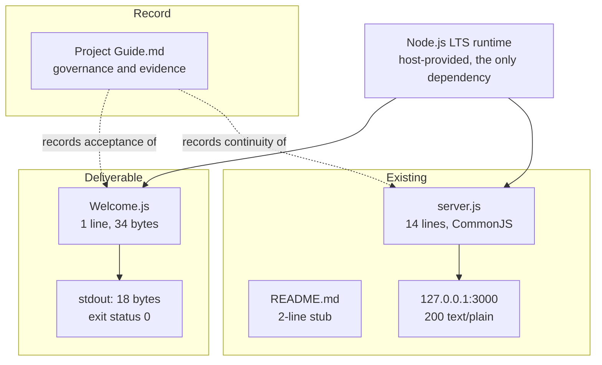

The dependency edges in the diagram are exhaustive. `Welcome.js` depends on nothing but the runtime's `console` global; it neither imports nor is imported by `server.js`; and the three components share no module, state, configuration, or data structure.

#### 1.2.2.3 Core Technical Approach

**Language and runtime.** The deliverable is JavaScript executed directly by Node.js. Its syntax is elementary — one member call on a runtime global applied to one string literal — which places it at ES5 level and makes it indifferent to version-sensitive language features. Both supported LTS lines are recorded as verified: Node.js `v24.21.0` as the reference line and `v22.23.2` as the supported floor (the supported floor reaches end of life on 30 April 2027). Re-running the acceptance gate during preparation of this specification on Node.js `v22.23.3` reproduced every criterion.

**Zero-dependency, manifest-free construction.** `console` is a runtime global, so the file needs no `import`, `export`, or `require`. A token scan over `Welcome.js` for `import`, `export`, `require`, `process`, `argv`, and `env` returns zero matches, and the tracked blob hash (`58a5dcab…`) matches the working-tree file. The absence of a manifest is a deliberate design position rather than an oversight: it preserves the zero-install criterion, and it avoids the `"type": "module"` hazard to the CommonJS `server.js` described in §1.2.1.3.

**Module-system neutrality.** Because the source declares neither import nor export syntax, the runtime's classification of the file is immaterial. This was verified empirically by running a copy with a sibling `package.json` declaring `"type": "module"` and then with no manifest at all: output was identical and exit status `0` in both cases.

**Natural termination over forced exit.** The file registers no timer, no listener, and no `process.exit()` call. The event loop empties once the single write completes, which means queued output is never truncated — a property confirmed by piping output into a deliberately slow reader.

**Isolation by construction.** No input channel is opened: no `process.argv`, no standard input, no `process.env`, no file, no socket. The security posture follows from that enumeration rather than from sampling — there is no input to validate, no credential to manage, and no transitive advisory exposure. Tracked file permissions are `0644` on all four paths.

**Verification approach.** Acceptance is a nine-line shell gate whose combined result decides pass or fail, executed against captured streams rather than a terminal, because a terminal's newline translation reports 19 bytes instead of 18. The gate checks parse validity, message content, byte count, standard-error emptiness, exit status, the hex bytes, the line count, and the filename casing.

**Pre-existing service approach.** `server.js` uses Node's built-in `http` module with one inline handler and no framework, middleware, routing layer, or state:

```javascript
// server.js:7-9 — identical statements for every request, whatever the method or path
res.statusCode = 200;
res.setHeader('Content-Type', 'text/plain');
res.end('Hello, World!\n');
```

### 1.2.3 Success Criteria

#### 1.2.3.1 Measurable Objectives

Each objective below is binary and decided by a command's output, which is what makes the deliverable's acceptance exhaustive rather than judgmental. Results in the right-hand column were reproduced against this checkout.

| Objective | Acceptance command | Observed result |
|---|---|---|
| Exact message on a user-visible channel | `node Welcome.js` | `Welcome to Blitzy` |
| Byte-exact stdout, single trailing newline | `node Welcome.js \| wc -c` | `18` |
| Empty standard error | `node Welcome.js 2>&1 >/dev/null \| wc -c` | `0` |
| Success exit status | `node Welcome.js >/dev/null; echo $?` | `0` |
| Minimality — one source line | `wc -l < Welcome.js` | `1` |
| Exact filename and casing at the root | `ls Welcome.js` | `Welcome.js` |
| Syntax validity of every JavaScript file | `node --check` per tracked `.js` file | Both `Welcome.js` and `server.js` exit `0` |
| Zero-install posture | `ls package.json package-lock.json node_modules 2>/dev/null \| wc -c` | `0` |
| Exactly one path added by the deliverable | `git diff --name-status 1484182 HEAD` | `A Welcome.js` (the mainline also shows `A` for the Project Guide) |

The compliance matrix in `Project Guide.md` §5.1 evaluates twelve deliverable and benchmark rows: eleven pass, and the twelfth — the project rule's Python clause — is recorded as not met by decision. The guide states that all 17 functional, non-functional, and implicit requirements are met.

#### 1.2.3.2 Critical Success Factors

| Critical success factor | Why it is critical | Status |
|---|---|---|
| Single-file, single-statement delivery | The two minimality counts — one source line and one added file — are binding acceptance criteria, not preferences | Met |
| Byte-exact output rather than approximate | Acceptance compares captured bytes, so character-level accuracy including the trailing newline decides the outcome | Met |
| Natural termination | A forced exit could truncate queued output and silently falsify the byte count | Met |
| Manifest-free, dependency-free tree | Any `package.json`, lockfile, or `node_modules` breaks the zero-install criterion outright | Met |
| Continuity of the pre-existing surface | The change must leave `README.md` and `server.js` byte-identical and the existing HTTP surface working | Met |
| Module-system neutrality | The file must not depend on how the runtime classifies it, since no manifest pins the classification | Met |
| Governance reconciliation of the Python clause | The one open item; it is the only thing standing between "ready as delivered" and full rule compliance | **Open** |
| Manual acceptance discipline | With no automated check, the gate must be re-run on every change to the file | Accepted by design |

#### 1.2.3.3 Key Performance Indicators

The programme's KPIs are pass/fail counts rather than service-level objectives. No SLA or SLO is defined anywhere in the repository, and none would be meaningful for the deliverable: it is a short-lived process, not a service, with no throughput or availability surface to measure.

| KPI | Target | Observed |
|---|---|---|
| Acceptance checks passed | All checks pass, none fail | 42 of 42 passed, 0 failed (`Project Guide.md` §3), re-confirmed against this checkout |
| Automated suite status | Zero tests, by design | `node --test` → `tests 0 / suites 0 / pass 0 / fail 0`, exit `0` |
| Runtime parity | Byte-identical output on every supported line | Byte-identical on `v24.21.0` and `v22.23.2`; re-run here on `v22.23.3` with identical results |
| Dependency count | Zero | `0` third-party packages; `0` manifests, lockfiles, or `node_modules` |
| Added paths by the deliverable | Exactly one | `A Welcome.js` |
| Execution latency | Negligible, bounded by process start | Recorded as roughly 25–30 ms (`Project Guide.md` §9.1) |
| Performance non-impact | Request latency at or below the idle baseline | Met; medians stayed at or below baseline with no failed request (`Project Guide.md` §4) |
| Rule compliance | 3 of 3 rule clauses | 2 of 3 — the language clause is open |
| Project completion | 15.0 h scoped | 12.5 h complete, 2.5 h remaining → **83%** |


## 1.3 Scope

### 1.3.1 In-Scope: Core Features and Functionalities

#### 1.3.1.1 Must-Have Capabilities

The deliverable was specified with a closed set of eleven binding requirements. Each is satisfied and each is decidable by command output, which is why the acceptance case rests on the requirement list rather than on judgment.

| Requirement | What it demands | Evidence of satisfaction | Status |
|---|---|---|---|
| Exact message on a user-visible channel | The string `Welcome to Blitzy` reaches stdout | Captured stdout is 18 bytes; hex verified character by character | Met |
| Exact filename and location | `Welcome.js` at the repository root, case-sensitive | `ls Welcome.js` returns `Welcome.js`; no `.mjs`, `.cjs`, or `.py` variant exists | Met |
| JavaScript implementation | Parses and runs under Node.js | `node --check Welcome.js` exits `0`; syntax is ES5 level | Met |
| Self-termination with success status | Exit `0` with empty stderr and no forced exit | `timeout 10 node Welcome.js` → `0`; stderr byte count `0` | Met |
| Minimal line count | One statement on one line | `wc -l` = 1, `wc -c` = 34, one semicolon, one trailing LF, no indentation, no comment | Met |
| Simplicity without abstraction | No function, class, variable, wrapper, guard, or export | Token scan for `import`/`export`/`require`/`process`/`argv`/`env` returns zero matches | Met |
| Runs as written | No install, build, or transpile step | Zero manifests, lockfiles, and `node_modules` in the tree or any ancestor up to `/` | Met |
| No impact on the existing application | Must not degrade the pre-existing service | Standalone short-lived process, never imported by `server.js`; measured latency at or below baseline | Met |
| Flow and feature separation | The one feature's one flow occupies a file containing nothing else | The entire file is the single greeting statement | Met |
| Module-system independence | No dependence on CommonJS vs. ES-module classification | Identical output with a sibling `"type": "module"` manifest and with no manifest at all | Met |
| Excluded artifacts absent | No tests, CI, container, config, dependency, or extra documentation | Repository-wide sweeps return nothing for every excluded class | Met |

The twelfth line of the governing compliance matrix — the project rule's Python clause — is out of scope for the deliverable and is recorded as not met by decision (§1.3.3.1).

#### 1.3.1.2 Primary User Workflows

The product has exactly one workflow, verifiable in four invocation variants, plus a continuity workflow for the pre-existing service. There is no authentication flow, screen, background job, scheduled task, or administrative action anywhere in the repository.

| Workflow | Actor | Steps | Observed outcome |
|---|---|---|---|
| W1 — Direct invocation | Acceptance runner, developer | `cd` to the repository root; run `node Welcome.js` | `Welcome to Blitzy` on stdout; exit `0` |
| W1a — Absolute-path invocation | Operator working from any directory | `node /abs/path/Welcome.js` | Identical bytes; exit `0` (verified from `/tmp`) |
| W1b — Captured or piped invocation | Script, pipeline, or automated job | `MSG="$(node Welcome.js)"` or `node Welcome.js \| wc -c` | `[Welcome to Blitzy]`; byte count `18` |
| W1c — Isolated-environment invocation | Verifier proving independence | `env -i node Welcome.js` | Identical bytes; exit `0` |
| W2 — Acceptance-gate execution | Reviewer deciding pass/fail | Run the nine commands of `Project Guide.md` §9.5 | All nine hold; repeatable on a second supported Node line |
| W3 — Pre-existing service continuity | Operator (outside the deliverable) | Run `node server.js`; issue any request | `200 text/plain`, body `Hello, World!`, startup log `Server running at http://127.0.0.1:3000/` |

W1 through W2 constitute the product's complete in-scope workflow surface. W3 is in scope only as a continuity obligation: the behaviour must remain unchanged, and it does.

#### 1.3.1.3 Essential Integrations

**There are no essential integrations beyond the host runtime.** The product is a short-lived process that writes one fixed string and exits; it neither calls nor is called by any other system. The inventory below is exhaustive rather than illustrative.

| Integration class | Required by the product? | Evidence |
|---|---|---|
| Host runtime (Node.js) | **Yes** — the only runtime dependency | The file executes under Node.js alone; no other software is installed or configured |
| Package registry / npm | No | Zero manifests, lockfiles, and `node_modules`; `console` is a runtime global |
| External APIs, databases, queues, caches | No | Zero imports; no endpoint, connection string, or driver anywhere in the tree |
| CI/CD pipeline or container platform | No | No workflow, pipeline, or container definition exists |
| Identity, secrets, or configuration service | No | Zero environment variables and zero secrets; identical output under `env -i` |
| Observability, metrics, alerting | No | No instrumentation, telemetry, or logging configuration |
| Version-control hosting | **Yes, at delivery time only** — not at runtime | `origin` is a GitHub remote; PR #15 was merged through the hosting API |

#### 1.3.1.4 Key Technical Requirements

| Requirement | Specification | Source of truth |
|---|---|---|
| Runtime | Node.js LTS — reference `v24.21.0`, supported floor `v22.23.2` (re-confirmed here on `v22.23.3`) | `Project Guide.md` Appendix D |
| Language level | Elementary JavaScript, ES5-level syntax; one member call and one string literal, nothing version-sensitive | `Welcome.js:1` |
| Filename and location | Exactly `Welcome.js` at the repository root, with a capital `W` | `Project Guide.md` §5.1 item 2 |
| File size and encoding | 1 line, 34 bytes, single terminating LF, mode `0644`, no trailing blank line or padding | `wc`, `od`, `stat` |
| Style contract | Single-quoted literal, terminating semicolon, no indentation, no comment | `Welcome.js:1` |
| Process contract | Exit `0`; empty stderr; natural termination with no `process.exit()`, timer, or listener | Acceptance gate output |
| Dependency policy | Zero third-party packages; no manifest, lockfile, or `node_modules` in or above the repository | Ancestor sweep to `/` |
| Module neutrality | No `import` or `export` syntax, so classification by the runtime is immaterial | Token scan; ESM/CommonJS probes |
| Platform | Any platform with a Node.js build; verified on Linux. A case-sensitive filesystem is required for the filename check to be meaningful | `Project Guide.md` §9.1, §9.7 |
| Performance obligation | The pre-existing application's performance must not be impacted | `Project Guide.md` §5.1 item 8 |

### 1.3.2 In-Scope: Implementation Boundaries

#### 1.3.2.1 System Boundaries

The boundaries are exact and, because the artifact is one line long, exhaustive:

- **File boundary.** The deliverable is a single path — `Welcome.js`, mode `0644`, blob hash `58a5dcab…`, 34 bytes. The deliverable adds no other file, directory, or artifact.
- **Process boundary.** The deliverable is a short-lived process that writes 18 bytes to stdout and exits. It binds no port, opens no socket, writes no file, registers no timer or listener, and leaves no residue after termination.
- **Dependency boundary.** No manifest, lockfile, or `node_modules` exists in the repository or in any ancestor directory up to `/`.
- **Interface boundary.** The file declares no `import`, `export`, or `require`, so it exposes no reusable module contract. Its only interface is the process: stdout bytes and an exit status.
- **Change boundary versus the base commit.** Relative to base `1484182`, the mainline adds `Welcome.js` (1 insertion) and `blitzy/documentation/Project Guide.md` (381 insertions) — 2 files changed, 382 insertions total. `README.md` and `server.js` are byte-identical to their pre-project state.

**Boundary caveat worth recording.** `Project Guide.md` states that `git ls-files` lists 3 paths, that "exactly one path was added," and (compliance item 11) that "the only `.md` is the pre-existing `README.md`." Those figures describe its own pre-merge branch, `blitzy-e2f602a0-05aa-4abd-9177-dc7377485002`, which exists as a remote branch. On the merged mainline, `git ls-files` lists **4** paths and two paths were added, because the guide is committed alongside the deliverable. The one-file minimality criterion is therefore satisfied by `Welcome.js` and by the branch that carried it, not by the merged tree as a whole; a future compliance audit should read those counts against the deliverable branch rather than against `main`. The same applies to the guide's §9.7 troubleshooting row and §5.2 divergence 3, which refer to seven untracked PNG captures under `blitzy/screenshots/`: that directory does not exist in this checkout, and `git status --porcelain --untracked-files=all` returns nothing.

#### 1.3.2.2 User Groups Covered

| User group | Covered? | How they interact with the system |
|---|---|---|
| Acceptance runner or reviewer | Yes | Executes the product or the nine-line acceptance gate, and decides pass or fail from captured output |
| Developer or maintainer | Yes | Reads the one-line file as the repository's reference for the smallest correct JavaScript program; re-runs the gate on any change to it |
| Operator of the pre-existing service | Incidental | Starts `server.js`; unaffected by this deliverable, which is never imported by it and does not touch its port |
| Delivery-pipeline integrator | Yes | Consumes the binary pass/fail acceptance result as the harness's output |
| End users or consumers | No — none exist | There is no interface, API, account model, or stored data for them to use |
| Localisation or accessibility users | Not applicable | One fixed ASCII message, no interactive surface, no localisable content |

#### 1.3.2.3 Geographic and Market Coverage

- **No geographic scope exists.** No region, locale, timezone, currency, or jurisdiction-specific behaviour is present; the message is a fixed ASCII string, and the product is neither hosted as a service nor distributed as a package.
- **Coverage is measured in runtimes and platforms, not markets.** The product runs on any platform with a Node.js build; verification was performed on Linux, and both supported runtime lines — `v24.21.0` and `v22.23.2` — were exercised with byte-identical results.
- **Filesystem case sensitivity is a functional boundary.** The repository requires a case-sensitive filesystem to enforce the `Welcome.js` casing; on a case-insensitive filesystem, `node welcome.js` succeeds locally and then fails on Linux with `MODULE_NOT_FOUND`.
- **No temporal or clock-dependent behaviour.** The 2026 dates visible in the repository are commit metadata, not runtime inputs; the product reads no clock, calendar, or timezone.

#### 1.3.2.4 Data Domains Included

- **None.** The system has no persistence layer: no database, no file input or output, no cache, no queue, and no retained state of any kind.
- **The complete data inventory is 18 bytes** — the 17-character message plus its newline — written once to stdout. When the pre-existing service runs, it additionally emits one startup log line to stdout and returns a 14-byte response body to its caller.
- **No personal data, no sensitive data, no secrets.** There is no input channel, so there is no data-entry path; nothing requires classification, retention, encryption, or deletion, and there is no credential to rotate.
- **No data is written to disk.** Repeated and concurrent executions were observed to produce identical bytes and to modify no tracked file, leaving no residue behind.

### 1.3.3 Out-of-Scope

#### 1.3.3.1 Excluded Features and Capabilities

The following capability classes are excluded by explicit decision. Each absence was confirmed by a repository-wide filesystem sweep, not by inference from the file list.

| Excluded class | Status on the mainline | Evidence |
|---|---|---|
| Automated tests or a test runner | Absent by design | `node --test` reports `tests 0 / pass 0 / fail 0`, exit `0`; no test file exists |
| CI/CD workflows | Absent | Zero pipeline or workflow files anywhere in the tree |
| Container or orchestration definitions | Absent | Zero `Dockerfile`, Compose, or manifest files |
| Package manifest, lockfile, `node_modules` | Absent | Sweeps over the tree and every ancestor directory return nothing |
| Configuration or environment files | Absent | Zero `.env` files or configuration sources |
| Documentation beyond the guide | Absent | Only the pre-existing `README.md` and the Project Guide exist |
| Python artifact (the rule's language clause) | Absent by decision | Zero `.py` files; the compliance matrix records the clause as not met |
| Licensing file | Absent | No `LICENSE` file of any kind |
| User interface | Absent | No UI, no HTML or CSS assets, no screenshots directory in this checkout |
| Logging, metrics, or telemetry | Absent | No instrumentation and no logging configuration |
| A server or network surface for the deliverable | Absent | The product binds no port; the only listener in the repository is the pre-existing `server.js` |
| Git hooks, editor config, lint or format config | Absent | Sweeps return nothing; the style contract is verifiable by reading one line |
| Security-hardening work on `server.js` | Excluded | The pre-existing file is byte-identical to base and its gaps remain open |

#### 1.3.3.2 Future Phase Considerations

The Project Guide scopes 2.5 outstanding hours across four items; two of them are already satisfied in this checkout, which narrows the genuinely open work to the governance decision and an owner-side acceptance re-run.

| Consideration | Rationale | Effort | State here |
|---|---|---|---|
| Rule governance decision on the Python clause | The one open item; amend or narrow the rule, or issue a product-scoped waiver, leaving the file byte-identical | 1.0 h | Open — owner decision |
| Branch publication and pull request | Publish the branch and open the PR; the record-only commit may be squashed | 0.5 h | Already done — PR #15 is merged into `main` |
| Owner-side acceptance re-run | No automated check exists, so the gate must be re-run in the owner's environment on the standardised Node line | 0.5 h | Recommended; re-run here reproduces every criterion |
| Working-tree housekeeping | Delete untracked captures before staging so a blanket `git add` cannot add a second file | 0.5 h | Already clean — no untracked paths exist |
| Add a small automated check | Reasonable only if the product grows beyond one statement, since manual acceptance stops being sufficient at that point | Not scoped | Deferred by design |
| Standardise on Node.js 24.x or later | The supported floor (`22.x`) reaches end of life on 30 April 2027; the source needs no change | Not scoped | Monitored |
| Harden the pre-existing service | Add a listener `'error'` handler, drain on `SIGTERM`/`SIGINT`, and read the port from configuration | Not scoped | Open — pre-existing, owner decision |
| Reconcile sibling-branch variants | Remote branches carry a `package.json`, a `Server.js`, a `Server.test.js`, and a separate Technical Specifications document | Not scoped | Not merged into the mainline |

#### 1.3.3.3 Integration Points Not Covered

| Integration point | Why it is not covered |
|---|---|
| `server.js` behaviour, hardening, and configuration | Pre-existing and required to stay byte-identical; its missing error listener, absent shutdown drain, and hardcoded `127.0.0.1:3000` are explicitly out of this deliverable's scope |
| Package manifest and package-manager scripts | Excluded to preserve the zero-install criterion; a `package.json` declaring `"type": "module"` would additionally break the CommonJS `server.js` at runtime |
| CI/CD, container registry, or deployment platform | Not required — the product is run from a checkout, never deployed or published |
| Sibling-branch variants (`package.json`, `Server.js`, `Server.test.js`, a separate Technical Specifications document) | Present on remote branches only; none is merged, and none forms part of this mainline |
| External systems of record, identity providers, databases, and observability platforms | No such integration exists anywhere in the tree, and none is proposed within the scoped work |
| Downstream consumers of the greeting | The message is consumed by whoever reads stdout; no downstream system consumes it, and no contract with one is defined |

#### 1.3.3.4 Unsupported Use Cases

| Use case | Why it is unsupported |
|---|---|
| Importing or requiring `Welcome.js` as a reusable module | The file declares no `import`, `export`, or `require`; executing it prints as a side effect rather than returning a value |
| Customising the printed message | The literal *is* the product; there is no parameter, environment variable, argument, or configuration file |
| Running it as a long-lived service, daemon, or health endpoint | It terminates on its own immediately and binds no port |
| Using the pre-existing `server.js` as a production HTTP service | It returns `200` for every method and path — including unknown paths, where `GET /nope` yields `200` — with no error handling, no graceful shutdown, and a loopback-only, hardcoded bind |
| Relocating the pre-existing service's port or host by configuration | Both values are hardcoded at `server.js:3-4`; changing them requires editing the source |
| Running without a Node.js runtime | The product is JavaScript requiring Node.js; no build artifact, bundle, or native binary is produced |
| Relying on automated detection of regressions | Neither `Welcome.js` nor `server.js` is guarded by tooling, so a changed literal, an added line, or a rename would pass unnoticed |
| Treating the Project Guide's counts as mainline counts | Its tracked-path and added-path figures describe the deliverable branch, not the merged tree (§1.3.2.1) |
| Assuming the filename check forgives casing | The filename must be `Welcome.js` exactly; a case-insensitive filesystem masks the error locally and it surfaces on Linux |
| Treating stream success as guaranteed | `console.log` does not raise when the destination stream cannot accept the write, so a full or closed destination loses the message while the process still exits `0` |


## 1.4 References

The evidence base for this section is the repository itself. It is small enough to be enumerated in full: the checkout holds exactly four tracked files and no untracked ones, and no external web source was consulted for any statement made here.

**Repository files**

- `Welcome.js` — the product deliverable. Establishes the entire in-scope behavior: one statement, `console.log('Welcome to Blitzy');`, 1 line and 34 bytes, mode `0644`, blob hash `58a5dcab90815d7b1db080e39613e7711f5854e0`, SHA-256 `5c7ac141d94f92056efb756f17335252c31e3d08d509e641d76512f73112c1fc`. Running it produces 18 bytes on stdout (`57 65 6c 63 6f 6d 65 20 74 6f 20 42 6c 69 74 7a 79 0a`), an empty stderr, and exit status `0`; a token scan confirms it contains no `import`, `export`, `require`, `process`, `argv`, or `env` reference.
- `README.md` — establishes project identity and charter: heading `hao-backprop-test`, sentence "test project for backprop integration." 58 bytes across two text lines with no trailing newline (`wc -l` reports 1). Confirmed byte-identical to base commit `1484182`.
- `server.js` — the pre-existing HTTP demo service and the continuity obligation. Lines 3–4 fix `hostname = '127.0.0.1'` and `port = 3000`; lines 6–10 hold the inline handler that sets `200`, `text/plain`, and the body `Hello, World!` for every request; line 12 calls `server.listen` with no `'error'` listener. 14 lines and 342 bytes; confirmed byte-identical to base. Boundary of the section's claims about it: a full section of its own belongs to the product-requirements material.
- `blitzy/documentation/Project Guide.md` — the governance and evidence record, 381 newlines and 35,992 bytes. Sections cited here: §1.2 and §1.3 (completion status and accomplishments), §1.4 (the one open issue and its owner), §2.1–§2.3 (hours allocation and the 12.5-of-15.0 reconciliation behind the 83% figure), §3 (the 42 passing checks and the zero-test status), §4 (runtime validation, performance non-impact, and byte-exact output on both runtimes), §5.1 (the twelve-row compliance matrix), §5.2 (divergences 1–3), §6 (the eight-row risk table), §8 (production readiness and the binary success metrics), §9.1–§9.2 (prerequisites and the zero-setup environment), §9.5 (the nine-command acceptance gate), §9.7 (troubleshooting, including the filename-case and byte-count hazards), and Appendices C–E and G (file locations, technology versions, the absence of environment variables, and the glossary).

**Repository folders**

- `blitzy/` — the only first-order directory besides `.git`; contains documentation only, no executable code.
- `blitzy/documentation/` — holds `Project Guide.md` and nothing else; therefore the repository's sole documentation subtree on the mainline.

**Version history examined**

- `39974fd650d4907479ded7a04ea91aaa0f35b5c1` — mainline tip; merge commit "Merge pull request #15" by `blitzy-qa[bot]`, 22 September 2026, with parents `1484182` and `4d1256c`. Local `main`, `origin/main`, and `HEAD` all resolve to this commit.
- `4d1256c`, `6c16ea2`, `1cef465` — the three commits authored by `Blitzy Agent` on 22 September 2026; together they add `Welcome.js` and the Project Guide, the record-only middle commit existing because the language decision had no file in which to live.
- `14841829750db74f960c42e73b0839fa82c3f798` — base commit "Add files via upload" by `Ajitkumar Bhangale`, 12 March 2026; contains only `README.md` and `server.js` and is the reference for the byte-identity claim. `git diff --stat 1484182 HEAD` reports 2 files changed, 382 insertions(+).
- Remote branch `origin/blitzy-e2f602a0-05aa-4abd-9177-dc7377485002` — the pre-merge branch the Project Guide describes and whose figures (3 tracked paths, 1 added path) differ from the merged tree.
- Sibling remote branches and their commits `051eee7` (adds a `package.json` manifest naming `blitzy-server`, `"start": "node Server.js"`, `"test": "node --test Server.test.js"`, `"engines": {"node": ">=18"}`), `494b5af` (adds `Server.js`), `d890fca` (adds `Server.test.js`), and `8291f74` (adds `blitzy/documentation/Technical Specifications.md`) — establish that divergent variants of this project exist on 94 repository refs but none is merged into the mainline.

**Files searched for and confirmed absent**

No `.blitzyignore` exists in the repository, so no path was excluded from this investigation. Repository-wide sweeps and an ancestor-directory walk from the checkout up to `/` found no `package.json`, package lockfile, `node_modules`, Dockerfile, Compose or workflow YAML, `.env` file, `.gitignore`, `LICENSE`, `*.test.js`, `*.py`, or editor/lint configuration — which is the evidence behind every absence claim in §1.3.


# 2. Product Requirements

## 2.1 Feature Catalog

The catalogue below is the complete requirement surface of the merged mainline at commit `39974fd`, and it is deliberately small: eight features. Six describe behaviour that `Welcome.js` provides, one describes the pre-existing service the deliverable is obliged not to disturb, one records the single governance obligation that remains open. Every entry is traceable to code, to a command's observed output, or to the governance record in `blitzy/documentation/Project Guide.md`; nothing is listed that the repository does not exhibit, and no capability is proposed that no requirement asks for.

Feature groups used throughout this section:

| Group | Features | Character |
|---|---|---|
| Delivered product behaviour | F-001, F-002, F-003, F-004, F-005 | Behaviour of `Welcome.js`, the one file this product adds |
| Preserved pre-existing surface | F-006 | Behaviour of `server.js`, unchanged by this product |
| Verification and governance | F-007, F-008 | The acceptance mechanism and the open compliance obligation |

### 2.1.1 Catalog Summary

| ID | Feature name | Category | Priority |
|---|---|---|---|
| F-001 | Deterministic Standard-Output Greeting | Core output contract | Critical |
| F-002 | Zero-Install, Manifest-Free Execution | Packaging and dependency posture | Critical |
| F-003 | Natural Termination with Success Exit Status | Process lifecycle | High |
| F-004 | Input, Environment and Working-Directory Independence | Isolation and security posture | High |
| F-005 | Runtime Module-System Neutrality | Portability | Medium |
| F-006 | Pre-existing Loopback HTTP Greeting Service | Pre-existing repository surface, continuity-guarded | Medium |
| F-007 | Manual Acceptance Gate and Evidence Record | Verification and governance | High |
| F-008 | Project-Rule Language Compliance | Governance and compliance | Medium |

| ID | Status | Requirement source | Where it lives |
|---|---|---|---|
| F-001 | Completed | Product request clauses recorded in `Project Guide.md` §5.1 items 1, 2, 5, 6 | `Welcome.js:1` |
| F-002 | Completed | `Project Guide.md` §5.1 items 7, 11; §9.2 | `Welcome.js:1` (no manifest anywhere in the tree) |
| F-003 | Completed | `Project Guide.md` §5.1 item 4 | `Welcome.js:1` |
| F-004 | Completed | `Project Guide.md` §4, §9.6 (environmental independence, pipeline use) | `Welcome.js:1` |
| F-005 | Completed | `Project Guide.md` §5.1 item 10 | `Welcome.js:1` |
| F-006 | Completed (pre-existing, unmodified) | `Project Guide.md` §5.1 item 8; §6 risk row 6 | `server.js:1-14` |
| F-007 | Completed | `Project Guide.md` §3, §9.5 | `blitzy/documentation/Project Guide.md` |
| F-008 | Proposed | `Project Guide.md` §1.4, §5.1 item 12, §5.2 divergence 1 | No code path — governance decision only |

### 2.1.2 Identifier, Priority and Status Conventions

- **Feature identifiers.** `F-001` through `F-008`, assigned once and never renumbered; a withdrawn feature leaves a gap rather than shifting the identifiers of its neighbours. The three-digit feature field is zero-padded so identifiers sort lexically.
- **Requirement identifiers.** `F-XXX-RQ-YYY`, nested under their owning feature and numbered from `001`. The `XXX` field repeats the owning feature's number, so a requirement ID always names its parent without a lookup.
- **Version.** This catalogue is version 1.0, read against mainline tip `39974fd`. It is anchored to content hashes rather than to dates:

| Anchor | Value |
|---|---|
| Product source blob | `58a5dcab90815d7b1db080e39613e7711f5854e0` |
| Product source SHA-256 | `5c7ac141d94f92056efb756f17335252c31e3d08d509e641d76512f73112c1fc` |
| Preserved service blob | `320a75a7649db30756f011001f299d20df1c44b3` |
| Governance record | `blitzy/documentation/Project Guide.md`, 381 lines, 35,992 bytes |

A change to either anchored file re-baselines the affected feature's acceptance criteria and makes its version 1.0 evidence stale. Requirement versions therefore move with the source, not on a schedule.

| Rating | Meaning as applied here |
|---|---|
| Critical | Acceptance of the product is impossible without it; its failure makes the delivered artifact the wrong artifact (F-001, F-002) |
| High | Binding product or process clause whose failure is a defect rather than a change of scope (F-003, F-004, F-007) |
| Medium | Behavioural or governance clause that must hold but is not the acceptance spine (F-005, F-006, F-008) |
| Must-Have | Requirement whose failure fails the acceptance gate |
| Should-Have | Requirement that the delivered artifact already satisfies and that a regression would report as a defect |
| Could-Have | Documented, verified behaviour whose loss would be tolerated without a product change |

Of the 26 requirements catalogued here, 18 are Must-Have, 7 are Should-Have and 1 is Could-Have. Complexity is Low for 25 of them, because the deliverable is a single statement; the one exception is F-007's gate execution, which is Medium because it spans parse, execution, byte, and filesystem checks.

### 2.1.3 Catalog Scope and Basis

**Basis.** The catalogue describes the merged mainline, not a branch. Base commit `1484182` contained only `README.md` and `server.js` — no product capability at all — so nothing here supersedes an earlier product. `git diff --name-status 1484182 HEAD` reports exactly two additions, `A Welcome.js` (1 line) and `A blitzy/documentation/Project Guide.md` (381 lines); `git ls-tree HEAD` lists four blobs, all mode `0644`.

**What is excluded, and why it is not a feature.** The absences below were confirmed by a sweep of every file in the checkout and of every ancestor directory up to `/`. Each is an absence by decision, and an absence is not catalogued as a feature: no test runner (`node --test` reports 0 tests), no CI or container definition, no package manifest or lockfile, no configuration or environment file, no user interface, no logging or telemetry, no licensing file, and no Python artifact. Section 1.3.3.1 lists these exclusions in full.

**What is deliberately not sourced from other branches.** The repository carries 94 refs; 22 remote refs are unmerged into `39974fd`, and several carry divergent variants of this same project — for example `origin/blitzy-01ba23cf-5665-4383-82e3-2f93d3b7f0f7` adds a `package.json` (name `hao-backprop-test`, `main: server.js`, `scripts.start: node server.js`, `engines.node: >=18`, empty dependency maps) alongside a `blitzy/documentation/Technical Specifications.md`, and `origin/09-Oct-26-Br2` carries a Technical Specifications document alone. None of those variants is merged, none is reachable from `HEAD`, and no requirement in this catalogue derives from them. Section 1.3.3.2 records them as out of scope.

**Assumptions.** Each is documented in the governance record and holds for every feature below.

| # | Assumption | Source |
|---|---|---|
| A1 | The host supplies a Node.js LTS runtime; no other software is installed or configured | `Project Guide.md` §9.1 |
| A2 | The filesystem is case-sensitive, otherwise the `Welcome.js` casing requirement is masked locally | `Project Guide.md` §9.7 |
| A3 | Acceptance is executed manually: no automated check guards either script | `Project Guide.md` §3, §6 |
| A4 | No manifest is added in or above the repository, since a `"type": "module"` manifest would break the CommonJS `server.js` | `Project Guide.md` §6 |
| A5 | Acceptance asserts captured bytes rather than terminal rendering, which reports 19 bytes instead of 18 | `Project Guide.md` §9.7 |

**Constraints that bound every feature.** Two counts are binding rather than aspirational — exactly one source line in `Welcome.js` and exactly one file added by the deliverable — and the pre-existing `README.md` and `server.js` must remain byte-identical to base. F-008 is the one open compliance obligation, and it can be closed only by a wording decision, never by code.


## 2.2 F-001 — Deterministic Standard-Output Greeting

### 2.2.1 Feature Metadata

| Field | Value |
|---|---|
| Feature ID | F-001 |
| Feature name | Deterministic Standard-Output Greeting |
| Feature category | Core output contract (functional) |
| Priority level | Critical |
| Status | Completed |
| Implementation | `Welcome.js:1` — `console.log('Welcome to Blitzy');`, 1 line, 34 bytes, mode `0644`, blob `58a5dcab90815d7b1db080e39613e7711f5854e0` |
| Verification runtime | Node.js `v22.23.3` in this checkout; recorded as verified on `v24.21.0` (reference) and `v22.23.2` (supported floor) in `Project Guide.md` Appendix D |

### 2.2.2 Description

**Overview.** This is the product. One statement writes the fixed 17-character message `Welcome to Blitzy` plus a single newline to standard output, after which the process ends. It is the repository's entire user-visible surface: there is no interface, endpoint, screen, or return value, so F-001 is not one feature among several delivered behaviours — it is the delivered behaviour, with F-002 through F-005 describing the properties under which it holds and F-006 describing the surface it must leave alone.

**Business value.** The output contract makes acceptance exhaustive and mechanical. Because the correct result is a fixed byte sequence, pass or fail is decided by comparing captured bytes rather than by judgement, and the four binary criteria — stdout equals `Welcome to Blitzy\n`, stderr is empty, exit status is `0`, and the source is one line — leave no room for interpretation. The repository exists as a test project for backprop integration (`README.md`), so this determinism *is* the value: it is the smallest artifact against which an integration can reliably assert.

**User benefits.** An acceptance runner can assert the result in one comparison and reproduce it on any supported runtime. A developer gets a reference for the smallest correct JavaScript program in this repository. A pipeline integrator gets a stable, side-effect-free unit of work: 18 bytes on stdout, exit status `0`, no files written, no state retained.

**Technical context.** The statement invokes `console.log`, a runtime global bound to the process's standard output stream, so there is nothing to import and no module resolution to perform. The syntax level is elementary ES5 — one member call and one string literal — which is why the source is insensitive to Node.js version and to whether the runtime classifies the file as CommonJS or as an ES module (F-005). Two boundary facts belong to this feature: the message is a literal, so it cannot be changed without editing the source, and `console.log` does not raise when the destination stream cannot accept the write, so a full or closed destination would lose the message while the process still exits `0`. Output must be verified by capturing it, never by trusting the exit status alone (`Project Guide.md` §3, "Not Covered").

### 2.2.3 Dependencies

| Dependency class | Detail |
|---|---|
| Prerequisite features | None. F-001 is the root of the catalogue; F-002 through F-005 are enabling properties of it, not prerequisites |
| System dependencies | A Node.js LTS runtime supplying the `console` global and a writable standard-output stream. Recorded lines: `v24.21.0` (reference) and `v22.23.2` (supported floor, end of life 30 April 2027); re-verified here on `v22.23.3` |
| External dependencies | None. Zero third-party packages; `console` is a runtime global, so the dependency count of the product is zero |
| Integration requirements | Outbound only, and only to the caller's own standard output. Any consumer that can read a pipe or capture a stream works — `wc -c`, `od`, a shell variable, a pipeline stage, a CI step. No contract exists with any downstream system, and no inbound integration exists |

### 2.2.4 Functional Requirements

**Requirement details**

| Requirement ID | Description | Priority | Complexity |
|---|---|---|---|
| F-001-RQ-001 | Write the message `Welcome to Blitzy` followed by exactly one newline to standard output | Must-Have | Low |
| F-001-RQ-002 | Reside at the repository root under the exact filename `Welcome.js`, case-sensitive | Must-Have | Low |
| F-001-RQ-003 | Hold one statement on one line: 34 bytes, single-quoted literal, terminating semicolon, no indentation, no comment, single trailing LF | Must-Have | Low |
| F-001-RQ-004 | Write nothing to standard error on the success path | Must-Have | Low |
| F-001-RQ-005 | Contain no function, class, variable, wrapper, guard, or export — no abstraction over the single statement | Should-Have | Low |

**Acceptance criteria** (every command below was executed in this checkout and its observed result is shown)

| Requirement ID | Acceptance criteria | Observed verification |
|---|---|---|
| F-001-RQ-001 | Captured stdout equals `Welcome to Blitzy`; its byte count is 18; its hex is `57 65 6c 63 6f 6d 65 20 74 6f 20 42 6c 69 74 7a 79 0a` | `node Welcome.js \| wc -c` → `18`; `node Welcome.js \| od -An -t x1` → the byte sequence above |
| F-001-RQ-002 | `Welcome.js` is listed at repository-root depth with exact casing, and no `welcome.js`, `.mjs`, `.cjs`, or `.py` variant exists | `ls Welcome.js` → `Welcome.js`; `ls -1 \| grep -i welcome` → one entry; file counts for `*.mjs`, `*.cjs`, `*.py` all `0` |
| F-001-RQ-003 | `wc -l` returns 1 and `wc -c` returns 34; the file ends in a single LF with no blank line or padding | `wc -l -c Welcome.js` → `1 34`; `cat -A Welcome.js` → `console.log('Welcome to Blitzy');$` |
| F-001-RQ-004 | Standard-error byte count is 0 and the process reports no diagnostic | `node Welcome.js 2>&1 >/dev/null \| wc -c` → `0` |
| F-001-RQ-005 | No module or process token appears in the source; the file declares nothing | `grep -E 'import\|export\|require\|process\|argv\|env' Welcome.js` → 0 matches |

**Technical specifications**

| Aspect | Specification |
|---|---|
| Input parameters | None. Command-line arguments are ignored (`node Welcome.js foo bar` still yields 18 bytes), piped standard input is ignored (18 bytes), and no environment variable is read (`env -i` yields identical bytes) |
| Output / response | 18 bytes on file descriptor 1 — `Welcome to Blitzy` + LF — nothing on descriptor 2, and process exit status `0`. There is no return value: the file defines no module contract and cannot usefully be imported |
| Performance criteria | One buffered write followed by natural termination; recorded as roughly 25–30 ms per `Project Guide.md` §9.1. No SLA or SLO exists anywhere in the repository, and none would be meaningful for a short-lived process |
| Data requirements | The only data is the in-source literal: 17 ASCII characters, 17 bytes plus one newline written once. No external data source, no persistence, no retained state, no personal or sensitive data |

**Validation rules**

| Aspect | Rule |
|---|---|
| Business rules | The output must be byte-exact, never approximate or localized; the message is a literal and is not parameterizable, so customization is not a supported use case; the deliverable may add no file other than `Welcome.js` and its acceptance record |
| Data validation | The single in-source literal is validated against the hex dump rather than against a rendered terminal. Because the product opens no input channel, no input-validation path exists and none is required |
| Security requirements | No input to validate, no credential or secret held, no dynamic code evaluation, no socket opened, no dependency to expose a transitive advisory. Tracked file mode is `0644` on every path in the tree |
| Compliance requirements | `Project Guide.md` §5.1 items 1, 2, 5 and 6 pass against this feature. The style contract and the one-line ceiling are compliance obligations rather than preferences, and the message channel is the only user-visible channel the product has |


## 2.3 F-002 — Zero-Install, Manifest-Free Execution

### 2.3.1 Feature Metadata

| Field | Value |
|---|---|
| Feature ID | F-002 |
| Feature name | Zero-Install, Manifest-Free Execution |
| Feature category | Packaging and dependency posture (non-functional) |
| Priority level | Critical |
| Status | Completed |
| Implementation | Property of `Welcome.js:1`, proven by the absence of any manifest in the tree or above it; no supporting file exists to implement it |
| Verification runtime | Node.js `v22.23.3`; tree and ancestor sweeps executed in this checkout |

### 2.3.2 Description

**Overview.** The product runs exactly as it sits in the checkout. `git clone` followed by `node Welcome.js` is the whole procedure: there is no install, no dependency resolution, no build, no bundling and no transpile step, because the single statement calls a runtime global rather than importing anything. The posture is enforced not by tooling but by the shape of the artifact — there is nothing in the repository that a package manager could read.

**Business value.** The feature removes the two costs that usually dominate a small product's total ownership: the setup step and the supply chain. A consumer of this repository never runs an installer, never resolves a version graph, and never inherits a transitive advisory. Zero dependencies also means the artifact cannot drift: there is no lockfile to audit and no upgrade to schedule. For a test project whose purpose is to validate an integration path, that absence is what makes the fixture stable across runs and across hosts.

**User benefits.** A reviewer can execute the product in a bare checkout with no network access. An automated job can invoke it without a package-manager step, so there is no cache to warm and no registry credential to hold. A future maintainer reads one line and knows the entire dependency graph — an empty one.

**Technical context.** `console` is a runtime global, so `Welcome.js` needs no `import`, `export`, or `require` and therefore no module resolution. A token scan across the file returns zero matches for `import`, `export`, `require`, `process`, `argv`, and `env`. The manifest-free position is deliberate rather than incidental: it preserves the zero-install criterion, and it avoids a latent integration hazard, because adding a `package.json` that declares `"type": "module"` in or above this repository would break the CommonJS `server.js` at runtime while the module-neutral `Welcome.js` kept working (`Project Guide.md` §6). Sibling branches illustrate the hazard — `origin/blitzy-01ba23cf-5665-4383-82e3-2f93d3b7f0f7` carries a manifest naming `hao-backprop-test` with `main: server.js` and `engines.node: >=18` — but none of those variants is merged, and this mainline is manifest-free.

### 2.3.3 Dependencies

| Dependency class | Detail |
|---|---|
| Prerequisite features | F-001 — the statement whose zero-dependency shape this feature describes. No artefact outside the single file is required |
| System dependencies | A Node.js LTS runtime only. The absence of a manifest means no declared engine floor exists, so the runtime line is a convention documented in `Project Guide.md` Appendix D rather than a machine-enforced constraint |
| External dependencies | None, and emphatically so: no package registry, package manager, lockfile, or `node_modules` is involved at any point in building or running the product |
| Integration requirements | None. Adding a manifest, lockfile, or dependency would not merely exceed scope — it would fail acceptance, and a `"type": "module"` manifest would additionally break the preserved `server.js` (F-006) |

### 2.3.4 Functional Requirements

**Requirement details**

| Requirement ID | Description | Priority | Complexity |
|---|---|---|---|
| F-002-RQ-001 | Execute as written from a fresh checkout with no install, build, bundling, or transpile step | Must-Have | Low |
| F-002-RQ-002 | Introduce no package manifest, lockfile, or `node_modules` directory in the repository or in any ancestor directory | Must-Have | Low |
| F-002-RQ-003 | Declare no dependency and no module reference in the source; rely only on runtime globals | Must-Have | Low |

**Acceptance criteria** (observed results from this checkout)

| Requirement ID | Acceptance criteria | Observed verification |
|---|---|---|
| F-002-RQ-001 | `node Welcome.js` succeeds on a clean checkout and produces no build output, bundle, cache, or generated artifact of any kind | The command printed the message and exited `0` with no preceding setup step; `git status --porcelain --untracked-files=all` returned 0 lines after repeated and concurrent runs, so nothing was generated |
| F-002-RQ-002 | A repository-wide sweep and an ancestor-directory walk from the checkout to `/` return zero hits for `package.json`, `package-lock.json`, `yarn.lock`, and `node_modules` | `find` over the tree → 0 hits for each pattern; `ls package.json package-lock.json node_modules \| wc -l` → `0`; the walk through `/tmp/blitzy/Ajit_GH_Repo-12-Mar-26`, `/tmp/blitzy`, `/tmp` and `/` found none |
| F-002-RQ-003 | The source contains no `import`, `export`, or `require`, and both tracked JavaScript files parse under the runtime | Token scan → 0 matches; `node --check Welcome.js` and `node --check server.js` each exited `0` |

**Technical specifications**

| Aspect | Specification |
|---|---|
| Input parameters | The source file and the runtime, and nothing else: no arguments, no environment, no configuration file, and no resolution step consumes input |
| Output / response | The same 18 bytes on stdout and exit status `0` as F-001, with the additional guarantee that no package-manager process, install log, or lockfile is produced or modified as a side effect |
| Performance criteria | Time to first byte is bounded by process startup alone, since no resolution, install, or build phase exists between invocation and the write. Recorded end-to-end time is roughly 25–30 ms (`Project Guide.md` §9.1) |
| Data requirements | None. There is no dependency graph, no manifest field, no cache directory and no downloaded content; the whole data footprint remains the 18 bytes written once |

**Validation rules**

| Aspect | Rule |
|---|---|
| Business rules | Zero-install and zero-dependency are acceptance criteria, not preferences: any `package.json`, lockfile, `node_modules` directory, or declared dependency fails acceptance outright. A manifest that also declares `"type": "module"` additionally breaks the preserved `server.js` |
| Data validation | The dependency set is verified by exhaustive sweep of the checkout and of every ancestor directory up to `/` rather than by sampling or by reading a declared list — the absence is proven, not reported |
| Security requirements | Zero dependencies means zero transitive advisory exposure and no install-time script execution. No registry credential, token, or package-scope configuration is held, because no registry is contacted |
| Compliance requirements | Satisfies `Project Guide.md` §5.1 items 7 and 11, and the zero-install clause of §9.2, which directs that `npm install`, `npm init`, and `npm ci` must not be run here because they would create the very artifacts the criterion excludes |


## 2.4 F-003 — Natural Termination with Success Exit Status

### 2.4.1 Feature Metadata

| Field | Value |
|---|---|
| Feature ID | F-003 |
| Feature name | Natural Termination with Success Exit Status |
| Category | Process lifecycle (non-functional) |
| Priority level | High |
| Status | Completed |
| Implementation | Property of `Welcome.js:1` — the file registers no exit call, timer, or listener, so the event loop empties after the write |
| Verification runtime | Node.js `v22.23.3`; recorded as verified on `v24.21.0` and `v22.23.2` (`Project Guide.md` §4) |

### 2.4.2 Description

**Overview.** After the single write, the process ends on its own with exit status `0`. The source neither calls `process.exit()` nor registers a timer, a listener, or an exit handler, so termination is the event loop running out of work rather than a command to quit. The distinction matters because it is the difference between output that is guaranteed to be flushed and output that merely usually is.

**Business value.** Exit status is one of the four binary acceptance criteria: a caller that checks only `$?` must be able to trust `0`, and a caller that captures bytes must not receive a truncated message. Natural termination delivers both, and it removes the failure mode in which a forced exit discards queued output while the process still reports success. In a pipeline that depends on this fixture, that reliability is the whole point.

**User benefits.** Shell and CI callers can use the exit status directly (`node Welcome.js >/dev/null; echo $?` → `0`) without special-casing signals or timeouts. Pipeline stages receive an orderly end-of-file, so `node Welcome.js | wc -c` reports `18` rather than a race-dependent count. Operators see no residual process, no held descriptor, and no cleanup step.

**Technical context.** Node.js exits when no referenced work remains on the event loop. With one statement, no timers, and no listeners, the loop empties as soon as the queued write completes, which is why queued bytes are never abandoned. Termination was confirmed under a wall-clock bound: `timeout 10 node Welcome.js` returned `0`, meaning the timeout never fired and the process ended of its own accord. Durability of the output was confirmed separately by piping into a deliberately slow reader — `node Welcome.js | (sleep 2; cat) | wc -c` returned `18` — so no byte was lost while the consumer was not reading. A `grep` across the source for `process.exit`, `setTimeout`, `setInterval`, `addListener`, and `.on(` returns zero matches, which is the structural counterpart to those two runtime observations.

### 2.4.3 Dependencies

| Dependency class | Detail |
|---|---|
| Prerequisite features | F-001 — there must be a write to terminate after. F-003 is the lifecycle property of that write |
| System dependencies | A Node.js runtime whose default event-loop behaviour is unmodified. The feature depends on Node's own draining semantics, not on any library or flag |
| External dependencies | None. No signal handler, supervisor, init system, or process manager participates |
| Integration requirements | The caller's process-wait semantics: the shell, pipeline, or job runner must observe the exit status and the end of the output stream. No integration is required to *achieve* termination, only to consume its result |

### 2.4.4 Functional Requirements

**Requirement details**

| Requirement ID | Description | Priority | Complexity |
|---|---|---|---|
| F-003-RQ-001 | End the process with exit status `0` after the message has been written | Must-Have | Low |
| F-003-RQ-002 | Terminate naturally — no `process.exit()`, no timer, no listener, no exit handler — letting the event loop empty | Must-Have | Low |
| F-003-RQ-003 | Deliver all 18 bytes even when the consumer reads slowly, so output is never truncated by a forced exit | Should-Have | Low |

**Acceptance criteria** (observed results from this checkout)

| Requirement ID | Acceptance criteria | Observed verification |
|---|---|---|
| F-003-RQ-001 | Exit status is `0` after a successful run, and stderr remains empty | `node Welcome.js >/dev/null; echo exit=$?` → `exit=0`; stderr byte count `0` |
| F-003-RQ-002 | The process ends within a generous bound without any forced exit, and the source contains no exit call, timer, or listener | `timeout 10 node Welcome.js` → exit `0`, timeout never fired; `grep -E 'process\.exit\|setTimeout\|setInterval\|addListener\|\.on\(' Welcome.js` → 0 matches |
| F-003-RQ-003 | A deliberately slow consumer still receives the complete message | `node Welcome.js \| (sleep 2; cat) \| wc -c` → `18` |

**Technical specifications**

| Aspect | Specification |
|---|---|
| Input parameters | None. Termination timing is not configurable, and no argument, environment variable, or signal changes it |
| Output / response | Exit status `0`; nothing on standard error; an orderly end-of-file on the output stream; no message on any other descriptor |
| Performance criteria | The process ends immediately after the write completes, with no drain delay, no grace period, and no shutdown work. There is no timeout, retry, or watchdog in the product |
| Data requirements | None. No handle, descriptor, temporary file, or signal handler survives termination, and repeated plus concurrent runs were observed to leave zero untracked or modified paths |

**Validation rules**

| Aspect | Rule |
|---|---|
| Business rules | Exit status is an acceptance criterion and is not negotiable by convention: a non-zero status fails acceptance even when the bytes are correct, and a forced exit is prohibited because it could truncate queued output and silently falsify the byte count |
| Data validation | Output durability is validated against a deliberately slow consumer rather than against a fast local terminal, since only the slow consumer can reveal truncation |
| Security requirements | Nothing executes at shutdown — no exit handler, no signal handler, no cleanup routine, and no privileged teardown — so termination presents no code-execution surface beyond the single write |
| Compliance requirements | Satisfies `Project Guide.md` §5.1 item 4 and the natural-termination entry of its glossary; §4 records both the `timeout`-bounded exit and the slow-reader durability check as runtime evidence |


## 2.5 F-004 — Input, Environment and Working-Directory Independence

### 2.5.1 Feature Metadata

| Field | Value |
|---|---|
| Feature ID | F-004 |
| Feature name | Input, Environment and Working-Directory Independence |
| Category | Isolation and security posture (non-functional) |
| Priority level | High |
| Status | Completed |
| Implementation | Property of `Welcome.js:1` — the file reads no argument, standard input, environment variable, file, or directory |
| Verification runtime | Node.js `v22.23.3`; recorded as verified on `v24.21.0` and `v22.23.2` (`Project Guide.md` §4) |

### 2.5.2 Description

**Overview.** The product behaves identically whatever it is handed and wherever it is run. Arguments, piped input, the entire environment, and the working directory are all without effect: the same 18 bytes appear, the same empty standard error, the same exit status `0`. The file opens no input channel at all, so independence here is structural rather than defensive — there is no code path that could consult its surroundings.

**Business value.** Isolation removes an entire class of operational work. Because nothing is configurable and nothing is read, there is no environment-specific setup to script, no secret to provision or rotate, no per-host configuration to keep in step, and no input an attacker could supply. It also makes results comparable: a byte count observed on one host, in one shell, under one environment is the byte count on any other, which is what allows a fixture of this size to stand as an acceptance artifact.

**User benefits.** An acceptance runner can invoke the product from any directory, with any arguments, in an empty environment and get identical output. A pipeline integrator never has to export a variable or prepare a file first. A developer debugging a mismatch can rule out context entirely: if the bytes differ, the source is the only explanation.

**Technical context.** Four invocation contexts were exercised, each against captured bytes: `node Welcome.js foo bar` (18 bytes, arguments ignored), piped standard input (18 bytes), `env -i node Welcome.js` (identical bytes under a completely empty environment), and an absolute-path invocation from `/tmp` (18 bytes, so no relative path is resolved). A token scan adds the structural evidence: zero matches for `process`, `argv`, or `env` in the source. The security posture follows from the same enumeration rather than from sampling — there is no input to validate, no credential to manage, and no file access to constrain — and `Project Guide.md` §4 records the corresponding runtime observations. The one caveat is environmental rather than behavioural: invoking the file by a wrong filename casing on a case-insensitive filesystem succeeds locally and then fails on Linux with `MODULE_NOT_FOUND`.

### 2.5.3 Dependencies

| Dependency class | Detail |
|---|---|
| Prerequisite features | F-001 — independence is a property of the write's context, and there must be a write |
| System dependencies | A Node.js runtime. The runtime does expose `process.argv` and `process.env`, but the source never reads them, so no runtime feature beyond `console` participates |
| External dependencies | None. No configuration service, secret store, credential file, or environment file is involved — there is nothing to point at |
| Integration requirements | Only the outbound stdout contract of F-001. There is no environment-specific setup, so the same command sequence is valid on every host, and callers must supply no arguments, variables, or working directory |

### 2.5.4 Functional Requirements

**Requirement details**

| Requirement ID | Description | Priority | Complexity |
|---|---|---|---|
| F-004-RQ-001 | Ignore command-line arguments and standard input completely | Must-Have | Low |
| F-004-RQ-002 | Read no environment variable and produce identical output under an empty environment | Must-Have | Low |
| F-004-RQ-003 | Be independent of the working directory: resolve nothing by relative path, so invocation by absolute path from any directory succeeds | Should-Have | Low |
| F-004-RQ-004 | Leave no residue: write no file, retain no handle or process, and modify no tracked path | Should-Have | Low |

**Acceptance criteria** (observed results from this checkout)

| Requirement ID | Acceptance criteria | Observed verification |
|---|---|---|
| F-004-RQ-001 | Extra arguments and piped input each leave the output at 18 bytes with exit status `0` | `node Welcome.js foo bar \| wc -c` → `18`; `printf 'x\n' \| node Welcome.js \| wc -c` → `18` |
| F-004-RQ-002 | Output under `env -i` is byte-identical to output in a full environment | `env -i $(command -v node) Welcome.js \| od -An -t c` → `W e l c o m e   t o   B l i t z y \n` |
| F-004-RQ-003 | Invocation by absolute path from an unrelated directory produces the same 18 bytes | `cd /tmp && node <repo>/Welcome.js \| wc -c` → `18` |
| F-004-RQ-004 | Repeated and concurrent runs leave the worktree clean and no process behind | `git status --porcelain --untracked-files=all` → 0 lines after all probes; no residual process or handle observed |

**Technical specifications**

| Aspect | Specification |
|---|---|
| Input parameters | None. The product declares no input parameter of any kind, and the four context dimensions a process normally inherits — arguments, standard input, environment, working directory — are each verified to have no effect |
| Output / response | The invariant 18 bytes on stdout, empty stderr, exit status `0`, produced identically under every invocation context tested |
| Performance criteria | No environment lookup, no filesystem lookup, and no directory resolution occurs, so invocation cost stays bounded by runtime startup alone; the message survives even when stdout is redirected to a file or attached to a slow reader |
| Data requirements | No input data is consumed and no data is retained. The product touches no data store, holds no secret, and writes nothing to disk, so nothing requires classification, retention, or deletion |

**Validation rules**

| Aspect | Rule |
|---|---|
| Business rules | Identical output under every invocation context is a criterion: arguments, piped input, environment variables and the working directory must not change the result. Configurability is explicitly not a supported use case |
| Data validation | Independence is validated differentially — the same capture taken with extra arguments, with piped input, under `env -i`, and from a foreign directory — and cleanliness is validated by the worktree status check, so both the behaviour and its side effects are asserted |
| Security requirements | No input channel exists, so no input-validation, injection, or deserialization surface exists; no secret is read or held; no file or socket is opened; file mode is `0644`. Any future change that introduced a dependency, an argument, or an input channel would create a security surface this product does not have today and must be treated as a scope change |
| Compliance requirements | Satisfies the environmental-independence and residue claims recorded in `Project Guide.md` §4 and the pipeline and assertion examples of §9.6. The filename-case hazard of §9.7 remains the one context sensitivity worth documenting: it is a platform property, not a product behaviour |


## 2.6 F-005 — Runtime Module-System Neutrality

### 2.6.1 Feature Metadata

| Field | Value |
|---|---|
| Feature ID | F-005 |
| Feature name | Runtime Module-System Neutrality |
| Category | Portability (non-functional) |
| Priority level | Medium |
| Status | Completed |
| Implementation | Property of `Welcome.js:1` — the source declares no `import` and no `export`, so the runtime's classification of the file is immaterial |
| Verification runtime | Node.js `v22.23.3`; the same neutrality is recorded for `v24.21.0` and `v22.23.2` in `Project Guide.md` §4 |

### 2.6.2 Description

**Overview.** The file runs correctly whether Node.js treats it as a CommonJS module or as an ES module, and whether the runtime finds a governing manifest above it or none at all. Because the source has no `import` and no `export`, it carries no syntax that the loader must interpret either way, and the product therefore inherits no dependency on module-system classification.

**Business value.** Module neutrality is what allows the repository to remain manifest-free without the product becoming fragile. The zero-install posture of F-002 forbids adding a `package.json`, which means the classification of the file is left entirely to the runtime and to whatever ambient configuration a host might supply; neutrality makes that indeterminate context irrelevant. It is also the property that keeps the deliverable safe beside the pre-existing `server.js`, which is CommonJS and would break under a `"type": "module"` manifest.

**User benefits.** A reviewer can run the file in a checkout that has no manifest, on a host that has one above it, or in a directory where the runtime infers a different classification — and observe identical output every time. No module-system question has to be answered before the product can be exercised, and no `MODULE_NOT_FOUND` or loader error can arise from classification.

**Technical context.** Neutrality was tested empirically rather than argued: a copy of the file was run outside the repository with a sibling `package.json` declaring `"type": "module"` (18 bytes, exit `0`), with `"type": "commonjs"` (18 bytes), with no manifest at all (18 bytes), and as a `.cjs` copy under a `"type": "module"` manifest (18 bytes). The probes were deliberately taken in a temporary directory so that the repository itself stayed free of the manifest that the zero-install criterion forbids. The complementary evidence is structural — a token scan returns zero matches for `import` and `export` — which is why the behaviour does not depend on the probe host. The related hazard is recorded for the preserved service: a manifest declaring `"type": "module"` added in or above the repository would break `server.js` while leaving `Welcome.js` unaffected (`Project Guide.md` §6).

### 2.6.3 Dependencies

| Dependency class | Detail |
|---|---|
| Prerequisite features | F-001 (the statement) and F-002 (the manifest-free posture that leaves classification undetermined) |
| System dependencies | The Node.js module loader and its implicit classification rules: extension-based for `.js` in the absence of a manifest, and extended to `.cjs` and `.mjs` when a manifest or extension decides it. No loader flag, hook, or configuration is used |
| External dependencies | None. No module loader library, bundler, transformer, or polyfill is present |
| Integration requirements | None at runtime. One forward constraint governs any future integration: if a manifest ever becomes necessary, it must declare `"type": "commonjs"` so the preserved `server.js` keeps working |

### 2.6.4 Functional Requirements

**Requirement details**

| Requirement ID | Description | Priority | Complexity |
|---|---|---|---|
| F-005-RQ-001 | Behave identically whether the runtime classifies the file as a CommonJS module, as an ES module, or with no manifest present | Should-Have | Low |
| F-005-RQ-002 | Add no local module configuration — no manifest, no loader option, no extension change — leaving classification to the runtime | Must-Have | Low |

**Acceptance criteria** (observed results from this checkout)

| Requirement ID | Acceptance criteria | Observed verification |
|---|---|---|
| F-005-RQ-001 | Equal output and exit status under an ESM declaration, a CommonJS declaration, and no declaration, and when run as a `.cjs` copy under an ESM declaration | `{"type":"module"}` → 18 bytes, exit `0`; `{"type":"commonjs"}` → 18 bytes; no manifest → 18 bytes; `Welcome.cjs` under an ESM manifest → 18 bytes |
| F-005-RQ-002 | The checkout contains no manifest, and the source contains no `import` or `export` | Manifest sweep over the tree and all ancestors → 0 hits; token scan of `Welcome.js` → 0 matches |

**Technical specifications**

| Aspect | Specification |
|---|---|
| Input parameters | None. Classification is an ambient runtime fact, not a parameter the product reads, and no flag or variable alters the behaviour |
| Output / response | The invariant 18 bytes on stdout, empty stderr, and exit status `0` under every classification context tested; no loader warning or diagnostic is emitted |
| Performance criteria | No module resolution, transformation, or loader hook participates, so startup cost stays bounded by runtime bootstrap alone. Both supported runtime lines are recorded as byte-identical (`Project Guide.md` Appendix D) |
| Data requirements | None. No manifest, cache, or module metadata is read or written; classification is resolved from the file's own content and extension |

**Validation rules**

| Aspect | Rule |
|---|---|
| Business rules | The source must not depend on how the runtime classifies the file, and the deliverable must not introduce the manifest that would decide it — adding one would breach the zero-install criterion and would risk breaking the preserved `server.js` |
| Data validation | Classification is validated by differential execution under each declaration, performed on copies outside the repository so that the validation method cannot itself breach the manifest-free criterion |
| Security requirements | The file performs no dynamic import, no `eval`, no `vm` use, and registers no loader hook, so it presents no code-loading surface. Its neutrality additionally prevents a classification failure that would surface as a runtime error rather than a product defect |
| Compliance requirements | Satisfies `Project Guide.md` §5.1 item 10 and implements the mitigation recorded in §6 for the manifest hazard, namely to keep the tree manifest-free and, if a manifest ever becomes necessary, to declare `"type": "commonjs"` and re-run both files |


## 2.7 F-006 — Pre-existing Loopback HTTP Greeting Service (Continuity-Guarded)

### 2.7.1 Feature Metadata

| Field | Value |
|---|---|
| Feature ID | F-006 |
| Feature name | Pre-existing Loopback HTTP Greeting Service |
| Category | Pre-existing repository surface, continuity-guarded |
| Priority level | Medium |
| Status | Completed (pre-existing and unmodified by this product) |
| Implementation | `server.js:1-14`, blob `320a75a7649db30756f011001f299d20df1c44b3`, 14 lines, 342 bytes, mode `0644`; present in base commit `1484182` |
| Verification runtime | Node.js `v22.23.3`; exercised in this checkout over loopback TCP port 3000 |

### 2.7.2 Description

**Overview.** The repository contains an HTTP demonstration service that predates this product, and the product's obligation toward it is continuity: while `Welcome.js` is added, the service must keep working exactly as it did. It binds `127.0.0.1:3000` and answers every request — any method, any path — with `200 OK`, `Content-Type: text/plain`, and the body `Hello, World!\n`. It is catalogued here because the requirement "the performance of the application is not impacted by this code" attaches to it, and because it is the only other executable surface in the repository; it is catalogued as a preserved feature, not a delivered one.

**Business value.** Continuity is what makes the addition of the product safe. The service is the repository's standing capability, and the acceptance case treats its preservation as a verification obligation rather than an assumption: the deliverable is judged partly on what it leaves untouched. Because the product is a standalone short-lived process that the service never imports or references, that continuity holds by construction and was then confirmed by measurement.

**User benefits.** An operator can keep starting and exercising the demo service exactly as before, with the same bind address, the same response, and the same startup message. Requests do not slow down when the product runs beside the service — observed latencies of 4.3 ms and 0.6 ms were taken immediately before and after a run of `node Welcome.js`, both of which completed with `200`.

**Technical context.** The service is 14 lines of CommonJS: `require('http')` at `server.js:1`, constants `hostname = '127.0.0.1'` and `port = 3000` at lines 3–4, an inline handler at lines 6–10 that sets the status, header, and body and ignores the request entirely, and `server.listen(port, hostname, callback)` at line 12 whose callback logs `Server running at http://127.0.0.1:3000/`. Three consequences were observed at runtime: the response is indistinguishable across methods and paths (`GET /` and `POST /nope` with a body both returned `HTTP/1.1 200 OK`, `Content-Type: text/plain`, `Content-Length: 14`); a second start fails with exit status `1` and an `Error: listen EADDRINUSE: address already in use 127.0.0.1:3000` stack trace, because `server.js` attaches no `'error'` listener to the listener; and stopping the service releases the port (a subsequent request failed with a connection error). These are pre-existing properties of the file, recorded in `Project Guide.md` §6 as open hardening items outside this product's scope.

### 2.7.3 Dependencies

| Dependency class | Detail |
|---|---|
| Prerequisite features | None. The service exists in base commit `1484182` and depends on no feature in this catalogue |
| System dependencies | A Node.js runtime supplying the built-in `http` module (used as CommonJS), and a free loopback TCP port `3000` on the host |
| External dependencies | None. No framework, middleware, router, or template engine is used — the handler is an inline closure over the built-in server |
| Integration requirements | The service and the product share only the host runtime; the product never imports, references, or configures the service, and the service never invokes the product. The one governing constraint is negative: no manifest declaring `"type": "module"` may be introduced, since it would break this CommonJS file |

### 2.7.4 Functional Requirements

**Requirement details**

| Requirement ID | Description | Priority | Complexity |
|---|---|---|---|
| F-006-RQ-001 | `server.js` remains byte-identical to its state in base commit `1484182` | Must-Have | Low |
| F-006-RQ-002 | The pre-existing HTTP surface keeps answering every request with `200`, `Content-Type: text/plain`, and the body `Hello, World!\n` | Must-Have | Low |
| F-006-RQ-003 | The delivered product must not degrade the service's performance, stability, or startup | Must-Have | Low |
| F-006-RQ-004 | The service keeps its loopback-only bind and releases port `3000` when stopped | Could-Have | Low |

**Acceptance criteria** (observed results from this checkout)

| Requirement ID | Acceptance criteria | Observed verification |
|---|---|---|
| F-006-RQ-001 | The base-to-`HEAD` diff contains no change to `server.js`, and the blob hash is unchanged | `git diff --name-status 1484182 HEAD` → `A Welcome.js`, `A blitzy/documentation/Project Guide.md` only; `git ls-tree HEAD` shows blob `320a75a7…` |
| F-006-RQ-002 | Two distinct methods and paths return an identical status line, content type, length, and body, and the startup message is logged | `GET /` → `HTTP/1.1 200 OK`, `Content-Type: text/plain`, `Content-Length: 14`; `POST /nope` with a body → same; stdout → `Server running at http://127.0.0.1:3000/` |
| F-006-RQ-003 | Requests continue to succeed with latency at or below the idle baseline while the product is run repeatedly beside the service | With the service running, requests before and after `node Welcome.js` returned `http_code=200` at `time_total=0.004337` and `0.000609`; the product still produced 18 bytes |
| F-006-RQ-004 | The bind address is loopback-only, and the port is free once the service stops | `server.js:3-4` fixes `127.0.0.1` and `3000`; after stopping the service, a request failed with curl exit `7` (connection refused) |

**Technical specifications**

| Aspect | Specification |
|---|---|
| Input parameters | Any HTTP request, and none of it matters: method, path, headers, and body are all ignored by the inline handler, and the bind address and port are hardcoded with no configuration or environment override |
| Output / response | One startup line on stdout — `Server running at http://127.0.0.1:3000/` — and, for every request, `HTTP/1.1 200 OK` with `Content-Type: text/plain` and a 14-byte body (`Hello, World!` plus LF) |
| Performance criteria | Documented as non-impacted: latency measured during and after repeated runs of the product stayed at or below the idle baseline with no failed request, and the service's memory, thread, and descriptor counts were stable (`Project Guide.md` §4). No SLA is defined |
| Data requirements | No persistence at all — no store, log, or cache. The service holds two string constants and one response literal, and retains no request content |

**Validation rules**

| Aspect | Rule |
|---|---|
| Business rules | `README.md` and `server.js` must stay byte-identical to base, and the deliverable must not import, reference, or configure the service. The service's own gaps — no listener `'error'` handler, no `SIGTERM`/`SIGINT` drain, hardcoded bind, undifferentiated handler — remain outside this product's scope and are untouched |
| Data validation | Continuity is validated two ways rather than one: `git diff` against base `1484182` proves the file is unchanged, and a live request proves the behaviour still matches the recorded status, headers, and body |
| Security requirements | The listener is bound to loopback only, so it is not reachable off-host. It has no authentication, no TLS, no request-body handling and no error handling, and it is therefore not a production service — a property recorded as an open pre-existing item rather than a defect of this product. The delivered product neither touches port `3000` nor interacts with the service process |
| Compliance requirements | Satisfies `Project Guide.md` §5.1 item 8 (performance non-impact) and the runtime-validation entries of §4 that cover the pre-existing surface, and preserves the two pre-existing paths that the change boundary of §1.3.2.1 requires to remain byte-identical |


## 2.8 F-007 — Manual Acceptance Gate and Evidence Record

### 2.8.1 Feature Metadata

| Field | Value |
|---|---|
| Feature ID | F-007 |
| Feature name | Manual Acceptance Gate and Evidence Record |
| Category | Verification and governance |
| Priority level | High |
| Status | Completed |
| Implementation | The nine-command gate in `blitzy/documentation/Project Guide.md` §9.5, plus the evidence record itself at 381 lines and 35,992 bytes, mode `0644`. No code artifact implements it |
| Verification runtime | Node.js `v22.23.3` here; the record states parity on `v24.21.0` and `v22.23.2` (`Project Guide.md` §3, §4) |

### 2.8.2 Description

**Overview.** This is the repository's acceptance mechanism in place of a test suite. Nine shell commands, executed from the repository root, together decide pass or fail: a parse check, the message content, the byte count, standard-error emptiness, the exit status, the hex bytes, the line count, the filename casing, and a whole-tree parse of every tracked JavaScript file. The companion half of the feature is the evidence record — `blitzy/documentation/Project Guide.md` — which holds the compliance matrix, the 42 observed check results, the divergences, the risk table, and the development guide.

**Business value.** The feature is what makes the product's acceptance auditable. Because the repository carries no automated test file by design — `node --test` reports `tests 0 / suites 0 / pass 0 / fail 0` — the gate is not a fallback but the primary mechanism, and the record is the artifact a reviewer or an auditor reads to see which clause was checked how. It converts a one-line product into a defensible delivery: every acceptance claim in the record is anchored to a command whose output was observed.

**User benefits.** A reviewer can reproduce the entire decision with nine copy-paste commands and no fixtures or temporary files, and can repeat them on a second runtime line to establish parity. A developer inherits a precise definition of "unchanged" for the file — literal, byte count, line count, casing, exit status — and a documented troubleshooting table for the ways it can appear to fail while passing. An auditor gets the twelve-row compliance matrix with its one recorded exception rather than a claim of blanket conformance.

**Technical context.** The gate deliberately asserts captured bytes rather than rendered output, because a terminal's newline translation reports 19 bytes instead of 18. Each requirement in F-001 through F-006 corresponds to at least one gate line or recorded check, and the gate's commands are read-only apart from the captures they print; `node --check` performs no execution at all. The record also carries the acceptance decision's known blind spots: no automated regression net guards either script, and stream-failure behaviour is not asserted, since `console.log` does not raise when the destination cannot accept the write. The gate's own outputs were reproduced in this checkout without a single line diverging from the record.

### 2.8.3 Dependencies

| Dependency class | Detail |
|---|---|
| Prerequisite features | F-001 through F-006 — the gate has nothing to assert without them, and its nine lines are drawn directly from their acceptance criteria |
| System dependencies | A Node.js runtime on `PATH` (all nine lines invoke `node`), the shell utilities `wc`, `od`, and `ls`, and `git` for the tracked-file loop and the added-path checks |
| External dependencies | None. The gate installs nothing, contacts no registry, uses no test framework, and needs no network access |
| Integration requirements | A human reviewer or an automated job that can run shell commands in the repository root and read their output. Nothing consumes the gate programmatically inside the repository, and the product exposes no machine-readable result channel |

### 2.8.4 Functional Requirements

**Requirement details**

| Requirement ID | Description | Priority | Complexity |
|---|---|---|---|
| F-007-RQ-001 | Provide a documented, repeatable acceptance gate whose combined result decides pass or fail, with no fixtures or temporary files required | Must-Have | Medium |
| F-007-RQ-002 | Assert captured bytes rather than terminal rendering, so byte counts are taken from a pipe or a captured stream | Must-Have | Low |
| F-007-RQ-003 | Retain the evidence record in the repository, holding the compliance matrix, checked results, and development guide | Should-Have | Low |

**Acceptance criteria** (observed results from this checkout)

| Requirement ID | Acceptance criteria | Observed verification |
|---|---|---|
| F-007-RQ-001 | Every command of the gate holds, both on the current runtime and on a second supported line, and the parse loop covers every tracked JavaScript file | All nine lines held: parse OK, `[Welcome to Blitzy]`, `18`, `0`, `exit=0`, the expected hex, `1`, `Welcome.js`, and both tracked `.js` files parsing with exit `0` |
| F-007-RQ-002 | Byte counts are obtained from a pipe or captured stream and match 18, with the terminal-translation discrepancy documented | `node Welcome.js \| wc -c` → `18`; the 19-byte terminal artifact is recorded as a troubleshooting row in `Project Guide.md` §9.7 |
| F-007-RQ-003 | The record is present, tracked, and carries the acceptance material a reviewer needs | `blitzy/documentation/Project Guide.md` is tracked at 381 lines and 35,992 bytes and contains §3 (42 of 42 checks), §5.1 (the twelve-row matrix), §6 (the risk table), and §9.5 (the gate) |

**Technical specifications**

| Aspect | Specification |
|---|---|
| Input parameters | None. The gate takes no arguments; the only variable is which Node.js line is on `PATH`, and the record requires repeating the gate with a second supported line prefixed to `PATH` |
| Output / response | For each line, the observed value quoted in the record: `parse OK`; `[Welcome to Blitzy]`; `18`; `0`; `exit=0`; the hex sequence `57 65 6c 63 6f 6d 65 20 74 6f 20 42 6c 69 74 7a 79 0a`; `1`; `Welcome.js`; and exit `0` for the whole-tree parse loop |
| Performance criteria | The gate is a handful of short-lived processes and completes in seconds; the automated runner alone reports `# duration_ms 12.048834` with zero tests. It contacts no network and needs no warm cache |
| Data requirements | No test data, fixture, or golden file is stored. The expected values live in the gate's own commands and in the record, so nothing has to be kept in sync or regenerated |

**Validation rules**

| Aspect | Rule |
|---|---|
| Business rules | Acceptance is manual by design, so any change to `Welcome.js` — a changed literal, an added line, a renamed file — requires re-running the gate; the gate must leave no temporary file behind, which is why every line writes to a pipe or `/dev/null`; and the absence of an automated suite is intentional rather than an omission |
| Data validation | Byte-level results must come from a captured stream, never from a terminal; the exit status alone is insufficient evidence because stream failure is not asserted, so the output itself must be verified rather than the status |
| Security requirements | Every gate command is read-only with respect to the repository — `node --check` parses without executing, and the captures go to stdout or the null device. No credential, network access, or privileged resource is involved |
| Compliance requirements | The record provides the 42-of-42 checked results of `Project Guide.md` §3 and the twelve-row compliance matrix of §5.1, including row 12 recorded as not met by decision. It is the mechanism by which each other feature's compliance claim is evidenced rather than asserted |


## 2.9 F-008 — Project-Rule Language Compliance (Python Clause)

### 2.9.1 Feature Metadata

| Field | Value |
|---|---|
| Feature ID | F-008 |
| Feature name | Project-Rule Language Compliance (Python Clause) |
| Category | Governance and compliance |
| Priority level | Medium |
| Status | Proposed |
| Implementation | None, by necessity — there is no code path that can close a language mandate for a JavaScript artifact. The obligation is recorded in `Project Guide.md` §1.4, §5.1 row 12 and §5.2 divergence 1 |
| Verification runtime | Not applicable; the item is a decision, not a behaviour |

### 2.9.2 Description

**Overview.** This is the one open item in the delivery, and it is a governance obligation rather than an engineering feature. The governing project rule states that new products are to be created in Python with each flow and feature clearly separated, while the product's own request named JavaScript and the filename `Welcome.js` in the same sentence. A single `.js` file cannot hold runnable Python, renaming it would break the required filename, and shipping a `welcome.py` beside it would double the file count against a minimality criterion the request made explicit — so the clause is unmet by recorded decision rather than by oversight.

**Business value.** Resolving it closes the only gap a compliance audit can find. The rule has three clauses; flow/feature separation and performance non-impact are met and verified, and the language clause is the third. Until a decision exists, a literal audit of this repository reports one of three clauses unsatisfied, and the deliverable's own record cannot present full conformance even though every functional requirement and acceptance criterion passes. Closing it costs 1.0 h of owner time and touches no code.

**User benefits.** An auditor receives an explicit, reasoned resolution instead of an unexplained divergence. A developer knows which instruction governs when a general rule and a specific product request conflict, so future products in this harness do not repeat the ambiguity. Nothing about the product's behaviour, output, or performance changes either way.

**Technical context.** The conflict is structural, not stylistic. The product request fixed both the language and the filename for this artifact; the rule mandated Python project-wide with no per-product carve-out. `Welcome.js` holds one statement, so there was nowhere to record the reasoning in the source — a comment would have breached the one-line ceiling and the zero-comment style contract, and a waiver document would have added a second file against the one-added-file criterion. The rationale therefore went into version history instead: commit `6c16ea2` changes no path and explains the decision in its message, verifiable with `git diff --name-status 1cef465 6c16ea2`. A filesystem sweep corroborates the outcome: the tree contains zero `.py` artifacts. `Project Guide.md` classifies the gap as governance only — "no functional, security, performance or continuity effect."

### 2.9.3 Dependencies

| Dependency class | Detail |
|---|---|
| Prerequisite features | F-001 — the artifact whose language is in question. The clause has no subject until the JavaScript product exists |
| System dependencies | None. No runtime, tool, or service participates in a governance decision |
| External dependencies | The governing project rule text itself, which lives outside the repository and is quoted in `Project Guide.md` §5.2 divergence 1 rather than stored in the tree |
| Integration requirements | The delivery pipeline's governance and audit process, plus the project owner as decision authority. The resolution is recorded in rule text, in a waiver, or in delivery metadata — none of which is a repository artifact that this product may add |

### 2.9.4 Functional Requirements

**Requirement details**

| Requirement ID | Description | Priority | Complexity |
|---|---|---|---|
| F-008-RQ-001 | Record an owner decision that resolves the rule's language clause — amend or narrow the rule so a per-product language instruction governs, or issue a product-scoped waiver | Should-Have | Low |
| F-008-RQ-002 | Close the item without code: no rename, no port, no supplementary Python artifact, and no change to `Welcome.js` | Must-Have | Low |

**Acceptance criteria**

| Requirement ID | Acceptance criteria | Observed verification |
|---|---|---|
| F-008-RQ-001 | A recorded decision exists that names this delivery and either narrows the rule or waives it, moving the item from open to resolved | No decision is recorded at the mainline tip — `Project Guide.md` §1.4 lists the owner as "Project owner" with a 1.0 h estimate and §5.1 row 12 remains `NOT MET, by recorded decision`. This requirement is therefore open |
| F-008-RQ-002 | The delivered file is unchanged and no Python artifact appears anywhere in the tree | `sha256sum Welcome.js` → `5c7ac141d94f92056efb756f17335252c31e3d08d509e641d76512f73112c1fc`; sweep for `*.py` over the checkout → 0 hits; `git diff --stat 1484182 HEAD` → `Welcome.js` (+1) and the Project Guide (+381) only |

**Technical specifications**

| Aspect | Specification |
|---|---|
| Input parameters | None at runtime. The decision's inputs are the two conflicting instruction texts — the project rule and the product request — as recorded in `Project Guide.md` §5.2 divergence 1 |
| Output / response | A recorded decision, not a runtime behavior. No artifact is produced, no command output changes, and the product's 18 stdout bytes are unaffected in every outcome |
| Performance criteria | Not applicable to the product. The remediation itself is budgeted at 1.0 h of owner time, the largest single item in the 2.5 h of remaining work (`Project Guide.md` §2.2) |
| Data requirements | None. The evidence is documentary: the rule text quoted in the divergence table and the compliance matrix row that records the clause as unmet |

**Validation rules**

| Aspect | Rule |
|---|---|
| Business rules | Two of the rule's three clauses are met and verified — flow and feature separation, and performance non-impact. The language clause is unmet by decision; no code change can close it, and changing the file to "comply" would break criteria the request stated outright, namely the filename and the one-line ceiling |
| Data validation | The unresolved state is validated by reading the compliance matrix and by checking the deliverable is intact — the file's hash is unchanged and no Python artifact exists — rather than by any runtime assertion |
| Security requirements | None. The gap has no security, functional, performance, or continuity effect, because nothing in the product's behaviour depends on which language the rule prefers |
| Compliance requirements | This requirement *is* the compliance item: `Project Guide.md` §5.1 row 12 records it as not met by decision, and §6 carries the matching open risk — that an audit of this repository finds one of three clauses unsatisfied — with the mitigation being to amend, narrow, or waive the rule while keeping `Welcome.js` byte-identical |


## 2.10 Feature Relationships

### 2.10.1 Feature Dependency Map

Only relationships that the source, the command output, or the governance record actually establish are drawn. `Welcome.js` neither imports nor is imported by `server.js`, so no edge joins F-001's group to F-006; the two executables are independent at runtime.

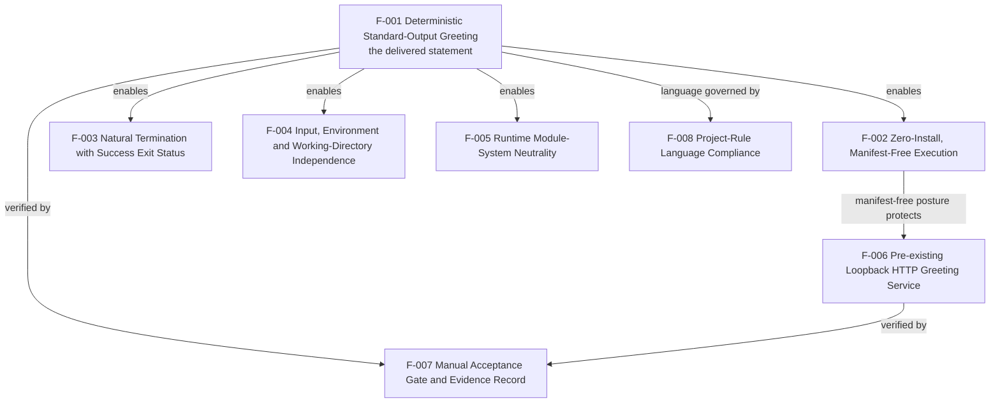

Edges point from the prerequisite or influencing feature to the one it bears on.

| Feature | Related feature | Relationship established |
|---|---|---|
| F-001 | F-002, F-003, F-004, F-005 | F-001 is their prerequisite: each describes a property of the one delivered statement, and none has a subject without it |
| F-002 | F-006 | The manifest-free posture is what keeps the CommonJS `server.js` safe; a `"type": "module"` manifest in or above the repository would break F-006 while leaving F-001 working |
| F-001, F-006 | F-007 | The gate asserts both: the product's bytes, count, line count, casing and status, and the service's continued HTTP response |
| F-001 | F-008 | The delivered artifact's language is the subject of the open governance clause; the relationship is one of obligation, not of behaviour |
| F-006 | F-001 | None. They share the host runtime and nothing else; the product is never imported by the service, binds no port, and touches no file the service uses |

### 2.10.2 Integration Points

The product has exactly one runtime integration point — its standard output stream — plus the host runtime it shares with the preserved service. Everything else below is a delivery-time or governance interface rather than a runtime one.

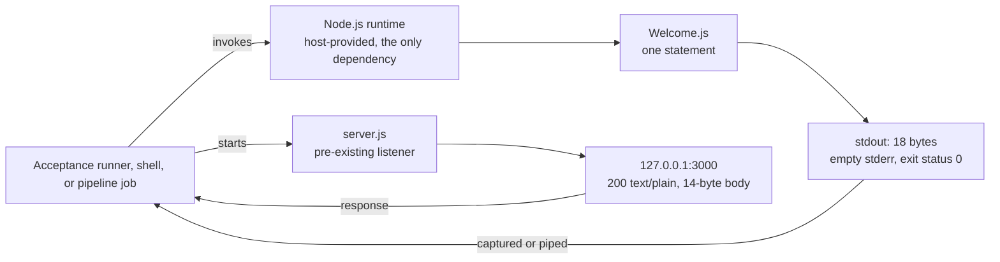

| Integration point | Feature | Direction | Character |
|---|---|---|---|
| Standard output stream | F-001, F-003 | Outbound | The product's only runtime interface. Any consumer that can read a pipe or capture a stream works; no contract exists with a specific downstream system |
| Process exit status | F-003 | Outbound | Callers may branch on `$?`; the value is `0` on the success path and no other status is produced |
| Host Node.js runtime | F-001 – F-006 | Host-provided | The sole shared dependency. `Welcome.js` consumes the `console` global; `server.js` consumes the built-in `http` module |
| Loopback TCP port `3000` | F-006 | Inbound, pre-existing | Bound by `server.js` alone; the product opens no socket and never interacts with this listener |
| Acceptance gate runner | F-007 | Human or job driven | A reviewer or job executes the nine commands and reads the results; nothing consumes the gate programmatically inside the repository |
| Version-control hosting | Delivery-time only | Outbound, external | `origin` is a GitHub remote and the change reached the mainline as PR #15, merged through the hosting API. No runtime dependency on it exists |
| Governance review process | F-008 | External, non-runtime | The owner's decision is recorded outside the artifact; the product emits nothing and changes nothing in any outcome |

Related process flows already documented: the component view and its exhaustive dependency edges appear in Section 1.2.2.2, and the workflow table — direct, absolute-path, captured, and isolated invocations, plus acceptance-gate execution and service continuity — appears in Section 1.3.1.2.

### 2.10.3 Shared Components and Common Services

| Shared element | Used by | Nature of the sharing |
|---|---|---|
| Node.js runtime | F-001 – F-006 | The only element shared by the two executables, and it is host-provided rather than part of the repository. `console` and `http` are runtime built-ins, not repository modules |
| `blitzy/documentation/Project Guide.md` | F-007, F-008, and the compliance claims of every other feature | A documentation artifact, not a code component: the acceptance gate, the twelve-row compliance matrix, and the open governance item all live in it. No executable reads it |
| Repository working tree | All features | Shared only in the trivial sense that one file was added to it; the product writes no file, and no feature passes state to another through the filesystem |

**There are no common services and no shared code components.** The product declares no import, export, or `require`, so it exposes no reusable module and consumes none; there is no manifest, so no package resolution step exists to be shared; and there is no configuration, cache, queue, database, or state of any kind in the repository. `Welcome.js` and `server.js` share no module, no variable, no port, no file handle, and no data structure — a property recorded in Section 1.2.2.2 and visible directly in the two sources, where the product's single statement and the service's `require('http')` have nothing in common but the runtime that executes them. The only element one feature supplies to another is a *posture* rather than a component: the manifest-free state that F-002 establishes is what allows F-005's neutrality to hold and F-006's CommonJS service to keep working.


## 2.11 Implementation Considerations

### 2.11.1 Technical Constraints

| Feature | Constraint | Consequence if breached |
|---|---|---|
| F-001 | Exactly one source line and one added file; the message must be a single-quoted literal followed by a semicolon with no indentation and no comment | The two minimality counts are acceptance criteria, so any second line, comment, or wrapper file fails acceptance. The comment ban is why the language rationale had to be recorded in commit `6c16ea2` instead of in the source |
| F-001 | The filename is fixed at `Welcome.js` at the repository root, case-sensitive | Renaming, re-casing, or relocating breaks an acceptance criterion; on a case-insensitive filesystem the error is masked locally and then fails on Linux with `MODULE_NOT_FOUND` |
| F-002 | No manifest, lockfile, or `node_modules` in or above the repository, and no declared dependency | Breaks the zero-install criterion outright, and a manifest declaring `"type": "module"` additionally breaks the preserved `server.js` at runtime |
| F-003 | No `process.exit()`, timer, listener, or exit handler | A forced exit could truncate queued output and silently falsify the byte count while the process still reported success |
| F-004 | No input channel of any kind — no argument, standard input, environment variable, file, or socket | Configurability is explicitly unsupported; introducing an input channel would create a security surface the product does not have today and would make results host-dependent |
| F-005 | No local module configuration and no module syntax in the source | Pinning a classification with a manifest would breach F-002 and endanger F-006; relying on classification would make the product fragile on any host with ambient configuration |
| F-006 | `server.js` and `README.md` must remain byte-identical to base commit `1484182`; its hardening gaps stay open | Any edit — including an `'error'` listener, a shutdown drain, or a configurable port — exceeds this deliverable's scope and fails the continuity criterion |
| F-007 | Acceptance is manual; no test file, runner, or CI workflow may be added | Adding automated tooling would breach the excluded-artifact criterion, so a change to `Welcome.js` is guarded only by the discipline of re-running the gate |
| F-008 | The item can be closed only by a wording decision | No code change can satisfy a Python mandate for a JavaScript artifact: renaming breaks the required filename, and a `.py` companion doubles the file count against the minimality criterion |

### 2.11.2 Performance Requirements

| Feature | Requirement | Evidence |
|---|---|---|
| F-001 | One buffered write and immediate exit; no SLA or SLO is defined anywhere in the repository, and none would be meaningful for a short-lived process | Roughly 25–30 ms recorded end to end (`Project Guide.md` §9.1); 18 bytes captured on every run in this checkout |
| F-002 | Time to first output bounded by process startup alone, with no install, resolve, or build phase between invocation and the write | `node Welcome.js` runs directly from the checkout with no preceding command |
| F-003 | No drain delay, grace period, or shutdown work; termination follows the write immediately | `timeout 10 node Welcome.js` → exit `0`, timeout never fired; slow-reader capture received all 18 bytes |
| F-004 | No environment, filesystem, or directory lookup, so invocation cost is independent of context | Identical byte output and exit status under extra arguments, piped input, `env -i`, and invocation by absolute path from `/tmp` |
| F-006 | The pre-existing application's performance must not be impacted — a stated acceptance criterion, not an aspiration | With the service running, requests returned `200` at `time_total=0.004337` and `0.000609` around a product run; `Project Guide.md` §4 records medians at or below the idle baseline with no failed request and stable memory, thread, and descriptor counts |
| F-007 | The gate must be cheap enough to re-run on every change and must not create fixtures or temporary files | The nine lines are short-lived processes; the automated runner reports `# duration_ms 12.048834` for zero tests |

### 2.11.3 Scalability Considerations

Scalability is **not an applicable dimension** for this product, and the repository deliberately does not pretend otherwise. `Welcome.js` is a single-shot process, not a service: it holds no state, exposes no concurrent interface, and has no throughput, latency-under-load, or capacity surface to scale. No SLO, autoscaling rule, pool size, or resource limit appears anywhere in the tree, and none would be meaningful.

| Feature | Applicability | Note |
|---|---|---|
| F-001, F-003, F-004 | Not applicable | Every run is an independent process. Repeated and concurrent runs produced byte-identical output, modified no tracked file, and left no process or handle behind, so N concurrent runs cost N processes and yield N identical results with no contention |
| F-002 | Not applicable | There is no installation, download, or cache to scale, and no registry to rate-limit |
| F-005 | Not applicable | No loader or build stage exists whose throughput could vary |
| F-006 | Not measured, and not asserted | The pre-existing listener is a single-process demo with a fixed loopback bind and an inline handler. Concurrency behaviour is unasserted, and a second start fails with exit status `1` and `EADDRINUSE`; treating it as a scalable service is an unsupported use case |
| F-007, F-008 | Not applicable | Verification and governance items have no load dimension |

Any requirement to serve concurrent callers, sustain throughput, or run as a resident process would be a new product rather than a scaling change to this one.

### 2.11.4 Security Implications

| Feature | Implication | Status |
|---|---|---|
| F-001 | The program reads no argument, standard input, environment variable, or file; opens no socket; executes no dynamic code; holds no secret; and declares no dependency. There is therefore no input to validate, no credential to manage, and no transitive advisory exposure. File mode is `0644` | Complete and enumerated rather than sampled |
| F-002 | Zero dependencies means zero supply-chain surface: no install-time script execution, no registry credential, and no version graph to audit | Complete |
| F-003 | Nothing executes at shutdown — no exit handler, signal handler, or cleanup routine | Complete |
| F-004 | Any future change that introduced a dependency, an argument, or an input channel would create a security surface this product does not have today, and must be treated as a scope change to be agreed first | Recorded as a risk in `Project Guide.md` §6 and mitigated today by the absence of such channels |
| F-005 | No dynamic `import`, no `eval`, no `vm` use, and no loader hook is registered | Complete |
| F-006 | Loopback-only bind, so the listener is not reachable off-host, but it has no authentication, no TLS, no request-body handling, and no listener `'error'` handler; a second start exits `1` with an `EADDRINUSE` stack trace on standard error. It is a demonstration service, not a production one | Open, pre-existing, and outside this deliverable's scope |
| F-007 | Every gate command is read-only with respect to the repository; `node --check` parses without executing | Complete |
| F-008 | The governance gap has no security effect in either outcome | Recorded as governance only |

### 2.11.5 Maintenance Requirements

| Area | Requirement | Trigger or cadence |
|---|---|---|
| Runtime lifecycle | The only moving part is the host Node.js runtime. The supported floor, Node.js 22.x, reaches end of life on 30 April 2027 | Standardise on the 24.x line or later; the source uses no version-sensitive syntax, so no code change will be needed |
| Regression protection | No automated check guards `Welcome.js` or `server.js`; `node --test` reports 0 tests by design | Re-run the documented gate on any change to either file, and revisit the absence of automation only if the product grows beyond one statement |
| Output verification | `console.log` does not raise when the destination stream cannot accept the write, and terminal newline translation reports 19 bytes instead of 18 | Assert the byte count against a captured file or a pipe, and verify the output itself rather than only the exit status |
| Style and readability | The style contract — single-quoted literal, terminating semicolon, no indentation, no comment — is verifiable by reading one line; no linter, formatter, or editor configuration exists to enforce it | Manually, on any edit; `Project Guide.md` Appendix F records the tooling that is deliberately absent |
| Dependency and configuration drift | There is nothing to patch, no lockfile to audit, no configuration to drift, and no secret to rotate | Continuous by construction, provided the manifest-free posture of F-002 is preserved |
| Pre-existing service | `server.js` has no automated coverage, no listener `'error'` handler, no graceful shutdown drain, and a hardcoded `127.0.0.1:3000` bind | Open, pre-existing owner decision; hardening it is outside this deliverable's scope |
| Branch hygiene | Divergent variants of this project exist only on unmerged remote branches (a variant manifest, an alternative service file and test file, and a separate Technical Specifications document on 22 unmerged remote refs) | Not merged and not scoped; reconciling them would be a separate effort |
| Acceptance record | The evidence record is part of the delivery, and its counts describe the deliverable branch rather than the merged tree, which gains two paths because the record itself is committed | Read the file, line, and added-path counts against the branch that carried `Welcome.js`, as recorded in Section 1.3.2.1 |


## 2.12 Traceability Matrix

### 2.12.1 Requirement-to-Compliance Traceability

Every row of the twelve-row compliance matrix in `Project Guide.md` §5.1 is traced below to the feature that owns it and to the check that evidences it. The eleven must-have capabilities listed in Section 1.3.1.1 map one-for-one onto rows 1 through 11 of this table; the twelfth row is the open governance item, owned by F-008.

| Compliance row (`Project Guide.md` §5.1) | Owning feature | Acceptance evidence | Status |
|---|---|---|---|
| 1. Exact message on a user-visible channel | F-001 | `Welcome.js:1`; captured stdout 18 bytes; hex `57 65 6c 63 6f 6d 65 20 74 6f 20 42 6c 69 74 7a 79 0a` | Pass |
| 2. Filename exactly `Welcome.js`, at the repository root | F-001 | `ls Welcome.js`; `git ls-files`; zero `*.mjs`, `*.cjs`, `*.py` artifacts | Pass |
| 3. JavaScript implementation | F-001, F-002 | `node --check` exits `0` for both tracked `.js` files; syntax is ES5 level | Pass |
| 4. Self-termination with success status | F-003 | Exit `0`, empty stderr, `timeout` never triggered, no exit call in source | Pass |
| 5. Minimal line count, one statement | F-001 | `wc -l -c Welcome.js` → `1 34`; one semicolon; single trailing LF | Pass |
| 6. Simple and readable, no abstraction | F-001 | Token scan for `import`/`export`/`require`/`process`/`argv`/`env` → 0 matches; no declaration in the file | Pass |
| 7. Runs as written — no install, build, or transpile | F-002 | No manifest, lockfile, or `node_modules` in the tree or any ancestor directory | Pass |
| 8. Application performance not impacted | F-006 | Requests at `http_code=200`, `time_total=0.004337` and `0.000609`, around a run of the product | Pass |
| 9. Each flow and feature clearly separated | F-001, F-002 | The one feature's one flow occupies a dedicated file containing nothing else | Pass |
| 10. Module-system independence, no local module configuration | F-005 | 18 bytes under an ESM manifest, a CommonJS manifest, no manifest, and as a `.cjs` copy | Pass |
| 11. Excluded artifacts absent | F-002 | Repository-wide sweeps return nothing for every excluded class; the only `.md` outside the record is the pre-existing `README.md` | Pass |
| 12. Project rule — new products in Python | F-008 | `Welcome.js:1` is JavaScript; sweep for `*.py` → 0 hits; matrix row recorded as not met by decision | Not met, by decision (open) |

### 2.12.2 Requirement Roll-Up by Feature

| Feature | Requirements | Must / Should / Could | Acceptance evidence location |
|---|---|---|---|
| F-001 | 5 | 4 / 1 / 0 | Section 2.2.4 — the F-001 acceptance table |
| F-002 | 3 | 3 / 0 / 0 | Section 2.3.4 — the F-002 acceptance table |
| F-003 | 3 | 2 / 1 / 0 | Section 2.4.4 — the F-003 acceptance table |
| F-004 | 4 | 2 / 2 / 0 | Section 2.5.4 — the F-004 acceptance table |
| F-005 | 2 | 1 / 1 / 0 | Section 2.6.4 — the F-005 acceptance table |
| F-006 | 4 | 3 / 0 / 1 | Section 2.7.4 — the F-006 acceptance table |
| F-007 | 3 | 2 / 1 / 0 | Section 2.8.4 — the F-007 acceptance table |
| F-008 | 2 | 1 / 1 / 0 | Section 2.9.4 — the F-008 acceptance table |
| **Total** | **26** | **18 / 7 / 1** | — |

### 2.12.3 Acceptance Flow

The path below is the process by which every claim in this section was verified, and it is the same path a reviewer repeats from `Project Guide.md` §9.5.

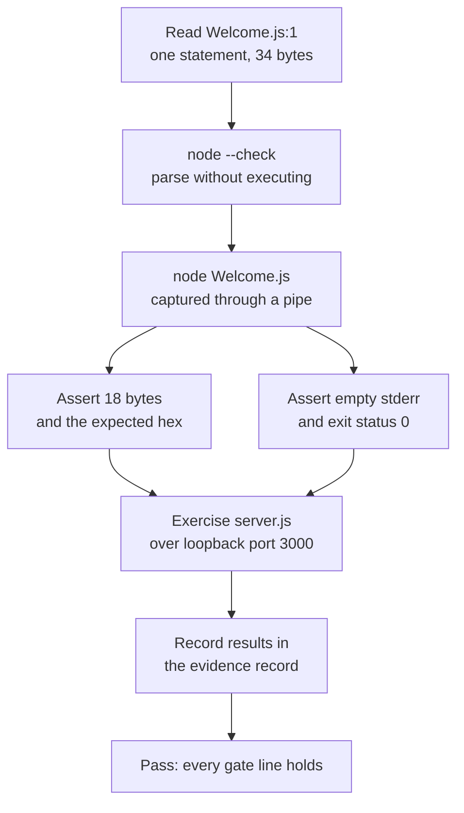

### 2.12.4 Requirement Versioning and Related Specification Material

- **Version.** This traceability matrix is version 1.0, read against mainline tip `39974fd`. It is anchored to content, not to a date: `Welcome.js` blob `58a5dcab90815d7b1db080e39613e7711f5854e0` and SHA-256 `5c7ac141d94f92056efb756f17335252c31e3d08d509e641d76512f73112c1fc`, and `server.js` blob `320a75a7649db30756f011001f299d20df1c44b3`. A change to either file re-baselines the affected feature's acceptance criteria and makes the corresponding rows of this matrix stale until they are re-run.
- **Related sections of this specification.** Section 1.1 states the product's problem, stakeholders, and value proposition; Section 1.2 describes the components, capability surface, and success criteria that these features implement; Section 1.3 fixes the in-scope requirements, boundaries, exclusions, and unsupported use cases that the catalogue defers to; Section 1.4 lists the evidence base. The process flowcharts referenced in this section are the component view in Section 1.2.2.2, the workflow table in Section 1.3.1.2, and the two diagrams in Sections 2.10.1 and 2.10.2 above.
- **Related specification material outside this mainline.** A separate Technical Specifications document exists on unmerged sibling branches — `blitzy/documentation/Technical Specifications.md` on `origin/blitzy-01ba23cf-5665-4383-82e3-2f93d3b7f0f7`, and the same path on `origin/09-Oct-26-Br2`. Neither is reachable from `HEAD`, neither governs this mainline, and no requirement in this section derives from either; Section 1.3.3.2 records them as out of scope.
- **Governing record.** `blitzy/documentation/Project Guide.md` is the authoritative record behind every status in this section: §3 for the 42 checked results, §5.1 for the compliance matrix traced above, §5.2 for the three divergences, §6 for the risk table, and §9.5 for the acceptance gate.


## 2.13 References

The evidence base for this section is the repository itself, read at mainline tip `39974fd`, plus the four sections of this specification already written. No external source was consulted, and no statement here rests on a web reference.

**Repository files**

- `Welcome.js` — the product and the subject of F-001 through F-005 and F-008. Establishes the whole delivered behaviour: the single statement `console.log('Welcome to Blitzy');` at line 1, 1 line and 34 bytes, mode `0644`, blob `58a5dcab90815d7b1db080e39613e7711f5854e0`, SHA-256 `5c7ac141d94f92056efb756f17335252c31e3d08d509e641d76512f73112c1fc`; captured stdout of 18 bytes (`57 65 6c 63 6f 6d 65 20 74 6f 20 42 6c 69 74 7a 79 0a`), empty stderr, exit status `0`; zero matches for `import`, `export`, `require`, `process`, `argv`, `env`, `process.exit`, `setTimeout`, `setInterval`, `addListener`, and `.on(`; and the file's own one-line style contract, which bounds every requirement of F-001.
- `server.js` — the pre-existing service catalogued as F-006. Lines 1 and 12 establish the CommonJS `require('http')` and the unguarded `server.listen` call; lines 3–4 fix `hostname = '127.0.0.1'` and `port = 3000`; lines 6–10 hold the inline handler returning `200`, `text/plain`, and the body `Hello, World!\n` for every method and path. 14 lines, 342 bytes, blob `320a75a7649db30756f011001f299d20df1c44b3`, byte-identical to base `1484182`.
- `README.md` — project identity and charter for the whole section: heading `hao-backprop-test` and the sentence "test project for backprop integration." 2 lines, 58 bytes, byte-identical to base; the reason the product's value is stated as verification rather than commercial capability.
- `blitzy/documentation/Project Guide.md` — the governance and evidence record behind every status in this section, 381 lines and 35,992 bytes. §1.4 supplied F-008's owner, effort, and open state; §2.1–§2.3 the hours split of the remaining work; §3 the 42 checked results and the zero-test status; §4 the runtime validation, byte-exact output, and performance non-impact evidence; §5.1 the twelve-row compliance matrix traced in Section 2.12.1; §5.2 the three divergences, including the language decision and the record-only commit; §6 the eight-row risk table cited in Sections 2.1.3 and 2.11; §9.1–§9.2 the prerequisites and zero-setup environment; §9.5 the nine-command acceptance gate executed for F-007; §9.6–§9.7 the usage examples and the troubleshooting rows; and Appendices A, C, D, E, F, and G the command reference, file locations, runtime versions, the absence of environment variables, the tooling that is deliberately absent, and the glossary.

**Repository folders**

- `blitzy/` — the only first-order directory besides `.git`; holds documentation and no executable code, which is why no feature in this catalogue derives from it.
- `blitzy/documentation/` — contains `Project Guide.md` and nothing else; the repository's sole documentation subtree on this mainline.

**Version history and refs examined**

- `39974fd` — mainline tip, "Merge pull request #15" by `blitzy-qa[bot]`, 22 September 2026; the revision every status in this section is read against, and the reachable set for the branch comparison in Section 2.1.3.
- `1484182` — base commit, "Add files via upload" by `Ajitkumar Bhangale`, 12 March 2026; contained only `README.md` and `server.js` and is the reference for F-006's byte-identity requirement and the §5.1 items traced in Section 2.12.1.
- `1cef465`, `6c16ea2`, `4d1256c` — the three delivery commits; `6c16ea2` in particular changes no path and carries the language rationale that F-008 describes, which is why it is cited as the reason no comment appears in the source.
- `origin/blitzy-e2f602a0-05aa-4abd-9177-dc7377485002` — the pre-merge branch whose three-path counts the Project Guide quotes, cited in Section 2.11.5 for reading acceptance counts against the deliverable branch rather than the merged tree.
- `origin/blitzy-01ba23cf-5665-4383-82e3-2f93d3b7f0f7` and `origin/09-Oct-26-Br2` — unmerged sibling branches carrying a variant `package.json` (name `hao-backprop-test`, `main: server.js`, `engines.node: >=18`, empty dependency maps) and a separate `blitzy/documentation/Technical Specifications.md`; they establish the out-of-scope variants noted in Sections 2.1.3, 2.3.2, and 2.12.4.

**Sections of this specification used as cross-references**

- Section 1.1 Executive Summary — the business problem, stakeholder set, and value proposition summarized in F-001 and F-002.
- Section 1.2 System Overview — the component inventory and its exhaustive dependency edges (1.2.2.2), the five-capability surface (1.2.2.1), and the measurable objectives and KPIs (1.2.3) that this section's features trace back to.
- Section 1.3 Scope — the eleven must-have capabilities and key technical requirements (1.3.1.1, 1.3.1.4), the implementation boundaries (1.3.2), and the exclusions and unsupported use cases (1.3.3) that Sections 2.1.3 and 2.7 defer to.
- Section 1.4 References — the enumerated evidence base, the absent-artifact list, and the branch comparison that Section 2.1.3 reuses rather than repeats.

**Web sources**

- None. No external documentation, registry entry, or vendor page was consulted for any statement in this section; no dependency exists whose version would require one.


# 3. Technology Stack

## 3.1 Programming Languages

The repository is written in exactly one programming language, **JavaScript**, executed by the host's **Node.js** runtime. The tracked tree contains four paths and no others — `README.md`, `Welcome.js`, `server.js` and `blitzy/documentation/Project Guide.md` (`git ls-files`; `find . -path ./.git -prune -o -type f -print` returns the same four files) — so the language inventory below is exhaustive rather than representative. Of those four paths, two are executed JavaScript, and two are a Markdown description and a Markdown evidence record.

### 3.1.1 Language by Component

| Component | Language and variant | Runtime facility used | Evidence |
|---|---|---|---|
| `Welcome.js` — delivered product, repository root | JavaScript at ES5 level; module-neutral, declaring no `import` and no `export` | `console`, a runtime global requiring no import | `Welcome.js:1` — `console.log('Welcome to Blitzy');` |
| `server.js` — pre-existing loopback HTTP service | JavaScript, CommonJS module (explicit `require`) | The `http` core module | `server.js:1` — `const http = require('http');` |
| `README.md`, `blitzy/documentation/Project Guide.md` | Markdown; declarative documentation, never executed | None | Tracked file list; 1 line / 58 bytes and 381 newlines / 35,992 bytes |

A token scan over every tracked file for `require`, `import`, `export`, `process.`, `__dirname`, `fs.`, `net.`, `dns.`, `child_process`, `eval(` and `new Function` returns a single match in the whole repository: `server.js:1`'s `require('http')`. `Welcome.js` matches nothing, which is what makes it runnable with no install step and no module declaration.

No second language is present in any form. There is no Python artifact (`F-008`'s language clause is recorded as unmet by decision — see §2.9 and `Project Guide.md` §5.2 divergence 1), and there is no TypeScript, no compiled or native language, and no browser-side script: the tree holds no `.py`, `.ts`, `.pyi`, `.html`, `.css`, `.json` or configuration file of any kind.

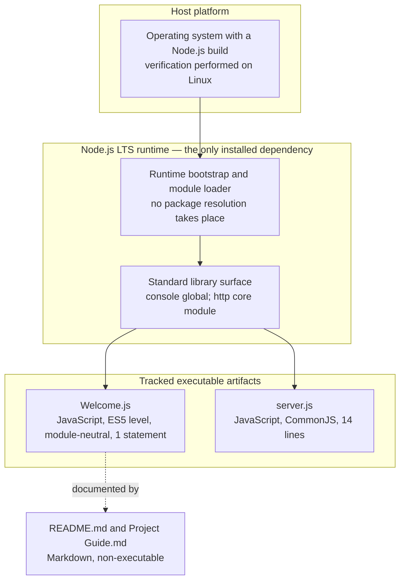

The diagram's edges are the complete dependency set: both JavaScript artifacts depend on the host runtime and on nothing else, and they do not depend on each other.

### 3.1.2 Selection Criteria

JavaScript was not a default; it was the only choice that satisfies the binding acceptance criteria simultaneously.

| Criterion | Why it governed | How the source satisfies it |
|---|---|---|
| Zero-install execution (F-002) | The product must run as written, with no install, build or transpile step, and no manifest, lockfile or `node_modules` anywhere in or above the tree | JavaScript is executed directly by Node.js, and `console` is a runtime global, so the file needs no import, no resolution and no compilation |
| Minimal artifact (F-001) | The deliverable is capped at one statement on one line in one file; the message must be a single-quoted literal followed by a semicolon | The language admits the whole product as one member call on a global applied to one string literal; the file is 1 line, 34 bytes, with no wrapper, guard or export |
| Continuity with the pre-existing service (F-006) | `server.js` is JavaScript and must stay byte-identical | Choosing JavaScript kept the repository single-language, required no port or shim, and left `server.js` untouched (`git diff --quiet 1484184 HEAD -- README.md server.js` — base `1484182` — is silent) |
| Version and toolchain insensitivity | The tree declares no runtime floor, so the source must survive any supported Node.js line | The syntax is ES5 level: one member call and one string literal, with nothing version-sensitive, and observed output is byte-identical on the reference line `v24.21.0`, the supported floor `v22.23.2` and the runtime re-verified here, `v22.23.3` |
| Explicit product instruction | The product request named JavaScript and the filename `Welcome.js` in the same sentence, while the governing project rule mandates Python project-wide with no per-product carve-out | The specific instruction was followed and the conflict recorded, since a `.js` file cannot hold runnable Python and a companion `.py` file would breach the one-added-file ceiling. The rationale was committed as a zero-byte change, `6c16ea2`, because a comment in the source would have breached the one-line and zero-comment style contract |

### 3.1.3 Constraints and Dependencies

| Constraint | Specification | Consequence if breached |
|---|---|---|
| A Node.js runtime is mandatory | The deliverable is source, not a compiled artifact or bundle; no native binary, package or distribution is produced | On a host with no Node.js on `PATH` the command fails as `node: command not found`; there is no fallback execution path |
| Filename and location are case-sensitive | Exactly `Welcome.js` with a capital `W`, at the repository root; no `welcome.js`, `.mjs`, `.cjs` or `.py` variant exists | A mis-cased invocation succeeds on a case-insensitive filesystem and then fails on Linux with `MODULE_NOT_FOUND` |
| The deliverable declares no module syntax | No `import`, `export` or `require` in `Welcome.js`, so classification is left to the runtime (F-005) | Adding a manifest that declared `"type": "module"` would break the CommonJS `server.js` at runtime while `Welcome.js` kept working; the recorded mitigation is to declare `"type": "commonjs"` if a manifest ever becomes necessary |
| No declared runtime floor | No `engines` field, no `.nvmrc`, no `node-version` file anywhere in the tree, and no manifest that could hold one | The verified floor (`v22.23.2`) is a documented contract rather than an enforced one; runtime drift is not caught by tooling |
| A fixed style contract | Single-quoted literal, terminating semicolon, no indentation, no comment, single trailing LF | Any second line, wrapper or comment breaks the one-line minimality criterion that acceptance measures with `wc -l` |
| The Python mandate is unmet | Recorded by decision, not by oversight, and closable only by a wording change | Governance-only: a literal audit finds one of the rule's three clauses unsatisfied; there is no functional, security, performance or continuity effect |

**Dependencies of the language choice.** The only dependency is the host runtime. No compiler, transpiler, bundler, package manager, virtual environment or interpreter flag participates in building or running either file, and no language-level library import is declared beyond Node's own `http` module in `server.js`. The practical consequence is that the language's operational support window is the runtime's support window, and nothing else: the supported floor, Node.js 22.x, reaches end of life on 30 April 2027, while the source itself needs no change to move lines.


## 3.2 Frameworks &amp; Libraries

### 3.2.1 Core Frameworks: None Adopted

No application framework is used, declared or required. The repository's complete framework surface is two Node.js built-ins: the `console` runtime global in `Welcome.js:1` and the `http` core module in `server.js:1`. Because the tree contains exactly four tracked paths, this is an enumeration rather than a sample: there is no framework directory, no framework configuration, no manifest that could declare one, and no `require` or `import` anywhere except `server.js:1`.

Every framework class in the default reference stack was assessed against the tree and found inapplicable, with absence confirmed by repository-wide sweeps rather than by inference:

| Framework class | Status in this repository | Evidence |
|---|---|---|
| Web / HTTP framework (Express, Flask, Django, FastAPI) | Not used. `server.js` answers requests with Node's raw `http` module and one inline handler; no routing layer, middleware pipeline or view layer exists | `server.js:1,6-10`; zero manifest files; zero `.py` files |
| Front-end framework (React, TypeScript, TailwindCSS, React Native) | Not applicable. The product has no user interface and no browser-side asset: one line of JavaScript is written to stdout | Tracked tree is four paths, none of them HTML, CSS, JSX/TSX or bundled |
| Data-access framework or ORM | Not applicable. There is no database, driver, schema or migration (see §3.5) | Zero imports other than `node:http`; no connection string anywhere |
| AI / ML framework (Langchain or similar) | Not applicable. No model call, inference client or prompt asset exists | Zero dependencies, zero endpoints |
| Native or cross-platform application framework (Swift, Kotlin, Objective-C, Electron) | Not applicable. There is no mobile, desktop or native component to build | No platform-specific source, build file or bundle manifest |

### 3.2.2 Supporting Libraries: The Node.js Standard Library and Runtime Globals

The library surface is Node.js itself. Both executables rely on facilities the runtime already provides, which is why the repository needs no dependency graph at all.

| Facility | Provision in Node.js | Where used | Notes |
|---|---|---|---|
| `console` | Runtime global, no import required | `Welcome.js:1` (`console.log`) and `server.js:13` (startup message) | A global, not a module import — this is what keeps `Welcome.js` free of `require` and module-neutral |
| `http` | Core module, loaded as `require('http')` | `server.js:1` — `createServer`, `listen` | Documented as Stability 2 - Stable in the Node.js API docs for the v22.x, v24.x and v26.x lines; nothing about it is experimental |
| `node:test` test runner | Built-in, invoked as `node --test`; stable since Node.js v20.0.0 and reachable only under the `node:` scheme | Invoked during verification of this checkout | Reports `tests 0 / suites 0 / pass 0 / fail 0`, exit `0`. It is the runtime's own tooling, not a project dependency, and it is not the acceptance mechanism (F-007) |

The complement is equally concrete. A token scan over the tracked files returns zero matches for `process`, `fs`, `net`, `dns`, `child_process`, `path` and `os`, so no filesystem, network-client, DNS, subprocess or environment facility is used by the deliverable; `server.js` binds a listener but never opens an outbound connection. No polyfill, shim, helper module or vendored file exists anywhere in the tree.

### 3.2.3 Compatibility and Integration Requirements

| Requirement | Specification | Evidence |
|---|---|---|
| Runtime lines | Reference line Node.js `v24.21.0`; supported floor Node.js `v22.23.2`, which reaches end of life on 30 April 2027. The gate was re-run for this specification on `v22.23.3` and reproduced every criterion | `Project Guide.md` Appendix D; local re-run |
| Language level | ES5 level — one member call and one string literal. No optional chaining, top-level `await`, class field or other version-sensitive syntax, so no minimum feature level is asserted | `Welcome.js:1`; `node --check` exits `0` on both tracked `.js` files |
| Module-system classification | Neutral. The deliverable's source contains neither `import` nor `export`, and identical 18-byte output with exit `0` was recorded under a sibling `"type": "module"` manifest, a `"type": "commonjs"` manifest, no manifest at all, and as a `.cjs` copy under an ESM manifest | §2.6; `Project Guide.md` §4 |
| Manifest declaration, if one is ever added | Must declare `"type": "commonjs"`, because `server.js:1` uses CommonJS `require`. A `"type": "module"` manifest added in or above the repository would break `server.js` at runtime while leaving `Welcome.js` unaffected | `Project Guide.md` §6 — recorded mitigation |
| Engine declaration | None exists and none is enforced: no `engines` field, `.nvmrc`, `node-version` file or `engines` check anywhere in the tree. The supported floor is a documented contract, and `npm 11.21.0` is present on the verification host but is not part of the repository's stack | Ancestor sweep to `/`; repository-wide sweep for version-pinning files |
| Platform | Any platform with a Node.js build. Verification was performed on Linux; a case-sensitive filesystem is required for the `Welcome.js` filename criterion to be meaningful | `Project Guide.md` §9.1, §9.7 |
| Component-to-component integration | None. `Welcome.js` is not imported by `server.js` and does not import it; the two share no module, package, configuration, state or data structure, and are independent short-lived and long-lived processes. There is no interface contract between them beyond both targeting the same runtime | Token scan (`Welcome.js` matches no import form); `server.js` never references `Welcome.js` |

### 3.2.4 Justification for the Framework-Free Choice

The absence of a framework is a design decision that the acceptance criteria made unavoidable; each reason below is traceable to a stated requirement.

- **It is the only way to satisfy the zero-install criterion (F-002).** Any framework requires a manifest and an install step, and therefore a `package.json` and a `node_modules` directory. The documented setup instructions state plainly that `npm install`, `npm init` and `npm ci` must not be run here because adding a manifest, lockfile or `node_modules` breaks a stated acceptance criterion outright (`Project Guide.md` §9.2, §9.3).
- **It protects the pre-existing service (F-006).** A manifest is the only artifact that could break `server.js`, because a `"type": "module"` declaration would change how the runtime loads a file that uses `require`. Keeping the tree manifest-free removes that hazard entirely, and module neutrality (F-005) removes the dependency on classification that a manifest would otherwise have to settle.
- **It keeps the artifact inside the minimality ceilings (F-001).** A framework would add at least one file and at least one line, against a deliverable priced at exactly one added file and one source line. The one statement is the product.
- **It carries the smallest possible security surface.** Zero dependencies means zero install-time script execution, zero registry credential, no transitive version graph to audit and no advisory exposure. The product reads no argument, standard input, environment variable or file; opens no socket in `Welcome.js`; holds no secret; and executes no dynamic code (§2.11.4).
- **It preserves performance non-impact (N-4).** `Welcome.js` is a standalone short-lived process that is never imported by or referenced from `server.js`, so it cannot add work to the pre-existing service. Measured request latency around runs of the product stayed at or below the idle baseline with no failed request (`Project Guide.md` §4).
- **It costs nothing in capability.** The product's entire behaviour is one write to stdout, and `server.js` returns one fixed response for every method and path. A framework's routing, templating, middleware and lifecycle management would be unreferenced weight in a tree that contains no request branch to route, no view to render and no state to manage.


## 3.3 Open Source Dependencies

### 3.3.1 Third-Party Packages Declared: Zero

The repository declares no third-party package, in no dependency class and at no resolution scope. The figure is an exhaustive count, not an estimate: the complete non-`.git` file list is `README.md`, `Welcome.js`, `server.js` and `blitzy/documentation/Project Guide.md`.

| Dependency artifact | Count | Evidence |
|---|---|---|
| Runtime third-party packages | 0 | No `require` or `import` of anything but `http`, a Node.js core module (`server.js:1`); `Welcome.js` declares no import at all |
| Development or test packages | 0 | No manifest exists that could declare one; `node --test` uses the built-in runner only |
| Manifests (`package.json`, `pyproject.toml`, `requirements.txt`, `pom.xml`, `go.mod`, …) | 0 | Repository-wide sweep over the tree and every ancestor directory up to `/` returns nothing |
| Lockfiles (`package-lock.json`, `yarn.lock`, `poetry.lock`, …) | 0 | Same sweep; no `node_modules` directory either |
| Vendored code, bundled assets, submodules | 0 | Four tracked paths, three of them source or Markdown; no `.gitmodules` |
| Transitive dependency graph | None exists | With no manifest there is nothing to resolve, so there is no tree of indirect packages to audit |

The complementary evidence is that nothing in the repository could obtain a dependency even if one were wanted: there is no package manager configuration (no `.npmrc`, no registry URL, no scoped package reference), no install script, and no CI step that installs anything.

### 3.3.2 Package Registries, Resolution and Runtime Version Pinning

**No package registry is contacted, at build time or at run time.** There is no resolution step to describe: `Welcome.js` runs directly from the checkout, and the documented setup instructions explicitly forbid `npm install`, `npm init` and `npm ci`, because adding a manifest, lockfile or `node_modules` breaks a stated acceptance criterion (`Project Guide.md` §9.2, §9.3). The verification host does carry `npm 11.21.0` and `npx`, but they are host tooling rather than repository stack: nothing in the tree invokes them, and no script, hook or workflow references them.

**The only third-party open-source component in the stack is Node.js itself**, and it is host-provided rather than pinned by the repository. The repository ships no code from any other project, and therefore creates no third-party licence obligation; there is also no `LICENSE` file of its own, so the deliverable is distributed only as source in the checkout.

| Node.js line | Version verified | Release status (external) | End of life |
|---|---|---|---|
| 24.x — reference line | `v24.21.0` | Maintenance LTS since 20 October 2026; latest patch `v24.22.1` (21 October 2026 security release) | 30 April 2028 |
| 22.x — supported floor | `v22.23.2`; re-verified for this specification on `v22.23.3` | Maintenance LTS since 21 October 2025; latest patch `v22.23.4` (21 October 2026 security release) | 30 April 2027 |
| 26.x | Not used or verified | Becomes the Active LTS line on 28 October 2026 | Not applicable to this deliverable |

Two operational readings follow from the table. First, the patch levels verified here predate the 21 October 2026 security releases, so the host runtime should be brought up to `v22.23.4` or later on the 22.x line, or to `v24.22.1` or later on the 24.x line; the source needs no change, because its ES5-level syntax and its two standard-library facilities are unaffected by patch releases. Second, because both verified lines are now in Maintenance LTS, adopting a newer line (26.x, once it becomes Active LTS, or later) is a host-side decision with no code impact — the same conclusion recorded as the runtime-lifecycle maintenance item in §2.11.5.

### 3.3.3 Non-Adopted Variants Carried on Unmerged Branches

The repository's origin holds 94 refs, of which 22 are not merged into `main`. Several carry dependency declarations and tooling that the mainline deliberately does not have. None is reachable from `HEAD`, none contributes a dependency to the delivered stack, and none governs it; they are recorded here only so that a scan of the hosting service is not mistaken for a property of this repository.

| Variant | Refs | What it declares | Status |
|---|---|---|---|
| Manifest variant | 7 | A `package.json` naming the project, marked private and MIT, `main: server.js`, `start`/`test` scripts, `engines.node >= 18`, and empty `dependencies`/`devDependencies` | Not merged into `main` |
| Lockfile variant | 2 | A `package-lock.json` accompanying the manifest | Not merged |
| Test-suite variants | 5 | `node:test`-based suites (`test/server.test.js`, `Server.test.js`, `test/lifecycle.test.js`, and a `test/` tree with unit, integration, negative, performance and security suites) driving the service over the wire | Not merged |
| Python / Flask variant | 1 | A WSGI rewrite of `server.js` on Python 3.12+ with exactly pinned `Flask==3.1.3` and `Werkzeug==3.1.8`, and `pytest` confined to `requirements-dev.txt` | Not merged |
| Other Python artifacts | 2 | A `Welcome.py` port with its own tests, and a `server.py` with a `requirements.txt` | Not merged |

Each of these is a different task's answer to the same repository, and each would breach at least one criterion this deliverable is measured against — a manifest or lockfile breaks the zero-install posture (F-002), extra test files break the excluded-artifact criterion (F-007), and a `.py` artifact doubles the file count against the one-added-file ceiling (F-001). Section 1.3.3.2 records the reconciliation of these variants as out of scope.


## 3.4 Third-Party Services

No third-party service is called, configured or required by either executable. The product's runtime behaviour is a single write to standard output followed by exit, and the pre-existing service answers on a loopback socket without contacting anything. Every row below is an absence confirmed by repository-wide and ancestor-wide sweeps, not an omission that a later integration would fill.

| Service class | Required at runtime? | Evidence |
|---|---|---|
| External APIs and integrations | No | Exactly one import exists in the whole tree — `server.js:1`'s `require('http')`, a Node.js core module. There is no endpoint, base URL, connection string, API key or client library, and `Welcome.js` opens no socket at all |
| Authentication or identity service | No | No identity provider, token endpoint, OAuth or JWT library, session store or credential file exists; the tree holds no `.env` file, and the product produces identical output under a completely empty environment (`env -i`) |
| Monitoring, logging or analytics | No | No instrumentation, exporter, agent, SDK or logging configuration; nothing is written to disk, and there is no log file, metric or trace emitter |
| Cloud services, hosting or managed platform | No | No infrastructure-as-code file, no cloud resource definition, no container registry reference and no deployment descriptor anywhere in the tree |
| Message broker, queue or scheduler | No | No client library, connection string or topic reference; the deliverable is a one-shot process, not a consumer or producer |

### 3.4.1 Version-Control Hosting (Delivery-Time Only)

The one external service in the picture is the version-control host, and it participates only in delivery, never at runtime. `origin` is a GitHub remote for the repository `ajitblitzy/Ajit_GH_Repo-12-Mar-26`; the change reached the mainline as pull request #15, merged through the hosting API rather than by a local merge, and the ref namespace holds 94 refs across the mainline and its sibling task branches. Authentication to that host is provided by a delivery-time access credential configured outside the tracked tree — the repository stores no secret, no credential file and no host configuration, so nothing about the product depends on that service being reachable.

The consequence for this section is that the repository has no runtime service dependency of any kind: it can be cloned and run, and it can be run with no network access at all.


## 3.5 Databases & Storage

**There is no database and no storage layer.** The system holds no persistence of any kind, and this is a structural property of the artifact rather than an unfinished area: a process that writes 18 bytes and exits has nothing to persist to. Every item below is verified by an exhaustive sweep of the four tracked paths and of every ancestor directory of the checkout up to `/`.

| Storage concern | Implementation in this repository | Evidence |
|---|---|---|
| Primary database | None. No database engine, driver, connection string, schema or migration exists | Zero imports other than `node:http`; no manifest that could declare a driver |
| Secondary database, cache or session store | None. No key-value store, Redis/Memcached client, session store or cache library is referenced, and no cached artifact is produced | Repository-wide sweep; token scan returns no `fs`, `net` or client-module match |
| Durable file storage or object storage | None. Neither executable opens a file for reading or writing, and no bucket, volume or upload path is configured | No `fs` module usage anywhere; only `node:http` is imported, and `Welcome.js` imports nothing |
| Log, audit or telemetry store | None. No log file, sink, rotation policy or telemetry destination exists | No logging configuration file and no writer in either source |

### 3.5.1 Data Persistence Strategy: None by Design

The product's complete data inventory is **18 bytes** — the 17-character message `Welcome to Blitzy` plus one newline — written once to standard output, which the operating system attaches as file descriptor 1 to whichever consumer invoked the process. Those bytes are not stored anywhere by the product: they belong to the invoking shell, pipe or redirect target, and the process exits with status `0` immediately afterwards. Nothing is read back, and re-running the program recomputes nothing because the message is a literal in the source rather than derived data.

Two consequences follow, and both are acceptance-relevant rather than incidental:

- **There is no persistence strategy to document, because there is no state to persist.** The deliverable is a single-shot process with no session, no accumulator, no cursor and no retention rule. Repeated and concurrent runs were observed to produce identical bytes, modify no tracked file and leave no process or handle behind.
- **No data classification, encryption, backup or deletion obligation exists.** There is no input channel, so no personal or sensitive data can enter the system; there is no secret or credential in the tree; and there is no data store against which a retention or encryption requirement could be written.

The pre-existing service is equally stateless. Its handler at `server.js:6-10` ignores method, path, headers and body and returns the same `200 text/plain` `Hello, World!` response, so each request is computed from constants alone, with no request log, no body buffering, no rate counter and no shared state between requests.

### 3.5.2 In-Process State and Working-Tree Residue

The only mutable state in the system is in-memory and process-local: the `http.Server` object and the per-request request/response objects that Node.js creates inside `server.js`, all discarded when the process ends. `Welcome.js` holds no state at all — it declares no variable, so the string literal is the only datum the process ever handles.

Residue was checked rather than assumed:

- `git status --porcelain --untracked-files=all` returns nothing, before and after the verification runs performed for this specification, so neither executable leaves a file behind, and no temporary fixture or capture directory exists in the working tree.
- The seven untracked PNG captures described in `Project Guide.md` §5.2 divergence 3 and §9.7 are not present in this checkout: there is no `blitzy/screenshots/` directory, and the complete file list is the four tracked paths. The only housekeeping risk the guide records — an untracked capture directory being swept in by a blanket `git add` — therefore does not apply here, and the working tree is clean.


## 3.6 Development & Deployment

### 3.6.1 Development Tools

The toolchain is deliberately thin. The recorded policy is that a package manager, linter, formatter, test framework, bundler and container or CI tooling are all unused, and that `node --check` — the runtime's own read-only parse gate — is the only syntax check (`Project Guide.md` Appendix F). The table below separates what the repository requires from what the verification host happened to provide.

| Tool | Role here | Status |
|---|---|---|
| Node.js runtime | Executes `Welcome.js` and `server.js`; supplies every facility either file uses | Required. `v22.23.3` in the verification checkout; reference line `v24.21.0` and supported floor `v22.23.2` recorded in `Project Guide.md` Appendix D |
| `node --check` | Read-only parse gate that installs nothing and executes nothing; the first line of the acceptance gate | Required. Exits `0` for both tracked `.js` files |
| `node --test` (built-in `node:test`) | The runtime's built-in runner; invoked here and reported `tests 0 / suites 0 / pass 0 / fail 0`, exit `0` | Available and unused as an acceptance mechanism — the repository intentionally contains no test file (F-007) |
| Git | Version control, branch publication and history inspection | Required. `git 2.43.0` in the checkout; no hooks are installed and no `core.hooksPath` is configured |
| GitHub hosting | Remote `origin`, pull requests, ref storage | Required at delivery time only; pull request #15 was merged through the hosting API |
| Shell utilities (`wc`, `od`, `sha256sum`, `timeout`, `env`, `grep`, `find`, `ls`, pipelines) | Byte-level verification: output length, hex fidelity, source hash, termination, environment isolation | Used by the documented acceptance gate; they are host utilities, not project dependencies |
| A browser | Observing the pre-existing service's response as a page during continuity verification | Used during verification only; the deliverable has no user interface |
| Deliberately absent: package manager, linter, formatter, test framework, bundler/transpiler, editor or CI configuration | — | Not installed and not configured. The style contract — single-quoted literal, semicolon, no indentation, no comment — is verified by reading one line |
| Python 3 | Present on the verification host, referenced by no file in the tree | Unused; the repository contains zero `.py` artifacts |

### 3.6.2 Build System: None

There is no build system, and nothing to build. The deliverable is source executed directly by the runtime: the syntax is ES5 level — one member call and one string literal — so there is no transpile target, no bundling step, no minification, no asset pipeline and no generated artifact. The tree contains no `scripts` block, no task runner file, no `Makefile` and no build configuration, because no manifest exists to hold one.

Two consequences matter operationally. First, there is no build output to reproduce: the deployed artifact *is* the tracked file, so what is reviewed is exactly what runs. Second, time to first output is bounded by runtime bootstrap alone, with no install, resolve or compile phase between invocation and the write; the end-to-end figure recorded in `Project Guide.md` §9.1 is roughly 25–30 ms, and the built-in runner's own housekeeping for an empty suite measured about 12 ms in this checkout.

### 3.6.3 Containerization: None

No container is defined or used. A sweep of the tree finds no `Dockerfile`, no `docker-compose` file, no `.dockerignore`, no Kubernetes or other orchestrator manifest, and no container registry reference; `docker` is not installed on the verification host either. The product is run by the host runtime from its checkout, so the environment contract is a Node.js line on the host rather than a pinned base image.

That choice is consistent with the rest of the stack rather than an omission: an image would add a second distribution channel and a second version-pinning surface for a product whose entire output is fixed bytes, and packaging it would require either a manifest inside the tree — breaching the zero-install and excluded-artifact criteria (F-002, F-007) — or build steps outside it. The compatibility contract that a container would otherwise encode is instead carried by the two verified runtime lines recorded in §3.3.2 and §3.2.3.

### 3.6.4 CI/CD Requirements: No Pipeline, Manual Acceptance Gate

No continuous-integration or continuous-delivery system exists, and none may be added within this deliverable's scope: the tree contains no `.github/` directory, no workflow file, and indeed no YAML, JSON or configuration file of any kind, and F-007 records that adding automated tooling would breach the excluded-artifact criterion. Acceptance is instead a documented nine-line gate (`Project Guide.md` §9.5) whose combined result decides pass or fail.

| Pipeline stage | Status in this repository | Detail |
|---|---|---|
| Build | Not applicable | Nothing is compiled, bundled or packaged (§3.6.2) |
| Test | Manual, by design | The gate's nine commands run in a shell and are read by a reviewer; the runtime's built-in runner reports zero tests because the repository contains no test file |
| Package or publish | Not applicable | No artifact, archive or package is produced; nothing is published to any registry |
| Deploy | Not applicable | The product is run from its checkout; there is no environment to promote to (§3.6.5) |

The gate is worth stating precisely, because it is the project's substitute for a pipeline: parse the file, capture the message, assert 18 bytes on stdout, assert an empty standard error, assert exit status `0`, assert the hex bytes, count the source lines, confirm the exact filename casing at the root, and parse every tracked `.js` file. Every line must hold, and the whole set is repeated on a second supported runtime line to confirm parity. Two verification hazards are recorded alongside it: a terminal's newline translation reports 19 bytes instead of 18, so assertions must run against a captured file or a pipe; and `console.log` does not raise when the destination stream cannot accept the write, so the bytes must be verified rather than the exit status alone.

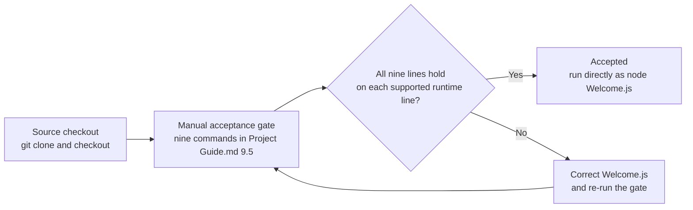

### 3.6.5 Deployment and Release Model

**The product is run, not deployed.** Distribution consists of the version-control checkout itself; there is no package to install, no service to start, no port to bind for the deliverable, no startup ordering to respect and no environment to prepare. The documented procedure is `git clone`, check out the branch, and run `node Welcome.js` from the repository root — with the explicit instruction not to run `npm install`, `npm init` or `npm ci`, since any of them would create the manifest, lockfile or `node_modules` directory that the zero-install criterion forbids (`Project Guide.md` §9.2, §9.4).

Release events are therefore ordinary Git operations: the mainline's history is five commits, of which the deliverable contributes the addition of `Welcome.js` and a record-only commit, and the change reached `main` through pull request #15. No semantic version is published, no tag is used to distribute an artifact, and no release notes are generated.

Two operational obligations carry forward, both host-side and both recorded in §2.11.5:

- **Runtime patching.** The verification runtime (`v22.23.3`) predates the 21 October 2026 Node.js security releases (`v22.23.4`, `v24.22.1`), so the host interpreter should be updated; the source requires no change. The supported floor, Node.js 22.x, reaches end of life on 30 April 2027, and standardising on a newer line is likewise a host decision with no code impact.
- **Regression discipline.** Because acceptance is manual and nothing guards either file, the nine-line gate must be re-run on any change to `Welcome.js` or `server.js`. A future edit that changed the literal, added a line or renamed the file would otherwise pass unnoticed.

### 3.6.6 Integration Requirements Between Components and Their Environment

The integration surface is small enough to enumerate in full, and every interface below was observed rather than assumed.

| Interface | Requirement | Evidence |
|---|---|---|
| Deliverable to runtime | `Welcome.js` uses one runtime global, `console`; it needs no import, resolution or configuration. The process must be able to write to standard output, which the runtime supplies as file descriptor 1 | `Welcome.js:1`; token scan returns no `require`, `import`, `process` or `fs` match |
| Pre-existing service to runtime | `server.js` loads `http` from the core library, creates one server and listens on a fixed loopback address | `server.js:1,6-12` |
| Pre-existing service to network | Bind on host `127.0.0.1`, port `3000`, both hardcoded with no environment or command-line override; loopback-only, so the listener is not reachable off-host. Each request returns `200`, `Content-Type: text/plain` and the 14-byte body `Hello, World!`; the port is released when the process stops | `server.js:3-4,7-9`; observed response headers and startup log |
| Deliverable to pre-existing service | **No integration.** `Welcome.js` is never imported by `server.js`, and the two share no module, package, configuration, state or data. The only measured relationship is the obligation that the product must not degrade the service, which was verified by comparing request latency around runs of the product against the idle baseline | Token scan; `Project Guide.md` §4 |
| Repository to version control | `origin` is a GitHub remote; branch publication and pull requests use the hosting API, authenticated by a delivery-time credential held outside the tracked tree | `git remote -v`; PR #15 |
| Continuity obligation to the pre-existing files | `README.md` and `server.js` must remain byte-identical to base commit `1484182`. Verified with `git diff --quiet 1484182 HEAD -- README.md server.js`, which is silent, and the mainline diff adds only `Welcome.js` and the evidence record | `git diff --stat 1484182 HEAD` |
| Forward constraint on any future manifest | If a manifest ever becomes necessary, it must declare `"type": "commonjs"`, because `server.js` uses CommonJS `require`; a `"type": "module"` declaration in or above the repository would break the service at runtime while leaving the module-neutral `Welcome.js` unaffected | `Project Guide.md` §6 — recorded mitigation |
| Deliverable to downstream consumers | `Welcome.js` exports nothing, so it presents no callable interface: its only contract is 18 bytes on stdout and exit status `0`, consumed by whoever invoked the process | `Welcome.js` contains no `export`, `module.exports` or declaration |

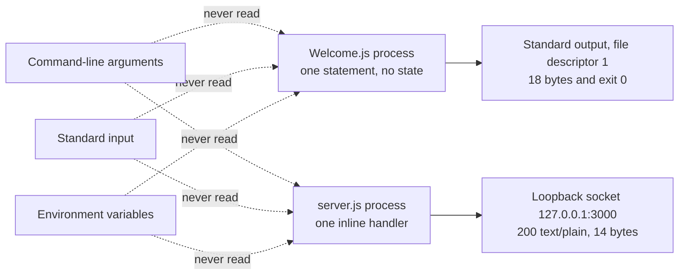

The two processes in the diagram are drawn separately on purpose: they share the runtime and nothing else, and no edge connects them.


## 3.7 References

- `Welcome.js` — the delivered product and the only executable path the Technology Stack is built around; source of the language, style-contract, zero-dependency and no-input findings (1 line, 34 bytes, `console.log('Welcome to Blitzy');`, SHA-256 `5c7ac141d94f92056efb756f17335252c31e3d08d509e641d76512f73112c1fc`).
- `server.js` — the pre-existing HTTP service; source of the `require('http')` core-module usage, the hardcoded `127.0.0.1:3000` bind, the inline request handler and the byte-identity result (14 lines, 342 bytes).
- `README.md` — project identity `hao-backprop-test` and its stated purpose as a backprop-integration test project.
- `blitzy/documentation/Project Guide.md` — the delivery and evidence record: runtime reference line and supported floor and the third-party-package count (Appendix D), prerequisites (§9.1), setup and dependency policy (§9.2–9.3), run procedure (§9.4), acceptance gate (§9.5), example usage (§9.6), troubleshooting (§9.7), developer-tools policy (Appendix F), port reference (Appendix B), performance non-impact evidence (§4), compliance matrix (§5.1), rule divergences (§5.2), risk table (§6) and maintenance limitations.
- `blitzy/` and `blitzy/documentation/` — the documentation subtree; confirmed to contain no manifest, dependency, configuration or executable artifact.
- `.git` metadata (via `git ls-files`, `git status --porcelain --untracked-files=all`, `git log`, `git diff`, `git remote -v`, `git branch -a`, `git ls-tree` on remote refs) — the four-path tracked inventory, byte-identity of `README.md` and `server.js` against base commit `1484182`, the GitHub `origin`, 94 refs with 22 unmerged, and the sibling-branch variants summarised in §3.3.3.
- Host environment (Node.js `v22.23.3`, npm `11.21.0`, `npx`, git `2.43.0`, `python3`, docker and terraform absent, shell utilities) — the verification runs behind every compatibility and tooling claim: `node --check`, `node Welcome.js`, byte and hex measurement, `sha256sum`, `node --test`, and the manifest, lockfile, `node_modules`, container, CI and `.py` sweeps over the tree and all ancestor directories.
- [web] Node.js Release Working Group release schedule (github.com/nodejs/Release and its `schedule.json`) — verified Node.js 22.x as Maintenance LTS with end of life 30 April 2027, 24.x entering Maintenance LTS on 20 October 2026 with end of life 30 April 2028, and 26.x becoming the Active LTS line on 28 October 2026.
- [web] nodejs.org release announcements for `v22.23.4` and `v24.22.1` and the October 2026 security-release post — confirmed the current patch levels used in §3.3.2.
- [web] nodejs.org API documentation — confirmed the `http` module's status as Stability 2 (Stable) on the v22.x, v24.x and v26.x lines, and the built-in test runner's stability since Node.js `v20.0.0` with `node:test` reachable under the `node:` scheme and invocable as `node --test`.
- [web] endoflife.date/nodejs — independent corroboration of the Node.js 22.x support and end-of-life dates.


# 4. Process Flowchart

## 4.1 Process Model Overview and Scope

The repository performs exactly four processes, and only two of them execute code. Its complete non-`.git` file list is `README.md`, `Welcome.js`, `server.js`, and `blitzy/documentation/Project Guide.md` — 397 lines and 36,426 bytes in total. There is no scheduler, queue, worker pool, message broker, database, cache tier, configuration service, test runner, CI workflow, or resident application anywhere in the tree, and no `package.json`, lockfile, or `node_modules` directory in the checkout or in any ancestor directory up to `/`.

That shape determines how this section is written. Rather than inventing flows to fill the process taxonomy, each requested category is either documented from observed behaviour or reported as not applicable with the evidence that settles it: event processing and batch processing in §4.3.3 and §4.3.4, caching and transaction boundaries in §4.5.1, and retry and fallback mechanisms in §4.5.2. Where a category is empty, the emptiness is a property of the design that the acceptance criteria depend on, not an omission from this description.

Two facts bound the whole model. First, the product is a **single-shot process**, not a service: it holds no state between runs, exposes no concurrent interface, and has no throughput or availability surface to scale. Second, the product and the preserved service are **independent at runtime** — they share only the host Node.js runtime, and neither imports, invokes, or configures the other (`README.md`; `Welcome.js:1`; `server.js:1-14`). No diagram in this section therefore draws a runtime edge between them.

### 4.1.1 Actors, Systems and Swim Lanes

Nine actors and systems participate, grouped into the lanes used by the diagrams below. A lane appears in a diagram only where its workflow crosses it.

| Lane | Actor or system | Role in the flows | Evidence |
|---|---|---|---|
| Caller | Shell, CI job, pipeline stage, or human operator | Issues `node Welcome.js`, captures or pipes standard output, and reads the exit status | `Project Guide.md` §9.6, §9.5 |
| Runtime | Host-provided Node.js LTS runtime | Bootstraps the process, classifies the entry file, supplies the `console` global and the built-in `http`/`net` modules, and drains the event loop | `Welcome.js:1` uses `console`; `server.js:1` uses `http` |
| Product | `Welcome.js` | The single statement that writes the message | `Welcome.js:1`, 1 line, 34 bytes |
| Output consumer | Pipe, captured file, terminal, pipeline stage, or assertion script | Receives the 18 bytes and is the only observable destination | `Project Guide.md` §9.5, §9.6 |
| Service | `server.js` | Preserved loopback HTTP listener, unmodified by this product | `server.js:1-14`, byte-identical to base `1484182` |
| HTTP client | `curl`, a browser, or any TCP client | Drives the preserved service's request flow | `Project Guide.md` §4 |
| Verification | Reviewer or automated job | Executes the nine-command acceptance gate and records the result | `Project Guide.md` §9.5 |
| Governance | Project owner | Resolves the open language clause | `Project Guide.md` §1.4, §5.2 |
| Delivery | Git client and the GitHub remote | Carries the change from branch to mainline | Merge commit `39974fd Merge pull request #15` |

Two of these lanes carry obligations rather than activity. The **governance** lane produces no runtime artifact at all: the F-008 clause is settled by wording, and no code path in the repository can open or close it. The **delivery** lane is a one-time crossing rather than a running process: the change reached the mainline as merge commit `39974fd` (PR #15), so the repository's own record of publishing and opening the pull request as *remaining* work (`Project Guide.md` §1.6, §2.2) is stale with respect to the history in this checkout.

### 4.1.2 Process Inventory and System Boundaries

| # | Process | Owning features | Trigger | Normal terminator | Boundary crossed |
|---|---|---|---|---|---|
| 1 | Product execution | F-001 – F-005 | Caller runs `node Welcome.js` | Exit status `0` after one 18-byte write | Operating-system process boundary; file descriptor 1 outbound only |
| 2 | Acceptance gate execution | F-007 | Reviewer or job runs the nine documented commands from the repository root | Every observed value equals the documented value; the result is recorded | Shell boundary; read-only with respect to the repository |
| 3 | Pre-existing service operation | F-006 | Operator runs `node server.js` | Operator stops the process and port `3000` is released | Loopback TCP boundary on `127.0.0.1:3000` |
| 4 | Governance resolution | F-008 | A compliance review finds the project rule's language clause unmet | Owner amends, narrows, or waives the rule | Organisational boundary; no runtime path exists |

**Process 1 boundary.** The product touches three file descriptors and nothing else: standard input is never read, standard output carries 18 bytes, and standard error is empty. It creates and modifies no file, opens no socket, spawns no child process, and holds no handle past exit. Five sequential runs and eight concurrent runs left `git status --porcelain -uall` reporting zero lines, so the process has no observable side effect outside its own output stream.

**Process 2 boundary.** The gate is a sequence of short-lived command invocations against shell, `git`, and coreutils. It is read-only: `node --check` parses without executing, and every capture goes to a pipe, a variable, or the null device. Its terminator is a comparison performed by the reviewer, not a state the repository reaches.

**Process 3 boundary.** One inbound loopback listener, bound to `127.0.0.1` and port `3000` as hardcoded constants, with no outbound connection, no TLS, no authentication, and no configuration override (`server.js:3-4`). Because the bind is loopback-only, no request can reach it from off-host.

**Process 4 boundary.** No file, command, or process carries this process; its entire record lives in `blitzy/documentation/Project Guide.md` and in the version history.

The change boundary that all four processes respect is fixed: `git diff --name-status 1484182 HEAD` returns exactly `A Welcome.js` and `A blitzy/documentation/Project Guide.md`, so `README.md` and `server.js` remain byte-identical to their pre-project state (F-006-RQ-001).

### 4.1.3 Timing, SLA and Performance Characterisation

**No SLA, SLO, or service-level objective is defined anywhere in the repository**, and none would be meaningful: process 1 is a short-lived program with no throughput, availability, or capacity dimension, and process 3 is a demonstration listener with a fixed bind and a single inline handler. The constraints that do exist are of three kinds — a wall-clock bound on termination, a measured non-impact requirement on the preserved service, and a runtime support date.

| Kind | Constraint | Value and evidence |
|---|---|---|
| Termination bound | The product must end on its own, with no forced exit that could truncate queued output | `timeout 10 node Welcome.js` returned `0`; the timeout never fired (F-003-RQ-002) |
| Execution latency | Bounded by runtime bootstrap alone; recorded for context, not mandated | Measured `real 0m0.024s` in this checkout; recorded as roughly 25–30 ms (`Project Guide.md` §9.1) |
| Output durability | All 18 bytes must survive a consumer that reads slowly | `node Welcome.js \| (sleep 2; cat) \| wc -c` returned `18` (F-003-RQ-003) |
| Service non-impact | Request latency at or below the idle baseline while the product runs | `time_total=0.004195` on `GET /` and `0.000494` immediately after a product run, both returning `200`; the record shows `0.004337` and `0.000609` around a product run (§4) |
| Gate cost | Cheap enough to re-run on every change, with no fixtures or temporary files | Nine short-lived processes; the repository's own timing reference is `node --test` reporting `# duration_ms 12.27` for zero tests |
| Connection retention | The only timer-like element observed in the system | The service replies `Connection: keep-alive` and `Keep-Alive: timeout=5`, a per-connection timer owned by Node's `http` module; `server.js` registers no timer of its own |
| Runtime support | The supported floor, Node.js 22.x, reaches end of life on 30 April 2027 as recorded | `Project Guide.md` §6 and Appendix D; the source uses no version-sensitive syntax, so no code change follows |

Three of these deserve emphasis because they are easy to misread as defects. The **24 ms** figure is a measurement of the whole process, not a target to be met; it is dominated by interpreter startup and is unaffected by the working directory, the environment, or any ambient manifest, because no environment or filesystem lookup occurs (F-004). **The absence of a drain or shutdown phase** in process 1 is deliberate: the event loop empties as soon as the queued write completes, which is precisely why output cannot be truncated by a shutdown path. **The preserved service's timing figures are a non-impact requirement rather than a latency budget** — the criterion is that requests stay at or below the idle baseline while the product runs, and F-006-RQ-003 is satisfied by that comparison, not by an absolute bound.

## 4.2 Core Business Processes

Only the first of the four processes in §4.1.2 is a business process in the usual sense. The repository is a test project for backprop integration (`README.md`), so the product flow exists to produce a byte sequence that an acceptance runner can assert mechanically, and the other three flows exist to verify that output, to preserve the surface it must not disturb, and to resolve the one obligation that code cannot satisfy. Each workflow below is documented with its start and end points, its steps, its decision diamonds, its system boundaries, its error states, and the timing that applies to it.

### 4.2.1 High-Level System Workflow

Figure 4-1 places the whole system on one page across four lanes. The caller lane issues the invocation and owns the verdict; the runtime lane bootstraps the process, resolves the ambient module classification, and drains the event loop; the product lane holds the single statement and the write; the output-consumer lane receives the bytes; and a termination lane carries the natural exit that produces the status the caller tests.

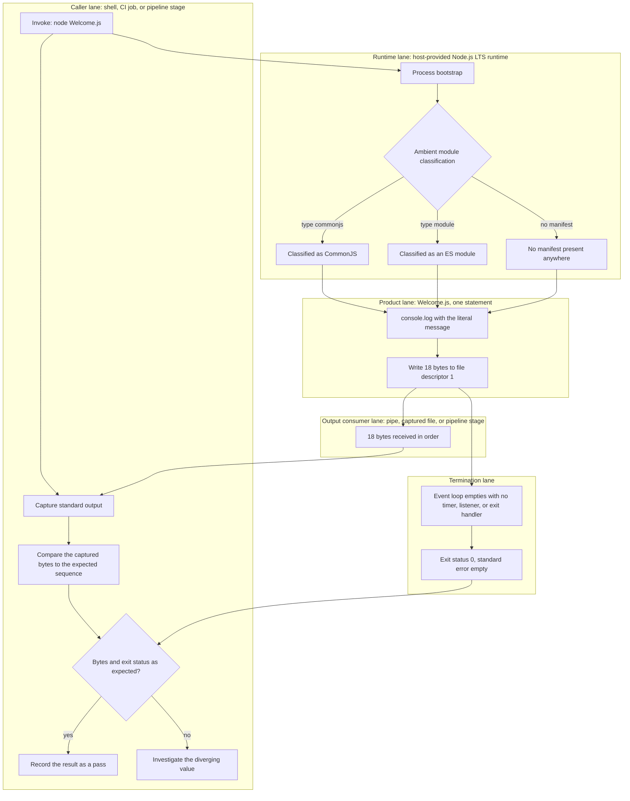

Three properties of the diagram are deliberate. The three classification branches in the runtime lane **converge on the same statement** rather than diverging into separate paths, because the source declares no `import` and no `export`, so classification cannot alter behaviour (F-005-RQ-001). The **drain precedes the verdict** rather than replacing it, because termination is what makes the exit status meaningful. And there is **no lane for the preserved service**, because the product never contacts it, imports it, or shares a file, port, or variable with it (§2.10.3); that surface is modelled separately in §4.2.4.

### 4.2.2 Product Execution Flow (F-001 – F-005)

The product flow runs from the caller's invocation to process exit and crosses four boundaries: the shell, the loader, the statement, and the output stream.

| # | Actor | Step | Requirement | Observed evidence |
|---|---|---|---|---|
| 1 | Caller | Issue `node Welcome.js`, by bare filename, relative path, or absolute path | F-002-RQ-001 | Invocation from the repository root and by absolute path from `/tmp` both produced 18 bytes |
| 2 | Runtime | Locate and load the entry file | F-004-RQ-003 | Working-directory independence confirmed; a foreign working directory with a relative name fails at this step |
| 3 | Runtime | Parse the 34 bytes of source; syntax level is ES5 | F-001-RQ-003 | `node --check Welcome.js` exits `0`, on both the reference and floor runtime lines |
| 4 | Runtime | Resolve the ambient module classification | F-005-RQ-001 | Neutral: identical results under manifests of either type and with none present |
| 5 | Runtime | Execute the single statement — `console.log` applied to the string literal | F-001-RQ-001, F-001-RQ-005 | One statement, one call, no wrapper, guard, or abstraction |
| 6 | Product | Queue the message, 17 characters plus one newline, on file descriptor 1 | F-001-RQ-001 | Captured output is exactly 18 bytes: `57 65 6c 63 6f 6d 65 20 74 6f 20 42 6c 69 74 7a 79 0a` |
| 7 | Product | Flush the stream with nothing registered to outlive it | F-003-RQ-002 | No `process.exit`, timer, listener, or exit handler in the source; a slow reader still received all 18 bytes |
| 8 | Runtime | Empty the event loop and end the process | F-003-RQ-001 | Exit status `0` under a `timeout 10` bound that never fired; standard error empty |
| 9 | Caller | Consume the bytes and the status | F-004-RQ-004 | Five sequential and eight concurrent runs left no residue and modified no tracked path |

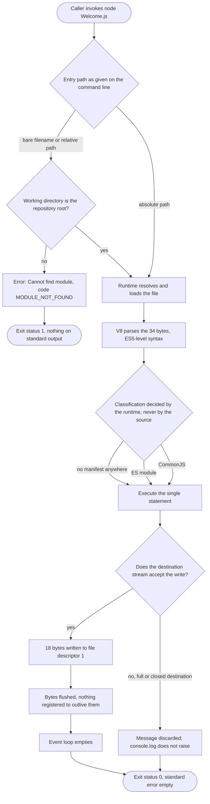

**Decision points in this flow.** Three, and only three. DP-01 resolves the entry path: a bare filename or relative path is resolved against the working directory, so the step fails when the caller is elsewhere, while an absolute path always resolves. DP-02 resolves the classification, and both of its outcomes converge — it is recorded as a decision because it must be shown not to branch. DP-03 asks whether the destination stream accepts the write, and it is the flow's only **silent** failure: `console.log` does not raise when the stream cannot take the bytes, so the message would be lost while the process still reported exit status `0`. This is why acceptance asserts captured bytes rather than the exit status alone (F-007-RQ-002).

**Timing.** The whole flow measured `real 0m0.024s`. Nothing in it waits on the environment, the filesystem, the network, or another process, so its duration is bound by interpreter startup (F-002, F-004).

### 4.2.3 Acceptance Gate Flow (F-007)

The repository carries no test file and no test runner by design — `node --test` reports `tests 0 / suites 0 / pass 0 / fail 0` — so the acceptance gate is the primary verification mechanism rather than a fallback. It is nine commands executed from the repository root, whose combined result decides pass or fail.

| Line | Command purpose | Documented and observed value |
|---|---|---|
| 1 | Parse the source without executing it | `node --check Welcome.js` exits `0`; reported as `parse OK` |
| 2 | Capture the message | `[Welcome to Blitzy]` |
| 3 | Count the bytes from a pipe | `18` |
| 4 | Count the bytes on standard error | `0` |
| 5 | Read the exit status | `exit=0` |
| 6 | Hex-dump the captured bytes | `57 65 6c 63 6f 6d 65 20 74 6f 20 42 6c 69 74 7a 79 0a` |
| 7 | Count the source lines | `1` |
| 8 | Confirm filename casing at the root | `Welcome.js` |
| 9 | Parse every tracked JavaScript file | `Welcome.js` and `server.js` both exit `0` |

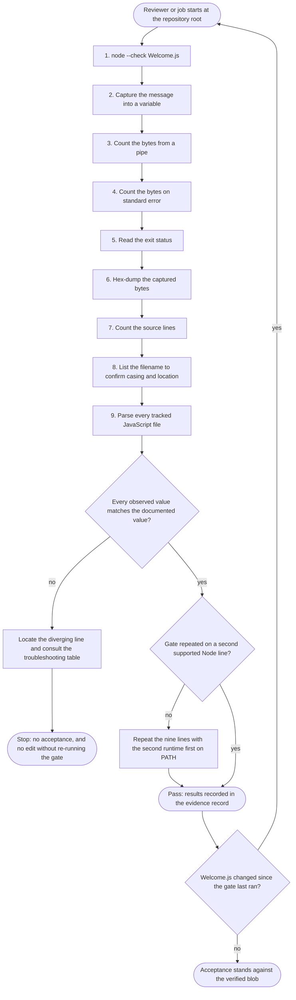

**Decision points.** DP-04 asks whether every observed value matches the documented value; a single mismatch fails the whole gate, because the nine lines are a conjunction rather than a score. DP-05 asks whether the gate has been repeated on a second supported Node line, which is what establishes runtime parity. **Timing.** The gate consists of short-lived processes and completes in seconds, which is what makes the re-entry rule practical.

Two rules govern the flow. The **re-entry rule** (F-007 business rule) sends any change to `Welcome.js` — a changed literal, an added line, a renamed file — back to the start of the flow, because no automated check guards the file. The **capture rule** (F-007-RQ-002) forbids reading a byte count from a terminal: the terminal's newline translation reports 19 bytes instead of 18, a discrepancy recorded as a troubleshooting row rather than a product behaviour.

### 4.2.4 Pre-Existing Service Continuity Flow (F-006)

The preserved service predates the product and is byte-identical to its state in base commit `1484182`. Its flow is documented here for two reasons: it is the only other executable surface in the repository, and the requirement that the product must not impact application performance attaches to it.

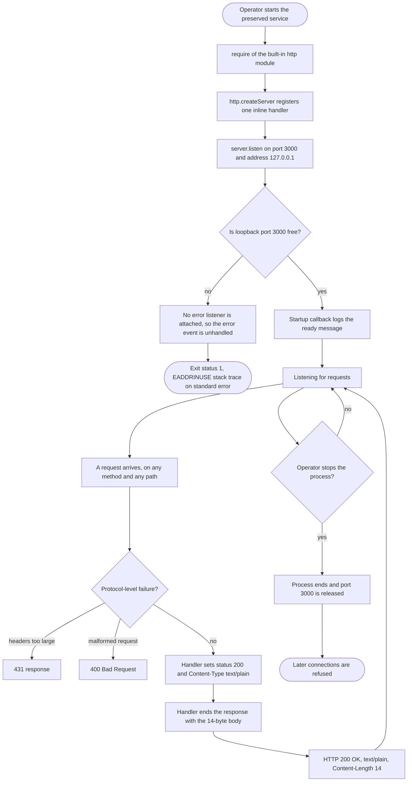

**Steps and observed results.** Startup logs `Server running at http://127.0.0.1:3000/`. Every request is answered identically: `GET /` returned `HTTP/1.1 200 OK`, `Content-Type: text/plain`, `Content-Length: 14` at `time_total=0.004195`; `POST /nope` with a body returned `200`, `text/plain`, 14 bytes at `time_total=0.000497`; `GET /nope` also returned `200`. An oversized header produced `431` and a malformed request line produced `400 Bad Request`. A second start exited `1` with `Error: listen EADDRINUSE: address already in use 127.0.0.1:3000`. After the process was stopped, a later connection was refused (`curl` exit `7`), confirming the port is released.

**Decision points.** DP-06 asks whether the port is free at bind time; because `server.js` attaches no `'error'` listener to the listener, the negative branch is an unhandled error event whose only diagnostic is a stack trace. DP-07 asks whether the request is well-formed at the protocol level, which is decided by Node's `http` module rather than by application code — the handler itself distinguishes nothing. DP-08 asks whether the operator has stopped the process.

**Continuity obligation and its evidence.** The service must keep working exactly as before while the product is added, so the flow's true test is comparative rather than absolute: with the service running, the product produced its 18 bytes and the next request still returned `200` at `time_total=0.000494`; the record states that medians stayed at or below the idle baseline with no failed request and stable memory, thread, and descriptor counts (`Project Guide.md` §4). The file's own hardening gaps — no listener error handler, no `SIGTERM`/`SIGINT` drain, hardcoded bind address, undifferentiated handler — remain open and out of scope (F-006-RQ-001).

### 4.2.5 Governance Decision Flow (F-008)

This flow has no runtime artifact, no code path, and no observable output; it is documented because it is the one item in the repository that is not closed, and because a reader of the process model will otherwise look for it among the executable flows.

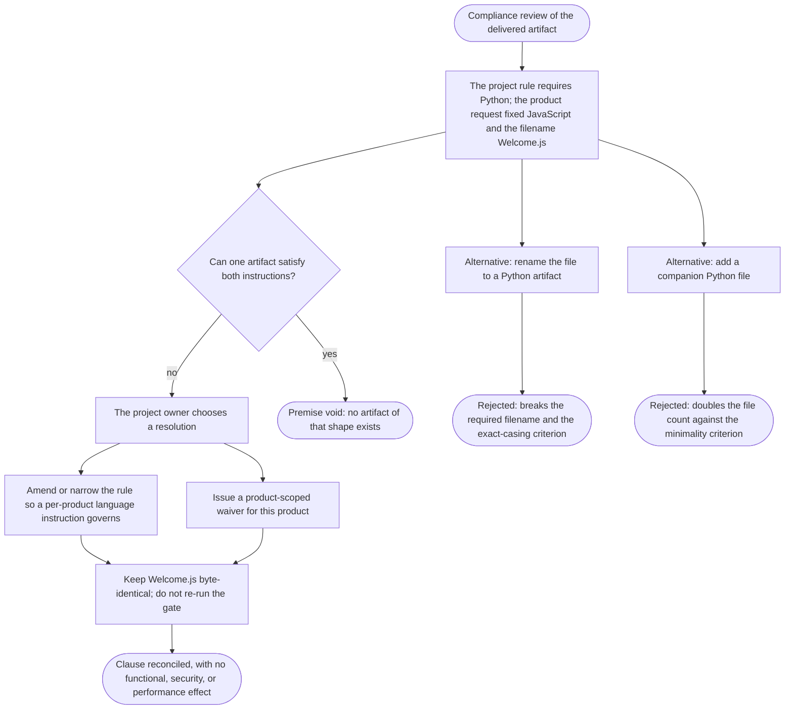

**Decision point.** DP-09 asks whether one artifact can satisfy both instructions at once. It cannot: a `.js` file cannot hold runnable Python, renaming it breaks the required filename, and shipping a companion `.py` file doubles the file count against a minimality criterion the request stated outright. The clause is therefore unmet by recorded decision rather than by oversight, and the flow terminates in a wording decision whose outcome leaves `Welcome.js` untouched in every branch. The unresolved item is tracked at 1.0 hour of the 2.5 remaining hours in the project ledger, and its impact is governance-only.

### 4.2.6 Decision Points and Error Paths

The ten decision points across all four flows are catalogued below, followed by every error path observed in the system.

| ID | Flow | Decision point | Positive branch | Negative branch | Requirement |
|---|---|---|---|---|---|
| DP-01 | Product execution | Is the entry file resolvable from the current working directory? | Load and continue | `MODULE_NOT_FOUND`, exit `1` | F-004-RQ-003 |
| DP-02 | Product execution | How does the runtime classify the file? | All three outcomes converge on the same execution | None — no branch diverges | F-005-RQ-001 |
| DP-03 | Product execution | Does the destination stream accept the write? | 18 bytes on descriptor 1 | Message discarded silently; exit status still `0` | F-001-RQ-001 |
| DP-04 | Acceptance gate | Do all nine observed values match the documented values? | Pass recorded | Diagnose via the troubleshooting table | F-007-RQ-001 |
| DP-05 | Acceptance gate | Has the gate been repeated on a second supported runtime line? | Acceptance stands | Repeat the nine lines | F-007-RQ-001 |
| DP-06 | Service | Is loopback port `3000` free at bind time? | Ready message logged, request handling begins | Unhandled error event, exit `1` | F-006-RQ-004 |
| DP-07 | Service | Is the request well-formed at the protocol level? | Inline handler answers `200` | `431` or `400`, produced by the `http` module | F-006-RQ-002 |
| DP-08 | Service | Has the operator stopped the process? | Port released; later connections refused | Keep serving | F-006-RQ-004 |
| DP-09 | Governance | Can one artifact satisfy both governing instructions? | Premise void | Owner amends/narrows the rule or waives it | F-008 |
| DP-10 | Delivery | Are `README.md` and `server.js` byte-identical to base `1484182`? | Continuity holds | The change exceeds scope and fails the continuity criterion | F-006-RQ-001 |

| Flow | Trigger | Observed symptom | Exit status | Recovery |
|---|---|---|---|---|
| Product | Runtime absent from `PATH` | `/bin/sh: 1: node: not found` on standard error | `127` | Install a supported LTS line, or invoke the interpreter by its full path |
| Product | Entry file not resolvable | `Error: Cannot find module ...`, `code: 'MODULE_NOT_FOUND'`, `requireStack: []` | `1` | Run from the repository root, or pass an absolute path |
| Product | Filename casing wrong | `Cannot find module '.../welcome.js'` | `1` | Use the exact casing `Welcome.js`; the mistake is masked on a case-insensitive filesystem and fails on Linux |
| Product | Destination stream full or closed | No diagnostic at all; message discarded, standard error empty | `0` | Assert the captured bytes, never the exit status alone |
| Verification | Byte count read from a terminal | `19` reported instead of `18` | `0` | Count from a pipe or a captured file |
| Verification | Automated suite expected | `node --test` reports `tests 0 / suites 0` | `0` | Use the nine-line gate; the empty suite is intentional |
| Service | Port `3000` already bound | `Error: listen EADDRINUSE: address already in use 127.0.0.1:3000`, unhandled error event | `1` | Stop the earlier instance; no configuration override exists |
| Service | Request headers too large | `431` response | n/a | Pre-existing protocol behaviour of the runtime; raising the limit is outside scope |
| Service | Malformed request line | `400 Bad Request` | n/a | Pre-existing protocol behaviour of the runtime; the handler has no error path |
| Service | Process stopped | Connection refused (`curl` exit `7`) | n/a | Restart the service; the port is released on exit |
| Service | Shutdown with requests in flight | No drain occurs; no `SIGTERM`/`SIGINT` handler exists | n/a | Accepted pre-existing gap, recorded as an owner decision |
| Delivery | Untracked artifacts before staging | `git status` lists them | n/a | Stage `Welcome.js` by name instead of with a blanket add; in this checkout the tree is clean and no untracked captures exist |

The pattern across all twelve rows is worth stating plainly: **the product itself has no error-handling code, so every failure path in this table originates outside it** — in the shell, in the module loader, in the output stream's consumer, in Node's `http` module, or in the reviewer's method. A token scan of `Welcome.js` for `import`, `export`, `require`, `process`, `argv`, `env`, `setTimeout`, `setInterval`, `addListener`, and `.on(` returns zero matches, so the source contains no branch of any kind, error or otherwise.

## 4.3 Integration Workflows

The repository's integration surface is deliberately minimal: one outbound byte stream, one inbound loopback socket, and a version-control remote used once at delivery time. There is no data flow between the product and the preserved service, no API contract between the product and anything, no event-driven integration, and no batch integration. Each is documented below, and where the answer is "none" the evidence that settles it is given.

### 4.3.1 Data Flow Between Systems

Three flows carry data, and all three carry fixed, unrepeated byte sequences.

| # | Flow | Source of the data | Transformation | Destination | How it is validated |
|---|---|---|---|---|---|
| 1 | Product output contract | The string literal inside `Welcome.js:1` | None. `console.log` appends one newline and writes | File descriptor 1 of the product process | Byte comparison of a capture against the expected sequence |
| 2 | Loopback HTTP response | Two string constants and one response literal at `server.js:3-9` | None. The handler discards the entire request | The connected TCP peer | Status line, `Content-Type`, `Content-Length` and body compared across two methods and paths |
| 3 | Delivery of the artifact | The committed content of `Welcome.js` | Git object storage, then the hosting API | The mainline tree at merge commit `39974fd` | `git diff --name-status 1484182 HEAD` and the recorded blob hash |

The most consequential property of flow 1 is what it does **not** contain. The product does not read the file that contains it, does not read a configuration file, a query, a record, or a parameter, and does not transform what it emits: the literal in the source is the entire data universe of process 1, so the output is fixed at build time rather than computed at run time. There is therefore no schema, no serialisation format, no message envelope, and no protocol to version, and the only negotiation with the consumer is that the consumer can read a stream.

Flow 2 has the complementary property: the handler reads the request and discards every byte of it. Method, path, headers, and body all end at `server.js:6-10` without being stored, forwarded, logged, or branched on, so no request content reaches any state at all — verified by `GET /`, `GET /nope`, and `POST /nope` with a body all returning the same `200 text/plain` response.

No data store appears in any of these flows. The product writes nothing to disk, the service retains nothing beyond the bytes it is currently sending, and no two actors in §4.1.1 share a file, table, queue, cache, or stream. The one boundary worth naming is directional: the output stream is a trust boundary in the outbound direction only, since the product writes to it and never reads from it.

### 4.3.2 API Interactions

Two integration endpoints exist in the whole system, and only one of them is a network API.

**The product's integration point is a stream, not an API.** Its contract has four clauses, each decided by comparison rather than judgement: 18 bytes on standard output, nothing on standard error, exit status `0`, and no other observable effect. There is no request, no response, no handshake, no content negotiation, no framing beyond byte order, no authentication, and no versioning.

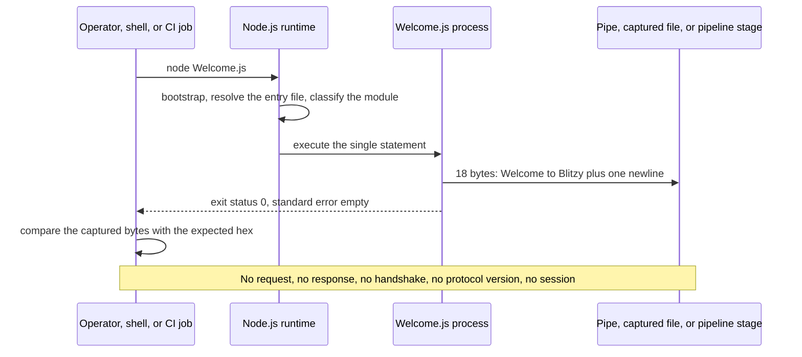

Any consumer able to read a pipe or capture a stream satisfies that contract — `wc -c`, `od`, a shell variable, a pipeline stage, or a CI step (`Project Guide.md` §9.6) — and no contract exists with any specific downstream system.

**The preserved service exposes one route that accepts every request.** It is reached only over loopback, and its response does not depend on what arrives.

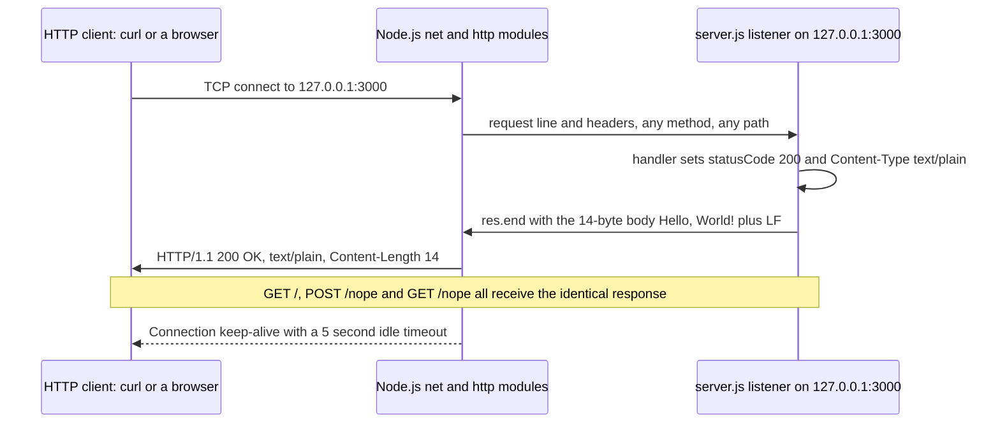

| Interaction | Direction | Transport | Contract | Failure responses | Requirement |
|---|---|---|---|---|---|
| Product standard output | Outbound | Anonymous pipe, captured file, terminal, or pipeline stage | 18 fixed bytes; empty standard error; exit status `0` | None produced by the product itself | F-001-RQ-001, F-003-RQ-001 |
| Service request handling | Inbound | HTTP/1.1 over loopback TCP | Any request receives `200`, `text/plain`, 14-byte body | `431` for oversized headers, `400` for a malformed request line, both from the `http` module | F-006-RQ-002 |
| Service startup notification | Outbound | Standard output | One line naming the bind address | `EADDRINUSE` stack trace and exit `1` when the port is taken | F-006-RQ-002, F-006-RQ-004 |
| Version-control remote | Outbound, delivery time only | HTTPS to the hosting API | Branch publication and pull request | Not exercised at run time; the merge landed as `39974fd` | F-007-RQ-003 |

There is **no API between the product and the service** in either direction. The product binds no port and exposes no server (`Project Guide.md` Appendix B), so nothing can call it; it never opens a socket, so it calls nothing; and the service neither reads nor invokes `Welcome.js`. The two agree only on the host runtime that executes them.

### 4.3.3 Event Processing Flows

**None exist, and the design makes them impossible without a scope change.** The product registers no listener, emits no event, publishes no message, and subscribes to no topic: a token scan of `Welcome.js` for `addListener` and `.on(` returns zero matches, and the file's single statement admits no asynchronous construct of any kind. There is no event bus, broker, queue, webhook, stream processor, or signal handler anywhere in the tree — a repository-wide sweep for shell, JSON, YAML, TOML, INI, lock, and XML artifacts returns zero files, and no `.github` directory exists, so no CI workflow, scheduled job, or repository hook fires on any event either.

The nearest thing to event processing is the request event that Node's `http` module delivers to the inline handler at `server.js:6` — one callback invoked once per request, with no ordering guarantee, delivery semantics, or retry policy to define. It is documented as an API interaction in §4.3.2 rather than as a product flow.

The consequence for the process model is that **the system has no asynchronous edge**. No path can complete after the caller has stopped observing the process, there is no queue to drain, and no delivery, ordering, or at-least-once semantics exist to be argued about. That is a design property the acceptance criteria depend on rather than an unmodelled area.

### 4.3.4 Batch Processing Sequences

**None exist.** The repository contains no scheduler, no cron entry, no job definition, no queue consumer, no CI workflow, no container image, and no dataset: the non-`.git` tree is exactly four files, and sweeps for YAML, JSON, container, and environment-file artifacts return nothing. The product processes no records, accepts no input, and has no notion of a batch boundary — every run is a single self-contained execution that reads nothing and writes 18 bytes.

The only repeated execution in the repository is the **manual re-running of the acceptance gate** after a change (§4.2.3). That is iterative, human-driven verification rather than a batch sequence: it has no batch size, no cursor, no checkpoint, and no resume semantics, and each pass is independent of the previous one.

Two properties that batch flows normally demand are therefore inapplicable, and for the same reason. There is no **idempotency** requirement, because there is no state a repeat could corrupt — five sequential runs and eight concurrent runs each produced identical bytes and left `git status --porcelain -uall` reporting zero lines. And there is no **partial-failure or resume** semantics, because no work unit smaller than the whole process exists. The one partial outcome the runtime permits is DP-03, where the destination stream refuses the write; that outcome is terminal, unobservable from the exit status, and recoverable only by the consumer, which is why acceptance asserts captured bytes (§4.2.2).

### 4.3.5 Integration Timing Summary

| Flow | Observed or recorded timing | Nature |
|---|---|---|
| Product standard output | `real 0m0.024s` end to end | Measured; bounded by runtime bootstrap |
| Product output durability | All 18 bytes delivered to a reader that slept 2 s | Measured; confirms no truncation |
| Service request handling | `time_total=0.004195` and `0.000497` | Measured; a non-impact baseline, not a latency budget |
| Service connection retention | `Keep-Alive: timeout=5` | Runtime default owned by the `http` module |
| Acceptance gate | Nine short-lived processes; `# duration_ms 12.27` reported for the empty suite | Measured; seconds at human scale |

No queue depth, throughput figure, backpressure limit, request-rate limit, or timeout policy is defined anywhere in the repository, and none exists.

## 4.4 Flowchart Requirements

This sub-section states, for every workflow in §4.2 and §4.3, the elements a flowchart of it must show, the rules that govern the values flowing through it, and the checkpoints at which those rules are enforced.

### 4.4.1 Element Catalog per Workflow

The diagrams in this section use five Mermaid element types, each with one meaning.

| Element | Mermaid form | Meaning in Section 4 |
|---|---|---|
| Start or end point | `(["label"])` | A point at which the workflow begins or terminates |
| Process step | `["label"]` | An action performed by the actor owning the lane |
| Decision point | `{label}` | A branch with exactly one condition and labelled outcomes |
| Swim lane | `subgraph ... end` | An actor or system boundary; the lane is the system boundary |
| Message or invariant | `participant`, `->>`, `-->>`, `Note over` | A message exchange in a sequence diagram, or a boundary the diagram cannot express as a message |

Every workflow is catalogued against the seven required elements.

| Workflow | Start point | End points | Process steps | Decision diamonds | System boundary | User touchpoints | Error states and recovery |
|---|---|---|---|---|---|---|---|
| Product execution, Figure 4-2 | Caller invokes `node Welcome.js` | Exit `0` after 18 bytes; exit `1` before any output | 9 steps (§4.2.2) | DP-01 entry resolution, DP-02 module classification, DP-03 stream acceptance | One operating-system process; descriptors 0, 1 and 2 only; no file, socket, or child process | The invocation command, the captured output, and the exit status | `MODULE_NOT_FOUND` → correct the path or casing; `127` → supply a runtime; silent loss on DP-03 → assert captured bytes rather than the status |
| Acceptance gate, Figure 4-3 | Reviewer or job starts at the repository root | Pass recorded; or no acceptance, with no edit permitted | 9 command lines, each on a short-lived process | DP-04 all values match, DP-05 second-line parity | Shell over a read-only view of the repository; `node --check` parses without executing | Execution and result-reading by a reviewer or job; no machine-readable result channel inside the repository | Divergence → locate the line and consult the troubleshooting table; any change to the file re-enters at the start |
| Service continuity, Figure 4-4 | Operator starts the service | Operator stops it and port `3000` is released | 4 startup steps and 4 request-handling steps | DP-06 port availability, DP-07 protocol validity, DP-08 stop signal | One inbound loopback TCP listener on `127.0.0.1:3000`; no outbound connection and no TLS | The startup log line, and the response body in a browser or client | `EADDRINUSE` → stop the earlier instance, as no configuration override exists; `400` and `431` → runtime protocol behaviour with no application path; stop → connection refused |
| Governance, Figure 4-5 | Compliance review of the delivered artifact | Clause reconciled, with the file untouched | Review, choose a resolution, keep the artifact byte-identical | DP-09 can one artifact satisfy both instructions? | Organisational; no runtime path and no executable artifact | The owner's decision, recorded outside the artifact | Renaming and companion-file alternatives are enumerated and rejected with their reasons |

Two entries in the table are deliberately sparse. The **governance workflow has no runtime steps, boundaries, or touchpoints**, because nothing in the repository can execute it. And the flows promised by the process taxonomy for **event processing and batch processing do not appear at all**, because the system has no asynchronous edge and no work unit smaller than a whole process (§4.3.3, §4.3.4); a diagram of either would be a diagram of nothing.

Start and end points follow three conventions throughout. A workflow ends **successfully only where the evidence says so** — exit `0` for the product, a recorded pass for the gate, a released port for the service. It ends **unsuccessfully in a named, observed state** — exit `1` with `MODULE_NOT_FOUND`, exit `1` with an `EADDRINUSE` trace, exit `127` when the runtime is absent. And the **caller always owns the terminal verdict**: the product's flow ends at exit, and the caller's comparison of the captured bytes is a separate step in the caller's lane (Figure 4-1), which is what keeps a silent DP-03 failure from being recorded as a pass.

### 4.4.2 Validation Rules and Checkpoints

**Business rules at each step.** Nine rules bind the flows, and each is enforced at a point that can be named.

| # | Business rule | Where it binds | Enforcement | Evidence |
|---|---|---|---|---|
| 1 | The output must be byte-exact, never approximate or localised | Product step 6 | Byte comparison of a capture | Captured output is exactly 18 bytes |
| 2 | The message is a literal and is not parameterisable; configurability is not a supported use case | Product steps 1–5 | No input channel exists to supply a value | Token scan for `process`, `argv`, `env` returns 0 matches |
| 3 | One statement on one line: 34 bytes, single-quoted literal, terminating semicolon, no indentation, no comment | Product step 3 | Reading the single line | `wc -l -c Welcome.js` returns `1 34` |
| 4 | Exactly one path may be added by the deliverable | Delivery | Added-path diff against base | `git diff --name-status 1484182 HEAD` returns `A Welcome.js` plus the evidence record |
| 5 | No manifest, lockfile, or `node_modules` in the repository or in any ancestor directory | All product steps | Repository sweep plus an ancestor walk to `/` | Zero hits for `package.json`, `package-lock.json`, `node_modules` |
| 6 | No input channel of any kind: no argument, standard input, environment variable, file, or socket | Product steps 1–5 | Structural — the source contains no read of any kind | Identical output under extra arguments, piped input, `env -i`, and an absolute path from `/tmp` |
| 7 | No `process.exit()`, timer, listener, or exit handler | Product step 7 | Structural, plus a bounded run | `timeout 10` never fired; exit status `0` |
| 8 | `README.md` and `server.js` must remain byte-identical to base `1484182` | Delivery | Diff against base, plus a live request | No change to either path; the service still answers `200 text/plain` |
| 9 | No test file, runner, CI workflow, container, or configuration artifact may be added | All flows | Repository sweep for each excluded class | Zero hits; `node --test` reports 0 tests by design |

**Data validation requirements.** Six requirements govern how the values above are verified; five of them exist because a plausible shortcut produces a wrong answer.

| # | Requirement | Why it exists |
|---|---|---|
| 1 | Byte counts must come from a pipe or a captured stream, never from a terminal | The terminal's newline translation reports 19 bytes instead of 18 |
| 2 | The exit status alone is insufficient evidence of success | `console.log` does not raise when the destination cannot accept the write, so DP-03 loses the message while the process still exits `0` |
| 3 | Independence must be validated differentially — extra arguments, piped input, an empty environment, and a foreign working directory each captured separately | A single passing run cannot distinguish independence from luck |
| 4 | Classification must be validated on copies outside the repository | A probe manifest inside the tree would itself breach the manifest-free criterion |
| 5 | Continuity must be validated twice — bytes by diff and behaviour by a live request | A diff proves the file is unchanged; only a request proves the behaviour still matches |
| 6 | For excluded artifacts, the required result is a negative: absence is proven by exhaustive sweep, not by reading a declared list | Nothing declares what is absent, so only a sweep can establish it |

**Validation checkpoints in the product and delivery flows.** Each checkpoint is a point at which the flow can be stopped.

| Checkpoint | Trigger | Validated value | Consequence of failure |
|---|---|---|---|
| Entry resolution | DP-01 | The entry file is found | `MODULE_NOT_FOUND`, exit `1` |
| Parse | After product step 3 | `node --check` exits `0` with no output | `SyntaxError`, exit `1` |
| Statement shape | Reading the file | One statement, 34 bytes, single trailing LF | Minimality criterion fails |
| Output bytes | Product step 6 | 18 bytes matching the expected hex | Acceptance fails |
| Standard error | Product step 7 | 0 bytes | Acceptance fails |
| Exit status | Product step 8 | `0` | Acceptance fails |
| Residue | After product step 8 | `git status --porcelain -uall` returns 0 lines | Isolation criterion fails |
| Runtime parity | Gate DP-05 | Byte-identical results on both supported lines | Parity claim fails |
| Continuity | Delivery, DP-10 | `README.md` and `server.js` unchanged | Continuity criterion fails, and the change exceeds scope |

### 4.4.3 Authorization and Compliance Checkpoints

**There is no authorization checkpoint anywhere in the system's runtime flows, and that is a design property rather than a gap.** The product reads no credential, identity, token, or role; it opens no socket and therefore authenticates no peer; it reads no environment variable, so it holds no secret to compare against; and it operates on no protected resource — it writes 18 bytes to the calling process's own standard output. The service likewise has no authentication, no TLS, no session, and no request-body handling, which is why it is characterised as a demonstration listener rather than a production service. There is therefore nothing to authorise in either executable flow, and no authorization rule is missing from the diagrams.

The checkpoints that do constrain access are all non-runtime.

| Checkpoint | Nature | Effect |
|---|---|---|
| Loopback bind on `127.0.0.1:3000` | Network reachability constraint fixed by constants at `server.js:3-4` | The listener cannot be reached from off-host; a stopped process causes connections to be refused (`curl` exit `7`) |
| File mode `0644` on every tracked path | Filesystem permission | Files are readable but not executable; no path in the tree has an executable bit set, and no file begins with a shebang |
| Reviewer's right to run the acceptance gate | Process-level, outside the repository | The gate is read-only with respect to the tree, and nothing inside the tree governs who may run it |
| Owner's authority over the language clause | Organisational, governed by F-008 | Only the owner can reconcile the clause; no code path in the repository can change its status |
| Merge authority on the remote | Delivery-time, exercised through the hosting API | The change reached the mainline as PR #15 merged by the QA identity rather than by a local merge (`Project Guide.md` §6; merge commit `39974fd`) |

**Regulatory and compliance checks.** The repository records no external regulatory regime: no personal, financial, or health data is present or processed, no export-control or licensing artifact exists, and the product consumes no personal or sensitive data at all (F-001 data requirements). The compliance obligations that do constrain the flows are internal and enumerated in the twelve-row matrix of `Project Guide.md` §5.1, of which eleven rows pass and the twelfth is recorded as not met by decision.

| Compliance checkpoint | Flow it constrains | Status |
|---|---|---|
| Exact message on a user-visible channel | Product execution | Pass |
| Filename exactly `Welcome.js`, at the repository root | Product execution, delivery | Pass |
| JavaScript implementation | Product execution | Pass |
| Self-termination with success status | Product execution | Pass |
| Minimal line count, one statement | Product execution, delivery | Pass |
| Simple and readable, with no abstraction | Product execution | Pass |
| Runs as written, with no install, build, or transpile step | Product execution | Pass |
| Application performance not impacted | Service continuity | Pass |
| Each flow and feature clearly separated | All flows | Pass |
| Module-system independence, with no local module configuration | Product execution, delivery | Pass |
| Excluded artifacts absent | All flows | Pass |
| Project rule — new products in Python | Governance (§4.2.5) | Not met, by recorded decision |

Two further checkpoints sit at the delivery boundary rather than inside a runtime flow: the continuity comparison of `README.md` and `server.js` against base commit `1484182` (DP-10), and the added-path count, which must be exactly one deliverable path. Both hold in this checkout — `git diff --name-status 1484182 HEAD` returns `A Welcome.js` and `A blitzy/documentation/Project Guide.md`, and no other path is touched. The second of these is the checkpoint a blanket `git add` would breach, which is why the record directs that `Welcome.js` be staged by name.

## 4.5 Technical Implementation

The technical realisation of the process model follows from one fact: neither executable holds any state. `Welcome.js` declares no variable, class, or function (F-001-RQ-005), and `server.js` declares two string constants and one response literal, with an inline handler that ignores its request entirely. What follows documents the state and error behaviour that do exist, and names each category that does not exist along with the evidence that establishes its absence.

### 4.5.1 State Management

**State transitions.** Two processes have a lifecycle worth diagramming. The product's process passes through four distinguishable states, of which only two are externally observable.

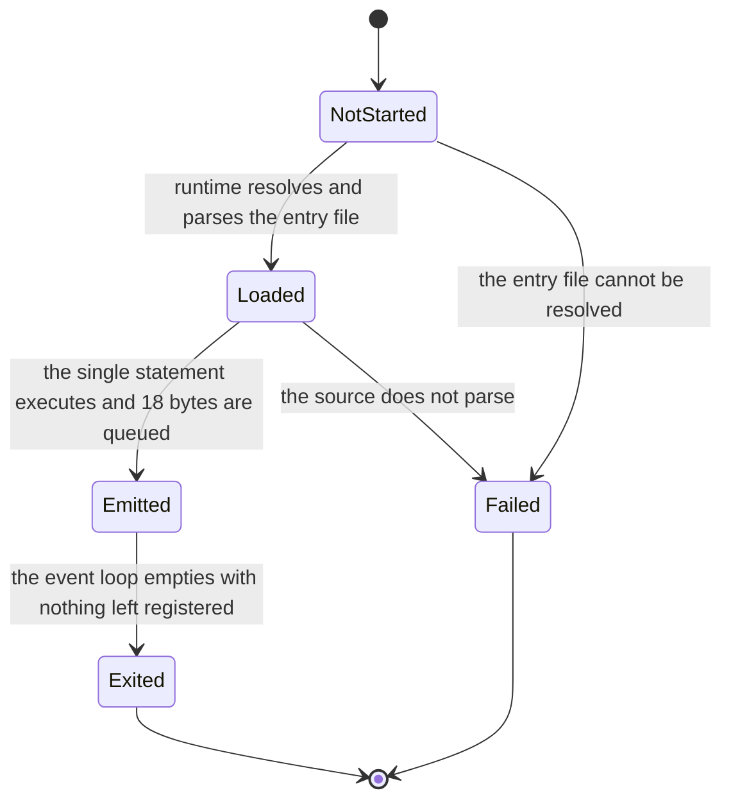

The preserved service's lifecycle is the repository's only long-lived one, and its failure branch is reached before any request is handled.

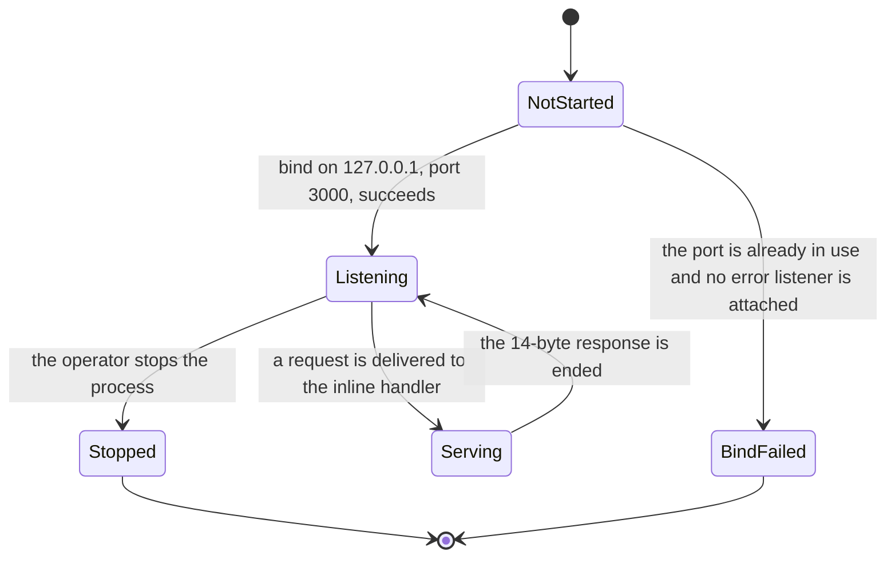

| Process | State | Observable from outside? | Entry condition | Exit condition | Evidence |
|---|---|---|---|---|---|
| Product | NotStarted | Yes, as a running process | The caller invokes `node Welcome.js` | The runtime resolves the entry file | Any of the five invocation contexts tested |
| Product | Loaded | No | The file is resolved and parsed | The single statement executes | `node --check` exits `0`; no diagnostic is emitted |
| Product | Emitted | Yes, as 18 bytes on descriptor 1 | The statement executes | The event loop empties | Captured output is exactly 18 bytes |
| Product | Exited | Yes, as exit status `0` | The loop is empty | Process end | `timeout 10` returned `0` and never fired |
| Product | Failed | Yes, as exit status `1` plus a stack trace | The file is unresolvable or unparsable | Process end | `MODULE_NOT_FOUND` observed with exit `1` |
| Service | NotStarted | Yes, as a running process | The operator invokes `node server.js` | The bind succeeds or fails | Startup log observed |
| Service | Listening | Yes, through a successful connection | The bind succeeds | A request arrives, or the process is stopped | `Server running at http://127.0.0.1:3000/` |
| Service | Serving | Yes, as a response | A request is delivered | The response is ended | `200`, `text/plain`, 14 bytes |
| Service | BindFailed | Yes, as exit status `1` plus a stack trace | The port is already bound | Process end | `EADDRINUSE`, `errno -98` |
| Service | Stopped | Yes, as a refused connection | The process ends | — | `curl` exit `7` after the process was stopped |

Three notes qualify the diagrams. **No transition carries a payload**: no state holds data forward, so the product's `Emitted` state contains the 18 bytes being flushed and nothing else, and the service's `Serving` state contains only the response being written. **The product's failure branch is reachable only before the write**, so a product run either produces the full message or produces no output at all. And **`Serving` returns to `Listening` on every request** because the handler retains nothing between requests — there is no session, no cursor, and no accumulation.

**State variables.** There are none. A token scan of `Welcome.js` for `process`, `argv`, and `env` returns zero matches, and the file declares no variable at all. `server.js` declares exactly two: the `hostname` and `port` constants at lines 3–4, both read once at `listen` time. Nothing is written after startup in either program.

**Data persistence points.** There are none at run time, and this is asserted rather than assumed. The product writes no file, opens no socket, and creates no temporary artifact; five sequential runs and eight concurrent runs left `git status --porcelain -uall` reporting zero lines, so no path was created or modified. The service writes only its one startup line to standard output and persists nothing — no access log, no request log, and no store.

Persistence does occur at two points outside run time, and they are the only ones in the system.

| Persistence point | What is stored | Where | Verified by |
|---|---|---|---|
| Commit `1cef465` | The 34 bytes of `Welcome.js` as a git blob | Git object store | The tracked blob hashes to `58a5dcab90815d7b1db080e39613e7711f5854e0` |
| Commit `4d1256c` | The evidence record, 381 lines and 35,992 bytes | `blitzy/documentation/Project Guide.md` | `git ls-files`; the file is tracked at mode `0644` |

**Caching requirements.** There is no cache in the system, and none is required. No cache tier, cache directory, or precomputed artifact exists; the repository contains no `node_modules` or any other resolution cache; the service emits no `ETag`, `Last-Modified`, or `Cache-Control` header, so nothing downstream caches its response; and the product's output is regenerated from a source literal on every run rather than retrieved. The one piece of retained state observed anywhere in the system is a **per-connection keep-alive timer**: the service's responses carry `Connection: keep-alive` and `Keep-Alive: timeout=5`, so Node's `http` module retains a connection for up to five seconds of idleness. That timer belongs to the runtime rather than to `server.js`, which registers no timer of its own.

**Transaction boundaries.** There is no transaction, no commit or rollback, and no isolation level to choose, because no shared mutable resource exists. The nearest equivalent is the boundary of a single write: a product run is atomic in the sense that the message either reaches the stream in full or is lost entirely, and there is no compensating action for the lost case — a recovery that the source cannot perform, which is why DP-03 is verified from outside the process (§4.2.2).

Concurrency follows the same shape. Every product run is an independent process with its own file descriptor 1 and no shared resource, so N concurrent runs cost N processes and yield N identical results; eight concurrent runs were observed to each print the message with no interference, and the record notes that medians for the service's request latency stayed at or below the idle baseline while the product ran. In the service, each request is handled independently by a handler that writes no shared state, so no lock, queue, or ordering guarantee is involved.

### 4.5.2 Error Handling

**Retry mechanisms.** None exist in either executable. The product makes one attempt and exits; the service answers a request once and returns to listening. There is no retry loop, no backoff, no jitter, no circuit breaker, and no retry budget anywhere in the tree. The only repetition in the system is caller-driven: the acceptance gate is re-run after a change to the file (§4.2.3), and a caller may resubmit an HTTP request to the service knowing that the handler is stateless and that a repeat is harmless.

**Fallback processes.** None exist. There is no degraded mode, no default response, no alternative path taken when the primary one fails, and no cached answer to serve. Every failure in the system is terminal for the process that experiences it: an unresolvable entry file, a parse error, and a refused stream write all end the product without an alternative, and a port that is already bound ends the service before it serves anything. Introducing a fallback would require adding a branch, which the one-statement ceiling forbids (F-001-RQ-003, F-001-RQ-005).

**Error notification flows.** The product emits nothing on standard error on any path it controls, which is itself an acceptance criterion (F-001-RQ-004). Every diagnostic in the system therefore originates outside the product, on standard error, and is paired with a non-zero exit status.

| Failure | Origin of the notification | Message | Exit status |
|---|---|---|---|
| Runtime absent from `PATH` | The shell | `/bin/sh: 1: node: not found` | `127` |
| Entry file unresolvable | Node's CommonJS loader | `Error: Cannot find module ...` with `code: 'MODULE_NOT_FOUND'` and `requireStack: []` | `1` |
| Source does not parse | V8 | `SyntaxError` with a position and a code frame | `1` |
| Destination stream refuses the write | Nothing | No message at all; standard error remains empty | `0` |
| Port already bound | Node's event loop | `Unhandled 'error' event` with `Error: listen EADDRINUSE ...` and a stack trace | `1` |
| Request malformed or oversized | Node's `http` module | An HTTP response (`400` or `431`) to the client, with no application diagnostic | Process continues |
| Acceptance divergence | The reviewer's comparison | The observed value differs from the documented value | n/a |

The last row matters as much as the others: because the product emits no diagnostic on its own failure path and because `node --test` reports zero tests, **the notification channel for a product defect is the reviewer's comparison of a captured value against the documented one**, supported by the troubleshooting table in the evidence record. Nothing in the repository alerts anyone automatically.

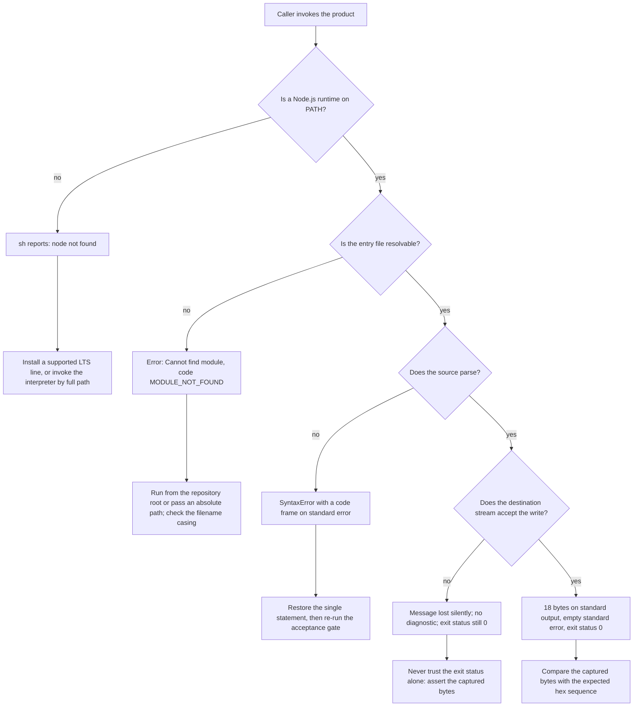

**Recovery procedures.** Every recovery in this system is performed by a caller or an operator, because no process in the repository contains error-handling code. The procedures are correspondingly concrete, and each is tied to the failure it addresses.

| Recovery | Applies to | Action | Requirement it restores |
|---|---|---|---|
| Correct the invocation path | `MODULE_NOT_FOUND` from a foreign working directory | Run from the repository root, or pass the file's absolute path | F-004-RQ-003 |
| Correct the filename casing | `MODULE_NOT_FOUND` from `node welcome.js` | Use the exact casing `Welcome.js`; the mistake is masked on a case-insensitive filesystem and fails on Linux | F-001-RQ-002 |
| Supply a runtime | `node: not found`, exit `127` | Install a supported LTS line, or invoke the interpreter by its full path | F-002-RQ-001 |
| Assert captured bytes instead of the status | A lost message on DP-03 | Capture the stream and compare the bytes; treat the exit status as necessary but not sufficient | F-007-RQ-002 |
| Count from a capture, not a terminal | A reported count of 19 instead of 18 | Pipe the output or redirect it to a file before counting | F-007-RQ-002 |
| Stop the earlier instance | `EADDRINUSE` on a second service start | Stop the process holding port `3000`; no configuration override exists, because the bind is hardcoded | F-006-RQ-004 |
| Re-run the gate | Any change to `Welcome.js` | Repeat the nine documented lines, on both supported runtime lines, and record the results | F-007 business rule |
| Revert the file | A failed gate after an edit | Restore the single statement; the repository holds no other copy to fall back on | F-001-RQ-003 |
| Stage by name | Untracked artifacts before a commit | Stage `Welcome.js` explicitly rather than with a blanket add, so the one-added-file criterion cannot be breached | Minimality criterion |

Two of these are stated in the negative and should be read as rules rather than remedies. There is **no recovery from a lost message inside the product**, because the write is the last thing it does and detection is impossible from the exit status. And there is **no recovery from an unrecorded acceptance run**: with no automated suite, an edit that passed locally but was never gated leaves no evidence, which is why the record requires the gate to be re-run rather than to be trusted to have been run.

## 4.6 Required Diagrams and Coverage

Every diagram class this specification requires is present in Section 4. This sub-section indexes them, states which classes are not applicable and the evidence that settles that, and traces each figure to the requirements it illustrates.

### 4.6.1 Diagram Index

| Required diagram class | Figure | Sub-section | Scope of the figure |
|---|---|---|---|
| High-level system workflow | Figure 4-1 | 4.2.1 | Five lanes — caller, runtime, product, output consumer, termination — with the classification branches converging and the drain preceding the caller's verdict |
| Detailed process flow — core product features F-001 – F-005 | Figure 4-2 | 4.2.2 | Nine steps, three decision points (DP-01, DP-02, DP-03), and the silent-loss branch |
| Detailed process flow — acceptance gate, F-007 | Figure 4-3 | 4.2.3 | Nine command lines, DP-04 and DP-05, the divergence branch, and the re-entry loop |
| Detailed process flow — service continuity, F-006 | Figure 4-4 | 4.2.4 | Startup with the port-availability branch, per-request handling, protocol-level branches, and shutdown with port release |
| Detailed process flow — governance resolution, F-008 | Figure 4-5 | 4.2.5 | DP-09, the two permitted resolutions, and the two rejected alternatives |
| Integration sequence diagram — product output contract | Figure 4-6 | 4.3.2 | Caller, runtime, product process and output consumer as four participants |
| Integration sequence diagram — loopback HTTP exchange | Figure 4-7 | 4.3.2 | Client, Node's `net`/`http` modules and the `server.js` listener, with the response and the keep-alive note |
| State transition diagram — product process | Figure 4-8 | 4.5.1 | Five states including the single pre-write failure branch |
| State transition diagram — service listener | Figure 4-9 | 4.5.1 | Four states plus the bind-failure branch |
| Error handling flowchart | Figure 4-10 | 4.5.2 | Four decision gates in order of occurrence, with the recovery applicable at each |

### 4.6.2 Diagram Classes Reported as Not Applicable

| Class | Status | Evidence |
|---|---|---|
| Event processing flow | Not applicable | `Welcome.js` registers no listener; a token scan for `addListener` and `.on(` returns zero matches. No bus, broker, queue, or webhook exists, and no `.github` directory is present, so no repository event triggers anything (§4.3.3) |
| Batch processing sequence | Not applicable | No scheduler, job definition, queue consumer, container image, CI workflow, or dataset exists; the non-`.git` tree is four files. The only repeated execution is the manual acceptance gate (§4.3.4) |
| Retry or fallback loop | Not applicable | Neither executable contains a retry, backoff, circuit breaker, degraded mode, or default response; adding a branch would breach the one-statement ceiling (§4.5.2) |
| Request/response flow between the product and another system | Not applicable | The product binds no port and opens no socket, so nothing calls it and it calls nothing; its only integration point is an outbound byte stream (§4.3.2) |
| Data-store entity or access flow | Not applicable | No database, cache, queue, or file store is read or written by any process at run time; the only persistence points are the two delivery commits (§4.5.1) |

### 4.6.3 Swim-Lane and Decision-Point Coverage

Swim lanes are drawn in Figure 4-1, the only workflow that crosses more than one system boundary; its five lanes are exactly the actors of §4.1.1 that participate in the product flow. The remaining detailed flows are drawn without subgraph lanes because each is executed inside a single process boundary, and where a second actor takes part — the operator starting and stopping the service in Figure 4-4, or the HTTP client in Figure 4-7 — the actor appears as an explicit participant or node label rather than as a lane. No diagram draws a lane for an actor that does not act in its workflow, and no diagram joins the product lane to the service lane, because no such runtime edge exists (§2.10.3).

| Decision point | Figure | Flow |
|---|---|---|
| DP-01 entry resolution | Figure 4-2 | Product execution |
| DP-02 module classification | Figure 4-1, Figure 4-2 | Product execution |
| DP-03 stream acceptance | Figure 4-2, Figure 4-10 | Product execution |
| DP-04 all gate values match | Figure 4-3 | Acceptance gate |
| DP-05 second-runtime parity | Figure 4-3 | Acceptance gate |
| DP-06 port availability | Figure 4-4, Figure 4-9 | Service continuity |
| DP-07 protocol-level validity | Figure 4-4 | Service continuity |
| DP-08 stop signal | Figure 4-4, Figure 4-9 | Service continuity |
| DP-09 governance resolution | Figure 4-5 | Governance |
| DP-10 continuity of the pre-existing paths | Not diagrammed | Delivery boundary; it is a diff comparison rather than a flow step, and its result is recorded in §4.4.3 |

### 4.6.4 Diagram-to-Requirement Traceability

| Figure | Requirements the figure illustrates |
|---|---|
| 4-1 | F-001-RQ-001, F-003-RQ-001, F-005-RQ-001, F-007-RQ-002 |
| 4-2 | F-001-RQ-001, F-001-RQ-003, F-001-RQ-004, F-002-RQ-001, F-003-RQ-001, F-003-RQ-002, F-003-RQ-003, F-004-RQ-003, F-005-RQ-001 |
| 4-3 | F-001-RQ-001, F-001-RQ-002, F-001-RQ-003, F-003-RQ-001, F-007-RQ-001, F-007-RQ-002, F-007-RQ-003 |
| 4-4 | F-006-RQ-001, F-006-RQ-002, F-006-RQ-003, F-006-RQ-004 |
| 4-5 | F-008 |
| 4-6 | F-001-RQ-001, F-003-RQ-001, F-004-RQ-001, F-004-RQ-002, F-007-RQ-002 |
| 4-7 | F-006-RQ-002, F-006-RQ-004 |
| 4-8 | F-001-RQ-001, F-001-RQ-004, F-003-RQ-001, F-003-RQ-002, F-004-RQ-004 |
| 4-9 | F-006-RQ-002, F-006-RQ-004 |
| 4-10 | F-001-RQ-004, F-002-RQ-001, F-004-RQ-003, F-007-RQ-002 |

Coverage is complete in the sense that matters: every one of the eight catalogued features appears in at least one figure, and every decision point and error state named in §4.2.6 appears in the figure that owns it, with DP-10 the single exception, which is a delivery-time comparison rather than a step in a flow.

## 4.7 References

- `Welcome.js` — the product's entire implementation: 1 line, 34 bytes, `console.log('Welcome to Blitzy');`; established the product execution flow in §4.2.2, the state transitions in §4.5.1, and the absence of any error-handling branch or registered listener.
- `server.js` — the preserved loopback HTTP listener at lines 1–14; established the service continuity flow in §4.2.4, the HTTP API interaction in §4.3.2, the listener state diagram in §4.5.1, and the `EADDRINUSE` failure branch.
- `README.md` — project identity `hao-backprop-test` and charter (`test project for backprop integration`); established the framing of the product flow as a conformance fixture in §4.2.
- `blitzy/documentation/Project Guide.md` — the evidence and governance record, 381 lines and 35,992 bytes; established the nine-command acceptance gate (§9.5, flow in §4.2.3), the twelve-row compliance matrix and the open language clause (§5.1, §5.2; §4.2.5, §4.4.3), the risk table including the manifest hazard and the runtime end-of-life date (§6; §4.1.3), the troubleshooting table (§9.7; §4.2.6), the recorded runtime lines `v24.21.0` and `v22.23.2` (Appendix D; §4.1.1), and the port reference showing that the product binds no port while the service uses `3000` (Appendix B).
- `blitzy/` and `blitzy/documentation/` — folders confirming that the repository's only documentation subtree is the evidence record, so no separate process documentation exists beside it.
- Repository root (``) — the four-file, 397-line, 36,426-byte tree that establishes the process inventory in §4.1.2 and the absence of any scheduler, manifest, lockfile, container, or CI artifact.
- Version history (`.git`) — commits `1484182` (base, adding `README.md` and `server.js`), `1cef465` (adding `Welcome.js`), `6c16ea2` (record-only, changing no path), `4d1256c` (adding the evidence record), and `39974fd` (merge of pull request #15); established the delivery flow's crossing point in §4.1.1 and the continuity comparison against base in §4.4.3.
- Terminal observation recorded in this checkout on Node.js `v22.23.3` — reproduced all nine gate lines, the 18-byte capture and its hex sequence, the exit statuses `0`, `1` and `127`, the `MODULE_NOT_FOUND` and `EADDRINUSE` diagnostics, the `200`, `400` and `431` service responses, the `0.024s` product wall time, and a clean worktree after repeated and concurrent runs; established every measured value quoted in §4.1.3, §4.2.2, §4.2.4, §4.3.5 and §4.5.1.
- No external web sources were consulted for this section. Every external fact it states — the Node.js runtime lines, the end-of-life date of the 22.x floor, and the hosting remote's role in the merge — is quoted from `blitzy/documentation/Project Guide.md` or from the repository's own git history, and is attributed to that source where it appears.

# 5. System Architecture

## 5.1 High-Level Architecture

### 5.1.1 System Overview

**Architecture style and rationale.** The system is a **single-tier, manifest-free composition of independent process-local executables**. There is no application framework, no layered stack, no shared module, no package graph, no build or transpile step, and no long-lived shared state. The complete non-`.git` file list is four paths — `README.md`, `Welcome.js`, `server.js` and `blitzy/documentation/Project Guide.md` — of which exactly two are executable and neither refers to the other.

Four binding properties of the product request produced this shape, and no design freedom remained once they were accepted together:

| Binding property | Why it forces a single-tier, no-shared-module shape |
|---|---|
| Minimality: one source line in `Welcome.js` and exactly one path added by the deliverable | A layer, a wrapper, a configuration module or a shared utility would each exceed the line and file ceilings outright |
| Zero-install posture (F-002) | No manifest may exist anywhere in or above the checkout, so no framework can be resolved and no package can be declared |
| Continuity of the pre-existing surface (F-006) | `server.js` must stay byte-identical, which forbids refactoring it into a shared entry point, a router, or a module the new code imports |
| Module-system neutrality (F-005) | `Welcome.js` declares no `import` and no `export`, so the runtime's ambient classification of the file cannot affect behaviour — a property that a shared module boundary would destroy |

The repository's own charter frames this correctly: `README.md` identifies it as `hao-backprop-test`, "test project for backprop integration", so the architectural goal is **a mechanically verifiable conformance fixture**, not a maintainable application. The style is therefore deliberately the smallest composition that satisfies the criteria — two executables that share nothing but the host runtime and the checkout they live in.

**Architectural principles.** Each principle below is a stated design position with evidence in the tree, not an inferred convenience.

| Principle | Statement | Evidence |
|---|---|---|
| One artifact per capability | Each externally visible capability occupies its own file and shares no code with any other | `Welcome.js:1` holds one statement; `server.js:1-14` holds the listener; neither references the other |
| Zero third-party surface | The stack contains no dependency class at any resolution scope | A text sweep of the tree and every ancestor directory to `/` returns no manifest, lockfile or `node_modules`; the only `require` in the repository is `server.js:1`'s `http` core module |
| Standard streams as the product interface | The product is a filter over file descriptor 1, not an API | `Welcome.js:1` calls the `console` global; the guide (§9.6) demonstrates capture and pipeline use |
| Statelessness by construction | No run retains, mutates or shares state | `Welcome.js` declares no variable; `server.js:3-4` declares two constants read once at bind time; no file or socket is written by the product |
| No runtime coupling between components | The two executables never call, import, signal or configure one another | Verified by text search in both directions: `Welcome.js` never mentions `server`; `server.js` never mentions `Welcome` |
| Continuity over refactoring | Pre-existing paths are preserved byte-identical rather than improved | `git diff --name-status 1484182 HEAD` reports only `A Welcome.js` and `A blitzy/documentation/Project Guide.md` — `README.md` and `server.js` are untouched |
| Verification outside the process | Acceptance is asserted on captured bytes and exit status by an external actor, not by in-process checks | The nine-line gate in `Project Guide.md` §9.5; no `try`/`catch`, assertion or test file exists in either executable |

**System boundaries and major interfaces.** The system boundary is the process boundary. Everything inside the boundary is the four tracked paths; everything outside it is host-supplied — the operating system, the Node.js runtime, the standard streams, the loopback TCP stack, and the filesystem holding the checkout. There is no deployment topology, no environment promotion, and no separation between development, test and production: the artifact is executed in place from a version-control checkout, and its runtime context is whatever host supplies it.

| Interface | Direction | Contract | Evidence |
|---|---|---|---|
| Process invocation | Inbound | `node Welcome.js` or `node server.js`, executed from the repository root or by absolute path; no arguments, flags or environment variables are read | `Welcome.js:1`; `server.js:3-4`; `Project Guide.md` Appendix E records zero environment variables |
| Standard output, descriptor 1 | Outbound (product) | Exactly 18 bytes — the 17-character message plus one LF — once per run | Measured: `57 65 6c 63 6f 6d 65 20 74 6f 20 42 6c 69 74 7a 79 0a` |
| Standard error, descriptor 2 | Outbound (product) | Always empty on every path the product's own code controls; emptiness is an acceptance criterion (F-001-RQ-004) | Measured stderr byte count `0`; no diagnostic statement exists in the source |
| Exit status | Outbound | `0` on a completed run; non-zero only when the shell, the module loader or V8 fails before or during execution | Measured `exit=0`; `MODULE_NOT_FOUND` and `SyntaxError` paths exit `1` (§4.5.2) |
| Loopback HTTP | Bidirectional (service) | HTTP/1.1 over TCP on `127.0.0.1:3000`; every request, on any method and any path, receives `200`, `text/plain`, a 14-byte body | `server.js:3-4`, `server.js:6-10`; observed `HTTP/1.1 200 OK`, `Content-Length: 14`, body `Hello, World!` |
| Startup diagnostic | Outbound (service) | One log line on standard output after a successful bind | `server.js:12-14`; observed `Server running at http://127.0.0.1:3000/` |
| Filesystem at load time | Inbound | The runtime reads exactly four files; nothing is written at run time | `find` over the tree returns four paths; repeated runs leave `git status` clean |

Two boundary facts deserve emphasis because they are architectural rather than incidental. **No inbound data interface exists for the product**: it reads no argument, no standard input, no environment variable and no file, so there is no input boundary to validate and no protocol to version. And **the loopback listener is a pre-existing surface, not part of the deliverable**: it is documented here because it is the repository's only network-facing component and because the product's performance must not disturb it (F-006), not because the product integrates with it.

### 5.1.2 Core Components

The table covers every tracked artifact plus the host-provided execution substrate that makes both executables runnable. `README.md` and `blitzy/documentation/Project Guide.md` are grouped as one row because they play a single architectural role — non-executable, human-readable record and identity — with distinct audiences.

| Component | Primary Responsibility | Key Dependencies & Integration Points | Critical Considerations |
|---|---|---|---|
| `Welcome.js` — delivered product, 1 line / 34 bytes | Emit the fixed greeting once per run on standard output, then let the process end naturally with status `0` (F-001 – F-005) | Depends on the `console` runtime global only; integrates with the caller through descriptor 1 and the exit status; no import, no manifest, no shared module | One-statement ceiling forbids any error handling, so a refused stream write loses the message silently (DP-03); the file must stay byte-identical (blob `58a5dcab…`) or its v1.0 acceptance evidence goes stale |
| `server.js` — pre-existing loopback HTTP service, 14 lines / 342 bytes | Bind `127.0.0.1:3000` and answer every request with the same `200` / `text/plain` / 14-byte response (F-006) | Depends on the `http` core module (`server.js:1`); integrates with the file-descriptor and loopback TCP interfaces; shares no module, port or variable with `Welcome.js` | Continuity-guarded: must remain byte-identical to base (blob `320a75a7…`); no `'error'` listener, no shutdown drain and a hardcoded bind address, all recorded as open, out-of-scope gaps |
| `README.md` and `blitzy/documentation/Project Guide.md` — identity and evidence record, 1 line / 58 bytes and 381 lines / 35,992 bytes | State the repository's purpose and hold the acceptance evidence, compliance matrix, risk register and development guide (F-007) | Read by humans and by repository browsers; referenced by no runtime path and imported by neither executable | Non-executable, so it cannot fail at run time; it is nevertheless the system's only defect-detection channel, because no automated check exists (§5.4.1) |
| Node.js LTS runtime — host-provided, not in the tree | Resolve and classify the entry file, provide the `console` global and the `http`/`net` modules, schedule and drain the event loop, and own the process lifecycle | Supplied by the host operating system; it is the only dependency of either executable | The runtime's support window is the stack's support window: the verified floor, Node.js 22.x, reaches end of life on 30 April 2027 (§3.3); a manifest declaring `"type": "module"` anywhere above the tree would break the CommonJS `server.js` while leaving `Welcome.js` unaffected |

Two absences are architectural decisions rather than omissions and must be read as such: **there is no shared library component**, because any module shared between the two executables would create a coupling the continuity criterion forbids and would add a path the minimality criterion excludes; and **there is no configuration component**, because neither executable reads an environment variable, a config file or an argument (Appendix E of the evidence record).

### 5.1.3 Data Flow

Two data flows exist in the entire system, and they are disjoint. The product's flow carries bytes outward from a string literal to a standard-stream consumer; the service's flow carries an HTTP exchange between a loopback client and a fixed response body. No data moves between the two flows: neither executable references the other, they share no module, file, port, environment variable or temporary artifact, and no run of `Welcome.js` leaves any residue that a later run or a request handler could read.

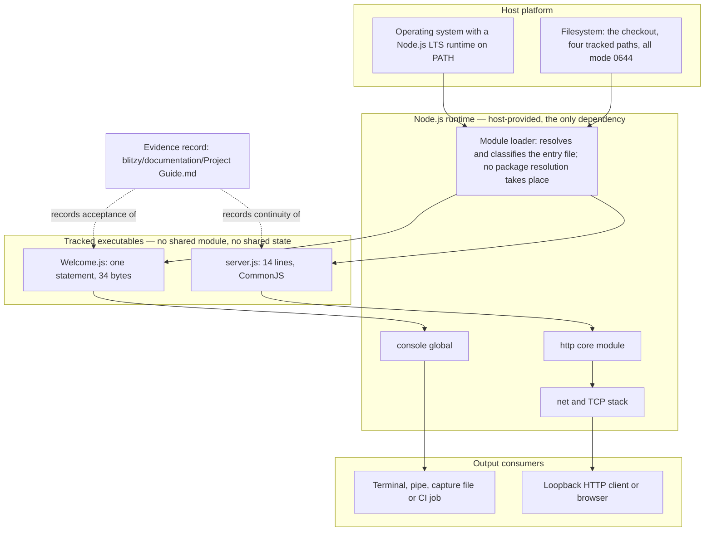

**Figure 5-1 — component interaction and runtime topology.** The diagram draws no edge between the two executables because none exists, and no lane for a caller of `Welcome.js` because the caller appears as the consumer of descriptor 1. The evidence record is drawn with dashed edges because its relationship to both executables is documentary.

**Primary flow — the product's standard-output flow.** The path from invocation to exit is fixed and has no branch of any kind in the source:

1. The caller invokes `node Welcome.js` from the repository root or by absolute path. The runtime resolves the file; a relative invocation from another directory fails here, before any output.
2. The loader parses the 34 bytes of source. Its syntax is ES5 level — one member call on a global applied to one string literal — and `node --check Welcome.js` exits `0`.
3. The loader classifies the file. With no manifest in the tree or above it, and no `import` or `export` in the source, every classification converges on the same execution (F-005).
4. The single statement executes: the `console` global formats the literal and appends the line terminator that `console.log` supplies.
5. Eighteen bytes are queued on descriptor 1 — `57 65 6c 63 6f 6d 65 20 74 6f 20 42 6c 69 74 7a 79 0a` — and flushed to the consumer, whether that is a terminal, a pipe, a redirection to a file or a CI capture buffer.
6. The event loop empties with no timer, listener or exit handler registered, so the process ends on its own with status `0` and nothing on descriptor 2. Measured wall-clock cost of the whole flow on the verification host: `real 0m0.022s`.

**Secondary flow — the loopback HTTP exchange.** The service's path is equally fixed and equally branchless inside the application:

1. The operator invokes `node server.js`. The `http` core module is loaded and `http.createServer` registers a single inline handler.
2. `server.listen` binds `127.0.0.1` on port `3000`. A successful bind prints one startup line; a bind failure is an unhandled error event because no `'error'` listener is attached, and the process exits `1` with a stack trace.
3. A client connects over loopback and sends any request — observed with `GET /`, `GET /nope` and `POST /nope` carrying a body.
4. Node's HTTP parser validates the request at the protocol level and converts it into a JavaScript request object. Malformed or oversized requests are answered `400` or `431` by the runtime before the handler is reached.
5. The inline handler (`server.js:6-10`) ignores method, path, headers and body entirely and performs three fixed statements: set status `200`, set `Content-Type: text/plain`, end the response with `Hello, World!\n`.
6. The `http` module serialises the response — status line, headers including a `Date` header computed at send time and a `Content-Length` of 14 derived from the fixed body, plus `Connection: keep-alive` and `Keep-Alive: timeout=5` — and writes it to the socket. Observed `time_total=0.000502` for a POST and under 5 ms for a GET.
7. The handler retains nothing between requests, so the listener returns to its waiting state immediately; the flow is idempotent for every request.

**Data transformation points.** The system contains exactly three points where data changes form, and all three belong to a runtime facility rather than to application code:

| Transformation | Where it happens | Input → Output | Owned by |
|---|---|---|---|
| Literal to byte stream | `console.log` formatting inside the runtime | JavaScript string of 17 characters plus terminator → 18 bytes on descriptor 1 | Node.js runtime global |
| Wire bytes to request object | Node's HTTP parser | HTTP/1.1 request bytes on the socket → request object delivered to the inline handler | `http` core module |
| Response fields to wire bytes | Node's response serialisation | Status code, header map and 14-byte body → HTTP/1.1 response bytes, with `Content-Length` and `Date` computed at send time | `http` core module |

**Key data stores and caches.** There is none at run time, in either flow. The product writes no file, opens no socket and creates no temporary artifact, and repeated and concurrent runs were observed to leave the tracked tree unmodified. The service persists nothing — not an access log, not a request log, not a counter — and emits no `ETag`, `Last-Modified` or `Cache-Control` header, so nothing downstream is invited to cache its response. The only retained state anywhere in the system is a **per-connection keep-alive timer** of five seconds, and it is registered by the runtime's `http` module rather than by `server.js`, which creates no timer of its own. Persistence exists only at delivery time: the four tracked blobs in the git object store, plus the evidence record, which is the one artifact that holds durable system knowledge (§5.3.3).

### 5.1.4 External Integration Points

Every boundary crossing the system makes is listed below. Three of the five rows are host-supplied substrate rather than integrated systems, which is the point: the architecture has **no integration contract with any enterprise system**, and the absence is deliberate, verifiable and recorded as a security property (§5.3.5). No formal SLA, SLO or availability target is defined anywhere in the repository; the operational-expectation column therefore states the observed behaviour and the external lifecycle fact that actually binds the stack.

| System | Integration Type & Protocol | Data Exchange Pattern | SLA / Operational Expectation |
|---|---|---|---|
| Node.js LTS runtime (host-provided) | In-process execution substrate; no wire protocol; the runtime is invoked as a process host | Outbound only from the system's point of view: the runtime loads 34 bytes of source, supplies the `console`, `http` and `net` modules, and returns an exit status | A supported LTS line must be present on `PATH`; verified byte-identical on `v24.21.0` (reference) and `v22.23.2` (floor), re-verified here on `v22.23.3`. The floor reaches end of life on 30 April 2027 and the reference line on 30 April 2028 (§3.3); the source needs no change to move lines because its syntax is ES5 level |
| Operating-system process and standard-stream surface | POSIX process model with standard file descriptors; no framing or application protocol | 18 bytes outbound on descriptor 1, nothing on descriptor 2, exit status `0`; no inbound descriptor is read | Output must be captured to be asserted: a terminal's newline translation reports 19 bytes rather than 18, and `console.log` does not raise when the destination refuses the write, so the exit status alone is not sufficient evidence (F-007-RQ-002) |
| Output consumer — terminal, pipe, captured file, pipeline stage or CI job | Byte stream; no protocol, no acknowledgement, no flow control negotiated by the system | One unsolicited 18-byte message per run, terminated by a single LF; the consumer applies no schema | A deliberately slow reader still receives all 18 bytes, confirming that natural termination never truncates queued output; consumers rely on the message and the status, never on a response object |
| Loopback HTTP client or browser | Network; HTTP/1.1 over TCP bound to `127.0.0.1:3000` | Synchronous request/response; stateless and idempotent — any method, any path, any body yields the same `200` / `text/plain` / 14-byte reply | The bind is loopback-only and hardcoded, with no environment or argument override, so the service is reachable from the local host alone; a second start on an occupied port exits `1` with an unhandled `EADDRINUSE` error, and the port is released when the process ends |
| Filesystem checkout and version-control history | Local file access at load time; git transport for the delivery record | The runtime reads four paths and writes none; the deliverable reached the mainline as commits through the hosting remote (PR #15), with the evidence record committed as a blob | All four paths carry mode `0644` and are tracked in git; the tree must remain manifest-free and lockfile-free for F-002 to hold, and the working tree must stay clean so a blanket `git add` cannot introduce a second artifact |


## 5.2 Component Details

### 5.2.1 Welcome.js — The Delivered Product Component

**Purpose and responsibilities.** `Welcome.js` is the deliverable: one statement, one file, occupying its own flow exactly as the project rule's separation clause requires. Its responsibilities are the five product features F-001 to F-005 and nothing else.

- Emit the exact 17-character message followed by one newline on standard output (F-001).
- Run as written, with no install, resolution, build or transpile step (F-002).
- Terminate naturally with exit status `0`, so queued output is never truncated (F-003).
- Read no argument, no standard input, no environment variable and no file, and locate nothing by relative path (F-004).
- Behave identically whether the runtime classifies the file as CommonJS, as an ES module, or with no manifest present (F-005).

Its explicit non-responsibilities are equally architectural: it performs no input handling, no logging, no configuration, no error handling, no network access, no persistence and no export of any kind. Each absence is enforced by the one-statement ceiling, not left to convention.

**Technologies and frameworks.** JavaScript at ES5 level, using one runtime global and no library. The source is `console.log('Welcome to Blitzy');` at `Welcome.js:1` — one member call applied to one string literal. No framework, module system, transpiler, bundler or package is involved, and the file declares no `import`, no `export` and no `require`. Syntax level matters operationally: because nothing in the source is version-sensitive, the same bytes run on any supported Node.js line, which was verified on the reference line `v24.21.0`, the supported floor `v22.23.2`, and `v22.23.3` during preparation of this section.

**Key interfaces and APIs.**

| Interface aspect | Specification |
|---|---|
| Invocation | `node Welcome.js`, by bare filename, relative path or absolute path; no argument, flag, environment variable or standard-input channel is read; the file must be located at the repository root with exact casing because nothing resolves it by name |
| Output contract | Exactly 18 bytes on descriptor 1 per run — `57 65 6c 63 6f 6d 65 20 74 6f 20 42 6c 69 74 7a 79 0a` — with the single trailing LF supplied by `console.log` |
| Diagnostic contract | Descriptor 2 is empty on every path the product's code controls; this is an acceptance criterion rather than an observation (F-001-RQ-004) |
| Status contract | Exit `0` after a completed write; a non-zero status arises only from the shell, the loader or V8 failing before or during execution |
| Programmatic surface | None. The file exports nothing and offers no callable API, so the process boundary — descriptor 1 plus the exit status — is its only consumer interface |
| Identity | No manifest, therefore no version field; the artifact is identified by content: git blob `58a5dcab90815d7b1db080e39613e7711f5854e0`, SHA-256 `5c7ac141d94f92056efb756f17335252c31e3d08d509e641d76512f73112c1fc`, 34 bytes, 1 line, mode `0644` |

**Data persistence requirements.** None at run time, and this is asserted rather than assumed: the process writes no file, opens no socket and leaves no temporary artifact, while five sequential runs and eight concurrent runs left `git status --porcelain -uall` reporting zero lines. The only durable copy of the component is the git blob named above, and any change to it re-baselines its acceptance evidence.

**Scaling considerations.** The component scales by process multiplicity and by nothing else. Each run is an independent process with its own descriptor 1 and no shared resource, so N concurrent runs cost N processes and yield N identical results; eight concurrent runs were each observed to print the message without interference. Per-run cost is bounded by interpreter startup, measured at `real 0m0.022s` in this checkout and recorded as roughly 25–30 ms in the evidence record (`Project Guide.md` §9.1). The practical ceiling is therefore the host's process limits, not any artifact of the design — and, because the component writes once and exits, sustained high-volume use would be better served by a warm process, a change the one-statement and zero-install criteria forbid.

**Critical considerations.** Three properties make this component fragile in ways its size hides. First, **its only silent failure is its most dangerous**: `console.log` does not raise when the destination stream refuses the write, so a full or closed reader loses the message while the process still reports status `0` (DP-03). Second, **nothing guards the file** — `node --test` reports zero tests and no CI workflow exists, so a changed literal, an added line or a renamed file would be caught only by re-running the manual gate. Third, **the byte contract is exacting**: a single trailing LF, 34 source bytes and one source line are all measured by the gate, and the filename casing `Welcome.js` is load-bearing on a case-sensitive filesystem.

### 5.2.2 server.js — The Pre-Existing Loopback HTTP Service

**Purpose and responsibilities.** `server.js` predates the deliverable and is preserved byte-identical to base commit `1484182`. It is the repository's only network-facing component and its only long-lived one: it binds a loopback port, answers every request with the same greeting, and runs until stopped. Its responsibilities as documented are narrow and static.

- Bind `127.0.0.1:3000` and confirm the bind with one log line on standard output.
- Answer every request — any method, any path, any headers, any body — with status `200`, `Content-Type: text/plain` and the 14-byte body `Hello, World!` plus one LF.
- Keep running and keep the port held until the operator stops the process.

It has no responsibility for routing, request discrimination, validation, authentication, logging, metrics, persistence or shutdown coordination, and it performs none.

**Technologies and frameworks.** JavaScript in CommonJS form: `const http = require('http');` at `server.js:1`, the only `require` in the entire repository, loading a Node.js core module rather than a third-party package. The listener is built with `http.createServer` and an inline arrow-function handler (`server.js:6-10`), then bound with `server.listen(port, hostname, …)` (`server.js:12-14`). There is no framework, middleware, router, template engine, static-file layer or state container, and the whole component is 14 lines and 342 bytes.

**Key interfaces and APIs.**

| Interface aspect | Specification |
|---|---|
| Network interface | TCP on `127.0.0.1:3000`, loopback-only and hardcoded together at `server.js:3-4`; no environment variable, argument or configuration file can relocate it, so the listen address is fixed at the source level |
| Request interface | HTTP/1.1 parsed by Node's `http` module into a request object that the handler never inspects; protocol-level conditions are answered before the handler runs, with `431` for oversized headers and `400` for a malformed request line |
| Response interface | `200` with `Content-Type: text/plain` and a 14-byte body; `Content-Length` and `Date` are computed by the `http` module at send time, and the connection is retained with `Connection: keep-alive` and `Keep-Alive: timeout=5`. Observed: `HTTP/1.1 200 OK`, `Content-Length: 14`, body `Hello, World!`; POST `/nope` with a body also returned `200`, `text/plain`, 14 bytes at `time_total=0.000502` |
| Startup diagnostic | One line on descriptor 1 after a successful bind: `Server running at http://127.0.0.1:3000/` |
| Failure interface | None declared. No `'error'` listener is attached to the listener, so an occupied port produces an unhandled error event and the process exits `1` with a stack trace on descriptor 2 — observed as `Error: listen EADDRINUSE: address already in use 127.0.0.1:3000`, `code: 'EADDRINUSE'`, `errno: -98` |
| Shutdown interface | Process end only. No `SIGTERM` or `SIGINT` handler exists and no in-flight drain is performed; the port is released when the process exits, after which a later connection is refused (observed `curl` exit `7`) |
| Identity | git blob `320a75a7649db30756f011001f299d20df1c44b3`, SHA-256 `332fc2d04eb5b8f3cb230855457af80d0dfc246f958d6e49615610d656acc2e0`, 14 lines, 342 bytes, mode `0644` |

**Data persistence requirements.** None. No request log, access log, counter or store is written; the component holds no state between requests, so a repeated request is answered identically with no accumulation, and the only retained resource is the runtime's own five-second keep-alive timer. The component's durable evidence is confined to its git blob and to the continuity assertion that the file is byte-identical to base.

**Scalability considerations.** The service cannot be scaled out without editing the source. `server.js:3-4` fixes both address and port as constants, so a second instance on the same host fails at bind with `EADDRINUSE` and exits `1` — observed directly. No cluster module, worker-thread pool, socket reuse option or load balancer is present. Within a single process, concurrency is whatever Node's event loop supports for a handler that writes no shared state and retains nothing, which is why the handler needs no lock, queue or ordering guarantee; each request is answered once and the listener is immediately ready again. Capacity is therefore one instance per host, bounded by one event loop and by the loopback interface, which is adequate for the continuity role the component plays and is not a production service target.

**Critical considerations.** Four gaps are recorded as open, pre-existing and out of the deliverable's scope: the missing `'error'` listener that turns a port conflict into a stack trace rather than a diagnosable message; the missing `SIGTERM`/`SIGINT` drain; the hardcoded bind address with no override; and the undifferentiated handler that makes unknown paths indistinguishable from the intended route. One forward-looking hazard is architectural rather than a gap: the component is CommonJS, so adding a `package.json` declaring `"type": "module"` in or above this repository would break it at runtime while leaving the module-neutral `Welcome.js` working; the recorded mitigation is to keep the tree manifest-free and, if a manifest ever becomes necessary, to declare `"type": "commonjs"` and re-run both files. The component also has no automated coverage of any kind.

### 5.2.3 Documentation Components — README.md and the Evidence Record

The two Markdown artifacts are non-executable and participate in no runtime path, but they carry architectural weight: one states the system's purpose, and the other is the system's only mechanism for detecting a defect.

| Component | Role | Size and identity | Architectural significance |
|---|---|---|---|
| `README.md` | Project identity and charter: the heading `# hao-backprop-test` and the sentence "test project for backprop integration." | 1 line / 58 bytes; git blob `8959476c31f45285511f9f36eee50ef983b17816`; byte-identical to base | It is the only statement anywhere in the tree of why the system exists, and it is what classifies the deliverable as a conformance fixture rather than a product |
| `blitzy/documentation/Project Guide.md` | Delivery, verification, compliance, risk, operational and development record | 381 lines / 35,992 bytes; git blob `9339cbea86be6a6ca8caa67b3bebeb3e4e405104`; SHA-256 `a5575764aaf4146149c5f591abf214d3a4c3c3f061662e7701af8e88bb9804d5` | It holds the nine-line acceptance gate (F-007), the 42 manual checks, the 12-row compliance matrix, the divergence analysis, the eight-row risk register and the appendices that document ports, versions, environment variables and the tool inventory |

Three points make the evidence record an architectural component rather than a document. **It is the system's monitoring substitute**: with no metrics endpoint, no health check and no telemetry, the reviewer's comparison of captured bytes against the documented values is the only channel through which a defect becomes visible (§5.4.1). **It is the only durable state that changes during the project's life**, since no runtime component persists anything and the source is frozen by its acceptance evidence. And **its existence is constrained by the same minimality criterion as the deliverable**: the evidence record is the single additional path the change is permitted to add, which is why the language decision was committed as a zero-byte commit (`6c16ea2`) rather than as a waiver file, and why no `docs/adr/` directory, test file or diagram asset may be introduced. The guide's own divergence register records that seven untracked PNG captures were written under `blitzy/screenshots/` while the loopback surface was verified in a browser; those files are absent from this checkout, where `blitzy/documentation/Project Guide.md` is the only path beneath `blitzy/` and `git status` is clean.

### 5.2.4 Component State Transitions

The system's components have no data state, so the only state machine worth drawing at architecture level is the **composition lifecycle**: which states the system can occupy once the four tracked paths exist, and how each activation path terminates. Per-process state machines — the product's five states and the listener's four — are Figure 4-8 and Figure 4-9 in §4.5.1; this figure places both activation paths on one diagram to show that they never rejoin.

```mermaid
stateDiagram-v2
    [*] --> ManifestFreeCheckout: four tracked paths present, all mode 0644
    ManifestFreeCheckout --> Unrunnable: no Node.js runtime on PATH, shell exits 127
    ManifestFreeCheckout --> RuntimeResolved: a supported Node.js LTS line is present
    RuntimeResolved --> ProductExecuting: node Welcome.js
    RuntimeResolved --> ServiceBinding: node server.js
    ProductExecuting --> ProductEmitted: the single statement queues 18 bytes on descriptor 1
    ProductExecuting --> ProductFailed: entry file unresolvable or unparsable, exit status 1
    ProductEmitted --> Exited: the event loop empties, exit status 0, descriptor 2 empty
    ServiceBinding --> ServiceListening: loopback 127.0.0.1 and port 3000 bound
    ServiceBinding --> BindFailed: port already in use, unhandled error event, exit status 1
    ServiceListening --> ServiceServing: a parsed request reaches the inline handler
    ServiceServing --> ServiceListening: the 14-byte response is ended; nothing is retained
    ServiceListening --> Stopped: the operator stops the process and the port is released
    Exited --> [*]
    ProductFailed --> [*]
    BindFailed --> [*]
    Stopped --> [*]
    Unrunnable --> [*]
```

**Figure 5-2 — composition lifecycle and activation paths.**

Four properties of the figure are deliberate. **The classification decision is not drawn as a state**, because the three ambient cases — CommonJS, ES module, no manifest — converge on the same execution and therefore cannot alter the composition (F-005-RQ-001). **No transition carries state**: nothing is persisted, cached or handed between components, so `ProductEmitted` holds only the 18 bytes being flushed and `ServiceServing` holds only the response being written. **Both activation paths are terminal for the process that takes them**: no recovery, retry or fallback exists in either executable, and recovery is always performed by a caller or an operator instead. And **the paths never rejoin**: the product and the service share no file, port, module, variable or temporary artifact, so no edge exists between them in any state.

### 5.2.5 Sequence Diagrams for the Key Flows

Section 4 owns the two request/response sequences: the product's output contract is Figure 4-6 and the loopback HTTP exchange is Figure 4-7 in §4.3.2. The two flows drawn here are the ones a component view needs and the earlier figures do not cover: the manual acceptance run that decides whether the deliverable passes, and the service's full lifecycle from bind through release.

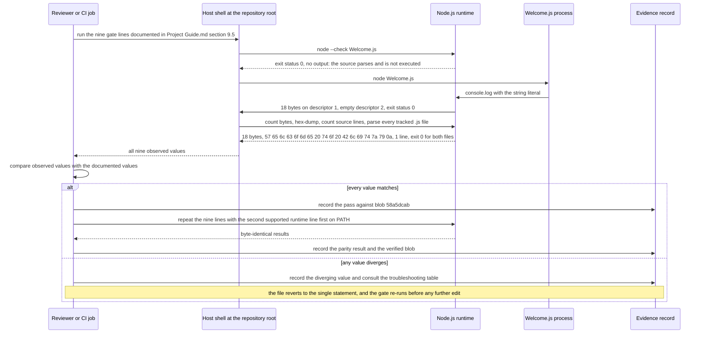

**Figure 5-3 — the acceptance run (F-007).** The sequence is deliberately manual: the nine lines exist in the evidence record rather than in a script, because a committed test file would breach the excluded-artifact criterion. Two consequences follow. Every participant except the evidence record is ephemeral, so a run leaves nothing behind but its recorded result. And the reviewer is a load-bearing actor rather than an observer — the comparison at the centre of the sequence is the system's only defect-detection mechanism, and its absence is the one failure mode nothing in the repository reports.

```mermaid
sequenceDiagram
    participant Op as Operator
    participant S as server.js process
    participant N as Node.js runtime
    participant L as Loopback TCP 127.0.0.1 port 3000
    participant C as HTTP client or browser
    Op->>S: node server.js
    S->>N: require the built-in http module
    N-->>S: module handle, with no package resolution
    S->>L: listen on address 127.0.0.1 and port 3000
    alt the loopback port is free
        L-->>S: listening event
        S->>Op: log the startup line on descriptor 1
        C->>L: connect and send a request, on any method and any path
        L->>S: parsed request delivered to the inline handler
        S->>L: status 200, Content-Type text/plain, 14-byte body
        L-->>C: HTTP/1.1 200 OK with Content-Length 14 and keep-alive timeout 5
        Note over S,L: the handler retains nothing, so the listener returns to waiting immediately
        Op->>S: stop the process
        S-->>L: sockets closed, port released
        C->>L: a later connection attempt
        L-->>C: connection refused
    else the port is already bound
        L-->>S: error event EADDRINUSE with errno -98
        Note over S: no error listener is attached, so the event is unhandled
        S-->>Op: stack trace on descriptor 2, exit status 1
    end
```

**Figure 5-4 — the pre-existing service's lifecycle (F-006).** The figure is scoped to bind, serve and release; the request-level exchange is Figure 4-7. Two operational facts it makes explicit are that the bind is the component's only failure point with a diagnostic at all, and that no drain occurs on shutdown, so a request in flight when the process ends is lost — an accepted, recorded pre-existing gap.

### 5.2.6 Scaling, Capacity and Composition Constraints

The system has no scaling mechanism in the ordinary sense, because it has no service tier, no data tier and no shared resource. What it does have is a set of hard ceilings that bound any future growth, and they are architectural rather than incidental.

| Component | Scaling mechanism | Practical ceiling | Evidence |
|---|---|---|---|
| `Welcome.js` | Process multiplicity: each run is an independent process with its own descriptor 1 | Host process limits; per-run cost is interpreter startup, measured at `real 0m0.022s` here and recorded as roughly 25–30 ms | Eight concurrent runs each produced 18 identical bytes and left no residue; five sequential runs left `git status` clean |
| `server.js` | None. Within one process, concurrency is the event loop's, for a handler that retains nothing | One instance per host: the bind address and port are constants, and a second start exits `1` with `EADDRINUSE` | `server.js:3-4`; observed second-start failure with `errno -98`; no cluster, worker-thread or socket-reuse mechanism exists |
| Node.js runtime | Multiple supported lines; the source is indifferent to which one runs it | The runtime's support window: the verified floor (22.x) reaches end of life on 30 April 2027 and the reference line (24.x) on 30 April 2028 | §3.3; source is ES5 level with no version-sensitive syntax, so moving lines needs no code change |
| Evidence record | Manual update by the reviewer or owner | One added path is permitted by the minimality criterion, and this is it — no test file, CI workflow, container definition or ADR directory may join it | `git diff --name-status 1484182 HEAD` reports exactly `A Welcome.js` and `A blitzy/documentation/Project Guide.md` |

Three capacity implications follow directly from the table and should be treated as design constraints rather than observations. **Throughput cannot be improved inside the current architecture**: the product writes once and exits, so per-run cost is dominated by process startup, and a warm process or a batch mode would violate both the one-statement ceiling and the separation clause. **The service cannot be made redundant**: it binds a fixed loopback address, so there is no replica, no failover and no second instance to promote — its availability is the availability of the single process an operator starts. And **verification does not scale with change volume**: 42 checks are executed by hand against a file whose acceptance evidence is bound to a specific blob hash, so any edit — however small — invalidates that evidence and requires the whole gate to run again. No scalability, availability or throughput target is defined anywhere in the repository, and no such target would be measurable for a component whose entire output is 18 bytes.


## 5.3 Technical Decisions

### 5.3.1 Architecture Style: Decision and Tradeoffs

The style chosen is the smallest composition that satisfies binding criteria simultaneously: a manifest-free checkout holding two independent, dependency-free executables that share nothing but the host runtime. The alternatives below were not merely unappealing — each conflicts with at least one criterion that acceptance measures, which is what makes the decision effectively forced rather than preferential.

| Alternative considered | What it would have introduced | Why it was not adopted |
|---|---|---|
| Framework-based service (for example an Express or Flask application exposing the greeting) | A package dependency, a router, a manifest, a start script and a test toolchain | Breaks the zero-install criterion (F-002) outright: a manifest, a lockfile and a `node_modules` tree are three separate excluded artifacts. It also adds entry points and files against the one-added-file ceiling |
| Layered application with shared modules (controller/service/util split) | Multiple source files, a shared library, a build or resolution step, and internal interfaces between layers | The deliverable is one statement; layers would each be empty and would exceed both the one-line and one-added-file ceilings. A shared module would also couple the two executables, which the continuity criterion forbids |
| Containerised or deployed microservice | A container definition, an orchestration manifest, a registry, a health endpoint and a CI pipeline | The artifact is run in place from a checkout, never deployed; a `Dockerfile` or CI workflow is an explicitly excluded artifact class, and no runtime environment exists to promote between |
| Published module or packaged distribution | A manifest with a version field, an entry-point declaration, a registry account and a publish step | Requires exactly the manifest the zero-install posture forbids, and would add a distribution channel the project has no use for |
| Python implementation as the project rule directs | A `.py` artifact, an interpreter requirement, and a second language in the tree | The product request fixed JavaScript and the filename `Welcome.js`; a `.py` file cannot occupy that path, and a companion file would double the file count against the minimality criterion. Recorded as divergence 1 and F-008, still open (§5.3.7, ADR-010) |
| Hardening or refactoring the pre-existing `server.js` | An `'error'` listener, a graceful-shutdown drain, a configurable bind address and request discrimination | `server.js` must remain byte-identical to base for the continuity criterion; all four gaps are recorded as open, pre-existing and out of scope |

**Accepted tradeoffs.** The chosen style buys determinism, zero install, and a verification surface small enough to check exhaustively; it pays for them in capabilities that must be understood as deliberate costs rather than oversights.

| Tradeoff accepted | Why it is acceptable here | Residual exposure |
|---|---|---|
| No error handling anywhere in the code | The product's only runtime operation is one write to a stream, and the criteria forbid branching | A refused stream write loses the message while the process still exits `0` (DP-03); detection depends entirely on capturing and comparing bytes |
| No automated regression protection | A committed test file is an excluded artifact, and the deliverable is one statement whose content is trivially verifiable by reading a line | Any future edit — a changed literal, an added line, a rename — is caught only by re-running the manual gate |
| No configurability (no arguments, environment, config file) | The message, bind address and port are fixed by the request; configurability would create both an input surface and a file the criteria exclude | The service's port cannot be relocated without editing the source, and a port conflict surfaces as a stack trace rather than a configurable workaround |
| No observability infrastructure (no metrics, tracing, health endpoint or alerting) | There is no service to observe and no consumer of such data; the evidence record supplies the only KPI set | A defect has no automatic signal; the system's fault detection is a human comparison performed on demand |
| No code reuse between the two executables | Reuse would require a shared path, coupling the deliverable to the pre-existing file that must stay untouched | A future requirement affecting both scripts would be implemented twice, and nothing would detect divergence between them |

### 5.3.2 Communication Pattern Choices

Three communication patterns exist in the system, plus a set of deliberate absences. Each was selected because it needs no dependency and leaves no state behind.

| Pattern | Where used | Why this pattern | Alternative rejected |
|---|---|---|---|
| Process invocation and exit status as the control channel | The caller drives both executables; results are signalled by the exit code | Needs nothing beyond the operating system's process model, and makes success mechanically assertable without any protocol | A handshake file, a readiness ping or an exit-code-free design would each require an extra artifact or a second channel to keep consistent |
| Standard output as a unidirectional byte stream, in the pipe-and-filter idiom | The product writes 18 bytes to descriptor 1, which a shell may capture, redirect or pipe (`Project Guide.md` §9.6) | A stream needs no framing, no schema, no acknowledgement and no library, and it keeps the product usable inside an existing shell pipeline | Writing to a file, a socket or a database would create persistence, a port or a dependency, and would each add a failure mode the product cannot handle |
| Request/response over loopback HTTP/1.1 | The pre-existing service answers every request identically on `127.0.0.1:3000` | The `http` core module provides protocol parsing, header computation and serialisation, so the component needs no framework and no code beyond setting three fields | A raw TCP listener with hand-built framing, a WebSocket channel or an RPC framework would add code, protocol surface and dependencies for a demo response |
| No inter-process channel of any kind | Neither executable calls, signals or configures the other | There is no data to exchange: the product has no consumer inside the system, and the service reads nothing the product writes | Signals, exit-code sharing, a shared file, a socket or an environment variable between them would each create exactly the coupling the continuity rule forbids |
| No asynchronous or event-driven integration | No queue, bus, broker, webhook, callback or scheduled job exists | The system has no asynchronous work: one write, one response, nothing to await | An event bus or scheduler would introduce infrastructure, configuration and a failure domain with no requirement behind it |

### 5.3.3 Storage and Persistence Decisions

No runtime storage decision had to be made, because nothing in the system stores anything at run time. The two durable stores are the version-control object database and one Markdown file, and both are delivery-time artifacts.

| Storage concern | Decision | Rationale | Consequence |
|---|---|---|---|
| Runtime persistence in the product | None. No file, socket, temporary artifact or log is written | The single statement produces one stream write; any persistence would add a failure path the criteria exclude | Output is the only evidence a run leaves; nothing can be re-read after the fact, so the consumer must capture it |
| Runtime persistence in the service | None. No access log, request log, counter or store | The handler writes no shared state and retains nothing between requests | Behaviour is idempotent per request and unreconstructable afterwards; there is no request history to inspect |
| Application database, key-value store or broker | None, in any class | No requirement involves durable structured data, and every such component would bring a dependency, configuration and a connection surface | There is no schema, migration, backup, connection pool or credential to manage |
| Configuration store (`.env`, config file, environment variables) | None. The product reads no `process.env`; the service's bind values are source constants | Configurability would create both an input surface and a file the criteria exclude; the values are fixed by the request | The system's behaviour is identical on every host, which is what makes the byte contract portable |
| Delivery-time persistence | The git object database holds all four tracked blobs; the mainline arrived through PR #15 with the product added at `1cef465` and the evidence record at `4d1256c` | Source control is the distribution channel and the audit trail; no other store is needed | The artifact's identity is a content hash rather than a version number: `Welcome.js` blob `58a5dcab…`, `server.js` blob `320a75a7…` |
| Durable system knowledge | `blitzy/documentation/Project Guide.md` — 381 lines, 35,992 bytes, mode `0644` | Acceptance evidence, risk register and operating instructions must outlive the session that produced them, and this is the single path the minimality criterion permits the change to add | A change to either executable invalidates the record's evidence until the gate is re-run and the record updated by hand |

**Backup and retention.** No backup mechanism is required or provided. Every artifact is reproducible from its commit, the runtime state is empty by construction, and the only unrecoverable object would be uncommitted working-tree content — which is exactly what the delivery discipline guards against by staging `Welcome.js` by name rather than with a blanket add, so the untracked capture files described in the record's divergence register cannot enter the repository.

### 5.3.4 Caching Strategy Justification

There is no cache in the system, and none is warranted: every value the system produces is either a literal re-derived on each run or a response small enough that recomputation costs less than retrieval.

| Cache concern | Decision | Evidence | Downstream effect |
|---|---|---|---|
| HTTP response caching | No caching directives are emitted — no `ETag`, no `Last-Modified`, no `Cache-Control`, no `Expires` | Observed response headers are `Content-Type`, `Date`, `Connection`, `Keep-Alive` and `Content-Length` only | Nothing downstream is invited to cache the response; a client may apply heuristic caching for the 14-byte body, which is harmless because the body never varies |
| Module or package resolution cache | None exists, because no resolution occurs | No manifest, no lockfile and no `node_modules` anywhere in the tree or above it; the only `require` loads a built-in core module | Startup cost stays bounded by runtime bootstrap and is unaffected by cache state; a cold and a warm checkout behave identically |
| Computed-value caching inside the product | None, and none is possible | The message is a literal in the source, regenerated on every run rather than retrieved; memoisation would require declaring state | Each run is self-contained and hermetic, so no run can influence another's output |
| Connection retention as an implicit cache | Keep-alive connections are retained by the runtime's `http` module for five seconds of idleness | Observed headers `Connection: keep-alive` and `Keep-Alive: timeout=5`; `server.js` registers no timer of its own | A client may reuse a socket and observe marginally lower latency; the state belongs to the runtime, not to the application, so it survives no process restart |
| Build, transpile or asset cache | None, because no build step exists | The source is executed as written; there is no bundler, transpiler or asset pipeline in the tree | There is no stale-artifact class of defect: the executed bytes are always the committed bytes |

### 5.3.5 Security Mechanism Selection

Security in this system is an enumeration of absent surfaces rather than a set of implemented controls. The source supports that enumeration completely — it reads no argument, no standard input, no environment variable and no file, opens no socket of its own, executes no dynamic code and declares no dependency — so the posture is stated rather than sampled.

| Control | Selection | Rationale and evidence |
|---|---|---|
| Authentication | None, and not applicable to the product: no input channel exists to authenticate against | `Welcome.js` reads nothing and answers nobody; the loopback service accepts any client that can reach `127.0.0.1`, which is a local-machine trust boundary rather than an authentication gap |
| Authorization | None. The service performs no request discrimination at all | Every method and path receives the same `200` reply, so there is no protected resource, no role and no access decision to make |
| Transport security | None. The bind is loopback-only and no TLS is negotiated | `server.js:3-4` binds `127.0.0.1`, so traffic never traverses a network segment; adding TLS would require a certificate, a dependency and a configuration file, each excluded |
| Input validation | Vacuous for the product; not implemented for the service | The product has no inputs to validate. The service accepts any request and ignores its method, path, headers and body, so its only validation is protocol-level parsing by the `http` module, which answers `400` or `431` before the handler runs |
| Secret and credential management | None. No credential, key, token or password appears anywhere in the tree | The product reads no environment variable and the service needs no authentication material; there is no secret to store, rotate or leak |
| Dynamic code loading | None. No `eval`, no `new Function`, no dynamic `import` and no loader hook | A token scan of every tracked file for `eval(` and `new Function` returns no matches; the only module load is a static `require` of a core module |
| Dependency and advisory surface | Zero third-party packages, therefore no transitive advisory exposure | A sweep of the tree and every ancestor directory to `/` finds no manifest, lockfile or `node_modules`; the sole third-party component is the host runtime itself, whose support window is managed at the host level (§5.4.5) |
| Filesystem permissions | All four tracked paths are mode `0644`; nothing is executable and no file is written at run time | `stat` over the four paths; the run-time posture is read-only, so a compromised process has no write target |
| Audit trail | None at run time. The git history plus the evidence record are the only audit surfaces | The repository holds five commits and one evidence record; no log, no request history and no metric is retained by either process |

**Residual risk and forward constraint.** Two exposures are real and are recorded rather than solved. The loopback service is unauthenticated and answers any path, so any process or user on the same host can elicit its response — acceptable for a local demo whose response contains no system data, and out of scope because the file must stay byte-identical. And the posture rests on an absence that a future change could remove: introducing a dependency, a command-line argument, an environment variable or an input channel would create a security surface the system does not have today, which is why the recorded mitigation is to preserve the zero-dependency, zero-input posture and treat any proposed dependency or integration as a scope change to be agreed first.

### 5.3.6 Architecture Decision Tree

The figure records the decisions that produced the composition, in the order the binding criteria force them. Each rejected branch names the criterion it would have violated.

```mermaid
flowchart TD
    A["Binding criteria: one source line, one added file, no install step, preserve the pre-existing surface"] --> B{"May a manifest, lockfile or node_modules exist in or above the checkout?"}
    B -->|"no"| C{"Can one file deliver the output contract with no framework, import or build step?"}
    B -->|"yes"| B1["Rejected: a manifest or lockfile breaks the zero-install criterion, and a type module declaration above the tree would break the CommonJS server.js at runtime"]
    C -->|"yes"| D["One statement on the console runtime global, executed directly"]
    C -->|"no"| C1["Rejected: any framework or build step requires exactly the manifest and dependency tree that must not exist"]
    D --> E{"Does the deliverable need an inbound interface?"}
    E -->|"no"| F["Standard output stream plus exit status as the only interface"]
    E -->|"yes"| E1["Rejected: the request fixes a message on a user-visible channel, not a service, and an inbound interface would add an input surface and a validation duty"]
    F --> G{"May the pre-existing listener be refactored or shared?"}
    G -->|"no"| H["Two independent executables with no shared module, port, file or variable"]
    G -->|"yes"| G1["Rejected: byte-identical continuity of README.md and server.js is an acceptance criterion"]
    H --> I{"Must any state outlive a run?"}
    I -->|"no"| J["Stateless processes: no database, no cache, no configuration and no log"]
    I -->|"yes"| I1["Rejected: durability would require a store, a configuration and a backup surface that no requirement asks for"]
    J --> K{"Is an automated suite permitted to guard the artifact?"}
    K -->|"no"| L["Manual nine-line gate recorded in the evidence record"]
    K -->|"yes"| K1["Rejected: a committed test file is an excluded artifact and would breach the one-added-file ceiling"]
    L --> M["Final composition: manifest-free checkout, two process-local executables, standard-stream and loopback interfaces, statelessness throughout, acceptance verified by hand"]
```

**Figure 5-5 — decision tree for the architecture's composition decisions.**

### 5.3.7 Architecture Decision Records

Each record below states a decision the repository's evidence supports, its driver, its consequences, and the alternatives it forecloses. The records live in this specification and in the evidence record rather than in a `docs/adr/` directory, because a directory of ADR files is one of the artifact classes the deliverable's minimality criterion excludes; the zero-byte commit `6c16ea2` exists for the same reason, since a rationale that could not occupy a file went into the history instead.

| ID | Decision | Status |
|---|---|---|
| ADR-001 | Deliver the product as one statement in one file at the repository root, carrying no comment, wrapper, guard or abstraction | Accepted, implemented at `1cef465`; blob `58a5dcab…` |
| ADR-002 | Keep the checkout manifest-free and lockfile-free, with no `node_modules` in the tree or in any ancestor directory | Accepted; enforced by the acceptance gate's zero-install sweep |
| ADR-003 | Make standard output and the exit status the product's only interface, with no API, file or socket | Accepted; 18-byte contract verified on three runtime versions |
| ADR-004 | Terminate naturally by letting the event loop empty, never by calling `process.exit()` | Accepted; a slow reader still received all 18 bytes |
| ADR-005 | Keep the source module-neutral — no `import`, no `export`, no declared module type — leaving classification to the runtime | Accepted; identical behaviour under both declarations and with no manifest |
| ADR-006 | Preserve `README.md` and `server.js` byte-identical to base rather than hardening, refactoring or extending them | Accepted; `git diff --name-status 1484182 HEAD` reports only the two additions |
| ADR-007 | Compose the system as two independent executables that share no module, port, file, variable or artifact | Accepted; text search confirms neither file references the other |
| ADR-008 | Hold no runtime state: no database, no cache, no configuration file, no environment variable and no log | Accepted; repeated and concurrent runs leave the tracked tree unmodified |
| ADR-009 | Verify by a manual nine-line acceptance gate recorded in the evidence record rather than by a committed automated suite | Accepted by design; `node --test` reports zero tests |
| ADR-010 | Implement in JavaScript, as the product request specified by language and filename, although the project rule mandates Python for new products | Open — governance decision only (F-008); 2 of the rule's 3 clauses met, no functional, security, performance or continuity effect |

Three of these records carry consequences that a future architect must weigh before extending the system. **ADR-002 and ADR-007 together mean there is no place to put shared code**: any new capability touching both executables would have to be implemented twice, or would require the shared path that ADR-007 rejects and the continuity rule protects against. **ADR-006 fixes a boundary that no future change may cross quietly** — modifying `server.js`, even to add the missing `'error'` listener, exceeds the deliverable's scope and fails the continuity criterion, so that hardening must be raised as a separate, explicitly scoped change. And **ADR-010 is the only record with an open status**: it can be closed only by amending or narrowing the project rule or by issuing a product-scoped waiver, and no code change can close it, because renaming the file breaks the required filename and adding a companion `.py` file breaks the minimality criterion.


## 5.4 Cross-Cutting Concerns

### 5.4.1 Monitoring and Observability

The system has no observability infrastructure: no metrics endpoint, no health check, no telemetry exporter, no dashboard, no alerting rule and no log aggregation. It has instead one runtime signal and one human mechanism, and the architecture is explicit about which defects each can and cannot reveal.

| Observability concern | Present? | Mechanism or substitute | Evidence |
|---|---|---|---|
| Process liveness (service) | Yes, implicitly | A successful connection to `127.0.0.1:3000` proves the listener is up; a refused connection (curl exit `7`) proves it is down | Observed after the process was stopped; no health endpoint exists |
| Service startup confirmation | Yes, one line | A single log line on descriptor 1 after a successful bind | `Server running at http://127.0.0.1:3000/` from `server.js:12-14` |
| Product output verification | Yes, externally | Capture descriptor 1 and compare the bytes with `57 65 6c 63 6f 6d 65 20 74 6f 20 42 6c 69 74 7a 79 0a` | The nine-line gate (`Project Guide.md` §9.5); measured here as 18 bytes |
| Product success signal | Yes | Exit status `0` plus an empty descriptor 2 | Measured `exit=0`, stderr byte count `0` |
| Error visibility | Partial | Failures announce themselves on descriptor 2 with a non-zero status only when the shell, the loader, V8 or the runtime detects them; a refused stream write announces nothing | `node: not found` (127), `MODULE_NOT_FOUND` (1), `SyntaxError` (1), silent message loss (0), `EADDRINUSE` (1), `400`/`431` responses |
| Resource metrics (CPU, memory, descriptors, threads) | No | Only what the platform's own tools report; neither program emits any | No metric, counter or gauge exists in the source |
| Request metrics and tracing | No | Nothing is recorded about any request; the handler is not instrumented | No request log, no counter, no timing statement in `server.js` |
| Alerts and notifications | No | Nothing in the repository notifies anyone, on any event | The risk register records that a defect has no automatic signal |
| Acceptance KPIs | Yes, recorded by hand | Pass/fail counts, runtime parity, dependency count, added-path count, latency and completion percentage | `Project Guide.md` §1.2.3.3: 42 of 42 checks passed, 0 automated tests, 0 third-party packages, 1 added path, completion 83% |

**The actual defect-detection mechanism.** With no instrumentation anywhere, the system's monitoring role falls to a human comparison: a reviewer runs the gate, captures the bytes, and compares them against the values recorded in the evidence record (Figure 5-3). That has one important architectural consequence, stated in the record as a limitation rather than hidden: the two failure modes that produce no diagnostic at all are a refused stream write, which loses the message while the process still exits `0`, and an acceptance run that was never performed — an edit that passed locally but was never gated leaves no trace, which is why the record prescribes re-running the gate on every change rather than trusting that it was run.

**Why nothing was instrumented.** Adding a diagnostic statement to the product would breach the one-statement ceiling; writing even a startup line to descriptor 2 would violate the empty-stderr criterion; and neither executable has a place to configure an exporter, since no configuration file may exist. The absence of observability is therefore a consequence of the same criteria that produced the composition, and the substitution — captured bytes plus a written record — is the only mechanism the criteria permit. No SLO, error budget or availability target is defined, and no such target would be measurable for a short-lived process whose total output is 18 bytes.

### 5.4.2 Logging and Tracing Strategy

The repository contains exactly one logging statement, and the strategy is best described by what it deliberately does not do.

| Logging concern | Decision | Evidence |
|---|---|---|
| Application log statements | Exactly one in the entire repository — the service's post-bind confirmation | `server.js:13`, a template literal interpolating the fixed host and port; observed on startup |
| Product logging | None on either standard stream except the mandated message itself | The product writes 18 bytes to descriptor 1 and nothing to descriptor 2; empty stderr is an acceptance criterion (F-001-RQ-004) |
| Levels, formats and structured logging | None. No level, severity, timestamp, correlation field or JSON structure exists | The single line is an unstructured interpolated string |
| Log destinations and configuration | None. The line goes to standard output, and no destination, file path, rotation rule or retention policy is configurable | No configuration mechanism exists; the product reads no `process.env` |
| Request or access logging | None in the service | The inline handler records nothing about any request, before or after the response |
| Tracing and correlation identifiers | None. There is no trace context, span, request ID or propagation between components | No identifier is generated anywhere, and there is no inter-process channel to carry one |
| Diagnostic origin | All diagnostics originate outside application code — in the shell, the module loader, V8, or the runtime's `http` and `net` modules | Shell exit `127`; loader `MODULE_NOT_FOUND`; V8 `SyntaxError`; runtime `EADDRINUSE`; `400`/`431` protocol responses |

**Consequence for operators.** Because the system logs almost nothing, the evidence record's troubleshooting table is the functional equivalent of log analysis: it maps each observable symptom — a `MODULE_NOT_FOUND` from the wrong working directory, a mis-cased filename that works on a case-insensitive filesystem and fails on Linux, a byte count of 19 produced by terminal newline translation rather than by the program, a missing runtime, an unexpected `tests 0` result, untracked capture files — to its cause and its resolution. Operators should read that table as the system's documented diagnostic behaviour rather than as a convenience, and should never infer success from the absence of log output, since the product is designed to produce none.

### 5.4.3 Error Handling Patterns

**The pattern is the absence of a pattern.** Neither executable contains error-handling code: no `try`/`catch`, no error callback, no `'error'` listener, no retry, no backoff, no circuit breaker, no fallback path, no degraded mode and no compensating action. Every failure in the system is terminal for the process that experiences it, and every recovery is performed by a caller or an operator from outside.

| Failure class | Detection origin | Propagation and effect | Recovery, performed externally |
|---|---|---|---|
| Runtime absent from `PATH` | Operating-system shell | `/bin/sh: 1: node: not found` on descriptor 2; exit `127`; no output produced | Install a supported LTS line, or invoke the interpreter by absolute path |
| Entry file unresolvable | Node's CommonJS loader | `Error: Cannot find module` with `code: 'MODULE_NOT_FOUND'`; exit `1`; no output produced | Run from the repository root, or pass an absolute path; check the filename casing |
| Source does not parse | V8 | `SyntaxError` with a code frame on descriptor 2; exit `1` | Restore the single statement and re-run the gate |
| Destination stream refuses the write | Nothing — the failure is undetectable from inside | Message discarded; descriptor 2 stays empty; exit status still `0` | Capture descriptor 1 and compare the bytes; never rely on the exit status alone |
| Acceptance values diverge from the record | The reviewer's comparison | No runtime effect at all; the divergence exists only in the comparison | Locate the diverging gate line, consult the troubleshooting table, re-run the full gate |
| Loopback port already bound | Node's event loop | Unhandled `'error'` event: `EADDRINUSE`, `errno -98`, stack trace on descriptor 2, exit `1`; the service never serves | Stop the process holding port `3000`; no configuration override exists, because the bind is hardcoded |
| Request malformed or oversized | Node's `http` module | `400` or `431` response to the client; the process continues serving; no application diagnostic | None required; the runtime's protocol handling is the whole mechanism |

The architectural invariant worth carrying forward is that **a product run either produces the complete message or produces nothing at all**, because the failure branch is reachable only before the write: the literal is fixed, the stream write is the last action, and no partial state can be emitted. The one exception is the silent case — a write that is accepted by the API and then refused by the destination — which is why the acceptance rule is to assert the captured bytes rather than the exit status.

```mermaid
flowchart TD
    subgraph Announced["Failures that announce themselves"]
        A1["Runtime absent from PATH"] --> A2["Shell writes to descriptor 2, exit status 127"]
        A3["Entry file unresolvable or unparsable"] --> A4["Loader or V8 writes to descriptor 2, exit status 1"]
        A5["Loopback port 3000 already bound"] --> A6["Unhandled error event, stack trace on descriptor 2, exit status 1"]
        A7["Request malformed or oversized"] --> A8["Runtime answers 400 or 431, the process survives"]
    end
    subgraph Silent["Failures that stay silent"]
        S1["Destination stream refuses the write"] --> S2["No diagnostic anywhere, exit status still 0"]
        S3["Acceptance values never compared with the record"] --> S4["No defect signal exists, since nothing is automated"]
        S5["An executable edited without re-running the gate"] --> S6["Evidence goes stale, with no tool to notice"]
    end
    subgraph Channels["Detection channels the architecture provides"]
        D1["Capture descriptor 1 and compare with the 18 documented bytes"]
        D2["Read descriptor 2 and the exit status"]
        D3["Re-run the nine-line gate on both supported runtime lines"]
        D4["Record the outcome in the evidence record"]
    end
    S2 --> D1
    S4 --> D3
    S6 --> D3
    A2 --> D2
    A4 --> D2
    A6 --> D2
    D1 --> D4
    D2 --> D4
    D3 --> D4
```

**Figure 5-6 — where failures are announced, where they are silent, and the channel that detects each.** The per-gate error flowchart for the product flow itself is Figure 4-10 in §4.5.2; this figure takes the system view, contrasting self-announcing failures with the three that produce no signal unless an external actor looks for them.

### 5.4.4 Authentication and Authorization Framework

No authentication or authorization framework exists in any form: no identity provider, no credential store, no session, no token, no API key, no role model, no policy engine, no access-control list and no audit trail. This is a property of the system's interface surface rather than an unimplemented requirement.

| Layer | Control present | Consequence |
|---|---|---|
| Product (`Welcome.js`) | None, and none is applicable | The component opens no inbound channel and reads no input, so there is no principal to authenticate and no resource to authorize |
| Pre-existing service (`server.js`) | None | Any client able to reach `127.0.0.1:3000` receives the same `200` response on any method and any path; the local-machine trust boundary is the only control, and it is enforced by the bind address rather than by code |
| Host and filesystem | Operating-system account and file permissions, mode `0644` on all four paths | Access is equivalent to the ability to read the checkout and, in the service's case, to reach loopback; nothing in the repository narrows or widens that |
| Delivery channel | Handled by the hosting service that received PR #15, outside the system | No credential is stored in the tree, so no secret can be exposed by it, and no deployment identity exists |
| Forward constraint | Recorded mitigation rather than a mechanism | Introducing an inbound interface, a dependency or a configuration file would create an authentication obligation this system does not currently have; the recorded position is to preserve the zero-input posture and treat any such proposal as an agreed scope change |

The practical reading for an operator is that authorization here is **reachability**: whatever can execute the product, or connect to loopback, is authorized to everything the system does. That is acceptable for a conformance fixture whose response contains no system data and whose product interface is one public string, but it is not a posture that would transfer unchanged to a component carrying sensitive state — and no such component exists in this repository.

### 5.4.5 Performance Requirements and Service Levels

No formal service level, availability target, throughput objective or error budget is defined anywhere in the repository, and none would be measurable for a component that writes 18 bytes and exits. What the architecture has instead is a set of measured figures and one externally imposed lifecycle constraint.

| Performance metric | Measured value | Source |
|---|---|---|
| Product end-to-end latency | `real 0m0.022s` for the full run (parse, execute, flush, exit) | Measured in this checkout; the record states roughly 25–30 ms (`Project Guide.md` §9.1) |
| Product output size | 18 bytes, invariant across runs, environments and runtime lines | Measured; byte-identical on the reference line and the supported floor |
| Service response latency | `time_total=0.000502` for a POST with a body; under 5 ms for a GET | Measured in this checkout; the record reports `0.004195` for a GET under load |
| Service response size | 14 bytes, with `Content-Length` computed by the runtime | Measured response headers |
| Concurrency behaviour | Eight concurrent product runs each produced identical bytes with no interference and no residue | The record's isolation checks; five sequential runs left the tracked tree unmodified |
| Performance non-impact on the pre-existing surface | Request latency medians stayed at or below the idle baseline while the product ran repeatedly and concurrently, with no failed request and stable memory, thread and descriptor counts | `Project Guide.md` §4; this is the measurable form of the project rule's non-impact clause and of F-006 |
| Startup cost floor | Bounded by runtime bootstrap; nothing is resolved, fetched or compiled before the statement executes | No manifest, no network step and no build step exists |

**What stands in for an SLA.** Two things do, and both are external. First, the **runtime support window** is the stack's operative service level, because the only dependency is host-provided: the verified floor, Node.js 22.x, reaches end of life on 30 April 2027, and the reference line, Node.js 24.x, on 30 April 2028 (§3.3, consistent with the Node.js release schedule). The source is indifferent to which line runs it, so the lifecycle obligation is a host-patching obligation rather than a code change. Second, acceptance itself is the **binary KPI set**: every gate value must match its documented value, the count is a conjunction rather than a score, and a single mismatch fails the whole run. Performance beyond that is not a requirement of this system — the record's own KPI for the product is "negligible, bounded by process start", which is the correct target for a fixture whose purpose is a byte sequence, not a service.

### 5.4.6 Continuity, Recovery and Disaster Recovery

There is no disaster-recovery apparatus — no replica, no failover, no backup job, no snapshot, no restore drill, no replication and no second instance anywhere. The architecture does not need one, because it holds no runtime state to lose: every artifact is reproducible from a commit, every process is short-lived or expendable, and the only durable knowledge lives in version control and in one Markdown file. Recovery is therefore **recomposition from git**, and it is measured in minutes of operator time rather than in a recovery window.

| Loss or failure scenario | Impact | Recovery procedure | Recovery exposure |
|---|---|---|---|
| Working copy deleted or corrupted | No capability loss; the four tracked paths are all in the object database | Clone the remote and check out the branch, then run the product — no setup step exists (the record's §9.2 commands) | Recovery point is the last commit; recovery time is a clone plus a checkout |
| Either executable edited or corrupted | The byte contract or the continuity guarantee is broken | Compare against the recorded content anchors — `Welcome.js` blob `58a5dcab…`, SHA-256 `5c7ac141…`; `server.js` blob `320a75a7…`, SHA-256 `332fc2d0…` — then restore the file from git and re-run the gate | Minutes; the tree holds no second copy to fall back on, so git is the only source |
| No Node.js runtime on the host | Nothing runs; the shell reports `node: not found` and exits `127` | Install a supported LTS line; no repository change is required | Minutes; no code, configuration or dependency step is involved |
| Verified runtime line reaches end of life | The host receives no further security patches for that line | Standardise on a newer supported line and re-run the gate; the ES5-level source is unaffected by version drift | A host-side decision with no code impact (recorded for Node.js 22.x on 30 April 2027) |
| Loopback port `3000` already bound | The service cannot start; the process exits `1` with an unhandled `EADDRINUSE` error | Stop the process holding the port; the bind address and port are source constants, so there is no configuration override | Minutes; until the conflict is resolved, the service is unavailable, and no second instance can absorb the load |
| Request in flight while the service stops | The response is lost; no drain occurs before exit | Restart the service; the stateless handler makes a retry harmless | Accepted pre-existing gap, recorded as an owner decision outside this deliverable's scope |
| Acceptance run never performed after an edit | The record's evidence silently understates the change; nothing detects it | Re-run the nine gate lines on both supported runtime lines and update the record | Undetectable by tooling; the only countermeasure is the re-entry rule in the acceptance flow |
| Uncommitted working-tree content lost | The only genuinely unrecoverable class of loss in the system | None — this is why the delivery discipline stages `Welcome.js` by name rather than with a blanket `git add`, so untracked captures cannot enter the tree and no required file can be overwritten | Total for the uncommitted bytes; mitigated procedurally rather than technically |

**Continuity obligation.** The specific continuity requirement this architecture carries is that the pre-existing surface survives the deliverable unchanged — `README.md` and `server.js` byte-identical to base commit `1484182`, with the existing HTTP behaviour re-verified intact. That obligation is verified by diff rather than by test, is the reason ADR-006 rejects hardening the service, and is why the two executables share no code: any shared path would make a future change to one a change to the other, and would put the continuity guarantee at risk for a benefit the criteria do not permit.


## 5.5 References

- `Welcome.js` — the delivered product component: the single statement `console.log('Welcome to Blitzy');` at line 1, its 34-byte / 1-line size, blob `58a5dcab90815d7b1db080e39613e7711f5854e0`, SHA-256 `5c7ac141d94f92056efb756f17335252c31e3d08d509e641d76512f73112c1fc`; established the 18-byte stdout contract, the empty-stderr and exit-status-0 behaviour, and the absence of any import, export, require, argument, environment or timer token.
- `server.js` — the pre-existing loopback HTTP service component: `require('http')` at line 1, the `hostname`/`port` constants at lines 3–4, the inline handler at lines 6–10 and the listen callback at lines 12–14; established the loopback-only hardcoded bind, the fixed `200`/`text/plain`/14-byte response, the single startup log line, the unhandled `EADDRINUSE` failure path, and blob `320a75a7649db30756f011001f299d20df1c44b3`.
- `README.md` — the project's identity and charter (`hao-backprop-test`, "test project for backprop integration"), which classifies the system as a conformance fixture; 58 bytes, blob `8959476c31f45285511f9f36eee50ef983b17816`, byte-identical to base.
- `blitzy/documentation/Project Guide.md` — the evidence and governance component: 381 lines / 35,992 bytes, blob `9339cbea86be6a6ca8caa67b3bebeb3e4e405104`, SHA-256 `a5575764aaf4146149c5f591abf214d3a4c3c3f061662e7701af8e88bb9804d5`; supplied the acceptance gate (§9.5), the 42 manual checks (§3), the runtime-validation results (§4), the twelve-row compliance matrix (§5.1), the divergence register (§5.2), the risk register (§6), the delivery-readiness statement (§8), the development guide (§9) and the appendices documenting ports, key file locations, technology versions, the zero environment-variable set and the tool inventory.
- `blitzy/` and `blitzy/documentation/` — the folder structure holding the record; confirmed that `blitzy/documentation/Project Guide.md` is the only path beneath `blitzy/`, so the seven untracked PNG captures recorded in the guide's divergence register are absent from this checkout.
- Repository root (`""`) — established that the top-level contents are `README.md`, `Welcome.js`, `server.js` and the `blitzy` folder, and therefore that the system's complete source surface is two executables and two Markdown artifacts.
- `.git/` — the version-control store that supplied the branch name `27-Oct-26-Br1`, the commit chain `1484182` → `1cef465` → `6c16ea2` → `4d1256c` → merge `39974fd`, the per-path blob hashes, the `A Welcome.js` / `A blitzy/documentation/Project Guide.md` additions against base `1484182`, and the byte-identical status of `README.md` and `server.js`.
- [web] Node.js Release Working Group schedule (`github.com/nodejs/Release` and its `schedule.json`) — confirmed the end-of-life dates and maintenance transitions used in §5.1.4, §5.2.6 and §5.4.5: 22.x maintenance from 2025-10-21 and end of life 2027-04-30; 24.x maintenance from 2026-10-20 and end of life 2028-04-30; 26.x becoming Active LTS on 2026-10-28.
- [web] nodejs.org release notes for `v22.23.4` and `v24.22.1` (21 October 2026 security releases) and the October 2026 security-release post — confirmed the latest patch levels of the two verified lines, which match the versions recorded in §3.3.
- [web] `endoflife.date/nodejs` — independent confirmation of the 22.x and 24.x support windows cited in §5.4.5.
- [web] nodejs.org, "Evolving the Node.js Release Schedule" — confirmed the published LTS, maintenance and end-of-life dates for the 26.x line referenced in §5.2.6.


# 6. SYSTEM COMPONENTS DESIGN

## 6.1 Core Services Architecture

### 6.1.1 Applicability Determination

**Core Services Architecture is not applicable for this system.** The repository contains no service tier. It holds four tracked paths (`git ls-files` → `README.md`, `Welcome.js`, `server.js`, `blitzy/documentation/Project Guide.md`), exactly two of which are executable (`Welcome.js`, `server.js`), exactly one of which opens a network socket (`server.js:1`, `server.js:12`), and neither of which references the other in any direction. A core services architecture presupposes two or more independently deployable components whose interaction is governed by discovery, routing and failure policy. No such component exists in this tree, and the criteria that govern the repository exclude creating one.

The determination is an enumeration rather than a sample, so the absence is a property of the system and not an artefact of incomplete inspection. Every precondition a core services architecture rests on was checked against the whole tree, including code embedded in documentation:

| Precondition for a core services architecture | Present | Evidence |
|---|---|---|
| Two or more independently deployable units | No | One path may be added by the deliverable under the minimality criterion; `git diff --name-status 1484182 HEAD` reports only `A Welcome.js` and `A blitzy/documentation/Project Guide.md` |
| A network-addressable endpoint owned by the system | No | The repository's single socket is the pre-existing demo listener at a hardcoded loopback address (`server.js:3-4`, §2.7) |
| An inter-service transport (RPC, HTTP client, message broker, queue) | No | The only `require` in the repository is the core `http` module at `server.js:1`; no client, broker or queue construct appears anywhere in the tree |
| Service discovery or a registry | No | Nothing registers, publishes, resolves or health-checks an address; the listener is reached by a literal `127.0.0.1:3000` |
| Independent scaling or redeployment of a component | No | Bind address and port are source constants, so a second instance exits `1` with `EADDRINUSE` (observed; §5.2.2) |
| Shared external state (database, cache, broker) | No | Neither executable persists anything: no store, no log, no counter, no temporary artefact (§5.2.1, §5.2.2) |
| A runtime configuration surface | No | No environment variable, argument, flag or configuration file is read; Appendix E of the evidence record records zero environment variables |

**Why the loopback listener is not a service tier.** `server.js` is the only network-facing code in the repository, and it does not meet the bar that would make it a service component rather than a single process. It holds one inline handler that ignores method, path, headers and body and answers every request with one fixed 14-byte body; it performs no routing, no business logic, no validation, no persistence and no logging; it registers with nothing and advertises no health or readiness endpoint; and it binds `127.0.0.1`, so it is unreachable off the host by construction. It exists as continuity-guarded pre-existing surface (F-006, §2.7), and its recorded gaps — no `'error'` listener, no shutdown drain, a hardcoded bind — are documented as open, out-of-scope items rather than as service-configuration omissions (§5.2.2). In services terms it is the degenerate case: one process, one address, one response, no peers.

**Four criteria exclude a service tier.** Each is a binding property of the product request, and together they leave no design freedom in which a distributed composition could exist:

| Criterion | Why it excludes a service tier | Reference |
|---|---|---|
| Minimality — one source line, one added path | A second component, a bootstrap file, a manifest or a container definition would each exceed the file ceiling outright | §5.1.1 |
| Zero-install posture (F-002) | No manifest may exist anywhere in or above the checkout, so no framework, RPC client, registry client or service library can be declared or resolved | §2.3, §3.3 |
| Continuity of the pre-existing surface (F-006) | `server.js` must remain byte-identical, so the existing listener cannot be refactored into a routable service, wrapped in middleware or given a health endpoint | §2.7 |
| Module-system neutrality (F-005) | `Welcome.js` declares no `import` and no `export`, so ambient module classification cannot change its behaviour — a shared module boundary between components would destroy that property | §2.6 |

**How the mandated areas are answered below.** Because the concerns this section is required to cover cannot be answered "present", each is answered as an explicit disposition with the evidence behind it: service components in §6.1.2, scalability design in §6.1.3 and resilience patterns in §6.1.4, with the required diagrams labelled in §6.1.5. A verdict of non-applicability without that per-concern disposition would leave a reader unable to distinguish an absent capability from an omitted analysis. All three areas are bounded by one further fact: no SLA, SLO, availability target, throughput objective or error budget is defined anywhere in the repository (§5.4.5), so what can be recorded is the system's ceilings and their evidence, not conformance to a target.


### 6.1.2 Service Components

The six mandated service-component concerns are disposed of below. Two of them — service boundaries and responsibilities, and retry and fallback — map onto constructs the system does possess and are described in full; the remaining four have no referent in this repository, a conclusion reached by searching the whole tree for every such construct rather than by inspecting the two executables alone.

| Service-component concern | Determination | Evidence |
|---|---|---|
| Service boundaries and responsibilities | Present as **process** boundaries, not service boundaries — detailed below | `Welcome.js:1`; `server.js:1-14`; §5.2.1, §5.2.2 |
| Inter-service communication patterns | None. No inter-process channel of any kind exists, in either direction | A tree-wide text search for a client, RPC, broker, queue or producer construct returns nothing; the only `require` is the server-side core `http` module at `server.js:1` |
| Service discovery mechanisms | None. No name, registry, DNS or environment lookup resolves any address | Bind address and port are literals at `server.js:3-4`; no environment variable is read anywhere in the tree |
| Load balancing strategy | None. One instance per host, and no upstream pool to balance across | A second start exits `1` with `EADDRINUSE`; no reverse proxy, worker pool or socket-reuse option exists |
| Circuit breaker patterns | None. No failure counter, breaker state, deadline or trip condition exists | Neither file contains an `'error'` listener, a timer or a conditional branch; the only failure response is the runtime's own protocol-level `400`/`431` (§5.2.2) |
| Retry and fallback mechanisms | None inside the system; retry is **external** and made safe by idempotence — detailed below | No `try`/`catch`, retry loop or backoff anywhere; the product's one silent failure mode is recorded at §5.4.3 |

**Service boundaries and responsibilities.** The system's real boundaries are process boundaries, and each is owned by exactly one file. Responsibility assignment follows the repository's one-artifact-per-capability principle (§5.1.2): `Welcome.js` owns the standard-output contract and nothing else, `server.js` owns the loopback listener and nothing else, and no third component exists to own a shared concern.

| Boundary | Interface it exposes | Contract, and the consequence of failure |
|---|---|---|
| `Welcome.js` process | Descriptor 1, descriptor 2 and the exit status | Exactly 18 bytes on descriptor 1, nothing on descriptor 2, status `0`. The write is the last action, so a failure branch reachable only before it means a run yields either the complete message or no output at all |
| `server.js` process | HTTP/1.1 over TCP on `127.0.0.1:3000`, plus one startup line on descriptor 1 | `200` / `text/plain` / 14 bytes for every parsed request. A bind conflict is terminal (exit `1`, unhandled error event); a stop releases the port with no drain for a request in flight |
| Checkout and version-control boundary | The four tracked blobs and their git history | The tree must stay manifest-free for the zero-install posture to hold, and `server.js` must stay byte-identical for the continuity guarantee (§2.7) |
| Host runtime boundary | The Node.js LTS runtime and the operating system's process and stream facilities | The runtime's support window is the stack's support window — the verified floor (Node.js 22.x) reaches end of life on 30 April 2027, as recorded in §3.3 and the evidence record |

No boundary in the table carries a coordination obligation, because no component owns a resource another needs: there is no shared module, no shared socket, no shared file, no shared environment variable and no shared variable. That is also why the two executables are independent at the level a services architecture would call deployment — but independence here is a consequence of having no interaction, not of a designed interface contract between them.

**Inter-service communication, discovery, load balancing and circuit breaking.** These four concerns have no referent in this system, and the reason is the same for all four: the two executables do not communicate. They share no socket, no file, no environment variable and no temporary artefact; neither names the other; and a run of one leaves no residue the other could read (§5.2.1). There is consequently nothing to route between components, nothing to register or resolve, no second instance to place behind a balancer, and no call path for a breaker to protect. The single HTTP surface is consumed by an external client over loopback, never by another component of this system, so its traffic never crosses a component boundary.

**Retry and fallback.** The pattern this system actually relies on is **external retry against an idempotent operation**. Invocation is per run, so the caller — a shell, a pipeline stage, a CI job or a human operator — performs the retry by invoking the command again. That is safe by construction: each run is a fresh process with no state, no resource held between runs and no side effect other than 18 bytes on its own descriptor 1; five sequential runs and eight concurrent runs produced identical bytes and left the working tree unmodified (§5.2.1, §5.2.6). For the loopback service, a client retry is equally harmless because the handler retains nothing between requests — and equally invisible, since no request log or counter exists to show that a retry occurred. There is no fallback in any form: no alternative body, no cached or last-known-good response, no degraded greeting, no secondary endpoint. One failure also outlives this pattern and is worth stating alongside it — a destination that refuses the stream write loses the message while the process still exits `0`, so a caller that retries on non-zero exit status alone will never learn the run failed (§5.4.3).

```mermaid
flowchart TD
    subgraph Outside["Outside the system boundary"]
        OP["Operator shell or CI job"]
        CONS["Output consumer: terminal, pipe, file or capture buffer"]
        HTTPC["Loopback HTTP client or browser"]
    end
    subgraph Inside["System boundary: one checkout, four tracked paths"]
        WEL["Welcome.js — one-shot process, one statement, 34 bytes"]
        SRV["server.js — single long-lived process, 14 lines"]
        REC["README.md and the evidence record — non-executable"]
    end
    subgraph NotPresent["Service-tier machinery: no such component exists in the tree"]
        DISC["Service registry and discovery"]
        LBP["Load balancer or reverse proxy"]
        BROKER["Message broker or RPC transport"]
        POLICY["Circuit breaker, retry policy and fallback route"]
    end
    OP -->|"node Welcome.js, retried per run by the caller"| WEL
    WEL -->|"18 bytes on descriptor 1, exit status 0"| CONS
    OP -->|"node server.js"| SRV
    HTTPC -->|"HTTP/1.1 on 127.0.0.1:3000, any method or path"| SRV
    SRV -->|"200 text/plain, 14 bytes, no retained state"| HTTPC
    REC -.->|"records acceptance evidence for"| WEL
    REC -.->|"records continuity of"| SRV
    DISC -.->|"nothing to discover: one address, hardcoded, no second instance"| SRV
    LBP -.->|"nothing to balance: a second instance cannot bind"| SRV
    BROKER -.->|"no inter-process channel exists between the two executables"| WEL
    POLICY -.->|"no breaker, retry or fallback statement exists in either file"| SRV
```

**Figure 6-1 — service interaction view of the composition.** The diagram carries no edge between `Welcome.js` and `server.js` because none exists: no import, no call, no signal, no shared file and no shared port connects them. The four nodes in the lower group are drawn only to record that the machinery a core services architecture is built from — registry, balancer, broker, failure policy — is absent from the repository rather than merely dormant; a tree-wide text search for each of those constructs returns no match. What the figure does contain is the whole of the system's interaction surface: one invocation path per executable, one output contract, one loopback request/response pair, and a documentary relationship between the evidence record and both executables. This is the composition counterpart of the component topology in §5.1.3 (Figure 5-1); where that figure shows the runtime substrate, this one shows the boundaries a services view would have examined, and what it finds at each.


### 6.1.3 Scalability Design

Scalability in the conventional sense — adding capacity to a service by replicating it, resizing it or reacting to load — has no subject in this system. There is no service tier whose capacity can be changed, no load signal to observe, and no mechanism in the tree that could carry a scaling rule. What follows disposes of each mandated scalability concern and then records the two capacity envelopes the composition actually imposes.

| Scalability concern | Determination | Evidence |
|---|---|---|
| Horizontal scaling approach | Inapplicable to the listener, which is single-instance by construction, and present only as **process multiplicity** for the product — detailed below | `server.js:3-4` fixes the bind; a second start exits `1` with `EADDRINUSE`; a tree-wide search finds no cluster module, worker pool or socket-reuse option |
| Vertical scaling approach | Not configured, and not configurable from inside the repository. No heap size, thread-pool size, worker count or process priority is set anywhere | No configuration file, command-line flag or environment variable is read by either executable; the runtime's defaults govern the process |
| Auto-scaling triggers and rules | None. No metric exists to trigger on, and no rule carrier exists to hold a trigger | No container, orchestrator, unit or process-manager definition appears in the tree; the evidence record classifies the product as run rather than deployed (§3.6) |
| Resource allocation strategy | No declared allocation. Only observed facts exist: one process per invocation, `0644` on all four paths, and a listener process holding 7 runtime-internal OS threads with 0 child processes | Observed in this checkout; all four tracked paths verified mode `0644` |
| Performance optimization techniques | None in the code, and none admissible: no cache, pool, batching, lazy load or warm path exists; optimization is displaced onto the measured non-impact obligation and the acceptance gate | `Welcome.js:1`; `server.js:6-10`; measured request latency and per-run wall clock (§5.4.5) |
| Capacity planning guidelines | Not target-based. Capacity is recorded as ceilings on an existing component, and no throughput or concurrency objective is defined to plan against | §5.2.6; §5.4.5 records that no SLA, SLO or error budget exists |

**The one scaling dimension that exists.** The product scales by process multiplicity and by nothing else. Each invocation is an independent process with its own descriptor 1, no shared resource and no coordination requirement, so N concurrent runs cost N processes and yield N identical results — observed as eight concurrent runs producing identical bytes with no interference and no residue (§5.2.1, §5.2.6). The ceiling this hits is the host's process limit, not any property of the design. Per-run cost is dominated by interpreter bootstrap rather than by the statement, measured at `real 0m0.030s` in this checkout and `real 0m0.022s` in earlier verification, and described in the evidence record as roughly 25–30 ms (§9.1). That gives an order-of-magnitude figure of tens of runs per second per core **if** process spawn were the only cost — arithmetic on a measured value, not a benchmark, since no load test was performed and none is documented anywhere in the repository. The structural consequence is the one worth planning around: sustained high-volume use of this component would require a warm or batched process, and both are excluded by the one-statement ceiling and the separation clause (§5.2.6).

**Vertical scaling and resource allocation.** There is nothing to resize. The listener cannot be given more workers, because no cluster module, worker-thread pool or socket-reuse option is present, and the source may not be edited without breaking the continuity guarantee (§2.7). Within its single process, capacity is whatever one Node.js event loop provides for a handler that reads nothing, writes one fixed 14-byte body and retains no state between requests — which is why the handler needs no lock, no queue and no ordering guarantee, and why its concurrency is adequate for the continuity role it plays rather than sized for a throughput target. Resource allocation is likewise undeclared: the repository states no memory, CPU or priority requirement for either executable, and no mechanism exists through which one could be expressed, since neither reads an argument or an environment variable.

**Auto-scaling triggers and where elasticity lives instead.** The only elastic element in the system is outside its boundary: the caller's own scheduler. A shell loop, a pipeline, a CI job or an operator decides how many times to invoke `node Welcome.js`, and that decision is the system's entire scaling policy — the repository holds no rule, no threshold, no metric and no orchestrator to express one. For the listener there is no scaling event of any kind: the process either holds its port and serves, or fails at bind and exits, and the repository records no mechanism that could start a replacement automatically.

**Capacity planning as it can be done here.** Three ceilings bound any plan; each is a consequence of the composition rather than of a budget, and each is fully documented in §5.2.6.

| Ceiling | Bound | Consequence for a planner |
|---|---|---|
| Service instances per host | Exactly one, because address and port are source constants and a second start cannot bind | No replica can absorb load or survive a process failure; availability equals the availability of the single process an operator starts |
| Product throughput | Interpreter bootstrap per run (tens of milliseconds), multiplied by the host's process-spawn capacity | Batch or high-volume use is bounded by process cost, and the warm-process remedy is excluded by the governing criteria |
| Verification throughput | 42 manual checks bound to a specific source blob; a single edited byte invalidates the recorded evidence | Change capacity is limited by human verification effort, not by compilation, build or deployment time |

```mermaid
flowchart TD
    subgraph Product["Welcome.js — the only elastic path: process multiplicity"]
        CALL["Caller: shell loop, pipeline stage, CI job or operator"]
        P1["Run 1 — own process, own descriptor 1"]
        P2["Run 2 — own process, own descriptor 1"]
        PN["Run N — own process, own descriptor 1"]
        OUT["N independent 18-byte results, no coordination, no shared resource"]
        CALL --> P1
        CALL --> P2
        CALL --> PN
        P1 --> OUT
        P2 --> OUT
        PN --> OUT
    end
    subgraph Service["server.js — one instance per host, no scale-out path"]
        OPSTART["Operator starts the process"]
        BIND["Bind 127.0.0.1:3000 — address and port are source constants"]
        LOOP["One event loop, one stateless branchless handler"]
        FAIL["Second instance: EADDRINUSE on descriptor 2, exit status 1"]
        OPSTART --> BIND
        BIND --> LOOP
        OPSTART --> FAIL
    end
    subgraph Missing["Scaling machinery absent from the repository"]
        AUTOSC["Auto-scaling rules and metric triggers"]
        ORCH["Orchestrator, container or process-manager definition"]
        RESV["Resource requests, limits and right-sizing"]
        WARM["Warm-process or batch mode for sustained volume"]
    end
    AUTOSC -.->|"no metric and no rule carrier exists"| LOOP
    ORCH -.->|"nothing in the tree declares how the process is started"| OPSTART
    RESV -.->|"no declared allocation; host defaults govern"| LOOP
    WARM -.->|"excluded by the one-statement and zero-install criteria"| CALL
```

**Figure 6-2 — scalability architecture of the composition.** The upper group is the whole of the system's elasticity: N independent short-lived processes, none of which knows of the others. The middle group is the fixed half — a listener whose bind address and port are constants and whose only scaling-related behaviour is the failure of a second start. The lower group names the scaling machinery that a services architecture would place around such a listener and that this repository does not contain at any path: no metric, no rule, no orchestrator, no declared allocation, no warm path. No scalability target exists to measure against (§5.4.5), so the figure and the table above record architectural ceilings and their evidence rather than conformance; per-component ceilings, including the runtime's own support window, are tabulated in §5.2.6.


### 6.1.4 Resilience Patterns

Resilience in the services sense — surviving the loss of an instance, failing over to a peer, degrading gracefully under load — has no subject here, for the reason §6.1.1 establishes: there is no service tier, no peer instance and no second deployment to absorb anything. Every fault-tolerance mechanism in this system sits outside the process boundary, and the two actors that provide it are the operator and the caller. Neither executable contains a `try`/`catch`, an `'error'` listener, a timer, a retry loop, a backoff, a fallback branch or a compensating action — the pattern the system has is the absence of a pattern, recorded at §5.4.3.

| Resilience concern | Determination | Evidence |
|---|---|---|
| Fault tolerance mechanisms | None inside either process. Every failure is terminal for the process that experiences it, and recovery is performed externally | No error handler of any kind in either file; the missing listener `'error'` handler is recorded as an open, pre-existing gap (§2.7, §5.2.2) |
| Disaster recovery procedures | No DR apparatus: no replica, snapshot, backup job, restore drill or second instance. Recovery is recomposition from git | The four tracked blobs plus the remote; the procedure table is §5.4.6, which also gives the recovery exposure of each loss scenario |
| Data redundancy approach | No runtime data exists, so no redundancy mechanism applies. The only durable copies of the system are git blobs on the remote and the local checkout | Neither executable persists anything: no store, no log, no counter, no temporary artefact (§5.2.1, §5.2.2) |
| Failover configurations | None, and none is possible without editing the source: no second instance can bind the fixed loopback address, and no health check, promotion rule or traffic switch exists | `server.js:3-4`; observed second-start failure with `EADDRINUSE`, exit status `1` |
| Service degradation policies | None. There is no partial-response, read-only, rate-limited, queued or load-shedding mode; behaviour under adverse conditions is binary | The handler sets `200` unconditionally (`server.js:6-10`); the product's all-or-nothing output invariant is at §5.4.3 |

**Where containment actually happens.** Containment in this system is the process boundary, and it holds whether or not any code participates:

| Failure | Blast radius | Recovery actor and mechanism |
|---|---|---|
| Runtime, loader or parse failure before the write | One process; nothing emitted, exit status non-zero | Operator: invoke from the repository root or by absolute path, then re-run the acceptance gate (§9.5 of the evidence record) |
| Destination refuses the stream write | One run's bytes; the process still exits `0` and descriptor 2 stays empty | Operator: capture descriptor 1 and compare the bytes against the documented 18 — the exit status cannot reveal this failure (§5.4.3) |
| Loopback port `3000` already bound | The service never serves; one process exits `1` | Operator: stop the process holding the port — no configuration override exists, because the bind is a source constant |
| Request malformed or oversized | That request only; the listener keeps serving | Runtime: Node's `http` module answers `400` or `431` at the protocol level, before the handler is reached |
| Process stopped with a request in flight | That response only; no drain occurs before exit | Operator or client: restart the service and retry; the stateless handler makes the repeat harmless |

No failure in the table propagates beyond one process, and none of the listed rows requires coordination between components — which is the substantive finding of this sub-section. Containment is not a designed control but a structural consequence of there being nothing shared to corrupt: no shared state, no shared socket, no shared file, no shared cache and no downstream dependency whose failure could travel back into the system.

**Why there is no degraded mode.** The system has exactly two operating states: a component works completely, or it does not work at all. The product emits the complete 18 bytes or nothing, because the write is its last action and no partial state can be constructed (§5.4.3). The listener answers every parsed request identically or stops serving entirely. There is no circuit breaker to open, no queue to buffer into, no cache to serve stale content from, and no dependency to time out against — the failure classes that a degradation policy normally absorbs (a slow downstream, a saturated pool, an unavailable third party) have no counterpart here, because the system has no downstream dependency, no pool and no third party. That is a property of the interface surface rather than an unimplemented capability: there is no partial answer to give, and the response carries no system data whose staleness could matter.

**Continuity as the resilience obligation that does apply.** The one resilience requirement this repository genuinely carries is continuity of the pre-existing surface: `server.js` and `README.md` must survive the deliverable byte-identical, with the loopback service's behaviour re-verified intact (F-006, §2.7). It is verified by diff against base commit `1484182` rather than by test, and it is the reason the two executables share no code — a shared module or path would turn any future change to one into a change to the other. The corollary is that the hardening measures a resilience review would normally recommend — attaching an `'error'` listener, draining on `SIGTERM`/`SIGINT`, reading the port from configuration, adding a health endpoint — cannot be applied unilaterally: each would edit a file whose byte identity is part of the acceptance evidence. They are recorded as open, pre-existing items and remain an owner decision (§2.7, §5.2.2).

```mermaid
flowchart LR
    subgraph Failures["Observed failure modes"]
        A["Loader or V8 failure: entry file unresolvable or unparsable"]
        B["Destination refuses the stream write: message lost silently"]
        C["Loopback port 3000 already bound"]
        D["Request malformed or oversized"]
        E["Process stopped with a request in flight"]
    end
    subgraph Radius["Blast radius: one process, never wider"]
        R1["One process: no output, non-zero exit status"]
        R2["One run: bytes lost, exit status still 0"]
        R3["The service never serves; one instance per host"]
        R4["That request only; the listener keeps serving"]
        R5["That response only; no drain before exit"]
    end
    subgraph Actors["Recovery actor and mechanism"]
        M1["Operator: invoke from the repository root or by absolute path, then re-run the gate"]
        M2["Operator: capture and compare descriptor 1 bytes; the exit status cannot reveal it"]
        M3["Operator: free port 3000; no configuration override exists"]
        M4["Runtime http module: protocol-level 400 or 431, no application code involved"]
        M5["Operator or client: restart and retry; the stateless handler makes it harmless"]
    end
    A --> R1 --> M1
    B --> R2 --> M2
    C --> R3 --> M3
    D --> R4 --> M4
    E --> R5 --> M5
```

**Figure 6-3 — resilience pattern implementation in the composition.** The figure reads left to right: each observed failure mode, the boundary that contains it, and the actor that performs recovery. Two properties are deliberate. Every recovery lane terminates outside the system's code — in the operator, the caller or the Node.js runtime — because no in-process error handling exists to draw. And every blast radius is a single process, which is what makes the absence of failover survivable at this scope: nothing else in the composition depends on the process that fails. This figure is the service-architecture counterpart of Figure 5-6 in §5.4.3, which classifies the same failures by whether they announce themselves; here they are classified by containment and recovery ownership.


### 6.1.5 Required Diagrams and Coverage

Each diagram this section is required to contain is delivered below as a labelled Mermaid.js flowchart, placed in the sub-section whose analysis it illustrates so that it is read beside the evidence it rests on.

| Required diagram class | Delivered figure | What it establishes |
|---|---|---|
| Service interaction diagram | **Figure 6-1** — §6.1.2 | The complete interaction surface of the composition: one invocation path and one output contract per executable, one loopback request/response pair, and no edge of any kind between the two executables |
| Scalability architecture | **Figure 6-2** — §6.1.3 | Process multiplicity as the only elastic path, the single-instance ceiling imposed by the fixed bind, and the absent autoscaling, orchestration, allocation and warm-path machinery |
| Resilience pattern implementations | **Figure 6-3** — §6.1.4 | Each observed failure mode, the single process that contains it, and the actor outside the system's code that performs recovery |

**Why these are diagrams of boundaries rather than of a service topology.** A conventional core services architecture section draws its service mesh, its discovery path, its balancing tiers and its breaker state machine. None of those can be drawn from evidence here: no registry, balancer, broker, breaker or second instance exists at any path in the repository, and a diagram of them would depict software that is absent from the tree. What can be drawn from evidence — and what the three figures above do draw — is where each boundary lies, what crosses it, what is contained by it, and what is missing from the composition. Every figure is a flowchart, every figure carries a bolded caption that names what it shows and which absences are deliberate, and every figure is referenced from the prose that precedes it.

**Relationship to the document's other diagrams.** The system-level views live in the sections that own them and are not repeated here: Figure 5-1 in §5.1.3 shows component topology and data flow with the host runtime, Figure 5-2 in §5.2.4 shows the composition lifecycle and the two activation paths, Figures 5-3 and 5-4 in §5.2.5 show the acceptance run and the service lifecycle as sequences, and Figure 5-6 in §5.4.3 classifies failures by whether they announce themselves. The figures in this sub-section add the services-architecture lens those views do not carry: interaction boundaries (§6.1.2), scaling boundaries (§6.1.3) and containment boundaries (§6.1.4). The request/response flow diagrams for the product's output contract and the loopback exchange belong to the process-model section (§4.3, §4.5).


### 6.1.6 References

- `Welcome.js` — the delivered product: one statement, 34 bytes, the standard-output contract, the exit-status contract and the empty-stderr criterion that define its process boundary (§6.1.2).
- `server.js` — the repository's only network-facing component: the `require('http')` at line 1, the fixed `hostname`/`port` constants at lines 3–4, the branchless inline handler at lines 6–10 and the `listen` call at lines 12–14 that together establish the single-instance, single-address, no-drain characteristics recorded in §6.1.1 through §6.1.4.
- `README.md` — the project identity (`hao-backprop-test`, "test project for backprop integration") that classifies the deliverable as a conformance fixture rather than a deployed service.
- `blitzy/documentation/Project Guide.md` — the evidence record: the nine-line acceptance gate (§9.5), the 42 manual checks and the three uncovered areas (§3), the compliance matrix and the recorded language-rule divergence (§5), the eight-row risk register (§6), the runtime-version and end-of-life data (Appendix D), the zero-environment-variable inventory (Appendix E), the port reference (Appendix B) and the tool inventory (Appendix F).
- `blitzy/` — the repository's only non-source subtree; contains the evidence record and nothing executable.
- `blitzy/documentation/` — the folder holding `Project Guide.md`; no other artifact beneath `blitzy/` exists in this checkout, and `git status` is clean.

Internal cross-references used above: §2.3 (zero-install posture), §2.6 (module-system neutrality), §2.7 (F-006, the continuity-guarded loopback service), §3.3 (open-source dependencies and the runtime support window), §3.6 (development and deployment posture), §4.3 and §4.5 (process-model flow diagrams), §5.1 (high-level architecture, binding properties), §5.2 (component details, per-component scalability and capacity ceilings), §5.4.3 (error-handling patterns and the silent-failure invariant), §5.4.5 (performance requirements and service levels) and §5.4.6 (continuity, recovery and disaster recovery).

No web sources were consulted for this section. The runtime lifecycle dates cited here are taken from the repository's own record (§3.3 and Appendix D of the evidence record) and are attributed to it rather than asserted independently.


## 6.2 Database Design

### 6.2.1 Applicability Determination

**Database Design is not applicable to this system.** The repository contains no database engine, no database driver, no schema, no data-definition or data-manipulation statement, no persistent store of any kind, and no configuration surface through which one could be connected. The determination rests on an enumeration rather than a sample: the tracked tree is exactly four paths (`README.md`, `Welcome.js`, `server.js`, `blitzy/documentation/Project Guide.md`), and the complete non-`.git` file list adds only the two folders that hold the last of them.

Every precondition a database design rests on was checked against the whole tree, including code and configuration embedded in documentation:

| Precondition for a database design | Present | Evidence |
|---|---|---|
| A persistence layer — engine, driver, embedded store, on-disk file format | No | The repository's only `require` is the standard-library `http` module at `server.js:1`; `Welcome.js` declares no `import`, `export` or `require` at all |
| A schema — tables, collections, fields, records, types | No | A case-insensitive sweep of all four tracked paths for `CREATE TABLE`, `ALTER TABLE`, `schema`, `index`, `constraint`, `primary key`, `foreign key` and `REFERENCES` returns zero matches |
| A write path to durable storage | No | Neither executable calls any file-writing API (`writeFile`, `appendFile`, `createWriteStream`, `openSync` all absent); a run from a foreign working directory produced 18 bytes on descriptor 1, empty descriptor 2, exit status `0`, and left nothing behind |
| A durable open handle at runtime | No | The running listener's descriptor table holds only stdio, `anon_inode` event objects, anonymous pipes and one socket — local address `0100007F:0BB8`, state `LISTEN` (`127.0.0.1:3000`); no regular file is open, and the process has zero children |
| A connection, pool or credential consumed by the product | No | No manifest, lockfile or `node_modules` exists in the tree or in any ancestor directory up to `/`; no connection string exists anywhere; the product reads no environment variable (`Project Guide.md` Appendix E) |
| A retention, backup, replication or migration obligation | No | Nothing is persisted, so nothing can be retained, archived, replicated, migrated or lost; the only durable artifacts are the four git blobs (§6.2.2) |

**Why the interface surface cannot carry a store.** Four binding properties of this repository leave no design freedom in which a persistence layer could exist, and each is a governing criterion rather than an oversight:

| Criterion | Why it excludes persistence | Reference |
|---|---|---|
| Minimality — one source line, one added path | A schema, a migration, a seed file, a store module or a manifest would each exceed the file and line ceilings outright | §1.3.1.1, §5.1.1 |
| Zero-install posture (F-002) | No manifest may exist in or above the checkout, so no driver, ORM or store library can be declared or resolved | §2.3, §3.3 |
| Zero input channel (F-004) | The product reads no argument, standard input, environment variable, file or socket, so no data can enter the system to be stored | §2.5, §5.4.4 |
| Continuity of the pre-existing surface (F-006) | `server.js` must remain byte-identical, so its handler cannot acquire a store, a request log or a cache | §2.7, §5.4.6 |

**What data the system actually handles.** Three transient data families exist, and all three die with the process that produced them. The complete inventory is 18 bytes for the product, 14 bytes per loopback response and one 41-byte startup line; the storage layer, the schema and the indexes that this section is required to document have no counterpart in any of them.

| Data family | Lifecycle | Evidence |
|---|---|---|
| The product's message | 17 characters plus one newline, written once to descriptor 1 and handed to the consumer; the producer holds no copy and exits `0` | `Welcome.js:1`; captured stdout measured at 18 bytes, hex `57 65 6c 63 6f 6d 65 20 74 6f 20 42 6c 69 74 7a 79 0a` |
| The loopback response | 14 bytes computed from constants on every parsed request, never buffered, logged or retained between requests | `server.js:6-10`; observed `200`, `Content-Type: text/plain`, `Content-Length: 14` |
| The startup line | 41 bytes on descriptor 1 after a successful bind; a single unstructured interpolated string with no destination, level or rotation rule | `server.js:12-14`; observed `Server running at http://127.0.0.1:3000/` |
| Per-request runtime objects | The `http.Server` instance and each `req`/`res` pair exist in process memory only and are discarded when the process ends | `server.js:6-14`; no variable holds state between requests |

**How the mandated areas are answered below.** Because each required concern cannot be answered "present", it is answered as an explicit disposition with the evidence behind it: schema design in §6.2.2, data management in §6.2.3, compliance considerations in §6.2.4 and performance optimization in §6.2.5, with the required diagrams labelled in §6.2.6. A verdict of non-applicability without that per-concern disposition would leave a reader unable to distinguish an absent capability from an omitted analysis. Two further facts bound all four areas: the product is a short-lived process rather than a service, and no data-classification, retention or residency requirement is stated or implied anywhere in the repository, so what can be recorded is the absence of each mechanism and the evidence for it rather than conformance to a policy. The persistence question in its storage-layer form is developed in §3.5; this section examines the same absence through the database-design lens the specification requires.


### 6.2.2 Schema Design

The six mandated schema concerns are disposed of below. None has a referent in this repository, and the reason is the same for all six: no data is ever written to a durable medium, so there is no schema to design, no key to declare, no index to build, no partition to draw, no replica to configure and no backup to schedule.

| Schema concern | Determination | Evidence |
|---|---|---|
| Entity relationships | None. No entity is persisted and no relationship between any two data elements exists, so there is nothing to model | Zero matches for `REFERENCES`, `foreign key` or `constraint` across all four tracked paths; neither executable holds a data structure that outlives its process |
| Data models and structures | Present only as **transient** structures: a string literal in source, an in-memory `http.Server` with per-request objects, and the byte sequences written to descriptor 1 and to the socket | `Welcome.js:1`; `server.js:6-14`; no declared variable in `Welcome.js` and no container, record or collection in either file |
| Indexing strategy | None. There is no store to index and no query path a lookup could accelerate | No index declaration exists; the only lookup in the system is a constant read from source, which needs no structure |
| Partitioning approach | None. The system's only boundaries are process and stream boundaries, which are structural rather than data-partitioning constructs | One process per run; `/proc/<pid>/fd` shows no sharded file or directory layout |
| Replication configuration | None, and none is possible without editing source: neither data nor service can be replicated, and a second listener instance exits `1` | The bind address and port are source constants at `server.js:3-4`; a second start measured exit status `1` with 626 bytes of stderr, `Error: listen EADDRINUSE: address already in use 127.0.0.1:3000` |
| Backup architecture | None at the data layer. The only durable copies of the system are the git blobs in the local object database and the remote they are pushed to | `git ls-files -s` lists four blobs at mode `100644`; `git count-objects -v` reports 840 objects in one pack, size-pack 1631 KiB; `origin` is the sole remote |

**Entity relationships.** The complete data model is two transient entities and no relationship between them — not an undiscovered relationship, but an impossible one, since the two executables share no file, no socket, no module, no environment variable and no identifier (§6.1.2). No primary key, no foreign key, no unique constraint, no check constraint, no default and no referential action exists at any path: the tree-wide case-insensitive sweep returned zero matches for each of those declarations, and neither executable contains a data structure — object, array, map or class — capable of holding a record.

```mermaid
erDiagram
    PROCESS_RUN {
        string stdout_message "18 bytes written once to descriptor 1 then released"
        int exit_status "0, produced by the runtime and stored nowhere"
        string working_directory "read by nothing, since no relative path is resolved"
    }
    HTTP_EXCHANGE {
        string request_method "ignored by the handler"
        string request_path "ignored by the handler"
        string response_body "a constant literal, not a computed field"
        int response_status "200, a constant literal"
    }
```

**Figure 6-4 — the system's complete data model as an ERD.** Both entities are transient: `PROCESS_RUN` exists for the roughly 25–30 ms of a product run and `HTTP_EXCHANGE` for the life of one request, and neither survives the process that created it. The figure carries no relationship line because none exists — there is no shared key, no shared store and no shared component — and no attribute is marked as a key, because nothing is ever retrieved by identity. This is the ERD of a system with a data inventory rather than a data store, and it is the reason the schema concerns in the table above have no referent.

**Data models and structures.** Three structures exist, and each is defined by its lifetime. The first is a compile-time constant: the string in `Welcome.js:1` is part of the program's text, so it is a source artifact rather than stored data and is versioned by git rather than by a schema. The second is in-process and self-discarding: the `http.Server` object at `server.js:6` and the `req`/`res` pairs the runtime constructs per request hold no application fields at all — the handler reads nothing from `req` and writes only constants to `res`. The third is a byte sequence on a stream: 18 bytes on descriptor 1 for the product, 14 bytes on the wire per response for the listener, and one 41-byte startup line. A byte sequence has no fields, no types, no nullability and no cardinality, so there is no model to normalize, no denormalization to weigh and no schema evolution to plan.

**Indexing strategy, partitioning and the index inventory.** The complete inventory of indexes and constraints in this repository is **zero of each**, and the sweep that establishes it covered every file that holds code or configuration, including the Markdown evidence record: zero index declarations, zero primary keys, zero foreign keys, zero unique constraints, zero check constraints and zero referential actions. The absence is structural rather than deferred. An index accelerates a lookup and a partition divides a growing store; here there is no store to divide, and the only lookup the system performs is a read of a string constant embedded in its own source, which costs the same on the first run as on the ten-thousandth. The partitioning question resolves the same way: the process boundary is the only boundary the design draws, and it is a containment and lifecycle boundary rather than a data-partitioning one — no table, no namespace, no shard key and no partition predicate exists to define.

**Replication configuration.** No replication mechanism is configured, and none can be configured from inside the repository. Neither executable holds replicable state, so there is no change stream, no write-ahead record, no operation log and no snapshot to ship; and a second instance of the listener cannot even join the address, because both the host and the port are source constants at `server.js:3-4` and the source may not be edited without breaking the continuity guarantee (§2.7). That ceiling was measured rather than assumed: starting a second `server.js` against the occupied loopback port produced exit status `1` and 626 bytes on descriptor 2, opening with `node:events:497` and `throw er; // Unhandled 'error' event` and stating `Error: listen EADDRINUSE: address already in use 127.0.0.1:3000`. Read/write splitting, follower lag and failover promotion are therefore not merely unimplemented but unreachable, since they require at least two processes able to hold the same address or the same data — and this repository permits neither.

The one replication relationship that does exist is at the source-control layer rather than the data layer, and it is the mechanism §5.4.6 records as the system's recovery path: the four tracked blobs are pushed to and restored from the `origin` GitHub remote, and the object database that holds them is the repository's only durable state (840 objects in a single pack, 1631 KiB, across 94 refs). That is artifact replication, not data replication: it copies a 34-byte program and two pre-existing files, not rows, and its unit of consistency is a commit rather than a transaction.

```mermaid
flowchart TD
    subgraph Durable["Durable copies that exist"]
        BLOB["Four git blobs in the local object database<br/>840 objects, one pack, 1631 KiB"]
        REMOTE["origin remote on GitHub<br/>the only second copy of anything"]
    end
    subgraph Lanes["Replication lanes a database design would define"]
        STREAM["Streaming replication to a standby"]
        LOGICAL["Logical replication or change-data capture"]
        SNAPSHOT["Snapshot or dump shipping"]
        MULTIREGION["Cross-region read replica"]
    end
    subgraph Causes["Why no data-replication lane can exist"]
        C1["No write ever reaches durable storage, so no change stream exists"]
        C2["A second service instance cannot bind the fixed loopback address"]
        C3["No manifest may exist, so no replication agent can be declared"]
    end
    BLOB -->|"git push, git clone"| REMOTE
    C1 -.-> STREAM
    C1 -.-> LOGICAL
    C2 -.-> SNAPSHOT
    C3 -.-> MULTIREGION
```

**Figure 6-5 — replication architecture.** The upper group is the whole of the system's durable replication: git artifacts moving between a local object database and one remote, with a commit as the unit of consistency. The middle group names the four lanes a database design would define for a store of this kind, and the lower group gives the structural reason each is empty rather than dormant — nothing is written to persist, no second process can hold the address, and no manifest may exist to declare an agent. The dashed edges terminate on lanes that are absent from the repository at every path, which is the point the figure records.

**Backup architecture.** There is no database backup, and none is needed, because a backup protects stored state and this system stores none. What exists instead is the artifact-level guarantee: the source bytes are reproducible from a commit, and their integrity is anchored to recorded content hashes — `Welcome.js` at blob `58a5dcab90815d7b1db080e39613e7711f5854e0` with SHA-256 `5c7ac141…`, `server.js` at blob `320a75a7649db30756f011001f299d20df1c44b3`, `README.md` at blob `8959476c…` and the evidence record at blob `9339cbea…`. Recovery is therefore recomposition rather than restore: clone or check out, compare the restored file against its recorded hash, and re-run the gate. Two limits of that architecture are worth stating plainly, both recorded in §5.4.6: the tree holds no second copy to fall back on, so git is the only source of truth; and uncommitted working-tree content is the one genuinely unrecoverable class of loss in the system. No backup job, no snapshot schedule, no retention window and no restore drill exists anywhere in the repository, and no configuration carrier exists through which one could be expressed.


### 6.2.3 Data Management

The five mandated data-management concerns are disposed of below. Three of them — migration, archival and caching — have no referent in the repository; the other two exist in a form that belongs to source control and process memory rather than to a data layer, and are described in full for that reason.

| Data-management concern | Determination | Evidence |
|---|---|---|
| Migration procedures | None. There is no schema to migrate and no data to move; change arrives as a source edit and a commit, guarded by a manual gate instead of a migration step | One path was added by the deliverable (`git diff --name-status 1484182 HEAD` → `A Welcome.js`); no migration or seed artifact exists anywhere |
| Versioning strategy | Present at the **artifact** layer only: git commits for lineage and content hashes for integrity. No schema version, no row version, no optimistic-concurrency token and no migration counter exists | Mainline history `1484182 → 1cef465 → 6c16ea2 → 4d1256c → 39974fd`; `Welcome.js` blob `58a5dcab…`, SHA-256 `5c7ac141…` |
| Archival policies | None. Nothing accumulates, so nothing ages out: no retention window, no cold tier, no purge job and no archive target exists | No log, capture, dump or data file exists in the tree or in any ancestor directory |
| Data storage and retrieval mechanisms | Present as **process memory and standard streams**: the constant is read from the program text, written once to descriptor 1 and retrieved by the consumer that owns that descriptor | `Welcome.js:1`; captured stdout measured at 18 bytes; the listener returns constants without reading any store |
| Caching policies | None at any layer — no in-process memoization, no response cache, no cache directory, no cache headers and no cache configuration | No variable exists in `Welcome.js` to hold a memoized value; the handler sets only `Content-Type` and returns the full 14 bytes on every request |

**Migration procedures.** No migration exists because there is no schema, and no data-migration job exists because there is no data. The change that did occur followed the repository's own substitute for a migration: a single additive commit, `1cef465`, adding one file of one line, verified afterwards by enumerating what changed against base commit `1484182` rather than by applying a scripted transformation. Continuity of the pre-existing surface is enforced by the same means — `README.md` and `server.js` are confirmed byte-identical to their pre-project state by diff rather than by a compatibility shim (§5.4.6). Two consequences follow for anyone planning a change. First, because the repository carries no automated regression net, a source edit is accepted through the 42-check manual gate recorded in the evidence record rather than through a pipeline, so the "migration step" for this system is a human re-verification whose cost is measured in reviewer minutes. Second, no rollback artifact exists beyond the previous commit: recovery from a bad change is `git checkout` of the prior blob, not a down-migration, which is why the recorded content hash matters as the comparison anchor.

**Versioning strategy.** Two versioning layers operate, and neither versions data. The first is source lineage: five commits on the mainline, with the deliverable's change reaching it through PR #15 and the object database holding 94 refs in total. The second is content identity: each tracked path is pinned by its blob hash, and `Welcome.js` additionally by a recorded SHA-256, which is what makes byte identity checkable after a restore. A third versioning axis is operational rather than structural and is the only place where drift can occur: the runtime line. The source uses ES5-level syntax and is indifferent to version-sensitive features, so a runtime upgrade needs no code change and no data migration; the recorded obligation is host-side patching, with the verified floor reaching end of life on 30 April 2027 (§3.3, §5.4.5). What does *not* exist is any versioning of stored records, any schema-version table, any compatibility window between two schema generations, and any rollback plan expressed in data terms — because no record, table or store exists to version.

**Archival policies.** Nothing accumulates, so no archival policy is required and none is defined: the product is idempotent and retains nothing between runs, the listener retains nothing between requests, and neither writes a log, a counter or a temporary artifact. The one archival episode the repository's own record describes concerns verification evidence rather than system data — seven PNG captures written to `blitzy/screenshots/` while the pre-existing HTTP surface was being checked in a browser, recorded in `Project Guide.md` §5.2 as a housekeeping risk because a blanket `git add` could have committed roughly 2 MB of images against a one-added-file criterion. That directory does not exist in this checkout, `git status --porcelain --untracked-files=all` returns nothing, and the repository's own guidance is to delete such captures rather than archive them. The system therefore has no cold tier, no retention window, no purge schedule and no archive target, and — because it accepts no input — no class of data for which an archival rule could be written.

**Data storage and retrieval mechanisms.** Storage in this system is the process's own address space, and retrieval is whoever owns the output descriptor. Three concrete paths exist. The product's message is stored as program text and reaches its consumer through the runtime's `console` global onto descriptor 1, where the operating system attaches it to a terminal, a pipe, a redirect target or a capture buffer; the process keeps no copy, so the consumer's buffer is the only place the bytes persist. The listener's response is stored as literals at `server.js:8-9` and retrieved by re-sending them — a constant read from code, not a lookup, which is why no index, page cache or buffer pool participates in producing it. The startup line is stored in the same way and written once to descriptor 1 after a successful bind. Retrieval cost in every path is dominated by interpreter bootstrap rather than by any storage operation, measured at roughly 25–30 ms per product run (§5.4.5), which is what a data-retrieval comparison would otherwise measure.

```mermaid
flowchart LR
    subgraph Origins["Data origins: nothing enters the system"]
        ARGV["Arguments, stdin, environment, files, sockets - all unread"]
    end
    subgraph Producing["Data path that exists: the product"]
        LIT["String literal at Welcome.js:1<br/>part of the program text"]
        CON["console global, then descriptor 1"]
        CONS["Consumer: terminal, pipe, redirect target or capture buffer"]
    end
    subgraph Serving["Data path that exists: the pre-existing listener"]
        REQ["Loopback request on 127.0.0.1:3000<br/>method, path and body ignored"]
        HAN["Inline handler: 200 and text/plain from constants"]
        RESP["14-byte response on the wire"]
    end
    subgraph StorageStages["Storage stages a data flow diagram would normally show"]
        ING["Ingest, validation and normalisation"]
        STORE["Persistent store and its schema"]
        READ["Query and retrieval"]
        BATCH["Batch window, extract and load"]
    end
    LIT --> CON --> CONS
    REQ --> HAN --> RESP
    ARGV -.->|"no channel is opened"| LIT
    ING -.->|"no data is ingested"| STORE
    STORE -.->|"nothing is read back"| READ
    BATCH -.->|"no batch window exists"| STORE
```

**Figure 6-6 — data flow through the system, with the storage stages that are absent.** The upper three groups are the whole of the system's data movement: a constant travelling from source text to a consumer's descriptor, a request that is parsed and then ignored in favour of constants, and a response that leaves the process immediately. The lower group names the stages a data flow diagram normally carries — ingest, store, read back, batch load — and each dashed edge shows why it is empty: no input channel is opened, so nothing can be ingested; nothing is written durably, so nothing can be read back; and no batch window exists, because each invocation is a complete one-shot process rather than a scheduled load.

**Caching policies.** No cache exists at any layer of this system, and no caching control is configurable. There is no in-process memoization, because `Welcome.js` declares no variable and the listener's handler declares none either; there is no request-level cache, because the handler sets no `Cache-Control`, `ETag`, `Last-Modified` or `Vary` header and answers every request with the same full 14-byte body and an unconditional `200`; there is no shared cache such as a key-value store, because no client library for one exists and no manifest could declare it; and there is no cache directory, because no configuration mechanism exists to name one. What the runtime may do internally — its own on-disk code cache or a warmed interpreter process — lies outside the repository and carries no repository-visible configuration, and the source neither depends on it nor is affected by its presence. The performance question a cache would answer is instead answered structurally: the value returned is a literal in the executing process, so retrieval is a memory read, and the cost profile of a run is fixed by process startup rather than by any repeated expensive computation that caching could amortise.


### 6.2.4 Compliance Considerations

The five mandated compliance concerns are disposed of below. Four of them are answered by the same fact — the system retains no data and accepts no input, so no retention rule, privacy control or access policy has a subject — while the fifth, audit, exists in the repository in a governance form rather than a technical one and is described in full.

| Compliance concern | Determination | Evidence |
|---|---|---|
| Data retention rules | None defined and none required. Nothing is retained by the product or the listener; the only persistence in the checkout is git's own artifact history, which retains every committed version indefinitely by design | Neither executable writes a record, log or file; the four blobs remain addressable in the object database (840 objects, 94 refs) |
| Backup and fault tolerance policies | None at the data layer; artifact-level recovery only. No backup job, snapshot schedule or restore drill exists, and neither executable contains a fault-tolerance construct | `git count-objects -v`; no `try`/`catch`, `'error'` listener, retry or fallback in either file; recovery procedure tabulated in §5.4.6 |
| Privacy controls | None needed and none present. No personal, sensitive or identifying data can enter or leave the system, because no input channel and no external service exists | `Welcome.js` reads no argument, stdin, environment variable or file; no telemetry, cookie, session or third-party endpoint appears at any path |
| Audit mechanisms | Absent at runtime, present as a **governance record**: the 42-check evidence file, the compliance matrix and the commit history together provide the audit trail | One logging statement exists in the whole repository, `server.js:13`, and it records nothing about any request; `Project Guide.md` §5.1, §3 |
| Access controls | Filesystem permissions and reachability are the only controls. No identity, role, policy or credential check exists in code | All four tracked paths are mode `0644`; any client able to reach `127.0.0.1:3000` receives the same `200`; no authentication framework exists (§5.4.4) |

**Data retention rules.** There are no retention rules to define, because there is no retained data: the product writes 18 bytes to a descriptor owned by its caller and exits, and the listener answers from constants without recording anything about the request it answered. The retention question does surface in one adjacent place and is worth stating precisely. The repository's own object database retains every committed revision of every path indefinitely — including the record-only commit `6c16ea2`, which changes no path and exists solely to carry the language decision in its message — and there is no pruning policy, garbage-collection schedule or history-rewrite rule in force. That is artifact retention rather than data retention: its contents are three program files and one Markdown record, its smallest unit is a blob rather than a row, and it carries no personal data. No residency requirement, residency constraint or jurisdictional rule is stated anywhere in the repository, and none would be meaningful for a fixed ASCII string that is never stored.

**Backup and fault tolerance policies.** Backup architecture is described in §6.2.2 and the recovery procedures are tabulated in §5.4.6; the compliance-relevant reading is that the system's only fault-tolerance policy is **external, per-run retry**, and that it holds because both executables are side-effect-free with respect to durable state. Invocation is per run, so a caller — shell, pipeline stage, CI job or operator — retries by invoking again; observed repeated and concurrent runs produced identical bytes and left the tracked tree unmodified, which is what makes the retry harmless. Two limits belong in a compliance reading rather than only in an operational one. First, every failure is terminal for the process that experiences it, so there is no in-process recovery to audit. Second, the one silent failure mode is data-integrity relevant: `console.log` does not raise when the destination refuses the write, so a full or closed destination loses the message while the process still exits `0` and leaves descriptor 2 empty. The only integrity control the system has for that case is therefore external byte comparison — capture descriptor 1 and compare against the recorded 18 bytes — never the exit status, which is why the acceptance gate asserts captured output.

**Privacy controls.** The privacy posture follows from an enumeration rather than from a policy: with no input channel, no personal or sensitive data can enter the system, and with no external service, none can leave it. The product reads nothing — no argument, no standard input, no environment variable, no file, no socket — and its entire output is the fixed ASCII message `Welcome to Blitzy`, which is public by design and identical for every run and every caller. The listener receives requests but ignores method, path, headers and body, so no request content is read, logged, echoed or retained, and its response contains no system data whose disclosure could matter. No cookie, session, identifier, timestamp or tracking value is created anywhere, and no third-party endpoint, analytics sink or telemetry destination appears in the tree, so there is no data-processing relationship to disclose and no cross-border transfer to constrain. Encryption is likewise not applied and not required: there is no credential in any tracked path, and the loopback bind keeps the only network surface on the host. One working-copy credential exists and is worth recording precisely — the checkout's `.git/config` carries a host-issued, short-lived access token inside the `origin` remote URL, with an empty `credential.helper` and `askpass` configured, as an artifact of how the repository was delivered. It is a delivery-environment secret rather than a system secret: it appears in no tracked path, no runtime component reads it, and it has no bearing on the product's behaviour. The only durable writes that occur in this checkout at all are git's own metadata — objects, refs, reflogs and the index — and they are produced by version-control operations, never by either executable.

**Audit mechanisms.** At runtime there is no audit trail: the repository contains exactly one logging statement, the 39-character startup line at `server.js:13`, and it records nothing about any request, no counter, no timing, no correlation identifier and no access record. What substitutes for an audit trail is a written governance record, and in this repository the audit mechanism is a document rather than a component. `blitzy/documentation/Project Guide.md` holds the evidence: a 42-check results table with 42 passed and 0 failed, a twelve-row compliance matrix of which eleven rows pass and one — the project rule's Python clause — is recorded as not met by decision, a three-row divergence register, an eight-row risk register with owners and statuses, and appendices recording runtime versions, an empty environment-variable inventory, the port reference and the tool inventory. The commit history supplies the second audit axis: five mainline commits, a change summary of one file and one insertion against the base, and an exact-case path listing. Two audit-integrity caveats should be read alongside that record, both already documented in §1.3.2.1. Its tracked-path and added-path counts describe the branch that carried the deliverable rather than the merged mainline, where the evidence file itself is a second added path; and the seven untracked PNG captures it flags do not exist in this checkout. Because nothing is automated, the record's authority depends on a human re-running the gate after any change to either executable — an audit step the record itself prescribes, since a stale record leaves no trace that it is stale.

**Access controls.** Access control in this system is permissions plus reachability, and both are enforced outside the application code. The four tracked paths are mode `0644`, so any account able to read the checkout can read every file, and only the owning account can modify them; nothing in the repository narrows or widens that, and no `.gitignore`, hook or permission manifest exists to do so. The listener applies no authentication, authorization, rate limit or origin check, so whatever can reach `127.0.0.1:3000` receives the same response on any method and any path — a local-machine trust boundary enforced by the bind address rather than by code, which is why the loopback bind is itself the primary access control. The delivery channel's credentials are held by the hosting service that received the merge, outside the system, and the checkout's copy of a delivery token lives in untracked git configuration. No role model, policy engine, access-control list, API key or credential store exists in the repository at any path, and no audit trail of access attempts is produced. As §5.4.4 records, that posture is adequate for a conformance fixture whose response carries no system data, and it would not transfer unchanged to a component holding sensitive state — but no such component exists here.


### 6.2.5 Performance Optimization

The five mandated performance concerns are disposed of below. Each is a technique that presupposes a store, a query path or a connection to a peer — none of which this system has — so each is recorded as an absent mechanism together with the structural reason it cannot be introduced.

| Performance concern | Determination | Evidence |
|---|---|---|
| Query optimization patterns | None. There is no query interface, no statement, no plan, no prepared statement and no statistics to optimize against | Zero matches for `SELECT`, `INSERT`, `UPDATE`, `DELETE`, `query` or `prepare` in either executable; the returned value is a constant read from the program text |
| Caching strategy | None at any layer. No memoization, response cache, header-based cache or shared cache exists, and nothing is recomputed expensively enough for a cache to help | No variable exists in either file to hold a cached value; the handler emits no cache header |
| Connection pooling | None. The product opens no connection; the listener owns exactly one inbound socket and dials nothing outbound | The running listener's descriptor table holds one listening socket on `127.0.0.1:3000` and no peer connection object; no pool construct exists in the tree |
| Read/write splitting | None, and unreachable: there is no store to split and no second process that could hold a copy of one | No durable write occurs anywhere; a second listener instance was measured exiting `1` with `EADDRINUSE` |
| Batch processing approach | None. The unit of work is one process invoked once; the nearest analogue is the caller's own loop or parallel invocation, which the repository neither implements nor configures | `Welcome.js:1` executes once per process; no scheduler, queue, cron entry or batch window appears at any path |

**Query optimization patterns.** The system has no query surface, so there is no plan to tune, no index to choose, no join order to reorder, no cardinality estimate to gather and no prepared statement to reuse. The only value the system ever returns is a constant embedded in the running process, which is why `Welcome.js` performs no lookup at all and the listener's handler reads nothing from the request. The optimization obligation the repository does carry is different in kind and was made measurable instead: the pre-existing service's request latency must not be affected by the delivered code, which was verified by measuring request latency before, during and after repeated and concurrent runs of `Welcome.js` and observing medians at or below the idle baseline with no failed request and stable memory, thread and descriptor counts (§5.4.5, §6.1.3). Three design criteria close the door on the techniques a database design would list here — the one-statement ceiling forbids an accumulator or index structure, the zero-install posture forbids a planner or a driver, and the continuity guarantee forbids touching the handler that serves the constant.

**Caching strategy.** Nothing is cached and nothing would benefit from being cached. Retrieval in this system is a memory read of a string literal, and the cost profile of a run is fixed by process startup rather than by repeated computation, so a warm path has no expensive work to amortise. The consequences of the absence are worth stating because they are properties rather than gaps: with no cache there is no cache invalidation problem, no staleness window, no eviction policy, no cache-key design and no cold-start versus warm-start behavioural difference — every run and every request produces the same bytes on the first attempt as on the ten-thousandth. In-process caching would in any case be pointless: each product run is a fresh process with an empty address space, so a memoized value could never be reused across runs, and the listener's handler declares no variable in which to keep one. The runtime's own internal caches — a warm interpreter, an on-disk code cache — lie outside the repository, are neither configured nor depended upon by the source, and do not alter the observable contract.

**Connection pooling and read/write splitting.** There is no connection to pool and no store to split. The product opens no socket, file or pipe other than the descriptor the operating system attaches for it; the listener owns a single inbound listening socket and makes no outbound connection, as its descriptor table shows — one socket, `anon_inode` event objects, anonymous pipes and stdio, with no peer connection and no child process. Concurrency is therefore handled by the runtime's event loop rather than by a pool: the handler performs no I/O, holds no lock and retains nothing between requests, which is why it needs neither a queue nor an ordering guarantee and why its capacity is adequate for the continuity role it plays rather than sized for a throughput target. Read/write splitting presupposes a write path and a replica; this system has neither, and the single-instance ceiling is structural rather than a sizing decision, since both the bind address and port are source constants at `server.js:3-4`.

**Batch processing approach.** No batch mode exists and none is admissible. Each invocation of the product is a complete, self-terminating process that performs one write; there is no accumulator, no buffer to fill, no scheduled window in which a batch could run and no queue or scheduler construct anywhere in the tree. The nearest equivalent is arithmetic on a measured value: five sequential runs completed in `real 0m0.113s` in this checkout, about 22 ms per run, which matches the roughly 25–30 ms the evidence record reports (`Project Guide.md` §9.1) and makes a batch-like throughput figure of tens of runs per second per core the arithmetic consequence of process spawn rather than of any batching. Parallelism substitutes for batching at the caller's discretion, and it was measured to be safe: eight concurrent runs each produced 18 bytes with the identical SHA-256 digest (`2dc7e85a734de043…`), no interference, and a tracked tree that `git status --porcelain --untracked-files=all` still reports as clean. The structural limit is the one worth planning around — sustained high-volume use would require a warm or batched process, and both are excluded by the one-statement and separation criteria, which is the same ceiling §6.1.3 records.

**Measured envelopes relevant to any data-layer sizing.** No data-layer performance target exists to measure against; what can be recorded are the figures the composition actually produces, each observed in this checkout or in the repository's own record.

| Measure | Observed value | Evidence |
|---|---|---|
| Product run wall clock | `real 0m0.113s` for five sequential runs, ≈22 ms per run; the record states roughly 25–30 ms | Measured here; `Project Guide.md` §9.1 |
| Product output | 18 bytes, invariant across runs, environments and both supported runtime lines | Measured; hex `57 65 6c 63 6f 6d 65 20 74 6f 20 42 6c 69 74 7a 79 0a` |
| Listener response | 14 bytes with `Content-Length` computed by the runtime; the same bytes for every parsed request | Observed response headers |
| Listener startup line | 41 bytes on descriptor 1 — 40 characters plus its newline | Measured with `wc -c` on captured descriptor 1 |
| Concurrency | Eight concurrent runs, one identical digest, no residue | Measured here; `§5.4.5`, `§6.1.3` |

The sizing conclusion that follows is that no buffer pool, connection ceiling, statement cache or index budget has a value to set, because the system holds no data and opens no connection — the only two figures a planner can act on are the process-spawn cost per run, which is host-dependent, and the runtime's own support window, which is a patching obligation rather than a capacity one (§3.3, §5.4.5).


### 6.2.6 Required Diagrams and Coverage

Each diagram this section is required to contain is delivered below as a labelled Mermaid.js figure, placed in the sub-section whose analysis it illustrates so that it is read beside the evidence it rests on.

| Required diagram class | Delivered figure | What it establishes |
|---|---|---|
| Database schema diagram (ERD) | **Figure 6-4** — §6.2.2 | The system's complete data model: two transient entities, zero relationships, zero keys, zero indexes and zero constraints, with no attribute that outlives its process |
| Replication architecture | **Figure 6-5** — §6.2.2 | The only durable replication the system has — git artifacts between a local object database and one remote — beside the four data-replication lanes that are absent and the structural reason each is empty |
| Data flow diagram | **Figure 6-6** — §6.2.3 | The whole of the system's data movement, from a source literal and an in-memory handler to a consumer's descriptor and the wire, with the ingest, store, read-back and batch stages that do not exist |

**Why these are diagrams of absence rather than of a schema.** A conventional database-design section draws its entity relationships, its indexes, its partitioning layout and its replication topology. None of those can be drawn from evidence here: there is no store, no table, no key, no index, no partition predicate and no replica at any path in the repository, and a diagram of them would depict a schema that does not exist. What can be drawn from evidence — and what the three figures above do draw — is what data the system handles, how far it travels, where it dies, what durable copies exist, and which database machinery is missing from the composition. Every figure is a Mermaid.js diagram of a supported type (one `erDiagram`, two `flowchart`), every figure carries a bolded caption naming what it shows and which absences are deliberate, and every figure is referenced from the prose that precedes it. The index and constraint inventory the output format requires is likewise stated in full rather than illustrated: it is empty, with zero declarations of each kind (§6.2.2).

**Relationship to the document's other diagrams.** The storage question in its architecture-lens form is covered elsewhere and is not repeated here: §3.5 documents the absence of a persistence layer, §5.1.3 (Figure 5-1) shows component topology and data flow with the host runtime, Figure 5-2 in §5.2.4 shows the composition lifecycle and its two activation paths, Figures 5-3 and 5-4 in §5.2.5 show the acceptance run and the service lifecycle as sequences, Figure 5-6 in §5.4.3 classifies failures by whether they announce themselves, and Figures 6-1 through 6-3 in §6.1 show the interaction, scaling and containment boundaries of the composition. The figures in this sub-section add the data lens those views do not carry: the data model (§6.2.2), the durable-copy and replication picture (§6.2.2) and the data path with its missing storage stages (§6.2.3). The request-and-response flow diagrams that belong to the process model are Figure 4-10 and its siblings in §4.5.2.


### 6.2.7 References

- `Welcome.js` — the delivered product: the single `console.log` statement whose string literal is the system's entire data inventory and whose descriptor-1 write is the only output path (§6.2.1, §6.2.3); blob `58a5dcab90815d7b1db080e39613e7711f5854e0`, SHA-256 `5c7ac141…` as recorded in the evidence record.
- `server.js` — the repository's only network-facing component and its only long-lived process: the `require('http')` at line 1, the fixed `hostname`/`port` constants at lines 3–4 that make a second instance impossible, the branchless constant-returning handler at lines 6–10, and the single startup line at lines 12–14 that constitutes the repository's only log statement (§6.2.1, §6.2.2, §6.2.4, §6.2.5); blob `320a75a7649db30756f011001f299d20df1c44b3`.
- `README.md` — project identity (`hao-backprop-test`, \"test project for backprop integration\"), which classifies the deliverable as a conformance fixture with no commercial data obligation (§6.2.4); blob `8959476c31f45285511f9f36eee50ef983b17816`.
- `blitzy/documentation/Project Guide.md` — the evidence and governance record: the access statement that the product consumes no database (`:45`), the runtime inventory that names no database in the delivered scope (`:129`), the prerequisites statement that none is required (`:227`), the 42-check results table and compliance matrix (`§3`, `§5.1`), the three divergences including the untracked PNG captures (`§5.2`), the eight-row risk register (`§6`), the acceptance gate (`§9.5`), the zero-environment-variable inventory (Appendix E), the runtime versions and end-of-life date (Appendix D), the port reference (Appendix B) and the developer-tool inventory (Appendix F); blob `9339cbea86be6a6ca8caa67b3bebeb3e4e405104`.
- `blitzy/` and `blitzy/documentation/` — the repository's only non-source subtree and the folder holding the evidence record; neither contains executable code, and the capture directory the record describes does not exist in this checkout.
- `.git/` — the repository's only durable state and therefore the only backup and replication subject: `git ls-files -s` (four blobs at mode `100644`), `git count-objects -v` (840 objects in one pack, size-pack 1631 KiB, `count: 0`, `garbage: 0`), `git log --oneline` (five mainline commits from base `1484182`), `git remote -v` (`origin` as the sole remote), `.git/hooks` (zero non-sample files, so no hook writes data), and `.git/config` (the delivery token inside the remote URL, present in no tracked path).
- [web] No web sources were consulted for this section. The runtime lifecycle date cited here (Node.js 22.x ending support on 30 April 2027) is taken from the repository's own record in `Project Guide.md` Appendix D and §5.4.5 and is attributed to it rather than asserted independently.

Internal cross-references used above: §1.3 (scope, boundaries and the caveat on the record's counts), §2.3 (zero-install posture), §2.5 (input, environment and working-directory independence), §2.7 (F-006, the continuity-guarded pre-existing surface), §3.3 (open-source dependencies and the runtime support window), §3.5 (databases and storage — the persistence question in its storage-layer form), §4.5.2 (process-model flow diagrams), §5.1.1 and §5.1.3 (binding properties and component topology), §5.2.4–§5.2.5 (composition lifecycle, acceptance run and service lifecycle), §5.4.3 (error-handling patterns and the silent-failure invariant), §5.4.4 (authentication and authorization, and the reachability reading of access control), §5.4.5 (performance measures and the absence of any service level) and §5.4.6 (continuity, recovery and disaster recovery), together with §6.1 (core services architecture) and its Figures 6-1 to 6-3.


## 6.3 Integration Architecture

### 6.3.1 Applicability Determination

**Integration Architecture is not applicable for this system.** The repository contains no outbound call path, no message transport, no third-party service dependency, no API contract, no credential consumed at runtime and no configuration surface through which any of those could be introduced. The tracked tree is exactly four paths (`README.md`, `Welcome.js`, `server.js`, `blitzy/documentation/Project Guide.md`); exactly two are executable; exactly one opens a socket, and it is an inbound listener that dials nothing outbound. Integration architecture presupposes a system that exchanges data or control with another system under an agreed contract. Nothing in this repository has a counterparty.

The determination is an enumeration rather than a sample, so the absence is a property of the system rather than an artefact of incomplete inspection. Every precondition an integration architecture rests on was checked against the whole tree — including the Markdown evidence record, which is the only file that could carry an embedded configuration fragment:

| Precondition for an integration architecture | Present | Evidence |
|---|---|---|
| An outbound call path — HTTP/SOAP/gRPC client, socket dial, DNS or TLS use | No | The only `require` in the repository is the standard-library `http` module at `server.js:1`; a tree-wide text sweep for `fetch(`, `axios`, `http.request`, `https`, `WebSocket`, `net.connect`, `dns.`, `tls.`, `grpc` and `graphql` returns zero matches |
| A message transport — broker, queue, topic or event bus | No | No producer, consumer, topic, routing key, publisher or subscriber construct exists at any path; no manifest exists in or above the checkout through which a client library could be declared (§2.3, §3.3) |
| An API surface carrying a contract to design | No | The repository's one request-handling surface ignores method, path, headers and body; requests to `/api/v1/x?y=1` carrying `Authorization: Bearer …` returned the identical `200` / `text/plain` / 14-byte reply as `/` (observed) |
| A third-party service dependency | No | No endpoint, base URL, connection string or API key appears anywhere in the tree (§3.4); every `package.json` on every ref of the repository declares `dependencies` as an empty object |
| A runtime credential or integration secret | No | Neither executable reads an environment variable, argument or file (Appendix E of the evidence record); no `.env` file, config file or secret store exists in the tree or any ancestor directory |
| A gateway, proxy, ingress or TLS terminator definition | No | No gateway, reverse-proxy, ingress or certificate construct exists at any path, and the bind host and port are source constants at `server.js:3-4`; a TLS probe against the listener returned curl exit `35` (`wrong version number`) and an HTTP/2 prior-knowledge probe returned exit `56` |
| An interface specification of any standard kind | No | Zero matches across the tree for `swagger`, `openapi`, `raml`, `wsdl` or `postman`; the repository's only prose documents are the 58-byte `README.md` and the evidence record |
| An event, stream or batch integration flow | No | The product is one statement executed once per process; no scheduler, cron entry, worker, window, pipeline stage or job definition exists at any path |

**Why the loopback listener is not an integration.** `server.js` is the repository's only network-facing code, and it does not meet the bar that would make it an integrated endpoint. It dials nothing — its descriptor table holds exactly one socket, in `LISTEN` state at `0100007F:0BB8` (`127.0.0.1:3000`), with zero child processes and no peer connection — so there is no outbound leg for an integration to run on. It is reached only from the local host, because both the bind address and the port are source constants (`server.js:3-4`) and a request to the container's own non-loopback address was refused (curl exit `7`). It consumes no contract: it parses a request and then discards method, path, headers and body in favour of two constants, so nothing about the request has to be agreed with anyone in advance, and no payload schema, encoding or version is negotiated. And it is continuity-guarded pre-existing surface (`server.js` is byte-identical to base commit `1484182`), so it cannot be re-worked into an integration client or a gateway target without breaking an acceptance criterion (F-006, §2.7). In the terms §6.1.1 uses for the services lens, it is the degenerate case — one process, one address, one response, no peers; in integration terms, its clients are consumers of a local surface, not counterparties to an agreement.

**Four binding criteria leave no design freedom for an integration.** Each is a governing constraint of the product request rather than an omission:

| Criterion | Why it excludes an integration | Reference |
|---|---|---|
| Minimality — one source line, one added path | An integration client, an adapter, a contract file or a configuration file would each exceed the line and file ceilings outright | §5.1.1 |
| Zero-install posture (F-002) | No manifest may exist in or above the checkout, so no SDK, client library, broker client or schema package can be declared or resolved | §2.3, §3.3 |
| Zero input channel (F-004) | The product reads no argument, standard input, environment variable, file or socket, so no inbound integration channel exists or can exist | §2.5, §5.4.4 |
| Continuity of the pre-existing surface (F-006) | `server.js` must remain byte-identical, so the only network-facing code cannot acquire a client, a routing table, an authentication layer or a health endpoint | §2.7, §5.4.6 |

**What the system's boundary crossings actually are.** §5.1.4 already tabulates all five crossings the composition makes — the host runtime, the operating-system process and standard-stream surface, the output consumer, the loopback client and the filesystem/version-control boundary — and records that three of the five are host-supplied substrate rather than integrated systems. That table is not repeated here; this section examines the same surface through the integration lens the specification requires: which protocol is specified in §6.3.2, which message paths exist in §6.3.3, which external systems and dependencies exist in §6.3.4, and which figures the mandated diagram classes resolve to in §6.3.5. One qualification belongs with the finding: the system has external *relationships* even though it has no external *integration*. The Node.js LTS runtime executes both files and supplies `console` and `http`; the operating system supplies the process, stream and loopback facilities; and the version-control host received the delivery (§3.4.1). None of the three is governed by an integration contract with the system — no schema, quota, credential, version negotiation or availability commitment is exchanged — which is why they are documented as substrate and delivery channel rather than as integrations. The repository's own record reads the same way and is explicit on this point: `Project Guide.md:129` states that there is "no endpoint, screen, integration, authentication flow, database or background job in this product", and its runtime-prerequisites section lists network access among the things not required (`Project Guide.md:227`).

```mermaid
flowchart TD
    subgraph External["Outside the system boundary"]
        OP["Operator, shell, pipeline stage or CI job"]
        CONS["Output consumer: terminal, pipe, redirect target or capture buffer"]
        CLIENT["Loopback HTTP client or browser on the local host"]
        VCS["Version-control host: delivery and recovery only"]
    end
    subgraph Boundary["System boundary: one checkout, four tracked paths"]
        WEL["Welcome.js: one statement, 34 bytes"]
        SRV["server.js: single process, 14 lines, binds 127.0.0.1:3000"]
        REC["README.md and the evidence record: not executable"]
    end
    subgraph Substrate["Host-supplied substrate, not an integrated system"]
        RUNTIME["Node.js LTS runtime: console, http and process lifecycle"]
        OSIO["OS process, standard-stream and loopback TCP facilities"]
    end
    subgraph AbsentLanes["Integration lanes a conventional diagram would draw: no such path exists"]
        OUTCALL["Outbound API client call"]
        BROKER["Message broker, queue or topic"]
        GATEWAY["API gateway, reverse proxy or ingress"]
        PARTNER["Partner, upstream or legacy system"]
    end
    OP -->|"node Welcome.js, invoked once per run"| WEL
    WEL -->|"18 bytes on descriptor 1, exit status 0"| CONS
    OP -->|"node server.js"| SRV
    CLIENT -->|"HTTP request on loopback, any method and any path"| SRV
    SRV -->|"200, text-plain, 14 bytes, no retained state"| CLIENT
    RUNTIME -.->|"loads and executes, is declared by no manifest"| WEL
    RUNTIME -.->|"supplies http and the event loop"| SRV
    OSIO -.->|"descriptor 1 and the exit status"| WEL
    OSIO -.->|"the listener socket and the request parser"| SRV
    REC -.->|"records acceptance evidence for"| WEL
    REC -.->|"records continuity of"| SRV
    VCS -.->|"delivery-time only: no runtime role"| REC
    OUTCALL -.->|"no client library, endpoint or credential exists at any path"| SRV
    BROKER -.->|"no transport construct, and no manifest could declare a client"| WEL
    GATEWAY -.->|"the bind address and port are source constants"| SRV
    PARTNER -.->|"zero third-party packages resolved at runtime"| WEL
```

**Figure 6-7 — integration flow view of the composition.** The upper group is every actor outside the boundary, and the second group is the whole of the system. The third group names the host facilities that the system depends on but never negotiates with — they appear as dashed edges because neither executable declares, configures or addresses them. The lower group is the point of the figure: each of the four integration lanes a conventional diagram would draw is present only to record that nothing crosses it, and each dashed edge states the structural reason — no client library, no transport, no configurable bind, no third-party package. The only solid edges in the figure are the ones that exist in fact: one invocation path and one output contract for the product, one request/response pair for the listener, and a documentary relationship between the evidence record and both executables. There is no edge between `Welcome.js` and `server.js` because none exists (§6.1.2), and no edge between the system and the version-control host at runtime, because that host participates only in delivery (§3.4.1). This is the integration-lens counterpart of Figure 5-1 in §5.1.3, which draws the same runtime substrate as topology rather than as boundary crossings.

**How the mandated areas are answered below.** Because the concerns this section is required to cover cannot be answered "present", each is answered as an explicit disposition carrying the evidence behind it: API design in §6.3.2, message processing in §6.3.3 and external systems in §6.3.4, with the required diagrams — plus the sequence diagram the output format requires for key flows — labelled in §6.3.5. A verdict of non-applicability without that per-concern disposition would leave a reader unable to distinguish an absent capability from an omitted analysis. All three areas are bounded by two further facts: no contract, quota, schema or service level is defined anywhere in the repository, and the posture the record classifies as a security property is precisely the absence of an integration surface, so the disposition of each concern states what would have to change for it to appear — an owner-agreed scope change introducing a dependency, a credential or an input channel (`Project Guide.md:177`).


### 6.3.2 API Design

The six mandated API-design concerns are disposed of below. Each is a decision that presupposes a published interface with a counterparty — a protocol to fix, credentials to present, authorization to evaluate, load to meter, versions to select and a description to publish. This system has one request-handling surface that accepts everything and answers with constants, and one output contract that involves no counterparty at all, so five of the six concerns have no referent and the sixth — protocol — resolves to a wire behaviour that was observed rather than specified.

| API-design concern | Determination | Evidence |
|---|---|---|
| Protocol specifications | Present only as **observed wire behaviour**, never as a written specification — detailed below | `server.js:1`, `server.js:6-10`; observed `HTTP/1.1 200 OK`, `Content-Type: text/plain`, `Content-Length: 14`; TLS probe exit `35`, HTTP/2 probe exit `56`; malformed request answered `400` |
| Authentication methods | None. No credential is requested, checked, logged or echoed, and the transport itself is unauthenticated | A request carrying `Authorization: Bearer …` received the identical `200` / `text/plain` / 14-byte reply as a bare `GET /`; no `WWW-Authenticate` header, no token, key, certificate or session construct exists at any path (§5.4.4) |
| Authorization framework | None in code. Access is decided by reachability and file mode, both applied outside the application | The listener binds loopback only (`0100007F:0BB8` in `LISTEN` state) so off-host callers cannot connect; all four tracked paths are mode `0644`; no role, scope, policy, ACL or principal construct exists (§5.4.4, §6.2.4) |
| Rate limiting strategy | None at any layer — no counter, window, quota, burst allowance or shed path exists | 40 sequential requests and 20 concurrent requests each returned `200`; no `429` and no quota or `Retry-After` header was ever returned; the runtime's `400`/`431` replies reject malformed or oversized requests at the protocol level rather than metering load |
| Versioning approach | None at the interface. Versioning exists only at the artifact layer — git lineage, blob identity and one recorded content hash | A request to `/api/v1/x?y=1` returned the same 14-byte body as `/`; no version token in path, query, header or body is read; no `Accept-Version` handling exists; the versioning that does operate is recorded at §6.2.3 and the runtime line is the operational axis (§3.3) |
| Documentation standards | No interface-description artifact of any standard kind exists, and none is required by the system | Zero matches across the tree for `swagger`, `openapi`, `raml`, `wsdl` or `postman`; `README.md` is a 58-byte identity stub with no usage section; the behaviour that is documented is documented as commands in the evidence record (`Project Guide.md` §9.5, Appendix A) |

**The protocol that does exist, specified as observed.** The repository's only wire protocol is the plaintext HTTP surface `server.js` exposes, and its complete specification is what the runtime and the handler do together. No part of it is written down anywhere in the tree; the table below is the specification reconstructed from the source and from observed exchanges.

| Protocol aspect | Observed behaviour | Established by |
|---|---|---|
| Transport and binding | TCP on `127.0.0.1:3000`, plaintext only; no TLS listener, no certificate, no HTTP/2 or HTTP/3 support | `server.js:3-4`, `server.js:12`; bind row `0100007F:0BB8` state `0A`; TLS probe curl exit `35`; HTTP/2 prior-knowledge probe curl exit `56` |
| Accepted protocol versions | `HTTP/1.1` and `HTTP/1.0` both receive the same `200` reply; connection handling is the runtime's, including `Connection: keep-alive` and `Keep-Alive: timeout=5` for a persistent client | Observed responses; `--http1.0` and `--http1.1` probes both returned `200` with a 14-byte body |
| Accepted methods | Every method is accepted and treated identically — `GET`, `POST`, `PUT`, `DELETE`, `PATCH`, `OPTIONS`, `TRACE` and `HEAD` all produced `200` (`HEAD` with the body suppressed as HTTP requires); the handler contains no method branch | `server.js:6-10`; observed method matrix, responses `0.38–4.18 ms` |
| Request features honoured by the handler | None. Method, path, query string, headers and body are all ignored; the only request feature that affects the outcome is whether the runtime's parser can parse the request at all | `server.js:6-10`; identical replies for `/`, `/nope` and `/api/v1/x?y=1`, and for requests carrying an `Authorization` header |
| Response contract | Status `200`, `Content-Type: text/plain`, `Content-Length: 14`, body `Hello, World!` plus one LF; the runtime adds `Date`, `Connection: keep-alive` and `Keep-Alive: timeout=5` | `server.js:7-9`; observed header set in full; `Content-Length` computed by the runtime from the fixed body |
| Protocol-level error replies | `400 Bad Request` for a malformed request line; `431` for an oversized header; neither carries an application error body, a correlation identifier or guidance | Observed `400` from a raw malformed request; `431` recorded in the evidence record (`Project Guide.md:125`) |
| Negotiation, caching and CORS | No content negotiation (`Accept` ignored), no cache headers (`ETag`, `Last-Modified`, `Cache-Control` absent), no `Vary`, no CORS headers, no compression | Observed response headers in full; `server.js:7-9` sets exactly two response properties |

Two consequences of that specification matter to an integrator. The surface is **protocol-complete and semantically empty**: it will answer any well-formed request from the local host, which makes it trivially easy to consume and useless as a contract, because no request attribute changes the answer and no response attribute varies. And its error taxonomy is owned entirely by the runtime rather than by the application, so a client cannot distinguish "your request was wrong" from "this service has no opinion" by inspecting the reply.

**The product's interface is a stream contract, not an API.** `Welcome.js` exposes no request channel at all, so its interface is one-way and cannot be designed as an API: there is nothing to authenticate to, nothing to authorize against, no verb to choose, no representation to negotiate and no version to select. What it does have is a contract, and the contract is exact — which is why the system's most tightly specified interface is also the one with no protocol negotiation in it:

| Contract element | Value | Evidence |
|---|---|---|
| Standard output (descriptor 1) | Exactly 18 bytes once per run — `57 65 6c 63 6f 6d 65 20 74 6f 20 42 6c 69 74 7a 79 0a` | `Welcome.js:1`; captured stdout measured at 18 bytes, hex-verified |
| Standard error (descriptor 2) | Empty on every path the program's own code controls; emptiness is an acceptance criterion | Measured stderr byte count `0`; the source contains no diagnostic statement |
| Exit status | `0` on a completed run; non-zero only when the shell, module loader or V8 fails before or during execution | Measured `exit=0`; `sh` with an empty `PATH` exits `127`, an unresolvable entry file exits `1` |
| Input | None. Arguments, standard input, environment variables and files are not read, so the contract has no request half | Identical 18 bytes with extra arguments, with piped standard input and under `env -i`; Appendix E of the evidence record records zero environment variables |

**Why no API design exists.** Each API-design concern is blocked by a different binding criterion, which is what makes the absence structural rather than an unfinished decision:

| API concern | What introducing it would require | What forbids it |
|---|---|---|
| Authentication and authorization | A credential check, a token source and a policy — that is, an input channel and a secret in a tree that currently has neither | F-004 (zero input channel, §2.5) and the recorded security posture, which treats any new input channel or dependency as a scope change (`Project Guide.md:177`) |
| Versioning and negotiation | A version token, a route table or a negotiation branch, plus a second response variant to select between | The one-statement ceiling in `Welcome.js` and the byte-identity guarantee for `server.js` (F-006, §2.7) |
| Rate limiting and quota | A counter, a clock and a rejection path — state that survives a request | §6.2.1: neither executable retains anything; the handler's descriptor table and the source hold no counter |
| A gateway or proxy tier | A definition of the front tier plus a configurable bind for the listener behind it | No gateway construct exists at any path, and the bind host and port are source constants (`server.js:3-4`), so the surface cannot even be moved or re-addressed without editing a continuity-guarded file |
| A published interface description | A specification artifact and a manifest to carry a generator or validator | The zero-install posture forbids a manifest (§2.3), and minimality forbids an added path (§5.1.1) |

**Documentation standards, as they actually apply here.** Nothing in the tree describes an interface, because there is no interface description to standardise. What the repository documents instead is *behaviour verification*: the evidence record states a nine-command acceptance gate for the product (`Project Guide.md` §9.5), a command reference (Appendix A), a port reference (Appendix B), a technology-version table (Appendix D), an environment-variable inventory that is empty (Appendix E) and a developer-tool inventory that records no package manager, linter, test runner, bundler, container or CI tool (Appendix F). The documentation standard the project therefore enforces is reproducibility of its own evidence — commands whose output is quoted, and content hashes that pin the artifact under test — rather than a machine-readable API contract. That is consistent with `node --test` reporting `tests 0 / suites 0 / pass 0 / fail 0`: the record, not a suite, is the arbiter, and it is re-run by hand after any change.

```mermaid
flowchart TD
    subgraph ClientSide["API consumer side"]
        LOOPC["Loopback client: curl, browser, harness or test script"]
    end
    subgraph Pipeline["The whole request pipeline that exists"]
        SOCK["Listening socket on 127.0.0.1:3000, plaintext, loopback only"]
        PARSE["Node http parser: framing and validation, replies 400 or 431"]
        HAND["Inline handler at server.js lines 6 to 10"]
        RESP["Response: 200, text-plain, 14 bytes, unconditional"]
    end
    subgraph AbsentApi["API layers a designed surface would carry: absent from every path"]
        AUTHN["Authentication and credential exchange"]
        AUTHZ["Authorization policy and scope evaluation"]
        LIMIT["Rate limiter and quota accounting"]
        VERS["Version router and representation negotiation"]
        SPEC["Contract artifact: OpenAPI, WSDL, schema or SDK"]
        GATE["Gateway, proxy or ingress definition"]
    end
    LOOPC -->|"any method, any path, any headers, any body"| SOCK
    SOCK --> PARSE
    PARSE -->|"parsed request, request object discarded by the handler"| HAND
    HAND --> RESP
    RESP -->|"the same bytes for every request"| LOOPC
    AUTHN -.->|"no credential is requested or checked, and none may enter the tree"| HAND
    AUTHZ -.->|"access is decided by loopback reachability and mode 0644"| HAND
    LIMIT -.->|"no counter or window exists, and none could survive a request"| HAND
    VERS -.->|"no version token or route table exists in the handler"| HAND
    SPEC -.->|"no description artifact exists, and minimality forbids adding one"| HAND
    GATE -.->|"the bind address and port are source constants"| SOCK
```

**Figure 6-8 — API architecture of the only surface the system exposes.** The upper two groups are the entire pipeline: a plaintext loopback socket, the runtime's parser, one branchless handler and an unconditional response. The lower group names the six layers that a designed API would carry and that this repository does not contain at any path; each dashed edge states the structural reason the layer is empty rather than merely unconfigured. The figure also records where the real access decision is made — at the socket, by the hardcoded loopback bind, which is why no authentication or authorization node appears in the pipeline itself. The product's stream contract is deliberately absent from this figure because it is not an API surface; it is drawn in Figure 6-9 (§6.3.3) as a message path and in Figure 6-10 (§6.3.5) as a sequence. The services-lens view of the same listener, including its single-instance ceiling and absent scaling machinery, is Figure 6-2 in §6.1.3.


### 6.3.3 Message Processing

The five mandated message-processing concerns are disposed of below. Message processing presupposes a transport that carries messages between a producer and a consumer under some delivery policy — a broker, a queue, a stream, a batch window or at least an asynchronous hand-off. This system has exactly two message flows and neither is brokered: an unsolicited one-way write of 18 bytes per product run, and a synchronous request/response pair on the loopback listener. Both complete inside a single process on a single host, with no intermediate hop.

| Message-processing concern | Determination | Evidence |
|---|---|---|
| Event processing patterns | None in application code. No emitter, listener, subscriber or event handler is defined; the only callback in the system is the one-shot `listen` callback that prints the startup line | `server.js:12-14`; a tree-wide sweep for `emit(`, `EventEmitter`, `addListener`, `publish` and `subscribe` returns no code match in either executable |
| Message queue architecture | None. No broker, queue, topic, routing key, partition or consumer group construct exists at any path | Zero matches for `kafka`, `rabbit`, `amqp`, `mqtt`, `nats`, `redis`, `pubsub`, `producer` or `consumer` in the tree; no manifest exists in or above the checkout through which a client library could be declared (§2.3) |
| Stream processing design | Only the **standard streams**, used as a one-shot write rather than a processing pipeline — detailed below | `Welcome.js:1`; descriptor 1 received exactly 18 bytes and descriptor 2 stayed empty; standard input is never read; no `pipe`, `Transform`, watermark, window or backpressure logic exists in the source |
| Batch processing flows | None. The unit of work is one process invoked once, and the only batching in the repository is the operator's own sequence of gate commands | No scheduler, cron entry, job definition, accumulator or work file appears at any path; five sequential runs measured `real 0m0.113s`, about 22 ms per run (§6.2.5) |
| Error handling strategy | No in-process messaging error policy. Failures are announced by the shell, the module loader or the runtime, each of which then terminates the process; retry is external and per-run | No `try`/`catch`, retry loop, backoff, dead-letter path or compensating action exists; observed shell failure exit `127` with `/bin/sh: 1: node: not found`, loader failure exit `1` with `MODULE_NOT_FOUND`, and listener bind failure exit `1` with an unhandled `EADDRINUSE` error |

**The only message path that exists.** Every property a message-processing design would specify is absent from this path — and each absence is a consequence of the product being a one-shot process rather than a decision left open:

| Message-path property | Observed behaviour | Evidence |
|---|---|---|
| Direction and cardinality | One unsolicited message per run, outbound only; no reply channel and no second message | `Welcome.js:1`; captured stdout measured at 18 bytes, one line |
| Envelope and framing | No envelope. The payload is the whole message: 17 characters plus the line terminator the runtime appends. No header, identifier, timestamp or type field | Hex dump `57 65 6c 63 6f 6d 65 20 74 6f 20 42 6c 69 74 7a 79 0a` |
| Acknowledgement and delivery guarantee | None. The write is queued to descriptor 1 and never confirmed; nothing in the source can observe whether the consumer read the bytes | No stream callback, no `'drain'` handler and no error handler exists in the file; `console.log` does not raise when the destination refuses the write (§5.4.3) |
| Ordering and duplication | Irrelevant by construction: each run is an independent process producing identical bytes, so no run can reorder or duplicate another's message | Five sequential runs and eight concurrent runs each produced the same 18 bytes with the same digest (§6.2.5) |
| Backpressure | Handled by the runtime, not by the application: a deliberately slow reader still received all 18 bytes, because natural termination drains the queued write instead of cutting it off | `node Welcome.js \| (sleep 2; cat) \| wc -c` returned `18`; no timer or forced exit exists to truncate it |
| Persistence and replay | None. The producer holds no copy after the write, and the message exists only in the consumer's buffer | No file, socket or temporary artefact is written during a run; `git status --porcelain -uall` stays clean afterwards |

**The loopback exchange is the system's only request/response pair**, and it is synchronous, stateless and idempotent: a client sends any well-formed request, the handler answers from constants, and nothing is buffered or retained between exchanges. That removes the conditions a queue architecture exists to manage — there is no producer that outpaces a consumer, because the consumer is the same process that produces; no message is ever queued, deferred, retried or reordered, because there is no intermediate store; and the runtime's own keep-alive timer (`Keep-Alive: timeout=5`) is the only timer in the exchange and is created by the `http` module rather than by `server.js`, which instantiates none.

**Why no messaging middleware can exist.** Each messaging concern is blocked by a specific binding criterion rather than by an unfinished decision:

| Messaging concern | What introducing it would require | What forbids it |
|---|---|---|
| A broker or queue | A client library, a connection endpoint, credentials and a durable buffer | The zero-install posture forbids the manifest a client library would need (§2.3); no credential or endpoint exists in the tree (§3.4) |
| A producer or consumer component | A module or process that holds a connection and tracks offsets — code that does not exist and cannot share state with anything else | The one-statement ceiling in `Welcome.js` and the byte-identity guarantee for `server.js` (F-006, §2.7); §6.1.2 records that the two executables share no channel of any kind |
| Stream processing or batching | A pipeline stage, a window, a watermark, a scheduler or a warm process that outlives one invocation | Each invocation is a complete, self-terminating process; the warm or batched alternative is excluded by the one-statement and separation criteria (§6.2.5, §6.1.3) |
| An asynchronous or evented hand-off | An emitter, a subscriber and a lifecycle in which the process waits for work | The product registers no listener and no timer, so its event loop is empty the moment the write is queued — the property that makes its exit status reliable (F-003, §2.4) |

**Error handling strategy, stated as the system actually implements it.** There is no messaging error policy inside the system, because there is no delivery step the system owns: it writes to a descriptor the operating system hands it and exits. What exists instead is a division of labour between three failure announcers — the shell, the module loader and the runtime — and one silent mode that no code in the repository can detect. The table records where each failure is announced and whether the system itself can retry it.

| Failure | How it is announced | Can the system retry it |
|---|---|---|
| No interpreter on `PATH` | Shell: `/bin/sh: 1: node: not found`, exit `127`; the product never starts, so it emits nothing | No. The retry is the operator's: install a supported runtime or invoke the interpreter by absolute path |
| Entry file not resolvable (wrong working directory or wrong filename casing) | Loader: `Error: Cannot find module …`, `code: 'MODULE_NOT_FOUND'`, exit `1` on descriptor 2 | No. The retry is the caller's: invoke from the repository root or by absolute path — verified working from a foreign directory |
| Source not parsable | Loader: a syntax error before any statement executes, exit `1`; the parser is reachable read-only through `node --check`, which exits `0` for both tracked `.js` files | No. The retry is a source fix followed by a fresh run |
| Destination refuses the stream write | **Nothing.** The message is lost while the process still exits `0` and descriptor 2 stays empty | No, and the failure is invisible to the exit status — which is why the acceptance gate asserts captured bytes rather than the status (F-007-RQ-002) |
| Loopback port already bound | Runtime: unhandled `'error'` event, `Error: listen EADDRINUSE: address already in use 127.0.0.1:3000`, 626 bytes on descriptor 2, exit `1` | No. The retry is the operator's: stop the process holding the port, since no override exists |
| Request malformed or oversized | Runtime: `400 Bad Request` or `431`, at the protocol level before the handler is reached; the listener keeps serving | Not applicable to the system — the client retries, and the stateless handler makes the repeat harmless |

The strategy this amounts to is **external retry against an idempotent operation**, and it is safe by construction rather than by policy: each run is a fresh process with no state, no held resource and no side effect other than 18 bytes on its own descriptor 1, so a caller — a shell loop, a pipeline stage, a CI job or a person — may repeat the invocation without coordination. It is also, for the same reason, unobservable to the system: no counter, no log and no correlation identifier exists that could record that a retry happened, which is why §5.4.3 records the classification of these failures rather than a retry policy.

**Batch processing flows.** No batch mode exists and none is admissible. Each invocation is a complete, self-terminating process that performs exactly one write, so there is no accumulator, no buffer to fill, no window in which a job could be scheduled and no scheduler construct anywhere in the tree. The nearest thing to a batch in this repository is verification rather than processing: the nine-command acceptance gate of `Project Guide.md` §9.5 and the 42 manual checks it underpins are run in sequence by an operator, outside the system, one command at a time. Where batch-like throughput is wanted, the substitute is parallelism chosen by the caller, and it was measured to be safe — eight concurrent runs produced identical bytes with the same digest and left the tracked tree unmodified (§6.2.5) — while the arithmetic consequence is per-run process cost: about 22 ms per run measured here, matching the roughly 25–30 ms the record reports (`Project Guide.md` §9.1), so tens of runs per second per core rather than thousands. Sustained high-volume use would need a warm or batched process, and both are excluded by the criteria §6.1.3 records.

```mermaid
flowchart LR
    subgraph Produce["Message production: one unsolicited message per run"]
        SRC["String literal in the program text at Welcome.js line 1"]
        LOG["console.log formatting inside the Node.js runtime"]
        FD1["Descriptor 1: 18 bytes queued, then flushed as the event loop empties"]
    end
    subgraph Consume["Message consumption: no acknowledgement path exists"]
        CONS["Consumer: terminal, pipe, redirect target or CI capture buffer"]
        SLOW["Deliberately slow reader: still receives all 18 bytes"]
        LOST["Destination refuses the write: message lost, exit status still 0"]
    end
    subgraph Exchange["The only request and response pair in the system"]
        REQ["Loopback request: any method, any path, any headers, any body"]
        CONST["Inline handler: 200 and text-plain from constants"]
        REP["14-byte reply, no state retained between requests"]
    end
    subgraph AbsentMsg["Messaging machinery absent from every path"]
        BROKER["Broker topic with a producer and a durable consumer"]
        EVENTBUS["Event bus with registered subscribers"]
        PIPELINE["Stream processor with windows and watermarks"]
        JOBSCHED["Batch window, scheduler or job definition"]
        DLQ["Dead-letter queue with retry and backoff"]
    end
    SRC --> LOG --> FD1 --> CONS
    FD1 -->|"backpressure handled by natural termination"| SLOW
    FD1 -.->|"no error handler can observe a refused write"| LOST
    REQ --> CONST --> REP
    BROKER -.->|"no transport construct, and no manifest may declare a client"| FD1
    EVENTBUS -.->|"no emitter, listener or subscriber is defined in the source"| CONST
    PIPELINE -.->|"one write per process leaves no pipeline stage to draw"| FD1
    JOBSCHED -.->|"each invocation is already a complete one-shot process"| SRC
    DLQ -.->|"no try-catch, retry loop or backoff exists to feed one"| CONST
```

**Figure 6-9 — message flow through the system, with the messaging stages that are absent.** The upper group is the whole of the product's message path: a literal in program text formatted by the runtime, queued on descriptor 1, delivered to whatever the operating system attached to that descriptor. Its single failure branch is dashed because no code in the repository can observe it. The middle group is the only request/response pair the system has, carrying constants in both directions. The lower group names the five stages a message-processing design would normally draw — broker, event bus, stream pipeline, job scheduler and dead-letter path — and each dashed edge gives the structural reason it is empty rather than dormant. The product's stream contract also appears as the first lane of the sequence diagram in §6.3.5 (Figure 6-10), where the same path is drawn against the absent handshake, negotiation and acknowledgement steps.


### 6.3.4 External Systems

The four mandated external-system concerns are disposed of below. The system has external *relationships* — a host runtime it executes inside, an operating system that supplies its descriptors and sockets, and a version-control host that carried the delivery — but it has no external *system* in the integration sense: nothing that the executables call, register with, authenticate to, poll, subscribe to or depend on for a response. The distinction matters because the first three can be enumerated as dependencies with lifecycle obligations, while the fourth category — an integrated counterparty — is empty.

| External-system concern | Determination | Evidence |
|---|---|---|
| Third-party integration patterns | None at runtime. The repository resolves zero third-party packages, so there is no SDK, webhook sender, poller, client retry or vendor-specific protocol in play | The tree's only `require` is the standard-library `http` module at `server.js:1`; every `package.json` on every ref of this repository declares `dependencies` as an empty object; no `fetch(`, `axios`, `got(`, `superagent` or `WebSocket` construct appears anywhere (§3.4) |
| Legacy system interfaces | Present only as the **continuity-guarded pre-existing surface**: one plaintext HTTP interface that must stay byte-identical, consumed by no other component | `server.js` is unchanged from base commit `1484182` (blob `320a75a7649db30756f011001f299d20df1c44b3`); no adapter, shim, facade, mapper or translation layer exists at any path (F-006, §2.7) |
| API gateway configuration | None, and none configurable from inside the repository. There is no gateway, proxy, ingress or TLS terminator definition to configure | Zero matches for `gateway`, `nginx`, `haproxy`, `envoy` or `apigee` in the tree; the bind host and port are source constants at `server.js:3-4`, and the listener offers plaintext HTTP/1.x only (TLS probe exit `35`, HTTP/2 probe exit `56`) |
| External service contracts | None: no contract, schema, quota, vendor, service level, version pin or credential is exchanged with any external party at runtime | No endpoint, base URL, connection string or API key exists in the tree; no SLA, SLO, availability target or error budget is defined anywhere in the repository (§5.4.5); the runtime's support window is a host-side obligation rather than a contract (§3.3) |

**External dependency inventory.** Every external dependency the system has is host-supplied or delivery-time, and each is enumerated below with the role it plays and the fact that binds it. The list is complete for the tracked tree: it was assembled from the source's single `require`, from the evidence record's prerequisite and tool appendices (Appendix D, E and F), and from a sweep of the tree and every ancestor directory for a manifest, lockfile, configuration file or container definition.

| External dependency | Role | Supplied by | Evidence and lifecycle |
|---|---|---|---|
| Node.js LTS runtime | Resolves and classifies the entry file, supplies the `console` global and the `http` module, schedules and drains the event loop, and owns each process's lifecycle and exit status | Host operating system, via `PATH` | The only dependency of either executable. Verified byte-identical on `v24.21.0` (reference) and `v22.23.2` (floor) in the record, and re-verified here on `v22.23.3`. The floor reaches end of life on 30 April 2027 and the reference line on 30 April 2028; the source is ES5-level and needs no change to move lines (§3.3, Appendix D) |
| Operating-system process and standard-stream surface | Carries the product's 18 bytes to the consumer on descriptor 1, keeps descriptor 2 empty, and returns the exit status to the caller | Host operating system | Observed on every run. Output must be captured to be asserted: a terminal's newline translation reports 19 bytes rather than 18, and `console.log` does not raise when the destination refuses the write (F-007-RQ-002, §5.4.3) |
| Loopback TCP stack | Provides the only network surface the system occupies, bound to `127.0.0.1:3000` | Host operating system | Bind row `0100007F:0BB8` in `LISTEN` state; one socket descriptor and zero child processes in the listener's descriptor table; a request to the host's non-loopback address was refused (curl exit `7`), and the port is released when the process ends |
| Git and the version-control hosting remote | Delivery and recovery of the tracked artifacts; carries the change to the mainline and holds the only second copy of the blobs | Delivery environment, outside the system | `origin` is a GitHub remote for `ajitblitzy/Ajit_GH_Repo-12-Mar-26`; the change reached the mainline as pull request #15, merged through the hosting API; the ref namespace holds 94 refs. No runtime role: nothing in either executable contacts it (§3.4.1, §5.4.6) |
| Verification tooling: shell, `curl`, `wc`, `od`, `sha256sum`, `node --check`, `node --test` | Asserts the contract after the fact — byte count, hex dump, exit status and parse validity | Verification host and the runtime | Used for the nine-command gate of `Project Guide.md` §9.5 and for the observations recorded in this section; `node --test` reports `tests 0 / suites 0 / pass 0 / fail 0` and exits `0`, so nothing in this list is a system dependency (Appendix A, F) |
| Third-party packages | None | — | Every `package.json` found on any ref of this repository declares `dependencies` as an empty object. One unmerged sibling ref declares a single dev-only `devDependencies` entry, `autocannon ^8.0.0`, a load generator that appears in no merged path and in no runtime code (§3.3) |

**Third-party integration patterns.** The absence is structural: a third-party integration needs a client library, an endpoint, credentials and a place to configure them, and this repository permits none of the four. There is no manifest in the tree or any ancestor directory through which a package could be declared, no configuration surface through which an endpoint or key could be supplied, and no outbound path at runtime — the listener's descriptor table holds one socket, in `LISTEN` state, and the product opens no socket at all. The result is a system that can be cloned and run with no network access whatsoever, which the record states directly: network access is listed among the things the product does not require (`Project Guide.md:227`), and the product "consumes no environment variable, secret, credential, endpoint or database" (`Project Guide.md:45`). One integration hazard is recognised by the project's own risk register, and it is instructive that the hazard is not an external service: a `package.json` declaring `"type": "module"` added in or above this repository would change how the runtime classifies `server.js` and break the pre-existing CommonJS listener while leaving `Welcome.js` unaffected. The record files that row under the category *Integration* and mitigates it by keeping the tree manifest-free (`Project Guide.md:174`). The repository's only integration-category risk is therefore a manifest-classification hazard inside the checkout, not a dependency on anything outside it.

**Legacy system interfaces.** The pre-existing surface is the closest thing this system has to a legacy interface, and it is governed by continuity rather than by adaptation. `server.js` and `README.md` are byte-identical to base commit `1484182`, enforced by diff rather than by test, and the interface they present — one plaintext HTTP endpoint on loopback, answering every request with the same 14-byte body — must remain exactly that. No adapter, wrapper, shim, facade, protocol translator or versioned compatibility layer exists at any path, and none may be added: any of them would be an added path, against the minimality criterion, and any edit inside `server.js` would break the byte-identity evidence that makes the continuity guarantee checkable. The recorded gaps in that interface — no `'error'` listener on `listen`, no drain of an in-flight request on shutdown, and a hardcoded bind address with no override — are therefore documented as open, pre-existing items under owner decision rather than as work this section could schedule (§2.7, §5.2.2). Two interface behaviours are worth stating for anyone treating the listener as a legacy contract: a second start on the occupied port exits `1` with an unhandled `EADDRINUSE` error, and protocol-level faults are answered `400` or `431` without leaking internals and without an application error body.

**API gateway configuration.** There is no gateway tier and, more precisely, nothing to configure one with. No gateway, reverse proxy, ingress, load balancer or TLS terminator definition appears at any path; there is no route table, upstream list, virtual host, timeout policy or certificate to declare; and the listener cannot be re-addressed to sit behind a proxy, because its host and port are source constants (`server.js:3-4`) and the file may not be edited without breaking F-006. An operator could place a local proxy in front of the loopback port, but nothing in the repository specifies, requires, documents or configures that arrangement, and it would add no capability the surface does not already have — the reply is a constant on every path, so there is nothing for a gateway to route, transform, cache, throttle or protect. The same facts bound the transport side: with no TLS listener and no HTTP/2 support observed, a front tier would be terminating plaintext HTTP/1.x only, on a socket reachable from the local host alone.

**External service contracts.** No external service contract exists, in any form: no provider, no service-level agreement, no quota or rate plan, no schema or interface version pin, no credential, no support term and no deprecation schedule. The repository itself defines no SLA, SLO, availability target or error budget, so there is no internal commitment for an external one to mirror (§5.4.5). What substitutes for a contract in this system is the runtime's own support lifecycle, which is a host-side patching obligation rather than an agreement: a supported LTS line must be present on `PATH`, the verified floor reaches end of life on 30 April 2027, and the source needs no change to move to a later line because its syntax is ES5 level (§3.3). The operational expectations the composition does impose are internal to the repository and are stated where they belong — output must be captured rather than inferred from a terminal, and the acceptance gate must be re-run after any change to either executable (§5.4.5, §5.4.6). Because a new dependency, argument or input channel would create an integration and security surface the product does not have today, the record's position is that any proposed integration is a scope change to be agreed before it is built (`Project Guide.md:177`) — which is the same conclusion §6.3.1 reaches from the criteria side.


### 6.3.5 Required Diagrams and Coverage

Each diagram this section is required to contain is delivered as a labelled Mermaid.js figure, placed in the sub-section whose analysis it illustrates so that it is read beside the evidence it rests on. The output format also requires sequence diagrams for key flows, so a fourth figure is delivered below, covering both of the system's external interfaces in one view.

| Required diagram class | Delivered figure | What it establishes |
|---|---|---|
| Integration flow diagram | **Figure 6-7** — §6.3.1 | The complete set of actors outside the boundary, the host substrate the system depends on without negotiating with it, and the four integration lanes that exist only to record that nothing crosses them |
| API architecture diagram | **Figure 6-8** — §6.3.2 | The whole request pipeline — plaintext loopback socket, runtime parser, one branchless handler, unconditional response — beside the six API layers (authentication, authorization, rate limiting, versioning, contract artifact, gateway) that are absent from every path |
| Message flow diagram | **Figure 6-9** — §6.3.3 | The product's one unsolicited message path with its single unobservable failure branch, the system's only request/response pair, and the five messaging stages (broker, event bus, stream pipeline, job scheduler, dead-letter path) that do not exist |
| Sequence diagrams for key flows | **Figure 6-10** — §6.3.5 | Both external interfaces as ordered exchanges, with the integration steps that never occur — handshake, credential, version negotiation, correlation, acknowledgement, quota and retry guidance — named explicitly |

```mermaid
sequenceDiagram
    participant OP as Operator, shell or CI job
    participant PROD as Welcome.js process
    participant RT as Node.js runtime
    participant CONS as Output consumer
    participant CL as Loopback client
    participant SRV as server.js listener
    Note over OP,CONS: Key flow 1 - the product's one-way output contract
    OP->>PROD: node Welcome.js, one invocation per run
    PROD->>RT: evaluate the single statement
    RT->>CONS: 18 bytes on descriptor 1
    RT-->>OP: exit status 0, descriptor 2 stays empty
    Note over OP,CONS: Absent - handshake, credential, version negotiation, correlation identifier, acknowledgement, retry signal
    Note over CL,SRV: Key flow 2 - the loopback request and response
    CL->>SRV: HTTP request, any method and any path
    SRV->>CL: 200, text-plain, 14 bytes, identical for every request
    Note over CL,SRV: Absent - authentication challenge, token exchange, quota or rate-limit header, retry guidance, error taxonomy beyond protocol-level 400 and 431
```

**Figure 6-10 — sequence view of both external interfaces, with the integration steps that never occur.** Each lane holds only the steps observed in this checkout: an invocation, an evaluation, an 18-byte write and an exit status on the product side; a request and a constant reply on the listener side. The two notes naming absent steps are the reason this figure is a sequence diagram rather than a protocol trace — in a system with an integration, they would carry the handshake, the credential presentation, the version negotiation, the correlation identifier, the acknowledgement and the quota response. Because none of those exists here, a client cannot be told what version it is speaking to, cannot be authenticated, cannot be throttled and cannot distinguish a rejected request from one the service simply answered as it answers everything. A client's only reliable signal is the byte-level content of the reply, which is why the acceptance gate asserts captured bytes rather than a status code (F-007-RQ-002). Sequence diagrams for the acceptance run and the service lifecycle already exist as Figures 5-3 and 5-4 in §5.2.5; this figure adds the integration-reading of the same two exchanges, and does not restate those flows step by step.

**Why these are diagrams of boundaries rather than of an integration topology.** A conventional integration-architecture section draws its integration flow with a partner system, its API surface with a contract, and its message flow with a transport. None of those can be drawn from evidence here: there is no partner, no contract artifact, no transport, no gateway and no credential at any path in the repository, and a figure depicting them would show software that does not exist. What can be drawn — and what the four figures above do draw — is the boundary itself, what crosses it, what terminates inside it, and which integration lanes are empty together with the structural reason each is closed. Every figure is a Mermaid.js diagram of a supported type (three `flowchart`, one `sequenceDiagram`), each carries a bolded caption naming what it shows and which absences are deliberate, and each is referenced from the prose that precedes it. The output format requirements are met as follows: API specifications are given as Markdown tables in §6.3.2, no table in this section exceeds four columns, the sequence diagram for key flows is Figure 6-10 above, and every external dependency is documented in the inventory table in §6.3.4.

**Relationship to the document's other diagrams.** The integration question in its architecture-lens form is covered elsewhere and is not repeated here: §5.1.3 (Figure 5-1) shows component topology and the runtime substrate, §5.2.5 (Figures 5-3 and 5-4) shows the acceptance run and the service lifecycle as sequences, §5.4.3 (Figure 5-6) classifies failures by whether they announce themselves, §4.3 and §4.5.2 own the process-model flow and sequence diagrams for the product's output contract and the loopback exchange, and §6.1 through §6.2 own the service, scaling, containment, data-model, replication and data-flow views (Figures 6-1 to 6-6). The figures in this sub-section add the integration lens those views do not carry: the boundary crossing picture (§6.3.1), the API surface with its absent layers (§6.3.2), the message paths with their absent stages (§6.3.3) and the ordered exchange with its absent protocol steps (§6.3.5).


### 6.3.6 References

- `server.js` — the repository's only network-facing artifact and therefore the whole of its API surface: the single `require('http')` at line 1 (the only import in the tree), the fixed `hostname` and `port` constants at lines 3–4 that make the bind a source constant, the branchless inline handler at lines 6–10 that sets `200` and `text/plain` and returns a 14-byte body, and the `listen` call at lines 12–14 with its one startup line. Establishes the observed protocol specification, the absence of any method, path, header or body handling, the plaintext HTTP/1.x-only transport, the single-instance ceiling and the missing `'error'` listener (§6.3.1–§6.3.4). Blob `320a75a7649db30756f011001f299d20df1c44b3`; byte-identical to base commit `1484182`.
- `Welcome.js` — the delivered product: the single `console.log` statement whose 18-byte descriptor-1 write is the system's only message path and whose exit status is part of its contract. Establishes the one-way, unacknowledged, envelope-free message flow, the absence of any request half to the interface, and the backpressure behaviour under a slow consumer (§6.3.2, §6.3.3, §6.3.5). Blob `58a5dcab90815d7b1db080e39613e7711f5854e0`; SHA-256 `5c7ac141d94f92056efb756f17335252c31e3d08d509e641d76512f73112c1fc`.
- `README.md` — project identity (`# hao-backprop-test`, "test project for backprop integration."): 58 bytes in two text lines with no trailing LF, no usage section and no interface description, which is the documentation-standard evidence in §6.3.2. Blob `8959476c31f45285511f9f36eee50ef983b17816`.
- `blitzy/documentation/Project Guide.md` — the evidence and governance record, 381 lines / 35,992 bytes. Cited for: the access statement that the product consumes no environment variable, secret, credential, endpoint or database (`:45`); the runtime inventory stating that there is no endpoint, screen, integration, authentication flow, database or background job in the product (`:129`); the integration-category risk row on a future `package.json` declaring `"type": "module"` (`:174`); the assertion that a new dependency, argument or input channel would create a security surface and is a scope change to agree first (`:177`); the prerequisites statement that no network access is required (`:227`); the untracked-capture housekeeping item (`§5.2`); the protocol-level `400` and `431` replies (`:125`); the nine-command acceptance gate (`§9.5`) with its byte-count and hex assertions; the 42-check results table and the three uncovered areas (`§3`); the runtime versions and end-of-life dates (Appendix D); the empty environment-variable inventory (Appendix E); the port reference (Appendix B); and the developer-tool inventory recording no package manager, linter, test runner, bundler, container or CI tool (Appendix F). Blob `9339cbea86be6a6ca8caa67b3bebeb3e4e405104`.
- `blitzy/` and `blitzy/documentation/` — the repository's only non-source subtree and the folder holding the evidence record; neither contains executable code, and the seven untracked PNG captures the record describes under `blitzy/screenshots/` are absent from this checkout (`git status --porcelain --untracked-files=all` is empty).
- `.git/` — the delivery and recovery channel, and the only durable state in the system: four tracked blobs at mode `100644` (`git ls-files -s`), a five-commit mainline ending in merge commit `39974fd` for pull request #15 (`git log --oneline`), 94 refs of which 70 are merged into `HEAD` and the current branch `27-Oct-26-Br1` has no upstream, zero non-sample hooks, and a `[remote "origin"]` GitHub URL for `ajitblitzy/Ajit_GH_Repo-12-Mar-26` carrying a host-issued delivery token with an empty `credential.helper` and `askpass` set (the value is not reproduced anywhere in this specification, and it appears in no tracked path).
- Working-tree and absence sweeps run in this checkout — the evidence behind the applicability finding: a tree-wide token sweep with zero matches for outbound-client, broker, gateway, authentication, rate-limiting, versioning and contract-description constructs; `find` over the tree and an ancestor walk to `/` returning no manifest, lockfile, `node_modules`, `.env`, CI workflow, container or orchestration file; a union of every `package.json` across all refs showing `dependencies` as an empty object everywhere and a single dev-only `autocannon ^8.0.0` on one unmerged ref; and runtime probes on host Node v22.23.3 covering the method matrix, the `Authorization` header, HTTP/1.0, 40 sequential and 20 concurrent requests, the TLS and HTTP/2 probes, the loopback bind row and the port release on shutdown.
- [web] No web sources were consulted for this section. The runtime lifecycle dates quoted here (Node.js 22.x end of life on 30 April 2027; the 24.x line on 30 April 2028) are taken from the repository's own record and §3.3 and are attributed to it rather than asserted independently.

Internal cross-references used above: §2.3 (zero-install posture, F-002), §2.4 (natural termination, F-003), §2.5 (input, environment and working-directory independence, F-004), §2.7 (F-006, the continuity-guarded pre-existing surface), §2.8 (F-007, the manual acceptance gate), §3.3 (open-source dependencies and the runtime support window), §3.4 and §3.4.1 (third-party services and the delivery-time version-control host), §4.3 and §4.5.2 (process-model flow and sequence diagrams), §5.1.1–§5.1.4 (binding properties, components, data flow, and the external integration-point table that this section examines through the integration lens), §5.2.5 (Figures 5-3 and 5-4), §5.3.5 (the no-integration security posture), §5.4.3 (error-handling patterns and the silent-failure invariant), §5.4.4 (authentication and authorization posture), §5.4.5 (performance measures and the absence of any service level), §5.4.6 (continuity, recovery and disaster recovery), §6.1 (core services architecture, Figures 6-1 to 6-3), §6.2 (database design, Figures 6-4 to 6-6, and §6.2.3 on artifact-layer versioning and §6.2.4 on the delivery credential), and §6.2.5 for the measured per-run cost cited in §6.3.3.

## 6.4 Security Architecture

### 6.4.1 Applicability Determination

**Detailed Security Architecture is not applicable for this system.** The finding is an enumeration rather than a placeholder, because the repository is small enough to read completely. Neither executable contains authentication, authorization, session, token, key-management or cryptographic code; no credential is stored in the tracked tree or on any reference; the only inbound channel binds to loopback and cannot be reached from another host; and no user, role, permission, protected resource or regulated data record exists anywhere in the tree. There is consequently no principal to authenticate, no action to authorize, no data to encrypt or mask, and no dependency to audit — the subjects a security architecture is written about are absent.

**Why the inventory is complete.** Four paths are tracked, of which two are executable: `Welcome.js` (one statement, 34 bytes) and `server.js` (14 lines, 342 bytes); the others are `README.md` and the evidence record `blitzy/documentation/Project Guide.md`. A tree-wide sweep for `password`, `secret`, `credential`, `token`, `session`, `cookie`, `rbac`, `role`, `permission`, `encrypt`, `cipher`, `tls`, `certificate`, `private key`, `jwt`, `oauth`, `saml`, `mfa`, `identity provider`, `firewall`, `sudo` and `audit log` returned no matching code construct at all — its only hits are eight prose lines in the evidence record, each of which asserts the same absence. A sweep of every branch and remote ref (94 refs) found zero secret-material paths (`*.pem`, `*.key`, `*.crt`, `.env*`, `*secret*`, `*credential*`) and zero files matching token or private-key patterns.

| Security precondition | Present here? | Evidence |
|---|---|---|
| Identity store or user accounts | No | No account, table or credential file exists; neither executable reads any input (`Welcome.js:1`; `server.js:1-14`) |
| Credential or secret under version control | No | Tree-wide and all-refs sweeps return 0 secret-material paths and 0 token or private-key files |
| Inbound channel reachable off-host | No | `server.js:3-4` binds `127.0.0.1:3000`; the sole LISTEN row in `/proc/net/tcp` is `0100007F:0BB8`; a request to the container address `10.76.17.13:3000` was refused (curl exit 7) |
| Session, cookie or token lifecycle | No | No session store, no `Set-Cookie`, no issuance or validation path in either executable |
| Role, permission or access-control model | No | Anonymous, `Authorization: Bearer`, HTTP Basic and `Cookie` requests to `/admin` all returned `200` with identical bytes |
| Protected, personal or regulated data | No | The only payloads are the fixed public literals `Hello, World!\n` (14-byte body) and `Welcome to Blitzy` (18-byte output); §6.2 records no store |
| Cryptographic operation in application code | No | Token inventory: `console` in `Welcome.js`; `require`, `http`, `createServer`, `setHeader`, `listen`, `console` in `server.js` — no `crypto`, `tls`, `https` or `net` |
| Third-party dependency surface | No | 0 packages, 0 manifests, 0 lockfiles, 0 `node_modules` in the tree or any ancestor directory (F-002; §3.3) |
| Multi-tier trust boundary | No | One process per flow, no inter-process call, no downstream dependency (§5.1.1; §6.1.2) |
| Audit or log sink | No | The only application log statement is `server.js:13`; the log held exactly 41 bytes after a full probe run that included malformed and oversized requests (§5.4.2) |

The practices below are what the architecture relies on in place of a designed security layer; each is verifiable from the tree rather than asserted.

| Standard practice | How it is realized here | Evidence |
|---|---|---|
| Least privilege through exposure, not credentials | The service binds loopback only, so the host is the trust boundary and an off-host attempt is refused by the kernel | `server.js:3`; LISTEN `0100007F:0BB8`; curl exit 7 from `10.76.17.13` |
| Minimised attack surface | The product opens no socket, reads no argument, standard input, environment variable or file, and executes no dynamic code | `Welcome.js:1`; §2.5; §5.4.4 |
| Zero-dependency supply chain | Nothing is resolved, fetched or executed at any stage, so no transitive advisory can attach to this repository | 0 manifests, lockfiles or `node_modules`; §3.3 |
| No secret under version control | No tracked path or ref matches a secret-file or token pattern; the delivery credential exists only in the untracked working copy | All-refs sweep, 0 hits; `.git/config` untracked, mode `0644` |
| Cleartext transport confined to loopback | Plain HTTP/1.1 is acceptable only because the socket is unreachable from another host | TLS probe → curl exit 35; HTTP/2 prior knowledge → exit 56 |
| Source-integrity anchors | Recorded blob ids and digests make an unobserved edit detectable without tooling | `Welcome.js` `5c7ac141…`; `server.js` `332fc2d0…`; §5.4.6 |
| Continuity guard against opportunistic hardening | The pre-existing service is byte-identical to base commit `1484182`, so no unreviewed change entered it | §5.4.6 (ADR-006); evidence record §1.3 |
| Runtime patch discipline (operator obligation) | The runtime is host-provided and unpinned by the repository; the 21 October 2026 security release fixed High-severity issues in both supported lines | No `engines`, `.nvmrc` or `node-version` anywhere; host observed `v22.23.3` against released `v22.23.4` and `v24.22.1`; §3.3 |
| Change re-verification | Acceptance is the manual gate, re-run on any change, because no automated regression net exists | F-007; evidence record §3 and §9.5 |

```mermaid
flowchart TB
    subgraph OffHost["Off-host network — untrusted"]
        N1["Any host on the container network"]
        N2["Request to 10.76.17.13:3000"]
    end
    subgraph Loop["Loopback zone — trusted by bind address only"]
        P1["Local process or local account"]
        P2["Connect to 127.0.0.1:3000"]
        P3["server.js listener — one LISTEN socket, loopback only"]
    end
    subgraph Host["Host zone — operating-system boundary"]
        H1["Service process: uid/gid 0, no privilege drop, 0 child processes"]
        H2["Tracked files: 4 paths, mode 0644, owner root:root"]
        H3["Descriptors 1 and 2 inherited from the caller"]
        H4["Welcome.js: 18 bytes to descriptor 1, opens no socket"]
    end
    subgraph Deliver["Delivery zone — host-managed, outside the tracked tree"]
        G1["Git remote over HTTPS"]
        G2["Host-issued token in untracked .git/config, mode 0644"]
    end
    subgraph Supply["Runtime supply zone"]
        S1["Host-provided Node.js LTS — observed v22.23.3, no pin in the repository"]
    end
    N1 --> N2
    N2 -. refused, curl exit 7 .-> P3
    P1 --> P2 --> P3
    P3 --> H1
    S1 --> H1
    S1 --> H4
    H1 --> H3
    H4 --> H3
    H2 --> H1
    G2 --> G1
```

**Figure 6-11 — security zones and trust boundaries.** Five zones are shown with the two crossings that were exercised: a local client reaching the loopback listener, and an off-host client that the kernel refuses. The loopback bind, not a credential, is the boundary; the delivery credential sits outside the tracked tree; and the runtime supply zone carries the only security-maintenance obligation the system has.

**Where the remaining mandated areas are documented.** With the applicability gate met, the assignment's areas are recorded as dispositions rather than designs: the authentication framework in §6.4.2, the authorization system in §6.4.3, data protection in §6.4.4, the consolidated control matrix with residual risks in §6.4.5, compliance requirements in §6.4.6, and diagram coverage in §6.4.7.

### 6.4.2 Authentication Framework

No authentication framework exists in any form. The disposition below records, for each mandated area, what the repository contains instead.

| Mandated authentication area | Applicable here? | Observed position |
|---|---|---|
| Identity management | No | No identity store, account directory, user record or principal exists; the process runs under the host's own account (observed uid/gid 0) and holds no notion of who is calling |
| Multi-factor authentication | No | No authentication step exists, so there is neither a first factor nor a second; the interface has no login, enrolment or challenge surface |
| Session management | No | The handler is stateless and per request; no `Set-Cookie` header is ever emitted, no session identifier is generated, and the descriptor table of a running instance shows no regular file opened for read or write (§6.2.2) |
| Token handling | No | No token is issued, parsed, validated, refreshed or stored by either executable; a supplied `Authorization: Bearer` value is ignored and has no effect on the response |
| Password policies | No | No password, hash, salt, digest or credential store exists, and no policy (length, complexity, rotation, lockout, reuse) is stated anywhere in the tree |

**The one credential in the working copy is a delivery credential.** `git config --list --show-origin` resolves `remote.origin.url` to an HTTPS GitHub URL carrying a host-issued access token, with `credential.helper` empty, `credential.interactive=false` and `core.askpass=echo`. The file is untracked — no tracked path matches `.git/config` — and is mode `0644`. That credential authenticates the delivery channel (fetch and push), not the running system: neither executable reads it, it cannot be presented to the listener, and its value is deliberately not reproduced in this document. Rotation and storage belong to the issuing host; the repository offers no rotation mechanism, no secret manager and no environment indirection. Commits carry no cryptographic attestation either (`commit.gpgsign` is unset and `.git/hooks` holds no active hook beyond its samples), so the three delivery identities in history — the original uploader, the automated agent that authored the product commits and the QA bot that merged PR #15 — are attested by commit metadata alone.

**Observed unauthenticated request path.** Each credential-bearing variant was sent to a running instance and behaved exactly like an anonymous request.

| Request to `/admin` | Response | Significance |
|---|---|---|
| No credential at all | `200`, 14-byte body | The handler never asks for authentication and has no branch that could |
| `Authorization: Bearer x` | `200`, identical bytes | Bearer credentials are neither read nor rejected |
| HTTP Basic `-u user:pass` | `200`, identical bytes | There is no credential store to check against |
| `Cookie: sid=1` | `200`, identical bytes | Cookies are neither issued nor validated |

No probe produced a `401`, `403` or `405`, and no response carries a `WWW-Authenticate` header; the complete header set of every response is `HTTP/1.1 200 OK`, `Content-Type: text/plain`, `Date`, `Connection: keep-alive`, `Keep-Alive: timeout=5` and `Content-Length: 14`. Authentication here is therefore binary and implicit: access to loopback is indistinguishable from authorization, and no artifact — credential, cookie, ticket or signature — could distinguish two callers. §5.4.4 states the same posture from the system view; this sub-section records it as the whole of the authentication framework.

```mermaid
flowchart TD
    A1["Client connects to 127.0.0.1:3000"] --> A2{"Reachable on loopback?"}
    A2 -->|"No — off-host attempt"| A3["Connection refused by the kernel, curl exit 7"]
    A2 -->|"Yes"| A4["Node http parser accepts the request"]
    A4 --> A5{"Credential material supplied?"}
    A5 -->|"Authorization: Bearer"| A6["Header discarded"]
    A5 -->|"HTTP Basic user:pass"| A6
    A5 -->|"Cookie: sid=1"| A6
    A5 -->|"None"| A6
    A6 --> A7["Single inline handler — no identity, no session, no challenge"]
    A7 --> A8["200 OK, text/plain, 14-byte body"]
    A8 --> A9["No WWW-Authenticate header; no 401, 403 or 405 exists"]
```

**Figure 6-12 — authentication flow.** All four credential branches converge on the same handler, so reachability alone decides the outcome; the figure is also the insertion point picture, showing the step at which identity would have to be established if the bind address ever changed, since nothing in the current path performs such a step.

**Forward obligation.** These areas become obligations the moment the interface stops being loopback-only. A bind-address change, a reverse proxy, a container port mapping or any new inbound interface would require an authentication mechanism, a session or token lifecycle and a credential store that this system does not have; §6.4.5 records those triggers together with the recorded policy position, which is to preserve the zero-input posture and treat any such change as an agreed scope change.

### 6.4.3 Authorization System

There is no authorization system: no role model, no permission store, no policy decision point and no enforcement inside the application. The disposition for each mandated area follows.

| Mandated authorization area | Applicable here? | Observed position |
|---|---|---|
| Role-based access control | No | No role, group, claim or attribute model exists, and no configuration or identity source could supply one; the single handler branches on nothing (`server.js:6-10`) |
| Permission management | No | No grant, revoke or assignment surface exists; permission management is entirely the host filesystem's and the Git host's, since all four tracked paths are mode `0644` owned by the host account |
| Resource authorization | No | No resource is distinguishable to the service: every verb and every path receives the identical response |
| Policy enforcement points | Partial — one, outside the process | The only effective enforcement is the loopback bind plus host access control; there is no policy decision point, no policy file and no in-process check |
| Audit logging | No | After a full probe run of roughly 29 requests, including malformed and oversized ones, the process log still held only its 41-byte startup line; no destination, rotation or retention is configurable |

| Request | Response | Authorization meaning |
|---|---|---|
| Every verb on `/`: GET, POST, PUT, DELETE, PATCH, OPTIONS, TRACE, HEAD | `200`, 14-byte body | The method carries no authorization meaning |
| Paths `/`, `/admin`, `/nope`, `/../../etc/passwd` | `200`, identical bytes | The path carries no authorization meaning; a traversal-formed path is unremarkable because the handler opens no file |
| Any request from the container address `10.76.17.13:3000` | Connection refused, curl exit 7 | The single deny decision in the system, taken by the kernel from the bind address |
| `node server.js` while port 3000 is already bound | exit `1`, `EADDRINUSE` on descriptor 2 | The only other refusal, and it is a resource conflict rather than an authorization decision |

**The enforcement point that does exist is the bind address.** Authorization in this system is reachability, and reachability is decided before application code runs.

| Enforcement layer | Mechanism | Observed effect |
|---|---|---|
| Kernel and network namespace | `listen` on `127.0.0.1` only | An off-host client cannot connect; `0100007F:0BB8` is the sole LISTEN row in `/proc/net/tcp` |
| Host account | Process runs as uid/gid 0 with no privilege drop; no isolation is declared in the repository (no Dockerfile, no compose file, no unit file) | Whatever may run the interpreter may serve the port |
| Filesystem | Mode `0644`, owner `root:root`, on all four tracked paths | Any local account can read the checkout and the record; nothing marks a file confidential |
| Application | None | No check of identity, role, path or method exists in the handler |

**Audit logging is absent by construction, and the only trail is version control.** No request, error or access record is written; the handler records nothing before or after the response, and the one log statement in the repository runs once at startup (`server.js:13`). The consequence is that non-repudiation, access forensics and tamper evidence for a running instance do not exist inside the system: the only record that the service ever ran is external to it — a client's own connection log or an operator-captured descriptor 1. Version control supplies a different trail, covering change rather than access: five mainline commits, three author identities and no commit signature. §5.4.2 reaches the same conclusion from the logging view and §6.2.3 from the persistence view.

```mermaid
flowchart TD
    B1["Request: any method, any path, any credential"] --> B2{"Caller holds loopback access?"}
    B2 -->|"No"| B3["Refused by the kernel, curl exit 7, no application involvement"]
    B2 -->|"Yes"| B4{"Policy decision point consulted?"}
    B4 -->|"None exists in the system"| B5["Handler runs unconditionally"]
    B5 --> B6["Same 200, text/plain, 14-byte body for /, /admin, /nope and every verb"]
    B6 --> B7{"Access recorded anywhere?"}
    B7 -->|"No sink, no request logging"| B8["Descriptor 1 still holds only the 41-byte startup line"]
    B9["Sole enforcement point: the loopback bind plus host access"]
    B2 -.-> B9
    B8 --> B10["Any audit trail lives outside the process, in the client or the operator's capture"]
```

**Figure 6-13 — authorization flow for a request.** The decision that matters is taken before application code runs, by the kernel acting on the bind address; no policy is consulted, no resource is compared against a permission, and no access record is produced. Every branch shown as missing would have to be built — a policy source, an enforcement point inside the process and an audit sink — for a resource whose sensitivity differed from the fixed public string served today.

### 6.4.4 Data Protection

Nothing in this system protects data, because nothing in this system handles data that requires protection. The disposition for each mandated area follows.

| Mandated data-protection area | Applicable here? | Observed position |
|---|---|---|
| Encryption standards | No application cryptography | Neither executable references `crypto`, `tls` or `https`, and no algorithm, key length or mode is declared anywhere. Transport is cleartext HTTP/1.1: a TLS probe against the listener failed with curl exit 35, and an HTTP/2 prior-knowledge probe with exit 56 |
| Key management | No key material | 0 files matching `*.pem`, `*.key`, `*.crt`, `*.p12` or any keystore class exist in the tree, in any ancestor directory or on any of the 94 refs. The only credential is the host-issued Git token in the untracked `.git/config`, whose storage and rotation belong to the host that issued it |
| Data masking rules | No subject to mask | No personal or classified data is read, stored, logged or returned. The body is the fixed literal `Hello, World!\n` at `Content-Length: 14` for every request, and the handler never echoes request data |
| Secure communication | Loopback-only cleartext | The socket binds `127.0.0.1` and is refused from the container network (curl exit 7); protection comes from unreachability rather than from encryption, while the delivery channel is HTTPS through host-side credential handling |
| Compliance controls | None applicable | No regulated data class is processed, so no privacy, payment-card or health rule attaches; the only recorded compliance item is the project rule's language clause (F-008), a governance matter with no security effect (§6.4.6) |

| Communication path | Transport observed | Protection present |
|---|---|---|
| Client → service listener | Cleartext HTTP/1.1 over TCP on `127.0.0.1:3000`; no TLS (exit 35), no HTTP/2 (exit 56) | Loopback unreachability only: no encryption, no certificate, no hostname verification |
| Product → descriptor 1 | Inherited pipe, terminal or file | None required: 18 bytes of public text, with an empty descriptor 2 as an acceptance criterion |
| Service → descriptor 2 | Inherited stream | None; carries only the runtime's own startup and error diagnostics |
| Working copy → Git remote | HTTPS through the host's Git credential handling | Host-issued token in the untracked `.git/config`; value not reproduced here |
| Host → runtime | Unpinned, package-manager-free installation | Operator obligation: host observed at `v22.23.3` against releases `v22.23.4` (22.x) and `v24.22.1` (24.x) of 21 October 2026 |

**There is no data at rest to protect.** A running instance holds descriptors 0, 1 and 2, a set of anonymous runtime objects and exactly one socket; no regular file is open for read or write, and neither executable performs any filesystem operation. The only durable state in the system is the Git object database, whose contents are the four tracked files and their history. Confidentiality therefore reduces to two facts about the host: all four tracked paths and `.git/config` are mode `0644` owned by the host account, so any local account can read the checkout, including the embedded delivery token. The mitigations are that the token is untracked, is never staged by the documented delivery discipline, is absent from every commit on every ref, and can be revoked by the host that issued it.

**Masking is moot for a second reason: the service cannot disclose what it never receives.** The handler reads no header, no body and no path value, writes no request-derived content, and produces byte-identical output for a 20,000-byte header, a traversal-formed path and a malformed request line; its two error responses carry no body at all. Recorded position, stated in the evidence record's Security risk row: cleartext transport is acceptable **only** while the bind remains loopback, and the way to keep it acceptable is to preserve the zero-input, zero-dependency posture and to treat any new inbound interface, dependency or argument channel as an agreed scope change rather than an incremental edit. §6.4.5 records the triggers that would convert each of these dispositions into an obligation.

### 6.4.5 Security Control Matrix

The matrix records every control that exists, every control that is deliberately absent, and the evidence for each. States are used as follows: **Enforced** (a mechanism in the repository produces the effect), **Enforced by absence** (the effect holds because the corresponding capability does not exist), **Host obligation** (nothing in the repository realizes it), or **Not required** (no subject for the control exists).

| Layer | Control | State | Evidence |
|---|---|---|---|
| Network | Loopback-only bind | Enforced | `server.js:3-4`; sole LISTEN row `0100007F:0BB8`; off-host request refused, curl exit 7 |
| Network | Firewall, segmentation, allow-list | Not required | No network configuration exists in the repository; unreachability makes them redundant |
| Transport | TLS termination and certificate validation | Not required while loopback-only | TLS probe → exit 35; HTTP/2 prior-knowledge probe → exit 56 |
| Runtime | Privilege separation or capability drop | Host obligation | Process observed at uid/gid 0 with 0 child processes; no drop is performed |
| Runtime | Dependency and supply-chain control | Enforced by absence | 0 packages, 0 manifests, 0 lockfiles, 0 `node_modules` in the tree or any ancestor (F-002; §3.3) |
| Runtime | Version and patch management | Host obligation | No `engines`, `.nvmrc` or `node-version` anywhere; host at `v22.23.3` against released `v22.23.4` |
| Application | Authentication and identity | Enforced by absence | Anonymous, Bearer, Basic and Cookie requests all `200` (§6.4.2) |
| Application | Authorization and access control | Kernel-level only | Method and path matrix all `200`; the only deny is the refused off-host connection (§6.4.3) |
| Application | Input validation | Not required | No input channel exists; Node's parser alone answered bodyless `400` and `431` |
| Application | Response and security headers | Not required | Complete header set: `200 OK`, `Content-Type`, `Date`, `Connection`, `Keep-Alive`, `Content-Length` — no HSTS, CSP, `X-Content-Type-Options` or CORS header |
| Application | Dynamic code execution | Enforced by absence | No `eval`, `new Function`, `vm`, `child_process` or templating in either executable |
| Data | Encryption at rest and in transit | Not required | No store exists to encrypt; cleartext confined to loopback (§6.4.4) |
| Data | Secret handling and rotation | Partial — host-held, outside the tree | All-refs sweep: 0 secret-material paths; the delivery token lives only in the untracked `.git/config`, mode `0644` |
| Source | Content-integrity anchors | Enforced | `Welcome.js` SHA-256 `5c7ac141…`, `server.js` `332fc2d0…`; blob ids and modes recorded per path |
| Delivery | Commit signing and change protection | Host obligation | `commit.gpgsign` unset; 0 active hooks; branch protection is not observable from the repository |
| Process | Change re-verification | Enforced procedurally | The nine-line acceptance gate, 42 manual checks and 0 automated tests (F-007; evidence record §3, §9.5) |

| Residual risk | Rating (severity / likelihood) | Status | Required action |
|---|---|---|---|
| Delivery token is readable by any local account (untracked `.git/config`, mode `0644`) | Low / Medium — observed in this analysis | Open, host-side | Confine the checkout to a single-user host or tighten the file mode; revoke the token at teardown; never stage the file |
| Host runtime is one patch behind the current security release (`v22.23.3` vs `v22.23.4`) | Medium / High — observed in this analysis | Open, operator obligation | Apply the current security patch of the line standardised on and re-run the gate; the record monitors 22.x end of life at 30 April 2027 |
| Any local account or process may call the listener and receives the same response | Low / Medium | Accepted by design | None while the body remains a fixed public string; revisit if the response ever becomes data-bearing |
| Credential-bearing headers (`Authorization`, `Cookie`) are accepted and ignored | Low / Low — observed in this analysis | Accepted by design | None; document it so a `200` is never read as evidence of protection |
| A second start prints an unhandled `EADDRINUSE` stack trace to descriptor 2 | Low / Medium — record §6 | Open, pre-existing | Attach an `'error'` listener and a configurable port; recorded as an owner decision outside the deliverable |
| No drain on shutdown, so an in-flight request can be lost | Low / Medium — record §6 | Open, pre-existing | Drain on `SIGTERM`/`SIGINT` if the service is ever run continuously |
| A future dependency, argument or input channel would create a surface absent today | Low / Low — record §6, Security row | Mitigated by posture | Preserve the zero-dependency, zero-input stance; treat any such proposal as a scope change with a security review |
| No automated regression net, so a silent edit to either file goes unnoticed by tooling | Medium / Medium — record §6 | Accepted by design | Re-run the gate on any change; add an automated check only if the product grows beyond one statement |
| Commits are unsigned and no code-owner or review control is expressed in the repository | Low / Low — observed in this analysis | Open, host-side | Enforce branch protection and, if required, signing at the Git host; the repository cannot express either |

| Trigger | Obligation it would create | Recorded position |
|---|---|---|
| The bind address changes, a proxy or a container port mapping appears | Authentication, TLS termination, session or token lifecycle, credential store | Not permitted by the current posture; treat as an agreed scope change (§5.4.4) |
| A dependency, manifest or lockfile is introduced | Vulnerability monitoring, lockfile audit, patch cadence | Explicitly flagged in the record's Security risk row; the unmerged sibling refs carry only zero-runtime-dependency manifests |
| A new input channel is added: argument, environment variable, file or request body | Input validation, injection review, secret handling, error-path review | Same recorded position: preserve the zero-input, zero-secret stance |
| The response becomes request-derived or otherwise data-bearing | Per-resource authorization, response filtering, audit logging | No such path exists; the handler echoes nothing and never reads a body |
| The checkout moves to a shared or multi-user host | Credential confinement, file-mode review, process privilege separation | Today the token and all four paths are readable within the host account model |

**Reading of the matrix.** The repository has four enforceable controls — the loopback bind, the absence of dependencies, the absence of secrets in version control, and the recorded content anchors — plus one procedural control, the manual acceptance gate. Everything else in the standard security-control inventory is either unnecessary because its subject is absent or genuinely open and owned by the host: runtime patching, process privilege and credential confinement. That split, rather than the absence of a security layer, is the substance of this architecture's security position.

### 6.4.6 Compliance Requirements

No regulatory or certification regime attaches to this system, because no regulated data class and no audited service organization are in scope. The determinations below are made against the tree rather than assumed.

| Compliance area | Applicable? | Recorded position | Evidence |
|---|---|---|---|
| Data-protection regulation (GDPR, CCPA and equivalents) | No | No personal data is read, stored, logged or returned; the only payloads are fixed public string literals | §6.4.4; §6.2.2 (no store) |
| Payment-card data (PCI DSS) | No | No account, transaction or cardholder record exists anywhere in the tree | Four-path tree inventory |
| Health data (HIPAA) | No | No such data class, no store and no integration exists | §6.2; §6.3 |
| Security-control frameworks (SOC 2, ISO 27001, CIS Benchmarks) | No | No service organization, control environment, audit period, control owner or certification claim is expressed anywhere | Repository inventory; no policy file exists |
| Software licence and SBOM obligations | No obligations | Zero third-party packages and zero manifests mean no dependency licence is declared; with no `LICENSE` file in the tree, the repository also makes no licence grant | F-002; §3.3 |
| Software licence and SBOM obligations | No obligations | Zero third-party packages and zero manifests mean no dependency licence is declared; with no `LICENSE` file in the tree, the repository also makes no licence grant | F-002; §3.3 |
| Runtime security-support lifecycle | Yes | The runtime is host-provided and unpinned: 22.x reaches end of life on 30 April 2027 and 24.x on 30 April 2028, after which the line receives no security patches | §3.3; evidence record §6 |
| Project-rule compliance (language clause) | Recorded as unmet — governance only | The rule's Python clause is unmet by decision, with no functional, security, performance or continuity effect | F-008; evidence record §1.4, §5.2 |
| Evidence retention | Yes | The acceptance gate, its captured bytes and the record are retained in the repository so that a change can be re-verified rather than trusted | F-007; evidence record §3, §9.5 |

**The one compliance document in the repository is not a security framework mapping.** `blitzy/documentation/Project Guide.md` §5.1 carries a twelve-row matrix, but it measures the delivered artifact against the product request — message bytes, filename casing, line count, zero-install posture, module neutrality, excluded artifacts and the language clause — and closes with the security posture stated as an enumeration: the program "reads no argument, no standard input, no environment variable and no file; opens no socket; executes no dynamic code; holds no secret; and declares no dependency", with file permissions `0644`. That enumeration is reproducible from the tree and is the whole of the security claim the repository makes. No attestation, audit report, control certification or privacy notice is produced or referenced.

| Operating obligation | Holder | Cadence or trigger | Basis |
|---|---|---|---|
| Apply security patches to the runtime line that is standardised on | Host operator | Every Node.js security release | Host observed one patch behind the 21 October 2026 release, which fixed High-severity issues in both supported lines |
| Keep the bind address loopback-only | Owner of any change touching `server.js` | On every change | A non-loopback bind would expose cleartext, unauthenticated HTTP where protection today rests on unreachability |
| Keep the tree free of dependencies, secrets and configuration | Committer | On every change | F-002 and the recorded Security risk row; the delivery discipline stages paths by name rather than with `git add -A` |
| Re-run the acceptance gate and update the record | Reviewer | On every change to either executable | No automated test exists, so the record's own re-entry rule is the only control |
| Revoke the delivery credential at teardown | Host | On host decommission | The token lives in the untracked `.git/config` and is outside the repository's ability to rotate |

Compliance for this system therefore reduces to a support window and five host-side obligations. That is the accurate shape of the requirement: the strongest compliance property here is negative — the absence of dependencies, secrets and regulated data removes the classes of obligation that would otherwise attach.

### 6.4.7 Required Diagrams and Coverage

The policies below are the normative statements the preceding sub-sections establish, each traceable to evidence and each paired with the event that would force it to be revisited.

| Policy | Statement | Basis | Change trigger |
|---|---|---|---|
| P-01 Loopback-only exposure | The service binds `127.0.0.1`; it is never bound to a routable address while it serves cleartext | `server.js:3-4`; LISTEN `0100007F:0BB8`; off-host refusal | Any change to the bind constant or a proxy in front of the port |
| P-02 Zero dependency | No manifest, lockfile, `node_modules` or third-party package is introduced | F-002; §3.3; recorded Security risk row | A feature that cannot be met by the standard library |
| P-03 No secret under version control | No credential, key or token enters the tree or any ref; the delivery token stays in the untracked working copy | All-refs sweep, 0 secret-material paths | Any automation needing a credential at build or run time |
| P-04 Zero-input posture | Neither executable reads an argument, environment variable, file, request body or request-derived path value | `Welcome.js:1`; `server.js:6-10`; §2.5 | Any new input channel, however small |
| P-05 No dynamic code | No `eval`, `new Function`, `vm` or shell-out is used | Executable token inventory | A requirement to extend behaviour without editing source |
| P-06 Host patch discipline | The runtime line in use is kept at its current security patch by the host, since the repository pins nothing | No `engines`/`.nvmrc`; `v22.23.3` observed vs `v22.23.4` released 21 October 2026 | Each Node.js security release; 22.x end of life on 30 April 2027 |
| P-07 Re-verify on change | The nine-line acceptance gate is re-run and its evidence updated after any change to either executable | F-007; 0 automated tests | Every commit touching a `.js` file |
| P-08 Interface change is a scope change | Any new inbound interface, authentication requirement or data-bearing response requires an authentication mechanism, TLS termination, per-resource authorization and an audit sink to be designed first | §5.4.4 forward constraint; §6.4.5 triggers | A product requirement that exceeds a fixed public string |

| Required diagram or artifact | Where it appears | Sub-section | Coverage basis |
|---|---|---|---|
| Authentication flow diagram | Figure 6-12 | §6.4.2 | Unauthenticated request path in which all four credential branches converge on one handler |
| Authorization flow diagram | Figure 6-13 | §6.4.3 | The reachability decision, the absent policy decision point and the absent audit sink |
| Security zone diagram | Figure 6-11 | §6.4.1 | Five zones with the two crossings actually exercised: local allowed, off-host refused |
| Security control matrix | Tables in §6.4.5 | §6.4.5 | 16 controls across six layers, a nine-row residual-risk register and a five-row forward-obligation table |
| Security policy register | Table above | §6.4.7 | Eight normative policies, each with its evidence basis and change trigger |
| Compliance requirements | Table and obligations in §6.4.6 | §6.4.6 | Eight applicability determinations plus five operating obligations |

**No further diagram is added, deliberately.** Key material, a policy engine, a session store, a data store and a multi-tier trust boundary do not exist, so a diagram of any of them would depict an invention rather than the system. The flows this system does have are already drawn elsewhere in this specification and are not duplicated here: the product output contract and the loopback exchange as sequence diagrams (Figures 4-6 and 4-7), the runtime composition (Figure 5-1), the acceptance and failure-announcement views (Figures 5-3, 5-4 and 5-6), the service, scalability and resilience views (Figures 6-1 to 6-3), the data views (Figures 6-4 to 6-6) and the integration views (Figures 6-7 to 6-10). This section contributes Figures 6-11 to 6-13, continuing that numbering. Every table in this section has at most four columns.

### 6.4.8 References

**Files**

- `Welcome.js` — the one-statement product at the repository root; establishes the zero-input, zero-socket and zero-cryptography surface and the 18-byte output contract.
- `server.js` — the only network-facing component; `:3-4` hold the bind constants `127.0.0.1` and `3000`, `:6-10` the unconditional handler, `:13` the single startup log statement.
- `README.md` — project identity: `hao-backprop-test`, described as a test project for backprop integration.
- `blitzy/documentation/Project Guide.md` — the in-repo evidence record: §5.1 compliance matrix with the security-posture enumeration, §5.2 divergences including the language clause, §6 risk register (Security row, Node.js 22.x end of life, `server.js` robustness gaps), §9.5 the nine-line acceptance gate, Appendix B port reference, Appendix D versions, Appendix E environment-variable reference, Appendix F tooling status.

**Folders**

- `blitzy/` — documentation subtree; contains no executable code.
- `blitzy/documentation/` — holds the single evidence-record file cited above.
- `.git/` — object store and configuration used for the all-refs sweeps, the credential-handling inspection, the commit metadata and the content-integrity anchors; `.git/config` is untracked and the token it carries is not reproduced in this document.

**Web sources**

- [web] Node.js Release Working Group schedule (`github.com/nodejs/Release`, `schedule.json`) — 22.x is Maintenance LTS with end of life 2027-04-30; 24.x entered maintenance on 2026-10-20 with end of life 2028-04-30.
- [web] Node.js security release announcement, 21 October 2026 (`nodejs.org/en/blog/vulnerability/october-2026-security-releases`, with the release posts for v22.23.4 and v24.22.1) — confirms the current patch levels and that both supported lines received High-severity fixes.

**Specification sections cross-referenced**

- §2.5 to §2.9 (feature requirements F-004 to F-008) — the input-isolation, module-neutrality, continuity, acceptance-gate and governance clauses this section's dispositions rest on.
- §3.3 Open Source Dependencies — the zero-dependency posture and the runtime support window.
- §5.4.1 to §5.4.6 Cross-Cutting Concerns — observability, logging, error handling, the system-level authentication and authorization posture, performance and service levels, and continuity and recovery.
- §6.1, §6.2 and §6.3 — service composition, absence of persistence, and the integration surface, whose figures (6-1 to 6-10) this section continues rather than repeats.

## 6.5 Monitoring and Observability

### 6.5.1 Applicability Determination

**Detailed Monitoring Architecture is not applicable for this system.** The finding is an enumeration rather than a placeholder, because the repository is small enough to read completely: four tracked paths, two of them executable (34 bytes and 342 bytes), and not one construct of a monitoring stack anywhere in the tree.

**Why the determination is complete.** A word-boundary search across every non-`.git` file returns zero occurrences of `counter`, `gauge`, `histogram`, `health`, `alert`, `dashboard`, `telemetry`, `tracing`, `sla`, `slo`, `kpi`, `monitor` and `observab`. The only two hits for a metric-shaped token in the whole repository are a table header in the evidence record's own status table — `| Metric | Value |` at `blitzy/documentation/Project Guide.md:17`, holding total, completed and remaining hours and a completion percentage — and the risk-register status cell `Monitored` at `:172` for the Node.js 22.x end-of-life row. No exporter, agent, collector, scrape endpoint, alert rule, dashboard definition, trace context or health endpoint exists, and none could be configured even if wanted: the repository is manifest-free and configuration-free by an acceptance criterion (F-002), so there is no file in which a collector destination, a scrape interval or an alert threshold could be declared.

| Monitoring precondition | Present? | Evidence |
|---|---|---|
| Instrumentable process with a metrics surface | No | No metric statement, exporter or agent exists in either executable; a probe of `/metrics` returned the ordinary `200` `text/plain` 14-byte body |
| Health, readiness or liveness endpoint | No | `/healthz`, `/metrics`, `/status` and `/api/v1/health` each returned the identical `200` 14-byte response; the single unconditional handler at `server.js:6-10` answers every path |
| Configuration location for a collector | No | No configuration file, environment variable, argument or manifest exists anywhere in the tree or any ancestor directory |
| Aggregation or storage backend | No | 0 packages, 0 manifests, 0 lockfiles, 0 `node_modules`; the runtime is host-provided (§3.3) |
| Distributed interaction to trace | No | The two executables share no code, port, file or invocation path; the only interaction surface is one loopback request/response pair inside one process |
| Numeric business volume to chart | No | The unit of work is one process that writes 18 bytes and exits; no account, order, session or tenant exists anywhere |
| Defined service-level objective or error budget | No | No SLO, SLA, availability target or error budget appears anywhere in the tree (§5.4.5) |
| Alert destination or on-call rotation | No | Nothing in the repository notifies anyone on any event; no rule, contact point or paging integration exists |
| Dashboard consumer | No | No web surface and no UI: the delivered scope defines none, and the product's entire observable output is one line |
| Log aggregation pipeline | No | Exactly one unstructured log statement exists in the repository (`server.js:13`); no collector, level, timestamp, destination, rotation or retention is present |

**Why nothing was instrumented.** The absence is a consequence of the same criteria that produced the composition, not an oversight. Adding a diagnostic statement to `Welcome.js` would breach the one-statement ceiling; writing even a startup line to descriptor 2 would violate the empty-stderr acceptance criterion (F-001-RQ-004); and no component has a place to declare an exporter, because no configuration artifact may exist. §5.4.1 reaches the same conclusion from the cross-cutting view; this sub-section records it as the architectural position of the monitoring chapter.

**The basic monitoring practices followed instead.** With no instrumentation, observation falls to host-provided process signals and one human comparison: a reviewer captures the bytes a run produces and compares them with the values recorded in the evidence record.

| Practice | What it observes | Evidence |
|---|---|---|
| Capture descriptor 1 and compare the bytes | The product's entire output contract | `node Welcome.js \| wc -c` → `18`; hex `57 65 6c 63 6f 6d 65 20 74 6f 20 42 6c 69 74 7a 79 0a` |
| Read descriptor 2 and the exit status | Failures the product's own code cannot raise | stderr `0` bytes, exit `0`; a non-zero status arises only from the shell, the loader or V8 |
| Attempt a connection to `127.0.0.1:3000` | Liveness of the pre-existing service | `200` 14-byte body while running; curl exit `7` after the process stops, with 0 LISTEN rows remaining |
| Read the single startup line | That the loopback bind succeeded | Exactly 41 bytes on descriptor 1: `Server running at http://127.0.0.1:3000/` |
| Re-run the nine-line acceptance gate | Every product acceptance criterion at once | F-007; all nine lines reproduced here with no divergence |
| Compare content digests and blob ids | Whether either executable changed at all | `Welcome.js` SHA-256 `5c7ac141…`, `server.js` `332fc2d0…` (§5.4.6) |
| Read host process counters | Thread, descriptor and child-process counts of a running instance | 7 threads, 22 descriptors, 0 child processes |
| Time a run with the shell | End-to-end cost of one product execution | Five runs at `real 0m0.022s`–`0m0.027s` |
| Read the evidence record | The accumulated binary KPI set | 42 of 42 manual checks passed, 0 automated tests, 0 third-party packages, 1 added path |

**What the substitute cannot see.** Two defect classes produce no signal at all. A destination stream that refuses the write loses the message while the process still exits `0`, because `console.log` does not raise — so the exit status alone is not evidence the message was delivered. And an edit that was never gated leaves the record's evidence silently stale, because nothing automated compares source against expected bytes. Both are recorded limitations of the delivery (§5.4.1, §5.4.3), and both are why the acceptance rule is to assert captured bytes rather than the process outcome.

```mermaid
flowchart TB
    subgraph Runtime["Runtime layer — no instrumentation"]
        R1["Welcome.js process — one statement, no metric, log or trace statement"]
        R2["server.js process — one inline handler, one startup log line"]
        R3["Descriptor 1 — 18 bytes or the 41-byte startup line"]
        R4["Descriptor 2 and exit status — empty and 0 on the product's own paths"]
    end
    subgraph Host["Host observation layer — provided, not built"]
        H1["Shell utilities: wc, od, sha256sum, time"]
        H2["Descriptor table, thread count and child count from /proc"]
        H3["TCP reachability of 127.0.0.1:3000 — connect succeeds or is refused"]
        H4["Git history, blob ids and content digests"]
    end
    subgraph Human["Human comparison layer — the monitoring substitute"]
        U1["Reviewer runs the nine-line acceptance gate"]
        U2["Compare observed bytes with the recorded values"]
        U3["Record the result in the evidence record"]
    end
    subgraph External["External obligation layer"]
        E1["Host runtime patch level — observed v22.23.3 against released v22.23.4"]
        E2["Runtime support window — 22.x ends 30 April 2027, 24.x ends 30 April 2028"]
        E3["Delivery host — PR #15 merge, outside the runtime"]
    end
    R1 --> R3
    R2 --> R3
    R1 --> R4
    R2 --> R4
    R3 --> H1
    R4 --> H1
    R2 --> H2
    R2 --> H3
    R3 --> U1
    R4 --> U1
    H1 --> U2
    H3 --> U2
    H4 --> U2
    H2 --> U2
    U2 --> U3
    E1 --> H2
    E2 --> U3
    E3 --> U3
```

**Figure 6-14 — monitoring architecture, as substituted.** The instrumented layer that a monitoring architecture would draw is empty: both processes emit only their fixed contract values, and no component exports a counter, a span or a health state. What the figure shows instead is the signal path that does exist — a process writes bytes, a host-provided surface reads them, and a human compares them against recorded values before committing the result to the record. The external layer carries the two obligations the system genuinely has: the host's runtime patch level and the runtime line's support window. The two unobservable defect classes named above sit outside every arrow in this figure, which is the honest shape of this system's observability.

**Where the remaining mandated areas are documented.** With the applicability gate met, the assignment's areas are recorded as dispositions rather than designs: monitoring infrastructure in §6.5.2, observability patterns — health checks, performance metrics, business metrics, SLA monitoring and capacity tracking — in §6.5.3, incident response in §6.5.4, and diagram coverage in §6.5.5.


### 6.5.2 Monitoring Infrastructure

No element of a monitoring infrastructure exists in this repository: no metrics client, no exporter, no scrape or push endpoint, no log collector, no trace context, no alert rule host and no dashboard. The five mandated areas are dispositioned below, each against what the repository contains instead.

| Mandated area | Applicable? | Observed position |
|---|---|---|
| Metrics collection | No | No counter, gauge, histogram, timer or exporter appears in either executable. A probe of `/metrics` returned the ordinary `200` `text/plain` 14-byte body, because the handler at `server.js:6-10` answers every path identically. The only numbers the system produces are computed outside it, by an operator's shell |
| Log aggregation | No | Exactly one log statement exists in the repository, at `server.js:13`, and it writes an unstructured interpolated string to inherited descriptor 1. No collector, no agent, no destination, no level, no timestamp, no rotation and no retention. Measured: after 25 further requests the log file was still 41 bytes on one line |
| Distributed tracing | No | No trace context, span, request identifier, parent-child relationship or propagation header is generated or consumed. There is also nothing to link: the two executables never invoke each other, share no code, no port, no file, and no request path, so a distributed trace would have no second participant |
| Alert management | No | Nothing in the repository notifies anyone on any event, and no alert rule, threshold, contact point, silence window or paging integration exists. The risk register records the consequence directly: a defect in either executable has no automatic signal |
| Dashboard design | No | No dashboard artifact, metric query, chart definition or web surface exists. The delivered scope defines no UI, and the operator's substitute view is the four terminal-and-record surfaces drawn as Figure 6-16 in §6.5.5 |

**Metrics collection: the only measurements are host-side.** Because neither process emits a number, every metric this system has is a measurement an operator takes from outside it. The set is small, and it is exhaustive for the repository as it stands.

| Measurement | Surface used | Observed value |
|---|---|---|
| Product output size | `node Welcome.js \| wc -c` on descriptor 1 | `18` bytes |
| Product output identity | `od -An -t x1` over the captured stream | `57 65 6c 63 6f 6d 65 20 74 6f 20 42 6c 69 74 7a 79 0a` |
| Product source size and identity | `wc -l`, `wc -c`, `sha256sum` | 1 line, 34 bytes, `5c7ac141…c1fc` |
| Product run duration | Shell `time` around the invocation | `real 0m0.022s`–`0m0.027s` over five runs |
| Service response latency | Client-side `time_total` on a loopback request | `0.000502` s for a POST with a body; under 5 ms for a `GET` |
| Service resource footprint | `/proc/<pid>/task`, `/proc/<pid>/fd`, child-process count | 7 threads, 22 descriptors, 0 child processes |
| Acceptance outcome | The nine-line gate plus the record's tallies | 42 of 42 manual checks passed; `node --test` reports `tests 0` |

There is no exposition format, no scrape interval and no push target anywhere, which is why a monitoring system pointed at this repository would have nothing to scrape: the numbers above exist only for the duration of a command run by a human.

**Log aggregation: one statement is the whole logging surface.** The single statement is `console.log(\`Server running at http://${hostname}:${port}/\`)` at `server.js:12-14`. It is unstructured (no level, no severity, no timestamp, no correlation field, no JSON), it is emitted once per process at startup, and its destination is whatever descriptor 1 was inherited from — a terminal, a pipeline or a captured file. Nothing records a request, a response, an error or an exit; after 25 requests the captured log remained exactly 41 bytes on one line. The product adds nothing: it writes its 18 contract bytes and must leave descriptor 2 empty. Consequently there is no log store to aggregate into, and the closest thing to one is the operator's own capture file, retained by hand and by choice. §5.4.2 records the same position from the logging view.

**Distributed tracing: no participant pair and no context.** Request tracing requires at least two instrumented participants exchanging a propagated context. This system has one loopback request/response pair handled inside a single process with no instrumentation at either end, and its two executables are deliberately unconnected — a design property recorded as the separation clause and verified by the absence of any cross-reference between the files. What the system does have is **change** lineage rather than request lineage: five mainline commits, three author identities, blob ids per path and content digests, from which an unobserved edit is detectable without any tracing tool (§6.4.5, §5.4.6).

**Alert management: no rule host, and nothing to route to.** An alert requires a rule, an evaluator and a destination; none exists. The role is played instead by a person comparing observed values with the values recorded in `blitzy/documentation/Project Guide.md` — the thresholds that comparison uses are tabulated in §6.5.4 — and by the re-entry rule that the gate is re-run after any change to either executable. The two failures this arrangement cannot surface are the refused stream write, which loses the message while the process still exits `0`, and an ungated edit, which leaves the record silently stale.

**Dashboard design: four surfaces, no pixels.** No graphing tool is present, and none could be added without contradicting the zero-dependency and no-configuration criteria. The substitute is a set of four terminal-and-file views read in sequence: the captured descriptor 1 bytes, descriptor 2 together with the exit status, the acceptance record's status and risk tables, and the Git history with its digests. Their arrangement as an operator view is Figure 6-16 in §6.5.5.

| A monitoring stack would need | Available here? | Why it is blocked |
|---|---|---|
| A metrics client library or SDK | No | Declaring one requires a manifest and `node_modules`, which breach the zero-install criterion (F-002, §3.3) |
| A metrics or health route in the handler | No | `server.js` is continuity-guarded against any change (F-006-RQ-001); `Welcome.js` is capped at one statement |
| A collector, agent or sidecar configuration file | No | No configuration artifact may exist in the tree; the product reads no `process.env` and no argument |
| Log shipping or a log-destination declaration | No | One startup line, no destination setting, no collector, no rotation tooling |
| An alert rule file and an evaluation host | No | No scheduler, no orchestrator, no CI workflow and no notifier exists on the mainline |
| A dashboard or query surface | No | No UI, no web front end and no visualization tooling is in scope |
| Trace propagation between components | No | There is one process boundary and one request/response pair; no inter-process channel exists to carry a context |

**Non-adopted monitoring artifacts exist elsewhere on the remote, and none of them governs this repository.** A scan of the hosting service finds monitoring-shaped files, as it finds dependency declarations and test suites (§3.3.3). Every one of them belongs to a different task's answer to the same repository, none is reachable from this branch's history, and the mainline tree contains zero paths matching `monitor`, `metric`, `alert`, `dashboard`, `health` or `observ`.

| Non-adopted artifact | Ref | Status |
|---|---|---|
| `docs/areas/observability.md` | `origin/blitzy-ddd8b06e-111f-4b74-af23-47debf6e9b10` | Unmerged; the only observability-named path anywhere on the remote, absent from `HEAD` |
| `autocannon ^8.0.0` as a dev dependency, with `test/performance/` suites and a `test:performance` script | `origin/blitzy-fdec6d26-97ba-4d49-871f-a270e70801c5` | Unmerged; the only load-generation tooling ever declared, and it is development-only |
| `node:test`-based suites including `test/performance/server.performance.test.js` and `test/performance/load-test.js` | 5 sibling refs | Unmerged; the mainline runs no tests and holds no test file, by an acceptance criterion |
| CI, container and orchestrator definitions | None, on any of the 94 refs | Never committed; no workflow, `Dockerfile`, compose file, systemd unit or scheduler job exists anywhere |


### 6.5.3 Observability Patterns

The five mandated observability patterns are dispositioned below. None is implemented as an instrumented pattern; each is realized as something an operator performs or reads.

| Pattern | Present as designed? | Observed position |
|---|---|---|
| Health checks | No endpoint; a reachability proxy only | No `/healthz`, `/readyz` or `/status` route exists — each returned the ordinary `200` 14-byte body. Liveness is inferred from whether a TCP connection to `127.0.0.1:3000` succeeds |
| Performance metrics | No emitted metric; measured values exist | Neither process emits a timing, throughput or resource figure. Values such as run duration and response latency are measured by the operator's shell and client |
| Business metrics | No runtime business metric; a binary KPI set exists | The unit of work is one process writing 18 bytes; the only recorded figures are the delivery KPIs in the evidence record, including its own `Metric | Value` table |
| SLA monitoring | No SLA, SLO or error budget is defined | Nothing in the tree states an availability, latency or throughput commitment, and no monitor evaluates one. The operative service level is the runtime's support window |
| Capacity tracking | No capacity metric and no autoscaling trigger | Capacity is bounded by hardcoded constants and recorded as ceilings rather than tracked as a trend (§5.2.6) |

**Health checks.** The system has no health endpoint, and a conventional HTTP health probe would be actively misleading here: because the handler answers every path with the same `200`, `text/plain`, 14-byte response, a probe of `/healthz` reports success while telling the operator nothing that a probe of `/` would not, and nothing about any internal state. What a probe can still establish is whether the process is alive at all, since a stopped process produces a refused connection.

| Check | How it is performed | What the result means |
|---|---|---|
| Service liveness | Connect to `127.0.0.1:3000` and read the status code | `200` — the listener is bound and serving; curl exit `7` — no process holds the port |
| Service startup success | Read descriptor 1 for the startup line | Exactly 41 bytes, `Server running at http://127.0.0.1:3000/`; absence means the bind did not complete |
| Service startup failure | Read descriptor 2 and the exit status | Exit `1` with a 626-byte unhandled `EADDRINUSE` trace when the port is already bound |
| Product success | Capture descriptor 1, descriptor 2 and the exit status | 18 bytes, 0 bytes, `0` — the complete success signature |
| Product readiness | Not a distinct concept | The product has no dependency to wait for, no warm-up and no listener; it is ready the moment the interpreter starts |

```bash
curl -s -o /dev/null -w '%{http_code}' --max-time 3 http://127.0.0.1:3000/   # 200 while the process runs
# after the process stops the same command fails with curl exit 7: connection refused

```

There is no readiness/liveness distinction to draw, because there is no downstream dependency whose availability could make the process unready, and no startup sequence beyond the bind itself. §5.4.1 records the same signal set from the cross-cutting view.

**Performance metrics.** No performance metric is emitted by any component, so every figure below was measured from outside the process. The table is the complete set of performance signals this system supports.

| Metric | Definition | Observed value | Source |
|---|---|---|---|
| Product run duration | Wall-clock time from invocation to exit for one execution | `real 0m0.022s`–`0m0.027s` over five runs; recorded as roughly 25–30 ms | Shell `time`; record §9.1 |
| Product output size | Bytes written to descriptor 1 per run | 18 bytes, invariant across runs, environments and runtime lines | `wc -c` over a pipe |
| Product diagnostic volume | Bytes written to descriptor 2 on the product's own paths | 0 bytes — an acceptance criterion, not an observation | `2>&1 >/dev/null \| wc -c` |
| Service response latency | Client-observed time for a complete loopback request/response | `0.000502` s (POST with body); under 5 ms (GET); `0.004195` s GET under load in the record | Client `time_total` |
| Service response size | Bytes in the response body with `Content-Length` computed by the runtime | 14 bytes for every method and path | Response headers |
| Service resource footprint | Threads, descriptors and child processes of a running instance | 7 threads, 22 descriptors, 0 child processes | `/proc/<pid>/task`, `/proc/<pid>/fd` |
| Non-impact on the pre-existing surface | Request latency of the service while the product runs repeatedly and concurrently | Medians stayed at or below the idle baseline, with no failed request and stable memory, thread and descriptor counts | Record §4; F-006-RQ-003 |
| Verification cost | Duration of an automated run and of the acceptance gate | `node --test` reports `tests 0`, `duration_ms 12.13`, exit `0`; the gate is nine short-lived commands | Measured here; F-007 |

**Business metrics.** There is no business transaction to count: no account, order, session, tenant, subscription or revenue event exists anywhere in the tree, and the record classifies the repository as a conformance fixture whose purpose is a byte sequence. The metrics that do exist measure delivery rather than business volume, and they are binary rather than trending — a pass or a failure, never a rate.

| Delivery KPI | Value | Basis |
|---|---|---|
| Acceptance checks passed | 42 of 42 manual checks, 0 failures | Record §3; the gate's nine lines reproduced here with no divergence |
| Automated regression coverage | 0 tests, 0 suites — `node --test` reports `tests 0` and exits `0` | Measured here; recorded as intentional |
| Third-party packages | 0 runtime, 0 development, 0 manifests, 0 lockfiles, 0 `node_modules` | §3.3; tree and ancestor sweeps |
| Change footprint | 1 added executable path (`Welcome.js`); the record adds a second path on the merged mainline | `git diff --name-status 1484182 HEAD` → `A Welcome.js`, `A blitzy/documentation/Project Guide.md` |
| Source minimality | 1 line, 34 bytes, one statement, single trailing LF | `wc -l` → `1`; `cat -A` |
| Scoped completion | 12.5 of 15.0 hours, 83% | Record §1.2, §2.3 |
| Open items | 0 functional; 1 governance (the project rule's Python clause, F-008) | Record §1.4, §5.2 |
| Production readiness | Ready as delivered, subject to the governance decision | Record §8 |

**SLA monitoring.** No service-level agreement, service-level objective, error budget or availability commitment is defined anywhere in the repository, and none would be measurable for a process that writes 18 bytes and exits. The objectives the system does hold are acceptance-level and binary; they are stated below as the document's SLA requirements, each with the measurement that settles it.

| Objective | Requirement statement | Measurement | Evidence |
|---|---|---|---|
| Output fidelity | Every run writes exactly the 17 characters plus one trailing LF — 18 bytes, no more and no less | Capture descriptor 1 and compare byte-for-byte, including the hex dump | Byte-identical on `v24.21.0`, `v22.23.2` and `v22.23.3` here; `57 65 … 0a` |
| Diagnostic silence | Descriptor 2 is empty on every path the product's own code controls | stderr byte count = 0 | Measured `0`; F-001-RQ-004 |
| Successful termination | The process ends by itself with status `0`, with no forced exit that could truncate queued output | Exit status, under a `timeout` bound, plus a slow-reader durability check | Exit `0`; `timeout` never fired; 18 bytes survived a deliberately slow reader |
| Zero-install availability | The file runs as written on a host with a supported runtime, with no install, resolution, build or transpile step | Run from a fresh clone and observe the output | F-002; no manifest, lockfile or `node_modules` exists in the tree or any ancestor directory |
| Service liveness | While its process runs, the pre-existing listener answers on loopback; no availability commitment attaches to it | Connection outcome | `200` while running; curl exit `7` after stop; 0 LISTEN rows remain |
| Runtime support window | The stack's operative service level: the runtime line in use receives upstream support to its published end of life | Release schedule against the line in use | 22.x ends 30 April 2027; 24.x ends 30 April 2028; latest patches `v22.23.4` and `v24.22.1` (21 October 2026) (§3.3) |
| Patch recency | The host runtime is kept at its current security patch, since the repository pins nothing | Installed version against the released patch of that line | Host observed `v22.23.3`, one patch behind the 21 October 2026 security release |
| Re-verification after change | After any change to either executable, the nine-line gate is re-run and its evidence updated | Gate lines hold on the line standardised on | F-007; 42 of 42 checks |

No availability percentage, recovery-time or recovery-point objective, throughput target or error budget is defined, and none is expressed anywhere in the tree. Nothing evaluates these objectives automatically either: each is asserted by running the gate, which is why the re-verification row is the mechanism that keeps the others true. The one recurring monitoring duty the system genuinely has is the host patch cadence, and it is the only item the record marks `Monitored`.

**Capacity tracking.** No capacity metric exists and no autoscaling trigger, resource threshold or quota is declared, because there is no orchestrator, scheduler or platform integration to receive one. Capacity is instead a set of fixed ceilings, tracked by reading constants and by attempting the operation.

| Dimension | How it is tracked | Observed ceiling |
|---|---|---|
| Product throughput | Process multiplicity, measured by timing repeated and concurrent runs | Bound by host process limits: each run costs interpreter startup, 22–27 ms here; eight concurrent runs produced identical bytes with no interference |
| Service instances per host | Attempting a second start while the port is bound | Exactly one: the bind address and port are source constants, and a second instance exits `1` with `EADDRINUSE`, `errno -98` |
| Concurrent client handling | Requests issued against one running instance | One event loop with a stateless handler that retains nothing; 20 concurrent and 40 sequential requests were each answered `200` with no failure |
| Reachability | A connection attempt from a non-loopback address | Loopback only: an off-host attempt is refused (curl exit `7`), so capacity is confined to the local host |
| Resource footprint per instance | Thread, descriptor and child-process counts from `/proc` | 7 threads, 22 descriptors, 0 child processes, stable across repeated and concurrent runs; no growth was observed |
| Source and artifact ceilings | Reading and counting the tracked paths | One statement in `Welcome.js`; one added file path; 14 lines in `server.js`, which is continuity-guarded against change |

Two consequences follow for anyone operating this system. Capacity cannot be raised from inside the architecture — the product writes once and exits, and the service binds a fixed loopback address, so neither a warm process nor a second instance is available without editing source that a criterion forbids editing. And capacity tracking has no trend to report: with one instance per host and an invariant 14-byte response, there is no utilisation series to watch, only a ceiling that is either respected or broken, which the connection outcome and the bind result reveal immediately.


### 6.5.4 Incident Response

No incident-response machinery exists in this repository: no alert, therefore no routing; no paging integration, therefore no rotation; no incident channel; and no incident, defect or task tracker. The five mandated areas are dispositioned below against what the repository contains instead.

| Incident-response area | Implemented? | Observed position |
|---|---|---|
| Alert routing | No alert to route | Nothing in the tree notifies anyone on any event. Routing is performed by a person who reads one of four surfaces and decides what it means |
| Escalation procedures | Recorded owner decisions only | The record's owner-facing tables name an owner, a priority and an effort estimate for each open item; there is no on-call rotation, severity taxonomy or notification channel |
| Runbooks | Yes, as documented commands | The nine-line acceptance gate (§9.5) and the six-row troubleshooting table (§9.7) of the evidence record are the runbook set |
| Post-mortem processes | Retrospective artifacts, no standing process | The divergence analysis and the eight-row risk register are the post-hoc mechanism; no review meeting, incident record, timeline template or action-tracking system exists |
| Improvement tracking | Hand-maintained in the record | The hour ledger, priority table and status cells hold the improvement items; no backlog, issue queue, defect log or CI signal feeds them |

**Alert routing.** Since no alert is generated anywhere, what "routing" means here is which surface an operator consults and what it tells them. Nothing is pushed; every signal is pulled by reading a file, a stream or a socket.

| Surface | Signal it carries | Who reads it |
|---|---|---|
| Descriptor 1 of a product run | The 18-byte message or, once, the 41-byte service startup line | The reviewer running the acceptance gate |
| Descriptor 2 and the exit status | Loader, V8, shell and runtime diagnostics with a non-zero status | The operator diagnosing a failed run |
| A connection to `127.0.0.1:3000` | Whether the pre-existing listener is bound and serving | The operator of the pre-existing service |
| The evidence record | Accumulated pass/fail results, divergences, risks and open items | The reviewer, the owner and any auditor |

The record's troubleshooting table is the closest artifact to a routing table, because it maps each observable symptom to its cause and to the action that clears it.

| Symptom | Cause recorded | Resolution |
|---|---|---|
| `Error: Cannot find module`, exit `1` | The command ran from a directory other than the repository root | `cd` to the repository root, or pass the file's absolute path |
| The same error after `node welcome.js` | Wrong filename case, masked on a case-insensitive filesystem | Use the exact casing, `Welcome.js` |
| Byte count reads 19 instead of 18 | The output went to a terminal, whose newline translation adds a carriage return | Count from a pipe or a captured file, never from a terminal |
| `node: command not found` | No Node.js on `PATH` | Install a supported LTS line, or invoke the interpreter by absolute path |
| `node --test` reports 0 tests | Correct by design: the repository contains no test file | Use the nine-line gate as the acceptance check |
| Untracked files under `blitzy/` | Browser capture images left in the working tree | Remove the directory and stage the intended path by name; not reproducible in this checkout, whose working tree is clean |

**Alert threshold matrix.** Since nothing evaluates a rule automatically, the thresholds below are the expected-value comparisons an operator performs when reading the surfaces above. Each has an exact expected value rather than a band, because the contracts are byte-exact rather than statistical; none has a tolerance, a silence window, a deduplication rule or a notification route.

| Signal | Expected value | Breach condition | Severity if breached |
|---|---|---|---|
| Product stdout size | 18 bytes | Any other byte count | High — the message contract is broken (F-001-RQ-001) |
| Product stdout identity | `57 65 6c 63 6f 6d 65 20 74 6f 20 42 6c 69 74 7a 79 0a` | Any differing byte | High — the literal or its newline changed |
| Product stderr volume | 0 bytes | Any output on descriptor 2 | High — an acceptance criterion is broken (F-001-RQ-004) |
| Product exit status | `0` | Any non-zero status | High — the run failed before or during the write |
| Source line count | 1 line | Any additional line | High — the minimality ceiling is breached |
| Source size and identity | 34 bytes; SHA-256 `5c7ac141…c1fc` | Any divergence | Medium — the file changed without a recorded re-baseline |
| Filename and location | `Welcome.js` at repository-root depth 1 | Any other case, extension or path | High — the acceptance criterion names the file exactly |
| Zero-install posture | 0 manifests, lockfiles, `node_modules` in the tree or ancestors | Any such artifact present | High — breaks F-002 and the excluded-artifact criterion |
| Pre-existing surface integrity | `server.js` SHA-256 `332fc2d0…`, byte-identical to base `1484182` | Any divergence | High — the continuity guarantee is broken (F-006-RQ-001) |
| Whole-tree parse | `node --check` exits `0` for every tracked `.js` file | Any non-zero exit | High — no file in the tree is runnable |
| Service liveness | Connection to `127.0.0.1:3000` returns `200` while the process is expected up | Connection refused while the service should be running | Medium — the pre-existing service is down; no availability commitment attaches to it |
| Service startup line | Exactly 41 bytes, one line, on descriptor 1 | Absent or altered | Medium — the bind did not confirm, or the text changed |
| Port exclusivity | A second start exits `1` with `EADDRINUSE` | A second start succeeds and serves | Informational — two processes would share the port |
| Runtime patch level | The current security patch of the line in use | One or more patches behind | Medium — host obligation; the repository pins nothing |

```mermaid
flowchart TD
    subgraph Detect["Detection surfaces — all read manually"]
        D1["Captured descriptor 1 bytes and hex dump"]
        D2["Descriptor 2 content and the exit status"]
        D3["Connection outcome against 127.0.0.1 port 3000"]
        D4["Content digest or blob id of either executable"]
        D5["Installed runtime version against the released patch of its line"]
    end
    subgraph Compare["Threshold comparison — performed by a person"]
        C1{"Is anyone reading a surface at all?"}
        C2{"Does the observed value equal the recorded value?"}
    end
    subgraph Route["Response routes"]
        R1["No breach: record the pass, take no action"]
        R2["Product output or stderr diverged: restore the recorded statement, re-run the gate"]
        R3["Runtime missing or entry unresolvable: install a supported LTS line, or correct the working directory and filename case"]
        R4["Port conflict: stop the process holding port 3000 and restart"]
        R5["Change to an executable: re-run all nine gate lines on the standardised runtime line"]
        R6["Runtime patch lag: apply the current security patch, then re-run the gate"]
        R7["Record-level item: raise it against the owner column in the evidence record"]
    end
    subgraph Silent["Classes that produce no signal of their own"]
        S1["Destination stream refused the write: message lost, exit status still 0"]
        S2["Edit never gated: recorded evidence goes stale with nothing noticing"]
    end
    D1 --> C1
    D2 --> C1
    D3 --> C1
    D4 --> C1
    D5 --> C1
    C1 -->|"Nobody is reading"| S2
    C1 -->|"A reader is present"| C2
    C2 -->|"Matches"| R1
    C2 -->|"Diverges"| R2
    S1 -. "visible only by comparing captured bytes" .-> D1
    D2 --> R3
    D3 --> R4
    C2 --> R5
    D5 --> R6
    R2 --> R7
    R5 --> R7
    R6 --> R7
```

**Figure 6-15 — alert flow, as substituted.** The figure replaces a rule-evaluation pipeline with a reading pipeline: a surface produces a value, a person compares it with the value recorded in the evidence record, and the divergence selects a response route. The two silent classes sit deliberately outside the flow, because neither reaches a surface on its own — a refused stream write leaves descriptor 2 empty and the exit status at `0`, and an ungated edit leaves the recorded evidence intact and wrong. The only mechanism that recovers either is the re-run arrow on the right, which is why the record's re-entry rule carries the weight that automation would otherwise carry.

**Escalation procedures.** The escalation ladder is the owner column of the record's own tables. There is no on-call rotation, no severity taxonomy in any paging system and no notification channel; an item travels as far as the owner named beside it, and severity is expressed in the vocabulary of the risk register, which pairs a severity rating with a probability.

| Item | Owner | Priority / effort | Status |
|---|---|---|---|
| Project rule's Python language clause (F-008) | Project owner | High — 1.0 h | Open, governance only; no functional, security, performance or continuity effect |
| Branch publication and pull request | Owner | High — 0.5 h | Already satisfied on this branch: PR #15 is merged as `39974fd`, while the record still lists it as remaining |
| Acceptance re-run on the standardised runtime line | Owner | Medium — 0.5 h | Open |
| Working-tree housekeeping: untracked `blitzy/` captures | Owner | Low — 0.5 h | Already satisfied in this checkout, whose working tree is clean |
| Pre-existing `server.js` robustness gaps: no `'error'` listener, no shutdown drain, hardcoded port | Owner | Low severity, Medium probability | Open, recorded as outside the deliverable's scope |
| Runtime patch level one behind the current security release | Host operator | Medium — recurring | Open, host obligation; the only item the record marks `Monitored` |

**Runbooks.** The runbook set is the record's development guide: a nine-line acceptance gate, a six-row troubleshooting table, and setup and execution instructions that deliberately forbid `npm install`, `npm init` and `npm ci`. Each incident class maps to a documented first action.

| Incident | Runbook source | First action |
|---|---|---|
| Product output absent, truncated or altered | Gate §9.5, troubleshooting §9.7 | Capture descriptor 1, compare with the recorded bytes and hex, then restore the single recorded statement |
| Entry file not found, exit `1` | Troubleshooting §9.7 | Run from the repository root or by absolute path, and confirm the filename casing |
| Runtime absent, exit `127` | Troubleshooting §9.7 | Install a supported LTS line; no repository change is required |
| Loopback port already bound, exit `1` | Troubleshooting §9.7, Appendix B | Stop the process holding port 3000; no configuration override exists, because the bind is a source constant |
| Either executable changed | Gate §9.5, record §8 | Re-run all nine lines on both supported runtime lines and update the record |
| Pre-existing service unresponsive | Continuity evidence, §6.1.4 | Stop and restart the single instance; recovery is recomposition from `git` because no replica exists (§5.4.6) |
| Runtime line approaching end of life | Record §6 risk register, §3.3 | Standardise on a newer supported line and re-run the gate; the source is version-insensitive |

**Post-mortem processes.** No standing post-mortem process exists — no incident record, no timeline template, no review meeting and no action tracker. The equivalent artifacts are retrospective and written into the record: a three-row divergence analysis, each row carrying what was required, what was delivered instead, why it diverged, its impact and its remediation; and an eight-row risk register, each row carrying category, severity, probability, mitigation and status. Both are the product of the delivery review rather than of an incident, and both are updated by hand.

The record's own staleness illustrates the limit of that mechanism. It lists branch publication and pull request as remaining work, although the change reached the mainline as PR #15 and `39974fd` is the merge commit; and its divergence register describes seven untracked PNG captures under `blitzy/screenshots/`, a directory that does not exist in this checkout, where the working tree is clean. Neither discrepancy affects the delivered artifact, and both are consistent with a pre-merge branch whose state was captured at a point in time — but they show that a post-mortem record that is not re-validated against the tree drifts from it.

**Improvement tracking.** Improvement items are tracked as status cells and hour lines in the record rather than in a backlog: no issue tracker, no defect log, no sprint board and no CI signal exists. The ledger reconciles 12.5 of 15.0 hours as complete (83%), with the remaining 2.5 hours allocated across four named items, and the risk register carries a status per row — `Open`, `Accepted by design`, `Mitigated` or `Monitored`.

| Improvement item | Tracked where | State |
|---|---|---|
| Introduce an automated regression check for the product | Record §3 "Not Covered", §6 technical risk row | Deferred by decision; revisit only if the product grows beyond one statement |
| Standardise the runtime line and keep it patched | Record §6 operational risk row, status `Monitored` | Open, host obligation; 22.x ends 30 April 2027 |
| Harden the pre-existing service (error listener, shutdown drain, configurable port) | Record §6 operational risk row | Open, owner decision outside the deliverable's scope |
| Close the governance clause on the product language | Record §1.4, §5.2 divergence 1, §2.2 | Open, 1.0 h, requiring a wording decision rather than code |
| Preserve the zero-dependency, zero-input posture against future scope | Record §6 security risk row | Mitigated today; any proposal is a scope change to be agreed first |

The only corrective loop that closes inside the repository is the re-entry rule: after any change to either executable, re-run the nine gate lines and update the record. Everything else — the owner decisions, the runtime lifecycle and the improvement items — is tracked by hand in a Markdown file, which is the honest shape of incident response for a system with one output, one log line and no instrument to raise an alert.


### 6.5.5 Required Diagrams and Coverage

Each diagram class the assignment requires is present and is a truthful drawing of the substituted arrangement rather than an invented monitoring stack.

| Required diagram class | Figure | Sub-section | Scope of the figure |
|---|---|---|---|
| Monitoring architecture | Figure 6-14 | §6.5.1 | Four layers — an empty runtime instrumentation layer, the host-provided observation surfaces, the human comparison layer and the external obligation layer — with the two defect classes that reach no layer |
| Alert flow diagram | Figure 6-15 | §6.5.4 | Detection surfaces, the threshold comparison performed by a reader, the response routes, and the two classes that produce no signal of their own |
| Dashboard layout | Figure 6-16 | §6.5.5 | The four terminal-and-record surfaces an operator reads in sequence, with the expected value and the blind spot of each |

```mermaid
flowchart TB
    subgraph P1["Panel 1 — Product output capture"]
        A1["Pipe node Welcome.js into wc -c, od and a saved capture"]
        A2["Expected: 18 bytes, hex 57 65 ... 42 6c 69 74 7a 79 0a"]
        A3["Threshold: any other value is a High-severity breach"]
    end
    subgraph P2["Panel 2 — Process outcome"]
        B1["Descriptor 2 content and the exit status"]
        B2["Expected: 0 bytes and status 0"]
        B3["Blind spot: a refused stream write shows neither"]
    end
    subgraph P3["Panel 3 — Acceptance record"]
        C1["The nine gate lines and their observed values"]
        C2["42 of 42 manual checks, 0 automated tests"]
        C3["Risk-register status cells and open owner items"]
    end
    subgraph P4["Panel 4 — Change and integrity trail"]
        D1["Commit history, blob ids and content digests"]
        D2["Welcome.js 5c7ac141 ..., server.js 332fc2d0 ..."]
        D3["Installed runtime version against the released patch of its line"]
    end
    A3 -->|"then"| B1
    B3 -->|"then"| C1
    C3 -->|"then"| D1
    D3 -->|"back to the next run"| A1
```

**Figure 6-16 — dashboard layout, as substituted.** What a dashboard would aggregate from scraped series, this operator reads from four surfaces in order: the bytes a run produced, the process outcome, the record that holds the expected values and the open items, and the change trail that shows whether anything moved. Each panel carries its expected value and, in Panel 2's case, its blind spot — a refused write leaves both the exit status and descriptor 2 clean, so Panel 1 is the only panel that settles whether the message was actually delivered.

**Diagram classes reported as not applicable.** Each absence below is settled by the tree rather than assumed, and a diagram of any of them would depict an invention.

| Diagram class | Status | Evidence |
|---|---|---|
| Trace waterfall or span tree | Not applicable | No trace context, span producer or instrumentation point exists; no exporter could be configured, since no configuration artifact may exist |
| Service dependency or telemetry topology map | Not applicable | The two executables share no code, port, file or invocation path; the only interaction surface is one loopback request/response pair |
| Alert-rule evaluation pipeline with notifier fan-out | Not applicable | No rule, evaluator, contact point, paging integration or notification channel exists anywhere in the tree or on any ref |
| Log pipeline (collector, indexer, query) | Not applicable | Exactly one unstructured log statement exists (`server.js:13`), emitted once per process; no collector, level, destination or retention is present |
| Capacity time series or autoscaling curve | Not applicable | No capacity metric, threshold, quota, orchestrator or scheduler exists; capacity is a set of fixed ceilings (§6.5.3, §5.2.6) |
| SLO burn-down or error-budget chart | Not applicable | No SLO, SLA, availability target or error budget is defined anywhere, so there is nothing to burn down |
| Health-check state diagram | Not applicable as a distinct class | The listener has four states — bind, listening, serving, stopped — already drawn as Figure 4-9 with the bind-failure branch; a monitoring-specific state diagram would duplicate it |

**Why no further diagram is added.** Key instruments, exporters, collectors, rule hosts, dashboards and multi-component traces do not exist, so drawing them would document a system that is not there. The flows this system does have are drawn elsewhere in this specification and are not repeated here: the product output contract and the loopback exchange as sequence diagrams (Figures 4-6 and 4-7), the acceptance gate and the service lifecycle as sequence diagrams (Figures 5-3 and 5-4), the composition lifecycle (Figure 5-2), the failure-announcement view (Figure 5-6), the service, scalability and resilience views (Figures 6-1 to 6-3), the data views (Figures 6-4 to 6-6), the integration views (Figures 6-7 to 6-10) and the security zones and flows (Figures 6-11 to 6-13). This section contributes Figures 6-14 to 6-16, continuing that numbering after §6.4's Figure 6-13. Every table in this section has at most four columns.


### 6.5.6 References

**Files**

- `Welcome.js` — the one-statement product; establishes the 18-byte output contract, the empty-descriptor-2 criterion, and the absence of any instrumentation point in the delivered scope.
- `server.js` — the only network-facing component; `:3-4` hold the bind constants `127.0.0.1` and `3000`, `:6-10` the unconditional handler that answers every path including `/metrics` and `/healthz`, and `:12-14` the single startup log statement.
- `README.md` — project identity: `hao-backprop-test`, described as a test project for backprop integration.
- `blitzy/documentation/Project Guide.md` — the in-repo evidence record. §1.2 holds the only metric table in the tree and the 83% completion figure; §1.4 and §2.2 the open items with owners, priorities and hours; §3 the 42 manual checks and the "Not Covered" limitations; §4 the runtime validation including the measured latency non-impact on the pre-existing service; §5.1 the compliance matrix with the security-posture enumeration; §5.2 the three divergences; §6 the eight-row risk register, including the `Monitored` status recorded for Node.js 22.x end of life; §8 production readiness; §9.1–§9.7 the prerequisites, setup, execution, the nine-line acceptance gate, usage examples and the troubleshooting table; Appendix B the port reference; Appendix D the runtime versions; Appendix E the empty environment-variable reference; Appendix F the tool inventory.

**Folders**

- `blitzy/` — documentation subtree; contains no executable code.
- `blitzy/documentation/` — holds the single evidence-record file cited above, which is this system's monitoring substitute.
- `.git/` — used for the all-refs artifact sweep, the commit and blob anchors, and the working-tree cleanliness checks; no credential value is reproduced in this document.

**Web sources**

- [web] Node.js Release Working Group schedule (`github.com/nodejs/Release` and `schedule.json`) — 22.x ("Jod") is Maintenance LTS with end of life 2027-04-30; 24.x ("Krypton") entered maintenance on 2026-10-20 with end of life 2028-04-30; 26.x becomes Active LTS on 2026-10-28.
- [web] Node.js 21 October 2026 security releases (`nodejs.org/en/blog/vulnerability/october-2026-security-releases`, with the release posts for `v22.23.4` and `v24.22.1`) — confirms the current patch level of each supported line, that both fixes were rated HIGH severity, and that the host runtime observed here (`v22.23.3`) is one patch behind.

**Specification sections cross-referenced**

- §2.5 to §2.9 (features F-004 to F-008) — input and environment isolation, module-system neutrality, the continuity-guarded pre-existing service, the manual acceptance gate, and the governance-only language clause this section records as an open owner item.
- §3.3 Open Source Dependencies — the zero-dependency posture, the runtime support window, and the non-adopted variants carried on unmerged refs that §6.5.2 also reports for monitoring artifacts.
- §4.6 Required Diagrams and Coverage — the existing figure inventory (Figures 4-1 to 4-10), none of which this section duplicates.
- §5.2 Component Details — per-component responsibilities and interfaces, the evidence record described as the system's monitoring substitute (§5.2.3), the composition lifecycle (Figure 5-2), the acceptance and service-lifecycle sequences (Figures 5-3, 5-4) and the component capacity ceilings (§5.2.6).
- §5.4.1 to §5.4.6 Cross-Cutting Concerns — observability, logging and tracing, error handling, authentication and authorization, performance and service levels, and continuity and recovery; §6.5 extends their conclusions at chapter level rather than restating them.
- §6.1 to §6.4 — service composition, absence of persistence, the integration surface, and security zones and flows; this section continues that figure numbering from Figure 6-13 with Figures 6-14 to 6-16.


## 6.6 Testing Strategy

### 6.6.1 Applicability Determination

**Detailed Testing Strategy is not applicable for this system.** The delivered product is a single statement at `Welcome.js:1` — `console.log('Welcome to Blitzy');` — that writes 18 bytes to descriptor 1 and lets the process end with status `0`. The repository holds four tracked paths, one of them a 14-line pre-existing HTTP demo, one a two-line README stub, and one a documentary record; it declares no manifest, no dependency, no configuration, no datastore, no outbound call, no input channel and no user interface. The determination below is an enumeration rather than a placeholder, because the entire tree can be read completely.

| Precondition for a conventional test strategy | Present? | Evidence |
|---|---|---|
| A test file, suite or case in the tree | No | A `find` sweep for `*test*`, `*spec*`, `*.test.*` and `__tests__` returns nothing; `git ls-tree -r --name-only origin/main` lists four paths, none of them a test |
| A test runner or assertion framework declared | No | No `package.json`, lockfile, `node_modules`, `pyproject.toml` or `requirements*.txt` exists; `ls package.json package-lock.json node_modules` returns `0` entries |
| Coverage tooling or a coverage threshold | No | No configuration file of any kind exists anywhere in the tree, so no threshold could be declared; no coverage report artifact is present |
| Executable logic with branches to cover | No | `Welcome.js` holds one statement: no function, class, variable, condition, loop, export or error path |
| An input surface to drive test cases from | No | The product reads no argument, no standard input, no environment variable, no file and no socket (`Project Guide.md` Appendix E) |
| A component pair to integrate | No | `Welcome.js` has no import, export or `require`, and shares no code, port, file or invocation path with `server.js` |
| A datastore, broker or third-party service | No | Zero third-party packages and zero manifests; `server.js:3-4` binds the loopback address `127.0.0.1:3000` and nothing else |
| A UI surface to automate | No | No HTML, CSS, DOM or front-end asset exists on the mainline; the product's whole observable surface is one line on descriptor 1 |
| An environment to provision, seed or tear down | No | Nothing to install, configure, migrate or clean; a run needs only an interpreter, a shell and the file |
| A pipeline to trigger a suite | No | No `.github/`, `.gitlab-ci.yml`, `.circleci/`, `Jenkinsfile`, `Makefile`, `Dockerfile` or any `.yml`/`.yaml` file exists |

**Why the determination is complete rather than assumed.** `node --test`, run from the repository root, reports `TAP version 13`, `1..0`, `# tests 0`, `# suites 0`, `# pass 0`, `# fail 0`, `# duration_ms 12.121435` and exits `0`. A file-name sweep for test, spec and coverage artifacts returns no match, and a grep of every mainline file for `playwright`, `cypress`, `puppeteer`, `selenium`, `webdriver`, `jsdom`, `karma`, `jest`, `mocha`, `vitest`, `chai`, `sinon` and `coverage` returns zero occurrences. The remote carries 94 refs, and only ten of them carry a test path or a manifest at all; every one of those ten is a separate task answer on a sibling branch, and none is present in this branch's tree or in `origin/main`. Test tooling therefore exists nowhere in the delivered artifact.

**Why a suite is excluded, not merely unnecessary.** The acceptance criteria this delivery was measured against treat test artifacts as prohibited rather than optional. The evidence record's compliance matrix passes the excluded-artifact row precisely because "repository-wide sweeps return nothing for every excluded class" (`Project Guide.md:147`), and its tool inventory lists the test runner as "Not used" (`:367`). The zero-install criterion (F-002, §2.3) makes a framework impossible to declare without a manifest and `node_modules`, and the minimality ceiling — one source line in `Welcome.js`, one added executable path — leaves no room for a suite beside the product. Adding one would breach stated acceptance criteria and would require the criteria to be renegotiated first; the record's own risk register accepts the resulting gap by design (`:171`).

**What replaces it.** Acceptance is manual by design and is itself a specified feature, F-007 (§2.8): nine shell commands in `Project Guide.md` §9.5 whose combined result decides pass or fail, backed by the evidence record that holds 42 executed checks across seven areas with 42 passes and 0 failures (`:98-105`). This section therefore documents only the basic approach actually in force — byte-exact command checks over captured streams — and dispositions each block the assignment mandates against it.

| Mandated testing block | Applicability | Realized as |
|---|---|---|
| Unit Testing | Applicable in substance, not in form | The nine-command acceptance gate asserting captured bytes, the read-only `node --check` parse gate, and source-integrity digests (§6.6.2.1) |
| Integration Testing | Not applicable | Nothing integrates: two unconnected executables; only the pre-existing loopback surface is exercised, as continuity evidence (§6.6.2.2) |
| End-to-End Testing | Applicable as one product flow | One invocation producing 18 bytes and exit `0`, plus the runtime-isolation scenarios (§6.6.2.3) |
| Test Automation | Not applicable | No CI, no automated triggers and no reporting channel; re-verification is a human re-entry rule (§6.6.3) |
| Quality Metrics | Partially applicable | Binary, byte-exact thresholds replace coverage percentages, success rates and flake counts (§6.6.4) |

Everything a conventional test strategy would configure — a runner, a mocked collaborator, a coverage target, an environment, a pipeline — is dispositioned in the three sub-sections that follow, each against what the repository actually contains instead.

### 6.6.2 Testing Approach

The approach in force is command-and-compare: run the artifact under a real interpreter, capture what it wrote, and compare those bytes with values recorded in the evidence record. Nothing is compiled, seeded, mocked or provisioned, and every assertion is exact rather than statistical.

| Layer | Approach realized | Executed by | Evidence source |
|---|---|---|---|
| Unit | Byte-exact contract assertions on captured descriptor 1, plus source-integrity digests and a read-only parse gate | A reviewer's shell, one command per assertion | `Project Guide.md` §9.5, reproduced in this checkout |
| Integration | Continuity exercise of the pre-existing loopback surface only; no product-to-service integration exists to test | A reviewer issuing HTTP requests against a started `server.js` | `Project Guide.md` §4; HTTP probes in this checkout |
| End-to-end | One invocation, one captured stream, one exit status, repeated for isolation, durability and parity | A reviewer's shell; two runtime lines required | `Project Guide.md` §4, §9.5 |
| Performance | Wall-clock timing of a run and client-side latency of the pre-existing service around it | Shell `time` and an HTTP client | `Project Guide.md` §4; §6.5.3 |
| Security | Enumeration of the absent surfaces plus the checks that would reveal one appearing | Repository sweeps and stream inspection | `Project Guide.md` §5.1; §6.4 |

#### 6.6.2.1 Unit Testing

**Frameworks and tools.** No framework is adopted, installed or declared, because the zero-install criterion (F-002) forbids the manifest and `node_modules` a dependency would require. The tools in use are all host- or runtime-provided, and each was executed during this investigation.

| Tool | Role in this repository | Installed? | Observed result |
|---|---|---|---|
| `node` CLI | Executes the product and captures its streams | Host-provided; `v22.23.3` here, `v24.21.0` and `v22.23.2` per the record | 18 bytes on descriptor 1, `0` on descriptor 2, exit `0` |
| `node --check` | Read-only syntax gate; parses without executing and installs nothing | Available in the runtime | Exit `0` for both tracked `.js` files |
| `node --test` | The runtime's own runner; used to report the absence of a suite | Built into the runtime | `1..0`, `# tests 0`, `# duration_ms 12.121435`, exit `0` |
| `wc`, `od`, `sha256sum`, `ls` | Byte counts, hex identity, content digest, filename casing | Host-provided (`coreutils`) | `18`; `57 65 … 79 0a`; `5c7ac141…c1fc`; `Welcome.js` |
| `git` | Tracked-path enumeration, change set, continuity diff, clean-tree check | Host-provided | Four tracked paths; `A Welcome.js`; clean working tree |
| `timeout`, `env` | Natural-termination and environment-isolation probes | Host-provided | Exit `0` under `timeout 10`; identical bytes under `env -i` |

The runtime's built-in coverage reporter is available without installing anything — a scratch test run outside the checkout with `node --test --experimental-test-coverage` reported `# tests 1`, `# pass 1` and 100.00% line, branch and function coverage for the executed script — but it is not adopted inside the repository, and no third-party runner, assertion library or linter is used at any point.

**Test organization structure.** None exists: no test directory, no test file, no `describe`/`it` block and no suite file anywhere in the tree. The de facto organization is the evidence record's own table, which groups the work into seven named areas, each row naming its tool, its check count, its outcome and the claim it proves (`Project Guide.md:96-105`).

| Record area | Tool | Checks | Claim proven |
|---|---|---:|---|
| Syntax and whole-tree parse | `node --check` on both runtimes | 4 of 4 | Every tracked JavaScript file parses |
| Output contract | Execution with captured streams | 10 of 10 | 18 bytes on stdout, empty stderr, exit `0` |
| Source fidelity and minimality | `wc`, `od`, `sha256sum`, `git ls-files` | 8 of 8 | One line, 34 bytes, literal once, single trailing LF, exact name at root |
| Zero-install posture and exclusions | `ls`, `find`, ancestor walk, `grep` | 7 of 7 | No manifest, lockfile, `node_modules`, test, CI, container, environment or Python artifact |
| Repository continuity | `git diff`, `git rev-parse`, `git status` | 5 of 5 | `README.md` and `server.js` byte-identical to base; tree clean |
| Runtime behaviour and isolation | `node`, `timeout`, `env -i`, pipelines | 8 of 8 | Natural exit `0`, durable output, no environment or working-directory dependency, no residue |
| Automated test suite | `node --test` | 0 | There is no automated suite in the repository, by design |

If a suite were ever introduced, the unmerged sibling refs show the shape it would take: a `test/` tree split into `unit`, `integration`, `negative`, `performance` and `security` directories with shared `helpers` and `fixtures` (present on `origin/blitzy-fdec6d26-97ba-4d49-871f-a270e70801c5` and `origin/blitzy-7c01c7c6-a0f3-4b08-a455-eff460f1fc85`), or a single root-level suite file (on `origin/blitzy-43e19a45-b668-4481-898d-c90fc2a92f2f`). None of those paths is on this branch or on `origin/main`.

**Mocking strategy.** No mock, stub, fake, spy or test double is used, and none is required: the product performs no I/O beyond writing a string literal to an inherited descriptor, reads no clock, imports nothing, and its only collaborators — the runtime and the consumer of descriptor 1 — are real in every check. Two verification techniques substitute for doubles. The module-classification check copies the file to a scratch directory outside the checkout and runs it under an ancestor manifest declaring `"type": "module"`, then `"type": "commonjs"`, both printing the message with exit `0`, which isolates the classification question without adding a manifest to the repository. The output-durability check replaces a fast consumer with a deliberately slow pipe reader and still observes all 18 bytes, confirming that natural termination does not truncate queued output. The one thing deliberately not faked is the destination stream: `console.log` does not raise when the destination refuses the write — `node Welcome.js > /dev/full` exits `0` with the message lost and descriptor 2 empty — so the gate asserts captured bytes rather than the process outcome.

**Code coverage requirements.** No coverage tool, report or threshold is configured, and a percentage over a single statement is a degenerate metric. The operative coverage requirement is the one the record states instead: the delivered flow is exercised in full, recorded in its coverage column as "The single delivered flow", "`Welcome.js` in full" and "2 of 2 tracked `.js` files" (`Project Guide.md:98-104`), with the residual gaps enumerated rather than covered (`:107-112`).

| Coverage dimension | Requirement | Observed |
|---|---|---|
| The product's one flow | 100% asserted, byte-exactly | Asserted by the gate's content, byte-count, hex, stderr and exit-status lines |
| Every tracked JavaScript file | All parse on every supported runtime line | `2 of 2` on `v24.21.0` and `v22.23.2`; reproduced here on `v22.23.3` |
| Line, branch and function coverage | Not configured | Unavailable as a configured target; the runtime's reporter attributes 100.00% to the executed script when invoked with `--experimental-test-coverage` |
| Regression coverage of either file | None | Recorded as not covered: a changed literal, an added line or a renamed file would not be caught by tooling |

**Test naming conventions.** No suite exists, so no naming convention is in force; names live in the record's seven area labels and in the gate's inline comments and observed values (`"parse OK"`, `18`, `exit=0`). Were a suite added, the runtime's discovery convention is `<name>.test.js` passed to `node --test`, as the unmerged sibling refs use (`test/unit/server.test.js`, `Server.test.js`); adopting it would require the excluded-artifact criterion to change first.

**Test data management.** No fixture, golden file, seed, sample input or database exists anywhere in the tree. Expected values are literals embedded in the gate commands and in the record (`Project Guide.md` §9.5), so nothing has to be kept in sync or regenerated; the product consumes no input; and every gate line writes only to a pipe, a shell variable or `/dev/null`, which is why the tracked working tree stays clean (`git status --porcelain --untracked-files=all` returns nothing). The scratch manifest and scratch test used during this investigation were created outside the checkout, preserving the manifest-free property.

| Data artifact | Where the expected value lives | Lifecycle |
|---|---|---|
| Expected stdout | The literal `Welcome to Blitzy` in the gate's comparison and in the record | Authored once; compared per run |
| Expected byte count and hex | `18` and `57 65 … 79 0a` in the record and in the gate's `wc -c` and `od` lines | Compared per run; no stored capture |
| Expected source size and digest | `1` line, `34` bytes, `5c7ac141…c1fc`, quoted in the record's appendices | Compared on change only |
| Fixtures, seeds, databases | None | Nothing to create, load or tear down |

**Example test patterns.** Four patterns are available; the first three are the ones in force, and the fourth is carried only on unmerged refs.

Pattern A — assert the contract on captured bytes, never on a terminal:

```bash
node Welcome.js | wc -c            # 18
node Welcome.js | od -An -t x1     # 57 65 6c 63 6f 6d 65 20 74 6f 20 42 6c 69 74 7a 79 0a
```

Pattern B — assert the process outcome separately, and never in place of Pattern A, because a refused write passes this check:

```bash
node Welcome.js >/dev/null; echo "exit=$?"           # exit=0
node Welcome.js 2>&1 >/dev/null | wc -c              # 0
```

Pattern C — read-only parse gate over the whole tracked tree, which executes nothing:

```bash
for f in $(git ls-files '*.js'); do node --check "$f" || exit 1; done   # exit 0
```

Pattern D — the runtime's own runner, as used on the unmerged `origin/blitzy-43e19a45-b668-4481-898d-c90fc2a92f2f` ref; not adopted here:

```javascript
// test('greeting contract', () => { assert.strictEqual(captured.toString(), 'Welcome to Blitzy\n'); });
```

#### 6.6.2.2 Integration Testing

**Service integration test approach.** There is no product-to-service integration to test: `Welcome.js` imports nothing, and it shares no code, port, file or invocation path with `server.js` — the separation is a design property the record verifies by the absence of any cross-reference between the files. What remains is a continuity obligation: the pre-existing server must behave exactly as it did before this work, so it is started and exercised by hand, and its file is then compared against the base revision with `git diff --quiet 1484182 HEAD -- server.js`, which is silent.

| Integration surface | Exists? | How it is exercised | Observed |
|---|---|---|---|
| Product to pre-existing service | No | Verified absent: no shared code, port, file or invocation | The product runs identically with the service up or down |
| Client to pre-existing service | Yes — one process, one request/response pair | Start `node server.js`, issue requests, read status, headers and body | `200`, `text/plain`, 14-byte body on every method and path tested |
| Product to runtime | Yes — descriptor inheritance only | Execute under a real interpreter with captured streams | 18 bytes, empty stderr, exit `0`; identical under `env -i` |
| Product to repository | Read-only | Compare the tree before and after repeated runs | No tracked file modified, no residue created |

**API testing strategy.** The API is a single unconditional handler (`server.js:6-10`): every method, path, query string and body receives `200`, `Content-Type: text/plain` and a 14-byte `Hello, World!` body, because the handler branches on nothing. Verified in this checkout: `GET /` returned `HTTP/1.1 200 OK`, `Content-Type: text/plain`, `Content-Length: 14`, body `Hello, World!`; a `POST` with a body to `/any/path?q=1` returned the same `200` and `text/plain`. The record adds the protocol boundaries — oversized requests answered `431` and malformed ones `400` without leaking internals, a clean browser render with no request at or above `400`, and responses byte-identical across captures (`Project Guide.md` §4). There is no schema, no versioning, no authentication, no pagination and no error contract in scope to assert.

**Database integration testing.** Not applicable: the repository contains no database, driver, connection string, schema, migration, seed or query, and no manifest in which one could be declared. The product holds no state between runs — it writes 18 bytes and exits — and the pre-existing service retains nothing, so there is no persistence layer to test, mock or migrate.

**External service mocking.** Not applicable: neither executable makes an outbound call. `server.js:3-4` binds the loopback address `127.0.0.1:3000` only, an off-host connection attempt is refused, and the product opens no socket at all. There is no third-party API, queue, cache, mail relay or storage endpoint whose unavailability a double would need to simulate, and nothing in the tree declares a credential or endpoint to reach one.

**Test environment management.** There is nothing to manage. A verification environment is an interpreter on `PATH`, a shell with `wc`, `od`, `ls` and `git`, and the checkout; nothing is installed, configured, seeded or torn down, and a fresh clone is immediately testable.

| Environment dimension | Requirement | Evidence |
|---|---|---|
| Runtime lines | Two supported lines, run for parity: `v24.21.0` (reference) and `v22.23.2` (floor) | Byte-identical results recorded in `Project Guide.md` §4; reproduced here on `v22.23.3` |
| Working directory | The repository root, or the file's absolute path from anywhere | Absolute-path invocation from `/` returned the same 18 bytes |
| Environment variables | None | `env -i node Welcome.js` produced the identical byte sequence |
| Port exclusivity | Port `3000` must be free for the continuity check; it is a source constant with no override | A second start exits `1` with a 626-byte `EADDRINUSE` trace on stderr and nothing on stdout; the port is released on `SIGTERM`, after which a connection fails with curl exit `7` |
| Installation, containers, seeds | None | No manifest, lockfile, `node_modules`, container file or configuration artifact exists anywhere in or above the tree |

The unmerged refs replace this posture with a heavier one: their `package.json` declares `autocannon ^8.0.0` and adds npm scripts for unit, integration, negative, performance, security and coverage runs, which would require an install step and a lockfile. Nothing of the kind is adopted here.

#### 6.6.2.3 End-to-End Testing

**E2E test scenarios.** The product has exactly one end-to-end flow, and it is the flow the gate asserts; the remaining scenarios are isolation and durability variants of that same flow. Every row below was executed in this checkout, and the record reports the same checks in its runtime-validation section.

| Scenario | Command | Observed |
|---|---|---|
| Product execution and output | `node Welcome.js` | `Welcome to Blitzy`, exit `0`, nothing on stderr |
| Byte-exact output identity | `node Welcome.js \| od -An -t x1` | 18 bytes, `57 65 6c 63 6f 6d 65 20 74 6f 20 42 6c 69 74 7a 79 0a` |
| Natural termination | `timeout 10 node Welcome.js` | Exit `0`; the timeout never fired, so no handle was left registered |
| Output durability | Slow pipe reader downstream of the product | All 18 bytes delivered, confirming no truncation from a forced exit |
| Environment isolation | `env -i node Welcome.js` | Identical 18 bytes with an empty environment |
| Working-directory isolation | Absolute path invoked from `/` | Identical 18 bytes |
| Input indifference | Extra arguments and piped standard input | Identical 18 bytes in both cases |
| Repeatability and concurrency | Five simultaneous invocations | Five identical outputs, no residue, no modified tracked file |
| Module classification | Runs under ancestor manifests of either type and with none | Identical output and exit `0` in all three cases |

**UI automation approach.** Not applicable. The delivered scope defines no user interface, and no browser-automation tooling exists on the mainline — no Playwright, Cypress, Puppeteer, Selenium, WebDriver, jsdom or Karma, and no HTML or CSS asset anywhere in the tree. The single browser involvement in the record is a human-driven render check of the pre-existing service's plain-text response, made to confirm the pre-existing surface still renders with zero console messages and no request returning `400` or above (`Project Guide.md` §4). It is continuity evidence, not an automation approach, and there is no page, script or layout whose behaviour could differ between engines.

**Test data setup and teardown.** There is no setup and no teardown. Nothing is installed, migrated, seeded or deleted; expected values are literals in the gate commands; every capture goes to a pipe, a shell variable or `/dev/null`; and the checkout is left untouched, which the clean `git status --porcelain --untracked-files=all` output confirms. The only test data ever created during verification lived outside the checkout, in a scratch directory, so the repository's manifest-free and one-added-file properties were never at risk.

**Performance testing requirements.** No load-generation tooling is adopted: performance is a requirement only as non-impact on the pre-existing service (F-006-RQ-003), plus the observation that a run is short-lived. The record measures the service's request latency before, during and after repeated and concurrent runs of the new script and finds the medians at or below the idle baseline, with no failed request and stable memory, thread and descriptor counts (`Project Guide.md` §4).

| Measurement | Threshold or expectation | Observed |
|---|---|---|
| Product run duration | Tens of milliseconds; no target beyond that | `22–27 ms` per run reported in the record; `0.044 s` for a parse check plus one run here |
| Acceptance gate duration | Completes in seconds, with no fixture warm-up | Nine lines in `0.171 s` wall clock |
| Pre-existing service latency | Medians at or below the idle baseline during product runs | Recorded as such, with no failed request and stable resource counts |
| Response shape under test | 14 bytes, `text/plain`, `200`, no failure | Confirmed on `GET /` and on a `POST` with a body to an arbitrary path |

**Cross-browser testing strategy.** Not applicable. No web surface is in the delivered scope, the pre-existing response is plain text with no stylesheet, script or layout, and no browser-automation or compatibility-matrix tooling exists on the mainline. The record's browser observation is a single manual render of the plain-text response before and after repeated product runs; there is no engine, viewport or device dimension whose behaviour could differ.

**Security testing requirements.** The security posture is enumerated rather than sampled, because the source is small enough to enumerate completely: the program reads no argument, no standard input, no environment variable and no file; opens no socket; executes no dynamic code; holds no secret; declares no dependency; and carries mode `0644` (`Project Guide.md` §5.1). That removes the conventional security test classes and replaces them with checks that would detect a surface appearing.

| Security test class | Applicable? | Substitute check |
|---|---|---|
| Input validation and injection fuzzing | No input exists | Assertion that `Welcome.js` contains no `require`, `import`, argument, environment or stdin read |
| Authentication and authorization | No protected resource or principal exists | Absence of any credential, token, header or access-control artifact in the tree |
| Dependency and advisory scanning | Zero dependencies, zero lockfiles, zero manifests | The zero-install sweep, which returns `0` for manifest, lockfile and `node_modules` |
| Secret scanning | No secret exists to leak | Empty-environment run producing the identical message; no configuration artifact in the tree |
| Error and diagnostic leakage | The delivered path emits nothing on descriptor 2 | `node Welcome.js 2>&1 >/dev/null \| wc -c` returns `0`; a loader or runtime failure would surface as a non-zero status |
| Transport security | The only listener is loopback-only and pre-existing | The bind constant `127.0.0.1` in `server.js:3`, with an off-host connection attempt refused |
| File-permission review | The delivered artifact is world-readable and non-executable | Mode `0644` on all four tracked paths |

A `test/security/server.security.test.js` suite exists on two unmerged refs, and a testing-and-quality document exists on another (`docs/areas/testing-and-quality.md`). Neither is adopted here, and neither is reachable from this branch or from the mainline.

### 6.6.3 Test Automation

There is no test automation in this repository: no pipeline runs, no trigger fires, no report is published and no framework retries or quarantines anything. Verification is a set of commands a person runs, and the artifact that records the outcome is written by hand. Each mandated automation area is dispositioned against what exists instead.

| Automation area | Implemented? | What exists instead |
|---|---|---|
| CI/CD integration | No | No CI system, workflow or pipeline definition on this branch, on the mainline or on any of the 94 refs; delivery was a manually merged pull request |
| Automated test triggers | No | The only invocable runner, `node --test`, discovers zero tests; the operative trigger is the documented re-entry rule |
| Parallel test execution | No suite to shard | Process multiplicity of the product itself, exercised with five simultaneous runs |
| Test reporting | No machine-readable channel | The gate's printed values, the record's tallies, and the runner's TAP stream |
| Failed test handling | No framework to handle failure | The record's symptom→cause→action table, plus line-by-line identifiability of the gate |
| Flaky test management | No mechanism | Byte-exact deterministic assertions; apparent failures are documented environmental causes |

**CI/CD integration.** Nothing integrates. A `find` sweep returns no `.github/`, `.gitlab-ci.yml`, `.circleci/`, `Jenkinsfile`, `Makefile`, `Dockerfile` or any `.yml`/`.yaml` file, and the all-ref path sweep shows no workflow, container or scheduler definition on any ref of the remote. Delivery itself was manual: `git log` shows the change arriving as `39974fd`, "Merge pull request #15", with no automated check between the pull request and the merge. The nearest substitute for a CI artifact is the evidence record itself — the file a pipeline would generate if one existed — and it is maintained by hand, which is why the record's own counts drifted from the tree it describes (see §6.6.4).

| Pipeline expectation | Present? | Substitute |
|---|---|---|
| Workflow definition and runner | No | A reviewer's shell session |
| Build step | No build exists: zero imports, ES5-level syntax, nothing to compile or bundle | `node --check` parsing only |
| Test step | No suite exists | The nine acceptance-gate commands, run by hand |
| Artifact publication | No artifact is produced or published | The record, committed to the repository |
| Status gate on merge | No status check is defined or required | Reviewer judgement against the compliance matrix |

**Automated test triggers.** The only automated mechanism that can be invoked is the runtime's own runner, and invoking it in this repository is a no-op rather than a check: `node --test` from the repository root reports `TAP version 13`, `1..0`, `# tests 0`, `# duration_ms 12.121435` and exits `0`, so a green result carries no information about the product. Since no event wiring exists, the trigger that actually operates is a human rule recorded in the delivery evidence: after any change to `Welcome.js` — a changed literal, an added line, a renamed file — re-run the nine gate lines and update the record; the record defers adding a small automated check to the point where the product grows beyond one statement (`Project Guide.md:109`, `:171`).

| Candidate trigger | Fires today? | Substitute |
|---|---|---|
| Commit, push or branch creation | No — no hooks and no CI | Human re-entry rule after any change to either executable |
| Pull request opened or updated | No — no status check is configured | Reviewer runs the gate before merge |
| Schedule or nightly run | No scheduler exists anywhere | Host runtime patch review (§6.5.4) |
| Manual invocation | Yes | The nine gate lines, individually checkable |
| Before release or hand-over | No automated gate | The compliance matrix and risk register in the record |

**Parallel test execution.** Not applicable, because there is no suite to shard. The runtime's runner supports `--test-concurrency` — the unmerged refs pin `--test-concurrency=1` in their scripts — but nothing here is scheduled, and the whole gate is nine short-lived processes that complete in `0.171 s` wall clock on a single core. The parallelism the delivery does exercise is process multiplicity of the product, which is a property under test rather than an execution strategy: five simultaneous invocations produced five identical outputs with no interference and no residue, and the record reports repeated and concurrent runs leaving the pre-existing service's request latency at or below its idle baseline with stable thread and descriptor counts.

**Test reporting requirements.** Nothing consumes a result programmatically: the product has no machine-readable outcome channel, and no job reads one. Reporting therefore has four human-readable surfaces, and the record is the only durable one.

| Reporting surface | Format | Consumer | Content |
|---|---|---|---|
| Gate stdout | Plain printed values (`parse OK`, `18`, `0`, `exit=0`) | The reviewer running it | The pass/fail input for each of the nine criteria |
| Evidence record §3 | Markdown table | Reviewer, owner, auditor | 42 checks across seven areas, 42 passed, 0 failed, all manual |
| `node --test` stream | TAP (`1..0`, `# tests 0`, `# duration_ms 12.121435`) | Anyone invoking the runner | Confirms zero tests are discovered, exit `0` |
| Record §5.1 and §6 | Markdown tables | Project owner | Compliance matrix with one recorded exception; open risks with status |

**Failed test handling.** No framework exists to retry, quarantine, skip or annotate a failure, so failure handling is documented rather than automated. Two properties make that workable: each gate line is independently observable, so the diverging criterion identifies itself, and the record's troubleshooting table maps every symptom observed so far to its cause and first action (`Project Guide.md` §9.7).

| Failure observed | Documented cause | First action |
|---|---|---|
| `Cannot find module`, exit `1` | The command ran from a directory other than the repository root | `cd` to the repository root, or pass the file's absolute path |
| The same error after `node welcome.js` | Wrong filename case, masked on a case-insensitive filesystem | Use the exact casing, `Welcome.js` |
| Byte count reads `19` instead of `18` | The output went to a terminal, whose newline translation adds a carriage return | Count from a pipe or a captured file, never a terminal |
| `node: command not found` | No interpreter on `PATH` | Install a supported LTS line, or invoke the interpreter by full path |
| `node --test` reports 0 tests | Correct by design: the repository contains no test file | Use the nine-line gate as the acceptance check |
| Message missing while exit status is `0` | The destination refused the write; `console.log` does not raise | Assert captured bytes, never the exit status alone |

**Flaky test management.** No flakiness has been observed and no mechanism exists to classify it, because the assertions are byte-exact against a deterministic program: five concurrent runs produced identical output, the record reports byte-identical results across two runtime lines, and the product reads nothing that could vary between runs. Where a check appears to fail intermittently, the record's position is that the cause is environmental and documented rather than statistical — a terminal translating the newline, a wrong working directory, or a filename-case mistake on a case-insensitive filesystem — and each has a named remedy rather than a retry. The residual nondeterminism lives in the observation surface, not in the assertion: a destination stream that refuses the write loses the message while the process still exits `0`, which is why the acceptance rule is to assert captured bytes rather than the process outcome, and why a passing exit status is never accepted as evidence that the message was delivered.

### 6.6.4 Quality Metrics

The metrics this system can hold are binary and byte-exact rather than statistical: a run either produced the 18 recorded bytes and status `0`, or it did not. There is no coverage percentage to trend, no pass rate across a suite and no flake rate to compute, because no suite runs. Each mandated metric area is stated against the value the delivery actually records and the measurement that settles it.

**Code coverage targets.** No coverage tool, report or threshold is configured, and no configuration file exists in which one could be declared. A percentage over a single statement is a degenerate metric — one line is either executed or the program did not run — so the operative target is stated instead as full assertion of the delivered flow, with the gaps enumerated rather than covered (`Project Guide.md:98-112`).

| Coverage metric | Target | Observed |
|---|---|---|
| The product's single flow | 100% asserted, byte-exactly | Asserted by the gate's content, byte-count, hex, stderr and exit-status lines |
| Tracked JavaScript files that parse | All, on every supported runtime line | `2 of 2` on `v24.21.0` and `v22.23.2`; reproduced here on `v22.23.3` |
| Line, branch and function coverage | Not configured and not adopted | The runtime's reporter attributes 100.00% to the executed script under `--experimental-test-coverage`; no target is enforced |
| Automated regression coverage | None | Recorded as not covered: no tooling would catch a changed literal, an added line or a renamed file |

**Test success rate requirements.** The recorded rate is `42` of `42` checks passed, `0` failed, across seven measurement areas, every check manual (`Project Guide.md:96-105`). The requirement is stronger than a rate: acceptance is binary, and any divergence in content, byte count, byte identity, exit status or descriptor 2 is a failure of the criterion it proves rather than a statistical blip. Because no automation enforces it, the requirement is preserved by a re-verification rule — after any change to either executable, re-run all nine gate lines on the runtime line the project standardises on and update the record.

| Success requirement | Statement | Basis |
|---|---|---|
| Acceptance check outcome | `42` of `42` checks pass, `0` failures, on every supported runtime line | Record §3; the nine gate lines reproduced here with no divergence |
| Automated suite status | `0` tests, `0` suites — intentional, not an outage | `node --test` reports `1..0` and exits `0` |
| Change re-verification | Any change to `Welcome.js` requires the full gate to be re-run and the evidence updated | Record §3 "Not Covered", §6 risk row, §8 readiness statement |
| Byte-level breach severity | Any divergence in the byte contract is treated as High severity, not as noise | The threshold matrix in §6.5.4 defines the expected value and breach condition for each signal |

**Performance test thresholds.** No load tooling is adopted and no throughput target exists; the performance requirements are that a run is short-lived and that the pre-existing service is not slowed by it (F-006-RQ-003). Every figure below was measured rather than assumed, and the thresholds are expectations rather than pass/fail automation — nothing evaluates them without a person reading the result.

| Measurement | Threshold or expectation | Observed |
|---|---|---|
| Product run duration | Tens of milliseconds; no tighter target | `22–27 ms` per run in the record; `0.044 s` for a parse check plus one run here |
| Acceptance gate duration | Completes in seconds, with no warm-up or fixture load | Nine lines in `0.171 s` wall clock |
| Pre-existing service latency | Medians at or below the idle baseline while the product runs repeatedly and concurrently | Recorded as such, with no failed request and stable thread, descriptor and memory counts |
| Resource footprint of the service | No growth under test | 7 threads, 22 descriptors, 0 child processes, stable across runs (§6.5.3) |

**Quality gates.** The release gate is the nine-command acceptance gate of `Project Guide.md` §9.5, and it is the only gate the delivery has: nothing evaluates it automatically, and each line is checked by reading its printed value. All nine lines were reproduced in this checkout with no divergence from the record.

| Gate | Command | Passing condition | Observed |
|---|---|---|---|
| Syntax parse | `node --check Welcome.js` | Exit `0`, no output | `parse OK` |
| Message content | `out=$(node Welcome.js)` | Equals `Welcome to Blitzy` | `[Welcome to Blitzy]` |
| Output size | `node Welcome.js \| wc -c` | `18` | `18` |
| Diagnostic silence | `node Welcome.js 2>&1 >/dev/null \| wc -c` | `0` | `0` |
| Termination status | `node Welcome.js >/dev/null; echo $?` | `0` | `exit=0` |
| Byte identity | `node Welcome.js \| od -An -t x1` | `57 65 … 42 6c 69 74 7a 79 0a` | Exact match |
| Source minimality | `wc -l < Welcome.js` | `1` | `1` |
| Filename and placement | `ls Welcome.js` | Resolves at the repository root, exact casing | `Welcome.js` |
| Whole-tree parse | Loop over `git ls-files '*.js'` | Every tracked file exits `0` | Both files parse |

Three supporting gates sit around it. The excluded-artifact sweep requires that no manifest, lockfile, `node_modules`, test, CI, container, environment or Python artifact exists in the tree or any ancestor directory, and it returns `0` matches. The continuity gate requires that `README.md` and `server.js` are byte-identical to base revision `1484182`, which `git diff --quiet 1484182 HEAD -- README.md server.js` confirms. The cleanliness gate requires no stray working-tree content, which `git status --porcelain --untracked-files=all` confirms by returning nothing.

One documented divergence belongs with these gates. The record states that `git ls-files` lists three paths and that exactly one path was added, because it was written on its own pre-merge branch `blitzy-e2f602a0-05aa-4abd-9177-dc7377485002`; on this branch and on `origin/main`, `git ls-files` lists four paths and `git diff --name-status 1484182 HEAD` returns `A Welcome.js` together with `A blitzy/documentation/Project Guide.md`. The product's own footprint is unaffected — one executable path was added — but the record's counts describe its branch, not the merged tree.

**Documentation requirements.** Verification is documented in the repository as a first-class artifact rather than as a comment, and the requirement is that the record move with the code.

| Document | Requirement | Current state |
|---|---|---|
| `blitzy/documentation/Project Guide.md` | Hold the acceptance gate, the check tallies, the compliance matrix, the risk register and the development instructions, and be updated when the artifact changes | Present, 381 lines, 35,992 bytes, mode `0644`; gate and matrices complete |
| The evidence record's counts | Match the tree they describe | Drift recorded: it reports three tracked paths and one added path, while the merged tree has four paths and two added paths (the second being the record itself) |
| Change re-verification | After any change to either executable, re-run the gate and update the recorded evidence | Stated as the acceptance rule in §3 and §8 of the record |
| Troubleshooting reference | Map each observed symptom to its cause and remedy | Six rows, `Project Guide.md` §9.7 |

**Security testing requirements.** The security-relevant quality checks are the enumerations rather than the scans: a zero-input assertion (no argument, environment, stdin or file read in `Welcome.js`), a zero-dependency sweep, an empty-descriptor-2 assertion, a transport check confirming the only listener binds loopback, and a file-permission review confirming mode `0644` on every tracked path. No vulnerability scanner, secret scanner, dependency auditor or dynamic-analysis tool is installed or configured anywhere, and none could be without a manifest; the security architecture and its zone boundaries are documented in §6.4, and the test classes that substitute for conventional scanning are dispositioned in §6.6.2.3.

**Resource requirements for test execution.** Verification needs no infrastructure beyond the host and its runtime, which is why it can be reproduced from a bare clone in seconds.

| Resource | Requirement | Observed |
|---|---|---|
| Runtime | One supported Node.js LTS line; two for parity (`v24.21.0` reference, `v22.23.2` floor) | `v22.23.3` installed in this container; no second line present, and no install step is required for either |
| Time | Seconds, with no warm-up or fixture load | Nine gate lines in `0.171 s`; parse plus run `0.044 s`; the runner reports `duration_ms 12.121435` with zero tests |
| Processes and cores | Nine short-lived processes; one core is sufficient, and no worker pool or sharding is used | Sequential execution, no parallelism requirement |
| Privileges, network and storage | No elevated privileges, no outbound network, no artifact written to disk by the product | Files are mode `0644`; the product performs no I/O beyond descriptor 1; captures go to pipes or `/dev/null` |
| Environment and tooling | A shell with `wc`, `od`, `ls` and `git`; no container, scheduler or CI agent | All checks were run directly from the checkout, leaving the tracked tree clean |

### 6.6.5 Required Diagrams and Coverage

Three diagram classes are required of a testing-strategy section, and each is drawn here as the arrangement this repository actually has rather than as an invented test harness. Figure numbering continues after Figure 6-16, which closes §6.5.

| Required diagram class | Figure | Scope of the figure |
|---|---|---|
| Test execution flow | Figure 6-17 | The five gate lines a reviewer runs, the byte comparison made against recorded values, the response routes a divergence selects, and the two defect classes that reach no route |
| Test environment architecture | Figure 6-18 | Host and runtime, the four tracked paths under test, the scratch area outside the checkout used for module classification, the loopback service used for continuity, and the absent infrastructure |
| Test data flow | Figure 6-19 | No declared input, the 18 bytes produced, the observation surfaces that capture them, the recorded expected values they are compared against, and the re-entry loop back to the gate |

```mermaid
flowchart TD
    subgraph Gate["Gate lines, executed by a reviewer's shell"]
        G1["Parse gate: node --check on every tracked .js file"]
        G2["Run the product with captured stdout and stderr"]
        G3["Measure output with wc -c and od -An -t x1"]
        G4["Read the exit status and confirm descriptor 2 is empty"]
        G5["Confirm 1 line, 34 bytes and the exact filename at the root"]
    end
    subgraph Compare["Comparison, performed by a person"]
        C1{"Do the observed bytes equal the recorded values?"}
    end
    subgraph Routes["Response routes"]
        R1["Record the pass and change nothing"]
        R2["Restore the recorded statement and re-run all gate lines"]
        R3["Clear the environmental cause: working directory, filename case, or counting from a pipe instead of a terminal"]
        R4["Raise the item with the owner named in the evidence record"]
    end
    subgraph Blind["Classes the gate cannot see"]
        B1["Destination stream refused the write: message lost, exit status still 0"]
        B2["Edit never gated: recorded evidence goes stale with nothing noticing"]
    end
    G1 --> G2
    G2 --> G3
    G3 --> G4
    G4 --> G5
    G5 --> C1
    C1 -->|"Matches"| R1
    C1 -->|"Diverges in content, size or identity"| R2
    C1 -->|"Diverges only in observation conditions"| R3
    R2 --> R4
    B1 -. "visible only by comparing captured bytes" .-> G3
    B2 -. "produces no signal of its own" .-> C1
```

**Figure 6-17 — test execution flow, as executed.** No runner schedules these lines and no reporter consumes them: a reviewer runs them in order, compares the printed values with the values recorded in the evidence record, and the divergence selects a route. The two classes at the bottom deliberately bypass the comparison — a refused stream write leaves descriptor 2 empty and the exit status at `0`, and an ungated edit leaves the recorded evidence intact and wrong — which is why the file comparison on the left and the re-entry route on the right carry the weight automation would otherwise carry.

```mermaid
flowchart TB
    subgraph Host["Host and runtime — the whole environment"]
        H1["Node.js interpreter: v24.21.0 reference, v22.23.2 floor, v22.23.3 here"]
        H2["Shell utilities: wc, od, sha256sum, ls, timeout, env"]
        H3["git: tracked paths, continuity diff, clean-tree check"]
    end
    subgraph Checkout["Checkout under test — four tracked paths, manifest free"]
        F1["Welcome.js — the product under test"]
        F2["server.js — pre-existing surface, continuity guarded"]
        F3["blitzy/documentation/Project Guide.md — expected values and evidence"]
        F4["README.md — untouched pre-existing file"]
    end
    subgraph Scratch["Scratch area outside the checkout"]
        S1["Copy of Welcome.js under an ESM ancestor manifest"]
        S2["Copy of Welcome.js under a CommonJS ancestor manifest"]
    end
    subgraph Service["Loopback service runtime — continuity check only"]
        P1["node server.js process bound to 127.0.0.1:3000"]
        P2["HTTP client issuing requests and reading status, headers, body"]
    end
    subgraph Absent["Absent from the environment"]
        A1["No CI agent, workflow or scheduler"]
        A2["No manifest, lockfile, node_modules or container"]
        A3["No test framework, coverage tool, fixture store or seed data"]
    end
    F1 --> H1
    F2 --> H1
    F1 --> S1
    F1 --> S2
    F2 --> P1
    P2 --> P1
    H2 --> F1
    H3 --> F1
    F3 --> H2
    F4 --> H3
```

**Figure 6-18 — test environment architecture.** The environment is the host and the checkout; there is nothing between them. The scratch area exists only because the module-classification check needs an ancestor manifest that the repository is forbidden to contain, so the copy is made outside the tree and discarded. The loopback service appears because continuity of the pre-existing surface is the one integration obligation, and port `3000` must therefore be free and held by exactly one process while the check runs. The absent block is the substance of §6.6.1: every layer a test environment usually supplies is missing by acceptance criterion rather than by oversight.

```mermaid
flowchart LR
    subgraph Input["Input — declared as none"]
        I1["No argument, environment variable, stdin, file or socket is read"]
    end
    subgraph Run["Execution"]
        R1["node Welcome.js — one statement, natural termination"]
        R2["Descriptor 1: 18 bytes of message"]
        R3["Descriptor 2: 0 bytes, exit status 0"]
    end
    subgraph Observation["Observation surfaces"]
        O1["Pipe capture measured with wc -c and od -An -t x1"]
        O2["Shell variable capture of the message"]
        O3["Exit status and descriptor 2 read separately"]
    end
    subgraph Expected["Expected values — no fixture store"]
        E1["Recorded literal, 18-byte count and hex sequence"]
        E2["Recorded source size, digest, line count and filename casing"]
    end
    subgraph Record["Evidence record"]
        W1["Check-area tallies and observed values"]
        W2["Re-entry rule: any change re-runs the nine gate lines"]
    end
    I1 --> R1
    R1 --> R2
    R1 --> R3
    R2 --> O1
    R2 --> O2
    R3 --> O3
    O1 --> E1
    O2 --> E1
    O3 --> E1
    E1 --> W1
    E2 --> W1
    W1 --> W2
    W2 --> R1
```

**Figure 6-19 — test data flow.** Nothing enters the program, and only one value leaves it, so the data is the message itself: 18 bytes captured from descriptor 1 and compared with literals recorded in the evidence record. Descriptor 2 and the exit status travel a parallel path and prove only that nothing failed loudly — they cannot prove delivery, because a refused write leaves both clean. No fixture, golden file or seed sits anywhere in this flow; the expected values live in the gate's commands and in the record, and the only loop is the re-entry rule that sends a verification result back through all nine lines after any change.

**Diagram classes reported as not applicable.** Each absence is settled by the tree rather than assumed, and a diagram of any of them would depict tooling that does not exist.

| Diagram class | Status | Evidence |
|---|---|---|
| UI or browser automation flow | Not applicable | No UI, HTML, CSS or front-end asset exists in the delivered scope, and no Playwright, Cypress, Puppeteer, Selenium, WebDriver, jsdom or Karma tooling appears on the mainline |
| Cross-browser compatibility matrix | Not applicable | The only browser-facing response is a 14-byte plain-text body with no stylesheet, script or layout, so there is no engine, viewport or device dimension to vary |
| Database fixture, seed and migration flow | Not applicable | No database, driver, connection string, schema, migration or seed exists, and no manifest could declare one without breaching the zero-install criterion |
| Load-generation or performance-test topology | Not applicable | No load tool is adopted; `autocannon` and a `test/performance/` tree appear only on unmerged refs, and performance is asserted as measured non-impact on the pre-existing service |
| Environment provisioning and teardown sequence | Not applicable | Nothing is installed, configured, seeded or cleaned; the environment is an interpreter, a shell and the checkout |
| Parallel test shard plan | Not applicable | There is no suite to shard; the nine gate lines are nine short-lived sequential processes |
| Coverage heat map or trend | Not applicable | No coverage tool is configured and no report artifact is produced; a single statement leaves no distribution to colour |

Two flows this system does have are drawn elsewhere in this specification and are not repeated here: the product's output contract and the loopback request/response exchange as sequence diagrams (§4.4), and the acceptance-gate and service-lifecycle sequences together with the composition lifecycle (§5.2). This section contributes Figures 6-17 to 6-19, continuing that numbering after §6.5's Figure 6-16, and every table in this section has four columns or fewer.

### 6.6.6 References

**Files**

- `Welcome.js` — the artifact under test; its single statement `console.log('Welcome to Blitzy');` is the entire unit, integration and end-to-end surface. Establishes the 18-byte output contract, the empty-descriptor-2 criterion, the exit status `0`, the 1-line/34-byte/sha256 `5c7ac141…c1fc` source identity, and the absence of any input, import, mock target or error path.
- `server.js` — the pre-existing, continuity-guarded surface tested only for integration continuity; `:3-4` hold the bind constants `127.0.0.1` and `3000`, `:6-10` the unconditional handler that answers every method and path with `200`, `text/plain` and a 14-byte body, and `:12-14` the single startup log line. Its lack of an `'error'` listener produces the `EADDRINUSE` exit `1` observed when a second instance starts.
- `blitzy/documentation/Project Guide.md` — the repository's evidence record and the source of every expected value in this section. §3 holds the 42 executed checks across seven areas with 42 passes and 0 failures and the explicit "no automated suite by design" row, plus the three "Not Covered" limitations; §4 holds the runtime validations and the parity claims on Node.js `v24.21.0` and `v22.23.2`; §5.1 the twelve-row compliance matrix, including the excluded-artifact row and the enumerated security posture; §5.2 the divergences; §6 the risk register, including the no-automated-regression-net row; §8 the production-readiness statement; §9.1–§9.7 the prerequisites, execution, the nine-line acceptance gate, usage examples and the troubleshooting table; Appendices A–G the command reference, port reference, file locations, runtime versions, empty environment-variable reference, tool inventory and glossary.
- `README.md` — project identity only (`hao-backprop-test`, a test project for backprop integration); cited as an untouched pre-existing path in the continuity gate.

**Folders**

- `blitzy/` — documentation subtree; contains no executable code and no test artifact.
- `blitzy/documentation/` — holds the single evidence-record file cited above, which is this section's source for every expected value, check count and threshold.
- `.git/` — used for the tracked-path enumeration (`git ls-files`), the change set and continuity diff against base `1484182`, the working-tree cleanliness check, the commit history, and the all-ref sweep over the 94 remote refs that established where test tooling does and does not exist.

**Repository refs inspected**

- `origin/main` and this branch — four tracked paths, no test path, no manifest; identical trees.
- `origin/blitzy-fdec6d26-97ba-4d49-871f-a270e70801c5` and `origin/blitzy-7c01c7c6-a0f3-4b08-a455-eff460f1fc85` — unmerged task answers carrying a `package.json`, `package-lock.json` and a `test/` tree split into unit, integration, negative, performance and security directories with shared helpers and fixtures; the first also declares `autocannon ^8.0.0` and npm scripts for each suite plus `test:coverage` with `--experimental-test-coverage`. Cited as the non-adopted shape an automated suite would take.
- `origin/blitzy-43e19a45-b668-4481-898d-c90fc2a92f2f` — a single root-level `Server.test.js` using `node:test` and `node:assert/strict` with a free-port probe and explicit timeouts; cited as the non-adopted single-file pattern.
- `origin/blitzy-01ba23cf-5665-4383-82e3-2f93d3b7f0f7` — unmerged `test/server.test.js` with a `package.json`.
- `origin/blitzy-12b4994c-15ec-4cc6-a5af-f5f1348396e7` and `origin/blitzy-f97707bb-de58-4fd2-a5a3-9f65a0d8e9bc` — unmerged Python variants carrying `pyproject.toml` or a `tests/` directory; cited only to show that no such artifact exists on this branch, which is the F-008 language divergence recorded elsewhere in this specification.
- `origin/blitzy-ddd8b06e-111f-4b74-af23-47debf6e9b10` — unmerged `docs/areas/testing-and-quality.md`; cited as a non-adopted testing document.

**Web sources**

None. No external source was consulted for this section: every version, figure and command result comes from the repository and its evidence record, or from commands executed directly in the checkout (reported as observed here on Node.js `v22.23.3`, the only runtime line installed in the environment).

**Specification sections cross-referenced**

- §2.3 F-002 (zero-install, manifest-free execution) and §2.8 F-007 (manual acceptance gate and evidence record) — the two features that determine this section's approach and its exclusion of a test framework.
- §2.7 F-006 (pre-existing loopback greeting service, continuity-guarded) and §2.9 F-008 (project-rule language compliance) — the continuity obligation exercised as integration testing, and the governance-only open item.
- §3.3 Open Source Dependencies and §3.6 Development & Deployment — the zero-dependency posture, the runtime support window, and the non-adopted tooling carried on unmerged refs.
- §4.4 Flowchart Requirements and §4.6 Required Diagrams and Coverage — the existing figure inventory, which this section does not duplicate.
- §5.2 Component Details — per-component responsibilities, the composition lifecycle and the acceptance sequence.
- §6.4 Security Architecture — the zones and boundary checks this section's security-testing disposition relies on.
- §6.5 Monitoring and Observability — the thresholds, measurements and blind spots this section reuses; its Figure 6-16 precedes this section's Figures 6-17 to 6-19.

# 7. User Interface Design

## 7.1 No User Interface Required

> **No user interface required.** The repository defines no user interface — no web page, no graphical, mobile, desktop or terminal-UI screen, no view, no component library and no style sheet. Nothing in the project renders, styles, lays out or routes content for a human user.

**What the repository contains.** The complete tracked tree is four files: `Welcome.js` (1 line, 34 bytes), `server.js` (14 lines, 342 bytes), `README.md` (1 line, 58 bytes) and `blitzy/documentation/Project Guide.md` (381 lines). Only two of these are executable — `Welcome.js` and `server.js` — and neither contains presentation code. The tree has no `src/`, `app/`, `templates/`, `static/`, `public/`, `assets/`, `views/` or `components/` directory, and no manifest, package or build tool that could bundle one.

**Absence evidence.** Every check below was run against the whole repository.

| Check | Method | Result |
|---|---|---|
| UI file classes (`*.html`, `*.htm`, `*.css`, `*.scss`, `*.sass`, `*.less`, `*.jsx`, `*.tsx`, `*.vue`, `*.svelte`, templates, images, fonts) | case-insensitive extension sweep over the entire tree | zero matches; the sweep returns only `Welcome.js` and `server.js` |
| UI-named directories (`ui`, `view`, `screen`, `page`, `template`, `static`, `public`, `asset`, `component`, `theme`, `style`, `frontend`, `client`) | directory-name sweep over the entire tree | zero matches |
| Markup, DOM and framework constructs (`<!DOCTYPE`, `<html`, `<div`, `<body`, `<script`, `<style`, `document.`, `window.`, `addEventListener`, `querySelector`, `React`, `express`, `fastify`, `innerHTML`, `text/html`) | content grep across every file in the tree | zero matches anywhere; in code the only hit at all is `http.createServer` at `server.js:6` |
| Declared media type | content grep for `Content-Type` and `setHeader` | exactly one, `text/plain`, set at `server.js:8`; no `text/html` exists in the repository |

**Concurring statement in the repository's own record.** `blitzy/documentation/Project Guide.md:116` states it directly: "The deliverable has no user interface: it is a command-line script whose entire observable surface is one line on standard output." Its line 129 adds that "There is no endpoint, screen, integration, authentication flow, database or background job in this product," and line 227 records that the runtime needs "no package manager, no virtual environment, no database, cache, broker or container."

**Screens.** No screen, page or view exists to reference anywhere in the repository, so this section documents none. The only image captures the project record ever mentions are seven PNG files under `blitzy/screenshots/` (`Project Guide.md:158`, `:164`, `:311`), described there as untracked browser captures taken while the pre-existing HTTP surface was verified. That directory is absent from this checkout and `git status --porcelain --untracked-files=all` returns nothing, so those captures are not part of the repository's content.

The rest of this section records, for completeness, what interfaces the project does expose and why each requested UI topic resolves to not-applicable rather than to an omission.

## 7.2 Non-Graphical Interfaces That Do Exist

Although the project has no user interface, it does expose two observable, human-facing surfaces. Both are plain-text channels whose content is fixed and whose consumer supplies all presentation.

**Surface 1 — standard output of the delivered product.** `Welcome.js:1` holds the single statement `console.log('Welcome to Blitzy');`. Executing the file writes one line to the standard-output stream and the process then ends on its own.

| Property | Value | Evidence |
|---|---|---|
| Trigger | `node Welcome.js` from the repository root | `Welcome.js:1` |
| Payload | `Welcome to Blitzy` — 18 bytes including the trailing LF | `od` hex `57 65 6c 63 6f 6d 65 20 74 6f 20 42 6c 69 74 7a 79 0a` |
| Other channels | nothing on standard error; exit status `0` | captured `stderr` is 0 bytes; `exit=$?` reports 0 |
| Inputs consumed | none — no argument, no standard input, no environment variable, no file | token scan of the file returns no `process`, `argv`, `env` or `fs` reference |

**Surface 2 — loopback HTTP endpoint of the pre-existing service.** `server.js` starts a Node standard-library HTTP listener whose constants are fixed in source, and answers every request with the same response.

| Property | Value | Evidence |
|---|---|---|
| Trigger | any HTTP request to `http://127.0.0.1:3000/` | `server.js:3-4` fix `hostname = '127.0.0.1'` and `port = 3000` |
| Payload | `Hello, World!` plus LF — a 14-byte body | `server.js:9`; observed `Content-Length: 14` |
| Media type | `text/plain` — the only `Content-Type` in the repository | `server.js:8`; grep over the whole tree finds no other |
| Start signal | one console line, `Server running at http://127.0.0.1:3000/` | `server.js:13`; observed on standard output at startup |

Because the handler at `server.js:6-10` ignores the request object entirely, the surface is uniform: `GET /` returns `HTTP/1.1 200 OK` with `Content-Type: text/plain` and the 14-byte body, and `HEAD /anything?x=1` returns the same status and media type with no body. There is no routing, no method branching, no request parsing and no HTML anywhere in the response path.

**UI / backend interaction boundaries.** No such boundary exists, because neither program has a side to place on either end of it. There is no presentation layer, no client state, no document object model, no event handler, no view model and no template in the repository; consequently there is nothing for a UI tier to call and no backend contract written for one. What the project does have are two process-level boundaries, both documented elsewhere in this specification:

- **The stream boundary.** A consumer process — an interactive shell, a pipeline stage or a capture file — spawns the interpreter, receives the 18-byte line on file descriptor 1, and supplies every aspect of presentation itself. This is the boundary described as the product's output contract in Section 2.2 (F-001) and analysed as a stream interface in Section 6.3.
- **The socket boundary.** An HTTP client opens a loopback TCP connection to `127.0.0.1:3000` and receives the fixed response. Off-host reach is impossible: the listener binds loopback only, and a request to the container's own non-loopback address fails with curl exit `7` (connection refused). This boundary belongs to the pre-existing, continuity-guarded service documented as F-006 in Section 2.7.

The two surfaces are independent of each other. `Welcome.js` never imports, references or configures `server.js`, and `server.js` never mentions the product; grep over both files shows neither names the other. They share only the host Node.js runtime.

**A note on the browser check.** `Project Guide.md:126` records that the served response was rendered "in a real browser" as continuity evidence. That check exercises the browser's own default rendering of a `text/plain` resource — no markup, style sheet or client script is served by this repository and none is requested — so it verifies that the plain-text response is intact and well formed, not that a user interface exists.

```mermaid
flowchart LR
    Shell["Terminal, pipeline or CI shell"] -->|"node Welcome.js"| Product["Welcome.js — single statement"]
    Product -->|"18 bytes on stdout, exit 0"| Shell
    Client["Browser or HTTP client"] -->|"HTTP request, any method or path"| Service["server.js — http.createServer on 127.0.0.1:3000"]
    Service -->|"200, text/plain, 14-byte body"| Client
    Product -.->|"no shared state, no UI tier, no cross-reference"| Service
```

**Figure 7-1 — Observable surfaces and the absent UI tier.** Every path shown is a plain-text channel; the dashed edge denotes that the two programs do not interact, and that no rendering tier sits between either program and its consumer.

## 7.3 Requested UI Aspects — Determinations

Each topic the User Interface Design brief enumerates resolves to not-applicable. The table records the determination and the evidence behind it rather than leaving the topic unaddressed.

| Requested topic | Determination | Basis |
|---|---|---|
| Core UI technologies | None in use. No front-end framework, template engine, style sheet language, component library or bundler appears anywhere in the tree | extension and directory sweeps return no UI file; no manifest or dependency exists to supply one (Section 3.3 records zero third-party packages) |
| UI use cases | None. The project has two runtime flows — print one line, and answer loopback HTTP requests — and neither involves a user operating a screen | `Welcome.js:1`; `server.js:6-13`; the flows are catalogued as F-001 and F-006 in Sections 2.2 and 2.7 |
| UI / backend interaction boundaries | Not applicable. With no presentation layer, client state or view model, there is no UI tier to define a contract for. The boundaries that do exist are a process/stdout boundary and a loopback socket boundary | Section 7.2 above; Sections 2.2 and 2.7 |
| UI schemas | None exist. No schema, interface-definition, design-token or content-model file is present, and the only structured payloads in the project are the two fixed strings — 18 bytes of standard output and a 14-byte `text/plain` body | `Welcome.js:1`; `server.js:9`; whole-tree file inventory of four paths |
| Screens required | None. No screen, page, view or component exists in the repository to reference, and no capture of one is tracked | Section 7.1; the seven PNGs the record mentions under `blitzy/screenshots/` are untracked and absent from this checkout |
| User interactions | None. Nothing in either program accepts input: the product reads no argument, standard input, environment variable or file, and the service's handler ignores method, path, headers and body | `Welcome.js:1` reads nothing; `server.js:6-10` discards the request object and returns one constant response |
| Visual design considerations | None apply. No typography, colour, spacing, iconography, layout or responsive-breakpoint decision exists in the project, and no accessibility annotation (roles, labels, language attributes) exists to review | no markup, style sheet or asset file in the tree |

**On the appearance of design tokens in the project record.** `Project Guide.md:15`, `:187` and `:215` name two hex colours — Dark Blue `#5B39F3` and White `#FFFFFF`. They are the colour key for the Mermaid status and hour-breakdown charts inside that documentation file, and they govern how the record's own diagrams render. They are not product design tokens, and no application code consumes them.

**Forward note.** A user interface is a scope change rather than a gap to be filled here. Introducing one would break properties this repository treats as binding: the zero-install, manifest-free posture recorded as F-002 in Section 2.3 assumes no build step and no dependency graph, and the minimality criteria bind the delivered product to a single 1-line file. Any future UI work should be assessed against those criteria first, and against the project-rule language clause recorded as F-008 in Section 2.9.

## 7.4 References

- `Welcome.js` — the delivered product; its one statement `console.log('Welcome to Blitzy');` is the project's only standard-output surface and the product's entire observable behaviour.
- `server.js` — the pre-existing loopback HTTP service; its constants (`hostname`, `port`), handler (`statusCode`, `Content-Type: text/plain`, `res.end`) and startup log establish that the only media type in the repository is plain text and that no markup, routing or rendering exists.
- `README.md` — repository landing page (`# hao-backprop-test`, "test project for backprop integration."); establishes the project identity and that the only other Markdown page is a human-facing description rather than an interface.
- `blitzy/documentation/Project Guide.md` — the repository's evidence record; line 114 heads its "Runtime Validation & UI Verification" section, line 116 states "The deliverable has no user interface: it is a command-line script whose entire observable surface is one line on standard output", line 126 records the browser exercise of the served plain-text response, line 129 records that no endpoint, screen, integration, authentication flow, database or background job exists, line 227 records that no package manager, database, cache, broker or container is required, lines 158 and 164 reference the untracked `blitzy/screenshots/` captures, and lines 15, 187 and 215 supply the chart colour key `#5B39F3` / `#FFFFFF`.
- `blitzy/documentation/` — the only documentation folder in the tree; establishes that the repository's remaining content is governance and verification material rather than product code.
- `blitzy/` — contains only `blitzy/documentation/`; confirms that no `blitzy/screenshots/` capture directory exists in this checkout.

Cross-references within this specification: Section 2.2 (F-001, deterministic standard-output greeting), Section 2.3 (F-002, zero-install manifest-free execution), Section 2.7 (F-006, pre-existing loopback HTTP greeting service), Section 2.9 (F-008, project-rule language compliance), Section 3.3 (open-source dependencies, recorded as zero) and Section 6.3 (integration architecture).

No external or web sources were consulted for this section: every statement rests on files in the repository and on commands executed against it.

# 8. Infrastructure

## 8.1 Infrastructure Applicability Determination

**Detailed Infrastructure Architecture is not applicable for this system.** The repository provisions nothing to run: it holds four tracked paths, of which two are executable and together total 376 bytes (`Welcome.js` 34 bytes, `server.js` 342 bytes), and the deliverable is executed in place by a host-provided runtime. There is no deployable unit, no environment tier to promote into, no host to provision, no configuration to distribute, no state to persist and no ingress to expose. The determination is an enumeration rather than a placeholder, because every file in the tree was read and every relevant path class was swept for, in the tree and in every ancestor directory up to `/`.

| Infrastructure precondition | Present? | Evidence |
|---|---|---|
| Provisioned or deployable unit (image, package, bundle, archive) | No | No manifest, lockfile, build output, archive or registry reference exists; `Welcome.js` is the tracked artifact and is executed directly (`Project Guide.md` §9.4) |
| Environment tier to deploy into (development, staging, production) | No | No deployment descriptor, environment file or IaC artifact exists in the tree, and no such path has ever been committed on any of the 94 refs |
| Host or platform provisioning | No | No Terraform, Ansible, CloudFormation or Kubernetes artifact exists; `docker`, `terraform`, `kubectl`, `helm` and `ansible` are absent from the verification host |
| Configuration surface | No | The product reads no `process.env`, no command-line argument, no standard input and no file; no `.env`, `*.ini`, `*.conf`, `*.toml` or `*.yml` file exists anywhere in the tree or its ancestors |
| Network ingress | No | `Welcome.js` opens no socket; the pre-existing `server.js` binds the loopback address `127.0.0.1:3000` from source constants (`server.js:3-4`), so nothing is reachable off-host (§8.2.1) |
| Shared or persistent state | No | No database, cache, broker, volume or object-store reference exists in any file or ref; the absence is documented at chapter level in §6.2 |
| Scheduled or background execution | No | No scheduler, job definition, service unit or workflow file exists; a tree-wide sweep for `*.service`, `*.yml`, `*.yaml` and `*.sh` returns nothing |
| Secret or identity material to distribute | No | No key, certificate, `.pem`, `.env` file or credential-bearing path is tracked on any ref; the delivery-time credential lives outside the checkout (§3.4.1) |
| Monitoring or management agent | No | No exporter, agent, sidecar, collector or telemetry configuration exists anywhere; the monitoring chapter records the same position in §6.5.1 |
| Cost-bearing provisioned resource | No | No cloud account, managed service, container registry or paid dependency is referenced by any file, and no billing-relevant artifact exists to size (§8.9) |

**What this section therefore documents.** The assignment's escape clause applies, and its second half governs the rest: the section records the **minimal build and distribution requirements** in full — what must exist on a host for the product to run and how the artifact travels (§8.8), how much of each resource that costs (§8.9), and what obligations remain after delivery (§8.10) — and it dispositions each mandated infrastructure area as a determination with its basis, rather than inventing a stack that the repository does not contain.

| Mandated area | Disposition | Where |
|---|---|---|
| Deployment environment | Not applicable as a provisioned environment; the operative environment is a developer or operator host with a supported runtime | §8.2 |
| Cloud services | Not used — no provider, service, credential or resource of any kind | §8.3 |
| Containerization | Not used — no image, base image, registry or container tooling | §8.4 |
| Orchestration | Not applicable — no cluster, scheduler, replica or autoscaling trigger | §8.5 |
| CI/CD pipeline | No automated pipeline exists by criterion; a documented manual acceptance gate and a version-control distribution path substitute for it | §8.6 |
| Infrastructure monitoring | No agent or platform integration exists; host-provided process signals and digest comparison are the substitutes | §8.7 |
| Build and distribution | Applicable — this is the section's substantive content | §8.8 to §8.10 |
| Required diagrams | Figure 8-1 here, Figures 8-2 to 8-4 in §8.2 and §8.6, indexed in §8.11 | §8.11 |

```mermaid
flowchart TB
    subgraph Authoring["Authoring host — the only environment that exists"]
        A1["Operator host with a Node.js LTS runtime, git 2.43.0 and a shell"]
        A2["Checkout: 4 tracked paths, 376 bytes of executable source"]
        A3["No manifest, lockfile, node_modules, configuration file or secret"]
    end
    subgraph Delivery["Distribution channel — version control only"]
        D1["Git remote origin, a hosting service, used at delivery time"]
        D2["Branch publication and pull request #15"]
        D3["Commit 39974fd on main; no tag, no package, no registry publication"]
    end
    subgraph Execution["Execution — run in place, no deployment step"]
        E1["node Welcome.js — 18 bytes on descriptor 1, exit status 0"]
        E2["node server.js — one listener on 127.0.0.1 port 3000"]
    end
    subgraph Platform["Host-provided runtime — the entire platform contract"]
        H1["A supported Node.js LTS line: 24.x reference, 22.x supported floor"]
        H2["Any operating system with a Node.js build; a case-sensitive filesystem for the filename casing"]
        H3["No container, orchestrator, IaC state, cloud resource or managed service"]
    end
    subgraph Absent["Not present anywhere — verified absent on every ref"]
        X1["Cloud account or managed service"]
        X2["Container image or registry"]
        X3["Cluster, scheduler or autoscaler"]
        X4["IaC state, configuration server or secret store"]
    end
    A1 --> A2
    A2 --> A3
    A1 --> D2
    D1 --> D2
    D2 --> D3
    D3 --> E1
    D3 --> E2
    E1 --> H1
    E2 --> H1
    H1 --> H2
    H2 --> H3
```

**Figure 8-1 — infrastructure architecture as built.** The figure has one provisioned layer and it is not provisioned by this repository: a host supplies the interpreter, the shell and the filesystem, and everything the system does happens inside a checkout on that host. Delivery is a version-control operation, execution is a process launched from the checkout, and the right-hand block is deliberately empty — no cloud resource, image, cluster or IaC state exists on any ref, so drawing any of them would document a system that is not there. The four required diagram classes resolve as follows: this figure is the infrastructure architecture; the network view is Figure 8-2 in §8.2.1; the environment promotion flow is Figure 8-3 in §8.2.2; and the deployment workflow is Figure 8-4 in §8.6.2.


## 8.2 Deployment Environment

No infrastructure environment exists to assess, so this sub-section records the environment that actually executes the product and the one that executes the pre-existing service. Both are the same class of host: a general-purpose operating system with a Node.js build, used directly, with no platform layer between the filesystem and the interpreter.

### 8.2.1 Target Environment Assessment

| Assessment | Determination | Basis |
|---|---|---|
| Environment type | None of on-premises, cloud, hybrid or multi-cloud. The operative environment is a single **operator host** — a developer or reviewer workstation or a build agent — on which the product is run from its checkout | No cloud provider, region, account, subscription or managed service is referenced anywhere in the tree; `Welcome.js` needs only a runtime and a standard-output stream |
| Geographic distribution | None required and none expressed. There is no region, zone, latency budget, data-residency constraint or edge location in the repository; the only geographic fact is where the operator's host physically sits | A single short-lived local process has no distributed behaviour to place; the service binds loopback only, so it is confined to one machine |
| Compute | No requirement beyond one interpreter process. The product finishes in interpreter bootstrap time — five measured runs took `real 0m0.022s` to `0m0.025s` — and the service is a single event loop that answers every request with a fixed 14-byte body | `Project Guide.md` §9.1 records "nothing beyond what the runtime itself needs"; measured here with the shell `time` builtin |
| Memory | No product requirement. An empty Node.js `v22.23.3` process reports `rss` 43,804 KB, `heapUsed` 3,707 KB and `heapTotal` 5,224 KB; the pre-existing service process reports `rss` 47,752 KB and `vsz` 750,264 KB while serving | Measured with `process.memoryUsage()` and `ps` on this host; the product holds no data structure, so its footprint is the interpreter's |
| Storage | Negligible and non-growing. Tracked content totals 36,426 bytes; the whole checkout including history is 1.9 MB, whose `.git` holds 840 objects in one pack of 1,631 KiB | `wc -c`, `du -sh` and `git count-objects -v`; there is no data file, upload directory, cache or log store to size |
| Network | None for the product. It opens no socket and performs no name resolution. The pre-existing service binds loopback only (`127.0.0.1:3000`) and is unreachable off-host; the sole wide-area traffic is the version-control fetch or push at delivery time | Token scan of `Welcome.js` returns no `require`, `net`, `http` or `fetch`; a bind row of `0100007F:0BB8` in `/proc/net/tcp` and a refused off-host connection confirm the loopback confinement |
| High availability / redundancy | Not applicable. No replica, second instance, load balancer or standby exists or can exist: the service's port is a source constant, and a second start exits `1` with `EADDRINUSE` | `server.js:3-4`; the service-redundancy ceiling is recorded in §5.2.6 and the resilience position in §6.1.4 |
| Environment parity across tiers | No tiers exist to keep in parity. The single environment is defined by the interpreter line, and the source is byte-identical wherever it runs: the record verifies the same 18 bytes on `v24.21.0` and `v22.23.2`, reproduced here on `v22.23.3` | `Project Guide.md` §4; `node --check` and byte capture in this checkout |

**Resource requirements, as a sizing rule rather than a capacity plan.**

| Resource | Requirement | Observed | Note for operators |
|---|---|---|---|
| CPU | One core, no reservation | One short-lived single-threaded process per run; service idle at `00:00:00` CPU after startup | Concurrency is bounded by process multiplicity on the host, not by a pool (§8.9) |
| Memory | No floor required; allow the interpreter's own baseline | 43,804 KB RSS for a bare runtime; 47,752 KB RSS for the serving process | Nothing accumulates between runs, so no growth pattern exists to monitor |
| Storage | Room for the checkout | 1.9 MB total, 36,426 bytes of tracked content | No log rotation, cache eviction, snapshot or backup space is needed (§8.10) |
| Network | None for the product; loopback for the service | Zero sockets opened by the product; one listener descriptor in the service | No bandwidth, ingress, egress or DNS capacity is provisioned or required |

**Compliance and regulatory requirements.** No regulated data domain is touched, so no regulatory control attaches to this environment.

| Compliance dimension | Determination | Basis |
|---|---|---|
| Regulated data (personal, financial, health, payment) | None processed, stored or transmitted | The product's entire output is the fixed literal `Welcome to Blitzy`; the service's body is the fixed literal `Hello, World!`; no user, account, session or record concept exists anywhere |
| Data residency and transfer | Not applicable — no data leaves the host | No store, no replication, no third-party endpoint and no telemetry sink exists; the only outbound traffic is the version-control transaction |
| Retention, erasure and audit obligations | Not applicable; no data to retain | The repository holds source, documentation and the evidence record only; the service's single log line is an unstructured startup message with no request content |
| Access-control and privacy controls | Operating-system account and file mode only | All four tracked paths are mode `0644`; the security posture is enumerated in §5.4.4 and its chapter-level treatment is §6.4 |
| Software-licence compliance | One component to account for: the Node.js runtime, which the host provides rather than the repository | Zero third-party packages, manifests or lockfiles exist (§3.3); no repository file bundles or redistributes runtime code |
| Internal governance | One open, non-technical item | The project rule's Python clause for new products is unmet by recorded decision (F-008); its impact is governance-only and it changes no environment requirement (§2.9) |

```mermaid
flowchart LR
    subgraph HostNode["Operator host — the only environment"]
        B1["Operating system with a Node.js build and a case-sensitive filesystem"]
        B2["Node.js LTS interpreter: v24.x reference line, v22.x supported floor"]
        B3["Shell, git and the checkout containing the four tracked paths"]
    end
    subgraph ProductPath["Product path — no network, no port"]
        P1["node Welcome.js"]
        P2["Descriptor 1: 18 bytes"]
        P3["Exit status 0, empty descriptor 2"]
    end
    subgraph ServicePath["Pre-existing service path — loopback only"]
        S1["node server.js"]
        S2["Listener 0100007F:0BB8 = 127.0.0.1 port 3000"]
        S3["Every request: 200, text/plain, 14 bytes"]
    end
    subgraph OffHost["Off-host reachability"]
        O1["Other hosts on the same network"]
        O2["Internet or any wide-area client"]
    end
    B3 --> P1
    B1 --> B2
    B2 --> P1
    B2 --> S1
    P1 --> P2
    P1 --> P3
    S1 --> S2
    S2 --> S3
    O1 -. "refused — curl exit 7 from a non-loopback address" .-> S2
    O2 -. "no ingress route exists" .-> S2
    P1 -. "opens no socket" .-> B1
```

**Figure 8-2 — network architecture.** There is one trust and reachability boundary in this system and it is drawn by a source constant: the service binds `127.0.0.1`, so the whole of its reachable surface is the local machine. The product has no network surface at all — it writes to an inherited descriptor and lets the event loop empty. Off-host clients are refused rather than filtered, because no interface other than loopback is ever bound, and no load balancer, reverse proxy, service mesh, gateway or TLS terminator exists to place in front of either process.


### 8.2.2 Environment Management

There is no environment to manage, and the repository is explicit about why: the environment is whatever host runs the interpreter, and the only managed artifact is the tracked file itself. The four mandated areas are dispositioned below.

| Management area | Implemented? | Observed position |
|---|---|---|
| Infrastructure as Code | No | No declarative or procedural provisioning artifact exists: a tree-wide sweep for `*.tf`, `*.tfvars`, `*.yml`, `*.yaml`, `Dockerfile*`, `*.service` and shell scripts returns nothing, and an all-refs sweep finds that no such path has ever been committed on any of the 94 refs. `terraform`, `ansible`, `kubectl` and `helm` are not installed on the host either |
| Configuration management | No configuration surface exists | The product reads no `process.env`, no argument, no standard input and no file; the service reads only its two hardcoded constants. No `.env`, `*.ini`, `*.conf`, `*.toml` or environment-specific file is present, and no value could be declared per environment because there is no file to declare it in |
| Environment promotion | One environment, promoted by merge | Development happens on a branch, the change is reviewed through a pull request, and the merge to `main` is the promotion event — pull request #15, merged as `39974fd`. No development, staging or production tier exists |
| Backup and disaster recovery | No apparatus; recovery by recomposition | No backup job, snapshot schedule, replica, archive or restore drill exists anywhere. The recoverable unit is a commit, and recovery means cloning and checking out (§5.4.6 carries the full loss-and-recovery matrix) |

**Infrastructure as Code, in the only form this system has it.** The environment definition is not written as provisioning code but as a repository plus a procedure: four tracked paths, one interpreter line, and a nine-line acceptance gate whose commands are fixed in `Project Guide.md` §9.5. Rebuilding an environment therefore means cloning the repository and having a supported Node.js line on the host — there is nothing to apply, plan, converge or drift, because nothing outside the checkout was ever configured. The cost of that position is that the interpreter line and its patch level are unmanaged: no `engines` declaration, `.nvmrc`, `.node-version` or `.tool-versions` file exists anywhere in the tree, so the choice of runtime line lives with the host operator rather than with the repository, and it is the one dimension of the environment that can vary between hosts without anything noticing (§8.10).

**Configuration management: the single environment-sensitive property.** Source classification is the only trait of either executable that depends on the surrounding environment. With no manifest in or above the tree, and with no `import` or `export` anywhere in `Welcome.js`, the product behaves identically however it is classified — verified on copies running under manifests declaring `"type": "module"`, `"type": "commonjs"` and nothing at all (F-005). The pre-existing service is not neutral: it uses CommonJS `require` at `server.js:1`, so a manifest declaring `"type": "module"` added in or above the repository would break it while leaving the product unaffected. That forward constraint is the repository's only configuration rule, and it is the reason the configuration-management strategy here reads as a prohibition rather than a mechanism:

| Configuration rule | Reason | Consequence if broken |
|---|---|---|
| Do not add a manifest, lockfile or `node_modules` to the tree or any ancestor directory | The zero-install criterion and the excluded-artifact criterion both depend on their absence (F-002, F-007) | Acceptance fails; two stated criteria are breached by a single file |
| If a manifest ever becomes unavoidable, declare `"type": "commonjs"` | `server.js` loads `http` through CommonJS `require` | The pre-existing service fails to start while `Welcome.js` continues to work, making the breakage easy to miss |
| Do not run `npm install`, `npm init` or `npm ci` in this checkout | Each creates a manifest, lockfile or `node_modules` directory | The tree loses its zero-install posture; the record's §9.2 states the prohibition directly |
| Keep the runtime line and patch level with the host operator | Nothing in the repository pins them | Undeclared runtime drift between hosts; the deliverable is insensitive to it, the service is not |

**Environment promotion strategy.** Promotion is a version-control operation over an artifact that never varies: the same bytes are tested on a branch and merged to `main` unchanged. There is no environment-specific configuration to transform, no secret to inject, no substitution step and no separate deployment target, so the promotion path has one gate rather than a promotion chain.

| Stage | What happens | Gate | Evidence |
|---|---|---|---|
| Authoring on a branch | A working copy is edited; for this deliverable the branch is named for the task generation | `node --check` parses the file | Branch `27-Oct-26-Br1` in this checkout; the merge commit `39974fd` is `main` |
| Review and integration | The branch is published to the remote and a pull request is opened | Human review of a diff that adds one line | Pull request #15; `git diff --stat 1484182 HEAD` = 2 files changed, 382 insertions |
| Acceptance before merge | The nine-line gate is run against the captured bytes | All nine lines hold on each supported runtime line; the count is a conjunction, so one mismatch fails the run | F-007; `Project Guide.md` §9.5, reproduced in this checkout |
| Merge to `main` | The commit becomes the mainline tip; there is no artifact promotion, because there is no artifact | None further — `main` is what operators clone | `origin/main` == `39974fd`; no tag, no release object and no registry publication exists (0 tags locally and 0 on the remote) |

```mermaid
flowchart LR
    subgraph Author["Authoring stage"]
        A1["Operator host with a supported Node.js line"]
        A2["Working copy: edit the single statement"]
    end
    subgraph Integrate["Integration stage"]
        I1["Branch published to the git remote"]
        I2["Pull request opened for review"]
        I3["Nine-line acceptance gate run on captured bytes"]
    end
    subgraph Mainline["Mainline stage"]
        M1["Merge commit on main — pull request #15, 39974fd"]
        M2["No tag, no release object, no registry publication"]
    end
    subgraph Consume["Consumption stage — the promotion target"]
        C1["Clone or fetch the commit"]
        C2["node Welcome.js from the repository root"]
    end
    subgraph Never["Tiers and channels never created"]
        N1["Development, staging and production environments"]
        N2["Container registry or artifact repository"]
        N3["Configuration or secret store per tier"]
        N4["Blue-green, canary or rolling deployment target"]
    end
    A1 --> A2
    A2 --> I1
    I1 --> I2
    I2 --> I3
    I3 --> M1
    M1 --> M2
    M2 --> C1
    C1 --> C2
```

**Figure 8-3 — environment promotion flow.** The flow has three real stages and one honest absence: work reaches the mainline through review and a manual gate, and the promotion target is an operator's clone rather than a running environment, because nothing is provisioned to receive a promotion. The blocked-out tiers are not omissions — there is no configuration to transform per tier, no secret to inject and no second environment to keep in parity, so a staging tier would run the same bytes on the same interpreter and prove nothing the branch gate had not already settled.

**Backup and disaster-recovery plan.** The plan is a property of the repository rather than a service: every artifact is reproducible from a commit, no process holds state across a run, and the service's only output is a 41-byte startup line. The full loss-and-recovery matrix is §5.4.6; the infrastructure-relevant consequences are these.

| Property | Position | Basis |
|---|---|---|
| Backup mechanism | Version control alone — the git object database is the backup, holding 840 objects in one pack of 1,631 KiB | No backup job, snapshot schedule, archive or export exists, and no storage service is referenced |
| Recovery point | The last commit; the working tree is clean, so no uncommitted change is outstanding | `git status --porcelain --untracked-files=all` returns nothing in this checkout |
| Recovery procedure | Clone the remote, check out the commit, run the product from the root; no install, restore or configuration step exists | `Project Guide.md` §9.2, §9.4 |
| Integrity check after recovery | Compare content anchors before trusting a restored file — `Welcome.js` SHA-256 `5c7ac141d94f92056efb756f17335252c31e3d08d509e641d76512f73112c1fc`, blob `58a5dcab…`; `server.js` SHA-256 `332fc2d04eb5b8f3cb230855457af80d0dfc246f958d6e49615610d656acc2e0`, blob `320a75a7…` — then re-run the gate | Recorded anchors; the gate in §9.5 |
| State to lose | None at runtime. Nothing is written to a store, no counter is incremented and the service's log grows by zero bytes across requests | Verified: after 25 further requests the captured log remained 41 bytes on one line |
| Irrecoverable class | Uncommitted working-tree bytes — the only genuinely unrecoverable loss in this system | This is why staging is done by naming the intended path rather than with a blanket `git add` |
| External dependency for recovery | The version-control remote, at fetch time only; a local clone already holds the full history | Remote `origin`; 92 remote refs plus the local object database |


## 8.3 Cloud Services

**Cloud services are not used by this system.** No provider is selected, no account, region, subscription or resource is referenced, and no cloud SDK, CLI or credential appears in any file or on any ref. The product writes 18 bytes to an inherited descriptor and exits; the pre-existing service binds a loopback address on the local machine. Neither operation has a cloud analogue that would improve it, and introducing one would breach the zero-dependency and excluded-artifact criteria that govern acceptance (F-002, F-007).

| Cloud area | Used? | Determination and basis |
|---|---|---|
| Cloud provider selection and justification | None | A tree-wide token sweep for AWS, Azure, GCP, Cloudflare and managed-service names returns no match in any file; no `*.tf`, `*.tfvars` or provider configuration exists in the tree or on any of the 94 refs |
| Core services required, with versions | None | The only outbound-facing component in the source is `http` loaded from the runtime's own core library at `server.js:1`; there is no client library, endpoint, queue, bucket, function or managed runtime to version |
| High-availability design across regions or zones | Not applicable | Availability is bounded by one local host: the service binds a hardcoded loopback port and a second instance exits `1` with `EADDRINUSE`. No replica, zone, region or failover target exists (§6.1.4) |
| Cost optimization strategy | Nothing to optimize | Zero metered resources, zero provisioned capacity and zero cloud line items; the recurring cost attributable to infrastructure is `$0` and the only non-zero cost is operator time (§8.9) |
| Security and compliance considerations | No cloud control surface exists | No IAM role, service principal, access key, KMS key, secret store or audit log is referenced; the delivery-time version-control credential lives outside the tracked tree and no secret is stored in it |
| Managed observability, logging or tracing services | None | No exporter, agent, collector, destination or telemetry configuration exists; §6.5.1 records the same position for the monitoring chapter |

**The one external service the delivery uses is not a cloud runtime.** The repository's remote is a hosted version-control service, contacted to fetch and to publish a branch and a pull request — pull request #15, merged as `39974fd`. That interaction is a delivery-time transaction, not an element of the running system: nothing in either executable reaches it, no credential for it is stored in the tree, and the product runs unchanged on a host with no network at all, from a local clone that already holds the full history (§3.4.1).

**What would change the determination.** A future scope that introduced an inbound interface, a managed data store, a third-party endpoint or a scheduled job would create the provider, provisioning, credential and cost questions this section currently answers with "none" — and it would do so as a scope change to be agreed first, since the recorded position is to preserve the zero-dependency, zero-input posture rather than extend it silently (§6.4, risk register row for a future dependency or input channel).


## 8.4 Containerization

**Containerization is not used by this system.** No image is defined, built, published or referenced, and no container runtime is present: `docker` is not installed on the verification host, and a tree-wide sweep finds no `Dockerfile`, `docker-compose` file, `.dockerignore` or registry reference. An all-refs sweep confirms that none of these paths has ever been committed on any of the 94 refs, so containerization is absent from the repository's whole history rather than from the current tip only.

| Containerization area | Determination | Basis |
|---|---|---|
| Container platform selection | None selected | No container runtime, orchestrator manifest or registry is referenced by any file; `docker` is absent from the host, so no image could be built there in any case |
| Base image strategy | Not applicable — the environment contract is the interpreter line, not an image | The host supplies Node.js; the record's compatibility contract is two verified runtime lines (`v24.21.0` reference, `v22.23.2` floor), reproduced here on `v22.23.3` (§3.3, §3.6.3) |
| Image versioning and tagging | Not applicable — there is no image | The repository has 0 tags locally and 0 on the remote; versioning happens at commit granularity (`1484182` base, `1cef465`, `6c16ea2`, `4d1256c`, merge `39974fd`) |
| Build optimization | Not applicable — there is no build | The artifact is the 34-byte tracked source file; no install, resolve, compile, bundle or layer step exists to optimize (§3.6.2) |
| Image security scanning | Not applicable — no image exists to scan | There is likewise no dependency manifest or lockfile for an image scanner to inspect; the security posture is the enumerated absence of input, secret, socket and dependency (§5.4.4, §2.11.4) |
| Distribution through a registry | None | Distribution is the version-control checkout: an operator clones the commit and runs `node Welcome.js`; nothing is pushed to, or pulled from, any package or image registry |

**Why the absence is deliberate rather than unfinished.** An image would add a second distribution channel and a second version-pinning surface for a product whose entire contract is a fixed byte sequence. Packaging it would also require either a manifest inside the tree — which breaches the zero-install and excluded-artifact criteria (F-002, F-007) — or build steps outside it, which would move part of the artifact's definition away from the reviewed commit. The compatibility contract a base image would otherwise encode is already carried by the two verified runtime lines, and the environment itself carries no more than that: no library beyond the runtime's own core module `http` at `server.js:1`, and no native extension, system package or service dependency anywhere in the tree.

**Consequence for operators.** There is no image to pull, no digest to pin and no registry credential to rotate. The container-shaped obligations are replaced by host obligations: keep a supported Node.js line installed, keep it patched (§8.10), and treat the checkout's commit as the immutable identity of what is running — a role the recorded content anchors already fill for the two executables.


## 8.5 Orchestration

**Orchestration is not required by this system.** There is no cluster, scheduler, replica set, service discovery mechanism, ingress controller or autoscaler — and none of the conditions that would call for one exists: the product is a single short-lived process that writes 18 bytes and exits, and the pre-existing service is a single listener whose bind address and port are source constants.

| Orchestration area | Determination | Basis |
|---|---|---|
| Orchestration platform selection | None | No Kubernetes, Swarm, Nomad, ECS, systemd unit, `pm2` process file or supervisor configuration exists in the tree, and an all-refs sweep shows no such path has ever been committed on the 94 refs |
| Cluster architecture | Not applicable | There is no node pool, control plane, namespace, replica set or scheduling constraint. The unit of work is one operator host running one interpreter; the container tooling that would host a cluster is absent from the host as well |
| Service deployment strategy | Not applicable — nothing is deployed | The product is run from a checkout; the service is started by invoking its file. No rollout model (rolling, blue-green, canary) has a target, and no orchestration object exists to hold one |
| Auto-scaling configuration | Not applicable, and blocked by design | No scaling trigger, metric or policy is declared, and no component emits a metric for a scaler to read (§6.5.3). Capacity is a set of fixed ceilings rather than a tracked series: exactly one service instance per host, since a second start exits `1` with `EADDRINUSE` (`server.js:3-4`, §5.2.6) |
| Resource allocation policies | Not applicable | No CPU or memory request or limit is expressed anywhere, and none could be enforced by the runtime: the source contains no scheduling or resource-affinity construct, and the host's scheduler governs the process instead |
| Health and readiness probes for an orchestrator | Not available to probe | No `/healthz`, `/readyz` or `/status` route exists — every path returns the ordinary `200`, `text/plain`, 14-byte body, so a probe would report success without distinguishing internal state from the response itself (§6.5.3) |
| Service discovery and load balancing | None | The service is reached by a fixed loopback address on the local machine; there is no registry, resolver, virtual IP or balancer, and off-host clients are refused rather than routed |

**How scaling actually happens, and its ceiling.** Scaling this system means running more processes on the host that already has the code. That works for the product, whose runs are independent and stateless — eight concurrent runs each produced the identical 18 bytes with no interference and no residue — and it is bounded by host process limits, with each run costing interpreter bootstrap (22–25 ms measured). It does not work for the pre-existing service, which owns exactly one fixed loopback endpoint and cannot be replicated: a second instance fails to bind rather than sharing load. Both ceilings, and the reasons they cannot be raised from inside the architecture, are recorded in §5.2.6 and §6.5.3, so they are not restated here.

**What an orchestrator would be replacing.** It would replace a shell, a checkout and a runtime line. Because there is no startup ordering to respect, no dependency to wait for, no configuration to mount and no state to attach, the orchestration layer's entire value — scheduling, placement, restart policy, rolling update, autoscaling — would be exercised against an artifact that never varies. The recorded position is therefore that orchestration is out of scope, and that a future product requiring an always-on endpoint would be a different composition from this one rather than an extension of it.


## 8.6 CI/CD Pipeline

No continuous-integration or continuous-delivery system exists in this repository, and none may be added within its scope: the tree holds no `.github` directory, no workflow file, and no YAML, JSON, TOML or INI configuration of any kind, and an all-refs sweep of every object reachable from the 94 refs shows that no CI, container or IaC path has ever been committed. The exclusion is an acceptance criterion rather than an omission — the excluded-artifact class covers tests, CI, containers, configuration and dependency declarations (F-007) — so this section documents what functions as the build and deployment machinery instead, and where its manual steps are defined. The stack-level statement of the same position, with its tool inventory and stage table, is §3.6.4; this sub-section examines the pipeline itself: its triggers, its environment, its dependency posture, its outputs and its gates.

| Pipeline property | Position | Basis |
|---|---|---|
| Automation | None on the mainline or on any ref | No workflow, hook, job or runner definition exists; `.git/hooks` holds only sample files, so no local commit or push hook fires either |
| Substitute | A documented nine-line acceptance gate run by hand | `Project Guide.md` §9.5, with every line reproduced in this checkout and its expected values recorded |
| Artifact | The tracked source file, not a build output | `Welcome.js` is 34 bytes, one line; nothing is compiled, bundled or packaged (§3.6.2) |
| Distribution | The version-control checkout | Clone or fetch the commit and run it; no registry, archive or installer is involved (§8.8) |
| Failure handling | Manual, by construction | No retry, notification, badge or status check exists; a failing gate is seen by the person who ran it, and the record's troubleshooting table maps each symptom to an action (§6.5.4) |
| Traceability | Git history and content digests | Five mainline commits, three author identities, and per-path blob ids and SHA-256 anchors; there is no build number, run id or artifact digest to cite because no artifact is produced |


### 8.6.1 Build Pipeline

The repository has no build pipeline in the automated sense, so each mandated area is dispositioned against what exists instead: a human trigger, a host that needs nothing installed, no dependencies to resolve, no artifact to generate, and a nine-line gate that decides acceptance.

| Build-pipeline area | Position | Detail |
|---|---|---|
| Source control triggers | Manual only | No workflow, runner, job or hook exists on any ref, and no local hook fires: `.git/hooks` contains 0 non-sample files and `core.hooksPath` is unset. The trigger chain is human — publish a branch, open a pull request, merge |
| Build environment requirements | A host with a supported runtime, git and a POSIX shell | Nothing is installed or compiled. The toolchain is the Node.js LTS line (`v24.x` reference, `v22.x` supported floor; verified on `v24.21.0`, `v22.23.2` and `v22.23.3` here), `git 2.43.0`, and the shell utilities the gate uses (`wc`, `od`, `sha256sum`, `timeout`, `env`, `grep`, `find`) |
| Dependency management | None, by criterion | Zero manifests, lockfiles, `node_modules` directories or declared packages exist in the tree or any ancestor directory; the npm registry is never contacted (`~/.npmrc` and `/etc/npmrc` do not exist). The only code beyond the tracked files is the runtime's own core module `http` (`server.js:1`) and the runtime global `console` (`Welcome.js:1`) |
| Artifact generation and storage | No artifact is generated; the tracked file is the artifact | Nothing is transpiled, bundled, minified or packaged, and the syntax is ES5 level, so there is no build output to store. What plays the artifact store's role is the git object database — 840 objects in one pack of 1,631 KiB inside a 1.9 MB checkout |
| Quality gates | The nine-line acceptance gate, run by hand | The gate is the project's substitute for automated checks: parse, capture the message, assert 18 bytes on stdout, assert an empty descriptor 2, assert exit status `0`, assert the hex bytes, count source lines, confirm the filename casing at the root, and parse every tracked `.js` file |

**No dependency resolution step exists to fail.** A conventional build pipeline spends its time fetching and resolving a dependency graph; this one has an empty graph, and the graph is empty as a matter of acceptance rather than of convenience. Two rules follow for anyone building or verifying this repository, and both are recorded as prohibitions in the development guide: do not run `npm install`, `npm init` or `npm ci` — each creates the manifest, lockfile or `node_modules` directory that F-002 and the excluded-artifact criterion forbid — and do not add a manifest to the tree or to any ancestor directory. The one legitimate build-shaped action is the read-only parse check, `node --check`, which installs nothing and executes nothing.

| Build action | Command or state | Measured cost |
|---|---|---|
| Parse the deliverable without executing it | `node --check Welcome.js` | Part of a 45 ms measured pair with the subsequent run, averaged over three iterations |
| Execute the artifact | `node Welcome.js` | 22–25 ms per run over five runs |
| Parse every tracked JavaScript file | Loop over `git ls-files '*.js'` | Covered by the 188 ms measured for all nine gate lines |
| Materialize the artifact on a fresh host | `git clone` of the repository | 10 ms measured for a local clone from this checkout; the network case depends on the hosting service, not on the artifact |

**The quality gate, line by line.** Each line asserts a single value, and the nine together are a conjunction: every line must hold, and one mismatch fails acceptance. The gate deliberately asserts the captured bytes rather than the process outcome, because two hazards make the outcome unreliable as evidence. First, a terminal translates newlines, so a byte count taken from a terminal reports 19 instead of 18 — the count must come from a pipe or a captured file. Second, `console.log` does not raise when the destination stream refuses the write, so a full or closed destination loses the message while the process still exits `0`, and no stream-failure check exists in the repository to catch it.

| Gate line | Expected value | What it proves |
|---|---|---|
| `node --check Welcome.js` | Exit `0` | The delivered source parses and is syntactically a program |
| `out=$(node Welcome.js); echo "[$out]"` | `[Welcome to Blitzy]` | The message itself, compared as text |
| `node Welcome.js \| wc -c` | `18` | 17 characters plus exactly one trailing LF |
| `node Welcome.js 2>&1 >/dev/null \| wc -c` | `0` | Descriptor 2 is empty on the product's own path (F-001-RQ-004) |
| `node Welcome.js >/dev/null; echo "exit=$?"` | `exit=0` | Successful termination without a forced exit |
| `node Welcome.js \| od -An -t x1` | `57 65 6c 63 6f 6d 65 20 74 6f 20 42 6c 69 74 7a 79 0a` | Byte-level identity of the message, not just its length |
| `wc -l < Welcome.js` | `1` | The one-statement minimality ceiling |
| `ls Welcome.js` | `Welcome.js` | Exact filename casing at the repository root |
| `for f in $(git ls-files '*.js'); do node --check "$f"; done` | Exit `0` per file | Both tracked executables parse; the whole tree is runnable |

No linter, formatter, coverage threshold, vulnerability scan or style check participates: none is installed, none is configured, and the style contract — single-quoted literal, semicolon, no indentation, no comment — is verified by reading one line. The gate is repeated with a second supported runtime line prefixed on `PATH` to confirm parity, which is the repository's substitute for a matrix build: identical bytes on `v24.21.0` and `v22.23.2` are recorded, and this checkout reproduces them on `v22.23.3`.


### 8.6.2 Deployment Pipeline

There is no deployment pipeline, because there is nothing to deploy to: the artifact is executed from its checkout on the host that already holds it. What a deployment pipeline would provide — a strategy, a promotion workflow, rollback, post-deployment validation and release management — is provided here by version control, one manual gate and the recorded content anchors.

| Deployment-pipeline area | Position | Detail |
|---|---|---|
| Deployment strategy (blue-green, canary, rolling) | None — run in place | A "deployment" is a checkout of a commit, and there is no second slot to switch to, no traffic split to make and no instance fleet to roll through. The nearest equivalent to a cutover is the moment the operator invokes the file |
| Environment promotion workflow | Single environment; promotion by merge | The branch, pull-request and merge path is Figure 8-3 in §8.2.2 and is not repeated here; the promotion target is an operator's clone of `main` (§8.8) |
| Rollback procedures | Version-control rollback of an immutable file | Restore the intended file from the prior commit, compare it with the recorded content anchor, and re-run the gate. No migration, schema downgrade, cache flush, drain or traffic switch is involved, because the system holds no state and fronts no service |
| Post-deployment validation | The nine-line acceptance gate on the standardised runtime line | Nine lines, all of which must hold, asserted against captured bytes rather than a terminal (§8.6.1). Service validation is the loopback probe: a `200` with a 14-byte body, plus the 41-byte startup line |
| Release management | Merge to `main`; no version, tag or release object | The repository has 0 tags locally and 0 on the remote, publishes nothing to any registry and generates no release notes; a release event is a commit reaching `main`, as pull request #15 did |

**Rollback, concretely.** The granularity of a rollback is a commit, and recovery is cheap because every version of the artifact is already in the object database: the working tree is clean, the deliverable is one line in one file, and no runtime state depends on which version ran. The procedure is to identify the commit to return to, check the file out at that commit, verify it against the recorded anchor — `Welcome.js` SHA-256 `5c7ac141d94f92056efb756f17335252c31e3d08d509e641d76512f73112c1fc`, blob `58a5dcab…`, 1 line and 34 bytes — and then re-run the gate on the runtime line standardised on. Two properties make this safe in a way a service rollback is not: a run leaves no residue (repeated and concurrent runs modified no tracked file and left no process behind), and the product is never imported by the pre-existing service, so reverting it cannot interrupt anything that is running. The continuity obligation runs the other way as well: `README.md` and `server.js` must remain byte-identical to base commit `1484182`, which `git diff --quiet 1484182 HEAD -- README.md server.js` confirms silently.

**Post-deployment validation, beyond the gate.** The record's validation set adds two checks that the gate alone does not make. The first is environmental independence: identical output under an emptied environment (`env -i`), from a foreign working directory by absolute path, with arguments present, with piped input, and with output redirected to a file. The second is non-impact on the pre-existing surface: with the service running, request latency measured before, during and after repeated and concurrent product runs stayed at or below the idle baseline, with no failed request and stable memory, thread and descriptor counts. Measured here, a loopback `GET /` returned `200`, `text/plain`, 14 bytes in 4.1 ms while the process was up, and nothing but the 41-byte startup line was ever written to the service's log.

| Validation stage | Check | Expected result |
|---|---|---|
| Before activation | Whole-tree parse and the nine gate lines | All nine values match their recorded expectations |
| Independence | Empty environment, foreign working directory, arguments, piped input | Identical 18 bytes in every case |
| Activation | `node Welcome.js` from the repository root | 18 bytes on descriptor 1, empty descriptor 2, exit `0` |
| Service smoke check | Connect to `127.0.0.1:3000` while the service runs | `200`, `text/plain`, 14 bytes; off-host connections refused |
| Continuity | Diff `README.md` and `server.js` against base `1484182` | Silent diff — both byte-identical |
| Non-impact | Latency of the service around repeated product runs | At or below the idle baseline, no failed request |

**Release management and the record's remaining items.** The release process is the acceptance process: a commit is releasable when the gate holds on the runtime line the operator standardises on, and the evidence record is updated by hand afterwards. The record's own remaining-work list contains four items, two of which the current state of the repository already satisfies: the branch publication and pull-request item is complete, since pull request #15 is merged as `39974fd`, and the working-tree housekeeping item is complete in this checkout, whose working tree is clean with no untracked capture directory. The two still genuinely open are the governance decision on the project rule's Python clause (F-008, a wording decision with no code impact) and the owner-side acceptance re-run on the target runtime line — which is precisely this section's deployment validation step.

```mermaid
flowchart TD
    subgraph Prepare["Prepare — version control is the pipeline"]
        P1["Commit on main: 39974fd"]
        P2["Clone or fetch on the operator host"]
        P3["Check out the commit; the working tree carries no uncommitted change"]
    end
    subgraph Verify["Verify — the manual gate"]
        V1["node --check on every tracked .js file"]
        V2["Run the nine gate lines and capture descriptor 1 to a pipe or file"]
        V3{"Do all nine expected values hold on the standardised runtime line?"}
    end
    subgraph Activate["Activate — run in place"]
        A1["node Welcome.js from the repository root"]
        A2["18 bytes on descriptor 1, empty descriptor 2, exit status 0"]
        A3["Service smoke check: loopback 200 text/plain 14 bytes"]
    end
    subgraph Outcomes["Outcome routes"]
        O1["Accepted: record the evidence and the runtime line used"]
        O2["Divergence: consult the troubleshooting table and correct the working copy"]
        O3["Restore the intended file from the prior commit"]
        O4["Compare the restored file with the recorded anchor"]
    end
    subgraph Blocked["Never applicable here"]
        B1["Blue-green, canary or rolling cutover"]
        B2["Traffic switch, drain or connection quiesce"]
        B3["Schema migration or data backfill to reverse"]
        B4["Artifact promotion to a registry"]
    end
    P1 --> P2
    P2 --> P3
    P3 --> V1
    V1 --> V2
    V2 --> V3
    V3 -->|"Yes"| A1
    V3 -->|"No"| O2
    A1 --> A2
    A2 --> A3
    A3 --> O1
    O2 --> O3
    O3 --> O4
    O4 --> V2
```

**Figure 8-4 — deployment workflow, as it actually runs.** The figure keeps a pipeline's shape — prepare, verify, activate, respond — while showing that every stage is a version-control or shell operation performed by a person. The right-hand block names what a deployment pipeline usually contributes and that nothing here needs: there is no second environment to shift traffic between, no long-lived connection to drain, no schema to reverse and no registry to promote an artifact into. The single loop that matters is the middle one: a divergence sends the operator back to the prior commit, and the restored file is checked against the recorded anchor before the gate is re-run.


## 8.7 Infrastructure Monitoring

**No infrastructure monitoring exists in this system**, and none can be configured from inside it: no agent, exporter, sidecar, collector, scrape endpoint, alert rule or platform integration appears anywhere in the tree, and the repository is manifest-free and configuration-free by acceptance criterion, so there is no file in which a monitoring destination or threshold could be declared. The monitoring chapter records the complete position — its applicability determination and precondition table are §6.5.1, and its figures are 6-14 to 6-16 — so this sub-section dispositions the five infrastructure-facing areas only, each against the host-provided signal that stands in for it.

| Infrastructure monitoring area | Instrumented? | Substitute, and where it is defined |
|---|---|---|
| Resource monitoring (compute, memory, descriptor, storage) | No | Host process counters read by the operator from `ps`, `/proc/<pid>/task` and `/proc/<pid>/fd`; no metric statement exists in either executable |
| Performance metrics collection | No | Shell timing of a run and client-side timing of a loopback request; the metric definitions and their measured values are §6.5.3 |
| Cost monitoring and optimization | Not applicable — nothing is metered | There is no billing surface, no provisioned capacity and no usage-based service; the only recurring cost is operator effort (§8.9) |
| Security monitoring | No scanner, agent or SIEM | Integrity comparison of file digests and blob ids against recorded anchors, plus an all-refs sweep for excluded artifacts; the security posture itself is §5.4.4 and its chapter-level treatment §6.4 |
| Compliance auditing | No automated audit | The record's compliance matrix, read and re-checked by hand; its one open row is the project rule's Python clause (F-008), which is governance-only |

| Signal an operator can read | How it is observed | Value measured in this checkout |
|---|---|---|
| Service process footprint | `ps -o rss,vsz,time` and descriptor/thread counts under `/proc/<pid>` | 47,752 KB RSS, 750,264 KB VSZ, 7 threads, 22 descriptors, 0 child processes |
| Bare runtime footprint | `node -e 'process.memoryUsage()'` on an empty program | 43,804 KB RSS, 3,707 KB heap used, 5,224 KB heap total |
| Product run duration | Shell `time` around the invocation | 22–25 ms per run across five runs |
| Service response latency | Client `time_total` on a loopback request | 4.1 ms for `GET /` while serving |
| Service log growth | Byte count of the redirected descriptor 1 | 41 bytes, one line, unchanged after 25 further requests |
| Service reachability | Connection attempt to `127.0.0.1:3000` | `200` while running; refused (curl exit `7`) once the process stops |
| Runtime patch level | Installed version against the released patch of its line | Host `v22.23.3` against released `v22.23.4` (§8.10) |
| File integrity | `sha256sum` and `git ls-files -s` blob ids | `Welcome.js` `5c7ac141…` / `58a5dcab…`; `server.js` `332fc2d0…` / `320a75a7…` |

**Why nothing can be instrumented, and what that costs.** Adding a diagnostic statement to the product would breach the one-statement ceiling; writing a startup line to descriptor 2 would violate the empty-descriptor-2 criterion; and the pre-existing service is continuity-guarded against change by F-006-RQ-001, so a metrics or health route cannot be added to it either. The two defect classes that consequently reach no signal are the same ones the monitoring chapter records: a destination stream that refuses the write loses the message while the process still exits `0`, and an ungated edit leaves the recorded evidence silently stale. For infrastructure specifically, the unmonitored dimension with real consequences is the runtime patch level, because nothing in the repository declares or observes it (§8.10).

**What a monitoring stack would have needed, and why each path is closed.** A metrics client or SDK requires a manifest and `node_modules` (F-002); an exporter or agent needs a configuration artifact, and no configuration file may exist; an alert rule needs an evaluation host, and there is no scheduler, orchestrator or CI runner on any ref; a dashboard needs a web surface, and the delivered scope defines no UI (§7.1); and a distributed trace needs at least two instrumented participants, where this system has one process boundary and one loopback request/response pair handled inside a single process. Each of these is dispositioned in full in §6.5.2, and none is reopened here.


## 8.8 Minimal Build and Distribution Requirements

This is the section's applicable content: what must exist on a host for this system to be produced and delivered, and what form the delivered thing takes. The short answer is that the build is a read-only parse check and the delivery is a version-control checkout; everything a build-and-release process normally adds — dependency restoration, configuration, packaging, activation — is absent by criterion rather than by omission.

**Build requirements.**

| Requirement | Value | Basis |
|---|---|---|
| Interpreter | A supported Node.js LTS line: `24.x` as the reference line, `22.x` as the supported floor | Verified on `v24.21.0` and `v22.23.2` in `Project Guide.md` Appendix D and reproduced on `v22.23.3` in this checkout; the ES5-level source contains one member call and one string literal, so it is insensitive to version drift |
| Build toolchain | None — no compiler, transpiler, bundler, minifier, task runner or package manager is required or installed | No build configuration, `scripts` block, `Makefile` or manifest exists, and there is no manifest to hold one (§3.6.2) |
| Build steps | Zero. The source runs as written | F-002; `node Welcome.js` is the whole procedure |
| Mandatory build-shaped action | `node --check Welcome.js` — the runtime's own read-only parse gate, which installs nothing and executes nothing | First line of the acceptance gate; exits `0` for both tracked `.js` files |
| Build outputs | None. No artifact, archive, bundle or generated file is produced; the tracked source *is* the deployed artifact | 1 tracked executable path, 34 bytes; no compile, resolve or emit phase exists between invocation and the write |
| Build cost | Bounded by interpreter bootstrap: a parse-plus-run pair measured 45 ms, and all nine acceptance lines together measured 188 ms | Measured with the shell's nanosecond clock in this checkout |
| Build inputs | One tracked path — `Welcome.js`, 1 line and 34 bytes — plus the runtime that executes it | `git ls-files`; `wc -l` and `wc -c` |
| Environment inputs | None. No environment variable, command-line argument, standard-input byte, file read or network call participates | Token scan of `Welcome.js` returns no `env`, `argv`, `require`, `fs` or socket reference; identical output under `env -i` |
| Working directory | The repository root, or the file's absolute path from anywhere | Running by absolute path from an unrelated directory was verified to work; a relative invocation from elsewhere exits `1` with `MODULE_NOT_FOUND` |
| Prohibited during build | `npm install`, `npm init`, `npm ci`, and any addition of a manifest, lockfile or `node_modules` to the tree or an ancestor directory | Each breaches the zero-install and excluded-artifact criteria; stated directly in `Project Guide.md` §9.2 |

**Distribution requirements.**

| Requirement | Value | Basis |
|---|---|---|
| Channel | The version-control remote; delivery is a clone, fetch or checkout of a commit | Remote `origin` on a hosting service; the change reached `main` as pull request #15, merge commit `39974fd` |
| Artifact identity | `Welcome.js` at repository-root depth 1, 1 line and 34 bytes, mode `0644`; SHA-256 `5c7ac141d94f92056efb756f17335252c31e3d08d509e641d76512f73112c1fc`; blob `58a5dcab90815d7b1db080e39613e7711f5854e0` | Content anchors recorded for the delivered file; filename casing is itself an acceptance criterion |
| Packaging and versioning | None. No archive, package, installer, container image, tag or release object exists; 0 tags locally and 0 on the remote, and nothing is published to any registry | A release event is a commit reaching `main` |
| Transport footprint | 36,426 bytes of tracked content inside a 1.9 MB checkout; the git object database holds 840 objects in one pack of 1,631 KiB | `wc -c`, `du -sh`, `git count-objects -v` |
| Target platform | Any operating system with a supported Node.js build; verified on Linux, and a case-sensitive filesystem is required for the exact filename casing | The record's prerequisites list the runtime and the operating system and nothing else; a mis-cased filename is masked on a case-insensitive filesystem and fails on Linux |
| Credentials at distribution | Held outside the tracked tree; no secret, key, certificate or credential-bearing path is committed on any ref | The hosting credential lives in the working copy's untracked git configuration and no value is reproduced here |
| Distribution acceptance check | Compare the received file against the recorded anchor and run the nine-line gate on the runtime line standardised on; assert captured bytes, never a terminal rendering | §8.6.1; F-007 |
| Continuity obligation | `README.md` and `server.js` must arrive byte-identical to base commit `1484182` | `git diff --quiet 1484182 HEAD -- README.md server.js` is silent |

**External dependencies, enumerated.** This is the complete list: every entry is host-provided or delivery-time only, and none is a library the artifact links against.

| Dependency | Role | Provided by | Version and cost |
|---|---|---|---|
| Node.js runtime | Executes both files; supplies the `console` global and the core `http` module | The host operator | `24.x` reference and `22.x` floor verified; open source, `$0` |
| Git | Version control, branch publication, history and integrity checks | The host operator | `2.43.0` in this checkout; open source, `$0` |
| Version-control hosting service | Stores refs and receives pull requests | An external service | Delivery-time only, unpriced from the repository, `$0` attributable to the running system |
| POSIX shell utilities (`wc`, `od`, `sha256sum`, `timeout`, `env`, `grep`, `find`, `ls`) | Byte-level verification in the acceptance gate | The host operating system | No version requirement; `$0` |
| Operating system and filesystem | Process, descriptor and file services; case-sensitive name resolution | The host operator | No requirement beyond a Node.js build; `$0` |
| A browser | Observing the pre-existing service's response during continuity verification | The host operator | Verification only, never part of distribution; `$0` |

**What distribution does not involve here.** Each row below is an obligation a distribution process normally carries, and the reason it does not apply to this artifact.

| Usual distribution obligation | Position | Why |
|---|---|---|
| Dependency restoration on the target | None | The dependency graph is empty: no manifest, lockfile or `node_modules` exists, and the registry is never contacted |
| Configuration provisioning | None | There is no configuration surface — no file, environment variable or argument is read |
| Secret or certificate injection | None | No secret is consumed by either executable, and none is stored in the tree |
| Activation, health gate or rollout step | None | There is no service to bring up for the deliverable and no environment to activate; the operator invokes the file |
| Migration or data-loading step | None | No store, schema or dataset exists (§6.2) |
| Post-install verification tooling | None | Verification is the nine gate lines, run by hand from a shell that needs nothing installed |


## 8.9 Resource Sizing Guidelines and Cost Estimates

There is no provisioned capacity to size and no metered resource to price, so both the sizing guidance and the cost estimate reduce to arithmetic about one interpreter process and one shell session. The figures below are the measurements taken in this checkout; they are guidance for an operator, not a capacity plan, because nothing in this system accumulates load or holds state between runs.

**Resource sizing guidelines.**

| Resource | Minimum | Recommended allowance | Basis |
|---|---|---|---|
| CPU | One core; no reservation or affinity | Treat a run as a 22–25 ms burst of interpreter bootstrap; the service consumed `00:00:00` CPU time while idle | Five timed runs measured 22–25 ms; `ps -o time` on the serving process |
| Memory | No floor; the interpreter's own baseline dominates | Budget roughly 45 MB resident per concurrently executing interpreter — 43,804 KB measured for an empty program, 47,752 KB for the serving process | `process.memoryUsage()` and `ps -o rss,vsz`; heap used was 3,707 KB, so the resident figure is the runtime's, not the program's |
| Storage | Room for one checkout | Allow tens of megabytes: the whole checkout is 1.9 MB, of which `.git` is a 1,631 KiB pack holding 840 objects, and tracked content is 36,426 bytes | `du -sh`, `git count-objects -v`, `wc -c` |
| Storage growth | None at runtime | No log rotation, cache eviction or data-growth allowance is needed | The service's log stayed at 41 bytes across 25 further requests; no file is written by the product |
| Network | None for the product; loopback only for the service | No bandwidth, ingress, egress or DNS capacity is provisioned; delivery needs a single fetch of the checkout | The product opens no socket; the service binds `127.0.0.1:3000` and refuses off-host clients |
| Runtime line | Any supported Node.js LTS release | Standardise on one line, keep it at the current security patch, and re-run the gate after any change | No `engines`, `.nvmrc` or `.node-version` declaration exists, so the choice is the operator's (§8.10) |
| Concurrency (product) | Process multiplicity on one host | Each run is an independent short-lived process; eight concurrent runs each produced identical bytes with no interference, and five sequential runs left the tree unmodified | Record §4 and F-004; measured here for the sequential case |
| Concurrency (service) | Exactly one instance per host | Cannot be raised: the bind address and port are source constants, and a second start exits `1` with `EADDRINUSE` | `server.js:3-4`; §5.2.6 records the ceiling |
| Capacity headroom for growth | Host process slots and operator time | Growth costs process starts, not reserved capacity: there is no pool, queue, worker or autoscaler in the architecture | §8.5; §6.5.3 records the same capacity position |

**Cost estimates.** The estimate is a statement about what is genuinely consumed rather than a price list, because no component of the running system is billed by usage.

| Cost line item | Basis | Annual infrastructure cost |
|---|---|---|
| Compute, memory and storage for the running system | The operator's existing host; no cloud instance, volume, cluster or serverless allocation is created | `$0` |
| Node.js runtime and standard-library modules | Open-source runtime supplied by the host; `console` and `http` are part of it | `$0` |
| Container registry, image storage or orchestration control plane | None exists — no image, cluster, scheduler or IaC state is defined on any ref | `$0` |
| Managed data store, cache, broker or object storage | None referenced by any file, and no state is persisted at runtime | `$0` |
| Monitoring, logging or telemetry service | No agent, exporter, collector or destination exists; observation is a shell command | `$0` |
| Package or artifact registry fees | Nothing is published, and the package registry is never contacted | `$0` |
| Version-control hosting for the repository | Used at delivery time only; its fee is an account-level cost the repository cannot establish | Outside the running system; not attributable to a deployment |
| Operator effort (the only non-zero resource) | The evidence record's ledger: 15.0 hours total, 12.5 complete and 2.5 remaining, allocated across a governance decision (1.0 h), branch publication and pull request (0.5 h), an acceptance re-run on the target runtime line (0.5 h) and working-tree housekeeping (0.5 h) | Human time, not infrastructure spend |

Two of the record's four remaining items are already satisfied in the repository's current state: pull request #15 is merged as the mainline tip `39974fd`, and this checkout's working tree is clean with no untracked capture directory, so the publication and housekeeping hours are done rather than pending. The recurring cost that remains is the runtime patch cadence: keeping the interpreter line current, which is measured in minutes per patch and involves no code change.

**Cost optimization.** Nothing is metered, so there is no bill to optimize; the design choices that keep the figure at zero are worth stating because they are the ones a future change would erode.

| Choice that holds cost at zero | What it avoids |
|---|---|
| Source is executed in place, with no build or install step | Build minutes, artifact storage and a package-registry footprint |
| Zero third-party packages, no manifest and no lockfile | Dependency-update labour, advisory triage and supply-chain scanning tooling |
| The product is a short-lived process rather than an always-on endpoint | Idle compute, reserved capacity, a hosting slot and a scaling policy |
| No container image and no orchestrator | Registry storage, cluster nodes, control-plane fees and image hardening |
| No configuration, secret or environment surface | A configuration service, a secret store and per-environment drift management |
| Observation by shell command rather than by an agent | Monitoring licence, retention storage and dashboard maintenance |

**Where cost would begin.** The first genuinely cost-bearing change would be an always-on service with a wide-area interface, since that introduces reserved compute, TLS termination, ingress addressing and a patching cadence for a live endpoint — followed, in cost order, by a managed data store, a dependency graph to maintain and a monitoring stack to operate. Each of those is a scope change to be agreed before it is designed, because it would also breach the zero-dependency and zero-input posture this section's `$0` figure rests on.


## 8.10 Maintenance and Disaster-Recovery Procedures

**Maintenance procedures.** The system has no running service to keep available, no state to reconcile and no dependency to update, so maintenance reduces to three recurring duties — keeping the host interpreter current, re-verifying after any change, and keeping the working tree and the evidence record honest — plus one set of pre-existing service defects left as owner decisions.

| Maintenance duty | Cadence | Procedure | Basis |
|---|---|---|---|
| Apply runtime security patches | On each upstream security release | Update the installed Node.js line to its current patch and re-run the gate; no source change is involved | The host here runs `v22.23.3`, one patch behind the released `v22.23.4`; the 21 October 2026 release fixed ten CVEs, four of them HIGH, including a Brotli decoder out-of-bounds write permitting remote code execution |
| Standardise the runtime line | Once, then on end-of-life proximity | Choose a supported LTS line and use it for acceptance; the ES5-level source is insensitive to the choice | `22.x` reaches end of life on 30 April 2027 and `24.x` on 30 April 2028; as of 27 October 2026 no line is in Active LTS, `24.x` having moved to Maintenance on 20 October 2026 and `26.x` becoming Active LTS on 28 October 2026 |
| Re-verify after any change | On every change to either executable | Re-run the nine-line gate on the standardised runtime line and update the record; assert captured bytes, never a terminal count | No automated check guards either file, so an ungated edit is invisible; this is the record's re-entry rule (F-007) |
| Keep the tree manifest-free | On every change | Stage the intended path by name rather than with a blanket `git add`, and never add a manifest, lockfile or `node_modules` | A blanket add is how the excluded classes would enter the tree; the record's divergence 3 records the untracked-capture incident that motivated the rule |
| Re-validate the evidence record against the tree | Before relying on it | Re-run the recorded commands and correct any figure that has drifted | The record asserts `git ls-files` lists 3 paths, where the merged mainline lists 4; it also lists branch publication and the capture-directory housekeeping as remaining, both of which are satisfied in the current state |
| Pre-existing service hardening | Owner decision, currently open | Attach an `'error'` listener, drain on `SIGTERM`/`SIGINT` and read the port from configuration | Recorded as outside this deliverable's scope; any such change ends the continuity guarantee and requires `server.js` to be re-baselined against `1484182` |
| Continuity check on the pre-existing surface | Before releasing anything | Confirm `README.md` and `server.js` are byte-identical to base commit `1484182` | `git diff --quiet 1484182 HEAD -- README.md server.js` is silent; the files' SHA-256 anchors are recorded (§8.2.2) |

There is no maintenance window to schedule, no drain to perform and no rolling restart to sequence: the deliverable is not running between invocations, and the pre-existing service is a demo listener whose availability no commitment attaches to. No maintenance task in the table above requires touching `Welcome.js`, which is why the delivered file can stay byte-identical through every one of them.

**Disaster-recovery procedures.** There is no disaster-recovery apparatus — no backup job, snapshot schedule, replica, standby, failover target, restore drill or secondary site exists anywhere in the tree or on any of the 94 refs — and the architecture does not need one, because it holds no runtime state to lose. Recovery is **recomposition from version control**, and the full loss-and-recovery matrix is §5.4.6; this table records the infrastructure-facing capability questions.

| DR capability | Present? | What stands in for it |
|---|---|---|
| Backup of the artifact and its history | Yes, implicitly | The git object database: 36,426 bytes of tracked content held as 840 objects in one 1,631 KiB pack, mirrored on the remote |
| Backup of runtime state | Not applicable | No process retains state across a run; nothing is written to a store, and the service's log stays at 41 bytes |
| Snapshot or image to restore | None | There is no image, disk image or snapshot to restore; the artifact is a text file in a commit |
| Replica, standby or failover | None, and blocked | The service binds a fixed loopback port from source constants, and a second instance exits `1` with `EADDRINUSE`; there is no second slot to fail over to |
| Recovery point objective | The last commit | The working tree is clean, so no committed or uncommitted work is outstanding |
| Recovery time objective | A clone, a checkout and a gate run | A local clone of this checkout measured 10 ms and the nine-line gate 188 ms; the elapsed time is dominated by operator action, not by data movement |
| Recovery verification | Content anchors plus the gate | Compare `Welcome.js` against SHA-256 `5c7ac141…` and blob `58a5dcab…`, `server.js` against `332fc2d0…` and `320a75a7…`, then re-run the gate |
| Recovery when the remote is unreachable | Any existing clone is self-sufficient | A clone carries the full history in its own object database; only publishing a change needs the remote |
| Loss class with no technical remedy | Uncommitted working-tree bytes | Mitigated procedurally: stage the intended path by name, so a blanket `git add` cannot sweep unvetted files into the tree |
| Recovery of the pre-existing service after a crash | Restart the process | There is no drain and no replica; the stateless handler makes a retry harmless (record §6, operational row) |

**What a recovery costs, and what it cannot recover.** Recovering this system is a checkout plus a verification run — there is no data restore, no schema rebuild, no cache warm-up and no DNS change to sequence. What the same simplicity cannot do is recover a lost uncommitted change, since nothing outside version control holds a copy, or mask a runtime-line mismatch: because the repository pins nothing, a host with an unsupported interpreter will fail at the shell or in V8 rather than degrade, which is why the runtime line is the one maintenance item this section treats as operationally significant.


## 8.11 Required Diagrams and Coverage

Each diagram class the assignment requires is present, and each is a truthful drawing of the substituted arrangement rather than an invented deployment stack: an architecture with one provisioned layer, a promotion path that ends at an operator's clone, a deployment workflow whose stages are version-control and shell operations, and a network view whose single boundary is a loopback bind.

| Required diagram class | Figure | Sub-section | Scope of the figure |
|---|---|---|---|
| Infrastructure architecture | Figure 8-1 | §8.1 | The four real layers — authoring host, version-control delivery, in-place execution, host-provided runtime — beside an explicitly empty block for the cloud, container, cluster and IaC layers that do not exist |
| Network architecture | Figure 8-2 | §8.2.1 | Host and interpreter, the product's descriptor-only path, the service's loopback listener with its single bind row, and the refusals that answer off-host reachability |
| Environment promotion flow | Figure 8-3 | §8.2.2 | Authoring, integration and mainline stages with the manual gate between them, the clone that is the promotion target, and the tiers and channels never created |
| Deployment workflow | Figure 8-4 | §8.6.2 | Prepare, verify, activate and respond, with the rollback loop through the recorded anchors and a block naming the cutover, drain, migration and registry steps that do not apply |

**Diagram classes reported as not applicable.** Each absence is settled by the tree rather than assumed, and drawing any of them would depict an invention.

| Diagram class | Status | Evidence |
|---|---|---|
| Cloud or multi-region topology with zones, regions and managed services | Not applicable | No provider, account, region or managed service is referenced in any file or on any of the 94 refs; the only external service is the version-control host, used at delivery time |
| Container platform and image-layer diagram | Not applicable | No `Dockerfile`, compose file, `.dockerignore` or registry reference exists, `docker` is absent from the host, and no such path has ever been committed |
| Cluster, node-pool or scheduler placement diagram | Not applicable | No Kubernetes, Nomad, ECS, systemd or `pm2` artifact exists; the unit of work is one short-lived process on one host |
| IaC module and state graph | Not applicable | No `*.tf`, `*.tfvars`, CloudFormation, Ansible or Helm artifact exists, and no provisioning state is referenced |
| Pipeline DAG with parallel stages, runners and environments | Not applicable | No workflow, runner or job definition exists on any ref, and no local git hook is installed; the gate is nine sequential shell commands |
| Autoscaling curve or capacity time series | Not applicable | No metric, threshold, quota or scaler exists to chart, and capacity is a set of fixed ceilings (§5.2.6, §6.5.3) |
| Load-balancer, ingress or TLS-termination topology | Not applicable | No balancer, reverse proxy, gateway or certificate exists; the service is plaintext loopback only, and an HTTPS probe fails with curl exit `35` |
| Backup, replication or failover topology | Not applicable | No backup job, snapshot, replica or standby exists; recovery is a clone plus a gate run (§8.10, §5.4.6) |

**Figures already drawn elsewhere in this specification are not repeated here.** The process and workflow views are Figures 4-1 to 4-10, the composition and integration views Figures 5-1 to 5-6, the service, data, integration and security views Figures 6-1 to 6-13, the monitoring views Figures 6-14 to 6-16, the testing view Figure 6-17, and the non-graphical interface view Figure 7-1. This section contributes Figures 8-1 to 8-4, continuing the document's numbering, and its tables stay within the four-column limit set for this specification.


## 8.12 References

**Files**

- `Welcome.js` — the deliverable that makes this section's determination possible: one statement, 1 line, 34 bytes, SHA-256 `5c7ac141d94f92056efb756f17335252c31e3d08d509e641d76512f73112c1fc`, blob `58a5dcab90815d7b1db080e39613e7711f5854e0`. Establishes the 18-byte descriptor-1 contract, the empty-descriptor-2 criterion, natural termination with exit status `0`, the 22–25 ms run cost, and the complete absence of network, environment, argument, standard-input and file input.
- `server.js` — the pre-existing loopback service and the source of the document's only fixed network endpoint: `:1` loads the core `http` module, `:3-4` hold the hardcoded constants `127.0.0.1` and `3000`, `:6-10` the unconditional handler that answers every method and path with `200`, `text/plain` and a 14-byte body, and `:12-14` the listen call whose callback writes the 41-byte startup line. Also the file whose CommonJS `require` constrains any future manifest.
- `README.md` — project identity: `hao-backprop-test`, described as a test project for backprop integration; static content, no bearing on build or distribution.
- `blitzy/documentation/Project Guide.md` — the in-repo evidence record, cited throughout: §1.2 and §2.1–§2.3 for the hours ledger (15.0 total, 12.5 complete, 2.5 remaining); §1.4, §5.2 and §8 for the open governance item and the divergences; §3 for the 42 manual checks, the zero-test result and the "Not Covered" limitations; §4 for the runtime validations including measured latency non-impact on the pre-existing service; §5.1 for the compliance matrix and the security-posture enumeration; §6 for the risk register, including the runtime end-of-life and service-robustness rows; §9.1–§9.7 for prerequisites, setup, the zero-dependency instruction, the nine-line acceptance gate, usage examples and the troubleshooting table; Appendix B for the port reference; Appendix D for the runtime versions; Appendix E for the empty environment-variable list; Appendix F for the tool inventory.

**Folders**

- `blitzy/` — documentation subtree; contains no executable code and no infrastructure artifact.
- `blitzy/documentation/` — holds the single evidence-record file above, which is this system's substitute for a pipeline log and a monitoring record.
- `.git/` — used for the object and ref counts (840 objects, one 1,631 KiB pack, 94 refs), the tag check (0 tags), the hook check (0 non-sample files), the integrity anchors and the working-tree cleanliness checks; its configuration carries the delivery credential and no value from it is reproduced in this document.

**Web sources**

- [web] Node.js Release Working Group schedule (`github.com/nodejs/Release` and its `schedule.json`) — the lifecycle facts this section's maintenance table rests on: `22.x` in Maintenance LTS with end of life 30 April 2027; `24.x` entering Maintenance on 20 October 2026 with end of life 30 April 2028; `26.x` becoming Active LTS on 28 October 2026 with end of life 30 April 2029; and the resulting eight-day window (20 to 28 October 2026) in which no line is in Active LTS.
- [web] Node.js 21 October 2026 security releases (`nodejs.org/en/blog/vulnerability/october-2026-security-releases`, with the release posts for `v22.23.4` and `v24.22.1`) — the current patch level of each supported line, the ten CVEs fixed, four of them HIGH, including the Brotli decoder out-of-bounds write permitting remote code execution (CVE-2026-111497), and confirmation that the host runtime observed here (`v22.23.3`) is one patch behind.
- [web] `endoflife.date/nodejs` — independent corroboration of the `22.x` and `24.x` end-of-life dates and of the October 2026 maintenance transition.

**Specification sections cross-referenced**

- §2.9 (F-008) and §2.11 — the open governance clause on the product's language, which is the only item in this section's cost and maintenance tables that is not technical.
- §3.3 and §3.4.1 — the zero-dependency posture, the runtime support window, and the version-control host as the one external service, used at delivery time only.
- §3.6 Development & Deployment — the stack-level statements on tools, the absent build system, the absent containerisation, the absent pipeline with its manual gate, and the deployment-and-release model; this section's §8.6 examines the pipeline and §8.8 the build and distribution requirements at chapter level rather than restating them.
- §5.2.6 — the component capacity ceilings that bound sizing, including the single-service-instance limit.
- §5.4.1 to §5.4.6 — observability, logging, error handling, authentication, performance and service levels, and continuity, recovery and disaster recovery; §8.7 and §8.10 extend the last two rather than repeating their matrices.
- §6.2, §6.4 and §6.1.4 — absent persistence, the security posture and its chapter-level treatment, and the resilience position that leaves recovery to recomposition.
- §6.5.1 to §6.5.5 — the monitoring chapter's applicability determination, infrastructure dispositions, observability patterns, incident response and diagrams (Figures 6-14 to 6-16), which this section's monitoring sub-section dispositions from the infrastructure view without duplication.
- §4.6, §5.1 to §5.4, §6.1 to §6.6 and §7 — the existing figure inventory (Figures 4-1 to 7-1), none of which this section repeats; it contributes Figures 8-1 to 8-4.


# 9. Appendices

## 9.1 Additional Technical Information

**Scope of this appendix.** The seven reference sets below carry the technical detail that the repository supplies but the preceding sections do not own: the content-addressed identity of the four tracked artifacts, a consolidated command-and-observed-result reference, the prerequisites and quick start, the version-control reference, the inventory of artifacts that exist only on unmerged sibling refs, a register of every place where the evidence record and the repository disagree, and a map from each artifact to the sections that document it. Where a section already owns an item, the table names that section rather than restating its content.

The repository basis for everything here is four tracked paths (`README.md`, `Welcome.js`, `server.js`, `blitzy/documentation/Project Guide.md`), 397 newlines and 36,426 bytes of tracked content, and 1.9 MB on disk including `.git`. Unless a row names a different runtime line, every value was reproduced in this checkout on Node.js `v22.23.3`, the only line installed.

### 9.1.1 Artifact Identity and Integrity Ledger

| Tracked path | Lines / bytes | SHA-256 | Git blob id (mode 100644) |
|---|---|---|---|
| `Welcome.js` | 1 / 34 | `5c7ac141d94f92056efb756f17335252c31e3d08d509e641d76512f73112c1fc` | `58a5dcab90815d7b1db080e39613e7711f5854e0` |
| `server.js` | 14 / 342 | `332fc2d04eb5b8f3cb230855457af80d0dfc246f958d6e49615610d656acc2e0` | `320a75a7649db30756f011001f299d20df1c44b3` |
| `README.md` | 1 / 58 | `2c907195c3aabc9616d6dda07b61af3da480287eb5b5dde62974df6a182d7b45` | `8959476c31f45285511f9f36eee50ef983b17816` |
| `blitzy/documentation/Project Guide.md` | 381 / 35,992 | `a5575764aaf4146149c5f591abf214d3a4c3c3f061662e7701af8e88bb9804d5` | `9339cbea86be6a6ca8caa67b3bebeb3e4e405104` |

Three properties make this ledger the canonical identity register for the delivery:

- **All four paths are mode `0644`** in the git index and in the working tree; no tracked path is executable, and no run writes a file.
- **Two entries are continuity anchors.** `git diff --quiet 1484182 HEAD -- README.md server.js` is silent, so `README.md` and `server.js` are byte-identical to base revision `1484182`; §2.7 (F-006) owns that obligation and ADR-006 records the decision behind it.
- **A change to either executable re-baselines acceptance.** §2.12.4 anchors the traceability matrix to the `Welcome.js` and `server.js` digests, so the affected rows stay stale until the gate of §8.6.1 is re-run — the property the record's own risk register states as accepted by design.

The evidence record carries its own digest because it is a tracked artifact in the same change footprint, not an input outside the repository; it is the source of the check tallies (§9.1.2), the divergence analysis (§9.1.6), the compliance matrix and the risk register that the specification cites throughout.

### 9.1.2 Consolidated Command and Observed-Result Reference

Every row was executed in this checkout on Node.js `v22.23.3`, from the repository root. Commands containing a shell pipe are written with the pipe escaped so the table renders.

| Purpose | Command | Observed result |
|---|---|---|
| Run the product | `node Welcome.js` | `Welcome to Blitzy`; exit `0`; nothing on descriptor 2 |
| Parse without executing | `node --check Welcome.js` | exit `0`, prints `parse OK` when chained with `&& echo` |
| Parse every tracked JavaScript file | `for f in $(git ls-files '*.js'); do node --check "$f"; done` | exit `0`; both files parse |
| Exact size of the output | `node Welcome.js \| wc -c` | `18` |
| Byte identity of the output | `node Welcome.js \| od -An -t x1` | `57 65 6c 63 6f 6d 65 20 74 6f 20 42 6c 69 74 7a 79 0a` |
| Diagnostics are empty | `node Welcome.js 2>&1 >/dev/null \| wc -c` | `0` |
| Termination status | `node Welcome.js >/dev/null; echo $?` | `exit=0` |
| Source minimality | `wc -l < Welcome.js` | `1` |
| Filename and placement | `ls Welcome.js` | `Welcome.js` |
| Source digests | `sha256sum README.md Welcome.js server.js "blitzy/documentation/Project Guide.md"` | the four digests of §9.1.1 |
| Zero-install posture | `ls package.json package-lock.json node_modules 2>/dev/null \| wc -l` | `0` |
| Automated suite status | `node --test` | `TAP version 13`, `1..0`, tests `0` / suites `0` / pass `0` / fail `0`, `duration_ms 12.07`, exit `0` |
| Change set against base | `git diff --name-status 1484182 HEAD` | `A Welcome.js`; `A blitzy/documentation/Project Guide.md` |
| Change footprint | `git diff --stat 1484182 HEAD` | `2 files changed, 382 insertions(+)` |
| Continuity of pre-existing files | `git diff --quiet 1484182 HEAD -- README.md server.js` | silent — byte-identical |
| Working-tree cleanliness | `git status --porcelain --untracked-files=all` | no output |
| Parse plus one run | `time (node --check Welcome.js && node Welcome.js)` | `real 0m0.043s` |
| Five sequential runs | `time (for i in 1 2 3 4 5; do node Welcome.js >/dev/null; done)` | `real 0m0.117s` |

**Relationship to the gate.** §2.8 (F-007) owns the nine-line acceptance gate and the requirement that results be asserted against captured bytes rather than a terminal; §6.6.4 owns the quality-gate table with its passing conditions; §8.6.1 owns the same commands seen as a build pipeline. This table is the consolidated operational reference, and it adds the non-gate commands — the digest, version-control, cleanliness and timing rows — that those sections treat only in passing.

### 9.1.3 Prerequisites and Quick Start

| Requirement | Value | Verified basis |
|---|---|---|
| Runtime | Any supported Node.js LTS line: `v24.21.0` recorded as the reference line and `v22.23.2` as the supported floor, whose end of life is 30 April 2027 | `v22.23.3` installed here; §3.3 owns the support window |
| Operating system | Any platform with a Node.js build; verified on Linux | Filesystem case sensitivity matters: the file is `Welcome.js`, with a capital `W` |
| Host tools | A shell with `wc`, `od`, `sha256sum`, `ls`, `timeout` and `env`, plus `git` for the version-control checks | `git 2.43.0`; `node` at `/usr/bin/node` |
| Not required | No package manager, no virtual environment, no database, cache or broker, no container, and no network access | Zero manifests, lockfiles, `node_modules` and configuration artifacts in the tree or in any ancestor directory |
| Footprint | One short-lived process per run: roughly 22–27 ms, measured as `0.117 s` for five sequential runs | An empty Node `v22.23.3` process reports `rss 43,864 KB` and `heapUsed 3,706 KB` as the interpreter baseline |
| Runtime patch level | A host obligation rather than a repository setting: no `engines`, `.nvmrc`, `.node-version` or `.tool-versions` artifact exists anywhere | §8.10 owns the patch cadence; §3.3 owns the lifecycle dates |

```bash
git clone <remote> && cd <repository>
git checkout 27-Oct-26-Br1          # or main
git ls-files                        # README.md  Welcome.js  blitzy/documentation/Project Guide.md  server.js
node Welcome.js                     # Welcome to Blitzy, exit 0
```

**Do not run `npm install`, `npm init` or `npm ci` in this checkout.** A manifest, a lockfile or a `node_modules` directory breaks the zero-install criterion outright (§2.3, F-002) and would also introduce the `"type": "module"` hazard to the CommonJS `server.js` that §1.2.1.3 records. To confirm parity across lines, prefix a second interpreter on `PATH` — `PATH=<your-node-24-install>/bin:$PATH node Welcome.js` — and compare the captured bytes rather than the terminal's rendering.

The record's own setup instructions name its pre-merge branch `blitzy-e2f602a0-05aa-4abd-9177-dc7377485002`; this checkout sits on `27-Oct-26-Br1`. The tracked path set is identical on both, which is why the discrepancy register in §9.1.6 treats it as a naming difference rather than a content difference.

### 9.1.4 Version-Control Reference

| Commit | Date | Author | Change |
|---|---|---|---|
| `1484182` | 2026-03-12 | Ajitkumar Bhangale | Base revision: adds `README.md` and `server.js`; the anchor for every continuity comparison |
| `1cef465` | 2026-09-22 | Blitzy Agent | Adds `Welcome.js` — the product |
| `6c16ea2` | 2026-09-22 | Blitzy Agent | No path changed: the record-only commit carrying the language rationale in its message |
| `4d1256c` | 2026-09-22 | Blitzy Agent | Adds `blitzy/documentation/Project Guide.md` — the evidence record |
| `39974fd` | 2026-09-22 | blitzy-qa[bot] | Merge of pull request #15 into the mainline; `HEAD` |

| Repository property | Value | Note |
|---|---|---|
| Remote | GitHub `ajitblitzy/Ajit_GH_Repo-12-Mar-26` | The only external service involved; its credential lives outside the tracked tree |
| Refs | 94 total — 92 remote branches and 2 local | 70 remote refs merge into `HEAD`; 22 do not |
| Branch naming | 33 uuid-named `blitzy-*` refs plus dated `Br` branches | One uuid-named ref per task; dated branches such as `09-Oct-26-Br2` |
| Upstream | `main` tracks `origin/main`; the checked-out branch `27-Oct-26-Br1` has no upstream configured | A push from this branch needs an explicit target |
| Tags | 0 locally and 0 on the remote | Nothing in this repository is versioned by tag or released |
| Object database | 840 objects, 0 loose, 1 pack of 1,631 KiB | 89 distinct paths have ever been committed |
| Working tree | Clean | No modified, staged or untracked path |
| Distribution | Source checkout only | The change landed as PR #15; no artifact is published to any registry |

The record-only commit deserves the note §5.3.7 gives it: the language decision had nowhere to live in the tree, because a comment in `Welcome.js` would breach its one-line ceiling and a waiver document would add a second artifact. It could be squashed without changing acceptance, and `git diff --name-status 1cef465 6c16ea2` returns no path, which is what makes it provably inert.

### 9.1.5 Non-Adopted Artifact Inventory (Unmerged Sibling Refs)

The remote carries 92 branches, most of them sibling task answers. Refs that never merge into `HEAD` introduce no adopted capability, but they show what a different design would have brought, and they are the reason §3.3 and §6.6 can describe non-adopted tooling concretely rather than hypothetically.

| Artifact class | Paths observed on refs | Refs carrying it | Adopted in `HEAD`? |
|---|---|---|---|
| Node package manifest | `package.json` — 7 distinct blob variants | 7 | No |
| Lockfile | `package-lock.json` | 2 | No |
| Automated test suite | `Server.test.js`; `test/{unit,integration,negative,performance,security,helpers,fixtures}`; `tests/*` | 7 | No |
| Python implementation | `Welcome.py`; `server.py`; `wsgi.py`; `gunicorn.conf.py`; `app/{__init__,config,routes}.py`; `tests/{test_app,test_welcome}.py` | 3 | No — this is the F-008 divergence |
| Documentation set | `docs/**` — 35 paths, including `docs/areas/observability.md` and `docs/areas/testing-and-quality.md` | 4 | No |
| Second specification | `blitzy/documentation/Technical Specifications.md` | 14 | No |
| Load-generation tooling | devDependency `autocannon ^8.0.0` | 1 | No |
| Archive | `society_mgmt_300k.zip` | 1 | No |
| CI, container and IaC | none — no `.github/`, `Dockerfile`, compose file, `.gitlab-ci.yml`, `Jenkinsfile`, `.tf`, Kubernetes or Helm path, and no `.yml`/`.yaml` path | 0 | Never existed on any ref |

Three facts keep this inventory safely outside the delivered system. Every manifest variant declares **zero runtime dependencies** — five of the seven spell `"dependencies": {}` — so not even the sibling designs would have introduced an advisory surface; exactly one declares a single devDependency, the load generator `autocannon ^8.0.0`. **No variant declares `"type"`**, so none would have forced the module classification that `Welcome.js` deliberately leaves to the runtime. And the declared Node floors span `>=18` to `>=22.0.0 <23.0.0`, none of which the mainline inherits, because the mainline declares no engine constraint at all. One variant is named `blitzy-server` and points at a `Server.js` its own tree does not contain — a reminder that a sibling ref is an answer to a different question, not a newer version of this one.

### 9.1.6 Record-versus-Repository Discrepancy Register

The evidence record was authored on its own pre-merge branch and was not revised after the merge. The six items below are the complete set found; none changes the product's bytes or behaviour, and each is settled by the section named. Where the record and the repository disagree, the repository's own commands and the digests in §9.1.1 govern.

| Item | The record states | The repository shows | Owned by |
|---|---|---|---|
| Tracked-path count | `git ls-files` lists 3 paths, and "the only `.md` is the pre-existing `README.md`" | 4 paths; two `.md` files, the record itself being the second | §1.2.2.2, §2.12.4, §6.6.4 |
| Change footprint | "exactly one path was added"; `1 file changed, 1 insertion(+)` | `A Welcome.js` and `A blitzy/documentation/Project Guide.md`; 2 files changed, 382 insertions(+) | §2.10.2, §6.6.4 |
| Untracked captures | 7 untracked PNG files under `blitzy/screenshots/`, listed as housekeeping risk | The directory does not exist; `git status --porcelain --untracked-files=all` is empty | §5.2 divergence 3, §7.1 |
| Delivery status | "Publish the branch and open the pull request" listed as 0.5 h of remaining work | Delivered: `39974fd` "Merge pull request #15" is `HEAD`, so the item was completed after the record was written | §2.10.2, §4 |
| Checkout branch | Setup instructions name branch `blitzy-e2f602a0-05aa-4abd-9177-dc7377485002` | This checkout is on `27-Oct-26-Br1`; both carry the same four tracked paths | §9.1.3 |
| Runtime patch level | Reference `v24.21.0` and floor `v22.23.2` verified | `v22.23.3` is the only line installed here, and every recorded criterion reproduced on it | §3.3, §6.6.2.2 |

**Why this register matters more than it appears.** The record is the specification's evidence base, and five of its counts describe a branch rather than the merged mainline. Nothing in the product's footprint is affected — one executable path was added, its bytes match the digest above, and every acceptance criterion reproduced — but a reader comparing the record's path counts with `git ls-files` would otherwise have no way to tell a stale count from a defect. Treat §9.1.1 for identity and §9.1.2 for current results.

### 9.1.7 Artifact-to-Documentation Map

```mermaid
flowchart LR
    WELCOME["Welcome.js<br/>1 line, 34 bytes"]
    SERVER["server.js<br/>14 lines, 342 bytes"]
    README["README.md<br/>1 line, 58 bytes"]
    GUIDE["blitzy/documentation/Project Guide.md<br/>381 newlines, 35,992 bytes"]
    subgraph Deliverable["Product deliverable"]
        P1["2.2 F-001 output contract"]
        P2["2.3 F-002 zero-install execution"]
        P3["2.4 F-003 termination and exit status"]
        P4["2.5 F-004 input and environment independence"]
        P5["2.6 F-005 module neutrality"]
    end
    subgraph Existing["Continuity-guarded surface"]
        C1["2.7 F-006 loopback HTTP service"]
        C2["6.3 integration architecture"]
        C3["6.4 security architecture"]
    end
    subgraph Context["Repository context"]
        X1["1.2 system overview"]
        X2["3 technology stack"]
        X3["8 infrastructure and distribution"]
    end
    subgraph Evidence["Evidence and governance"]
        E1["2.8 F-007 acceptance gate"]
        E2["2.9 F-008 governance item"]
        E3["5.3 decision records"]
        E4["6.6 testing strategy"]
    end
    WELCOME --> P1
    WELCOME --> P2
    WELCOME --> P3
    WELCOME --> P4
    WELCOME --> P5
    SERVER --> C1
    SERVER --> C2
    SERVER --> C3
    README --> X1
    X2 --> X1
    GUide_placeholder["placeholder"]
    GUIDE --> E1
    GUIDE --> E2
    GUIDE --> E3
    GUIDE --> E4
    X3 --> X2
```

**Figure 9-1 — artifact-to-documentation map: which sections own each tracked artifact.**

| Artifact | Role | Documented in |
|---|---|---|
| `Welcome.js` | The product: one statement writing 18 bytes to descriptor 1 and exiting `0` | §1.2.2, §2.2–§2.6, §5.2.1, §6.6.2 |
| `server.js` | Pre-existing loopback HTTP greeting service, unmodified and continuity-guarded | §2.7, §5.2.2, §6.3.2, §6.4 |
| `README.md` | Project identity and charter (`hao-backprop-test`, a test project for backprop integration) | §1.1, §1.2.1, §3 |
| `blitzy/documentation/Project Guide.md` | Evidence record: hours ledger, check tallies, compliance matrix, divergences, risk register, development guide and appendices | §2.8, §2.9, §5.3.7, §6.6, §9.1.2, §9.1.6 |

No component, dependency or runtime path is introduced by anything in this appendix; its content is documentation of artifacts that already exist, and the two Mermaid-free tables above are the only navigation aids the section needs. The single figure in this section continues the numbering convention established from §4 onward, in which each section numbers its own diagrams sequentially.


### 9.1.8 Corrections to This Appendix

Two items in the material above need correction, and they are stated here rather than left silent because an appendix is a reference a reader may quote from.

| Location | As printed | Correction |
|---|---|---|
| Figure 9-1 (§9.1.7) | The rendering carries an extra unconnected node labelled `placeholder`, and the context edges read `X3 --> X2` and `X2 --> X1` | The node carries no meaning and should be disregarded. The context chain is intended to read `X1 --> X2 --> X3`: the repository overview is contextualised by the technology stack, which is in turn contextualised by the infrastructure and distribution view. Every other node and edge is as intended. |
| §9.1.5, third paragraph | "five of the seven spell `"dependencies": {}`" | Two of the seven spell `"dependencies": {}`; the remaining five declare no `dependencies` key at all. The conclusion is unchanged and the stronger for it — **no variant declares a runtime dependency**. The devDependency statement stands as written: exactly one variant declares a non-empty `devDependencies` block holding the load generator `autocannon ^8.0.0`, and one declares an empty block. |
| §9.1.7, closing paragraph | Describes the section's tables as its "navigation aids" | The intended statement is: **nothing in this appendix introduces a component, dependency or runtime path; it documents artifacts that already exist**, and Figure 9-1 with the artifact table beneath it is its only navigation aid. |

The corrected edge set for Figure 9-1, for any reader redrawing it:

```text
WELCOME --> P1, P2, P3, P4, P5        # product deliverable sections
SERVER  --> C1, C2, C3                # continuity-guarded surface sections
README  --> X1                        # repository overview
X1 --> X2 --> X3                      # overview, then stack, then infrastructure
GUIDE   --> E1, E2, E3, E4            # evidence and governance sections
```


## 9.2 Glossary

Terms are grouped by the layer they belong to rather than listed alphabetically, because most of them are only meaningful inside their layer. Where the repository defines a term itself, the definition follows the evidence record's wording (`Project Guide.md` Appendix G); the rest are defined from the source, the git history and the commands reproduced in §9.1.2. Section pointers name where each term is used in depth.

### 9.2.1 Delivery, Acceptance and Governance Terms

| Term | Meaning in this document |
|---|---|
| AAP | The scoped work plan against which the delivery is measured. The evidence record reports completion as "AAP-Scoped Completion" and heads its divergence table "AAP & Rule Divergences and Gaps"; the abbreviation is never expanded in the repository, so §9.3 gives the expansion in standard form and flags that provenance. |
| Acceptance gate | The nine shell commands in `Project Guide.md` §9.5 whose combined result decides whether the deliverable passes. Owned by F-007 (§2.8) and restated with explicit passing conditions in §6.6.4. |
| Binding criterion | A condition acceptance measures rather than a preference: the one-line ceiling, the one-added-file ceiling, the zero-install posture and the byte-identical continuity of the pre-existing files (§5.3.1). |
| Byte contract | The 18-byte stdout stream, comprising the 17-character message `Welcome to Blitzy` and one trailing newline, which the gate compares byte for byte and by hex (§2.2). |
| Change footprint | The paths the delivery touches: `A Welcome.js` together with `A blitzy/documentation/Project Guide.md`, reported as `2 files changed, 382 insertions(+)` against base `1484182` (§9.1.2, §9.1.4). |
| Compliance matrix | The twelve-row table in `Project Guide.md` §5.1 mapping each deliverable or benchmark to a status and its evidence; traced to the owning feature in §2.12.1. Eleven rows pass and the twelfth is the open governance item. |
| Conformance fixture | The role this repository plays: a small artifact whose correctness a delivery pipeline adjudicates mechanically rather than a product with a market (§1.2.1.1). |
| Continuity (continuity guard) | The obligation that `README.md` and `server.js` stay byte-identical to base revision `1484182` and that the pre-existing HTTP surface keeps working. Owned by F-006 (§2.7) and decided in ADR-006 (§5.3.7). |
| Divergence | A recorded difference between what the plan or the project rule required and what was delivered. Three are recorded — the language clause, the record-only commit, and the untracked capture files (`Project Guide.md` §5.2) — and their repository facts are registered in §9.1.6. |
| Evidence record | `blitzy/documentation/Project Guide.md`: the tracked record of hours, executed checks, compliance, divergences, risks, development instructions and appendices. Its identity is in §9.1.1 and the places where it disagrees with the tree are in §9.1.6. |
| Feature (F-00x) | An identifier for one documented behaviour or posture, F-001 through F-008, catalogued in §2.1. |
| Governance item | The one open non-code item: the project rule's Python clause, F-008 (§2.9), which is also ADR-010, the only decision record whose status is open (§5.3.7). |
| Minimality criteria | The two counts the request made binding: exactly one source line in `Welcome.js`, and exactly one file added to the repository. |
| Requirement (F-xxx-RQ-yyy) | An acceptance-level requirement under a feature, prioritised Must, Should or Could. The roll-up is 26 requirements: 18 must-have, 7 should-have and 1 could-have (§2.12.2). |
| Risk register | The eight-row table in `Project Guide.md` §6 giving category, severity, probability, mitigation and status for each known risk. |
| Traceability matrix | §2.12's mapping from each compliance row to the feature that owns it and the check that evidences it. |

### 9.2.2 Runtime and Platform Terms

| Term | Meaning in this document |
|---|---|
| CommonJS | The module system `server.js` uses through its top-level `require('http')` call. No artifact in the tree declares a module type, which is why the classification of `Welcome.js` is a runtime decision (§1.2.1.3). |
| ES module (ESM) | The alternative classification the runtime may apply to a `.js` file. Because `Welcome.js` declares no `import` or `export`, the choice is immaterial to it (§2.6). |
| Loopback bind | Binding `127.0.0.1`, so the socket is reachable only from the host itself; an off-host request is refused, and no transport security is negotiated (§2.7, §6.4). |
| Module-neutral source | Source containing no `import` or `export`, so it behaves identically whether the runtime classifies the file as CommonJS or as an ES module. |
| Natural termination | Ending the process by letting the event loop empty rather than calling `process.exit()`, so queued output is never truncated; confirmed with a deliberately slow reader (§2.4). |
| Plain-text response handler | The unconditional reply `200 \| text/plain \| Hello, World!\n` that `server.js` returns for every method, path, header set and body (§2.7). |
| Runtime line | One supported Node.js LTS series: 24.x as the reference line and 22.x as the supported floor, whose end of life is 30 April 2027 (§3.3). |
| Runtime parity | Byte-identical output on every supported line; recorded on `v24.21.0` and `v22.23.2` and reproduced on `v22.23.3` (§9.1.2). |
| Scratch area | A directory outside the checkout used for probes the repository must not contain, such as the ancestor manifest that exercises module classification or a temporary coverage run (§6.6.2.1). |
| Stream failure | The runtime's silence when a destination refuses the write: `console.log` does not raise, the message is lost, and the process still exits `0`. This is why acceptance asserts captured bytes rather than the exit status (§6.6.2.1). |
| Zero-input posture | The product reads no command-line argument, standard input, environment variable, file or socket, so its output is identical under `env -i` and from any working directory (§2.5). |
| Zero-install posture | The property that the source runs as written, with no manifest, lockfile, `node_modules`, build or transpile step anywhere in or above the repository. |

### 9.2.3 Repository and Version-Control Terms

| Term | Meaning in this document |
|---|---|
| Base revision | Commit `1484182`, the pre-project tree holding only `README.md` and `server.js`; every continuity comparison is made against it (§9.1.4). |
| Blob id | The content hash git records for a file — `Welcome.js` at `58a5dcab90815d7b1db080e39613e7711f5854e0` — which is the same identity mechanism as the SHA-256 digests in §9.1.1. |
| Record-only commit | `6c16ea2`: a commit that changes no path and carries the language rationale in its message, because the one-line ceiling left nowhere in the tree for that rationale. It is provably inert — `git diff --name-status 1cef465 6c16ea2` returns no path (§5.3.7, §9.1.4). |
| Ref | A named pointer in the repository or on the remote: 94 exist, 92 of them remote branches, of which 70 merge into `HEAD` and 22 do not (§9.1.4). |
| Sibling ref (sibling branch) | An unmerged branch carrying a different task's answer, named `blitzy-<uuid>` or by date. None is reachable from `HEAD`, so none contributes an adopted artifact (§9.1.5). |
| Tracked path | A path held in the git index: exactly four, all mode `0644`, none executable (§9.1.1). |
| Working tree | The checkout's mutable file state. It is verified clean — `git status --porcelain --untracked-files=all` returns nothing — so no probe in this section or in the sections it references left residue. |
| Non-adopted variant | An artifact present on an unmerged sibling ref and deliberately not merged: Node manifests, lockfiles, automated suites, Python ports, a documentation set, and a second Technical Specifications document (§9.1.5). |

### 9.2.4 Verification and Decision Terms

| Term | Meaning in this document |
|---|---|
| Architecture decision record (ADR-nnn) | A captured decision with its driver, its consequences and the alternatives it forecloses: ADR-001 through ADR-010, of which ADR-010 alone carries an open status (§5.3.7). |
| Decision point (DP-nn) | A numbered branching point in the process model, such as DP-03, the point at which a destination stream refuses the write and the message is lost silently (§4.2, §5.3.1). |
| Figure | A numbered Mermaid diagram, numbered sequentially within each section from §4 onward, with a bolded caption line. This section contributes Figure 9-1, corrected in §9.1.8 (§9.1.7). |
| Gate line | One of the nine commands of the acceptance gate. Each line is independently observable, which is why a divergence identifies the criterion it breached rather than merely reporting a failure (§6.6.3). |
| Manual acceptance | Acceptance by running the gate and reading its printed values. It is the only acceptance mechanism in force, because no automated suite exists by design (§2.8, §6.6.3). |
| Reproduced | Re-executed in the checkout used to prepare this specification, on Node.js `v22.23.3`, with the same observed result as the evidence record (§9.1.2). |
| Re-entry rule | The requirement that any change to either executable — a changed literal, an added line, a renamed file — be followed by a full re-run of the nine gate lines and an update to the record (§6.6.3). |


## 9.3 Acronyms

The table gives the expansion of every abbreviation used across this specification, together with where it applies and what it denotes in this repository. Two provenance rules apply. Where the abbreviation is expanded in the repository itself, the expansion is the repository's. Where the abbreviation is used but never spelled out — the delivery-process abbreviation `AAP` is the only case — the expansion given is the standard one for that process, and the row says so rather than implying the repository defines it. Abbreviations that are identifiers rather than acronyms — `F-001` to `F-008`, `F-xxx-RQ-yyy`, `DP-nn` and `ADR-nnn` — are defined in §9.2.1 and §9.2.4, and errno-style runtime codes such as `EADDRINUSE` and `MODULE_NOT_FOUND` are runtime messages rather than abbreviations.

| Acronym | Expansion | Where it applies and what it denotes |
|---|---|---|
| AAP | Agent Action Plan | The scoped work plan whose requirements the delivery was measured against. Used in the evidence record's completion and divergence headings; the repository never expands it, so this expansion is the standard form for that process, not a repository definition. |
| ADR | Architecture Decision Record | ADR-001 through ADR-010 in §5.3.7, each stating a decision, its driver, its consequences and the alternatives it forecloses. ADR-010 is the only open record. |
| API | Application Programming Interface | §6.3.2, the API-design view of a system whose only interface is a loopback handler returning one fixed plain-text body. No API surface beyond that handler exists. |
| CI/CD | Continuous Integration / Continuous Delivery | §8.6 and §6.6.3: no pipeline, workflow, runner or status check exists on this branch, on the mainline, or on any of the 94 refs. |
| CLI | Command-Line Interface | §6.6.2.1: the product's interface is the process invocation itself — `node Welcome.js` — with no argument parsing and no subcommands. |
| DP | Decision Point | `DP-01` through `DP-10`, the numbered branching points of the process model in §4.2; `DP-03`, the silent stream-failure path, is cited in §5.3.1. |
| E2E | End-to-End | §6.6.2.3: the single end-to-end flow, one invocation producing 18 bytes and exit `0`, plus its isolation and durability variants. |
| EOL | End of Life | §3.3 and §8.10: the supported runtime floor, Node.js 22.x, reaches end of life on 30 April 2027, which fixes the runtime-patching obligation. |
| ERD | Entity-Relationship Diagram | §6.2: the section's determination is that no database design applies, so there is no schema and therefore no entity-relationship diagram to draw. |
| ES5 | ECMAScript 5 | The syntax level of the delivered source — one member call on a runtime global applied to one string literal — which makes it indifferent to version-sensitive language features (§1.2.2.3, §2.12.1). |
| ESM | ECMAScript Module | §2.6 and §6.6.2.3: the module classification the runtime may apply to `Welcome.js`, which behaves identically under ESM, under CommonJS, and with no manifest at all. |
| HTTP | Hypertext Transfer Protocol | §2.7 and §6.3.2: the protocol of the pre-existing loopback service, HTTP/1.1 only, plaintext, answering every request with the same 14-byte plain-text body. |
| IaC | Infrastructure as Code | §8.2.2: no Terraform, Ansible, Helm or other IaC artifact exists in the repository, in any ancestor directory, or on any ref. |
| ID | Identifier | The identifier schemes this specification uses: feature IDs, requirement IDs, decision-record IDs, and the blob IDs of §9.1.1. |
| I/O | Input/Output | §6.6.2.1: the product's entire I/O surface is one write to descriptor 1, with no input channel and no file access. |
| KPI | Key Performance Indicator | §1.2.3.3: the programme's KPIs are pass/fail counts and parity results rather than service-level measures, for example 42 of 42 checks passed. |
| LF | Line Feed | The single trailing `0a` byte in the 18-byte stdout contract; `LF` also names the one newline in the 34-byte source file (§2.2, §9.1.1). |
| LTS | Long-Term Support | §3.3: the Node.js release lines the product is verified against — 24.x as the reference line and 22.x as the supported floor. |
| N/A | Not Applicable | The determination form used for items the repository settles by absence, for example the per-item UI determinations in §7.3 and the infrastructure determinations in §8.1. |
| npm | Node Package Manager | The package manager bundled with the runtime. It is deliberately unused: the manifest it would require is an excluded artifact, and §9.1.3 records the explicit prohibition on running `npm install`, `npm init` or `npm ci` here. |
| PR | Pull Request | PR #15, the change that carried the delivery to the mainline as merge commit `39974fd`, cited in §1.2.1.3 and listed in §9.1.4. |
| QA | Quality Assurance | The `blitzy-qa[bot]` identity that authored the merge of PR #15, recorded in the commit table of §9.1.4. |
| RQ | Requirement | The requirement identifier form `F-xxx-RQ-yyy`, used throughout §2 and rolled up per feature in §2.12.2. |
| RSS | Resident Set Size | §8.2: the memory measure reported for the runtime service and for the interpreter baseline — 47,752 KB for the running service, 43,864 KB for an empty process. |
| SHA-256 | Secure Hash Algorithm, 256-bit | The digest algorithm behind the identity ledger in §9.1.1, in which all four tracked artifacts are recorded by their 64-hexadecimal-character digests. |
| SLA | Service-Level Agreement | §1.2.3.3 and §5.4.5: none is defined, and none would be meaningful for a short-lived process with no availability surface. |
| SLO | Service-Level Objective | §1.2.3.3 and §5.4.5: none is defined, for the same reason as the SLA; the operative targets are byte-exact rather than statistical. |
| TAP | Test Anything Protocol | §6.6.2.1: the output format of the runtime's built-in runner, which reports `TAP version 13`, `1..0` and zero tests here — an intentional absence rather than a failure. |
| TLS | Transport Layer Security | §5.3.5: not negotiated. The only listener binds loopback and serves plaintext, and adding TLS would require a certificate, a dependency and a configuration file, each excluded. |
| UI | User Interface | §7: none is required, and none exists. The repository holds no HTML, CSS, template, image or front-end asset. |
| VSZ | Virtual Set Size | §8.2: the virtual-memory measure reported alongside RSS for the runtime service, observed at 750,264 KB. |


## 9.4 References

**Files**

- `Welcome.js` — the delivered product and the subject of §9.1.1, §9.1.2 and §9.1.7. Its single statement `console.log('Welcome to Blitzy');` establishes the 18-byte stdout contract, the 1-line/34-byte identity with SHA-256 `5c7ac141…c1fc` and blob `58a5dcab…`, the absence of any import, argument, environment or standard-input read, and the zero-dependency posture that §9.1.5 contrasts with the manifest variants on sibling refs.
- `server.js` — the pre-existing loopback service: `:3-4` hold the bind constants `127.0.0.1` and `3000`, `:6-10` the unconditional handler returning `200`/`text/plain`/`Hello, World!\n`, and `:12-14` the single startup log line. It supplies the port reference noted in §9.1.3, the continuity anchor registered in §9.1.1, and the CommonJS `require` on which the absent-manifest question turns.
- `README.md` — project identity only: `# hao-backprop-test`, "test project for backprop integration", 1 line, 58 bytes. It supplies the framing of §1.2.1.1 and its entry in the identity ledger of §9.1.1.
- `blitzy/documentation/Project Guide.md` — the evidence record, and the source of most detail in this appendix: Appendix A the command/result reference behind §9.1.2, Appendix B the port reference, Appendix C the file-location table, Appendix D the runtime versions, Appendix E the empty environment-variable reference, Appendix F the developer-tools inventory, Appendix G the six glossary definitions adopted in §9.2; §3 the 42-check tally, §4 the runtime validations, §5.1 the compliance matrix, §5.2 the three divergences and the record-only commit, §6 the risk register, §9.1–§9.7 the prerequisites, setup, execution, acceptance gate, examples and troubleshooting, and §1.2/§1.3/§2.1/§2.2 the hours ledger behind the 12.5/2.5/15.0 figures. Its drift from the merged tree is registered in §9.1.6.

**Folders**

- `blitzy/` — the documentation subtree; it holds no executable content and no artifact of any excluded class.
- `blitzy/documentation/` — holds the single evidence-record file cited above.
- `.git/` — the version-control object database and metadata behind §9.1.4: 5 mainline commits with authors, dates and change sets, 94 refs (92 remote, 70 merged and 22 unmerged), 840 objects in one pack of 1,631 KiB, index modes of `100644` for all four tracked paths, and the cleanliness checks reproduced in §9.1.2.

**Repository refs inspected**

- `HEAD` (`39974fd`) on branch `27-Oct-26-Br1`, and `origin/main` — the same four tracked paths, with no manifest, lockfile, `node_modules`, test, CI, container or IaC artifact.
- The 10 refs carrying manifest, suite or Python artifacts, cited in §9.1.5: `origin/blitzy-01ba23cf-5665-4383-82e3-2f93d3b7f0f7`, `origin/blitzy-0d87c45f-0590-4ba3-b347-09f75c7efe79`, `origin/blitzy-43e19a45-b668-4481-898d-c90fc2a92f2f`, `origin/blitzy-7c01c7c6-a0f3-4b08-a455-eff460f1fc85`, `origin/blitzy-c0420b70-d492-4a4e-b1c7-9f9ac9de9b3f`, `origin/blitzy-d28140ba-be0e-4a6c-8794-a5c9011bcb3b`, `origin/blitzy-ddd8b06e-111f-4b74-af23-47debf6e9b10`, `origin/blitzy-f3a1f8f1-9797-4e15-8ab7-4a2e1ba09f76`, `origin/blitzy-f97707bb-de58-4fd2-a5a3-9f65a0d8e9bc` and `origin/blitzy-fdec6d26-97ba-4d49-871f-a270e70801c5`. Parsing all seven `package.json` blobs they carry established the dependency statement in §9.1.5 and its correction in §9.1.8.
- The 14 refs carrying a second specification at `blitzy/documentation/Technical Specifications.md`, including `origin/09-Oct-26-Br2`, `origin/blitzy-01ba23cf-5665-4383-82e3-2f93d3b7f0f7` and `origin/blitzy-102428d6-2955-46d0-89ca-bf405e779947` — cited only to show that no such path is reachable from `HEAD`.
- The 22 remote refs that do not merge into `HEAD`, whose aggregate object set accounts for the 89 distinct paths ever committed and the 85 paths that exist only off the mainline.

**Web sources**

None. No external source was consulted for this section: every value comes from the repository, from the commands reproduced in §9.1.2 on Node.js `v22.23.3`, or from sibling sections whose sources are listed in their own References — the runtime lifecycle dates cited in §9.1.3 (22.x end of life 30 April 2027, 24.x as the reference line) are as recorded in §3.3 and §8.2, whose evidence is `github.com/nodejs/Release` and the `nodejs.org` release posts.

**Specification sections cross-referenced**

- §1.1 and §1.2 — project context, the component inventory, the five-capability surface and the success criteria that §9.1.7 maps to `README.md` and `Welcome.js`.
- §2.1–§2.13 — the feature catalogue (F-001 to F-008), the requirement identifiers, the traceability matrix and the compliance rows: the source of the identifier vocabulary defined in §9.2.1 and §9.2.4.
- §3.3 and §3.6 — the runtime support window and the non-adopted tooling that §9.1.3 and §9.1.5 set against the adopted stack.
- §4.2 — the decision points (DP-01 to DP-10) referenced in §9.2.4.
- §5.1–§5.4 — the composition, the per-component details, the decision records ADR-001 to ADR-010 referenced throughout this section, and the cross-cutting posture.
- §6.1–§6.6 — services, the database determination behind the ERD entry in §9.3, integration, security, monitoring, and the testing strategy that owns the gate's passing conditions.
- §7.1 and §7.3 — the no-user-interface determination and the per-item not-applicable dispositions.
- §8.1–§8.12 — infrastructure applicability, deployment environment and sizing (the RSS and VSZ figures cited in §9.3), the minimal build and distribution requirements that §9.1.3 quick-starts, maintenance and disaster recovery, and the figure inventory that §9.1.7 extends at Figure 9-1.


