# Technical Specification

# 1. Introduction

## 1.1 Executive Summary

`hao-backprop-test` is a deliberately minimal JavaScript repository. Its tracked tree holds exactly four files: the delivered product `Welcome.js`, the pre-existing `README.md` and `server.js`, and the governance record `blitzy/documentation/Project Guide.md`. There is no manifest, lockfile, `node_modules` directory, build step, configuration file or automated test anywhere in or above the tree.

The delivered product is one statement at the repository root — `console.log('Welcome to Blitzy');` (`Welcome.js:1`). Running it writes the exact message to standard output and the process ends on its own with status `0`. The file has no import, export, variable, function, class, argument handling, environment read, file access or network access.

| Attribute | Value |
|---|---|
| Repository identity | `hao-backprop-test` — "test project for backprop integration." (`README.md`) |
| Delivered artifact | `Welcome.js` — 1 line, 34 bytes, `console.log('Welcome to Blitzy');` |
| Observable behaviour | stdout `Welcome to Blitzy` + one LF = 18 bytes; stderr empty; exit status `0` |
| Runtime | Node.js — reference v24.21.0, supported floor v22.23.2 (end of life 30 April 2027) |
| Dependencies | 0 — no manifest, lockfile, `node_modules` or third-party package |
| Automated tests | 0 — `node --test` reports `tests 0 / suites 0 / pass 0 / fail 0` |
| Delivery status | 83% complete — 12.5 of 15.0 hours; 1 governance item open |

#### Core Business Problem

The repository records two framings of the problem, and both are reported here. `README.md` states the repository's purpose as a *test project for backprop integration*. `blitzy/documentation/Project Guide.md` never mentions backprop: it treats the work as delivering the smallest correct JavaScript program that satisfies a fixed set of acceptance criteria, and its Appendix C characterizes `README.md` as a "pre-existing stub for an unrelated project".

The engineering problem the two framings share is the one the repository actually solves: produce a JavaScript artifact that emits an exact, byte-verified message on a user-visible channel, terminates naturally with a success status rather than through a forced exit that could truncate queued output, runs as written with no install, dependency resolution, build or transpile step, and leaves the pre-existing repository surface byte-identical. The Guide states the delivered file is intended to serve "any developer who later takes it as this repository's reference for the smallest correct JavaScript program" (Section 1.1).

#### Key Stakeholders and Users

| Stakeholder / user | Interest in the system | Recorded basis |
|---|---|---|
| Project owner | Sole owner of the one open decision: the project rule's Python language clause | Guide §1.4, §5.2 divergence 1 (owner "Project owner", ETA 1.0 h) |
| Acceptance operator | Runs the file and the nine-line acceptance gate on a chosen Node.js line | Guide §9.5, Appendix A |
| Developer seeking a minimal reference | Reads the file as the repository's reference for the smallest correct JavaScript program | Guide §1.1 |
| Delivery and QA automation | Authored the change and merged it | Commits `1cef465`, `6c16ea2`, `4d1256c` ("Blitzy Agent"); PR #15 merged by `blitzy-qa[bot]` (`39974fd`) |
| Consumers of the pre-existing HTTP surface | None identified — nothing in the tree imports, references or consumes `server.js` | Guide Appendix C, §4 continuity checks |

The users the delivered artifact is specified to serve are those who execute it to accept it, and developers who read it as a reference. There is no end-user population, no authenticated user group and no tenant in the scope: the program reads no argument, no standard input, no environment variable and no file, and its output is identical under a completely empty environment (`env -i`).

#### Expected Business Impact and Value Proposition

No artifact in the repository states a commercial business case, a market impact or a revenue expectation, so no such claim is made here; the value is recorded entirely in delivery and assurance terms, and is reported at that scope.

| Dimension | Recorded position | Basis |
|---|---|---|
| Cost consumed | 12.5 of 15.0 allocated hours (83%), all attributed to AI execution | Guide §1.2, §2.1, §2.3 |
| Remaining cost | 2.5 hours, all procedural: governance 1.0, PR publication 0.5, acceptance re-run 0.5, housekeeping 0.5 | Guide §2.2, §7 |
| Requirements met | All 17 functional, non-functional and implicit requirements; 42 of 42 manually executed acceptance checks pass | Guide §3, §8 |
| Governance exposure | 1 of 20 scoped acceptance items open — the rule's Python clause is unmet by recorded decision; 2 of its 3 clauses (flow separation, performance non-impact) are met | Guide §1.4, §5.2, §8 |
| Operating surface | Zero dependencies to patch, zero lockfiles to audit, zero configuration to drift, zero secrets to rotate, zero services to operate | Guide §1.5, §5.1, §8 |
| Residual technical risk | Highest-severity open risk is the unreconciled language clause (Medium severity, High probability); the next is the absent automated regression net (Medium/Medium, accepted by design) | Guide §6 |

The value proposition is therefore a verified, zero-dependency, zero-configuration artifact with a maintenance surface limited to the host runtime's own support lifecycle, purchased at the cost of one unresolved governance decision and the absence of any automated regression guard on the delivered file.

## 1.2 System Overview

The system has two independent executable surfaces and one documentation record, all four artifacts being files in a single Git checkout. The delivered product is a one-statement JavaScript program; the other executable surface, `server.js`, pre-exists the work and was neither modified nor referenced by it.

### 1.2.1 Project Context

**Business context and market positioning.** `README.md` supplies the only stated identity and purpose: the heading `# hao-backprop-test` and the sentence "test project for backprop integration." No artifact in the repository states a market segment, a customer, a competitor or a commercial positioning, so none is asserted. The Guide's Appendix C instead characterizes `README.md` as a "pre-existing stub for an unrelated project" and nowhere uses the word "backprop", treating the delivered artifact as the smallest correct JavaScript program rather than as a component of a backprop integration; the two records disagree on the repository's purpose and both positions are as stated above.

What the repository does evidence is its role as a pipeline-exercising change set. The product change is authored by automation — commits `1cef465` and `6c16ea2` ("Blitzy Agent"), with `4d1256c` adding the Project Guide — and merged as pull request #15 by `blitzy-qa[bot]` (`39974fd`). The assurance apparatus around that change is disproportionate to the change itself: the governance record is 35,992 bytes across 382 lines and ten areas, against a delivered artifact of 34 bytes on one line.

**Current system limitations.** Nothing is replaced, upgraded or retired. `git diff --name-status 1484182 HEAD` lists added paths only, and the Guide's work ledger allocates 3.0 hours — the largest single line in the 12.5-hour ledger — to proving `README.md` and `server.js` byte-identical to their pre-project state. Consequently this is an additive change to a standing repository rather than a migration away from a predecessor, and no legacy decommissioning is in scope.

Limitations of the standing components are nonetheless recorded. `server.js` has no `'error'` listener on `listen`, so a second start exits `1` with a stack trace on stderr; it has no graceful-shutdown drain; and its port `3000` and host `127.0.0.1` are hardcoded with no override (`server.js:3-4`). `README.md` carries no setup commands, dependency declarations, usage examples, links, badges or contribution guidance. The delivered product carries the limitations the Guide records rather than resolves: no automated regression net guards it, `server.js` has no automated coverage either, and stream-failure behaviour is not asserted — `console.log` does not raise when the underlying stream cannot accept the write, so a full or closed destination would lose the message while the process still exits `0`.

**Integration with the existing enterprise landscape.** No integration exists, and this is a property of the source rather than an omission: the delivered file reads no argument, no standard input, no environment variable and no file; opens no socket; executes no dynamic code; holds no secret; and declares no dependency (`Welcome.js:1` and the enumerations in Guide §5.1, Appendix E). Nothing in the tree imports, references or consumes the delivered file, and it does not consume `server.js`. The only relationship between the two executable surfaces is co-residency in one working tree; the HTTP service binds loopback `127.0.0.1:3000` and is reachable only locally.

One integration hazard is recorded. A `package.json` declaring `"type": "module"` added in or above this repository would break the pre-existing `server.js` at runtime, because that file is CommonJS (`require('http')`), while the delivered file would keep working under either classification. The Guide rates this Integration / Medium severity / Low probability with mitigation "keep the tree manifest-free", and no manifest exists in or above the tree today.

### 1.2.2 High-Level Description

**Primary system capabilities.** The delivered product has four observable capabilities, each verified at runtime rather than inferred from source.

| Capability | Implementation | Verified behaviour |
|---|---|---|
| Emit the exact greeting | `console.log('Welcome to Blitzy');` (`Welcome.js:1`) | stdout is exactly 18 bytes: `57 65 6c 63 6f 6d 65 20 74 6f 20 42 6c 69 74 7a 79 0a` |
| Terminate with success | Natural event-loop drain; no `process.exit` | Exit status `0`, stderr empty, completes under `timeout 10` on both supported runtimes |
| Run without installation | No `import`, `export` or `require`; `console` is a runtime global | Executes with no manifest, lockfile, `node_modules`, build or transpile step |
| Remain module-neutral | No import/export syntax in the source | Identical behaviour whether an ancestor manifest declares `"type": "module"`, `"type": "commonjs"`, or is absent |

**Major system components.** Four tracked files constitute the whole system.

| Component | Path | Role | Status |
|---|---|---|---|
| Delivered product | `Welcome.js` | Writes the greeting to stdout and exits `0` | Added — 1 statement, 34 bytes |
| Project identity stub | `README.md` | Declares the repository name and stated purpose | Pre-existing — unmodified, 2 lines |
| HTTP demo service | `server.js` | CommonJS `http` server on `127.0.0.1:3000` returning `200`, `text/plain`, `Hello, World!` for any method or path | Pre-existing — unmodified, 14 lines |
| Governance record | `blitzy/documentation/Project Guide.md` | Delivery, verification, compliance, risk, operations and development evidence | Added by the same change — 382 lines, 35,992 bytes |

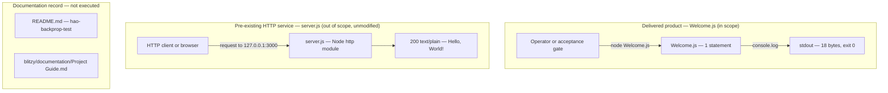

**Core technical approach.** The approach is subtractive: the artifact is defined by what it does not contain. The source is a single statement evaluated on Node.js, using only the host-provided `console` global, with no module-system construct of any kind, so the runtime's CommonJS/ESM classification of the file cannot affect it. Because nothing is imported, there is no dependency graph to resolve, no manifest to declare and no install or build phase to perform. The stated style contract is a single-quoted literal, a trailing semicolon, no indentation and a single trailing LF (`Welcome.js` is 34 bytes ending in one newline). Termination is left to the event loop draining on its own rather than forced with `process.exit`, so queued output is never truncated. Syntax is ES5-level — one member call and one string literal — which is what allows the same bytes to be produced on both supported runtime lines, v24.21.0 and v22.23.2. Execution cost is roughly 25–30 ms for one write and exit.

### 1.2.3 Success Criteria

**Measurable objectives.** Each objective below was checked against captured bytes rather than against intent.

| Objective | Criterion | Observed result |
|---|---|---|
| Exact message | stdout equals `Welcome to Blitzy` | 18 bytes, terminal LF present; stream `sha256` `2dc7e85a734de043468d7beb8ee5294e0c04440f23fd89b69fd8ea0ee7971951` |
| Silent success | Empty stderr and exit status `0` | 0 bytes on stderr; `exit=0`; `timeout 10` never triggered |
| Minimality | Exactly 1 source line and 1 added file for the product change | `wc -l Welcome.js` = 1; `git diff --name-status 1484182 HEAD` listed `A Welcome.js` when the Guide recorded it. That command now lists two added paths — `A Welcome.js` and `A blitzy/documentation/Project Guide.md` — the second being the governance record committed afterwards |
| Zero-install posture | No manifest, lockfile or `node_modules` in the repository or any ancestor directory | `ls package.json package-lock.json node_modules \| wc -l` = 0 |
| Runtime parity | Byte-identical output on every supported Node.js line | Identical bytes on v24.21.0 (reference) and v22.23.2 (supported floor) |
| Repository continuity | Pre-existing files byte-identical; existing HTTP surface intact | `README.md` and `server.js` unchanged; service still answers across methods, paths and protocol boundaries |

**Critical success factors.** The factors that decide success are:

- **Byte fidelity over intent.** Acceptance is judged on captured stdout, so any change to the literal, its casing or its trailing newline is a failure regardless of how the program "looks".
- **Preserved zero-install posture.** Adding a manifest, lockfile, `node_modules`, test file, CI workflow, container file, environment file or Python artifact would break a criterion the request made explicit.
- **Continuity of the pre-existing surface.** The delivered change must not disturb `README.md` or `server.js`, including the running HTTP service's latency and resource profile.
- **Module neutrality.** The artifact must not depend on how the runtime classifies the file, which is guaranteed only by keeping import/export syntax out of it.
- **Natural termination.** Output must not be truncated by a forced exit, which is why `process.exit` is absent and why durability was tested with a deliberately slow reader.
- **Governance reconciliation.** The one open item is a wording decision outside the code; until it is settled, a literal audit of the project rule finds one of three clauses unsatisfied.

**Key performance indicators.** The repository records the following measurable indicators of delivery and quality.

| KPI | Value | Basis |
|---|---|---|
| Requirement satisfaction | 17 of 17 requirements met | Guide §8 |
| Scoped acceptance items closed | 19 of 20 (95%) | Guide §1.4 |
| Manual acceptance checks | 42 of 42 passed, 0 failed, across 7 verification areas | Guide §3 |
| Automated coverage | 0 tests — `node --test` reports `tests 0 / suites 0 / pass 0 / fail 0` | Guide §3, Appendix A |
| Project completion | 83% — 12.5 of 15.0 hours (2.5 h remaining) | Guide §1.2, §2.3, §7 |
| Rule clauses met | 2 of 3 — flow separation and performance non-impact met; Python language clause not met | Guide §5.1, §5.2, §8 |
| Dependency, input and secret count | 0 / 0 / 0 | Guide §5.1, Appendix E |
| Execution cost | Roughly 25–30 ms for one write and exit | Guide §9.1 |
| Supported runtimes | 2 — Node.js v24.21.0 and v22.23.2 | Guide Appendix D |
| Recorded risks | 8 — 3 Open, 3 Mitigated, 1 Accepted by design, 1 Monitored | Guide §6 |

No throughput, availability, latency-under-load or capacity KPI applies to the delivered artifact: it is a short-lived process with no service, no listener and no state. The latency measurement recorded for the pre-existing `server.js` (request latency medians at or below the idle baseline while the new script ran repeatedly and concurrently, with no failed request and stable memory, thread and descriptor counts) is continuity evidence for that pre-existing service, not a KPI of the delivered product.

## 1.3 Scope

The scope is narrow enough to state exhaustively: one file, one statement, one observable effect, and a fixed list of artifact classes the change must not introduce. The boundaries below are drawn from the acceptance criteria the request fixed and from the exclusions the Guide's compliance matrix adjudicates.

### 1.3.1 In-Scope

**Must-have capabilities.** Each capability is binding, and each was checked against captured bytes.

| # | Must-have capability | Acceptance evidence |
|---|---|---|
| 1 | Emit the exact message `Welcome to Blitzy` on a user-visible channel | `Welcome.js:1`; stdout 18 bytes, hex verified character by character |
| 2 | Live at the repository root under the exact filename `Welcome.js` | `git ls-files` exact-case match at path depth 1; no `welcome.js`, `.mjs`, `.cjs` or `.py` variant exists |
| 3 | Be a JavaScript implementation | `node --check Welcome.js` exits `0` on v24.21.0 and v22.23.2; syntax level is ES5 |
| 4 | Self-terminate with a success status | Exit `0`, empty stderr, `timeout` never triggered; no `process.exit`, timer or listener in the source |
| 5 | Stay at minimal line count — one statement, 1 line, 34 bytes | `wc -l` = 1, `wc -c` = 34, one semicolon, no blank line, no padding, no comment |
| 6 | Stay simple and readable, with no abstraction | No function, class, variable, wrapper, guard or export in the file |
| 7 | Run as written — no install, build or transpile | Zero imports; no manifest, lockfile or `node_modules` in the repository or any ancestor directory |
| 8 | Not impact application performance | Standalone short-lived process, never imported by or referenced from the existing service; measured latency during and after repeated runs stayed at or below baseline |
| 9 | Separate each flow and feature clearly | The one feature's one flow occupies a dedicated file containing nothing else |
| 10 | Be module-system independent with no local module configuration | No import or export syntax; correct execution with and without an ancestor manifest of either type |
| 11 | Leave all excluded artifact classes absent | Repository-wide sweeps return nothing for every excluded class; the only `.md` pre-existing was `README.md` |
| 12 | Keep the pre-existing surface intact | `README.md` and `server.js` byte-identical to their pre-project state; the HTTP service re-verified across methods, paths and protocol boundaries |

**Primary user workflows.** Four workflows exist, and none accepts input or persists output.

1. **Execute for acceptance.** From the repository root, `node Welcome.js` prints `Welcome to Blitzy` and exits `0` with nothing on stderr.
2. **Verify the output contract.** The nine-line acceptance gate runs the parse check, captures stdout into a variable, counts output bytes, asserts stderr emptiness, reads the exit status, hex-dumps the bytes, counts source lines, checks the exact filename, and parses every tracked `.js` file.
3. **Consume the message downstream.** The output is captured into a shell variable, piped (`node Welcome.js | tr '[:lower:]' '[:upper:]'` yields `WELCOME TO BLITZY`), or asserted by string comparison in a script.
4. **Confirm continuity of the pre-existing service.** `server.js` is started on `127.0.0.1:3000`, exercised over HTTP and in a browser, and stopped — purely as continuity evidence, since it is not part of the deliverable.

**Essential integrations.** There are none. The delivered artifact integrates with no system: it reads no argument, standard input, environment variable or file, opens no socket, executes no dynamic code, holds no secret and declares no dependency. The absence of integration is enforced by the acceptance criteria rather than left unspecified, because a manifest, a dependency or an input channel would each create a surface the product is required not to have.

**Key technical requirements.**

| Requirement | Binding constraint | Verified state |
|---|---|---|
| Runtime | A supported Node.js LTS line | v24.21.0 (reference) and v22.23.2 (supported floor) produce byte-identical output |
| Syntax level | JavaScript at ES5 level | `node --check` exits `0` on both lines; one member call and one string literal |
| Module neutrality | No `import`/`export`; no module configuration | Runs under an ancestor manifest declaring `"type": "module"`, `"type": "commonjs"`, or none |
| Minimality | Exactly 1 source line, no comment or padding, single trailing LF | `wc -l` = 1; the literal appears exactly once; the file ends in one LF |
| Dependencies | Zero — no manifest, lockfile, `node_modules`, build or transpile | `ls package.json package-lock.json node_modules \| wc -l` = 0 |
| Style contract | Single-quoted literal, semicolon, no indentation, single trailing LF | Verifiable by reading the one line |
| Termination | Natural event-loop drain, no `process.exit` | Exit `0`; all 18 bytes survive a deliberately slow pipe reader |
| Performance | Must not impact the existing application | Request latency medians at or below idle baseline during and after repeated, concurrent runs |
| Portability | Any platform with a Node.js build; case-sensitive filename | Verified on Linux; the file is `Welcome.js` with a capital `W` |

**Implementation boundaries.**

| Boundary | Inside the scope | Outside the scope |
|---|---|---|
| Process | One short-lived Node.js process that writes to stdout and exits | Any listener, background job, timer, child process or resident service |
| I/O | Standard output only | Standard input, command-line arguments, environment variables, files, sockets, network |
| Data | One immutable string literal held in source | Persistent data, database, cache, message broker, log sink, telemetry |
| Repository | The tracked paths of this checkout as described in §1.2.2 | Any other repository, service, deployment target or environment |

- **User groups covered.** Anyone able to run `node` on a supported LTS line: the operator or evaluator who executes the file to accept it, and the developer who reads it as the repository's reference for the smallest correct JavaScript program. There is no account, role, permission, tenant or personal data model, so no user-group segmentation applies.
- **Geographic and market coverage.** Unbounded but undesignated. The program has no locale, timezone, region or network dependency; it emits a fixed ASCII string and produces identical output under a completely empty environment (`env -i`) and from a foreign working directory. No market, region or customer segment is named anywhere in the repository.
- **Data domains included.** Exactly one: the constant string literal `Welcome to Blitzy`. The program stores, transmits and derives no other value. The pre-existing service's response body `Hello, World!` (`server.js:9`) is observed only as continuity evidence and is not a data domain of this deliverable.

### 1.3.2 Out-of-Scope

**Explicitly excluded features and capabilities.**

| Exclusion | Basis for exclusion |
|---|---|
| Automated test suite | Intentionally absent — `node --test` reports zero tests; a test file is an excluded artifact class |
| Manifest, lockfile, `node_modules`, third-party package | Excluded artifact class; the zero-install posture is itself an acceptance criterion |
| CI workflow, container file, environment file, configuration | Excluded artifact class; the product is run, not deployed |
| Python artifact | The project rule mandates Python, but the product's own request named JavaScript and the filename `Welcome.js`; no `.py` file, stub, port or shim exists, and the clause is unmet by recorded decision |
| User interface | The deliverable has no UI; its entire observable surface is one line on standard output |
| Additional documentation | The Guide's compliance matrix records only the pre-existing `README.md` as an allowed `.md` |
| Changes to `server.js` or `README.md` | Pre-existing surface, read-only throughout, verified byte-identical |
| Logging, metrics, tracing, telemetry | Not present and not required; the program writes one line to stdout and nothing else |
| Error handling, retries, input validation | No input exists to validate and no failure path is in scope |
| Message parameterization, arguments, flags, configuration | The zero-input posture is deliberately preserved |
| Serving the greeting over HTTP | The delivered artifact opens no socket; `Welcome.js` binds no port |

**Future phase considerations.** The Guide records 2.5 hours of remaining work, none of it code: settling the rule's language clause (1.0 h, High), publishing the branch and opening the pull request (0.5 h, High), re-running the acceptance gate on the standardised Node line (0.5 h, Medium), and removing the untracked capture directory before staging (0.5 h, Low). Two of these are already reflected in the current checkout rather than pending: `HEAD` equals `origin/main` at merge commit `39974fd` (PR #15), and `git status` reports no untracked files, so no `blitzy/screenshots/` capture directory exists here. Beyond that backlog, the Guide states one conditional future item: add a small automated check "only if the product grows beyond one statement", and standardise on Node.js 24.x or later ahead of the 22.x end of life on 30 April 2027 — a runtime decision that requires no source change.

**Integration points not covered.** No database, cache, message broker, queue, API, identity provider, observability stack, secret store or external service is touched, and none is planned. `server.js` is not integrated with `Welcome.js` in either direction, and the two share nothing but a working tree. No enterprise system consumes the delivered artifact. One integration hazard is recorded as a boundary condition rather than a plan: a `package.json` declaring `"type": "module"` added in or above the repository would break the pre-existing CommonJS `server.js` at runtime while leaving `Welcome.js` unaffected, which is why the tree must stay manifest-free.

**Unsupported use cases.**

- Running under any runtime other than Node.js, including browsers, Deno-style runtimes and other JavaScript hosts.
- Importing or requiring the file as a library: it exports nothing and has no callable surface.
- Supplying a custom or dynamic message through arguments, environment variables, standard input or a configuration file.
- Configuring the pre-existing service's host or port (`server.js:3-4` hardcodes `127.0.0.1` and `3000` with no override), running it as a resilient long-lived service, or shutting it down gracefully.
- Retrieving the greeting over the network, from a web client, or from any process other than a local shell.
- Running any automated test or regression suite: acceptance is manual, by design.
- Treating the program as a long-lived service, a scheduled job or a component with availability or throughput guarantees.
- Deploying it to a container platform or a CI pipeline: no container file, workflow or deployment manifest exists.

## 1.4 References

Every statement in this section rests on the following repository evidence.

- `README.md` — established the repository identity `hao-backprop-test` and its stated purpose, "test project for backprop integration."
- `Welcome.js` — the delivered artifact: one statement, `console.log('Welcome to Blitzy');`, at the repository root; source of the output contract, the minimality counts and the zero-dependency posture.
- `server.js` — the pre-existing CommonJS HTTP service, including the hardcoded host `127.0.0.1` and port `3000` on lines 3–4 and the `200` / `text/plain` / `Hello, World!` response on lines 6–10.
- `blitzy/documentation/Project Guide.md` — the governance record supplying the completion figures (12.5 of 15.0 hours, 83%), the key accomplishments, the single open language-clause item, the 42-check manual verification table with its coverage gaps, the twelve-row compliance matrix, the security posture, the three divergences, the eight-row risk table, the nine-line acceptance gate, and the technology, port, environment-variable and glossary appendices.
- `blitzy/` — first-order documentation folder; confirmed to contain only `documentation/` and no executable source.
- `blitzy/documentation/` — folder holding the guide; established that the evidence subtree is documentation only.

Repository state observed through Git, which the section also cites: the commit history (`1484182` base, `1cef465`, `6c16ea2`, `4d1256c`, and merge commit `39974fd`), tracked-path listings, `git diff --name-status 1484182 HEAD`, and `git status --porcelain --untracked-files=all`. Runtime facts were confirmed by executing `node Welcome.js` and `server.js` and by `node --check`, `node --test`, `wc`, `od` and `sha256sum` on the host runtime (Node.js v22.23.3).

No web source was consulted; every fact above is drawn from the repository itself.

# 2. Product Requirements

## 2.1 Feature Catalog

Eight features are evidenced by this repository. Each is derived from an artifact that exists or from a criterion the change was actually judged against — the twelve-row compliance matrix in Guide §5.1, the eleven in-scope capabilities in §1.3.1, and the four tracked components in §1.2.2. Nothing is catalogued for which no artifact exists: the deliverable has no user interface, endpoint, account model, database, background job, scheduled task or external integration, and Guide §4 records that its entire observable surface is one line on standard output.

Requirements in 2.2 and the traceability matrix in 2.5 reference these IDs. F-001 to F-005 are properties of the delivered product, F-006 is the pre-existing HTTP service that remains a functioning part of the checkout while staying outside the change's scope, F-007 is the continuity obligation that binds the two, and F-008 is the delivery record the same change added.

| ID | Feature | Category | Priority |
|---|---|---|---|
| F-001 | Greeting Message Emission | Product Core / CLI Output | Critical |
| F-002 | Natural Self-Termination with Success Status | Process Lifecycle | Critical |
| F-003 | Zero-Install, Dependency-Free Execution | Packaging & Dependency Posture | Critical |
| F-004 | Module-System-Neutral Execution | Runtime Portability | High |
| F-005 | Minimal Single-Statement Source at Fixed Root Placement | Source Packaging & Minimality | High |
| F-006 | Pre-Existing HTTP Greeting Service | HTTP Service (pre-existing surface) | Medium |
| F-007 | Pre-Existing Surface Continuity and Performance Non-Impact | Repository Integrity | High |
| F-008 | Delivery Governance Record | Assurance & Documentation | Medium |

| ID | Status | Status basis |
|---|---|---|
| F-001–F-005, F-007 | Completed | Guide §5.1 records rows 1–11 `✅ PASS`; independently reproduced in this checkout |
| F-006 | Completed (pre-existing, unmodified) | `server.js` predates the change (`1484182`) and is byte-identical after it |
| F-008 | Completed | `blitzy/documentation/Project Guide.md` committed at `4d1256c` and tracked |

### 2.1.1 F-001 — Greeting Message Emission

**Feature metadata**

| Attribute | Value |
|---|---|
| Feature ID | F-001 |
| Feature name | Greeting Message Emission |
| Category | Product Core / CLI Output |
| Priority / Status | Critical / Completed |

**Description**

- **Overview.** `Welcome.js` holds one statement — `console.log('Welcome to Blitzy');` (`Welcome.js:1`) — and writes the fixed message to standard output. Nothing about the message is parameterized: the literal, its casing, its single trailing newline and the stream it lands on are all fixed in source.
- **Business value.** This is the only externally observable effect of the product, and every acceptance judgement is made on its bytes. Guide §8 records all 17 functional, non-functional and implicit requirements as met and 42 of 42 manually executed checks passing; Guide §1.4 records the single open item as a wording decision with "Governance only" impact. No artifact states a commercial value, so none is claimed here.
- **User benefits.** The acceptance operator gets an output verifiable to the byte (`57 65 6c 63 6f 6d 65 20 74 6f 20 42 6c 69 74 7a 79 0a`); a developer gets the repository's reference for the smallest correct JavaScript program (Guide §1.1); a shell consumer can capture, pipe or assert it — Guide §9.6 records `node Welcome.js | tr '[:lower:]' '[:upper:]'` yielding `WELCOME TO BLITZY` and a string comparison yielding `OK`.
- **Technical context.** One ES5-level member call on the runtime-provided `console` global. There is no import, function, class, variable or guard, so the runtime's module classification cannot affect it. The literal is single-quoted, semicolon-terminated, and the file's last two bytes are `;` and LF (`od -c`). Observed on this checkout's runtime (Node.js v22.23.3): stdout 18 bytes, stderr 0 bytes, exit status `0`; Guide Appendix A records the identical hex on v24.21.0 and v22.23.2.

**Dependencies**

| Dependency class | Requirement |
|---|---|
| Prerequisite features | None. The statement is self-contained in a 34-byte file. |
| System dependencies | A Node.js runtime on a supported line (reference v24.21.0; supported floor v22.23.2, end of life 30 April 2027 — Guide Appendix D) and its `console` global writing to the process's standard output. |
| External dependencies | None — zero packages; no manifest, lockfile or `node_modules` in the repository or any ancestor directory. |
| Integration requirements | None inbound: the program reads no argument, standard input, environment variable or file. Downstream consumption is limited to standard output capture or piping (Guide §9.6); no file, socket, log sink or telemetry is written. |

### 2.1.2 F-002 — Natural Self-Termination with Success Status

**Feature metadata**

| Attribute | Value |
|---|---|
| Feature ID | F-002 |
| Feature name | Natural Self-Termination with Success Status |
| Category | Process Lifecycle |
| Priority / Status | Critical / Completed |

**Description**

- **Overview.** The process ends by itself once the single statement has run: the event loop empties, no `process.exit` call, timer, listener or handle is registered, and the shell regains control.
- **Business value.** Termination is an acceptance criterion in its own right (Guide §5.1 row 4) because a forced exit can truncate queued output — the reason the Guide's ledger credits 2.0 hours to output-contract verification and robustness.
- **User benefits.** Scripts and pipelines that invoke the program receive a clean success status and no residual process, so it can be called repeatedly, concurrently, inside command substitution and inside larger pipelines without cleanup.
- **Technical context.** The absence of `process.exit`, timers and listeners is the mechanism; the Guide records natural termination confirmed under `timeout 10` on both supported runtimes with all 18 bytes surviving a deliberately slow pipe reader (Guide §4), and about 25–30 ms for one write and exit (Guide §9.1). On this checkout, `node Welcome.js >/dev/null; echo $?` returns `exit=0`.

**Dependencies**

| Dependency class | Requirement |
|---|---|
| Prerequisite features | F-001 — the single statement is the only work performed; termination is the event loop draining after it. |
| System dependencies | The Node.js runtime's lifecycle: process exit status is derived from the runtime, whose supported lines are v24.21.0 (reference) and v22.23.2 (floor). |
| External dependencies | None. |
| Integration requirements | Shell-level only: the parent process must observe the exit status. No shutdown hook, signal handler or drain step exists to coordinate. |

### 2.1.3 F-003 — Zero-Install, Dependency-Free Execution

**Feature metadata**

| Attribute | Value |
|---|---|
| Feature ID | F-003 |
| Feature name | Zero-Install, Dependency-Free Execution |
| Category | Packaging & Dependency Posture |
| Priority / Status | Critical / Completed |

**Description**

- **Overview.** The program runs as written. It imports nothing (the source has no `import`, `export` or `require`) and depends only on the `console` global the runtime provides, so no install, dependency resolution, build or transpile step exists between the source and its execution.
- **Business value.** The zero-install posture is itself a binding criterion (Guide §5.1 rows 7 and 11) and the reason Guide Appendix F records no package manager, linter, bundler or container tooling in use; Guide §8 counts the absence of a dependency graph, lockfile and configuration drift among the product's operating advantages.
- **User benefits.** `node Welcome.js` from a fresh clone is the entire setup (Guide §9.2 records no environment setup of any kind), which is what allows the file to serve as a minimal reference artifact.
- **Technical context.** Verified here: `ls package.json package-lock.json node_modules` in the repository and in every ancestor directory returns nothing, and `git ls-files` lists four tracked paths, none of them a manifest. Guide §3 records the zero-install posture and exclusion sweep as 7 of 7 checks passed, and Guide Appendix F notes that adding a manifest, lockfile or `node_modules` would break an acceptance criterion.

**Dependencies**

| Dependency class | Requirement |
|---|---|
| Prerequisite features | None. |
| System dependencies | Node.js runtime only, which supplies `console` as a global; JavaScript syntax used is ES5-level (Guide Appendix D). |
| External dependencies | None — dependency count is zero, so there is no package registry, lockfile or transitive advisory exposure. |
| Integration requirements | Negative integration requirement: the tree must stay free of `package.json`, lockfiles, `node_modules`, test files, CI workflows, container files, environment files and Python artifacts (Guide §5.1 row 11). |

### 2.1.4 F-004 — Module-System-Neutral Execution

**Feature metadata**

| Attribute | Value |
|---|---|
| Feature ID | F-004 |
| Feature name | Module-System-Neutral Execution |
| Category | Runtime Portability |
| Priority / Status | High / Completed |

**Description**

- **Overview.** Because the source contains no import or export syntax, the runtime's classification of the file — CommonJS or ES module — does not change its behaviour. The artifact therefore carries no module configuration of its own.
- **Business value.** Guide §5.1 row 10 records module-system independence with no local module configuration as a satisfied benchmark, and Guide §8 treats it as one of the areas where a one-line script can still be wrong.
- **User benefits.** The file keeps working if a module manifest later appears in or above the tree, and it does not impose a module system on the repository that hosts it.
- **Technical context.** Guide §4 records the file running correctly with an ancestor manifest declaring `"type": "module"`, with one declaring `"type": "commonjs"`, and with no manifest at all. The corresponding hazard is that a `package.json` declaring `"type": "module"` would break the pre-existing CommonJS `server.js` while leaving `Welcome.js` unaffected — rated Integration / Medium severity / Low probability with the mitigation "keep the tree manifest-free" (Guide §6).

**Dependencies**

| Dependency class | Requirement |
|---|---|
| Prerequisite features | F-003 — neutrality is preserved precisely because no module configuration is introduced. |
| System dependencies | The Node.js runtime's file-classification logic (manifest `"type"` field or its absence). |
| External dependencies | None. |
| Integration requirements | A negative constraint on F-006: no `package.json` may be added in or above the repository without re-verifying both executable surfaces. |

### 2.1.5 F-005 — Minimal Single-Statement Source at Fixed Root Placement

**Feature metadata**

| Attribute | Value |
|---|---|
| Feature ID | F-005 |
| Feature name | Minimal Single-Statement Source at Fixed Root Placement |
| Category | Source Packaging & Minimality |
| Priority / Status | High / Completed |

**Description**

- **Overview.** The product is one path, one line and one statement: `Welcome.js` at the repository root with exact casing, 34 bytes, 1 line by `wc -l`, a single trailing LF, no comment and no padding. Guide §10 G defines the binding counts as "minimality criteria" — exactly 1 source line and exactly 1 file added.
- **Business value.** Minimality and simplicity are acceptance benchmarks in their own right (Guide §5.1 rows 2, 5 and 6), and they are what make the file usable as a reference for the smallest correct JavaScript program (Guide §1.1).
- **User benefits.** A reader can verify the whole artifact by reading one line; a reviewer can confirm placement and size with two commands (`git ls-files`, `wc -l`).
- **Technical context.** Verified here: `wc -l -c Welcome.js` = `1 34`, `sha256sum` = `5c7ac141d94f92056efb756f17335252c31e3d08d509e641d76512f73112c1fc` (matching Guide Appendix A), and `git diff --name-status 1484182 HEAD` lists `A Welcome.js`. The same command now also lists `A blitzy/documentation/Project Guide.md`, the governance record committed afterwards, so the "one added file" count applies to the product commit `1cef465` and not to `HEAD`; Guide §5.2 divergence 2 records the intervening commit `6c16ea2` as a record-only commit that changes no path.

**Dependencies**

| Dependency class | Requirement |
|---|---|
| Prerequisite features | None. |
| System dependencies | Node.js for the parse check (`node --check Welcome.js` exits `0`); Git for placement and change-count evidence. |
| External dependencies | None. |
| Integration requirements | Placement and casing are filesystem-sensitive: Guide §9.1 notes the file is `Welcome.js` with a capital `W`, and a case-insensitive filesystem masks a wrong-case invocation that then fails on Linux. |

### 2.1.6 F-006 — Pre-Existing HTTP Greeting Service

**Feature metadata**

| Attribute | Value |
|---|---|
| Feature ID | F-006 |
| Feature name | Pre-Existing HTTP Greeting Service |
| Category | HTTP Service (pre-existing surface) |
| Priority / Status | Medium / Completed (pre-existing, unmodified) |

**Description**

- **Overview.** `server.js` is a CommonJS Node.js HTTP service (`require('http')`, `server.js:1`) that binds loopback host `127.0.0.1` on port `3000` (`server.js:3-4`) and answers every request — regardless of method, path, query or body — with status `200`, `Content-Type: text/plain` and the body `Hello, World!\n` (`server.js:7-9`), logging `Server running at http://127.0.0.1:3000/` on a successful bind (`server.js:12-14`).
- **Business value.** None is recorded: Guide Appendix C describes the file as a "Pre-existing HTTP demo server; unmodified by this work", and Guide §4 states it was exercised only as continuity evidence. Its value to this specification is that it is a live capability of the repository that the change had to leave intact.
- **User benefits.** A local caller — a terminal HTTP client or a browser — gets a fixed plain-text greeting; Guide §4 records the served response rendering in a real browser with zero console messages and no response returning `400` or above.
- **Technical context.** Verified in this checkout: `GET /` returns `HTTP/1.1 200 OK` with `Content-Type: text/plain` and body `Hello, World!`; `POST /anything?a=b` with a body returns `200 text/plain`; `HEAD /` returns `200`; a 20 KB request header returns `431 Request Header Fields Too Large`; a malformed request line returns `400 Bad Request` with no internal detail; and a second simultaneous start exits `1` with an unhandled `EADDRINUSE` stack trace on stderr because no `'error'` listener is attached to `listen`. The runtime's own HTTP parser produces the `431` and `400` responses; the source contains no error handling, branching or state.

**Dependencies**

| Dependency class | Requirement |
|---|---|
| Prerequisite features | None; the service predates the change. |
| System dependencies | Node.js built-in `http` module and the loopback interface; availability of TCP port `3000`, which is hardcoded with no override. |
| External dependencies | None — no package, database, cache or broker is contacted. |
| Integration requirements | Local-only by construction: the bind address is `127.0.0.1`, so the service is not reachable off-host. It shares nothing with `Welcome.js` beyond the working tree — neither file imports, references or consumes the other. |

### 2.1.7 F-007 — Pre-Existing Surface Continuity and Performance Non-Impact

**Feature metadata**

| Attribute | Value |
|---|---|
| Feature ID | F-007 |
| Feature name | Pre-Existing Surface Continuity and Performance Non-Impact |
| Category | Repository Integrity |
| Priority / Status | High / Completed |

**Description**

- **Overview.** The change is additive: `README.md` and `server.js` are byte-identical to their pre-project state, no tracked path was modified, and the running HTTP service is unaffected by the new script.
- **Business value.** Guide §2.1 allocates 3.0 hours — the largest single line in the 12.5-hour ledger — to proving this continuity, and Guide §5.1 rows 8 and 12 record performance non-impact and pre-existing surface integrity as satisfied benchmarks; the project rule's own clause requires that application performance not be impacted.
- **User benefits.** Anyone relying on the existing service or identity stub keeps exactly the behaviour they had, while the new file adds an independent capability beside them.
- **Technical context.** `git diff --name-status 1484182 HEAD` returns only added paths (`A Welcome.js`, `A blitzy/documentation/Project Guide.md`) with no `M` or `D` entries, and the working tree is clean (`git status --porcelain --untracked-files=all` is empty in this checkout — the seven untracked PNG captures Guide §5.2 divergence 3 describes are no longer present). Guide §4 records the measured continuity evidence: request latency medians at or below the idle baseline while the script ran repeatedly and concurrently, no failed request, and stable memory, thread and descriptor counts.

**Dependencies**

| Dependency class | Requirement |
|---|---|
| Prerequisite features | F-001 (the added artifact) and F-006 (the surface whose continuity is asserted). |
| System dependencies | Git, for the byte-identical and added-path comparisons; Node.js, to start the service and re-run the new script. |
| External dependencies | None. |
| Integration requirements | Negative integration requirement: the delivered file must never be imported by, referenced from, or co-scheduled with the service (Guide §5.1 row 8 records that it is "never imported by or referenced from the existing service"). |

### 2.1.8 F-008 — Delivery Governance Record

**Feature metadata**

| Attribute | Value |
|---|---|
| Feature ID | F-008 |
| Feature name | Delivery Governance Record |
| Category | Assurance & Documentation |
| Priority / Status | Medium / Completed |

**Description**

- **Overview.** `blitzy/documentation/Project Guide.md` is a 382-line, 35,992-byte Markdown record committed by the same change (`4d1256c`) and tracked in Git. It holds ten areas: executive summary, hours breakdown, test results, runtime validation, compliance and quality review, risk assessment, visual project status, summary and recommendations, development guide, and appendices.
- **Business value.** It is the repository's only statement of delivery status, completion accounting (12.5 of 15.0 hours, 83%), compliance adjudication (12-row matrix), recorded divergences (3), risks (8) and operating procedure (the nine-command gate). Without it, the project's single open item and the reasoning behind it would be unrecorded.
- **User benefits.** An owner, auditor or acceptance operator can act on it directly: Guide §1.6 lists the recommended next steps with priorities, and Appendix A gives each command with its observed result.
- **Technical context.** Documentation only — it is not executed, imported or referenced by either JavaScript file (Guide §1.2.2 classifies it as a component of the system; §1.3.2 excludes additional documentation as an artifact class while the only pre-existing `.md` was `README.md`). Its companion is the record-only commit `6c16ea2`, which carries no path changes and exists because the language decision had nowhere to live in a tree under a one-line and one-file ceiling (Guide §5.2 divergence 2).

**Dependencies**

| Dependency class | Requirement |
|---|---|
| Prerequisite features | The evidence it records: F-001 to F-007 outcomes and the acceptance gate in Guide §9.5. |
| System dependencies | A Markdown renderer for reading; Git for the commits it cites; a Node.js line and POSIX shell tools (`wc`, `od`, `sha256sum`) to re-run its gate. |
| External dependencies | None. The record cites no web source; every claim in it is drawn from the repository. |
| Integration requirements | None; nothing consumes the file programmatically. Guide §1.6 warns that cleanup of an untracked capture directory is advisable before staging so a blanket `git add` cannot add artifacts beyond the intended ones. |


## 2.2 Functional Requirements Table

Every requirement below is stated so that a single command decides it, and each acceptance criterion is one that was actually executed — in this checkout or in the record the Guide preserves. Requirement IDs follow `F-XXX-RQ-YYY`; all requirements are at version 1.0, frozen at commit `39974fd` (`HEAD` equals `origin/main`).

Two facts shape the tables that follow. First, the delivered product has **no inputs at all**: it reads no command-line argument, no standard input, no environment variable and no file (Guide §5.1 security posture, Appendix E), so most input-parameter and data-validation cells are structurally empty rather than unverified. Second, acceptance is manual by design: `node --test` reports `tests 0 / suites 0 / pass 0 / fail 0`, and the mechanism that decides these requirements is the nine-command gate in Guide §9.5, whose recorded results are cited in the acceptance criteria.

Process flows and related specifications:

- Component and runtime shape — §1.2.2 of this specification, whose flowchart shows the delivered product, the pre-existing service and the documentation record as separate surfaces.
- Verification procedure — Guide §9.5 (the acceptance gate, nine commands) with Guide §3 (the 42-check manual result table) as its outcome record.
- Continuity procedure — Guide §4 (runtime validation of the pre-existing surface and the performance non-impact measurement).
- Cross-reference for scope boundaries — §1.3.1 and §1.3.2 of this specification; feature dependency map — 2.3 below.

### 2.2.1 F-001 — Greeting Message Emission

**Requirement details**

| Requirement ID | Description | Acceptance criteria | Priority / Complexity |
|---|---|---|---|
| F-001-RQ-001 | On execution, write the exact characters `Welcome to Blitzy` followed by one LF to standard output. | `node Welcome.js \| od -An -t x1` yields `57 65 6c 63 6f 6d 65 20 74 6f 20 42 6c 69 74 7a 79 0a`; `node Welcome.js \| wc -c` yields `18`. | Must-Have / Low |
| F-001-RQ-002 | The message is fixed in source and takes no parameter from any input channel. | The literal appears exactly once (`Welcome.js:1`); `env -i` execution and execution from a foreign working directory produce identical bytes (Guide §4). | Must-Have / Low |
| F-001-RQ-003 | Success is silent: nothing is written to standard error. | `node Welcome.js 2>&1 >/dev/null \| wc -c` yields `0`. | Must-Have / Low |
| F-001-RQ-004 | All bytes must reach a slow or back-pressured stdout rather than being truncated. | A deliberately slow pipe reader receives all 18 bytes; no `process.exit` truncation path exists (Guide §4). | Should-Have / Low |
| F-001-RQ-005 | Output is byte-identical across every supported Node.js line. | Captured bytes match on v24.21.0 (reference) and v22.23.2 (supported floor); reproduced on v22.23.3 here (Guide §4, Appendix A). | Must-Have / Low |

**Technical specifications**

| Requirement ID | Input parameters | Output / response | Performance criteria & data requirements |
|---|---|---|---|
| F-001-RQ-001 | None — no argv, stdin, environment variable or file is read. | 18-byte stdout stream. | One write per process; Guide §9.1 records roughly 25–30 ms for a run; data is one immutable ASCII literal. |
| F-001-RQ-002 | Arguments, stdin and environment are consumed by nothing. | Identical 18 bytes under every invocation context tested. | No configuration read, so no configuration-dependent behaviour; no data is persisted. |
| F-001-RQ-003 | None. | Empty stderr (0 bytes). | No error path exists; Guide §3 records stream-failure behaviour as not asserted. |
| F-001-RQ-004 | A slow reader on the stdout pipe. | All 18 bytes delivered. | Depends on F-002 natural termination; a forced exit is the failure mode being excluded. |
| F-001-RQ-005 | None. | Byte-identical output per supported runtime. | ES5-level syntax — one member call and one string literal — so no version-sensitive API is used (Guide Appendix D). |

**Validation rules**

| Requirement ID | Business rules | Data validation | Security & compliance |
|---|---|---|---|
| F-001-RQ-001 | The message text, its casing and its trailing LF are fixed; no parameterization is permitted. | Byte-for-byte comparison against the recorded hex; byte count equals 18. | Writes to stdout only; holds no secret and no credential; compliance rows 1, 3 and 5 of Guide §5.1 pass. |
| F-001-RQ-002 | Output must not vary with context; the zero-input posture is preserved deliberately. | Comparison across empty environment, foreign working directory and repeated/concurrent runs. | No input channel exists, so there is no input-validation surface; file permissions are `0644` (Guide §5.1). |
| F-001-RQ-003 | Success is reported by exit status, not by diagnostics. | stderr byte count must equal 0. | Prevents internal detail from leaking to a log or terminal. |
| F-001-RQ-004 | Queued output must never be sacrificed to shorten process life. | 18 of 18 bytes received under the slow reader. | No additional obligation; verified as part of the output contract. |
| F-001-RQ-005 | Standardise on Node.js 24.x or later before 30 April 2027. | Byte comparison across runtime lines. | Node.js 22.x end of life is a Monitored operational risk in Guide §6; no code change is needed to move. |

### 2.2.2 F-002 — Natural Self-Termination with Success Status

**Requirement details**

| Requirement ID | Description | Acceptance criteria | Priority / Complexity |
|---|---|---|---|
| F-002-RQ-001 | The process must exit with success status `0` after the message is written. | `node Welcome.js >/dev/null; echo $?` yields `exit=0`; Guide records `timeout 10` never triggering on either supported line. | Must-Have / Low |
| F-002-RQ-002 | Termination must be natural — no `process.exit`, timer or listener registered. | Source contains no `process.exit`, timer or listener; the event loop empties on its own (Guide §5.1 row 4). | Must-Have / Low |
| F-002-RQ-003 | No process, handle, listening socket or file write may remain after the run. | Repeated and concurrent runs leave no residual process or handle, modify no tracked file, and the program binds no port (Guide §4, Appendix B). | Should-Have / Low |
| F-002-RQ-004 | Execution time must stay short enough for repeated and pipelined use. | Guide §9.1 records roughly 25–30 ms for one write and exit. | Should-Have / Low |

**Technical specifications**

| Requirement ID | Input parameters | Output / response | Performance criteria & data requirements |
|---|---|---|---|
| F-002-RQ-001 | None. | Process exit status `0`. | Measured over repeated and concurrent runs with identical results (Guide §4). |
| F-002-RQ-002 | None. | Immediate return to the invoking shell. | Bounded by the runtime's own shutdown; no drain or shutdown hook exists to wait on. |
| F-002-RQ-003 | None. | No residue in the process table, descriptor table or working tree. | Verified by `git status` cleanliness and by observing repeated runs (Guide §4; confirmed in this checkout). |
| F-002-RQ-004 | None. | One write followed by exit. | Cost is dominated by runtime startup; no data volume or concurrency of the program's own applies. |

**Validation rules**

| Requirement ID | Business rules | Data validation | Security & compliance |
|---|---|---|---|
| F-002-RQ-001 | A non-zero status is a failure regardless of correct output. | Exit status read directly from the shell; `timeout` wrapper must not fire. | Success status is the machine-readable contract for any caller. |
| F-002-RQ-002 | Forced exit is prohibited because it can truncate queued output. | Source inspection plus the slow-reader durability check. | Guide §5.1 row 4 records this as satisfied; the project rule's performance clause depends on it. |
| F-002-RQ-003 | The artifact must not behave like a service. | Working-tree and process residue checks. | No socket is opened and no file is written, so no persistent surface is created. |
| F-002-RQ-004 | Runtime cost must remain negligible beside the existing application. | Wall-clock observation of one run. | Supports the rule's non-impact clause; measurement of the service's own latency is F-007-RQ-003. |

### 2.2.3 F-003 — Zero-Install, Dependency-Free Execution

**Requirement details**

| Requirement ID | Description | Acceptance criteria | Priority / Complexity |
|---|---|---|---|
| F-003-RQ-001 | The source must declare no dependency: no `require`, `import` or `export`; only the runtime's `console` global is used. | `Welcome.js` contains one statement and no import construct; `node --check Welcome.js` exits `0` (Guide §9.3, §3). | Must-Have / Low |
| F-003-RQ-002 | No manifest, lockfile or `node_modules` may exist in the repository or in any ancestor directory. | `ls package.json package-lock.json node_modules 2>/dev/null \| wc -l` yields `0`; an ancestor walk finds no manifest (verified here; Guide §3 records 7 of 7 checks passed). | Must-Have / Low |
| F-003-RQ-003 | The program must run as written, with no install, build, bundling or transpile step. | `node Welcome.js` from a fresh clone prints the message; Guide §9.2 records that there is nothing to set up and warns against `npm install`. | Must-Have / Low |
| F-003-RQ-004 | Every excluded artifact class must stay absent from the tree. | Repository sweeps return nothing for test files, CI workflows, container files, environment files, configuration files, third-party packages and Python artifacts; the only `.md` pre-existing was `README.md` (Guide §5.1 row 11). | Must-Have / Low |

**Technical specifications**

| Requirement ID | Input parameters | Output / response | Performance criteria & data requirements |
|---|---|---|---|
| F-003-RQ-001 | Source file only. | One statement; nothing to resolve. | No dependency graph exists, so resolution cost is zero; data requirement is the runtime global `console`. |
| F-003-RQ-002 | Repository path and each ancestor directory. | Empty listing. | Checked with `ls` and a directory walk; Guide Appendix F records that adding any of these breaks a criterion. |
| F-003-RQ-003 | `node Welcome.js`. | Message on stdout, exit `0`. | No build phase, no intermediate artifact, no transpile output. |
| F-003-RQ-004 | Repository-wide sweeps, including `git ls-files`. | No matching artifact. | Guide §3 groups this as the "zero-install posture and exclusions" area; 4 tracked paths, none an excluded class. |

**Validation rules**

| Requirement ID | Business rules | Data validation | Security & compliance |
|---|---|---|---|
| F-003-RQ-001 | Dependencies may not be introduced without a scope change. | Source inspection for import constructs. | Zero dependencies means zero transitive advisory exposure (Guide §6, risk row 8). |
| F-003-RQ-002 | The tree must remain manifest-free, including ancestors. | Existence checks at every level of the path. | A manifest could break the pre-existing CommonJS service; see F-004-RQ-003. |
| F-003-RQ-003 | Reproduction from a clean checkout must succeed with no preparatory command. | Fresh-clone execution; no install log or lockfile appears. | No network access is required to run the product (Guide §9.1). |
| F-003-RQ-004 | Documentation beyond the record and excluded tooling may not be added. | Sweep results for each excluded class. | Keeps the maintenance surface to the host runtime's support lifecycle (Guide §8). |

### 2.2.4 F-004 — Module-System-Neutral Execution

**Requirement details**

| Requirement ID | Description | Acceptance criteria | Priority / Complexity |
|---|---|---|---|
| F-004-RQ-001 | The source must contain no import/export syntax that fixes the file's module system. | No `import` or `export` statement appears in `Welcome.js`; `node --check` is clean. | Must-Have / Low |
| F-004-RQ-002 | Behaviour must be identical whether the runtime classifies the file as CommonJS, as an ES module, or leaves it unclassified. | Correct output with an ancestor manifest declaring `"type": "module"`, one declaring `"type": "commonjs"`, and none at all (Guide §4). | Must-Have / Low |
| F-004-RQ-003 | No local module configuration may be introduced. | `git ls-files` lists four tracked paths, none of them a manifest; Guide §5.1 row 10 records module independence with no configuration. | Must-Have / Low |

**Technical specifications**

| Requirement ID | Input parameters | Output / response | Performance criteria & data requirements |
|---|---|---|---|
| F-004-RQ-001 | Source file and, for the parse check, the runtime. | Exit `0` from `node --check` with no output. | Static check only; no execution cost. |
| F-004-RQ-002 | An ancestor manifest of either `"type"` value, or its absence. | Identical 18-byte stdout in all three conditions. | Classification changes nothing because the file defines no module construct. |
| F-004-RQ-003 | `git ls-files` output. | No `package.json` path. | The tracked tree is four files: `README.md`, `Welcome.js`, `blitzy/documentation/Project Guide.md`, `server.js`. |

**Validation rules**

| Requirement ID | Business rules | Data validation | Security & compliance |
|---|---|---|---|
| F-004-RQ-001 | The file must not require a particular module system. | Source inspection; parse check on both supported lines (Guide §5.1 row 3). | Removes a runtime-classification failure mode from the artifact. |
| F-004-RQ-002 | The artifact must survive a future manifest appearing above it. | Comparison of captured output across the three conditions. | Integration risk mitigated by keeping the tree manifest-free (Guide §6). |
| F-004-RQ-003 | A manifest, if ever required, must declare `"type": "commonjs"` and be followed by re-verification of both files. | Absence check on tracked and ancestor paths. | Protects the pre-existing `server.js`, which is CommonJS (`server.js:1`) and would break under `"type": "module"`. |

### 2.2.5 F-005 — Minimal Single-Statement Source at Fixed Root Placement

**Requirement details**

| Requirement ID | Description | Acceptance criteria | Priority / Complexity |
|---|---|---|---|
| F-005-RQ-001 | The file must be named `Welcome.js` with exact casing and sit at the repository root. | `git ls-files` returns an exact-case match at path depth 1; no `welcome.js`, `.mjs`, `.cjs` or `.py` variant exists (Guide §5.1 row 2). | Must-Have / Low |
| F-005-RQ-002 | The source must be one line of 34 bytes — one statement, no comment, no padding — ending in a single LF. | `wc -l -c Welcome.js` yields `1 34`; the final two bytes are `;` and `\n` (`od -c`); the literal appears exactly once. | Must-Have / Low |
| F-005-RQ-003 | The source must contain no abstraction: no function, class, variable, wrapper, guard or export. | Reading the file yields one statement and nothing else (Guide §5.1 row 6). | Must-Have / Low |
| F-005-RQ-004 | The change must add exactly one product path and modify none. | `git diff --name-status 1484182 HEAD` shows only additions and no `M`/`D` entries; the product commit `1cef465` adds exactly `A Welcome.js`. | Must-Have / Medium |

**Technical specifications**

| Requirement ID | Input parameters | Output / response | Performance criteria & data requirements |
|---|---|---|---|
| F-005-RQ-001 | `git ls-files`, filesystem case sensitivity. | Path `Welcome.js` at depth 1. | Placement is verified without executing the program; Guide §9.1 flags case sensitivity as the platform-dependent part. |
| F-005-RQ-002 | `wc -l -c Welcome.js`, `od -c Welcome.js`, `sha256sum`. | `1 34`; trailing `;` `\n`; hash `5c7ac141d94f92056efb756f17335252c31e3d08d509e641d76512f73112c1fc`. | Size and hash are the minimality evidence; Guide §10 G names these as the binding counts. |
| F-005-RQ-003 | A read of the file. | One statement, no declarations. | Zero abstraction means zero internal API surface to test. |
| F-005-RQ-004 | `git diff --name-status 1484182 HEAD`. | `A Welcome.js`, plus `A blitzy/documentation/Project Guide.md` from the later record commit. | The product commit adds 1 line; the record-only commit `6c16ea2` changes no path (Guide §5.2 divergence 2). |

**Validation rules**

| Requirement ID | Business rules | Data validation | Security & compliance |
|---|---|---|---|
| F-005-RQ-001 | The filename and its location are contract elements; renaming breaks acceptance. | Exact-case path comparison. | Case-insensitive filesystems mask a wrong-case invocation that fails on Linux (Guide §9.7). |
| F-005-RQ-002 | The one-line ceiling is binding; a comment, blank line or padding breaches it. | Line count, byte count and trailing-byte inspection. | Style contract: single-quoted literal, semicolon, no indentation, single trailing LF (Guide §2.1, Appendix F). |
| F-005-RQ-003 | Simplicity is a criterion, not a preference. | Full-source read. | No hidden behaviour can escape review of one line. |
| F-005-RQ-004 | Exactly one product file may be added; the governance record is accounted for separately. | Added versus modified versus deleted path status. | Guide §1.6 warns against `git add -A` so untracked captures cannot breach the count. |

### 2.2.6 F-006 — Pre-Existing HTTP Greeting Service

**Requirement details**

| Requirement ID | Description | Acceptance criteria | Priority / Complexity |
|---|---|---|---|
| F-006-RQ-001 | The service must bind loopback `127.0.0.1` on port `3000` and announce the bind. | Startup log reads `Server running at http://127.0.0.1:3000/`; the port answers within about 1.5 s of launch (observed here). | Must-Have / Low |
| F-006-RQ-002 | Every request, regardless of method, path, query or body, receives the same response. | `GET /`, `POST /anything?a=b` with a body and `HEAD /` all return `200` with `Content-Type: text/plain` and body `Hello, World!`. | Must-Have / Low |
| F-006-RQ-003 | Protocol-boundary requests must be answered without disclosing internals. | 20 KB request header returns `431 Request Header Fields Too Large`; malformed request line returns `400 Bad Request`; neither response carries a stack trace. | Should-Have / Low |
| F-006-RQ-004 | Reachability must be local by construction. | Bind address is the loopback literal `127.0.0.1` (`server.js:3`); Guide Appendix B records no environment override for host or port. | Must-Have / Low |

**Technical specifications**

| Requirement ID | Input parameters | Output / response | Performance criteria & data requirements |
|---|---|---|---|
| F-006-RQ-001 | Process start; no argument or environment value is read. | Bound listener plus one stdout line. | Bind failure exits `1` with an unhandled `EADDRINUSE` stack trace because no `'error'` listener exists. |
| F-006-RQ-002 | An HTTP request of any method, path, query string or body. | `200`, `text/plain`, `Hello, World!\n`. | Response is built synchronously inside the request handler; no asynchronous work, state or branching (`server.js:6-10`). |
| F-006-RQ-003 | Oversized headers, malformed request lines. | `431` and `400` respectively. | Produced by the runtime's HTTP parser; the source adds no error handling of its own. |
| F-006-RQ-004 | A connection attempt from another host. | No response — the listener is loopback-only. | Loopback binding is the whole access-control model; there is no authentication or authorization layer. |

**Validation rules**

| Requirement ID | Business rules | Data validation | Security & compliance |
|---|---|---|---|
| F-006-RQ-001 | Host and port are fixed values; availability of port `3000` is an environmental precondition. | Startup log line and a successful request. | Loopback binding limits exposure; no credentials, TLS or secret handling exist. |
| F-006-RQ-002 | The response is uniform; no routing, content negotiation or state may be introduced. | Status, `Content-Type` and body compared across variants. | The body is a constant literal, so no user-controlled data reaches the response. |
| F-006-RQ-003 | Boundary conditions must not leak internals or crash the listener. | Status codes for oversized and malformed input. | Parser-level rejection; no raw query, path or body is logged or echoed. |
| F-006-RQ-004 | The service must remain a local demo, not a shared endpoint. | Bind-address inspection (`server.js:3`). | No access control beyond the loopback address; Guide §6 records the missing error listener, absent graceful shutdown and hardcoded port as open pre-existing gaps outside this deliverable. |

### 2.2.7 F-007 — Pre-Existing Surface Continuity and Performance Non-Impact

**Requirement details**

| Requirement ID | Description | Acceptance criteria | Priority / Complexity |
|---|---|---|---|
| F-007-RQ-001 | `README.md` and `server.js` must remain byte-identical to their pre-project state. | `git diff --name-status 1484182 HEAD` shows no `M` or `D` entry for either path; Guide §5.1 row 12 records the check as passed. | Must-Have / Medium |
| F-007-RQ-002 | The delivered change must leave the working tree clean, with no residue from verification. | `git status --porcelain --untracked-files=all` returns nothing in this checkout; repeated runs modify no tracked file (Guide §4). | Must-Have / Low |
| F-007-RQ-003 | Running the new script must not degrade the service's latency or resource profile. | Guide §4 records request latency medians at or below the idle baseline during and after repeated, concurrent runs, with no failed request and stable memory, thread and descriptor counts. | Must-Have / Medium |
| F-007-RQ-004 | The existing HTTP surface must continue to render correctly in a browser. | Guide §4 records the served response rendering with zero console messages and no request returning `400` or above, before and after repeated runs of the new script, with byte-identical captures. | Should-Have / Low |

**Technical specifications**

| Requirement ID | Input parameters | Output / response | Performance criteria & data requirements |
|---|---|---|---|
| F-007-RQ-001 | Base commit `1484182` and `HEAD`. | Diff limited to added paths. | Guide §2.1 credits 3.0 hours to this proof — the largest line in the ledger. |
| F-007-RQ-002 | `git status --porcelain --untracked-files=all`. | Empty output. | Guide §5.2 divergence 3 describes seven untracked PNG captures; none are present in this checkout. |
| F-007-RQ-003 | Repeated and concurrent `node Welcome.js` runs while `server.js` serves requests. | Latency medians at or below baseline; zero failed requests; stable resource counts. | Both programs are separate short-lived or long-lived processes; neither imports the other, so no shared heap or event loop exists. |
| F-007-RQ-004 | A browser request to the running service. | Rendered greeting, zero console messages, no response ≥400. | Responses are byte-identical across captures, as the body is a constant. |

**Validation rules**

| Requirement ID | Business rules | Data validation | Security & compliance |
|---|---|---|---|
| F-007-RQ-001 | The pre-existing surface is read-only for this change; its bytes must not drift. | Git path-status and content comparison. | Satisfies the repository-continuity benchmark (Guide §5.1 row 12) and the rule's non-impact clause. |
| F-007-RQ-002 | Verification must not leave artifacts inside the checkout. | Untracked-file enumeration. | Guide §1.6 makes removal of stray captures a precondition for staging. |
| F-007-RQ-003 | Non-impact is measured, not assumed. | Before/during/after latency comparison with resource sampling. | The delivered program opens no socket, so it cannot contend for the service's port or descriptors. |
| F-007-RQ-004 | The service's user-visible behaviour must not regress. | Browser observation and response-byte comparison. | No new content, header or error surface is introduced by the change. |

### 2.2.8 F-008 — Delivery Governance Record

**Requirement details**

| Requirement ID | Description | Acceptance criteria | Priority / Complexity |
|---|---|---|---|
| F-008-RQ-001 | The change must carry one tracked Markdown record covering delivery, verification, compliance, risk, operations and development evidence. | `blitzy/documentation/Project Guide.md` is tracked, 382 lines and 35,992 bytes, with ten numbered areas plus appendices A–G. | Should-Have / Low |
| F-008-RQ-002 | The record's completion account must be internally consistent. | 12.5 + 2.5 = 15.0 hours and 12.5 ÷ 15.0 = 83% agree across §1.2, §2.3, §7 and §8 of the record. | Should-Have / Low |
| F-008-RQ-003 | The one open item must be recorded with its owner, impact and effort. | §1.4 and §5.2 divergence 1 name the project rule's Python clause, owner "Project owner", ETA 1.0 h, impact "Governance only". | Should-Have / Low |
| F-008-RQ-004 | The acceptance procedure must be documented so it can be re-run after any change. | §9.5 lists the nine commands with their observed results; §3 records 42 of 42 manual checks and states in "Not Covered" that no automated net guards `Welcome.js`. | Should-Have / Low |

**Technical specifications**

| Requirement ID | Input parameters | Output / response | Performance criteria & data requirements |
|---|---|---|---|
| F-008-RQ-001 | A Markdown reader; `git ls-files`. | One tracked documentation path. | Content is documentary; nothing executes or imports it. |
| F-008-RQ-002 | The record's own tables. | Consistent hour and percentage figures. | Data requirement: completed 12.5 h, remaining 2.5 h, total 15.0 h, 83%. |
| F-008-RQ-003 | The record's §1.4 and §5.2 tables. | Named decision, owner, ETA, impact and the reasoning for the divergence. | The item carries no code work; closing it is a wording decision (Guide §8). |
| F-008-RQ-004 | A POSIX shell with Node.js. | Nine commands with their observed results. | Re-running requires no fixture, temporary file or network access (Guide §9.5). |

**Validation rules**

| Requirement ID | Business rules | Data validation | Security & compliance |
|---|---|---|---|
| F-008-RQ-001 | Exactly one documentation record accompanies the change; the pre-existing `README.md` was the only other `.md`. | Path and size inspection. | Recorded as an excluded artifact class only for additions beyond this record (Guide §5.1 row 11). |
| F-008-RQ-002 | Figures must reconcile across sections before the record is trustworthy. | Arithmetic reconciliation of the hour tables. | Guide §2.3 states high confidence for both completed and remaining figures. |
| F-008-RQ-003 | The open item must remain visible with an owner and an ETA. | Presence and completeness of the risk and divergence rows. | Guide §6 tracks it as Operational / Compliance, Medium severity, High probability, Open. |
| F-008-RQ-004 | Acceptance is manual by design; the procedure must be documented rather than assumed. | Presence of the nine-command gate and of the coverage-gap statement. | Guide §3 records the absence of automated regression coverage as a limitation, not an oversight. |


## 2.3 Feature Relationships

Feature relationships here are limited to those the artifacts actually exhibit. There is no request-handling feature that calls a data feature, no feature composed of sub-features, and no shared library: the delivered product is one statement in one file, so its features are properties of the same 34 bytes rather than collaborating components. The two executable surfaces in the repository share nothing but a working tree, and the Guide states the delivered file is "never imported by or referenced from the existing service" (Guide §5.1 row 8).

### 2.3.1 Feature Dependency Map

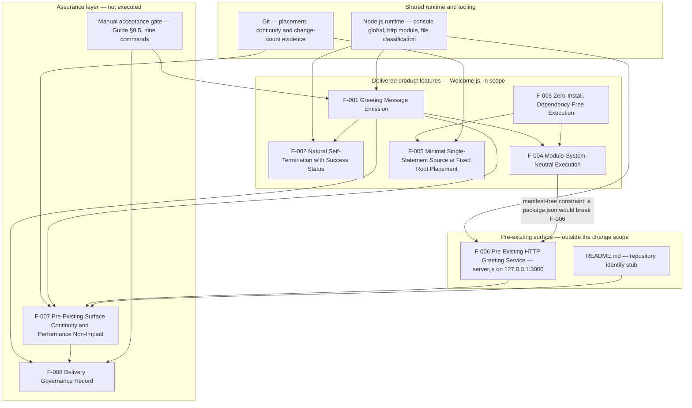

| Relationship | From | To | Recorded basis |
|---|---|---|---|
| Termination follows the write | F-002 | F-001 | The single statement is the only work; the event loop then drains (Guide §4, §5.1 row 4). |
| Neutrality is maintained by absence of configuration | F-004 | F-003 | No import construct and no manifest, so classification cannot matter (Guide §5.1 row 10). |
| Minimality bounds the source that carries the greeting | F-005 | F-003 | One statement, one file, no manifest; Guide §10 G names the two binding counts. |
| Continuity binds the added artifact to the pre-existing surface | F-007 | F-001, F-006 | The added file must not disturb `README.md` or `server.js`; 3.0 h of the ledger proves it (Guide §2.1, §4). |
| The record cites the outcome of the others | F-008 | F-001–F-007 | Guide §3–§5 record the results each feature is judged on, including the 42 manual checks. |
| Constraint hazard in the opposite direction | F-004 | F-006 | A `"type": "module"` manifest would break the CommonJS `server.js` while leaving `Welcome.js` working (Guide §6). |

### 2.3.2 Integration Points

| Integration point | Direction | Mechanism | Scope and constraint |
|---|---|---|---|
| Standard output | Outbound, one-way | `console.log` writes the 18-byte message (`Welcome.js:1`) | The only channel the delivered product writes to; no inbound channel exists (Guide §5.1 security posture). |
| Shell or pipeline consumer | Inbound to the consumer | Exit status and captured stdout; Guide §9.6 records piping and string-comparison usage | Consumer-side only; the product is unaware of who reads its output. |
| Loopback TCP port 3000 | Inbound to `server.js` | Node `http` listener bound to `127.0.0.1:3000` (`server.js:3-4`) | Pre-existing surface; no off-host reachability and no environment override (Guide Appendix B). |
| Git repository | Outbound, verification only | Tracked paths, commit history, `git diff --name-status 1484182 HEAD` | Supplies placement, minimality and continuity evidence; nothing in the product reads Git at runtime. |
| Markdown tooling | Inbound to a reader | Rendering of `blitzy/documentation/Project Guide.md` | Documentary only; neither JavaScript file imports or references it. |
| Module resolution | Absent by design | No dependency graph, manifest or lockfile | The negative integration requirement: adding any of these breaks an acceptance criterion (Guide Appendix F). |

### 2.3.3 Shared Components

| Shared component | Shared by | Basis | Consequence |
|---|---|---|---|
| Node.js runtime | F-001, F-002, F-003, F-004, F-006 | `console` is a runtime global for the product; `require('http')` uses the built-in module for the service (`server.js:1`) | One runtime support obligation: reference v24.21.0, floor v22.23.2 (end of life 30 April 2027 — Guide Appendix D). |
| The single working tree | All features | Four tracked paths in one checkout | Continuity is a shared obligation; a manifest or a stray artifact affects more than one feature. |
| Fixed string literals | F-001, F-008; separately F-006 | `Welcome.js:1` and `server.js:9` each hold a constant message that no input can influence | No parameterization, injection surface or data flow exists to connect them. |
| Git history | F-005, F-007, F-008 | Commits `1484182`, `1cef465`, `6c16ea2`, `4d1256c`, merge `39974fd` | Change-count and continuity evidence is derived from the history rather than from a file. |
| The Guide's command reference | F-007, F-008, and the acceptance criteria of every requirement in 2.2 | Guide Appendix A lists commands with observed results; §9.5 lists the gate | One documented verification surface serves every feature; re-running it is the only maintenance procedure. |

No shared library, class, module, configuration key, environment variable, database, cache, log sink or message channel exists between the delivered product and any other artifact. Nothing in the tree imports, requires or executes another tracked file.

### 2.3.4 Common Services

| Common service | Consumed by | Evidence | Nature |
|---|---|---|---|
| Node.js process lifecycle | F-001, F-002, F-003, F-004 | Exit status `0`, empty stderr, natural event-loop drain (verified here and in Guide §4) | Host-provided; no application-level lifecycle code exists. |
| Node.js built-in HTTP module and its parser | F-006 | `200` responses for any method or path; `431` on a 20 KB header; `400` on a malformed request line (observed) | Host-provided; boundary responses come from the parser, not from the source. |
| POSIX shell verification commands | All acceptance criteria in 2.2 | `node --check`, `wc`, `od`, `sha256sum`, `timeout`, `env -i`, pipelines (Guide §9.5, Appendix A) | Developer-side tooling; not a runtime dependency. |
| Manual acceptance gate | Every feature's acceptance evidence | Guide §9.5 (nine commands) and Guide §3 (42 of 42 checks passed) | Process, not software; Guide §3 records that no automated substitute exists for any part of the deliverable. |
| Git | F-005, F-007, F-008 | Tracked-path listings, `git diff --name-status`, `git status --porcelain --untracked-files=all` | Development and assurance tooling; the product runs identically without it (Guide §9.2). |

There is no application server, scheduler, queue, identity provider, observability stack or external service of any kind in this system, so no other common service can be documented without inventing it.


## 2.4 Implementation Considerations

Each feature below is considered against the five dimensions the Product Requirements call for. Where a dimension genuinely does not apply — a one-line script has no capacity model — that is stated rather than filled with invented guidance.

### 2.4.1 F-001 — Greeting Message Emission

| Dimension | Consideration | Basis |
|---|---|---|
| Technical constraints | The statement must stay one ES5-level member call with a single-quoted literal, a trailing semicolon, no indentation and a single trailing LF; the literal's bytes, including the LF, are contract elements and cannot be reworded. Output goes to stdout only. | Guide §2.1 style contract; `Welcome.js:1`; `od -c` shows the file ending `;` `\n` |
| Performance requirements | One write per process, roughly 25–30 ms for a run; output must reach a slow reader without truncation. | Guide §9.1, §4 |
| Scalability considerations | No service semantics exist to scale: the process is short-lived, stateless and holds no concurrency control. Repeated and concurrent runs were verified to produce identical bytes with no residue. | Guide §4 |
| Security implications | Zero input, zero secret, zero socket, zero dynamic code and zero dependency, so there is no input-validation surface; file permissions `0644`. The residual exposure is silent loss: `console.log` does not raise when the stream cannot accept the write, so output must be asserted from a captured stream rather than from the exit status. | Guide §5.1 security posture, §3 "Not Covered" |
| Maintenance requirements | No automated check guards the file; any future edit — changed literal, added line, renamed file — would go unnoticed by tooling. Re-run the nine-command gate in Guide §9.5 after any change, and capture output from a pipe or file, never a terminal, where newline translation shows 19 bytes. | Guide §3, §6, §9.7 |

### 2.4.2 F-002 — Natural Self-Termination with Success Status

| Dimension | Consideration | Basis |
|---|---|---|
| Technical constraints | Termination must remain the event loop draining: no `process.exit`, timer, listener, child process or handle may be introduced, because a forced exit can truncate queued output. | Guide §5.1 row 4, §10 G |
| Performance requirements | Process life is dominated by runtime startup; the run must stay within the 10-second bound the Guide's verification used, and no shutdown coordination may be added. | Guide §4 |
| Scalability considerations | Concurrency is achieved by independent short-lived processes; no shared resource is touched, so no contention is possible. | Guide §4; Guide Appendix B confirms the product binds no port |
| Security implications | An empty stderr keeps diagnostics off the channel, and the absence of signal handlers means the process cannot be made to linger. | Guide §4 |
| Maintenance requirements | Any future change that registers a handle (timer, socket, listener) invalidates the natural-termination proof, which then has to be re-established before acceptance. | Guide §3, §5.1 row 4 |

### 2.4.3 F-003 — Zero-Install, Dependency-Free Execution

| Dimension | Consideration | Basis |
|---|---|---|
| Technical constraints | The source may use runtime globals only; the repository and every ancestor directory must stay free of `package.json`, lockfiles, `node_modules`, test files, CI workflows, container files, environment files and Python artifacts. | Guide §5.1 row 11, Appendix F; verified by ancestor walk here |
| Performance requirements | Resolution and installation cost must stay at zero: no package manager is invoked at any point, and no network access is needed to run the product. | Guide §9.1, §9.3 |
| Scalability considerations | Not applicable to the product; the relevant constraint is categorical — adding a dependency, argument or input channel is a scope change, not a scale-out decision. | Guide §6 risk row 8 |
| Security implications | Zero dependencies mean zero transitive advisory exposure, no lockfile to audit, no secret to rotate and no configuration to drift; introducing either a dependency or an input channel would create a surface the product does not have today. | Guide §5.1, §6, §8 |
| Maintenance requirements | Do not run `npm install`, `npm init` or `npm ci` in this repository; the maintenance surface is the host runtime's support lifecycle alone. | Guide §9.2, §8 |

### 2.4.4 F-004 — Module-System-Neutral Execution

| Dimension | Consideration | Basis |
|---|---|---|
| Technical constraints | No `import` or `export` syntax may be introduced, and no module configuration may be added in or above the tree; if a manifest ever becomes necessary it must declare `"type": "commonjs"`. | Guide §5.1 row 10, §6 |
| Performance requirements | None; file classification is resolved by the runtime before the statement runs. | `Welcome.js:1` has no module construct |
| Scalability considerations | Not applicable. The constraint exists to preserve host-compatibility, not to accommodate growth. | Guide §5.1 row 10 |
| Security implications | Neutrality removes a classification-dependent failure mode from the artifact; the compensating hazard is that a `"type": "module"` manifest would break the pre-existing CommonJS `server.js` while leaving `Welcome.js` unaffected. | Guide §6 risk row "package.json declaring type module" |
| Maintenance requirements | Adding any manifest is a high-attention change: both executable surfaces must be re-verified, and the Guide records the manifest-free posture as the mitigation to preserve. | Guide §6, Appendix F |

### 2.4.5 F-005 — Minimal Single-Statement Source at Fixed Root Placement

| Dimension | Consideration | Basis |
|---|---|---|
| Technical constraints | Exact filename casing at path depth 1, one line of 34 bytes, a single trailing LF, no comment and no padding; the two minimality ceilings leave no room for an in-tree explanation or a waiver document — which is why the language decision lives in the commit message of `6c16ea2` instead. | `git ls-files`; `wc -l -c`; Guide §10 G, §5.2 divergences 1–2 |
| Performance requirements | None directly; source size is the proxy for reviewability and for the reference-artifact role the Guide assigns the file. | Guide §1.1 |
| Scalability considerations | The one-line ceiling means the artifact has no growth path by design; Guide §3 states that growth beyond one statement is the trigger to reconsider automated checking. | Guide §3 |
| Security implications | The whole artifact is reviewable by reading one line, so no hidden behaviour can exist; the recorded `sha256` (`5c7ac141d94f92056efb756f17335252c31e3d08d509e641d76512f73112c1fc`) gives a cheap integrity check. | Guide Appendix A; hash reproduced here |
| Maintenance requirements | Placement, casing and size are re-verifiable with `git ls-files`, `wc -l -c` and `ls Welcome.js`; on case-insensitive filesystems a wrong-case invocation is masked locally and fails on Linux. | Guide §9.5, §9.7 |

### 2.4.6 F-006 — Pre-Existing HTTP Greeting Service

| Dimension | Consideration | Basis |
|---|---|---|
| Technical constraints | Host `127.0.0.1` and port `3000` are hardcoded literals with no environment override; the handler is a single synchronous block with no routing, state or error handling; the file is CommonJS; no `'error'` listener is attached to `listen`, so a second start on a busy port exits `1` with an unhandled `EADDRINUSE` stack trace; no graceful-shutdown drain exists. | `server.js:1-14`; observed startup log, `431`/`400` responses and the second-start failure |
| Performance requirements | One synchronous response per request with no asynchronous work; during and after repeated, concurrent runs of `Welcome.js`, request latency medians stayed at or below the idle baseline with no failed request and stable memory, thread and descriptor counts. | Guide §4, §5.1 row 8 |
| Scalability considerations | No concurrency control, connection pooling, clustering or back-pressure handling exists; the service is a loopback demo bound to one port in one process and is not designed for load. | `server.js:12-14`; Guide Appendix C |
| Security implications | Reachability is limited to the loopback address, which is the whole access model — there is no authentication, authorization, TLS or request logging. Boundary input is rejected by the runtime's parser (`431` for a 20 KB header, `400` for a malformed request line) without leaking internals, and no raw path, query or body is echoed or logged. | `server.js:3`; observed responses; Guide §4 |
| Maintenance requirements | No automated coverage guards the file, and its robustness gaps are recorded as open pre-existing items outside this deliverable's scope — attach an `'error'` listener, drain on `SIGTERM`/`SIGINT`, and read the port from configuration if it is ever to run as a service. | Guide §6, §3 "Not Covered" |

### 2.4.7 F-007 — Pre-Existing Surface Continuity and Performance Non-Impact

| Dimension | Consideration | Basis |
|---|---|---|
| Technical constraints | The pre-existing bytes must not drift, and verification artifacts must be kept outside the checkout: Guide §5.2 divergence 3 records seven untracked PNG captures that landed in the tree during browser verification and would breach the one-added-file criterion if staged with `git add -A`. | Guide §5.2 divergence 3, §1.6 |
| Performance requirements | Non-impact is a measured requirement, not a best effort: request latency medians at or below the idle baseline during and after repeated, concurrent runs, zero failed requests, and stable memory, thread and descriptor counts. | Guide §4, §5.1 row 8 |
| Scalability considerations | Both executables are separate processes — one long-lived listener, one short-lived writer — so no shared heap, event loop or descriptor pool exists to contend for; the continuity proof was taken under repeated and concurrent execution for this reason. | Guide §4; `Welcome.js` opens no socket |
| Security implications | The change introduces no new listening socket, no new file descriptor, no new file write and no new inbound path, so it cannot widen the pre-existing service's exposure. | Guide §5.1 security posture, Appendix B |
| Maintenance requirements | Continuity is re-provable cheaply with `git diff --name-status 1484182 HEAD` and `git status --porcelain --untracked-files=all`; after any change, re-run both the acceptance gate and the latency comparison, and stage `Welcome.js` by name. | Guide Appendix A, §1.6 |

### 2.4.8 F-008 — Delivery Governance Record

| Dimension | Consideration | Basis |
|---|---|---|
| Technical constraints | One tracked Markdown record; it must not become a second product artifact, and the decision it carries (the language clause) was deliberately kept out of the source to preserve the one-line and one-file ceilings, so its rationale lives in the record-only commit `6c16ea2`. | Guide §5.2 divergences 1–2, Appendix C |
| Performance requirements | None — the record is never executed, imported or referenced by either JavaScript file. | Guide §1.2.2 component classification |
| Scalability considerations | Not applicable; the record grows with delivery evidence, not with runtime load. | Guide §10 A–G appendix structure |
| Security implications | The record documents the product's zero-input, zero-secret posture and contains no credential, endpoint or environment value; the repository holds no secret of any kind, so there is nothing for the record to leak. | Guide §5.1, Appendix E |
| Maintenance requirements | Keep the completion account reconciled as the 2.5 remaining hours are consumed (governance 1.0 h, PR publication 0.5 h, acceptance re-run 0.5 h, housekeeping 0.5 h), and treat Guide §9.5 as the re-entry procedure for any future change. | Guide §2.2, §2.3, §1.6 |

### 2.4.9 Cross-Cutting Implementation Constraints

| Constraint | Status and consequence | Basis |
|---|---|---|
| The project rule's Python language clause is unmet by decision | Governance only — no functional, security, performance or continuity effect; closing it is a wording decision (amend, narrow or waive) and the file must stay byte-identical. | Guide §1.4, §5.2 divergence 1, §6 |
| Runtime support lifecycle | The supported floor (Node.js 22.x) reaches end of life on 30 April 2027; standardise on 24.x or later, which requires no source change because the syntax is ES5-level. | Guide §6, Appendix D |
| No automated regression net | `node --test` reports `tests 0 / suites 0 / pass 0 / fail 0`; acceptance is the documented nine-command gate, whose coverage gaps are the delivered file's regression safety, the pre-existing service and stream-failure behaviour. | Guide §3, Appendix A |
| Verification artifacts belong outside the tree | Any capture written into the checkout must be removed before staging so a blanket `git add` cannot add a second artifact. | Guide §5.2 divergence 3, §1.6 |
| Growth trigger | If the product ever grows beyond one statement, that is the point at which a small automated check and a re-examination of the minimality ceilings earn their place. | Guide §3, §8 |


## 2.5 Requirements Traceability Matrix

Traceability is direct in this system because there is no layer between a requirement and its evidence: a requirement either maps to a byte range in one of the two JavaScript files, to a path and count produced by a Git command, or to a measured result recorded in the Guide. Every requirement introduced in 2.2 appears exactly once below, at version 1.0, frozen at commit `39974fd` where `HEAD` equals `origin/main`.

### 2.5.1 Requirement Traceability Matrix

| Requirement ID | Feature | Verification method and observed result | Verification origin |
|---|---|---|---|
| F-001-RQ-001 | F-001 | `node Welcome.js \| od -An -t x1` → `57 65 6c 63 6f 6d 65 20 74 6f 20 42 6c 69 74 7a 79 0a`; `\| wc -c` → `18` | Repository (this checkout); Guide Appendix A |
| F-001-RQ-002 | F-001 | Literal appears once (`Welcome.js:1`); identical output under `env -i` and from a foreign working directory | Guide §4 |
| F-001-RQ-003 | F-001 | `node Welcome.js 2>&1 >/dev/null \| wc -c` → `0` | Repository (this checkout) |
| F-001-RQ-004 | F-001 | All 18 bytes received by a deliberately slow pipe reader | Guide §4 |
| F-001-RQ-005 | F-001 | Byte-identical output on v24.21.0 and v22.23.2; reproduced on v22.23.3 | Guide §4, Appendix A; repository |
| F-002-RQ-001 | F-002 | `node Welcome.js >/dev/null; echo $?` → `exit=0`; `timeout 10` never triggered | Repository; Guide §4 |
| F-002-RQ-002 | F-002 | Source contains no `process.exit`, timer or listener | `Welcome.js:1`; Guide §5.1 row 4 |
| F-002-RQ-003 | F-002 | Repeated and concurrent runs leave no process, handle or file write; the program binds no port | Guide §4, Appendix B; repository |
| F-002-RQ-004 | F-002 | Roughly 25–30 ms for one write and exit | Guide §9.1 |
| F-003-RQ-001 | F-003 | No `require`, `import` or `export`; `node --check Welcome.js` exits `0` | Repository; Guide §9.3 |
| F-003-RQ-002 | F-003 | `ls package.json package-lock.json node_modules` and an ancestor walk return nothing | Repository (this checkout); Guide §3 |
| F-003-RQ-003 | F-003 | `node Welcome.js` from a fresh clone prints the message with no install step | Guide §9.2, §9.4 |
| F-003-RQ-004 | F-003 | Repository sweeps return no test file, CI workflow, container file, environment file, config or Python artifact | Guide §5.1 row 11 (7 of 7 checks passed) |
| F-004-RQ-001 | F-004 | No module syntax in the source; parse check clean | Repository; Guide §5.1 row 10 |
| F-004-RQ-002 | F-004 | Correct behaviour with an ancestor manifest of `"type": "module"`, of `"type": "commonjs"`, and with none | Guide §4 |
| F-004-RQ-003 | F-004 | `git ls-files` lists four paths, none a manifest | Repository (this checkout) |
| F-005-RQ-001 | F-005 | Exact-case `Welcome.js` at path depth 1; no `.mjs`, `.cjs`, lowercase or `.py` variant | Repository; Guide §5.1 row 2 |
| F-005-RQ-002 | F-005 | `wc -l -c Welcome.js` → `1 34`; final bytes `;` `\n`; `sha256sum` matches `5c7ac141…` | Repository; Guide §5.1 row 5, Appendix A |
| F-005-RQ-003 | F-005 | One statement; no function, class, variable, wrapper, guard or export | `Welcome.js:1`; Guide §5.1 row 6 |
| F-005-RQ-004 | F-005 | `git diff --name-status 1484182 HEAD` → `A Welcome.js` plus `A blitzy/documentation/Project Guide.md`; no `M` or `D` | Repository (this checkout) |
| F-006-RQ-001 | F-006 | Startup log `Server running at http://127.0.0.1:3000/`; port answers within about 1.5 s of launch | Repository (this checkout); `server.js:12-14` |
| F-006-RQ-002 | F-006 | `GET /` → `HTTP/1.1 200 OK`, `Content-Type: text/plain`, body `Hello, World!`; `POST /anything?a=b` → `200 text/plain`; `HEAD /` → `200` | Repository (this checkout); `server.js:6-10` |
| F-006-RQ-003 | F-006 | 20 KB header → `431 Request Header Fields Too Large`; malformed request line → `400 Bad Request`; no internals in the response | Repository (this checkout); Guide §4 |
| F-006-RQ-004 | F-006 | Bind address literal `127.0.0.1`; no host or port override exists | `server.js:3`; Guide Appendix B |
| F-007-RQ-001 | F-007 | Diff versus `1484182` shows no modification or deletion of `README.md` or `server.js` | Repository; Guide §5.1 row 12 |
| F-007-RQ-002 | F-007 | `git status --porcelain --untracked-files=all` returns nothing | Repository (this checkout); Guide §4 |
| F-007-RQ-003 | F-007 | Latency medians at or below the idle baseline during and after repeated, concurrent runs; zero failed requests; stable memory, thread and descriptor counts | Guide §4, §5.1 row 8 |
| F-007-RQ-004 | F-007 | Response renders in a browser with zero console messages and no reply at or above `400`, before and after repeated runs | Guide §4 |
| F-008-RQ-001 | F-008 | `blitzy/documentation/Project Guide.md` tracked, 382 lines, 35,992 bytes, ten areas plus appendices A–G | Repository (this checkout); Guide structure |
| F-008-RQ-002 | F-008 | 12.5 + 2.5 = 15.0 and 12.5 ÷ 15.0 = 83% agree across the record's §1.2, §2.3, §7 and §8 | Guide §2.3 |
| F-008-RQ-003 | F-008 | Open item named with owner "Project owner", ETA 1.0 h, impact "Governance only" | Guide §1.4, §5.2 divergence 1 |
| F-008-RQ-004 | F-008 | Nine-command gate documented with observed results; 42 of 42 manual checks recorded; coverage gaps stated | Guide §9.5, §3 |

All 31 requirements are in the Pass state. The one item that is not a requirement of any feature — the project rule's Python language clause — is carried in 2.5.2 as `NOT MET by recorded decision`.

### 2.5.2 Compliance Benchmark Traceability

| Benchmark | Governing requirements | Recorded result |
|---|---|---|
| 1. Exact message on a user-visible channel | F-001-RQ-001, F-001-RQ-002 | PASS — `Welcome.js:1`; 18 bytes, hex verified |
| 2. Filename exactly `Welcome.js` at the repository root | F-005-RQ-001 | PASS — exact-case match at depth 1 |
| 3. JavaScript implementation | F-003-RQ-001, F-004-RQ-001 | PASS — `node --check` exits `0` on both supported lines |
| 4. Self-termination with success status | F-002-RQ-001, F-002-RQ-002 | PASS — exit `0`, empty stderr, no forced exit |
| 5. Minimal line count, one statement | F-005-RQ-002 | PASS — 1 line, 34 bytes, one semicolon |
| 6. Simple and readable, no abstraction | F-005-RQ-003 | PASS — no declaration of any kind in the file |
| 7. Runs as written — no install, build or transpile | F-003-RQ-001, F-003-RQ-002, F-003-RQ-003 | PASS — zero imports, zero manifests, zero ancestors carrying one |
| 8. Application performance not impacted | F-007-RQ-003 | PASS — measured at or below idle baseline |
| 9. Each flow and feature clearly separated | F-005-RQ-001, F-005-RQ-003 | PASS — the one feature's one flow occupies a dedicated file |
| 10. Module-system independence, no local module configuration | F-004-RQ-001, F-004-RQ-002, F-004-RQ-003 | PASS — runs under either manifest type or none |
| 11. Excluded artifacts absent | F-003-RQ-004 | PASS — every excluded class swept and absent |
| 12. Project rule — new products in Python | None — no requirement corresponds; the product is JavaScript by the request's own terms | NOT MET by recorded decision; governance-only impact (Guide §5.1 row 12, §5.2 divergence 1) |

### 2.5.3 Feature-to-Artifact and Document Traceability

| Feature | Source artifact | Guide reference | Related specification |
|---|---|---|---|
| F-001 | `Welcome.js:1` | §3 output contract; §4 runtime validation; §5.1 row 1; §9.5–§9.6 | §1.2.2 capabilities; §1.3.1 must-have 1 |
| F-002 | `Welcome.js:1` | §4 natural termination; §5.1 row 4; §10 G glossary | §1.2.3 success criteria; §1.3.1 must-have 4 |
| F-003 | `Welcome.js:1`; repository tree | §3 zero-install area; §9.2–§9.3; Appendix F | §1.2.2 core technical approach; §1.3.1 must-have 7 |
| F-004 | `Welcome.js:1`; absence of any manifest | §4 module classification; §5.1 row 10; §6 risk row | §1.2.1 integration hazard; §1.3.2 unsupported use cases |
| F-005 | `Welcome.js` path, size and hash | §5.1 rows 2, 5, 6; §5.2 divergences 1–2; §10 G | §1.3.1 must-haves 2, 5, 6 |
| F-006 | `server.js:1-14` | §4 pre-existing service checks; §5.1 row 12; Appendix B, C | §1.2.2 component table; §1.3.1 must-have 12 |
| F-007 | Git history; `README.md`; `server.js` | §2.1 continuity ledger; §4 performance non-impact; §5.2 divergence 3 | §1.3.1 must-haves 8, 12 |
| F-008 | `blitzy/documentation/Project Guide.md` | §1–§10 in full | §1.2.2 component table; §1.4 References |

### 2.5.4 Assumptions and Constraints Affecting Verification

| Assumption or constraint | Effect on verification |
|---|---|
| A supported Node.js line is available on `PATH`. | Every acceptance command depends on it; Guide §9.1 records v24.21.0 as reference and v22.23.2 as the floor, and this checkout runs v22.23.3. |
| A POSIX shell with `wc`, `od`, `sha256sum` and `timeout` is available. | The gate's byte, hash and termination checks use these tools; a terminal-only measurement of byte count is misleading because of newline translation. |
| The filesystem used for placement checks is case-sensitive. | Guide §9.1 and §9.7 record that a case-insensitive filesystem masks a wrong-case filename that then fails on Linux. |
| Loopback TCP port `3000` is free and the host permits a loopback bind. | Required only to exercise the pre-existing service as continuity evidence; the delivered product binds no port. |
| The Guide's recorded measurements (dual-runtime parity, slow-reader durability, browser rendering, latency non-impact) are accepted as recorded. | These specific results were produced during the recorded work rather than re-measured here; the byte-level, exit-status, parse, path and HTTP-behaviour results were reproduced in this checkout and are noted as such. |
| The pre-existing service remains out of scope for change. | Its robustness gaps are documented as open owner decisions; no requirement of this section asks for them to be closed. |
| The project rule remains unamended. | Benchmark 12 stays `NOT MET` and the traceability of every other benchmark is unaffected, because no requirement depends on it. |


## 2.6 References

Every claim in this section rests on the following repository evidence.

- `Welcome.js` — the delivered artifact: the single statement `console.log('Welcome to Blitzy');` at the repository root, 1 line and 34 bytes ending in a single LF; source of the output contract, the minimality counts, the module-neutral and zero-dependency posture, and the natural-termination property.
- `server.js` — the pre-existing CommonJS HTTP service: `require('http')` on line 1, host `127.0.0.1` and port `3000` on lines 3–4, the `200` / `text/plain` / `Hello, World!` handler on lines 6–10, and the `listen` callback with its startup log on lines 12–14; source of F-006's requirements and of its recorded robustness gaps.
- `README.md` — the repository identity stub: heading `# hao-backprop-test` and the sentence "test project for backprop integration"; 58 bytes with no trailing newline; the file whose byte-identity F-007-RQ-001 asserts.
- `blitzy/documentation/Project Guide.md` — the governance record (382 lines, 35,992 bytes) supplying the compliance matrix (§5.1), the capability and scope statements (§4, §8), the completion account (§1.2, §2.3, §7), the divergences (§5.2), the risk table (§6), the development guide and nine-command acceptance gate (§9), and the command, port, file, technology, environment-variable, tooling and glossary appendices (§10 A–G).
- `blitzy/` — first-order folder confirming that the documentation subtree contains no executable source.
- `blitzy/documentation/` — folder holding the governance record; established that the evidence subtree is documentation only.

Repository state observed through Git, which the section also cites: commit history `1484182` (base), `1cef465`, `6c16ea2`, `4d1256c`, and merge commit `39974fd` (PR #15, which equals `HEAD` and `origin/main`); `git ls-files` (four tracked paths); `git diff --name-status 1484182 HEAD`; `git diff --stat origin/main...HEAD`; and `git status --porcelain --untracked-files=all`. Runtime facts were confirmed by executing `node Welcome.js` and `server.js` on the host runtime (Node.js v22.23.3) and by `node --check`, `node --test`, `wc`, `od`, `sha256sum` and direct HTTP requests including an oversized-header and a malformed-request case.

No web source was consulted; every fact above is drawn from the repository itself.


# 3. Technology Stack

## 3.1 Programming Languages

The repository is a JavaScript system and uses no other programming language. Four tracked paths exist — `Welcome.js`, `server.js`, `README.md` and `blitzy/documentation/Project Guide.md` — and the tracked file extensions are exactly `js` and `md`, so no typed, compiled, Python, native-mobile or shell source file is present anywhere in the checkout.

### 3.1.1 Language Allocation by Component

| Component | Path | Language | Language level / module system | Evidence |
|---|---|---|---|---|
| Delivered product | `Welcome.js` | JavaScript | ES5-level syntax; one member call and one string literal; module-neutral (no `import`, `export` or `require`) | `Welcome.js:1`; repository-wide sweep for module constructs returns one `require` in the tree, in `server.js` only |
| Pre-existing HTTP service | `server.js` | JavaScript | ES5-level syntax; CommonJS (`const http = require('http')`) | `server.js:1` |
| Project identity stub | `README.md` | Markdown (not a programming language) | Static declarative text; never executed | `README.md:1-2` |
| Governance record | `blitzy/documentation/Project Guide.md` | Markdown (not a programming language) | Static declarative text; never executed or imported by either executable | `blitzy/documentation/Project Guide.md` |
| Execution runtime | Host-provided | JavaScript executed by Node.js | Reference line Node.js v24.21.0; supported floor Node.js v22.23.2 | Project Guide Appendix D, §9.1 |

The JavaScript engine is V8, supplied by the runtime rather than declared by the repository: on the host used for this investigation, Node.js v22.23.3 reports `process.versions.v8` = `12.4.254.21-node.57`, `openssl` = `3.5.8` and `uv` = `1.51.0`. The Project Guide records verification on v24.21.0 (reference) and v22.23.2 (supported floor) with byte-identical output; the investigation host reported v22.23.3, a later patch on the same supported 22.x line, and reproduced the same 18-byte output, empty stderr, exit status `0` and source hash.

### 3.1.2 Selection Criteria

- **Language was fixed by the product request, not chosen.** The delivered artifact's language and filename were named in the same instruction ("in Javascript", stored in `Welcome.js`), and the governing project rule instead directed Python for new products. The specific instruction was followed and the rule's language clause was recorded as knowingly unmet — see `blitzy/documentation/Project Guide.md` §5.2 divergence 1 and §1.4. No free language selection therefore exists for the delivered product.
- **Syntax level chosen for cross-line parity.** The source is deliberately ES5-level — one `console.log` member call with one string literal — so it contains nothing version-sensitive and produces byte-identical output on both supported runtime lines (Project Guide §1.2.2, §5.1 row 3, Appendix D).
- **Runtime globals only, so the language choice imposes no install cost.** `console` is a Node.js runtime global, which is what allows the delivered file to run with no manifest, lockfile, `node_modules`, build or transpile step (Project Guide §9.3, Appendix F).
- **Module neutrality preserved by avoiding module syntax.** Because `Welcome.js` contains no `import` or `export`, its behaviour cannot depend on how the runtime classifies the file. The Guide verified identical behaviour under an ancestor manifest declaring `"type": "module"`, one declaring `"type": "commonjs"`, and no manifest at all (§5.1 row 10, Appendix G).
- **CommonJS retained for the pre-existing file.** `server.js:1` uses `require('http')`, so the pre-existing surface's classification is CommonJS and must stay so.

### 3.1.3 Constraints and Dependencies

| Constraint | Detail | Evidence |
|---|---|---|
| Runtime prerequisite | A supported Node.js LTS line is the only software requirement; verified on v24.21.0 and v22.23.2, verified on Linux, no package manager, virtual environment, database, cache, broker, container or network access required | Project Guide §9.1 |
| Runtime support lifecycle | The supported floor (22.x) reaches end of life on 30 April 2027; standardising on 24.x or later requires no source change because the syntax is ES5-level | Project Guide §6, Appendix D |
| No transpile or type layer | No `tsconfig.json` exists, no `.ts` or `.tsx` file is tracked, and no transpiler or bundler is configured | Repository file listing; Project Guide Appendix F |
| Filename case sensitivity | The artifact is `Welcome.js` with a capital `W`; a wrong-case invocation is masked on case-insensitive filesystems and fails on Linux | Project Guide §9.1, §9.7 |
| Filename and placement | Exact casing of `Welcome.js` at path depth 1 is an acceptance criterion; no `welcome.js`, `.mjs`, `.cjs` or `.py` variant exists | Project Guide §5.1 row 2 |
| No Python artifact | The project rule mandates Python for new products; no `.py` file, stub, port or shim exists, so a literal audit of the rule finds one of three clauses unsatisfied. This is a governance item with no functional, security, performance or continuity effect, and the file must stay byte-identical | Project Guide §1.4, §5.2 divergence 1, §6 |
| Style contract for the JavaScript source | Single-quoted literal, trailing semicolon, no indentation, single trailing LF; no comment or padding | Project Guide §2.1, Appendix A |
| Manifest hazard | A `package.json` declaring `"type": "module"` added in or above the tree would break the pre-existing CommonJS `server.js` at runtime while leaving `Welcome.js` unaffected; if a manifest ever becomes necessary it must declare `"type": "commonjs"` | Project Guide §6, §5.1 row 10 |

### 3.1.4 Disposition of Default-Stack Languages

The default technology stack names Python, Swift, Kotlin, Objective-C and TypeScript. None is present, and none is applicable to this system as it exists.

| Default-stack language | Present | Basis for the disposition |
|---|---|---|
| Python (primary backend language) | No | No `.py` artifact, stub, port or shim exists in the tree; tracked extensions are `js` and `md` only. The rule clause requiring Python is recorded as unmet by decision, and no functional requirement depends on it (Project Guide §1.4, §5.2 divergence 1) |
| TypeScript | No | No `tsconfig.json`, no `.ts`/`.tsx` file and no transpiler; the delivered source is plain JavaScript at ES5 level (Project Guide Appendix F) |
| Swift (iOS) | No | The checkout contains four files and no native application project, no package manifest and no platform build files; no mobile surface exists |
| Kotlin (Android) | No | Same basis: no Android project, manifest, Gradle file or native source is tracked |
| Objective-C (macOS) | No | Same basis: no Objective-C source, Xcode project or desktop application project is tracked |

Native and cross-platform application languages are out of scope by absence of any artifact rather than by a recorded exclusion: the system has two executable surfaces, both JavaScript, and its delivered product has no user interface at all (Project Guide §4).

## 3.2 Frameworks & Libraries

The system uses no application framework and no supporting library. The only code both executables consume is supplied by the Node.js runtime itself: the built-in `http` core module in `server.js` and the `console` runtime global in both files.

### 3.2.1 Core Frameworks

| Framework | Version | Role in this system | Evidence |
|---|---|---|---|
| Node.js (runtime, not a framework) | v24.21.0 reference line; v22.23.2 supported floor (24.x LTS and 22.x Maintenance LTS lines) | Hosts and executes both JavaScript surfaces; supplies `console` and the built-in `http` module | Project Guide Appendix D, §9.1 |
| No web or application framework | — | `server.js` uses the Node.js core `http` module directly; there is no Express/Fastify/Koa-class dependency, no router, no middleware and no ORM | `server.js:1-14`; `grep` over all tracked `.js` files returns a single `require`, for the core module `http` |

There is no framework layer to configure, version-pin or upgrade. The pre-existing service is built on the runtime's own HTTP primitives: `http.createServer` with an inline request handler, a single synchronous response path, and `server.listen(port, hostname, cb)` (`server.js:6-14`). The delivered product uses one runtime global and imports nothing (`Welcome.js:1`).

### 3.2.2 Supporting Libraries

None. A repository-wide sweep for module constructs — `require`, `import` and `export` across every tracked `.js` file — returns exactly one line, `server.js:1` `const http = require('http');`, and `http` is a Node.js core module rather than a library.

| Library class | Status | Evidence |
|---|---|---|
| Third-party packages | None | `ls package.json package-lock.json node_modules \| wc -l` = 0; Project Guide §9.3 |
| Web framework | None | `server.js` uses only the core `http` module |
| HTTP client / API SDK | None | No HTTP client call exists in either file; no outbound request is made |
| UI library (React, React-Native, TailwindCSS, ElectronJS) | None | The deliverable has no user interface; its entire observable surface is one line on standard output (Project Guide §4) |
| Build tool, bundler, transpiler | None | Zero imports and ES5-level syntax leave nothing to build (Project Guide Appendix F) |
| Linter / formatter | None installed, none configured | The style contract — single-quoted literal, semicolon, no indentation, single trailing LF — is verifiable by reading one line (Project Guide Appendix F) |
| Test library | None | No test file and no third-party runner; `node --test` is the runtime's own built-in runner and reports `tests 0 / suites 0 / pass 0 / fail 0`, exit `0` |

### 3.2.3 Compatibility Requirements

- **Runtime line.** The library surface requires a Node.js LTS build and nothing else. Output is byte-identical on v24.21.0 and v22.23.2 (Project Guide §1.3, Appendix D). Because `console` and `http` are long-standing runtime facilities and the syntax is ES5-level, no version-sensitive behaviour is reachable.
- **Module-system neutrality.** `Welcome.js` carries no module construct, so it behaves identically whether the runtime classifies it as CommonJS or as an ES module. `server.js` is CommonJS by construction and depends on remaining so.
- **Manifest-free posture.** The tree, and every ancestor directory, must stay free of `package.json`, lockfiles and `node_modules`. This is a stated acceptance criterion, and the corresponding hazard is recorded: a `package.json` declaring `"type": "module"` added in or above the repository would break the pre-existing CommonJS `server.js` while leaving `Welcome.js` unaffected (Project Guide §6, §5.1 row 11).
- **No resolution or installation step.** No package manager is invoked at any point and no network access is needed to run either file (Project Guide §9.1, §9.3).
- **Network binding.** `server.js` binds the loopback address `127.0.0.1` on port `3000`, both literals with no environment override, so the only consumer reachable is a local client (`server.js:3-4`, Project Guide Appendix B).

### 3.2.4 Justification for the Framework-Free Choice

- **The acceptance criteria forbid the alternatives.** The zero-install posture is itself a criterion: adding a manifest, a lockfile, `node_modules` or a third-party package would breach it (Project Guide §5.1 row 11, §9.2).
- **The functional surface needs no framework.** The delivered product performs one stdout write. `server.js` answers every request identically with one synchronous write, so routing, templating, middleware, connection pooling and error-handling frameworks have no behaviour to add (`server.js:6-10`).
- **Minimality is binding and measured.** The artifact is exactly 1 source line and 34 bytes, with no function, class, variable, wrapper or guard — criterion N-2 requires simplicity with no abstraction (Project Guide §5.1 rows 5-6, §2.1).
- **Performance non-impact is a measured requirement.** `Welcome.js` is never imported by or referenced from the existing service, and request latency medians on `server.js` stayed at or below the idle baseline during and after repeated, concurrent runs of the script (Project Guide §4, §5.1 row 8).
- **Security surface is reduced to nothing.** Zero dependencies mean zero transitive advisory exposure, no lockfile to audit and no configuration to drift (Project Guide §5.1 security posture, §8).

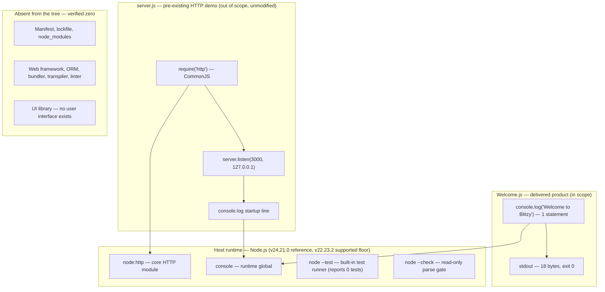

### 3.2.5 Disposition of Default-Stack Frameworks and Libraries

The default technology stack names Flask, Langchain, React with TypeScript, TailwindCSS, React-Native and ElectronJS. None is present, and none is applicable.

| Default-stack component | Present | Basis for the disposition |
|---|---|---|
| Flask (backend framework) | No | Python is not used anywhere in the tree, so no Python web framework applies; the pre-existing service uses the Node.js core `http` module instead (`server.js:1`) |
| Langchain (AI framework) | No | No AI, model-inference or agent code exists; the product's entire computation is one string write, and no dependency, network call or model endpoint is referenced (`Welcome.js:1`) |
| React with TypeScript (web frontend) | No | No frontend exists: the deliverable has no user interface and no HTML, CSS or JSX asset is tracked (Project Guide §4) |
| TailwindCSS | No | No stylesheet, build step or asset pipeline exists to consume it |
| React-Native (mobile/cross-platform) | No | No mobile application project or manifest is tracked; there is no mobile surface to build |
| ElectronJS (desktop) | No | No desktop application project, packaging manifest or renderer process exists |

Introducing any of these would be a scope change rather than a technology upgrade: the Guide records that adding a dependency or an input channel would create a security surface the product does not have today, and that the tree must stay manifest-free (Project Guide §6 risk rows, §5.1 row 11).

## 3.3 Open Source Dependencies

The repository declares, vendors and installs zero third-party or open-source packages. Its dependency count is `0`, and that figure is an acceptance criterion rather than a current state: adding a manifest, a lockfile, `node_modules` or a package would breach the zero-install posture the work was accepted against (`blitzy/documentation/Project Guide.md` §5.1 row 11, §9.2, Appendix F).

### 3.3.1 Dependency Inventory

| Dependency | Registry / origin | Version | How it reaches the system | Evidence |
|---|---|---|---|---|
| None (third-party packages) | No registry is used | — | Nothing is fetched, vendored or resolved | `ls package.json package-lock.json node_modules \| wc -l` = 0; repository-wide `grep` for module constructs returns one line, for a core module |
| Node.js runtime | Host-supplied distribution, not fetched by this repository | v24.21.0 (reference line), v22.23.2 (supported floor) | A host-provided prerequisite recorded in the development guide; never installed into the tree | Project Guide §9.1, Appendix D |
| `node:http` core module | Bundled with the Node.js runtime | Follows the runtime version (no independent release) | Required by the pre-existing `server.js` only | `server.js:1` |
| `console` global | Bundled with the Node.js runtime | Follows the runtime version | Used by `Welcome.js:1` and by the `server.js` startup log | `Welcome.js:1`, `server.js:13` |
| `node --test` built-in runner | Bundled with the Node.js runtime | Follows the runtime version | Available but exercising no test; `node --test` reports `tests 0 / suites 0 / pass 0 / fail 0`, exit `0` | Project Guide §3, Appendix A |
| npm | Host toolchain, present but never invoked by this repository | 11.18.0 observed on the investigation host | Not used: no manifest, no install, no `npm ci` | Project Guide Appendix F, §9.2 |

### 3.3.2 Package Registries and Resolution

- **No registry is contacted.** The repository contains no `package.json`, no `package-lock.json`, no `yarn.lock`, no `pnpm-lock.yaml` and no `npm-shrinkwrap.json`, so there is no registry, scope, version range or resolution graph to describe.
- **No package manager is run.** `npm`, `yarn` and `pnpm` are recorded as not used in the repository; the development guide explicitly forbids running `npm install`, `npm init` or `npm ci` here, because doing so would add an artifact class the acceptance criteria exclude (Project Guide Appendix F, §9.2).
- **No vendored source.** The checkout is four tracked files; there is no `vendor`, `third_party` or bundled-library directory of any kind.
- **The dependency graph is one edge, to the runtime.** `server.js` requires the runtime's own `http` module; `Welcome.js` requires nothing. Because nothing is imported, there is no graph to resolve and no resolution step to perform, which is what the zero-install posture records (Project Guide §1.1, §9.3).

### 3.3.3 Version and Compatibility Constraints for Dependencies

| Constraint | Detail | Effect |
|---|---|---|
| Supported runtime lines | v24.21.0 (reference) and v22.23.2 (supported floor), with byte-identical output on both | Any dependency introduced would have to hold parity across these lines |
| Syntax level | ES5-level JavaScript — one member call and one string literal | Nothing in the language surface constrains the runtime choice below the LTS floor |
| Support lifecycle | The 22.x supported floor reaches end of life on 30 April 2027 | Standardise on 24.x or later; no source change is required |
| Manifest form, if ever needed | A manifest must declare `"type": "commonjs"` | A `"type": "module"` manifest would break the pre-existing CommonJS `server.js` at runtime while leaving `Welcome.js` unaffected |
| No transitive surface | Zero dependencies, no lockfile, no `node_modules` | No transitive advisory exposure, no lockfile to audit, no SBOM to maintain, no configuration to drift |

### 3.3.4 Security Implications of the Dependency Posture

The Guide states the security posture by enumeration rather than by sampling, and the source supports that: the program reads no argument, standard input, environment variable or file; opens no socket; executes no dynamic code; holds no secret; and declares no dependency, so there is no input to validate, no credential to manage and no transitive advisory exposure. File permissions are `0644` (Project Guide §5.1). The compensating operational risk is the absence of a dependency scanner or lockfile audit — there is nothing to scan, but also no tooling in place if a dependency were ever introduced, which is why any proposed dependency is treated as an agreed scope change rather than a routine addition (Project Guide §6).

## 3.4 Third-Party Services

No third-party service is consumed at runtime. The delivered product opens no socket, makes no outbound request and holds no endpoint; the only network surface in the repository is an inbound loopback listener in the pre-existing `server.js`.

### 3.4.1 External APIs and Integrations

None. Both executable surfaces were read in full: `Welcome.js` contains a single `console.log` statement, and `server.js` creates a listener and answers each request from a static in-source literal, so neither file contains an HTTP client call, an SDK import, an endpoint constant or a retry path (`Welcome.js:1`, `server.js:1-14`). A repository-wide sweep for dependency constructs returns one `require`, for the Node.js core `http` module — an inbound server primitive, not a client integration.

| Integration class | Status | Evidence |
|---|---|---|
| Outbound HTTP/API calls | None | No HTTP client call exists in either JavaScript file |
| Third-party SDKs | None | Zero dependencies; no manifest or `node_modules` exists |
| Webhooks, queues, message brokers, event buses | None | No such client or configuration exists; the product has no inbound path |
| Inbound network surface | Loopback only — `127.0.0.1:3000` in the pre-existing service | `server.js:3-4`; Project Guide Appendix B records the port as loopback-only with no environment override |

The Guide records the corresponding boundary: no enterprise system consumes the delivered artifact, and nothing in the tree imports, references or consumes it either. The only relationship between the two executables is co-residency in one working tree (Project Guide §1.3.1 "Essential integrations", §1.3.2 "Integration points not covered"). Integration would be a scope change: a future change that introduces a dependency, a command-line argument or an input channel would create a security surface this product does not have today (Project Guide §6).

### 3.4.2 Authentication and Authorisation Services

None. There is no identity provider, no token issuance or validation, no session store and no credential of any kind in the tree. The product reads no environment variable, no command-line argument, no standard input and no file, and produces identical output under a completely empty environment (`env -i`) — so there is no configuration channel through which a credential could even be supplied (Project Guide Appendix E). The Guide records "No access issues identified" against a table whose only row is a placeholder: the product consumes no environment variable, secret, credential, endpoint or database (Project Guide §1.5).

Access control for the pre-existing service is its bind address alone. Because `server.js` listens only on `127.0.0.1`, reachability is limited to local clients; there is no authentication, authorisation, TLS termination or request logging in that file (`server.js:3`, 12-14; Project Guide §2.4.6).

### 3.4.3 Monitoring, Observability and Error Reporting

| Capability | Status | Detail |
|---|---|---|
| Application Performance Monitoring / tracing | None | No APM or tracing SDK is present, and no dependency exists through which one could be configured |
| Metrics / dashboards | None | No metric emission, no stats endpoint, no agent |
| Centralised logging or log sink | None | The only output channels are stdout: the 18-byte greeting from `Welcome.js:1` and a single startup line from `server.js:13` |
| Error reporting / crash telemetry | None | Neither file contains error handling, and no reporting client is referenced |
| Health or readiness endpoints | None | `server.js` has no routing, so every path returns the same response; the product binds no port at all |

Observability of the delivered product is therefore external to the system: acceptance is judged from captured stdout, empty stderr and exit status, and the Guide's checks used captured streams rather than in-process instrumentation (Project Guide §3, §4, §9.5). The absence of monitoring tooling is recorded as an accepted limitation rather than an oversight: no automated regression net guards `Welcome.js`, and stream-failure behaviour is not asserted, because `console.log` does not raise when the underlying stream cannot accept the write (Project Guide §3 "Not Covered").

### 3.4.4 Cloud Services and Hosting Platform

No cloud service is used. The repository contains no infrastructure-as-code, no deployment manifest, no serverless configuration, no cloud SDK and no cloud credential; the Guide records container and CI tooling as "Not used" with the rationale that "the product is run, not deployed" (Project Guide Appendix F). The delivered product's deployment story is the host runtime alone: any platform with a supported Node.js build, verified on Linux, with case-sensitive filename handling (Project Guide §9.1, §1.3.1).

The one external service the project genuinely depends on is GitHub, as the Git hosting and review platform for development and delivery rather than for runtime:

| External service | Role | Evidence |
|---|---|---|
| GitHub | Git hosting for the project's remote, and the platform on which the change was reviewed and merged as pull request #15 | `.git/config` shows the `origin` remote pointing at a `github.com` repository path; the merge commit `39974fd` is "Merge pull request #15" |

That dependency is confined to source control and pull-request delivery. It introduces no runtime coupling: the product runs without network access, and a checkout is the only artifact needed (Project Guide §9.1, §9.2).

### 3.4.5 Disposition of Default-Stack Third-Party Services

| Default-stack service | Present | Basis for the disposition |
|---|---|---|
| AWS (cloud platform) | No | No infrastructure-as-code, deployment manifest, cloud SDK, endpoint or credential exists; no cloud resource is configured or referenced anywhere in the tree |
| Auth0 (authentication) | No | No authentication flow, identity provider, client credential or token handling exists in either file; the product reads no configuration channel that could carry one |
| Monitoring tools | No | No APM, metrics agent, log sink or error-reporting client is present; the only output channel is stdout |

Adding any of these would be a scope change and would breach the zero-install posture: each requires either a dependency, a credential or an input channel, and the product today has none of the three (Project Guide §5.1, §6, §8).

## 3.5 Databases & Storage

The system uses no database, no cache, no message broker and no storage service. There is nothing to persist: the delivered product writes one fixed string to stdout and exits, and the pre-existing service answers from a literal held in source.

### 3.5.1 Primary and Secondary Databases

None. No database of any kind is referenced, configured or reachable.

| Storage / data-service class | Status | Evidence |
|---|---|---|
| Relational database | None | No driver dependency, no connection string, no schema, no migration and no configuration file exists in the tree |
| Document / NoSQL database | None | No client library, URI or credential is present; the dependency count is zero |
| Cache (in-memory or external) | None | No cache client, no cache configuration and no cache key exists |
| Message broker / queue | None | No producer or consumer code and no broker configuration exists |
| Object or file storage | None | Neither file opens, reads or writes a file; no storage path or bucket is referenced |
| Search, analytics or time-series store | None | No such integration exists in either executable |

The absence is corroborated by the Guide's own enumerations: the product consumes no environment variable, secret, credential, endpoint or database (Project Guide §1.5); it reads no environment variable, argument, standard input or file and produces identical output under an empty environment (Appendix E); and no database, cache, broker, container or network access is required to run it (§9.1).

### 3.5.2 Data Persistence Strategy

The runtime system is stateless, and the sole durable store is the Git repository itself.

| Layer | Persistence mechanism | Detail |
|---|---|---|
| Delivered product | None | A single short-lived process writes 18 bytes to stdout and ends when the event loop drains; no `process.exit`, timer, listener or handle is left registered, and repeated and concurrent runs leave no residue and modify no tracked file (Project Guide §4) |
| Pre-existing service | None | The handler is a single synchronous block with no state, no routing and no persistence; every request receives the same response regardless of method, path, query or body (`server.js:6-10`) |
| Source control | Git, via the GitHub-hosted `origin` remote | Source is the system of record; the tracked tree is the durable artifact and the change summary against the base is `1 file changed, 1 insertion(+)` (Project Guide Appendix A) |
| Working tree | None | `git status` on the checkout used for this investigation reports no untracked files; verification artifacts are required to stay outside the tree so a blanket `git add` cannot add a second artifact (Project Guide §5.2 divergence 3, §1.6) |

The complete set of data the system holds at runtime is two compile-time literals: the greeting `Welcome to Blitzy` in `Welcome.js:1` and the response body `Hello, World!\n` in `server.js:9`. Neither is parameterised, derived, transmitted or stored; the greeting is the only data domain of the deliverable, and the service's response body is continuity evidence for a pre-existing, out-of-scope surface (Project Guide §1.3.1 "Data domains included").

### 3.5.3 Caching, Buffering and Integrity Aids

There is no cache layer, but two runtime buffering behaviours are documented and one content-integrity aid is recorded:

- **Stdout buffering.** Output is queued by the runtime and flushed as the event loop drains; termination is deliberately natural rather than forced, so queued output is never truncated, and durability was verified against a deliberately slow pipe reader (Project Guide §4, Appendix G).
- **Byte-count hazard.** A terminal's newline translation makes the 18-byte output read as 19 bytes, so output must be asserted from a captured stream or a pipe rather than from a terminal — a verification concern, not a caching mechanism (Project Guide §9.7, §6).
- **Content integrity.** The Guide records `sha256sum Welcome.js` = `5c7ac141d94f92056efb756f17335252c31e3d08d509e641d76512f73112c1fc`, and this investigation reproduced that hash exactly. It is a cheap integrity check for a 34-byte artifact, not a storage mechanism (Project Guide Appendix A).

### 3.5.4 Disposition of Default-Stack Data Stores

| Default-stack store | Present | Basis for the disposition |
|---|---|---|
| MongoDB (database) | No | No driver, URI, credential, schema or connection configuration exists; the tree contains four files, none of which is a data configuration, and the product writes no data |
| Caching solution | No | No cache client or configuration exists; the only stateful behaviour is the runtime's own stdout buffer for a single 18-byte write |
| Storage service | No | Nothing is stored outside the Git working tree; no file is opened for writing by either surface |

Persistence is excluded rather than deferred. The scope explicitly places persistent data, databases, caches, message brokers, log sinks and telemetry outside the boundary, on the basis that the only data the product carries is one immutable string literal held in source (Project Guide §1.3.1 "Implementation boundaries"). Any storage integration would require a dependency, a credential or a configuration channel, each of which the acceptance criteria exclude, and would therefore have to be agreed as a scope change first (Project Guide §6).

## 3.6 Development & Deployment

Development is a clone-and-run exercise: Git for source control, a Node.js LTS runtime, and ordinary shell utilities for verification. There is no build system, no package installation step, no container and no pipeline definition in the repository; deployment is the act of running the file on a host that has Node.js.

### 3.6.1 Development Tools

| Tool | Version / form observed | Role in this project | Evidence |
|---|---|---|---|
| Git | System Git (`/usr/bin/git` on the investigation host) | Source control, branch and commit operations, continuity diffs and change accounting | `git ls-files`, `git log`, `git diff --name-status`, `git status` usage; Project Guide §3, Appendix A |
| Node.js runtime | v24.21.0 (reference line), v22.23.2 (supported floor); v22.23.3 observed on the investigation host | Executes both JavaScript surfaces and supplies the verification subcommands | Project Guide §9.1, Appendix D; runtime probe on the host |
| `node --check` | Bundled with the runtime | Read-only parse gate over every tracked `.js` file; installs nothing | Project Guide §3, Appendix F; both files parse with exit `0` |
| `node --test` | Bundled with the runtime | The runtime's built-in runner, available but exercising no test: `tests 0 / suites 0 / pass 0 / fail 0`, exit `0` | Project Guide §3, Appendix A |
| Shell and core utilities | `wc`, `od`, `sha256sum`, `ls`, `grep`, `find`, `timeout`, `env`, `tr`, pipelines | The acceptance gate and verification checks: byte counting, hex dumping, source hashing, repository sweeps, time-bounded runs, empty-environment runs | Project Guide §3, §9.5, Appendix A |
| Package manager | npm 11.18.0 present on the host, never invoked by this repository | Deliberately unused: running `npm install`, `npm init` or `npm ci` would add an excluded artifact class | Project Guide Appendix F, §9.2 |
| Linter / formatter | Not installed, none configured | The style contract — single-quoted literal, semicolon, no indentation, single trailing LF — is verifiable by reading one line | Project Guide Appendix F |
| Test runner (third-party) | None | Acceptance is the documented nine-command gate, run manually | Project Guide §3, §9.5 |
| Build tool, bundler, transpiler | Not used | Zero imports and ES5-level syntax leave nothing to build | Project Guide Appendix F |

**Notable tooling constraint.** The `blitzy/` directory is governance material captured alongside delivery, not a development dependency: it holds the 382-line Project Guide, is never executed, imported or referenced by either JavaScript file, and is tracked in Git. Verification artifacts written into the checkout must be removed before staging, because a blanket `git add` would otherwise add a second artifact (Project Guide §2.4.8, §5.2 divergence 3).

### 3.6.2 Build System

There is no build system, and none is required. The repository declares no manifest, so there is no script target, no task runner, no compiler invocation, no bundle step and no artifact output. The "build" for this system is the run itself: `node Welcome.js` executes the ES5-level source directly on the target runtime, and `node server.js` starts the pre-existing service directly (Project Guide §1.1, §9.4).

| Build concern | Status | Detail |
|---|---|---|
| Compilation / transpilation | None | Source is ES5-level and ships as written; no transpiler is configured |
| Bundling / minification | None | One module-less file with zero imports |
| Dependency resolution | None | No manifest, lockfile or registry interaction |
| Build output / artifact repository | None | The tracked source is the deliverable; the source hash `5c7ac141d94f92056efb756f17335252c31e3d08d509e641d76512f73112c1fc` identifies it |
| Environment setup | None | Nothing to configure; no `.env` file, environment variable or secret is consumed (Project Guide §9.2) |

### 3.6.3 Containerisation

Not used. No `Dockerfile`, no `docker-compose.yml`, no `.dockerignore` and no Kubernetes or Helm manifest exists in the tree; the Guide records container tooling as "Not used" with the rationale that "the product is run, not deployed" (Project Guide Appendix F). Two properties make a container unnecessary: the artifact has no dependencies to pin, and it needs no host capability beyond a Node.js LTS runtime — the program performs one write and exits in roughly 25–30 milliseconds (Project Guide §9.1).

The only process-level constraints a container would otherwise have carried are already fixed in source: the pre-existing service binds `127.0.0.1` on port `3000`, both literals with no environment override, so it is reachable from local clients only and cannot be reconfigured through the environment (`server.js:3-4`, Project Guide Appendix B).

### 3.6.4 CI/CD Requirements

There is no CI/CD definition in the repository. The tree contains no `.github/` directory, no workflow file and no `.gitlab-ci.yml`; the Guide records CI tooling as not used (Project Guide Appendix F, and the absence of such files from the tracked file list). The delivery mechanism observed is Git and the hosting platform's pull-request flow:

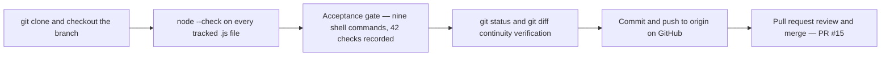

| CI/CD concern | Status | Detail |
|---|---|---|
| Pipeline definition | None in the repository | No workflow, job, stage or build configuration file is tracked |
| Automated test stage | None | `node --test` reports zero tests; there is no automated regression net for either surface (Project Guide §3 "Not Covered") |
| Automated verification that does exist | Manual, documented, reproducible | The nine-command acceptance gate in Project Guide §9.5, plus a 42-check verification record covering syntax, output contract, fidelity, zero-install exclusions, repository continuity, runtime behaviour and isolation (Project Guide §3) |
| Release / deployment automation | None | No deployment manifest, no artifact publication, no environment target |
| Delivery path observed | Branch → commit → push to `origin` → pull request → merge | `git log` shows the change authored by automation (`1cef465`, `6c16ea2`, "Blitzy Agent"), the record commit `4d1256c`, and the merge commit `39974fd` "Merge pull request #15" |
| Re-entry procedure after any change | Manual gate re-run | Guide §9.5 is the documented re-entry procedure for any future change (Project Guide §2.4.8) |

### 3.6.5 Runtime and Deployment Target

| Requirement | Value | Evidence |
|---|---|---|
| Runtime | A supported Node.js LTS line — v24.21.0 (reference) and v22.23.2 (supported floor) | Project Guide §9.1, Appendix D |
| Operating system | Any platform with a Node.js build; verified on Linux; filesystem case sensitivity matters because the file is `Welcome.js` with a capital `W` | Project Guide §9.1, §9.7 |
| Hardware | Nothing beyond what the runtime itself needs; one write and exit in roughly 25–30 ms | Project Guide §9.1 |
| Network | Not required to run either file | Project Guide §9.1 |
| Ports | The delivered product binds no port; the pre-existing service uses loopback port `3000` with a hardcoded host and no override | Project Guide Appendix B; `server.js:3-4` |
| Configuration / secrets | None consumed | Project Guide Appendix E, §1.5 |
| Startup order | None: there is no service to start and no dependency to sequence | Project Guide §9.4 |
| Forward requirement | Standardise on Node.js 24.x or later before the 22.x end of life on 30 April 2027; no source change is required because the syntax is ES5-level | Project Guide §6, Appendix D |

### 3.6.6 Disposition of Default-Stack Development and Deployment Components

| Default-stack component | Present | Basis for the disposition |
|---|---|---|
| Docker (containerisation) | No | No container file, compose file or image build exists; the product is run directly on the host runtime |
| Terraform (infrastructure as code) | No | No `.tf` file, module, state file or provider configuration is tracked, and no cloud resource is declared |
| GitHub Actions (CI/CD) | No | No `.github/` directory or workflow file exists; verification is the manual, documented acceptance gate. GitHub itself is used for hosting and pull-request delivery, not for running a pipeline |
| AWS and other cloud platforms | No | No cloud SDK, deployment manifest, endpoint or credential exists |

The forward-looking constraints for any change to this toolchain are recorded and narrow: keep the tree manifest-free; if a manifest ever becomes necessary, declare `"type": "commonjs"` so the pre-existing CommonJS `server.js` keeps working; keep verification captures outside the checkout; and re-run the documented acceptance gate on any change to either file (Project Guide §6, §5.1 row 10, §5.2 divergence 3, §9.5).

## 3.7 References

Every factual claim in this section rests on the following repository evidence.

- `Welcome.js` — the delivered product: one statement, 34 bytes, `console.log('Welcome to Blitzy');`; establishes the JavaScript language allocation, the ES5-level syntax, the module-neutral zero-import posture and the sole data domain. Its recorded and reproduced `sha256` is `5c7ac141d94f92056efb756f17335252c31e3d08d509e641d76512f73112c1fc`.
- `server.js` — the pre-existing HTTP service: the repository's only `require`, for the Node.js core `http` module; establishes CommonJS classification, the runtime's `http.createServer` / `server.listen` usage, the hardcoded loopback host `127.0.0.1` and port `3000`, and the static `Hello, World!\n` response.
- `README.md` — project identity stub (`# hao-backprop-test`); supplies the repository's only stated purpose and declares no technology, dependency, setup step or integration.
- `blitzy/documentation/Project Guide.md` — the governance record supplying technology versions and constraints: §1.4 and §1.5 (open governance item; no access issues, no secret or endpoint consumed), §2.1 (runtime decision and zero-manifest posture), §3 (test results, verification tooling, `node --test` reporting zero tests, coverage gaps), §4 (runtime validation and UI absence), §5.1 and §5.2 (compliance matrix, security posture, the unmet Python clause), §6 (risk register: runtime support lifecycle, manifest hazard, pre-existing service robustness), §9.1–§9.7 (prerequisites, zero-install setup, running, acceptance gate, troubleshooting), Appendix A (command reference and source hash), Appendix B (port reference), Appendix C (key file locations), Appendix D (technology versions), Appendix E (no environment variables), Appendix F (developer tools: package manager, linter, test runner, build tool and container/CI tooling all unused), Appendix G (glossary of zero-install posture, module-neutral source, natural termination and pre-existing surface).
- `blitzy/` — folder holding the governance record only; contains no executable content and is never imported or referenced by either JavaScript file.
- `.git/config` — repository metadata establishing the `origin` remote as a `github.com`-hosted Git repository, the sole external service this project depends on (for source control and pull-request delivery, not at runtime).
- Git commit history — `39974fd` ("Merge pull request #15", merged by `blitzy-qa[bot]`), `4d1256c` (Project Guide added), `6c16ea2` and `1cef465` (`Welcome.js` added, authored by the `Blitzy Agent` automation), and `1484182` (base revision by Ajitkumar Bhangale); establishes the delivery path, the automation tooling involved and the single-file change summary against the base.
- Repository-wide sweeps and runtime probes executed against the checkout during this investigation — `git ls-files` (four tracked paths, `js` and `md` extensions only), `grep` over all tracked `.js` files (one `require`, for a core module), the manifest/lockfile/`node_modules` existence probe (result `0`), `node --check` on both files, `node --test` (zero tests), `node Welcome.js` (18 bytes on stdout, empty stderr, exit `0`, hash reproduced), and an HTTP probe of `server.js` (`200`, `text/plain`, `Hello, World!` on `127.0.0.1:3000`), plus the host runtime probe reporting Node.js v22.23.3 with V8 `12.4.254.21-node.57`, OpenSSL `3.5.8` and libuv `1.51.0`.

No external or web source is cited: no statement in this section depends on material outside this repository, and the repository's own governance record is the authority for the runtime version lines and the support-lifecycle date it records.

# 4. Process Flowchart

## 4.1 System Workflows

This section documents the flows the code in this repository actually performs. There are two executable surfaces and no application framework, scheduler, queue, message broker or integration client: the in-scope product `Welcome.js` (one statement, 34 bytes) and the pre-existing, unmodified `server.js` (14 lines, 342 bytes, CommonJS HTTP server on loopback `127.0.0.1:3000`). Four workflows account for every runtime behaviour observed in this checkout:

| ID | Workflow | Features | Evidence source |
|---|---|---|---|
| W-1 | Greeting emission and self-termination — the product run | F-001, F-002, F-003, F-004, F-005 | `Welcome.js:1`; runtime probes in this checkout; Guide §4, §9.4 |
| W-2 | Manual verification and acceptance gate | F-008, and the acceptance criterion of every requirement | Guide §3 (42 checks), §9.5 (nine commands) |
| W-3 | HTTP greeting request handling | F-006 | `server.js:6-10`; request probes in this checkout |
| W-4 | Service start-up, listen and shutdown | F-006 | `server.js:12-14`; bind-conflict and signal probes in this checkout |

No other process exists: the repository has no scheduler, no CI workflow, no container entrypoint, no manifest script and no background job — `git ls-files` lists four paths and only two of them are executable (`README.md`, `Welcome.js`, `server.js`, `blitzy/documentation/Project Guide.md`), and no `.github`, `Makefile`, `Dockerfile` or `package.json` exists in the tree.

### 4.1.1 Core Business Processes

#### W-1 — End-to-end product journey (the only flow the deliverable has)

**Start point:** a human acceptance operator or developer, at a shell prompt, with a supported Node.js interpreter available (reference line v24.21.0, supported floor v22.23.2 — Guide Appendix D; this checkout was exercised on v22.23.3).
**End point:** the process has ended and the shell reports exit status `0`, having written 18 bytes to stdout and nothing to stderr.

| # | Step | Actor / system | What happens | Observed evidence |
|---|---|---|---|---|
| 1 | Select the interpreter | Operator | A supported Node.js line is used; no package manager, virtual environment or installation step exists | `node --version` → `v22.23.3` on this host; Guide §9.1, §9.3 |
| 2 | Invoke the program | Operator → shell | `node Welcome.js` from the repository root (Guide §9.4), or an absolute path from any directory | Invocation from `/tmp` by absolute path returned 18 bytes and exit 0 |
| 3 | Resolve path and spawn | Shell | The shell resolves the interpreter on `PATH` and the script path against the working directory, then spawns one process | Failure class documented in Guide §9.7 row 1 |
| 4 | Load the file | Node.js runtime | The runtime reads the 34-byte file and classifies its module type — with no manifest in or above the tree, and no `import`/`export` syntax in the source, classification cannot change behaviour | `git ls-files`; `grep` sweep returns no module construct in `Welcome.js` |
| 5 | Evaluate the single statement | Node.js runtime | `console.log('Welcome to Blitzy');` runs as one ES5-level member call on the runtime-provided `console` global (`Welcome.js:1`) | `node --check Welcome.js` exits 0 |
| 6 | Write the output | Runtime → stdout | Exactly 18 bytes are written: `57 65 6c 63 6f 6d 65 20 74 6f 20 42 6c 69 74 7a 79 0a` (`Welcome to Blitzy` plus one LF) | `wc -c` = 18; stream `sha256` = `2dc7e85a734de043468d7beb8ee5294e0c04440f23fd89b69fd8ea0ee7971951` |
| 7 | Drain the event loop | Node.js runtime | No timer, listener, socket, child process or `process.exit` call exists, so the event loop empties on its own | `grep` sweep of `Welcome.js` finds no `setTimeout`, `setInterval`, `process.exit`, `net.` or `fs.` |
| 8 | Terminate | Runtime → shell | The process ends with status `0` and an empty stderr; natural termination is what protects queued output from truncation | `exit=0`, stderr 0 bytes; Guide §5.1 row 4 records the same on both supported lines |
| 9 | Consume the result | Operator or downstream consumer | The captured bytes are compared against the contract, or piped onward | Guide §9.6 records `node Welcome.js \| tr '[:lower:]' '[:upper:]'` → `WELCOME TO BLITZY` |

Measured cost of the whole journey: **27 ms** wall clock in this checkout (one write and exit), consistent with the 25–30 ms the Guide records in §9.1. The flow is idempotent — three consecutive runs produced the identical stream hash, and the Guide records repeated and concurrent runs with no residual process, handle or file write.

**Decision points (all documented in Guide §9.7 or observed here):**

| ID | Decision | If the answer is no | Observed or documented consequence |
|---|---|---|---|
| D-1.1 | Is a Node.js interpreter on `PATH`? | The shell itself fails before the program starts | `node: command not found`; no script code runs (Guide §9.7 row 4) |
| D-1.2 | Does the path resolve to a file named exactly `Welcome.js`? | The runtime reports `MODULE_NOT_FOUND` | Exit status 1 with a stack trace on stderr; caused by a foreign working directory or wrong filename casing (Guide §9.7 rows 1–2). On a case-insensitive filesystem a wrong casing is masked locally and then fails on Linux |
| D-1.3 | Can the destination accept the write? | The 18 bytes are lost with no signal | Verified: `>&-` (closed stdout) → exit 0; `>/dev/full` → exit 0; `\| head -c 0` → exit 0. `console.log` does not raise, so the process reports success while the consumer receives nothing (Guide §3 "Not Covered") |
| D-1.4 | Is the output being counted from a captured stream or from a terminal? | A terminal's newline translation reports 19 bytes instead of 18 | Guide §9.7 row 3; the gate therefore counts from a pipe or a file |
| D-1.5 | Do captured bytes, stderr and exit status all match the contract? | Acceptance fails | Recovery is procedural: correct the invocation and re-run the gate (Guide §9.5, §9.7) |

**Error handling path of W-1:** the source contains no guard, `try`/`catch`, branch or error handler of any kind, and none of the failures above originate inside the 34 bytes — they are produced by the shell, the filesystem, the terminal or the runtime. Every failure is therefore surfaced outside the program (shell status, runtime stderr) and recovered procedurally, never programmatically. Failure modes, notifications and recovery are tabulated in 4.3.2 and drawn in 4.4.3.

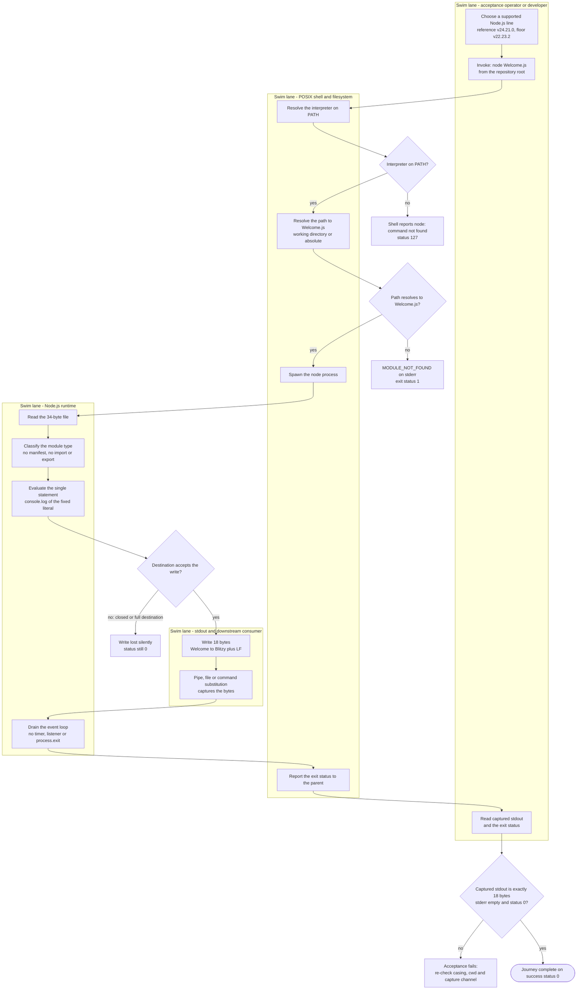

#### W-2 — Manual verification and acceptance workflow

**Start point:** a developer or owner with a fresh checkout. **End point:** the acceptance gate passes and, optionally, the record is updated. The repository has no automated suite — `node --test` from the root reports `tests 0 / suites 0 / pass 0 / fail 0` and exits 0 — so this flow *is* the quality gate (Guide §9.5; Guide §3 records 42 of 42 manual checks passing across seven areas).

| # | Step | Command / action | Pass condition |
|---|---|---|---|
| 1 | Read-only parse check | `node --check Welcome.js` | Exit 0, no output |
| 2 | Run and capture | `node Welcome.js` with stdout captured | Message present in the capture |
| 3 | Byte count | Count bytes on the **pipe or file**, never the terminal | Exactly 18 |
| 4 | Stderr emptiness | Redirect stdout away, count stderr | 0 bytes |
| 5 | Exit status | Read the status of the run | `0` |
| 6 | Byte-level fidelity | Hex dump the capture | `57 65 6c 63 6f 6d 65 20 74 6f 20 42 6c 69 74 7a 79 0a` |
| 7 | Minimality | `wc -l < Welcome.js` | 1 |
| 8 | Placement and casing | `ls Welcome.js` | Exact casing at the repository root |
| 9 | Whole-tree parse | `node --check` over every tracked `.js` file | Both `Welcome.js` and `server.js` exit 0 |
| 10 | Runtime parity | Repeat steps 1–6 with the second supported Node.js line on `PATH` | Byte-identical results |
| 11 | Continuity | Compare pre-existing files against their baseline | `README.md` and `server.js` byte-identical (`server.js` sha256 `332fc2d04eb5b8f3cb230855457af80d0dfc246f958d6e49615610d656acc2e0`) |

**Decision points:** does the file parse (D-2.1); do all nine commands hold (D-2.2); is the gate repeated on a second runtime line (D-2.3); are the pre-existing bytes unchanged (D-2.4). **Error path:** a failure at any step leads to Guide §9.7's six-row symptom/cause/resolution table and a re-run of the gate — there is no retry loop in software. **Timing:** the whole gate completes in seconds; the Guide's verification bounds each run with `timeout 10`.

#### W-3 — HTTP greeting request handling (pre-existing surface)

**Start point:** a local client — a terminal HTTP client or a browser — opening a TCP connection to `127.0.0.1:3000`. **End point:** the response is delivered and the connection is either reused or closed.

| # | Step | What happens | Observed evidence |
|---|---|---|---|
| 1 | Connect | The listener bound to loopback `127.0.0.1:3000` accepts the connection | `/proc/net/tcp` shows the listning socket at `0100007F:0BB8`, i.e. `127.0.0.1:3000` only |
| 2 | Parse the request | The runtime's HTTP parser reads the request line and headers before any application code runs | 400/431/408 responses below are produced by the parser, not by `server.js` |
| 3 | Dispatch | A parsed request reaches the inline handler; the handler never inspects `req` | `server.js:6` takes `(req, res)` and reads nothing from `req` |
| 4 | Compose the response | `res.statusCode = 200`, `res.setHeader('Content-Type','text/plain')`, `res.end('Hello, World!\n')` | `server.js:7-9`; 14-byte body `48 65 6c 6c 6f 2c 20 57 6f 72 6c 64 21 0a` |
| 5 | Deliver | Framed with `Content-Length: 14`, `Connection: keep-alive` and `Keep-Alive: timeout=5`; no `Server` header | Full header capture on `GET /` |
| 6 | Reuse or close | A further request may arrive on the same socket; an idle socket is closed by the server | Pipelined and reused requests both answered 200; idle socket closed at 6.01 s |

The response is a pure function of nothing: the method, path, query string and body are all ignored. Verified responses were identical for `GET /`, `GET /any/path?x=1`, `POST /` with a body, `PUT /deep/er/path`, `DELETE /x` and `GET /nonexistent` — all `200`, all with the same 14-byte body (`sha256` `c98c24b677eff448`), and none of them a `404`.

**Decision points:** connection accepted (D-3.1); request line and headers parseable, and `Host` present on HTTP/1.1 (D-3.2); header block within the parser's limit (D-3.3); header block completed before the headers timeout (D-3.4); connection reuse requested (D-3.5); next request inside the keep-alive window (D-3.6).

**Error states:** `400 Bad Request` for a malformed request line, an invalid method token or a missing `Host` header on HTTP/1.1; `431 Request Header Fields Too Large` for a 20 KB header; `408 Request Timeout` for a header block that never completes. All three close the connection and leak no internals — no stack trace, path or version is echoed. The process survived every one of them with stderr still at 0 bytes. Full flow: 4.4.2; error flow: 4.4.3.

#### W-4 — Service start-up, listen and shutdown lifecycle

**Start point:** `node server.js`. **End point:** the process is running and serving, has aborted, or has been signalled to stop.

| # | Step | What happens | Observed evidence |
|---|---|---|---|
| 1 | Construct | `http.createServer` registers the inline request handler | `server.js:6-10` |
| 2 | Bind | `server.listen(3000, '127.0.0.1', …)` requests the loopback endpoint | `server.js:3-4`, `server.js:12` |
| 3 | Announce | On a successful bind the callback logs `Server running at http://127.0.0.1:3000/` to stdout | Exact startup line observed; stderr 0 bytes |
| 4 | Serve | The process then handles connections until stopped; readiness was reached in about 35 ms after spawn | First successful request 35 ms after process start |
| 5 | Stop | `SIGTERM` or `SIGINT` uses the runtime's default disposition: immediate termination with no drain | Process gone immediately after the signal; shell reported status 143 (`128 + 15`) for `SIGTERM` |

**Decision points:** did the bind succeed (D-4.1); if not, is port `3000` already held (D-4.2); is the process being asked to stop by signal (D-4.3). **Error state:** a second instance while the port is bound dies with `Error: listen EADDRINUSE: address already in use 127.0.0.1:3000` as an unhandled `'error'` event — nothing is written to stdout, a stack trace goes to stderr, and the exit status is `1`. There is no `'error'` listener, no retry, no backoff and no fallback port anywhere in `server.js`; the Guide records this as an open pre-existing robustness item outside the delivered scope (Guide §6).

#### System interactions

| Interaction | Direction | Mechanism | Boundary crossed |
|---|---|---|---|
| Operator → product | Invocation | Shell command `node Welcome.js` | Human touchpoint: shell command line |
| Product → consumer | One-way, outbound | 18 bytes on stdout plus exit status | Process boundary; no socket, file or log sink is opened |
| Operator → assurance record | Read | Markdown rendering of `blitzy/documentation/Project Guide.md` | Human touchpoint: document reader |
| Operator → gate → product | Verification | Nine commands executed against the file | Developer tooling (`node --check`, `wc`, `od`, `sha256sum`), not a runtime dependency |
| HTTP client → service | Request | TCP to `127.0.0.1:3000` | Human touchpoint: browser or HTTP client; loopback interface only |
| Service → client | One-way, outbound | `200`, `text/plain`, 14 bytes | Loopback interface only |
| Both executables → runtime | Host facility use | `console` global (product) and the built-in `http` module (service) | Runtime boundary; the only `require` in the tree is `server.js:1` |

No interaction exists between the two executables beyond co-residency in one working tree: neither file imports, requires or references the other, and the Guide records that the delivered product is never imported by or referenced from the existing service (Guide §5.1 row 8).

### 4.1.2 Integration Workflows

The integration surface of this repository is deliberately negative, and each negative is verifiable rather than assumed.

**Data flow between systems.** Exactly one data flow leaves the delivered product:

| Flow | Direction | Payload | Destination | Evidence |
|---|---|---|---|---|
| DF-1 | Outbound, one-way | 18 bytes: `Welcome to Blitzy` + LF | The stdout stream, consumed by a pipe, a file or command substitution | `Welcome.js:1`; captured bytes in this checkout |
| DF-2 | Outbound (service) | 14-byte response body plus status and framing headers | The connected loopback client | `server.js:7-9`; response capture |
| — | Inbound to the product | **None** | — | No `process.argv`, `process.env`, stdin read, file read or `require` exists in `Welcome.js` (grep sweep returns zero matches); output is identical under `env -i` and from a foreign working directory |

There is no database, cache, message broker, object store, remote endpoint, telemetry sink or log file anywhere in the system — the sweep for `require`, `fs.`, `net.`, `fetch(` and `process.env` across both `.js` files returns a single line, `server.js:1:const http = require('http');`. Nothing in the tree imports, requires or executes another tracked file (section 2.3.2).

**API interactions.** The repository exposes one local API surface and calls none:

- Exposure: a single HTTP endpoint on `127.0.0.1:3000` that returns the same `200 text/plain` greeting for every method and every path (`server.js:6-10`). It is loopback-only by construction, so off-host callers cannot reach it.
- Consumption: no outbound HTTP call, client library or webhook exists; no `fetch(`, no `http.request`, no third-party API. The Guide records no endpoint, credential or external service consumption anywhere (Guide §1.5, Appendix E).
- Request bodies are ignored: the handler never reads `req`, and a `POST` carrying a body returned the same fixed 14-byte response as a bare `GET`.
- No authentication, authorization, API key, token or session concept exists on either side — the loopback bind address is the entire access model (see 4.2.3).
- Module resolution is a negative integration point: a `package.json` declaring `"type": "module"` added in or above the tree would break the CommonJS `server.js` while `Welcome.js` kept working (Guide §6). No manifest exists today.

**Event processing flows.** None exist at the application level. The product registers no listener, subscriber, hook or callback — it evaluates one statement and lets the event loop empty. In `server.js` the only event-driven behaviour is owned by the runtime: connection acceptance, request parsing and the keep-alive timer that closes an idle socket after about 6 seconds (`Keep-Alive: timeout=5`). There is no event emitter, queue, pub/sub channel, retry topic or dead-letter path in the repository, and no broker dependency to provide one (zero third-party packages; Guide Appendix D).

**Batch processing sequences.** None exist. There is no scheduler, cron entry, worker, queue consumer, migration script or CI job — the tree contains no CI configuration, no manifest script and no container file, and the Guide records that the product "is run, not deployed" (Guide Appendix F). Repetition is operator-driven and sequential (run the gate, run the program, re-run after a change), and it is safe to repeat because the work is idempotent: the product writes the same 18 bytes on every run, and the service returns the same bytes on every request.


## 4.2 Flowchart Requirements

This sub-section states, for each workflow in 4.1, the elements a correct flowchart must carry — start and end points, process steps, decision diamonds, system boundaries, user touchpoints, error states with recovery, and timing or SLA constraints — followed by the validation rules that apply at each step.

### 4.2.1 Workflow Element Inventory

| Element | W-1 Product run | W-2 Acceptance gate | W-3 HTTP request | W-4 Service lifecycle |
|---|---|---|---|---|
| **Start point** | Operator at a shell with a supported Node.js line available | Developer or owner with a checkout | Local client opening TCP to `127.0.0.1:3000` | `node server.js` invoked |
| **End point** | Process exited, status `0`, 18 bytes written, stderr empty | Gate verdict recorded (pass/fail per step) | Response delivered; socket reused or closed | Process serving, aborted, or stopped by signal |
| **Process steps** | Select interpreter → invoke → resolve path and spawn → load and classify → evaluate the statement → write 18 bytes → drain → exit → consume | Parse check → run and capture → byte count → stderr count → exit status → hex dump → line count → placement → whole-tree parse → parity → continuity | Connect → accept → parse → dispatch → set status and header → end with the fixed body → reuse or close | Construct → bind → announce on stdout → serve → stop |
| **Decision diamonds** | D-1.1 interpreter on `PATH`; D-1.2 path and casing resolve; D-1.3 destination accepts the write; D-1.4 capture channel is not a terminal; D-1.5 captured bytes, stderr and status match the contract | D-2.1 file parses; D-2.2 all nine commands hold; D-2.3 second runtime line tested; D-2.4 pre-existing bytes unchanged | D-3.1 accepted; D-3.2 request parseable and `Host` present; D-3.3 headers within limit; D-3.4 headers completed in time; D-3.5 reuse requested; D-3.6 next request inside the keep-alive window | D-4.1 bind succeeds; D-4.2 port already held; D-4.3 stop signal received |
| **System boundary** | One process; no socket, file descriptor, log sink or telemetry channel is opened | Developer tooling boundary: verification artifacts stay outside the checkout | Loopback interface only (`127.0.0.1:3000`, never a routable address) | One long-lived process holding one listening socket |
| **User touchpoints** | Shell command line; terminal or pipeline output; exit status | Shell command line; the nine-command gate; the Markdown record | Browser or terminal HTTP client | Shell command line; startup line on stdout |
| **Error states and recovery** | `MODULE_NOT_FOUND` → exit 1; interpreter missing → shell status 127; silent write loss with status 0; 19-byte terminal misreading. Recovery: correct the invocation, assert from a capture (4.3.2) | Parse error; wrong directory; wrong casing; byte-count mismatch; parity unproven; continuity breach. Recovery: Guide §9.7 table, then re-run the gate | `400`, `431`, `408` (all with `Connection: close`, no internals echoed) | `listen EADDRINUSE` → unhandled `'error'` event, exit 1 with a stack trace on stderr; signals terminate without draining |
| **Timing / SLA** | 27 ms measured here; 25–30 ms recorded in Guide §9.1; verification bounded by `timeout 10`. No SLA is committed | Seconds to run; no automated retry loop exists | Sub-millisecond per request observed (0.18–0.75 ms); keep-alive 5 s advertised, idle close at 6.01 s; `408` only after ~89 s | ~35 ms from spawn to first served request; second-instance failure returns in under a second |

**Elements that are correctly absent.** A flowchart of this system must not contain lanes, nodes or diamonds for the following, because none exists in evidence:

| Absent element | Why it must not be drawn | Evidence |
|---|---|---|
| Event subscribers, queues or brokers | No emitter, subscriber, topic or broker dependency exists | Grep sweep returns no listener or queue construct; zero third-party packages (Guide Appendix D) |
| Batch or scheduled jobs | No scheduler, cron entry, worker or CI job exists | No `.github`, `Makefile`, `Dockerfile` or manifest in the tree |
| Outbound API calls | Nothing calls an external endpoint | No `fetch(`, `http.request` or client library in either file; Guide §1.5 records no endpoint, secret or credential |
| Authentication or authorization steps | No authn/authz code exists, and the loopback bind is the whole access model | `server.js:3`; no auth string in either file |
| Data stores and transactions | No database, cache, file write or persist step exists | No `fs.`, `net.` or store dependency; Guide Appendix B records that the product binds no port |
| Load-balancing, cluster or scaling stages | One process, one listener, no concurrency control by design | `server.js:12-14`; Guide Appendix C |

### 4.2.2 Timing and SLA Considerations

**Measured timings in this checkout (Node.js v22.23.3):**

| Measurement | Observed value | Method |
|---|---|---|
| Product run: spawn to exit | 27 ms | Wall-clock around `node Welcome.js` with captured streams |
| Product run, recorded reference | 25–30 ms for one write and exit | Guide §9.1 |
| Service: spawn to first served request | ~35 ms | Polling the port with a bounded client immediately after spawn |
| Service: single request latency (20 sequential) | 0.18–0.75 ms | `curl -w '%{time_total}'` |
| Service: 20 concurrent requests | 16 ms total, all `200`, one distinct body | Concurrent clients, all awaited individually |
| Service: idle keep-alive lifetime | 6.01 s observed against an advertised `Keep-Alive: timeout=5` | Held an idle connection and read until the server closed it |
| Service: incomplete-header timeout | `408` observed at 89.08 s | Sent an unterminated header block and waited for the response |
| Service: second-instance failure | Exit 1 in under a second | Ran a second `node server.js` while the port was bound |

**Timeouts that govern the flows** — all of them runtime defaults, none configured in source (`server.js` sets no timer):

| Timeout | Effective value | Where it appears in the flows |
|---|---|---|
| `server.keepAliveTimeout` | 5000 ms (advertised as `Keep-Alive: timeout=5`) | D-3.6: closes an idle reused socket, observed at 6.01 s |
| `server.headersTimeout` | 60000 ms | D-3.4: produces `408 Request Timeout`; observed at 89.08 s, consistent with Node's 30 s connection-checking interval bounding when the timeout is noticed |
| `server.connectionsCheckingInterval` | 30000 ms | Explains the gap between the 60 s header timeout and the 89.08 s observation |
| `server.requestTimeout` | 300000 ms | A request that never completes is eventually abandoned by the runtime; not exercised, recorded here as the governing default |
| Verification bound | `timeout 10` per run | Guide §4 records the product completing within it on both supported runtime lines |

**Committed service levels.** No artifact in this repository states an availability, throughput, latency, RPO or RTO commitment. The only timing statements that exist are the observed/recorded execution figures above, the `timeout 10` bound used during verification, and one calendar constraint: the supported runtime floor, Node.js 22.x, reaches end of life on **30 April 2027**, after which hosts on that line receive no security patches (Guide §6, Appendix D). Consequently every node in the flowcharts carries an observed bound or none at all — none carries a contractual SLA.

### 4.2.3 Validation Rules

**Business rules enforced at each step.** Each rule below is a criterion the repository was actually judged against, not an inferred policy; the enforcement point is where a flowchart's decision diamond belongs.

| ID | Business rule | Enforced at | Failure consequence | Evidence |
|---|---|---|---|---|
| B-1 | stdout must carry exactly the 18-byte message `Welcome to Blitzy` plus one LF; the literal may not be reworded | W-1 step 6; gate steps 2–6 | Acceptance fails regardless of how the program "looks" | `Welcome.js:1`; captured bytes; Guide §5.1 rows 1, 5 |
| B-2 | The file must be named exactly `Welcome.js` with exact casing at the repository root | W-1 step 4; gate step 8 | `MODULE_NOT_FOUND` on Linux when casing or location is wrong | Guide §5.1 row 2, §9.7 row 2 |
| B-3 | One source line, one added file for the product change — the two binding minimality ceilings | Gate step 7 | A second line or artifact breaches the ceiling the request stated | `wc -l` = 1; Guide Appendix G ("minimality criteria") |
| B-4 | Zero-install posture: no manifest, lockfile, `node_modules`, test file, CI workflow, container file, environment file or Python artifact in or above the tree | W-2 step 11; any staging action | An acceptance criterion is broken | Guide §5.1 row 11, Appendix F; ancestor walk returns nothing |
| B-5 | Module neutrality: no `import`/`export` syntax, and no module configuration added in or above the tree; a manifest, if ever required, must declare `"type": "commonjs"` | W-1 step 4 | A `"type": "module"` manifest would break `server.js` while leaving `Welcome.js` unaffected | Guide §5.1 row 10, §6 |
| B-6 | Natural termination: no `process.exit`, timer, listener, socket or handle may be introduced | W-1 step 7 | A forced exit can truncate queued output; the termination proof must be re-established | Guide §5.1 row 4, §2.4.2 |
| B-7 | Output must be asserted from a captured stream, never from a terminal and never from the exit status alone | Gate steps 3, 4, 5 | A 19-byte misreading or a silently lost write is mistaken for success | Guide §3 "Not Covered", §9.7 row 3 |
| B-8 | Pre-existing bytes must not drift: `README.md` and `server.js` must stay byte-identical, and verification artifacts must be kept outside the checkout | W-2 step 11; before staging | Continuity breach; a blanket `git add` would add artifacts beyond the intended one | `git diff --name-status`; Guide §5.2 divergence 3, §6 |
| B-9 | Stage by explicit path, not `git add -A` | Any commit in W-2 | Untracked capture files could be committed into a one-added-file deliverable | Guide §1.6, §9.7 row 6 |

**Data validation requirements.** The delivered product validates nothing, because it accepts nothing: it reads no command-line argument, no standard input, no environment variable and no file, so there is no inbound data path to validate and no input-validation surface exists (Guide §5.1 security posture; grep sweep returns no `process.argv`, `process.env`, stdin read or file read in `Welcome.js`). In `server.js` the only validation in the system runs at the protocol boundary, and it is performed by the runtime's HTTP parser rather than by application code:

| Boundary rejection | Trigger observed | Response | Application code involved |
|---|---|---|---|
| Malformed request line | `BADREQUEST` sent as the request line | `400 Bad Request`, `Connection: close` | None — the parser answers before the handler runs |
| Invalid method token | `FOO / HTTP/1.1` | `400 Bad Request`, `Connection: close` | None |
| Missing `Host` on HTTP/1.1 | `GET / HTTP/1.1` with no `Host` header | `400 Bad Request` with `Connection: close` | None |
| Oversized header block | 20 KB single header | `431 Request Header Fields Too Large`, `Connection: close` | None |
| Header block never terminated | Request line and one header, no final blank line | `408 Request Timeout`, `Connection: close` after ~89 s | None |
| Protocol downgrade | `GET / HTTP/1.0` | `200` with `Connection: close` | Handler only |

None of these responses echo the request, a path, a stack trace or a version; the process stayed alive with stderr at 0 bytes throughout.

**Authorization checkpoints.** There are none, and none is required by the design: no authentication or authorization code, credential, token, session or role concept exists anywhere in the tree. The entire access model of the pre-existing service is its bind address — the listening socket is `127.0.0.1:3000` only (confirmed in `/proc/net/tcp` as `0100007F:0BB8`), so no off-host caller can reach it (Guide Appendix B). The delivered product has no access surface at all: it opens no socket, reads no secret and holds no credential (Guide §1.5, Appendix E). File permissions on the executable surfaces are `0644` (Guide §5.1).

**Regulatory compliance checks.** No regulation, standard or certification is referenced anywhere in the repository, and none applies: the product processes no personal data, stores nothing, transmits nothing off-host, and the service answers a fixed string without inspecting the request. The only compliance gate that exists is internal — the governing project rule's three clauses, adjudicated in the governance record:

| Rule clause | Status | Basis |
|---|---|---|
| Separate each flow and feature clearly | Met | The one feature's one flow occupies its own dedicated file containing nothing else (Guide §5.1 row 9) |
| Application performance not impacted | Met | Request latency medians at or below the idle baseline while the new script ran repeatedly and concurrently, no failed request, stable memory/thread/descriptor counts (Guide §4, §5.1 row 8) |
| New products written in Python | **Not met, by recorded decision** | The product is JavaScript as its own request specified by language and filename; no Python artifact exists. Impact is governance-only and no code change can close it (Guide §5.1 row 12, §5.2 divergence 1, §1.4) |

That single open item is a wording decision for the project owner — amend or narrow the rule, or issue a product-scoped waiver — and the file must stay byte-identical while it is settled (Guide §1.6, §8).


## 4.3 Technical Implementation

### 4.3.1 State Management

**State transitions.** Neither executable carries application state; the state that exists is process and socket state owned by the Node.js runtime. The two state machines are drawn in 4.4.5 and summarized here.

Product process lifecycle (W-1, `Welcome.js`):

| State | Entered when | Exit condition | Consequence |
|---|---|---|---|
| Spawned | The shell resolves an interpreter and a path and starts the process | File load begins, or the invocation fails | Failure exits here: `node: command not found` (shell status 127) or `MODULE_NOT_FOUND` (exit 1) |
| Loaded | The runtime has read the 34-byte file | Module type is settled | With no manifest in or above the tree the file is treated as CommonJS; no configuration governs the state |
| Classified | No `import`/`export` construct exists to depend on classification | The statement is evaluated | F-004: behaviour is identical under either classification |
| Evaluated | `console.log` writes 18 bytes to stdout | The event loop is empty | One write, no further work |
| Drained | No timer, listener, socket or handle remains registered | The runtime terminates the process | F-002: natural termination, so queued output cannot be truncated |
| Exited 0 | The runtime reports the process's status to the shell | — | Terminal state; stderr is empty |

Service lifecycle (W-4, `server.js`): `Constructed → Binding → Listening → Serving → Listening`, with three exits — `Aborted` (`EADDRINUSE`, exit 1 with a stack trace on stderr), `Closed` (an idle socket released after about 6 s, while the listener stays bound), and `Killed` (a signal with no drain, status 143 observed for `SIGTERM`). Restarting the process returns it to `Constructed` with nothing carried over.

Socket state, visible to the kernel rather than to the application, was observed directly: a `/proc/net/tcp` snapshot taken while the service ran showed the single listener on `0100007F:0BB8` in state `0A` (LISTEN) and many peer sockets in state `06` (TIME_WAIT) after clients closed. The service holds no session, connection registry or counter of its own.

**Data persistence points.** There are none at runtime, in either workflow:

- The product opens no file and writes none — no `fs.` call exists in `Welcome.js`, and no residual file, handle or process was observed after a run (Guide §4).
- The service writes nothing: no access log, no error log, no state file. Its only output is the one-line startup message on stdout and, on a failed bind, the runtime's stack trace on stderr.
- No database, cache, broker, object store or telemetry sink exists anywhere in the repository (zero third-party packages; Guide Appendix D).
- The only durable state in the system is Git-tracked content, and it is changed by a developer, not by a running program: five commits and four tracked paths. One commit, `6c16ea2`, is deliberately a record-only commit that changes no path, which is why the language decision survives in history rather than in a file (Guide §5.2 divergence 2).
- Verification artifacts must be written outside the checkout; the record shows seven untracked image captures once landed inside the tree and were removed, precisely because in-tree artifacts breach the one-added-file ceiling (Guide §5.2 divergence 3).

**Caching requirements.** None. There is no application cache, memoization, build cache, transpile cache or persisted lookup in the system; the product performs one write per process and keeps nothing between runs, and the service answers from a literal rather than from cached or derived data. The only caches in play belong to the runtime itself — its internal module registry (which holds the built-in `http` module for the life of the service process) and its HTTP parser's per-connection state — and neither is configured, inspected or invalidated by this code.

**Transaction boundaries.** None exist. No durable resource is mutated, no multi-step write is performed, and there is no partial-failure case to roll back, compensate or replay: the product's single write is to a stream, and the service's single write is a response body. Two properties follow and both were verified:

- **Idempotence** — three consecutive product runs produced the identical stream hash (`2dc7e85a…`), and twenty concurrent requests to the service returned one distinct body (`c98c24b677eff448`). Repeating either flow changes no state.
- **Isolation between runs** — concurrent executions share no heap, descriptor or file; the Guide records stable memory, thread and descriptor counts for the service while the script ran repeatedly alongside it (Guide §4, §5.1 row 8).

The nearest thing to a transaction boundary in this repository is procedural: the acceptance gate is all-or-nothing across nine checks, and its verdict is the only gate between a change and acceptance (Guide §9.5).

### 4.3.2 Error Handling

**Retry mechanisms.** None exist in code. Neither file contains a loop, backoff, reconnect, retry counter or idempotency key; `grep` over both files finds no `try`/`catch`, no `'error'` listener and no timer. The product has exactly one attempt — if the write cannot be delivered it is lost, and the process still exits `0` — and the service neither retries a failed bind nor falls back to another port. The only retry in the system is human: re-run the acceptance gate after correcting the invocation or the change (Guide §1.6, §9.5). Retrying is safe because both flows are idempotent, and the Guide states that growth beyond a single statement is the point at which automated checking earns its place (Guide §3).

**Fallback processes.** None exist in code, and the two failure classes that most need one have no substitute:

| Missing fallback | Consequence | Available substitute |
|---|---|---|
| Alternate output channel | If the stdout destination rejects the write, the message is lost with the process still reporting success | None in code; assert from a captured stream rather than the exit status (Guide §3 "Not Covered") |
| Alternate port or address | A held port `3000` aborts the service with exit 1; host and port are hardcoded literals with no override | Operator action only: free the port or stop the earlier instance (Guide §6) |
| Alternate runtime line | A host below the supported floor is unsupported | Operator action only: standardise on a supported line; the source needs no change because it is ES5-level (Guide Appendix D) |
| Graceful shutdown drain | In-flight work is not drained on signal | None; `SIGTERM`/`SIGINT` take the runtime's default disposition (status 143 observed for `SIGTERM`) |

**Error notification flows.** Exactly three channels carry any signal, and none of them is a log, metric, alert or telemetry path:

| Channel | What it carries | Observed instance |
|---|---|---|
| stdout | The service's success announcement only; the product's 18-byte message (which is the payload, not a notification) | `Server running at http://127.0.0.1:3000/` |
| stderr | Runtime diagnostics only — uncaught exceptions and, in the shell's case, interpreter-not-found messages | `Error: listen EADDRINUSE: address already in use 127.0.0.1:3000` with an unhandled `'error'` event stack trace; stderr stayed at 0 bytes in every product run and in every HTTP probe that produced a `400`, `431` or `408` |
| Exit status | Success or failure of a process, consumed by the shell or a pipeline | `0` for the product and for a clean service run; `1` for `MODULE_NOT_FOUND` and for `EADDRINUSE`; `143` when the service was stopped by `SIGTERM` |
| HTTP status (service only) | Boundary rejections, emitted by the runtime parser before the handler runs | `400`, `431`, `408` — all with `Connection: close` and no internal detail echoed |

Nothing is written to a log file, a syslog socket, a metrics endpoint or an alerting system, and nothing would be: there is no dependency and no outbound channel to carry it.

**Failure modes and recovery procedures.** The matrix below is the error-handling surface of the whole system, product first, then the pre-existing service, then the verification flow. Every row was observed in this checkout or is recorded in the governance record.

| ID | Failure mode | Layer that produces it | Detection | Automatic handling | Recovery procedure |
|---|---|---|---|---|---|
| E-1 | Working directory is not the repository root | Filesystem / runtime | `Cannot find module …` with `MODULE_NOT_FOUND`, exit 1 | None | `cd` to the repository root, or pass the absolute path — running by absolute path from an unrelated directory was verified to work (Guide §9.7 row 1) |
| E-2 | Filename casing or spelling is wrong (`welcome.js`) | Filesystem | Same `MODULE_NOT_FOUND`, exit 1; masked on a case-insensitive filesystem and then failing on Linux | None | Use the exact name `Welcome.js` (Guide §9.7 row 2) |
| E-3 | No Node.js interpreter on `PATH` | Shell | `node: command not found`; no script code runs | None | Install a supported LTS line or invoke the interpreter by its full path (Guide §9.7 row 4) |
| E-4 | stdout destination closed or full | Runtime stream | **None** — no exception, no stderr output, exit status still `0`; verified with closed stdout, `/dev/full` and a zero-length pipe reader | None | Assert output from a capture, never from the exit status alone (Guide §3 "Not Covered", §6) |
| E-5 | Byte count misread as 19 | Terminal | Terminal newline translation reported by the verification procedure | None | Count from a pipe or a captured file (Guide §9.7 row 3) |
| E-6 | The acceptance gate is not run at all | Process | Nothing detects it — acceptance is manual by design | None | Re-run the nine-command gate on any change; there is no automated regression net (Guide §3, §6) |
| E-7 | Port `3000` already held at start-up | Runtime / service | `Error: listen EADDRINUSE` as an unhandled `'error'` event, stack trace on stderr, exit 1, nothing on stdout | None — no `'error'` listener, no retry, no fallback port | Free the port or stop the earlier instance, then start again (Guide §6) |
| E-8 | Malformed, oversized or incomplete request | Runtime HTTP parser | Response status returned to the client | The parser answers and the process continues; the handler never sees the request | None needed; no application state was touched. Recorded as no-internals-leak behaviour with no logging (Guide §4) |
| E-9 | Client aborts before reading the response | Network / runtime | **None** — no log, no stderr output | Connection torn down; the server process was observed to survive with stderr still at 0 bytes | None needed |
| E-10 | The service is asked to stop by signal | Runtime | The shell observes the process's exit or signal status (`143` for `SIGTERM`) | Immediate termination with no drain; no shutdown hook exists | Start it again if needed; no state is carried over (Guide §6) |
| E-11 | Pre-existing bytes drift, or in-tree captures get staged | Repository | `git diff` / `git status` output | None | Restore the pre-existing bytes; remove capture directories before staging and stage by explicit path (Guide §5.2 divergence 3, §6) |

Two gaps are recorded rather than resolved, and both are acceptance-relevant: stream-failure behaviour is not asserted (E-4), and no automated check guards either executable (E-6). The Guide states them plainly among its "Not Covered" items (Guide §3) and rates the first as a mitigated technical risk, with the mitigation being the documented gate itself (Guide §6).


## 4.4 Required Diagrams

The five required diagram types follow. Each diagram was rendered offline with mermaid-cli 11.17.0 to confirm it parses and produces a valid SVG, and each is drawn from the evidence in 4.1–4.3: lanes are the actors and systems that actually take part, and no lane, node or diamond appears for a component this repository does not contain (4.2.1).

### 4.4.1 High-Level System Workflow

Swim lanes separate the human actors, the in-scope product, the pre-existing service, the assurance artifacts and the host runtime; the solid edges are runtime interactions and the dotted edges are host-facility use or documentary/verification relationships.

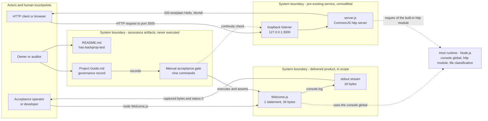

### 4.4.2 Detailed Process Flows for Each Core Feature

The product's own process flow — F-001 greeting emission with F-002 natural termination, F-003 zero-install execution, F-004 module neutrality and F-005 minimal placement — is drawn with its four decision diamonds in **4.1.1**. F-003, F-004 and F-005 are properties verified by the acceptance gate rather than processes of their own, so they appear in the gate flow below rather than in a flow of their own. The two remaining process flows follow.

**F-006 — HTTP greeting request handling.** Every request follows this path regardless of method, path, query or body; the three parser rejections are the only branches that do not reach the handler.

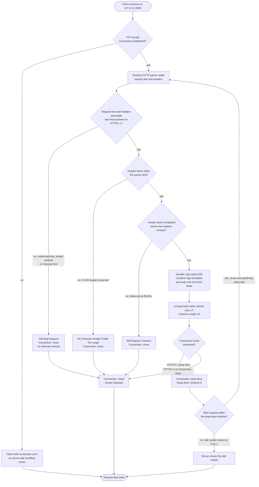

**F-008 — Verification and acceptance gate.** The repository's only quality gate: nine commands whose combined verdict decides acceptance, then parity and continuity checks. Failure at any point leads to the troubleshooting procedure and a re-run, which is the entire recovery mechanism (4.3.2).

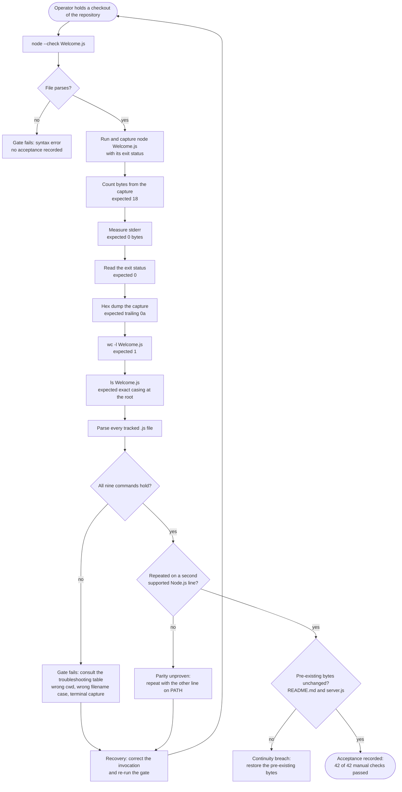

### 4.4.3 Error Handling Flowchart

One diagram covers both executables: the failure surfaces actually observed on each side, and the recovery procedure that exists for each. The dotted feature of this system is that recovery is never automatic — every arrow into the recovery lane is an operator action, because no retry, fallback or notification path exists in code (4.3.2).

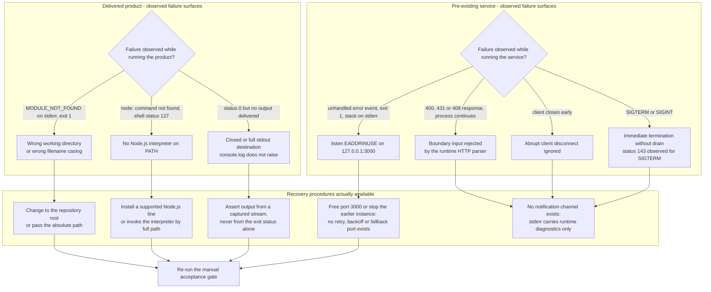

### 4.4.4 Integration Sequence Diagrams

**Product integration sequence.** The product's entire integration with the outside world: one invocation, one outbound write, one exit status, and no inbound channel at all.

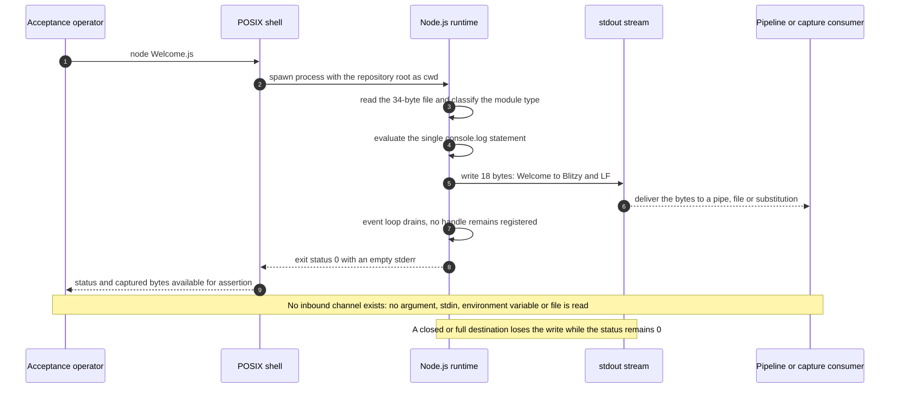

**Service integration sequence.** Loopback HTTP interaction, including the three parser rejections and the keep-alive reuse branch.

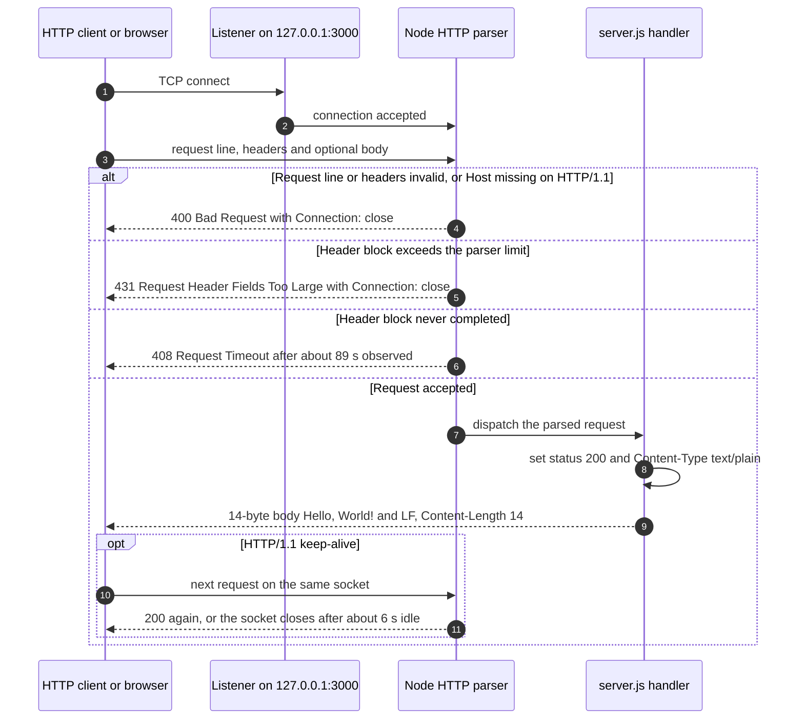

### 4.4.5 State Transition Diagrams

**Product process lifecycle.** States and transitions of the delivered program, including the two ways a run can fail before the statement is ever evaluated.

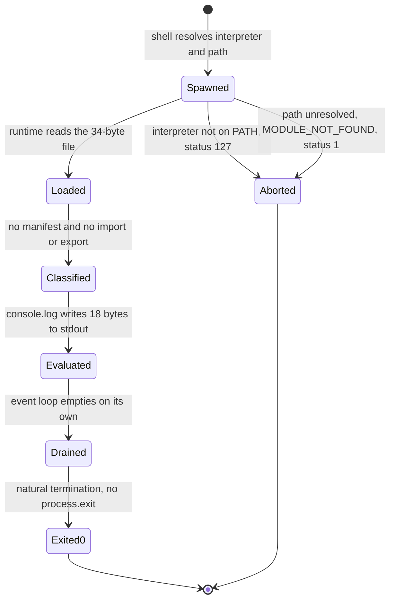

**Service process and connection lifecycle.** The listener's states across start-up, serving, idle-connection release, signal handling and the bind-conflict abort; no state is persisted across a restart.

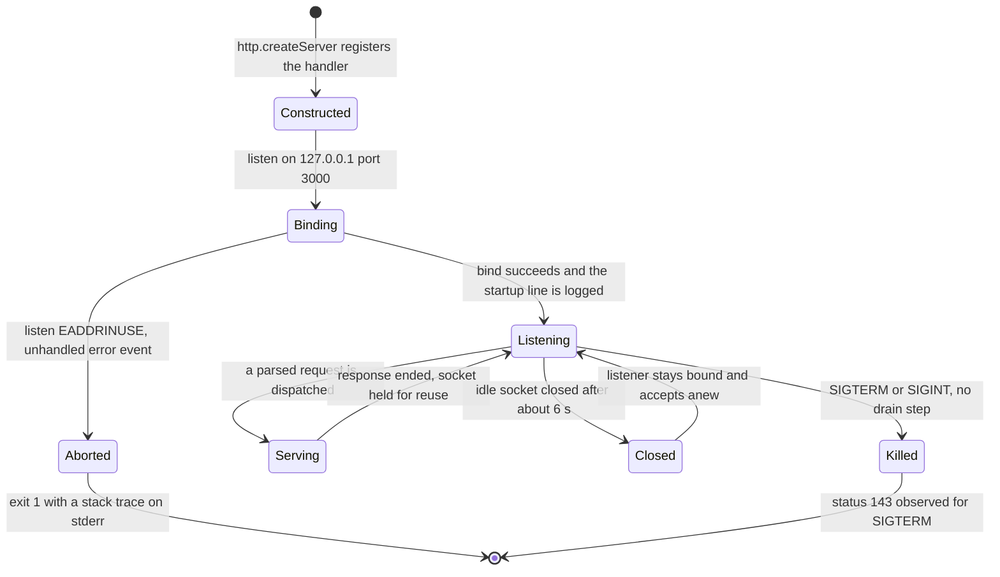


## 4.5 References

Every fact in this section rests on a file in this repository, on a runtime probe executed against this checkout (Node.js v22.23.3, branch `09-Oct-26-Br2`, clean working tree), or on the governance record committed alongside the product. No web source was consulted, because every claim is verifiable from the tree.

**Repository files cited**

- `Welcome.js` — the delivered product: the single statement `console.log('Welcome to Blitzy');` that defines workflow W-1, its stdout contract (18 bytes, `0a`-terminated), its lack of any inbound channel or error handling, and the source used for the no-handler sweep. Size 1 line / 34 bytes; sha256 `5c7ac141d94f92056efb756f17335252c31e3d08d509e641d76512f73112c1fc`.
- `server.js` — the pre-existing HTTP surface: `require('http')` (`:1`), host `127.0.0.1` and port `3000` (`:3-4`), the branch-free handler that sets status `200`, `Content-Type: text/plain` and ends with `Hello, World!\n` (`:6-10`), and the `listen` call whose callback logs the startup line (`:12-14`). Defines workflows W-3 and W-4. Size 14 lines / 342 bytes; sha256 `332fc2d04eb5b8f3cb230855457af80d0dfc246f958d6e49615610d656acc2e0`.
- `README.md` — repository identity (`# hao-backprop-test`, "test project for backprop integration."), the only stated purpose, and part of the pre-existing-byte baseline for rule B-8. sha256 `2c907195c3aabc9616d6dda07b61af3da480287eb5b5dde62974df6a182d7b45`.
- `blitzy/documentation/Project Guide.md` — the governance record (35,992 bytes, ten areas, appendices A–G) supplying every documented flow and rule this section reuses: the development workflow §9.1–§9.4, the nine-command acceptance gate §9.5, troubleshooting §9.7, the 42-check verification table §3, runtime validation §4, the twelve-row compliance matrix §5.1, the three divergences §5.2, the eight-row risk table §6, remaining work and priorities §2.2, the 83% completion accounting §1.2–§1.3, recommended next steps §1.6, and appendices B (ports), D (technology versions and the 30 April 2027 end-of-life date), E (no environment variables), F (developer tools) and G (glossary: acceptance gate, minimality criteria, zero-install posture, module-neutral source, natural termination, pre-existing surface).

**Repository folders cited**

- `blitzy/` — contains only `blitzy/documentation`; establishes that no capture directory is present in this checkout, in contrast to the seven untracked captures recorded in Guide §5.2 divergence 3.
- `blitzy/documentation/` — holds the single governance record; evidence that documentation is the folder's entire content and that nothing executable lives there.

**Repository state inspected**

- `git ls-files` (four tracked paths), `git status --porcelain --untracked-files=all` (clean), `git rev-parse --abbrev-ref HEAD` (`09-Oct-26-Br2`), `git log --name-status` (five commits, including the record-only commit `6c16ea2` that changes no path and the merge `39974fd`).
- `find` over the checkout and existence tests for `package.json`, lockfiles, `Dockerfile`, `docker-compose.yml`, `Makefile`, `tsconfig.json`, `.github`, `.gitignore` and `.nvmrc` — all absent, which is what rules out batch, CI and container workflows.
- `/proc/net/tcp` — the listening socket at `0100007F:0BB8` (`127.0.0.1:3000`) and the `TIME_WAIT` sockets recorded in 4.3.1.

**Runtime probes executed for this section**

- Product journey: stdout byte count (18), hex dump, stream sha256 `2dc7e85a734de043468d7beb8ee5294e0c04440f23fd89b69fd8ea0ee7971951`, stderr byte count (0), exit status (0), wall time (27 ms), repeatability across three runs, `env -i`, invocation by absolute path from `/tmp`, `require()` load, and the silent-write probes (`>&-`, `/dev/full`, zero-length pipe reader) that all exited 0.
- Service journey: spawn-to-readiness timing (~35 ms), request matrix across `GET`, `POST`, `PUT`, `DELETE`, `HEAD` and an unknown path (all `200`, one distinct 14-byte body), full header capture, twenty sequential latencies (0.18–0.75 ms), twenty concurrent requests (16 ms), keep-alive reuse and pipelining, idle-socket close at 6.01 s, malformed request line, invalid method token, missing `Host`, 20 KB header, unterminated header block (408 at 89.08 s), abrupt client disconnect, second-instance `EADDRINUSE` (exit 1), and `SIGTERM`/`SIGINT` termination (status 143 for `SIGTERM`).
- Runtime defaults interrogated from Node.js itself: `keepAliveTimeout` 5000 ms, `headersTimeout` 60000 ms, `connectionsCheckingInterval` 30000 ms, `requestTimeout` 300000 ms.
- Source sweeps: `grep` for `require`, `import`, `export`, `process.env`, `process.argv`, `readFile`, `fetch(`, `setTimeout`, `setInterval`, `process.exit`, `writeFile`, `createConnection`, `net.` and `fs.` across both `.js` files — a single match, `server.js:1`.
- Verification tooling used but not part of the product: `node --check`, `node --test` (0 tests), `wc`, `od`, `sha256sum`, `ss`, and mermaid-cli 11.17.0, which rendered all nine diagrams in this section to valid SVG offline.

**Web sources**

- None. No external documentation, standard or service was consulted or cited, and the repository itself references no external source.


# 5. System Architecture

## 5.1 High-Level Architecture

### 5.1.1 System Overview

**Architecture style.** The system is a *collection of independent, single-file, dependency-free JavaScript executables* that share nothing at runtime but a working tree and a host Node.js runtime. There is no application framework, no module graph, no service layer, no shared library and no inter-process channel. Each executable is a complete program in one flat script: `Welcome.js` (1 line, 34 bytes) is a short-lived batch-style process, and `server.js` (14 lines, 342 bytes) is a single-process, single-threaded, stateless loopback HTTP service. The only structural relationship between them is co-residency in the checkout — neither file imports, spawns, references or consumes the other, and the repository contains exactly four tracked paths (`README.md`, `Welcome.js`, `server.js`, `blitzy/documentation/Project Guide.md`).

**Rationale.** The style is not an architectural preference expressed in code; it is the direct consequence of the product request, which fixed the language (`JavaScript`), the filename (`Welcome.js`), and two hard ceilings — one source line and one added file — and of the governing requirement that performance of the existing application not be affected (`blitzy/documentation/Project Guide.md` §2.1, §5.1 rows 5–9). Within those limits, the design reduces the number of moving parts to the minimum that can still satisfy the functional contract: one runtime global (`console`), one statement, one output byte stream, one exit status. The additive constraint (do not disturb the pre-existing surface) is met by leaving `server.js` untouched and unreferenced rather than by building an isolation layer, so there is no abstraction — and therefore no coupling — to maintain.

**Architectural principles.** The principles below are each observable in the source or in the recorded verification rather than being aspirational statements.

- **Minimality as a hard constraint.** One statement per file, no comment, no padding, one trailing LF; `wc -l Welcome.js` = 1, `wc -c` = 34.
- **Zero-install, zero-dependency posture.** No `import`, `export` or `require` in the delivered file, and no manifest, lockfile or `node_modules` in the checkout or any ancestor directory. The only capabilities consumed are runtime globals (`console`) and, in the pre-existing file, one Node.js standard-library module (`http`).
- **Module-system neutrality.** `Welcome.js` contains no module syntax, so its behaviour cannot depend on how the runtime classifies the file — verified identical under an ancestor manifest declaring `"type": "module"`, one declaring `"type": "commonjs"`, and no manifest at all (Project Guide §5.1 row 10).
- **One flow per file.** Each feature's flow occupies its own dedicated file that contains nothing else, which is how the flow/feature-separation clause of the governing rule is satisfied (Project Guide §5.1 row 9).
- **Natural termination.** The delivered process ends by letting the event loop drain, never by calling `process.exit()`, so queued output cannot be truncated; a reader that slept 2 s before consuming still received all 18 bytes.
- **Statelessness.** No component holds state between invocations or between requests: `Welcome.js` keeps nothing, and `server.js` builds every response from constants with no session, cache or accumulated data.
- **Continuity of the pre-existing surface.** `README.md` and `server.js` are byte-identical to their pre-project state, and the running HTTP service was re-verified while the new script executed repeatedly and concurrently (Project Guide §2.1, §4).

**System boundaries.** The boundary of the delivered product is the OS process itself. It reads no command-line argument, no standard input, no environment variable and no file; opens no socket; executes no dynamic code; holds no secret; and reads no clock, random source or configuration. Its entire observable surface is what the runtime supplies at the process edge: 18 bytes on `stdout`, nothing on `stderr`, and exit status `0` (measured; `57 65 6c 63 6f 6d 65 20 74 6f 20 42 6c 69 74 7a 79 0a`). The pre-existing surface's boundary is a TCP listener bound to loopback `127.0.0.1` on port `3000`, both literals at `server.js:3-4` with no override, so it is reachable only from the local host. Outside these two boundaries the system holds no external interface: there is no database, cache, message broker, outbound network call, file write, scheduled job, user interface or third-party API. The repository's stated purpose (`README.md`: "test project for backprop integration") has no architectural expression — no backprop-related code, interface, dependency or data structure exists anywhere in the tree; the Project Guide instead treats `README.md` as a pre-existing stub for an unrelated project, and both positions are as recorded in section 1.2.

**Major interfaces.** Two interfaces exist, one per executable surface, and both are supplied by the runtime rather than defined by the application:

| Interface | Provider | Shape | Consumers |
|---|---|---|---|
| Process I/O contract | `Welcome.js` + Node.js runtime | Write 18 bytes to `stdout`; `stderr` empty; exit `0`; ignores argv, stdin and environment | Operator, shell pipelines, CI-style acceptance gate |
| HTTP/1.1 over loopback TCP | `server.js` + Node.js `http` module | Any method, any path → `200`, `Content-Type: text/plain`, `Content-Length: 14`, body `Hello, World!\n` | Local clients: `curl`, browser, scripts on the same host |

Component context and boundaries:

```mermaid
flowchart TB
    subgraph HostEnv["Host environment — Node.js LTS runtime, one process per run"]
        OpNode["Operator / acceptance gate"]
        subgraph ProductBoundary["Delivered product — Welcome.js process (in scope)"]
            ScriptNode["Welcome.js — single statement"]
            ConsoleNode["console global"]
            StdoutNode["stdout — 18 bytes, exit 0"]
            ScriptNode --> ConsoleNode
            ConsoleNode --> StdoutNode
        end
        OpNode -->|"node Welcome.js"| ScriptNode
    end

    subgraph LoopbackBoundary["Pre-existing HTTP surface — server.js process (out of scope, unmodified)"]
        ClientNode["Local HTTP client or browser"]
        HttpNode["server.js — Node http module"]
        RespNode["200 text/plain — Hello, World!"]
        ClientNode -->|"HTTP/1.1 request to 127.0.0.1:3000"| HttpNode
        HttpNode --> RespNode
    end

    subgraph RecordBoundary["Documentation — never executed"]
        ReadmeNode["README.md — identity stub"]
        GuideNode["blitzy/documentation/Project Guide.md"]
    end
```

No edge exists between `ProductBoundary` and `LoopbackBoundary`, and none between either executable and `RecordBoundary`: the two processes never communicate, and the Markdown files are read by humans and renderers only.

### 5.1.2 Core Components

| Component Name | Primary Responsibility | Key Dependencies | Integration Points & Critical Considerations |
|---|---|---|---|
| `Welcome.js` — delivered product (`Welcome.js:1`) | Emit exactly `Welcome to Blitzy` on `stdout` and exit `0`, as a single statement | Node.js LTS runtime only; `console` is a runtime global; zero packages, zero imports | Integrates through the OS process I/O contract (`stdout`/`stderr`/exit status). Critical: acceptance is byte-level, so the literal, casing and single trailing LF must stay unchanged; `console.log` does not raise if the stream rejects the write, so a closed or full destination loses the message while exit status stays `0` |
| `server.js` — pre-existing HTTP service (`server.js:1-14`) | Answer every request, regardless of method, path, headers or body, with `200`, `text/plain`, `Hello, World!\n` | Node.js standard-library `http` module via `require('http')` (CommonJS) | Integrates through HTTP/1.1 over loopback TCP `127.0.0.1:3000`. Critical: host and port are hardcoded with no override; no `'error'` listener on `listen`, so a second start on the same host fails with an unhandled `EADDRINUSE` error and exit `1`; no graceful-shutdown drain; a `package.json` declaring `"type": "module"` in or above the tree would break this CommonJS file |
| Node.js runtime — host-provided execution platform | Execute both scripts, supply `console` and the `http` module, and define the process edge (`stdout`, exit status) | Installed on the host; not declared by any repository artifact | Integrates via the command line (`node <file>`). Critical: reference line is v24.21.0 and the supported floor is v22.23.2 (parity verified on both); the 22.x line reaches end of life on 30 April 2027; no source change is needed to move to 24.x because the syntax used is ES5-level |
| `README.md` — project identity stub (`README.md:1-2`) | Declare the repository name `hao-backprop-test` and its stated purpose | None; static declarative Markdown | No runtime integration: never executed, imported or referenced. Critical: it is pre-existing and byte-identical to its pre-project state; its stated purpose conflicts with the Project Guide's characterization of the file |
| `blitzy/documentation/Project Guide.md` — governance record | Hold the delivery, verification, compliance, risk, operations, development and reference evidence for the change | None; static declarative Markdown, 382 lines | No runtime integration: never executed or imported by either script. Critical: it is the repository's only acceptance record, and it is tracked, so it counts as an added path in the change ledger |

### 5.1.3 Data Flow Description

**Primary flows.** Three flows exist in the repository, and exactly two of them execute. The first is the delivered product's entire lifecycle: an operator or an acceptance-gate command runs `node Welcome.js`; the runtime loads and evaluates the single statement at `Welcome.js:1`; `console.log` receives the string literal `'Welcome to Blitzy'` and writes it to the process's `stdout` stream; the event loop then has nothing left registered — no timer, no listener, no pending I/O — so the process ends on its own with status `0`. Measured end to end, the flow yields exactly 18 bytes (`57 65 6c 63 6f 6d 65 20 74 6f 20 42 6c 69 74 7a 79 0a`), zero bytes on `stderr`, and a completion time of roughly 23–30 ms per run including interpreter start-up. Nothing is read on the way in, so the flow is a constant: the same bytes are produced under an empty environment, from a foreign working directory via an absolute path, into a slow reader, and across repeated and concurrent runs.

The second flow is the pre-existing service's request cycle: a local client opens a TCP connection to `127.0.0.1:3000` and sends an HTTP/1.1 request; the runtime's HTTP parser turns the byte stream into a request object and invokes the single inline handler registered by `http.createServer` at `server.js:6`; the handler ignores every property of that object and executes three fixed statements — set `res.statusCode = 200`, set the `Content-Type` header to `text/plain`, and finish with `res.end('Hello, World!\n')`; the runtime then frames the response, adding `Date`, `Connection`, `Keep-Alive` and `Content-Length: 14`; and the bytes return over the same socket. The cycle repeats per request with no branching, no asynchronous application work and no state carried from one request to the next.

The third flow is the absence of one: no data path connects the two executables. `Welcome.js` never imports or spawns `server.js`, `server.js` never references `Welcome.js`, and neither writes a file, socket or clipboard that the other reads. The only observed interaction between them is resource co-tenancy on one host, which the Project Guide measured as non-impact — request-latency medians for the pre-existing service stayed at or below their idle baseline while the new script ran repeatedly and concurrently, with no failed request and stable memory, thread and descriptor counts (Project Guide §2.1, §4).

**Integration patterns and protocols.** Both flows are synchronous request–response patterns whose boundary is owned by the runtime, not by application code. The delivered product's protocol is the POSIX process contract: a byte stream out, an empty error stream, and a numeric exit status. The service's protocol is HTTP/1.1 over TCP, restricted to the loopback interface so no off-host client can reach it. Neither flow uses a queue, callback registration, event bus, retry policy, timeout, backoff or circuit breaker, because neither has a failure mode that application code could observe or act on — the same property that leaves application-level error handling absent (see 5.4.3).

**Data transformation points.** Only two transformations occur in the whole system, and both are performed by the runtime rather than by application logic.

| Transformation | Where | Input | Output |
|---|---|---|---|
| String literal → encoded output bytes | `console.log('Welcome to Blitzy')` (`Welcome.js:1`) | JavaScript string of 17 characters | 18 UTF-8 bytes: the 17 characters plus the newline the call appends |
| Inbound request bytes → outbound response bytes | Node.js HTTP parser and framing around the handler at `server.js:7-9` | Any HTTP/1.1 request (method, path, headers, body all discarded by the handler) | Status line, fixed headers, `Content-Length: 14`, body `Hello, World!\n` |

**Key data stores and caches.** None. There is no database, no cache, no session store, no log sink on disk, no temporary file, no queue and no in-memory structure that outlives a single statement or request. The only memory the system uses is the process heap of a short-lived interpreter, and the only persistence in the repository is version control — the four tracked files, of which the delivered change adds two (`git diff --name-status 1484182 HEAD` lists `A Welcome.js` and `A blitzy/documentation/Project Guide.md`). The consequence for architecture review is that this system has no recovery, consistency, eviction or schema concern to design for; it has only a delivery and a runtime-support lifecycle.

### 5.1.4 External Integration Points

The system integrates with four external parties, all of them local. No remote endpoint, hosted service, database, message broker, identity provider, monitoring agent or third-party package is called by either executable at runtime.

| System Name | Integration Type | Data Exchange Pattern | Protocol/Format, SLA Requirements |
|---|---|---|---|
| Host shell / operator (developer, acceptance gate, CI-style runner) | Local process invocation | Pushes one command; receives the process result (bytes out, empty error stream, exit code) | Command line `node Welcome.js`; the process I/O contract described in 5.1.1. No SLA is defined anywhere in the repository: a one-shot write and exit in roughly 23–30 ms is the measured behaviour, not a contracted target |
| `stdout` / `stderr` streams (terminal, pipe, or redirected file) | Local OS stream | One-way write of 18 bytes, followed by stream close at process exit | UTF-8 byte stream, LF-terminated; `stderr` stays at 0 bytes. No SLA defined; the recorded acceptance criterion is exact byte equality of the captured output |
| Local HTTP clients (`curl`, browser, or scripts on the same host) | Loopback HTTP service consumed over TCP | Client-initiated request–response; every request receives the same fixed reply | HTTP/1.1 over `127.0.0.1:3000`, `200` / `text/plain` / `Content-Length: 14`; parser-level rejections answer `400` for a malformed request line and `431` for a header block around or beyond the runtime's roughly 16 KB limit. No availability, latency or throughput SLA is defined; loopback binding means no off-host client can reach it |
| Node.js runtime (host platform) | Runtime dependency, not a network call | The process is executed by the runtime; the runtime supplies `console`, the `http` module and the process edge | Node.js LTS: v24.21.0 reference and v22.23.2 supported floor, verified byte-identical. Effective support deadline is the runtime's own lifecycle — the 22.x floor reaches end of life on 30 April 2027, and no repository artifact pins or declares a version |

Two further parties touch the system without any runtime interface, and are recorded here so that the integration inventory is complete:

- **Git and the GitHub hosting platform** — the delivery path is clone, checkout, commit, push, pull request and merge (`git log` shows the change authored by automation, the record commit `4d1256c`, and the merge commit `39974fd`, "Merge pull request #15"). This is a development-time integration only; no pipeline, workflow or deployment job exists in the repository.
- **Human readers of documentation** — `README.md` and `blitzy/documentation/Project Guide.md` are consumed by people and Markdown renderers, never by the executables.

No SLA, availability target, throughput commitment or recovery-time objective is stated for any integration point, and none is implied by the code: the delivered product is a single write and exit, and the pre-existing service is a loopback-only demo surface. The performance figures recorded in the Project Guide are verification observations of non-impact on the existing service, not contractual service levels.


## 5.2 Component Details

### 5.2.1 `Welcome.js` — Delivered Product

**Purpose and responsibilities.** `Welcome.js` is the entire delivered scope of the change. It writes exactly one message to standard output and exits successfully. Nothing else is asked of it: it accepts no input, exposes no callable surface, defines no function, class, variable or guard, imports nothing, exports nothing, listens on nothing, and returns no value to any other component. Its one responsibility is a fixed, byte-exact output contract.

| Aspect | Finding |
|---|---|
| Purpose and responsibilities | Emit `Welcome to Blitzy` on `stdout` as a single statement (`Welcome.js:1`: `console.log('Welcome to Blitzy');`), then terminate naturally with status `0` |
| Technologies and frameworks | Plain JavaScript at ES5 syntax level executed by the Node.js LTS runtime; one member call and one string literal. No framework, no package, no transpiler, no module system, no build step; `console` is a runtime global |
| Key interfaces and APIs | The process edge only: 18 bytes written to `stdout`, `stderr` left empty, exit status `0`. Command-line arguments, standard input and environment variables are all ignored — verified identical output under `env -i`, from a foreign working directory via absolute path, into a delayed reader, and across repeated and concurrent runs |
| Data persistence requirements | None. The file reads no file, writes no file, opens no socket and holds no state. Its only durable artifact is its own source: 1 line, 34 bytes, `sha256 5c7ac141d94f92056efb756f17335252c31e3d08d509e641d76512f73112c1fc` |
| Scaling considerations | Horizontal by process replication: each invocation is an independent short-lived OS process completing in roughly 23–30 ms with no shared resource, no lock and no coordination, so concurrency is bounded only by the host. Vertical scaling, pooling, caching and warm-up have no meaning here. The binding scaling constraint is environmental, not architectural: the filename's exact casing must be preserved on case-sensitive filesystems, and the runtime line must remain supported |

**Behavioural notes that matter to integrators.** Termination is not forced. The file contains no `process.exit()` call, no timer and no listener, so the process ends when the event loop empties and queued output is never truncated — a reader that slept 2 s before consuming still received all 18 bytes. Output is produced through `console.log`, which appends the terminating newline: 17 characters plus one LF gives the measured 18 bytes, `57 65 6c 63 6f 6d 65 20 74 6f 20 42 6c 69 74 7a 79 0a`. Because `console.log` does not raise when the underlying stream cannot accept the write, verification must assert the captured bytes rather than trust the exit status: a closed or full destination would lose the message while the process still reports `0`.

Component lifecycle:

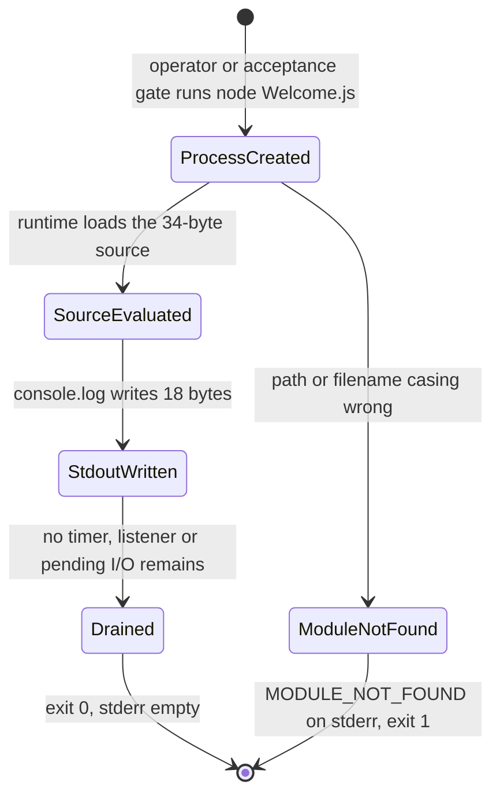

### 5.2.2 `server.js` — Pre-Existing HTTP Service

**Purpose and responsibilities.** `server.js` is the repository's pre-existing network-facing surface, present before the delivered change and byte-identical after it; it is out of the delivered product's scope and was not modified or referenced by it. Its responsibility is to run a demonstration HTTP endpoint on the loopback interface that answers every request with the same fixed response, regardless of method, path, query string, headers or body.

| Aspect | Finding |
|---|---|
| Purpose and responsibilities | Bind `127.0.0.1:3000` and answer every request with `200`, `Content-Type: text/plain`, body `Hello, World!\n`; on successful bind, log `Server running at http://127.0.0.1:3000/` to `stdout` (`server.js:6-13`) |
| Technologies and frameworks | Plain JavaScript at ES5 syntax level, CommonJS module classification; Node.js standard library only, via `const http = require('http')` (`server.js:1`). No web framework, no middleware, no router, no template engine, no package |
| Key interfaces and APIs | `http.createServer(handler)` with a `(req, res)` handler that never reads `req`; `res.statusCode`, `res.setHeader('Content-Type', 'text/plain')`, `res.end('Hello, World!\n')` (`server.js:6-10`); `server.listen(port, hostname, callback)` (`server.js:12`). External contract: any method, any path → `200`/`text/plain`/`Content-Length: 14`; runtime-level rejections answer `400` for a malformed request line and `431` for a header block at or beyond the parser's roughly 16 KB limit, without leaking internals |
| Data persistence requirements | None. No database, file, cache, session or shared memory; every response is built from three constants. Nothing survives process exit, so there is no state to persist, migrate or back up |
| Scaling considerations | Single process, single thread, no clustering or worker threads, no rate limiting, no connection pooling, and a listener restricted to loopback — off-host clients cannot reach it at all. The hardcoded host and port (`server.js:3-4`) mean two instances cannot coexist on one host: a second start throws `EADDRINUSE` from `listen` and the process exits `1`. Scaling outward would require making the bind address configurable, which does not exist today |

**Operational characteristics.** Host and port are literals with no environment override, so the binding is fixed. There is no `'error'` listener on `listen`: a failed bind surfaces as an unhandled `'error'` event, prints a stack trace on `stderr` and exits `1` (measured). There is no graceful-shutdown drain — the process has no `SIGTERM` or `SIGINT` handler — so termination relies on the runtime's default behaviour, after which the loopback port is released and immediately reusable (measured). HTTP keep-alive is left at the runtime default, observed on the wire as `Keep-Alive: timeout=5`, so connections are reused for a short idle window before closing. The change made no alteration to any of this; the Project Guide records the missing error listener, the missing drain and the unconfigurable port as open pre-existing items outside the delivered scope.

Component lifecycle:

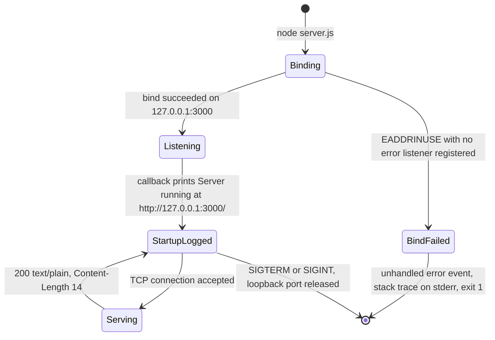

### 5.2.3 Node.js Runtime — Execution Platform

**Purpose and responsibilities.** The runtime is the host-provided platform that executes both scripts, supplies the globals and modules they consume (`console` for the product, `http` for the service) and defines the process edge through which the product's result becomes observable. It is not declared by any repository artifact: there is no manifest, no lockfile and no version pin, so the platform is an environment requirement rather than a dependency the code manages.

| Aspect | Finding |
|---|---|
| Purpose and responsibilities | Load and execute the source files directly as written; provide `console` as a runtime global and the `http` module from the standard library; own the process boundary (`stdout`, `stderr`, exit status); supply the verification subcommands |
| Technologies and frameworks | Node.js LTS. Reference line v24.21.0 and supported floor v22.23.2, verified byte-identical; the investigation host ran v22.23.3, a later patch on the same supported line, and reproduced the same 18-byte output, empty `stderr`, exit `0` and source hash. Engine is V8, supplied by the runtime rather than declared. `node --check` provides a read-only parse gate (both tracked `.js` files pass, exit `0`) and `node --test` provides the built-in runner (reports zero tests) |
| Key interfaces and APIs | Command line `node <file>`; process streams; exit status; the standard-library modules the scripts import (only `http`, only in `server.js`) |
| Data persistence requirements | None. The runtime stores no repository state; each invocation is a fresh process with an empty event loop and no carried state |
| Scaling considerations | Scaling is host-level rather than in-application: each execution is a separate process, both surfaces are single-threaded, and neither shares a runtime, socket or cache with the other. The forward-looking constraint is lifecycle, not capacity — the 22.x floor reaches end of life on 30 April 2027, and moving to 24.x or later requires no source change because the syntax is ES5-level (Project Guide §6, Appendix D) |

### 5.2.4 Documentation Artifacts (Non-Executing)

Neither Markdown file participates in runtime execution, and neither is imported, executed or referenced by a script. They are recorded here because they are tracked components of the deliverable and because one of them is the acceptance record for the change.

| Artifact | Purpose and responsibilities | Interfaces | Persistence and scaling |
|---|---|---|---|
| `README.md` (`README.md:1-2`) | Provides the repository's visible identity, `# hao-backprop-test`, and one sentence of stated purpose. No setup command, dependency list, usage example, link, badge or contribution guidance | Read by people and Markdown renderers only; no programmatic interface | Static text, 2 lines, 58 bytes. Pre-existing and unmodified; no scaling behaviour |
| `blitzy/documentation/Project Guide.md` | Holds the ten-area evidence record for the change: delivery summary, hour ledger, verification results, runtime validation, compliance matrix and divergences, risk register, status charts, development guide and appendices | Read by people and Markdown renderers only; contains Mermaid charts that render as images, which are never executed by this system | Static text, 382 lines. Added by the change and tracked, so it counts as an added path; it carries no runtime state and no scaling concern |

Because the documentation is tracked, it appears in the change ledger: `git diff --name-status 1484182 HEAD` lists exactly `A Welcome.js` and `A blitzy/documentation/Project Guide.md`. The first of those is the product; the second is the record of how the product was verified, and it is the only place where acceptance criteria, divergence decisions and pre-existing limitations are written down.

### 5.2.5 Component Interaction, State and Sequence Diagrams

**Component interaction.** The two executables are independent processes on one host. They share no call path, no socket, no file and no memory; the only connection drawn between them below is their co-residency in one checkout and one runtime.

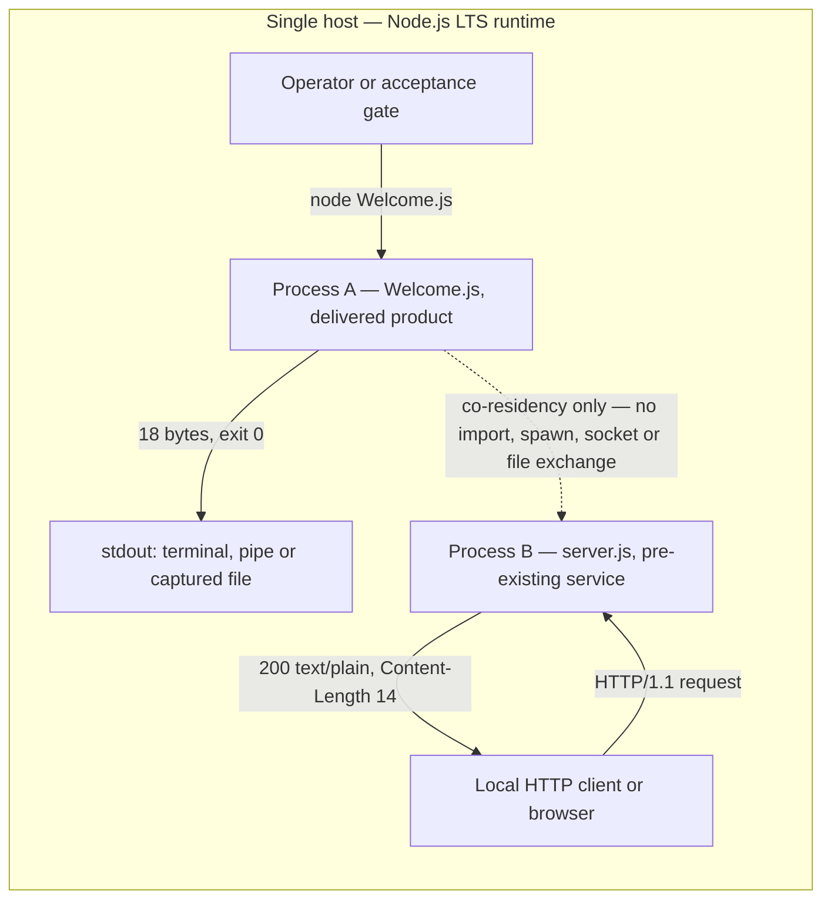

**Sequence — delivered product flow.** The full lifecycle of the in-scope deliverable, from invocation to exit status:

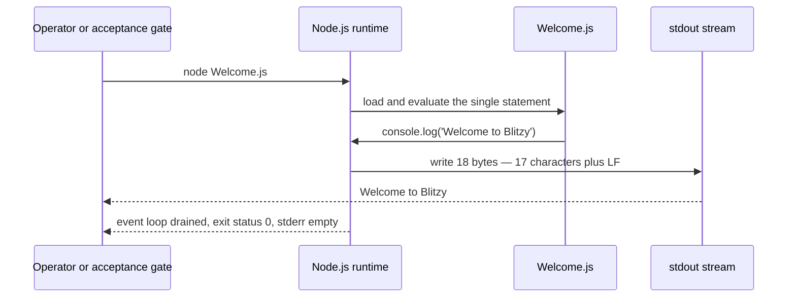

**Sequence — pre-existing HTTP request flow.** One request cycle against `server.js`, showing where the application's work ends and the runtime's framing begins:

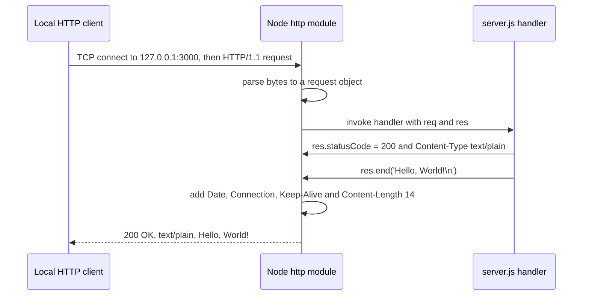

**Interaction invariants.** Three properties hold across both diagrams and are worth stating explicitly, because they define what an integrator may rely on: the product's flow has no failure branch that application code can observe; the service's handler never reads anything from the request, so its response is a constant; and no request, invocation or state transition in either component leads to a second component being called. There is therefore no distributed transaction, no ordering constraint, no retry or idempotency concern and no inter-component contract to version.


## 5.3 Technical Decisions

### 5.3.1 Architecture Style Decisions and Tradeoffs

| Decision | Alternatives Considered | Rationale (Evidence) | Tradeoff Accepted |
|---|---|---|---|
| Deliver the product as one dependency-free statement in a single root file rather than as a layered application | A module with a function, a class or a configuration layer; a small package with a manifest and a test file; a service exposing the message over HTTP | The product request fixed the language, the filename and two hard ceilings — one source line and one added file — and the governing scope excluded tests, CI, containers, configuration and dependency manifests (Project Guide §2.1, §5.1 rows 5, 6, 11) | No abstraction, no reuse and no place to put defensive code. A change to the literal, its casing or its trailing newline breaks acceptance with no tooling to detect it |
| Use runtime globals only, with no manifest so the source runs exactly as written | Adding `package.json` for scripts, metadata or a dependency; a build or transpile step | `console` is a Node.js runtime global, so nothing needs resolving, installing or building; the zero-install posture is a stated acceptance criterion (`ls package.json package-lock.json node_modules` returns 0) | No version pin, no script entry point and no declarative metadata. A manifest later added in or above the tree must declare `"type": "commonjs"` or the pre-existing CommonJS `server.js` breaks at runtime (Project Guide §6) |
| Keep the delivered source module-neutral by using no `import`, `export` or `require` | Declaring an explicit module system or shipping an ESM file | Neutrality makes behaviour independent of the runtime's file classification — verified identical with an ancestor manifest of either type and with none (Project Guide §5.1 row 10) | The file cannot use any module-scoped feature, which costs nothing here because it has one statement and no dependency |
| Let the process end by draining the event loop rather than calling `process.exit()` | Forcing exit after the write | A forced exit can truncate queued output; natural drain is what makes the byte-exact contract hold even against a delayed reader (measured: 18 bytes delivered to a reader that slept 2 s) | The process's lifetime is governed entirely by the runtime; there is no explicit shutdown point, which is acceptable because nothing is registered on the event loop |
| Deliver additively: leave the pre-existing `README.md` and `server.js` byte-identical and unreferenced | Refactoring `server.js`, consolidating shared helpers, or adding a shared module for both surfaces | The governing rule requires that existing application performance not be impacted, and continuity of the pre-existing surface is a stated acceptance criterion verified by diff and by measuring the running service (Project Guide §2.1, §5.1 row 8) | Two unrelated styles and two execution models coexist in one checkout — a batch script and a CommonJS HTTP service — with no shared code, so a future maintainer sees co-residency but no integration |
| Ship no application-level error handling, no logging, no monitoring, no authentication and no storage in the delivered product | Adding a `try`/`catch` wrapper, structured logging, a readiness probe or a health endpoint | The program reads no input, opens no socket, executes no dynamic code and holds no secret, so there is no input to validate, no credential to manage and no failure branch reachable by application code (Project Guide §5.1 security enumeration, Appendix E) | `console.log` does not raise when the destination cannot accept the write, so a closed or full stream loses the message while the process still exits `0`; verification must therefore assert captured bytes, never the exit status alone (Project Guide §3 "Not Covered") |
| Deliver acceptance as a documented manual gate instead of an automated suite | Adding a test file and a runner, or a CI workflow | Test files, CI definitions and extra files are excluded by the request's minimality criteria; `node --test` is available but intentionally exercises nothing (Project Guide §3, Appendix F) | No automated regression net guards either surface. Any future edit to `Welcome.js` must be re-validated by re-running the nine-command gate. This is recorded as a risk, accepted by design |
| Implement in JavaScript although the governing rule directed Python for new products | Shipping a Python artifact, or renaming the file to a `.py` variant | The product's own request named the language and the filename in the same instruction; a `.js` file cannot hold runnable Python and renaming would break a required filename while a parallel Python file would double the file count against an explicit ceiling (`Welcome.js:1`; Project Guide §5.2 divergence 1) | One of the rule's three clauses is knowingly unmet — a governance item with no functional, security, performance or continuity effect. Two of three clauses (flow separation and performance non-impact) are met and verified |

Two structural consequences follow from these decisions and are the reason the rest of this architecture section is short. First, the system has no internal boundary to negotiate: there is no module seam, interface contract, dependency injection point or configuration surface, so there is nothing to version, mock or substitute. Second, every constraint that would normally be architectural is instead environmental — the runtime line, the exact filename casing and the requirement to keep the tree manifest-free. Those three constraints are what a future change must protect, and each is checkable with a one-line command.

### 5.3.2 Communication Pattern Choices

Two communication patterns exist, one per surface, and both were chosen for the smallest observable contract rather than for extensibility.

| Pattern | Where Used | Why Chosen | Rejected Alternatives and Consequence |
|---|---|---|---|
| Synchronous one-way write to process `stdout`, followed by process exit (`Welcome.js:1`) | The delivered product | It is the only channel that needs no dependency, no port, no configuration and no lifecycle: the consumer is a shell pipeline, an acceptance gate or a redirected file, and the result is the bytes plus the exit status | A network endpoint, a message queue, a file output or a callback API would each add a dependency, a resource or a failure mode the scope excludes. The cost of the choice is that delivery is unacknowledged — stream failure is invisible and the exit status stays `0` |
| HTTP/1.1 request–response over loopback TCP (`server.js:6-13`) | The pre-existing service | The Node.js standard library supplies it, so the demonstration needs no framework; the handler is three fixed statements, giving a constant response for any method, path, headers or body | A framework, a router or middleware would add a dependency and per-route behaviour that no requirement asks for. The cost is a fixed binding: host and port are literals with no override, and two instances cannot coexist on one host |
| No inter-component communication | Between the two surfaces | The delivered product must not affect the existing application's performance, which is guaranteed by having no call path at all | A shared module, an in-process call or a socket would each create a coupling and a measurable interaction. Instead, the only measured interaction is host resource co-tenancy, which the recorded verification found non-impactful (Project Guide §2.1, §4) |

Both patterns are synchronous and stateless. Neither uses asynchronous callbacks, promises, events, streaming bodies, retries, timeouts, backoff or circuit breakers; the HTTP surface's keep-alive reuse is the runtime's default (`Keep-Alive: timeout=5` observed on the wire), not an application behaviour. Error signalling is likewise minimal: a process exit status on one side, and on the other the HTTP parser's own `400` and `431` responses, which the application never produces or observes.

### 5.3.3 Data Storage Solution Rationale

**There is no data store, and none was required.** The decision is recorded as an explicit absence rather than an omission, because each candidate storage technology would have added an artifact class the scope excludes.

| Storage Concern | Present | Rationale |
|---|---|---|
| Database (relational or document) | No | No component holds state: the product writes a constant and exits, and the service rebuilds every response from three constants. There is no entity, no schema, no query and no connection string anywhere in the tree |
| Durable files written at runtime | No | The product reads no file and writes no file; the service touches no filesystem path. The only files in the repository are the four tracked source and documentation paths |
| Session or user state | No | Neither surface identifies a caller or retains anything between invocations or requests |
| Queue, broker or event log | No | There is no producer, no consumer and no asynchronous boundary; each surface is a single process invoked or contacted directly |
| Persistent cache or key–value store | No | See 5.3.4 |
| Version control as the only durable state | Yes | The repository's persistence is Git: four tracked paths, of which the change adds two (`git diff --name-status 1484182 HEAD` lists `A Welcome.js` and `A blitzy/documentation/Project Guide.md`). The only artefact of the product that survives a run is its own 34-byte source, identified by `sha256 5c7ac141d94f92056efb756f17335252c31e3d08d509e641d76512f73112c1fc` |

The architectural consequence is that this system has no backup, restore, migration, schema-versioning, consistency or retention design — and no recovery point objective, because there is nothing to lose. Any future requirement for a store would be a scope change: it would introduce a dependency, an artifact class and a failure domain that do not exist today.

### 5.3.4 Caching Strategy Justification

**No caching exists, and adding one would reduce quality rather than improve it.** The delivered product computes nothing: its output is a string literal that reaches the stream in one call, so a cache would sit between a constant and a write with no work to save. Its per-invocation cost is roughly 23–30 ms, dominated by interpreter start-up rather than by any computation, so the only available optimisation would be to avoid starting the process at all — which the invocation model (one command per run, then exit) makes irrelevant. The service's response is likewise constant per request: it is assembled from three literal values with no lookup, no computation and no I/O, and the runtime's HTTP keep-alive already reuses connections for a short idle window.

Against that, caching would carry costs the architecture currently does not have: a third-party or host-level cache dependency, a place for stale data to live, an eviction policy to reason about, and a new failure mode in which the cached reply diverges from the source constants. It would also break the property that makes acceptance possible at all — that the observable output is a deterministic function of the source bytes. The decision is therefore to keep both surfaces cache-free, and to keep the only reusable artifact the OS-level one: the runtime's own process start-up on a warm host.

### 5.3.5 Security Mechanism Selection

**The delivered product selects no security mechanism, and its security posture is a complete enumeration rather than a sampling.** This is defensible precisely because the source is 34 bytes with no input channel: the program reads no command-line argument, no standard input, no environment variable and no file; opens no socket; performs no dynamic code loading; holds no secret; and declares no dependency, so there is no transitive advisory exposure to track. File permissions are recorded as `0644`.

| Security Concern | Mechanism in Place | Basis |
|---|---|---|
| Authentication and authorization | None, and none is applicable | There is no input to authenticate and no protected resource to authorize; the product has no caller identity concept, and the service returns the same constant to any local client |
| Input validation | None required | No input is consumed anywhere: the product ignores argv, stdin and the environment (verified under `env -i` and from a foreign working directory), and the service's handler never reads the request object (`server.js:6-10`) |
| Transport protection | None; plain HTTP on loopback | Traffic never leaves the host: the listener is bound to `127.0.0.1` on port `3000`, both literals with no override, so no off-host client can reach it. TLS would protect a channel that has no off-host endpoint, at the cost of keys, certificate lifecycle and an artifact class the scope excludes |
| Network exposure | One listener, loopback only | `server.js:3-4`. The listener is the only network resource in the tree; the delivered product opens none |
| Secret and credential handling | None | No credential, token, key, `.env` file or secret store is read, written or referenced by any tracked file (Project Guide Appendix E). The repository's Git remote carries an access token in its URL as host configuration; no code in the tree reads or uses it |
| Dependency and supply-chain risk | Zero packages, therefore zero transitive surface | No manifest, lockfile or `node_modules` exists in the checkout or any ancestor directory; the only external code executed is the Node.js runtime itself |
| Code-integrity control | Source hash and review | The delivered bytes are identified by `sha256 5c7ac141d94f92056efb756f17335252c31e3d08d509e641d76512f73112c1fc`, and the change reached `main` through pull request #15 |
| Known accepted weakening | Unacknowledged output delivery | `console.log` does not raise if the stream cannot accept the write, so a closed or full destination silently loses the message while the exit status stays `0`. The recorded mitigation is procedural: assert the captured bytes rather than the exit status (Project Guide §3, §6) |

The single forward-looking security constraint is architectural rather than technical: the zero-input, zero-dependency posture is what keeps this posture enumerable, so any future change that introduces an argument, an input channel or a package should be treated as a scope change requiring its own assessment (Project Guide §6).

### 5.3.6 Decision Tree and Architecture Decision Records

**Decision tree for changes to this system.** The tree encodes the constraints the recorded evidence establishes; each leaf names the consequence of the choice.

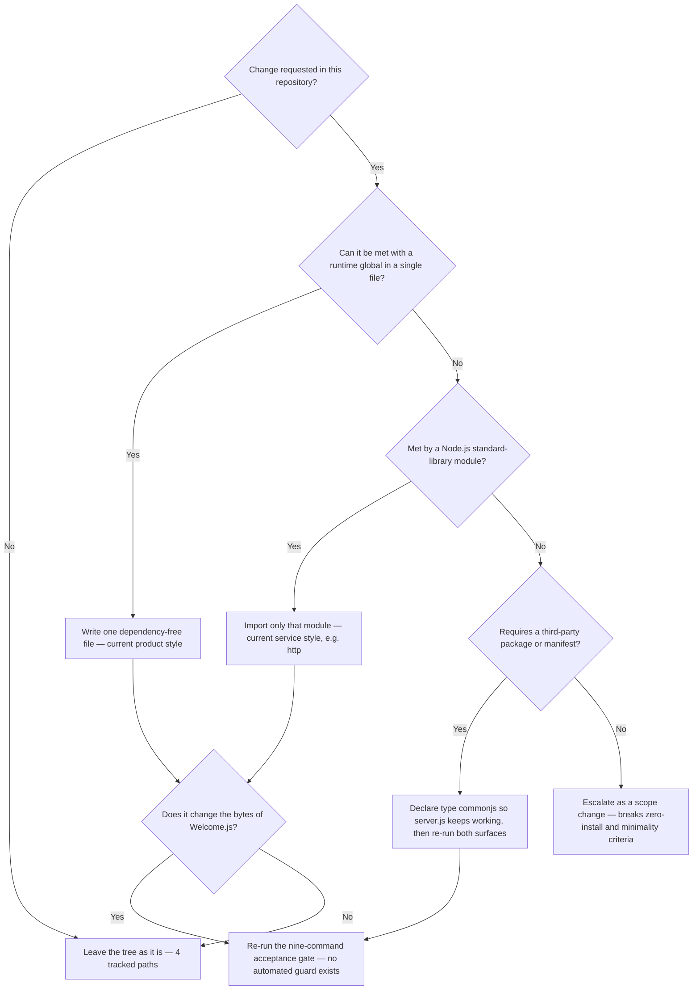

**Architecture decision records.** Each record states a decision that is already in force in the repository, its status, and the consequence a future maintainer inherits.

| ID | Decision | Status | Consequence |
|---|---|---|---|
| ADR-001 | Deliver the product as a single dependency-free statement at the repository root (`Welcome.js:1`) | Accepted, implemented | Byte-exact acceptance; no abstraction and no automated regression net |
| ADR-002 | Consume only runtime globals and standard-library modules; keep the tree manifest-free | Accepted, implemented | Zero-install execution; a manifest, if ever added, must declare `"type": "commonjs"` to protect `server.js` |
| ADR-003 | Keep the delivered source module-neutral by using no module syntax | Accepted, implemented | Behaviour is independent of the runtime's CommonJS/ESM classification |
| ADR-004 | Terminate by draining the event loop rather than calling `process.exit()` | Accepted, implemented | Queued output is never truncated; process lifetime is the runtime's to decide |
| ADR-005 | Treat `README.md` and `server.js` as immutable and unreferenced; deliver additively | Accepted, implemented and verified | Pre-existing surfaces stay byte-identical and the service's latency stays at or below its idle baseline; the two surfaces share no code |
| ADR-006 | Add no application-level error handling, logging, observability, authentication or storage to the product | Accepted, implemented | The failure surface is enumerable and tiny, but output-stream failure is silent; monitoring must be external to the process |
| ADR-007 | Deliver acceptance as a documented nine-command manual gate rather than an automated suite | Accepted by design | Any future edit to either `.js` file must be re-validated by hand; recorded as an accepted risk |
| ADR-008 | Implement in JavaScript despite the rule clause directing Python for new products | Accepted with recorded divergence | One of three rule clauses is knowingly unmet; it is a governance item with no functional, security, performance or continuity effect, and the file must stay byte-identical (Project Guide §1.4, §5.2 divergence 1) |
| ADR-009 | Emit the acceptance record as a tracked Markdown artifact rather than as code or configuration | Accepted, implemented | The record is auditable in version control and counts as one added path; it is never executed and adds no runtime dependency |


## 5.4 Cross-Cutting Concerns

### 5.4.1 Monitoring and Observability

**No in-process monitoring or observability mechanism exists, and the system's observable surface is small enough to enumerate.** Neither executable exports metrics, exposes a health or readiness endpoint, registers a diagnostics channel, or loads an APM, metrics or agent library; a repository-wide search for `process.on`, timers or handlers in the tracked `.js` files returns nothing. There is no manifest to declare such a dependency, and the delivered product has no listener that a probe could reach.

What remains observable is therefore only what the runtime emits at the process edge, plus the service's one startup line:

| Signal | Source | What It Establishes |
|---|---|---|
| 18 bytes on `stdout` (`57 65 6c 63 6f 6d 65 20 74 6f 20 42 6c 69 74 7a 79 0a`) | `Welcome.js:1` via `console.log` | That the product executed and produced exactly the required message. This is the acceptance signal, and it is a payload rather than a log record |
| Empty `stderr`, exit status `0` | Node.js runtime process edge | That the run completed without an unhandled error and that the event loop drained naturally |
| Exit status `1` with `MODULE_NOT_FOUND` on `stderr` | Node.js module loader | That the invocation itself was wrong — a wrong path or a wrong filename casing, the latter masked on case-insensitive filesystems and failing on Linux (measured) |
| `Server running at http://127.0.0.1:3000/` | Startup callback, `server.js:12-14` | That the pre-existing service bound successfully. This is the only log line either surface writes |
| HTTP response observed by the client | `server.js:6-10` plus runtime framing | `200`/`text/plain`/`Content-Length: 14` for any well-formed request; `400` or `431` from the parser for malformed or oversized requests |

Because no metric is emitted, health can only be judged from outside the process: by capturing output and reading the exit status for the product, and by sending a request for the service. The repository's own verification does exactly that — a nine-command acceptance gate using shell utilities (`wc`, `od`, `sha256sum`, `timeout`, `env`) rather than an instrumentation stack (Project Guide §9.5). The most important observability limitation is recorded rather than closed: `console.log` does not raise when the destination cannot accept the write, so `node Welcome.js >/dev/full` exits `0` with an empty `stderr` and the message is simply lost (measured). Monitoring must therefore assert captured bytes; an exit-status check alone can report success for a run that produced nothing.

### 5.4.2 Logging and Tracing

**There is no logging framework, no log level, no structured record, no log sink and no tracing.** No logging dependency is declared (there is no manifest to declare one), no file is written at runtime, and no correlation identifier is generated or propagated anywhere in the tree.

| Aspect | Finding |
|---|---|
| Application log records | One line, written once per service start: `Server running at http://127.0.0.1:3000/` (`server.js:13`). The product writes no log record at all — its `stdout` bytes are the deliverable, so treating them as logs would conflate payload with diagnostics |
| Log destination and retention | The process's `stdout`/`stderr` only, inherited from the invoking shell; where they go, and whether they are retained, is entirely the caller's decision. No file, rotation, level filter or retention policy exists |
| Request logging | None. The service does not log requests, responses, methods, paths, status codes, durations or client addresses, and the handler never reads the request object |
| Structured logging | None: no JSON records, no field schema, no severity vocabulary, no timestamps written by the code |
| Tracing and correlation | None, and none is applicable in-process: neither surface fans out to another component, so there is no span to parent and no context to propagate. The two surfaces never call each other, so there is no cross-process trace to join |
| Verification-time diagnostics | Outside the product, the verification record relies on shell tooling: `od` for a hex dump of the output, `sha256sum` for source identity, `wc` for byte and line counts, `timeout` to bound runs, and `env -i` to prove environmental independence (Project Guide §9.5, Appendix A) |

The architectural consequence is that diagnosability depends on the caller's capture discipline. A run whose output is not captured is unverifiable, and a failed run is distinguishable only by exit status plus whatever the runtime prints on `stderr`.

### 5.4.3 Error Handling Patterns

**Neither surface contains an application-level error handler.** A repository-wide search across the tracked `.js` files for `try`, `catch`, `console.error`, `process.exit`, `process.on`, `setTimeout` and `setInterval` returns nothing, so every error path in this system is the runtime's default behaviour rather than a designed response. That is consistent with the design intent recorded in the Project Guide — the program reads no input, opens no socket and consumes no dependency, so no failure branch is reachable by application logic — but it also means that the two failure modes an operator can actually meet are unhandled by design.

| Failure Mode | Behaviour | Evidence | Mitigation Available Today |
|---|---|---|---|
| Invocation error: wrong path or wrong filename casing | Loader throws `MODULE_NOT_FOUND`, prints a stack trace on `stderr`, exits `1`; nothing is written to `stdout` | Measured with `node welcome.js` on a case-sensitive filesystem | None in code. The recorded operator guidance is to invoke from the repository root or by absolute path and to preserve the exact casing `Welcome.js` |
| Output stream cannot accept the write (closed pipe, full device) | The write is lost silently: exit status stays `0` and `stderr` stays empty, because `console.log` does not raise | Measured with `>/dev/full` and with a closed pipe destination | None in code. The recorded practice is to assert captured bytes rather than the exit status (Project Guide §3 "Not Covered") |
| Service bind failure (port already in use) | `listen` emits `'error'` with nobody attached, so the process throws an unhandled `EADDRINUSE`, prints a stack trace on `stderr` and exits `1` | Measured by starting `server.js` twice concurrently (`server.js:12` registers a success callback only) | None in code; recorded as an open pre-existing item. Recovery is procedural: stop the incumbent process or free the port |
| Malformed or oversized HTTP request | The runtime's HTTP parser replies `400 Bad Request` for a malformed request line and `431 Request Header Fields Too Large` for a header block around or beyond its approximately 16 KB limit; both are emitted without application involvement and without leaking internals | Measured with raw sockets: 12 KB of headers → `200`, 20 KB → `431`, `@@@BROKEN@@@` request line → `400` | Provided by the runtime, not by the application. The handler itself never inspects the request, so it has no error branch to take |
| Uncaught exception anywhere else | Not reachable: there is no input, no dynamic code evaluation, no filesystem or database access and no third-party code in either surface | Source-level enumeration of both files | Not applicable — the absence of the underlying capability is the control |

There is no error propagation between components, because there is no call path between them; no retry, timeout, backoff, circuit breaker, bulkhead or fallback, because every operation is local and total; and no compensating action or dead-letter path, because nothing is committed anywhere. Error reporting is confined to the two channels the runtime already owns: process exit status and `stderr`. For operators, this yields one firm rule — treat any non-zero exit or non-empty `stderr` as a failure, and never treat exit `0` alone as proof that output was delivered.

Error handling flow across both surfaces:

```mermaid
flowchart TD
    InvokeNode["Shell runs node with one of the two scripts"]
    InvokeNode --> SurfaceNode{"Which surface was invoked?"}
    SurfaceNode -->|"Welcome.js"| LocateNode{"Source located at the exact path and casing?"}
    LocateNode -->|"No"| ModuleNode["MODULE_NOT_FOUND stack trace on stderr, exit 1"]
    LocateNode -->|"Yes"| WriteNode{"Destination accepts the 18-byte write?"}
    WriteNode -->|"Yes"| OkNode["18 bytes on stdout, stderr empty, exit 0"]
    WriteNode -->|"No"| SilentNode["Write lost silently — exit 0, stderr empty, no handler exists"]
    SurfaceNode -->|"server.js"| BindNode{"Loopback 127.0.0.1:3000 free?"}
    BindNode -->|"No"| AddrNode["Unhandled EADDRINUSE error event, stack trace on stderr, exit 1"]
    BindNode -->|"Yes"| ListenNode["Startup log line on stdout, service listening"]
    ListenNode --> ParseNode{"Request within parser limits?"}
    ParseNode -->|"Malformed request line"| BadNode["400 Bad Request from the HTTP parser"]
    ParseNode -->|"Header block at or beyond about 16 KB"| LargeNode["431 Request Header Fields Too Large from the HTTP parser"]
    ParseNode -->|"Well-formed"| HandlerNode["Handler runs: 200 text/plain, Content-Length 14"]
    ListenNode -->|"SIGTERM or SIGINT"| StopNode["Default runtime termination, loopback port released"]
```

### 5.4.4 Authentication and Authorization

**There is no authentication, no authorization and no identity concept anywhere in the system.** No credential, token, API key, certificate, session, cookie or password is read, issued, validated or stored by either surface, and no tracked file references a secret store or an identity provider. There is no user model, no role, no permission check and no access-control configuration — the enumeration is complete rather than sampled, because the delivered program consumes no input at all: it ignores command-line arguments, standard input and environment variables, verified by an identical 18-byte result under `env -i` and from a foreign working directory.

Where the pre-existing service is concerned, the *effective* access control is network reach rather than a security mechanism: the listener is bound to `127.0.0.1` on port `3000` with both values written as literals and no environment override (`server.js:3-4`), so only a process on the same host can connect, and every client that can connect receives the same constant response. There is no TLS, because the channel never leaves the host; and there is no request-level authorization, because there is no protected resource behind the endpoint. The service itself writes nothing and exposes no data, so an unauthorized client's worst case is receiving `Hello, World!`.

Two residual considerations follow, both already recorded as risks rather than defects. First, because the product's failure to deliver output is silent, a future change that gave the product an input channel or a caller would create a security surface that does not exist today; the recorded guidance is to treat any new dependency, argument or input channel as a scope change (Project Guide §6). Second, credentials do belong to the environment rather than the code: the checkout's Git remote URL carries a host-issued access token, which is host configuration and is neither read nor referenced by any file in the tree — such material must never be written into tracked files or into this specification.

### 5.4.5 Performance Requirements and SLAs

**No service level is stated anywhere in the repository, and none can be inferred from the code.** There is no availability target, no latency percentile, no throughput commitment, no capacity plan and no error-budget concept; the figures the Project Guide records are verification observations of a change's non-impact, not contractual levels. What can be stated are the measured characteristics and the hard environmental limits.

| Concern | Requirement in Force | Measured or Recorded Behaviour |
|---|---|---|
| Product execution cost | None stated | One write and exit, measured at roughly 23–30 ms per run including interpreter start-up (`5` sequential runs in 114 ms on the investigation host); the Project Guide records the same order of magnitude |
| Product throughput | None stated, and no in-process constraint | Each invocation is an independent short-lived process with no shared resource, so concurrency is bounded by host capacity rather than by application design |
| Output fidelity | Byte-exact output is the de facto acceptance criterion | 18 bytes, exactly `Welcome to Blitzy` plus one LF; verified identical on Node.js v24.21.0 and v22.23.2, and reproduced on v22.23.3 |
| Service response contract | None stated | `200`/`text/plain`/`Content-Length: 14` for any well-formed request; `400` and `431` from the HTTP parser at its boundary conditions |
| Connection behaviour | Runtime defaults, not choices | HTTP keep-alive active with `Keep-Alive: timeout=5` observed on the wire; no idle tuning, pooling, rate limiting or concurrency cap in application code |
| Impact on the pre-existing application | Explicit requirement: performance must not be affected | Recorded continuity evidence shows request-latency medians for the running service at or below their idle baseline while the new script ran repeatedly and concurrently, with no failed request and stable memory, thread and descriptor counts inside the ledger |
| Measurement hazard | None stated, but asserted in the record | A terminal's newline translation can show 19 bytes instead of 18, so byte counts must be taken from a pipe or captured file; and because a failed write is silent, the output itself must be verified rather than the exit status (both reproduced during this investigation) |
| Runtime support horizon | Forward requirement | The supported floor, Node.js 22.x, reaches end of life on 30 April 2027; standardising on 24.x or later requires no source change because the syntax is ES5-level (Project Guide §6, Appendix D) |
| Capacity planning | Not applicable | No persistent state, no connection pool, no cache and no queue exist, so there is no resource whose exhaustion degrades the system over time |

The architectural reading is that this system's performance characteristics are effectively fixed by its invocation model: cost is dominated by starting the interpreter, not by any work the code performs, which means optimisation effort belongs in how often the process is started rather than in what it does once running.

### 5.4.6 Disaster Recovery and Operational Continuity

**The recovery objective is trivial because there is nothing to lose, and the recovery procedure is to re-create the environment rather than to restore data.** No component persists state — no database, no cache, no session, no file written at runtime and no queue — so there is no recovery point objective, no backup, no restore drill, no snapshot and no failover path to design. The only durable asset is the source itself: four tracked paths in Git, of which the delivered change adds two (`Welcome.js` and `blitzy/documentation/Project Guide.md`).

| Continuity Concern | Position | Basis |
|---|---|---|
| Data to recover | None | No runtime state anywhere; the service rebuilds each response from three constants, and the product holds nothing |
| Recovery unit | A process, not a data set | The product's recovery is simply another invocation; the service's recovery is another `node server.js` |
| Rebuild procedure | Clone, checkout the branch, run — no install, build or configuration step | Repository declares no dependency, no manifest and no configuration; running the file is the whole procedure (Project Guide §9.2, §9.4) |
| Integrity check on rebuild | Source hash and the nine-command acceptance gate | `sha256 5c7ac141d94f92056efb756f17335252c31e3d08d509e641d76512f73112c1fc` identifies the delivered bytes; the gate re-asserts output bytes, exit status, `stderr` emptiness and minimality |
| Service outage recovery | Restart the process after the port is free | Measured: on `SIGTERM` the process ends and loopback port `3000` is released and immediately reusable; a restart attempt while an instance still holds the port fails with `EADDRINUSE` and exit `1`, so ordering matters (kill first, then start) |
| Single points of failure | One runtime line per host; one hardcoded bind address | The service binds one literal host and port with no override, so no second instance can coexist on a host; the runtime line is an environment prerequisite with no pin in the tree |
| Availability expectations | None stated | The service is a loopback demonstration endpoint, and no availability objective, redundancy requirement or failover target is recorded anywhere |
| Delivery rollback | Git history | The change is additive — two new paths — so reverting the merge removes the product and the record without touching `README.md` or `server.js`, which remained byte-identical throughout |
| Longer-term continuity risk | Runtime lifecycle, not data loss | The Node.js 22.x supported floor ends on 30 April 2027; hosts left on that line stop receiving security patches even though the code keeps working. The recorded remediation is to standardise on 24.x or later, which requires no source change |
| Recovery of acceptance evidence | The tracked governance record | `blitzy/documentation/Project Guide.md` holds the acceptance criteria, the 42 executed checks, the compliance matrix and the divergence decisions; because it is tracked, rebuilding the checkout restores the evidence alongside the code |

In operational terms this system is *restart-recoverable rather than restore-recoverable*: continuity depends on the host having a supported runtime and on the operator re-running a documented command, not on any state management, replication or backup discipline.


## 5.5 References

- `Welcome.js` — the delivered product: one statement (`console.log('Welcome to Blitzy');`), 1 line, 34 bytes, `sha256 5c7ac141d94f92056efb756f17335252c31e3d08d509e641d76512f73112c1fc`; establishes the process I/O contract, the module-neutral source, the absence of input reads, timers and error handling, and the 18-byte `stdout` result.
- `server.js` — the pre-existing loopback HTTP service: CommonJS `require('http')` at line 1, hardcoded `hostname`/`port` at lines 3–4, the inline `(req, res)` handler at lines 6–10, and `listen` with a success callback only at line 12; establishes the service's interfaces, its fixed bind address, the absence of an `'error'` listener and of any graceful-shutdown path, and the constant response contract.
- `README.md` — the repository's identity stub: `# hao-backprop-test` and the single-sentence stated purpose; establishes the stated project identity and the fact that no architectural component corresponds to it.
- `blitzy/documentation/Project Guide.md` — the 382-line tracked governance and verification record; the source for the acceptance gate and 42 executed checks, the runtime parity evidence (Node.js v24.21.0 reference and v22.23.2 floor), the hour ledger, the compliance matrix and divergences (including the Python rule clause), the risk register (missing server `'error'` listener, silent stream failure, absent automated regression net, 22.x end of life, manifest hazard), the performance non-impact measurement for the pre-existing service, and the development and troubleshooting guidance.
- Repository root folder — the complete non-`.git` inventory (four tracked paths and no hidden files) and the ancestor walk that shows no manifest, lockfile, `node_modules`, container file or configuration file in the checkout or any parent directory.
- `blitzy/` — a first-order folder containing governance material only, never executed or imported by either script; with `blitzy/documentation/`, it establishes that the change's second added path is documentation rather than code.
- Git history and working tree of branch `09-Oct-26-Br2` (HEAD `39974fd`) — `git ls-files` (four tracked paths), `git diff --name-status 1484182 HEAD` (two added paths only), and the commit sequence including the record-only commit `6c16ea2` and the merge commit `39974fd` ("Merge pull request #15"); establishes the additive nature of the change, the delivery path, and the byte-identical continuity of the pre-existing files.
- No web sources were consulted: every claim in this section is grounded in the repository's own files and in behaviour measured directly on the host running Node.js v22.23.3.


# 6. SYSTEM COMPONENTS DESIGN

## 6.1 Core Services Architecture

### 6.1.1 Applicability Determination

**Core Services Architecture is not applicable for this system.** The repository contains no microservices, no distributed architecture and no service decomposition of any kind, and nothing in its source, artifacts or recorded requirements calls for one.

The determination rests on a complete enumeration rather than a sample. The checkout holds four tracked paths — `README.md`, `Welcome.js`, `server.js`, `blitzy/documentation/Project Guide.md` — and nothing else; a repository-wide sweep for manifests, lockfiles, `node_modules`, container files, Compose/Kubernetes/Helm manifests, infrastructure-as-code, environment files and any `.yml`, `.yaml`, `.json`, `.toml`, `.tf`, `.ini` or `.conf` file returns zero matches. The only module import in the entire codebase is `const http = require('http')` at `server.js:1`, a Node.js standard-library module. With no service registry, no orchestrator, no container image, no message broker, no network boundary beyond loopback and no configuration surface, the machinery a core services architecture describes — service boundaries negotiated over a network, discovery, load distribution, circuit breaking, replication — has no subject matter in this repository. This is consistent with the architecture style recorded in 5.1.1 (a collection of independent, single-file, dependency-free JavaScript executables that share nothing at runtime but a working tree and a host runtime), with the component analysis in 5.2, and with the decisions recorded in 5.3.1 and 5.3.2.

Two qualifications keep this section honest and useful:

| Qualification | Position | Basis |
|---|---|---|
| One network-facing service component does exist | `server.js` runs a loopback HTTP service bound to `127.0.0.1:3000`. It is pre-existing, out of the delivered product's scope, unmodified by it, and referenced by no other file | `server.js:1-14`; 5.1.2, 5.2.2; Project Guide Appendix C |
| No service-to-service architecture exists around it | The delivered product (`Welcome.js`) is a short-lived batch process, not a service. It never imports, spawns, calls or is called by the HTTP service, so there is exactly one service and zero service dependencies | 5.1.1, 5.2.5; Project Guide §2.1, §4 |

Because one service component does exist, the areas the prompt enumerates — boundaries, communication, discovery, balancing, circuit breaking, retry and fallback, scaling, and resilience — are answered below for that single component, and each answer is either an observed property of its 14-line source or a recorded absence with the evidence that establishes it. The absence of a distributed topology is itself an architectural finding: it removes every distributed failure mode a design would otherwise have to mitigate, which is why 6.1.3 and 6.1.4 are short and why 6.1.4 leans on 5.4.3 and 5.4.6 for the failure and recovery positions already established there.

### 6.1.2 Service Components

The system consists of two executable components that are mutually unaware, executed by one host-provided runtime. Neither is decomposed further: each is a single file that contains a complete program, with no module seam, no library layer, no shared helper and no configuration surface (5.1.1, 5.3.1).

| Component | Boundary | Responsibility | Evidence |
|---|---|---|---|
| `Welcome.js` — delivered product process | The OS process edge: `stdout`, `stderr`, exit status | Write exactly `Welcome to Blitzy` (18 bytes) and terminate naturally with status `0`; ignore argv, stdin and environment | `Welcome.js:1`; 5.2.1 |
| `server.js` — pre-existing HTTP service process | A TCP listener bound to loopback `127.0.0.1` on port `3000` | Answer every request, for any method, path, headers or body, with `200`, `Content-Type: text/plain`, `Content-Length: 14`, body `Hello, World!\n`; log one startup line on the successful-bind callback | `server.js:3-4`, `server.js:6-14`; 5.2.2 |
| Node.js runtime — host platform | The command line `node <file>` and the process boundary it defines | Load and execute both files, supply `console` and the `http` module, own `stdout`/`stderr`/exit status | 5.2.3; Project Guide §9.1, Appendix D |

**Inter-service communication patterns.** There is no inter-service communication. The service has no upstream or downstream service, no client library, no broker, no queue and no outbound call of any kind; its only peer is a local HTTP client. Measured across the whole system, exactly two communication channels exist, and neither connects the two components:

| Channel | Pattern | Direction and Acknowledgement | Evidence |
|---|---|---|---|
| Process I/O contract | One-way, synchronous byte write then process exit | Write-only, unacknowledged: `console.log` does not raise if the destination rejects the write, so delivery is invisible to the writer | `Welcome.js:1`; 5.2.1, 5.4.3 |
| HTTP/1.1 over loopback TCP | Synchronous client-initiated request–response | Two-way per request, one request per exchange, no streaming body, no callbacks, no events; connection reuse is the runtime default, observed on the wire as `Keep-Alive: timeout=5` | `server.js:6-13`; 5.2.2, 5.3.2 |

No channel carries retry, timeout, backoff, idempotency key or correlation identifier, because no operation fans out beyond a single process (5.3.2, 5.4.2). The complete topology, including the explicit absence of a link between the two components, is drawn as Figure 6.1.1 in 6.1.5.

**Service discovery mechanisms.** None exist, in any form. Addressability is a compile-time constant pair rather than a discoverable property: `hostname = '127.0.0.1'` and `port = 3000` at `server.js:3-4` are literals with no environment override, so the only way a client can find the service is out-of-band knowledge recorded in Project Guide Appendix B. A second instance cannot be registered anywhere, because there is no registry, no DNS entry, no service mesh, no health endpoint and no manifest with which to declare one — and on the same host it cannot even start, because the fixed address is already taken (measured: `Error: listen EADDRINUSE: address already in use 127.0.0.1:3000`, exit `1`). The delivered product requires no discovery at all: it is invoked by path (`node Welcome.js`) rather than located over a network (5.2.1, Project Guide §9.4).

**Load balancing strategy.** None, and none is reachable through the current binding. Because the listener is bound to `127.0.0.1`, off-host traffic cannot arrive, so a front proxy, reverse proxy or ingress has nothing to distribute from outside the machine; the checkout contains no proxy, gateway, upstream pool or traffic-policy configuration of any kind. On the host itself, distribution is impossible by construction: one literal address and port admit exactly one instance, and the second attempt fails at `listen` (measured, exit `1`). What the service does supply is the runtime's own per-connection behaviour — HTTP keep-alive with a five-second idle window, no application-level connection pool, no rate limiting, no concurrency cap and no queueing — so several local clients are served by the event loop in arrival order rather than by any balancing policy (`server.js:6-13`; 5.2.2, 5.4.5).

**Circuit breaker patterns.** None. A circuit breaker presupposes a dependency that can fail independently, and this service has no dependency: its handler reads nothing from the request, performs no I/O, holds no state and always returns the same three literals, so there is no call that could time out, degrade or trip a breaker. The source contains no `try`/`catch`, no `process.on`, no timer and no failure branch (5.4.3); the only conditional behaviour anywhere in the request path belongs to the runtime's HTTP parser, which answers `400 Bad Request` for a malformed request line and `431 Request Header Fields Too Large` for a header block at or beyond its roughly 16 KB limit — both emitted without application involvement and without leaking internals (5.4.3; Project Guide §4).

**Retry and fallback mechanisms.** None. Nothing in the system retries an operation: the product performs one write and exits, and the service composes each response from constants with no fallback path, no secondary endpoint, no cached copy and no degraded response form. Failure handling is entirely the runtime's default: a bad invocation path yields `MODULE_NOT_FOUND` and exit `1`; a write the stream cannot accept is lost silently while the exit status stays `0`; and a bind conflict raises an unhandled `EADDRINUSE` event because `listen` registers a success callback only (`server.js:12-14`). Recovery for both surfaces is a human or scripted act — invoke the command again, or free port `3000` and restart the process — and is described in 6.1.4 and 5.4.6 rather than being implemented in code (5.4.3; Project Guide §6).

### 6.1.3 Scalability Design

**Horizontal and vertical scaling approach.** The two components scale in opposite ways, and only one of them scales at all. The delivered product scales horizontally for free, because each invocation is a separate short-lived OS process with no shared resource, no lock, no session and no coordination requirement; concurrency is therefore bounded by the host and not by the application (5.2.1, 5.4.5). The HTTP service does not scale horizontally on a host, and needs no vertical headroom: its handler performs no computation and no I/O, so there is nothing to size up.

| Component | Horizontal scaling | Vertical scaling |
|---|---|---|
| `Welcome.js` | Unbounded process replication — independent invocations, no coordination, ~23–30 ms each | Not meaningful: the workload is a single 18-byte write dominated by interpreter start-up |
| `server.js` | Not available: one literal `127.0.0.1:3000` binding admits exactly one instance per host; a second start fails on `listen` with an unhandled `EADDRINUSE` and exit `1` (measured) | Not designed or tuned: single process, single thread, no clustering, no worker threads, no pooling, no rate limiting; the response is assembled from three constants, so there is no load-driven cost to reduce |
| Node.js runtime | Each execution is a fresh process; no runtime or socket is shared between the components | Host-level only; the runtime line is the platform, supplied by the environment and pinned by no repository artifact |

Reaching even two service instances on one host would first require a source change that does not exist today: making the bind address and port configurable at `server.js:3-4`. Reaching a second host would additionally require an artifact class the repository deliberately excludes — a container image or an orchestration manifest (3.6.3, 3.6.6).

**Auto-scaling triggers and rules.** None exist, and none can be driven from inside the system. No metric, counter, gauge or log-based signal is emitted by either component; neither exposes a health, readiness or liveness endpoint; there is no manifest, container image, orchestration object or scheduler in the tree through which a replica count or resource limit could be declared; and there is no CI/CD or deployment automation to invoke one (5.4.1, 5.4.2, 3.6.4, 3.6.6). The only actor that decides how many times the product runs is whatever invokes it — an operator, a shell pipeline, or the documented acceptance gate (Project Guide §9.5) — and the service's instance count is fixed at one by its binding literal.

**Resource allocation strategy.** No allocation is declared, because there is no artifact in which to declare one. There is no manifest, no container specification, no systemd unit, no process supervisor and no configuration file; both scripts run under whatever defaults the host runtime and the invoking shell supply, with `0644` file permissions and no privileged capability requested (5.3.5, Project Guide §1.5). In practice the allocation unit is one OS process per invocation for the product, and exactly one long-lived process holding a loopback socket for the service. The one observable resource behaviour the runtime owns is HTTP connection reuse: `Keep-Alive: timeout=5` keeps an idle connection open for five seconds before closing, with no application-level pool sizing behind it (5.2.2, 5.4.5).

**Performance optimization techniques in force.** Performance work here is a property of how the program is invoked rather than of what it computes, and the recorded measurements support that reading:

| Technique | Status | Effect and evidence |
|---|---|---|
| Zero dependency resolution and zero build step | In force by design | The source runs as written; no manifest, lockfile, `node_modules`, transpile or bundle step exists, so no resolution or start-up overhead is paid beyond the interpreter itself (5.3.1, Project Guide §9.3) |
| ES5-level syntax and a single member call | In force | Nothing in either file is version-sensitive or computationally meaningful; the product's cost is dominated by interpreter start-up at roughly 23–30 ms per run (5.4.5, Project Guide §9.1) |
| No caching | Deliberate decision | Caching would sit between a constant and a write with no work to save, while adding a dependency, a staleness surface and an eviction policy — and it would break the property that makes acceptance possible, that the output is a deterministic function of the source bytes (5.3.4) |
| No application-level error handling, logging or instrumentation | Deliberate decision | Nothing is added to the hot path; the consequence, recorded in 5.4.3, is that a failed write is silent and monitoring must assert captured bytes rather than the exit status |
| Keep-alive reuse | Runtime default, not a choice | Five-second idle reuse observed on the wire; no application tuning, pooling or rate limiting exists (5.2.2) |
| Measurement discipline as a performance safeguard | Recorded practice | Byte counts must be taken from a pipe or captured file, because terminal newline translation can show 19 bytes instead of 18 (Project Guide §3, §9.7) |

**Capacity planning guidelines.** The plan that the observed constraints support is short and rests on environmental limits rather than on application arithmetic. No availability, latency, throughput or capacity target is stated anywhere in the repository (5.4.5), so the guidelines below are the derived implications of what the code actually fixes.

| Constraint | Planning implication | Basis |
|---|---|---|
| One service instance per host on loopback `127.0.0.1:3000` | Plan the service as a single-instance, local-only endpoint; there is no capacity to add on the same host without changing the bind literals, and no client off the host can reach it | `server.js:3-4`; measured `EADDRINUSE` exit `1`; 5.2.2, Project Guide Appendix B |
| Product concurrency bounded by the host, not the code | Size for process start-up cost (~23–30 ms each), not for in-process work; repeated and concurrent runs were measured as leaving no residue and as not affecting the running service's latency | 5.2.1, 5.4.5; Project Guide §2.1, §4 |
| No pool, cache, queue or persistent state to exhaust | No capacity-over-time degradation model is needed; there is no resource whose saturation degrades the system gradually | 5.3.3, 5.3.4, 5.4.5 |
| Runtime support horizon is the binding lifecycle constraint | Standardise hosts on Node.js 24.x or later before the 22.x floor reaches end of life on 30 April 2027; no source change is required because the syntax is ES5-level | Project Guide §6, Appendix D; 3.6.5 |
| Any growth beyond these limits is a scope change | Adding a dependency, a manifest, a configuration surface or a second instance introduces artifact classes the acceptance criteria exclude, so each must be agreed and re-verified rather than assumed | 5.3.1, 5.3.6, Project Guide §6 |

### 6.1.4 Resilience Patterns

Resilience in this system is a property of the process boundary and of version control, not of application code. No resilience pattern is implemented in either source file: a repository-wide inspection of the two tracked `.js` files finds no `try`/`catch`, no `process.on`, no `setTimeout`/`setInterval`, no health or readiness endpoint, no retry, no timeout, no backoff, no breaker, no bulkhead and no graceful-shutdown drain (5.4.3). What protection exists comes from two places — the Node.js runtime's own defaults, and the fact that nothing in the system persists state, so there is nothing to reconcile after a failure (5.3.3, 5.4.6).

| Pattern | Implemented | Position and evidence |
|---|---|---|
| Fault tolerance (in-process handling) | No | The failure paths that an operator can actually meet are unhandled by design and were reproduced: `MODULE_NOT_FOUND` with exit `1` for a wrong invocation path or filename casing; a silently lost write with exit `0` when the output stream cannot accept it; an unhandled `EADDRINUSE` event with a stack trace and exit `1` when port `3000` is occupied (`server.js:12-14`; measured; 5.4.3) |
| Circuit breaking, retry, timeout, fallback | No | No dependency exists that could fail independently, so there is no call to break, retry or replace; both surfaces are local, total and deterministic (6.1.2; 5.3.2) |
| Disaster recovery | Procedural, not coded | Recovery is re-running a command on a host that has a supported runtime. There is no backup, snapshot, restore drill or failover asset, because there is no runtime state to restore (5.4.6; Project Guide §9.2, §9.4) |
| Data redundancy | None required | No database, cache, session, queue or runtime-written file exists; the only durable asset is the Git-tracked source, identified by `sha256 5c7ac141d94f92056efb756f17335252c31e3d08d509e641d76512f73112c1fc` |
| Failover | No | One literal bind address and port means no secondary instance, host, port, DNS record or health check exists to fail over to; a second start on the same host fails at `listen` (6.1.2, 6.1.3) |
| Graceful degradation | No | Responses are constant and complete: any well-formed request receives `200`/`text/plain`/`Content-Length: 14`, with no partial mode, no degraded payload, no rate limiting and no load shedding |

**Fault tolerance mechanisms.** The tolerance that does exist is the runtime's, not the application's, and it is narrow but measurable. The HTTP parser rejects malformed and oversized requests before the handler is reached — `400 Bad Request` for a bad request line and `431 Request Header Fields Too Large` for a header block at or beyond roughly 16 KB (measured: a 20 KB header block returned `431`) — and it does so without leaking internals (Project Guide §4). HTTP keep-alive reuses connections for a five-second idle window, so a client that has just been served can send again without a new handshake (`Keep-Alive: timeout=5`, measured). Process interruption is handled by the runtime's defaults: on `SIGTERM` the service process ends with no drain step, its connections are refused, and loopback port `3000` is released and immediately rebindable (measured). Nothing beyond these behaviours is designed: there is no supervision, no restart policy, no watchdog and no application-level retry, so a terminated service stays down until it is started again (5.4.3, 5.4.6).

**Disaster recovery procedures.** The system is *restart-recoverable rather than restore-recoverable*, as recorded in 5.4.6: because no component holds state, the recovery procedure is environment re-creation rather than data restoration. In practice it is three steps with no install, build or configuration stage — clone the repository, check out the branch, run the command (`node Welcome.js` for the product, `node server.js` for the service) — and the integrity of the rebuild is checked by source hash plus the documented nine-command acceptance gate in Project Guide §9.5. Ordering matters for the service: a restart attempted while an instance still holds port `3000` fails with `EADDRINUSE` and exit `1`, so the incumbent process must stop first; the port is then free immediately (measured). Delivery rollback is likewise simple, since the change is additive to the tree and removal of the merge leaves `README.md` and `server.js` byte-identical (5.4.6, Project Guide §2.1).

**Data redundancy approach.** There is no data to replicate, and no redundancy mechanism exists beyond version control. Neither component reads or writes a file, socket or clipboard that another reads; there is no database, cache, broker, session store, temporary file or in-memory structure that outlives a single statement or request (5.3.3, 5.4.6). The only durable asset is the four tracked paths in Git — of which the change adds `Welcome.js` and `blitzy/documentation/Project Guide.md` — so redundancy is whatever the hosting arrangement provides for the repository, and the acceptance record itself is recoverable from the checkout because it is a tracked file (5.4.6). There is consequently no recovery point objective, retention policy or consistency concern to define.

**Failover configurations.** None exist. There is no standby instance, no secondary host, no alternate port, no floating address, no health check and no traffic manager in the repository or in any artifact that could reference one, and the loopback-only binding means no off-host failover target could serve the same clients anyway (`server.js:3-4`; 5.2.2, 5.4.6). Failover is therefore manual and total: free the port, restart the process, and re-run verification. The single points of failure that follow are recorded rather than mitigated — one host runtime line with no pin in the tree, one hardcoded bind address, one service instance, and one acceptance procedure that is manual by design (5.4.6, Project Guide §6).

**Service degradation policies.** There are none, in either direction. The service cannot be degraded partially because it holds nothing to shed: its handler ignores the request entirely and returns the same three literals, so there is no expensive path to defer, no optional content to drop, no queue to shorten and no session to evict (`server.js:6-10`; 5.4.5). The product has no degradation mode either — it performs one write and exits, so a run either delivers the 18 bytes or fails at the process edge, which is the only failure the caller can observe. The one behaviour that deserves the label of undetected degradation is recorded rather than solved: `console.log` does not raise when the destination cannot accept the write, so a closed pipe or full device loses the message while `stderr` stays empty and the exit status stays `0`. The recorded mitigation is procedural — assert the captured bytes, never the exit status alone — and any future input channel or dependency would be a scope change requiring its own resilience design (5.3.1, 5.3.5, 5.4.3; Project Guide §3).

### 6.1.5 Required Diagrams

Three diagrams are required for this section. Each is labelled and each is grounded in the source and the measured behaviour described above; none depicts a component or connection that does not exist in the repository.

| Figure | Diagram | What it establishes | Related sections |
|---|---|---|---|
| 6.1.1 | Service interaction | The complete runtime topology of the system: two mutually unaware processes, two communication channels, and the explicit absence of any inter-service link | 6.1.1, 6.1.2; 5.1.1, 5.2.5 |
| 6.1.2 | Scalability architecture | What scales today (process replication of the batch product) and what blocks the service from scaling at all | 6.1.3; 5.2.1, 5.2.2 |
| 6.1.3 | Resilience pattern implementation | Every failure path in the system, showing which resolutions come from the runtime and which are simply absent | 6.1.4; 5.4.3, 5.4.6 |

**Figure 6.1.1 — Service interaction diagram.** Two components, two channels, no inter-service edge. The dotted link is drawn only to make its own absence explicit: the components share a host, a checkout and a runtime, and nothing else.

```mermaid
flowchart LR
    subgraph HostEnv["Single host — Node.js LTS runtime, one OS process per invocation"]
        OperatorNode["Operator / acceptance gate"]
        subgraph ProductProc["Delivered product process — Welcome.js, in scope"]
            ScriptNode["One statement writing the literal to console"]
        end
        SinkNode["stdout stream — 18 bytes, stderr empty, exit 0"]
        subgraph ServiceProc["Pre-existing service process — server.js, out of scope"]
            ListenerNode["HTTP listener bound to literal 127.0.0.1:3000"]
        end
        ClientNode["Local HTTP client or browser"]
    end
    OperatorNode -->|"invocation: node Welcome.js"| ScriptNode
    ScriptNode -->|"one-way write, unacknowledged"| SinkNode
    ClientNode -->|"HTTP/1.1 request over loopback TCP"| ListenerNode
    ListenerNode -->|"200, text/plain, Content-Length 14"| ClientNode
    ScriptNode -.->|"co-residency only: no call path, socket, file or shared memory"| ListenerNode
```

**Figure 6.1.2 — Scalability architecture.** The present topology on the left, the absent controls on the right. Edges crossing between them record what a scale-out attempt would need and does not have; every node on the right is a documented non-existence, not a planned component.

```mermaid
flowchart TB
    subgraph CurrentState["Current topology — one host, fixed addresses"]
        InvokeNode["node Welcome.js"]
        ProcNode["Independent short-lived process per run, about 23 to 30 ms"]
        ReplicaNode["Replication bounded only by host capacity — no shared resource or coordination"]
        ServiceNode["server.js — exactly one instance on literal 127.0.0.1:3000"]
        SecondNode["Second instance attempted on the same host"]
        BlockedNode["Blocked: listen EADDRINUSE, unhandled, exit 1"]
        InvokeNode --> ProcNode
        ProcNode --> ReplicaNode
        ServiceNode --> SecondNode
        SecondNode --> BlockedNode
    end
    subgraph AbsentControls["Scale-out controls absent from the repository"]
        ConfigNode["No configurable bind address or port"]
        MetricsNode["No metrics, health probe or autoscaling signal"]
        ManifestNode["No manifest, container image or orchestrator object"]
        SupervisorNode["No supervisor, restart policy or deployment automation"]
    end
    ServiceNode -->|"cannot be replicated without"| ConfigNode
    ConfigNode --> ManifestNode
    ManifestNode --> SupervisorNode
    ServiceNode -->|"cannot be autoscaled without"| MetricsNode
```

**Figure 6.1.3 — Resilience pattern implementation.** Every branch terminates in either a runtime-provided resolution or an identified absence; there is no application-level handler anywhere in the tree, and recovery on both surfaces is a manual act.

```mermaid
flowchart TD
    TriggerNode["Failure, interruption or boundary condition"]
    TriggerNode --> SurfaceNode{"Which surface is affected?"}
    SurfaceNode -->|"Welcome.js invocation"| LocateNode{"Source at exact path and casing?"}
    LocateNode -->|"No"| MissingNode["MODULE_NOT_FOUND on stderr, exit 1 — unhandled"]
    LocateNode -->|"Yes"| WriteNode{"Destination accepts the 18-byte write?"}
    WriteNode -->|"Yes"| DeliveredNode["Delivered: 18 bytes on stdout, stderr empty, exit 0"]
    WriteNode -->|"No"| SilentNode["Silent loss — exit 0, stderr empty; no retry, fallback or alert exists"]
    SurfaceNode -->|"server.js service"| BindNode{"Loopback port 3000 free?"}
    BindNode -->|"No"| AddrNode["Unhandled EADDRINUSE event, stack trace on stderr, exit 1"]
    BindNode -->|"Yes"| ListenNode["Listening; one startup line logged"]
    ListenNode --> ParserNode{"Request within runtime parser limits?"}
    ParserNode -->|"Malformed request line"| BadNode["400 Bad Request — runtime parser, no application branch"]
    ParserNode -->|"Header block at or beyond about 16 KB"| LargeNode["431 Request Header Fields Too Large — runtime parser"]
    ParserNode -->|"Well-formed"| ServedNode["200, text/plain, Content-Length 14 — constant, no degraded mode"]
    ListenNode -->|"SIGTERM or SIGINT"| StopNode["Default runtime termination, no drain; port released and immediately rebindable"]
    StopNode --> ManualNode["Recovery is manual: free the port if needed, then start the process again"]
    AddrNode --> ManualNode
```

### 6.1.6 References

- `server.js` — the repository's only network-facing component: fixed bind literals `127.0.0.1` and `3000` (lines 3-4), the constant-response handler (lines 6-10), and the `listen` call whose success callback is the component's only registration (lines 12-14)
- `Welcome.js` — the delivered product: a single `console.log` statement emitting 18 bytes on `stdout` and terminating naturally with status `0`
- `README.md` — repository identity (`hao-backprop-test`) and its one-sentence stated purpose; never executed
- `blitzy/documentation/Project Guide.md` — the repository's delivery and verification record; established the pre-existing service's exercised behaviour (methods, paths, protocol boundaries, restarts, `431` and `400` responses), the open pre-existing items (no `'error'` listener, no graceful-shutdown drain, hardcoded port with no override), port and key-file references (Appendices B and C), the zero-install posture, no automated test suite, and the Node.js v24.21.0 reference / v22.23.2 supported floor with the 30 April 2027 end-of-life date
- `blitzy/` and `blitzy/documentation/` — the governance documentation subtree; non-executing, tracked, and referenced by neither script
- Measured runtime evidence on the host runtime (Node.js v22.23.3) — startup log line, `200`/`text/plain`/`Content-Length: 14` for `GET` and `POST` requests, `Keep-Alive: timeout=5`, unhandled `EADDRINUSE` with exit `1` on a second instance, `400` for a malformed request line, `431` for a 20 KB header block, and release of loopback port `3000` immediately after `SIGTERM`
- No web sources were consulted for this section; every statement rests on the tracked files above and on commands executed against the checkout

## 6.2 Database Design

### 6.2.1 Applicability Determination

**Database Design is not applicable to this system.** No database, no persistent store and no storage service of any kind is required, configured, referenced or reachable. The system's complete runtime data set is two compile-time string literals held in source, and each is consumed once and discarded when the process ends.

The determination rests on a complete enumeration of the tracked tree rather than on a sample of it. The checkout holds four tracked paths — `README.md`, `Welcome.js`, `server.js` and `blitzy/documentation/Project Guide.md` — and nothing else; a repository-wide sweep for manifests, lockfiles, `node_modules` and every `.json`, `.yaml`, `.yml`, `.toml`, `.ini`, `.env`, `.sql`, `.db`, `.sqlite`, `.csv`, `.parquet` and `.xml` file returns zero matches, and no manifest or `node_modules` directory exists in any ancestor directory above the checkout either. The only module import in the entire codebase is `const http = require('http')` at `server.js:1` — a Node.js standard-library module. Neither file uses `fs`, `net`, `child_process`, `process.env`, dynamic code evaluation or any third-party package, and a probe of twenty-two data-store driver module names (`pg`, `mysql`, `mysql2`, `sqlite3`, `better-sqlite3`, `mongodb`, `mongoose`, `redis`, `ioredis`, `knex`, `prisma`, `@prisma/client`, `sequelize`, `typeorm`, `oracledb`, `mssql`, `cassandra-driver`, `level`, `couchbase`, `neo4j-driver`, `amqplib`, `kafkajs`) resolves none of them.

| Storage / data-service class | Status | Evidence |
|---|---|---|
| Relational database | None | No driver resolves, no connection string or credential exists, and no DDL, schema, migration or data-definition file is present anywhere in the tree |
| Document / key–value / NoSQL store | None | No client library or URI is present; the dependency count is zero |
| Cache (in-process or external) | None | No cache client, cache key, TTL or eviction configuration exists; the deliberate absence is reasoned in 5.3.4 |
| Message broker, queue or event log | None | No producer, consumer or broker configuration exists, and neither surface fans out |
| Object, blob or file storage | None | Neither file opens, reads or writes a path at runtime; no bucket, mount, DSN or storage endpoint is referenced |
| Search, analytics or time-series store | None | No such integration exists in either executable, and no telemetry, log sink or metrics backend is declared |
| Embedded / file-based database | None | No `.db`, `.sqlite`, `.sqlite3` or data fixture file exists in the tree |

Runtime observation corroborates the static evidence. `node Welcome.js` writes 18 bytes to `stdout`, writes nothing to `stderr`, exits `0`, and leaves the working tree untouched: `git status --porcelain --untracked-files=all` returns zero lines before and after three sequential runs and after a batch of ten concurrent runs. The system therefore has no state that outlives a process, and no data whose durability, consistency or recovery a database design would have to govern.

Two qualifications keep this determination precise:

| Qualification | Position | Basis |
|---|---|---|
| Git is durable storage, but it is not a database | Version control is the system's only durable store: four tracked paths, of which this delivery adds two | `git diff --name-status 1484182 HEAD` → `A Welcome.js`, `A blitzy/documentation/Project Guide.md`; 3.5.2, 5.3.3 |
| Host-level transient memory does exist | The runtime buffers one 18-byte write to `stdout` and holds the response literal of `server.js` in process memory for the life of a request; neither survives the process | `Welcome.js:1`, `server.js:6-10`; 3.5.3, 6.1.4 |

The repository's own record states the same conclusion and is reported here as corroboration rather than as the sole basis: the product "consumes no environment variable, secret, credential, endpoint or database" (Project Guide §1.5); "There is no endpoint, screen, integration, authentication flow, database or background job in this product" (Project Guide §4); no "database, cache, broker or container, and no network access" is required to run it (Project Guide §9.1); and the product "reads no `process.env`, no command-line argument, no standard input and no file" (Project Guide Appendix E). Scope draws the boundary explicitly, placing "One immutable string literal held in source" inside the boundary and "Persistent data, database, cache, message broker, log sink, telemetry" outside it (1.3.1).

**One evidence caveat.** The hosted repository carries 84 refs, and other branch projects in it hold artifacts this tree does not: `package.json` in the tip trees of six sibling refs, `requirements.txt` and `app/config.py` in two others, and, across all refs' histories, paths such as `Welcome.py`, `pyproject.toml`, `wsgi.py`, `gunicorn.conf.py`, `tests/`, `docs/` and `society_mgmt_300k.zip`. None of those paths appears in this branch's tree or history, none is referenced by either executable, and none belongs to the system this specification documents; they are other deliverables sharing a Git remote. The database design of the documented system is the one described in this section.

Because one network-facing service component does exist — the pre-existing `server.js` — the areas the section prompt enumerates are answered below for that component and for the delivered product alike, and each answer is either an observed property of a 14-line file or a recorded absence with the evidence that establishes it (6.1.2).


### 6.2.2 Data Inventory and Entity Model

The system's complete data model is two immutable `string` values plus the transient memory that carries them to an output channel. There is no entity, no attribute set, no key, no relationship, no cardinality and no normalization decision to record, because nothing is stored: both values are compile-time literals that exist only as bytes in the tracked source, and both are consumed once per process.

| Data item | Where it is held | Lifetime | Evidence |
|---|---|---|---|
| Greeting value `Welcome to Blitzy` | A single-quoted string literal in the delivered source | Process lifetime; reproduced on every invocation | `Welcome.js:1`; 34-byte file, literal appears exactly once, file ends in one LF |
| HTTP response body `Hello, World!\n` | A string literal inside the request handler | Request lifetime; never retained between requests | `server.js:9`; `Content-Length: 14`, `Content-Type: text/plain` |
| `stdout` write buffer (18 bytes) | Runtime-owned stream buffer, in process memory | Until the event loop drains, then discarded | Measured: 18 bytes delivered, `stderr` empty, exit `0` |
| Source bytes of the four tracked paths | The filesystem working tree and the Git object store | Durable; superseded only by a new commit | `git ls-files`; `sha256sum` per path |

**Data structures and types.** Both values are fixed-length ASCII strings with no encoding, charset, collation, nullability, default, precision or scale attribute to declare, and the system defines no numeric, boolean, date/time, binary, blob, JSON, array, map or reference type anywhere. There is no surrogate key, natural key, composite key or foreign key, no identifier that could be referenced from another row, and no collection, table, document, keyspace or namespace in which a value could be addressed. The only structural facts about the data are that the greeting is 17 characters plus one newline (18 bytes on the wire, hex `57 65 6c 63 6f 6d 65 20 74 6f 20 42 6c 69 74 7a 79 0a`) and that the response body is 14 bytes including its newline.

**Entity relationships.** The relationship count is exactly zero, and this is a property of the design rather than an unmodelled gap. The two values belong to two mutually unaware processes that share nothing but a working tree and a host runtime (6.1.2, 5.3.3): no file, socket, environment variable, shared memory segment, identifier or correlation value passes between them, and nothing in either file imports, spawns, calls or is called by the other. There is consequently no join, no referential constraint, no cascade rule and no orphan condition that a schema could enforce — and no user, account, role, tenant, session or personal-data record to relate the values to (1.3.1; 5.4.4).

**Figure 6.2.1** renders this model as a Mermaid entity diagram. It depicts the complete data set and its complete key structure (none); no persisted entity exists, so no table, column, primary key, foreign key or relationship can be drawn.

The relevant design consequence is that the entire data layer of this system is source code. The only durable copy of both literals is the tracked text of `Welcome.js` and `server.js`, whose integrity is asserted by hashes rather than by a store: `sha256 5c7ac141d94f92056efb756f17335252c31e3d08d509e641d76512f73112c1fc` for the delivered artifact, `332fc2d04eb5b8f3cb230855457af80d0dfc246f958d6e49615610d656acc2e0` for the service, `2c907195c3aabc9616d6dda07b61af3da480287eb5b5dde62974df6a182d7b45` for `README.md` and `a5575764aaf4146149c5f591abf214d3a4c3c3f061662e7701af8e88bb9804d5` for the governance record. Any change to a value is therefore a source change, reviewed and versioned as code, not a data operation.


### 6.2.3 Schema Design

No schema exists to design. There is no DDL, no schema definition file, no catalog, namespace, collection, keyspace or table, and no schema-version table; the tree contains no `.sql`, `.db`, `.sqlite` or data-definition artifact of any kind, and the only module import in the codebase is the standard-library `http` module. Each design area the section prompt enumerates is therefore answered as a recorded absence with the evidence that establishes it, followed by the precondition any future implementation would have to satisfy.

| Design area | Position in this system | Evidence | Precondition to introduce it |
|---|---|---|---|
| Entity relationships | Zero entities, zero relationships, zero keys; no join or referential rule is expressible | `Welcome.js:1`, `server.js:6-10`; 6.2.2 | A stateful requirement, plus a dependency and credential channel the acceptance criteria exclude (1.3.2, 5.3.3) |
| Data models and structures | Two immutable string literals; no table, document, row, column or typed value anywhere | 6.2.2; `server.js:9` | Same as above; the values are consumed once and never retained |
| Indexing strategy | No index of any kind; the only lookups are the OS directory entry for a path and the runtime's module resolution | `node Welcome.js` resolves and reads one 34-byte file, then writes 18 bytes and exits | An addressable data set large enough to warrant a lookup structure |
| Partitioning approach | None; there is no data set to divide, shard or shard-key | No store, no key, no distribution boundary exists | A data volume or throughput requirement, which none is stated (5.4.5) |
| Replication configuration | None at the application level; only one service instance can exist on a host | `server.js:3-4` bind literals `127.0.0.1` and `3000`; 6.1.3 | A configurable bind address plus a second instance or host, neither of which exists |
| Backup architecture | No backup, snapshot, dump, restore drill or retention schedule in the tree or in the record | No runtime-written file exists; 5.4.6 | Something to lose: any state that survives a process |

**Entity relationships and data models.** The complete data model is described in 6.2.2 and drawn as Figure 6.2.1: two compile-time literals, no keys, no relationships. Both surfaces are stateless in the strict sense — the product is a short-lived process that writes once and ends, and the service's handler is a synchronous block that reads nothing from the request and returns the same three literals for any method, path, header set or body (`server.js:6-10`; 6.1.2, 5.3.3).

**Indexing strategy.** There is no index and no query plan to optimize, because there is no query. The observable lookups in the system are the runtime's own: resolving and reading `Welcome.js` from the working tree, and the HTTP parser accepting a request before the handler runs. Neither is a database index, and no access path in the system is chosen for selectivity, ordering or join performance. Section 6.2.7 records the constraint and index register, which contains no DDL constraints and no indexes.

**Partitioning approach.** No partitioning or sharding exists in any form — hash, range, list, composite, time-based or otherwise — because no data set, key space, node group or distribution boundary exists to partition. The horizontal scaling question that partitioning usually answers is instead settled by the process model: each product invocation is an independent short-lived OS process with no shared resource, so concurrency is bounded by the host rather than by any data-layer partitioning decision (6.1.3, 5.4.5).

**Replication configuration.** There is no replication in the application. The delivered product holds no state to replicate, and the service cannot be replicated on a host at all: `hostname = '127.0.0.1'` and `port = 3000` at `server.js:3-4` are compile-time literals with no environment override, so a second concurrent instance fails with an unhandled `EADDRINUSE` error and exit `1` (measured; 6.1.2). The only redundancy in the system is whatever the Git hosting arrangement provides for the repository itself, which is a property of the hosting platform rather than of this code. No read replica, standby, leader/follower pair, quorum, consensus group or replication lag window exists to configure or observe.

**Backup architecture.** No backup exists and none is needed: the system writes no file, opens no socket for persistence, keeps no session and retains no request or invocation record, so there is no data whose loss a backup would prevent. The durable asset is the source itself, and its integrity is checked by content hash plus the documented manual acceptance gate rather than by a restore procedure — the record states that the system is restart-recoverable rather than restore-recoverable, with no recovery point objective to define because no state changes at runtime (5.3.3, 5.4.6; 6.1.4).

**Design consequence.** Every schema-design question above resolves to the same architectural fact: the system's data layer is two source literals, and its only durable store is version control. Introducing any of these design areas would first require a stateful requirement, and with it a dependency, a credential and a configuration channel — three artifact classes the acceptance criteria exclude, so the change would have to be agreed as a scope change rather than assumed (1.3.2, 5.3.3; Project Guide §6).


### 6.2.4 Data Management

The system performs no migration, no versioning and no archiving of data, because it holds no data across processes. What the prompt's data-management areas map onto here is change management of source: the literals, the filename and the repository surface are the managed objects, and Git is the mechanism. Each area is stated below with its evidence and with the substitute mechanism that serves the same purpose.

| Data-management area | Position | Substitute mechanism in force | Evidence |
|---|---|---|---|
| Migration procedures | None: no schema, no migration tool, no migration ledger, no version table, no DDL to apply | Source change delivered as a commit on a branch, then merged through pull request #15; the documented acceptance gate is the re-entry procedure after any change | `git log` (`1cef465`, `6c16ea2`, `4d1256c`, merge `39974fd`); Project Guide §9.5, §3 |
| Versioning strategy | None for data; the source is versioned by Git and identified by content hash | Branch `09-Oct-26-Br2` → merge on `main`; `sha256` per tracked path; no data version, row version or optimistic-lock column exists | `git ls-files`, `git diff --name-status`, `sha256sum`; 3.6.4, 5.4.6 |
| Archival policies | None defined; nothing is written at runtime, so nothing needs archiving or purging | Git history is the archive, and the tracked governance record is the retained acceptance evidence | `blitzy/documentation/Project Guide.md`; 3.5.2, 5.4.6 |
| Storage and retrieval | Storage is the filesystem plus the Git object store; retrieval is one file read by the runtime plus an in-memory literal | `node Welcome.js` reads a 34-byte file, evaluates one statement and writes 18 bytes; the service assembles its response from constants with no lookup or I/O | `Welcome.js:1`, `server.js:6-10`; measured run behaviour |
| Caching policies | None, by design | None: no cache layer, TTL, invalidation rule or eviction policy exists; caching was rejected because it would sit between a constant and a write and would break output determinism | 3.5.3, 5.3.4 |

**Migration procedures.** There is no data migration to run and no schema against which to run one. The nearest equivalent operation is a source deployment: `git clone`, check out the branch, run the file — three steps with no install, build, configuration or data-loading stage (3.6.2, 3.6.5; Project Guide §9.2, §9.4). Two change-management hazards take the place a migration risk would occupy in a stateful system, and both are recorded rather than mitigated in code: adding a `package.json` declaring `"type": "module"` in or above the repository would break the pre-existing CommonJS `server.js` at runtime while leaving `Welcome.js` unaffected, which is why the tree must stay manifest-free; and any change to the delivered file's bytes requires the manual nine-command acceptance gate to be re-run, because no automated regression guard exists (Project Guide §6, §5.1 row 10).

**Versioning strategy.** Nothing in the system versions data, because nothing that persists is produced. The versioned objects are the source paths themselves: the branch carries three commits above the base (`1cef465`, `6c16ea2`, `4d1256c`) and reached `main` as merge commit `39974fd` via pull request #15. Identity is asserted two ways — by Git history, and by content hash, which is what makes an otherwise unpinned 34-byte artifact verifiable after a rebuild (`sha256 5c7ac141…c1fc`; 5.4.6). There is no migration ledger, no schema version constant, no embedded `__version__`, no manifest metadata and no compatibility matrix, and the tree deliberately carries no manifest in which a version could be declared.

**Archival policies.** No archival, retention or purge rule exists, and none is applicable: no file is written at runtime, no request record is retained, and the service logs nothing per request (5.4.2, 5.4.6). What is preserved is the delivery record — the tracked `blitzy/documentation/Project Guide.md`, which holds the acceptance criteria, the 42 executed checks, the compliance matrix, the recorded divergences and the risk register — plus the full commit history of the four tracked paths. Archival of a data set is therefore replaced by archival of a decision record, and the one procedural rule attached to it is that verification captures must be written outside the checkout so that a blanket `git add` cannot introduce a second artifact (3.6.1; Project Guide §5.2 divergence 3).

**Data storage and retrieval mechanisms.** Retrieval happens exactly once per invocation: the runtime locates and reads the source file, evaluates one statement, and the literal becomes an 18-byte write to the inherited `stdout` stream. In the service, retrieval never touches storage at all — each response is composed in memory from `res.statusCode = 200`, a `Content-Type` header and the body literal (`server.js:6-10`), and the handler never reads the request object. There is no read path, no write path, no cursor, no transaction boundary, no connection object and no isolation level anywhere in the system, and consequently no read-modify-write race, no deadlock, no phantom read and no serialization failure to handle. The durability that exists is the caller's: whether the 18 bytes are kept depends on where the invoking shell redirected the stream, a fact the system neither controls nor observes (5.4.1).

**Caching policies.** No caching policy exists at any layer. The decision is explicit and reasoned rather than incidental: the product's output is a deterministic function of its source bytes, and a cache would place a staleness surface between a constant and a write while breaking exactly that determinism (5.3.4). The two runtime behaviours that can be mistaken for caching are not: the runtime's buffering of the pending 18-byte write is transient transport, not a store, and the HTTP service's keep-alive connection reuse is the runtime's default transport behaviour — observed on the wire as `Keep-Alive: timeout=5` — with no application-level pool, TTL or invalidation logic behind it (3.5.3, 5.4.5).


### 6.2.5 Compliance Considerations

Compliance obligations attach to data, and this system processes and retains none. Each area the prompt enumerates is answered below with the evidence that establishes the position, and with the control that stands in its place where one does.

| Compliance area | Position | Control in place | Evidence |
|---|---|---|---|
| Data retention rules | None defined and none required; the system retains no runtime data at all | Retention is a property of the caller's capture and of the Git hosting arrangement, not of this code | No file written at runtime; 3.5.2, 5.4.6 |
| Backup and fault tolerance | No backup, snapshot, restore drill or failover asset exists | Integrity by content hash (`sha256 5c7ac141…c1fc`) plus the documented manual acceptance gate; recovery is re-running a command | 5.4.6; 6.1.4; Project Guide §9.5 |
| Privacy controls | No personal data is collected, derived, transmitted, logged or stored | The product reads no argument, standard input, environment variable or file and produces identical output under `env -i`; the service never reads the request object and logs no client address | Project Guide Appendix E; `server.js:6-10`, `server.js:13`; 5.4.2 |
| Audit mechanisms | No application-level audit log, request log, correlation identifier or telemetry | Git history, pull-request review and the tracked governance record are the audit trail | `git log` (`1cef465`, `6c16ea2`, `4d1256c`, merge `39974fd`); `blitzy/documentation/Project Guide.md` |
| Access controls | No authentication, authorization, role, grant or privilege exists in either surface | Effective control is network reach (loopback-only binding) plus operating-system file permissions `0644` and Git hosting credentials held as host configuration | `server.js:3-4`; 5.3.5, 5.4.4 |

**Data retention rules.** No retention period, purge job, expiry field, tombstone, legal-hold flag or retention schedule exists anywhere in the repository, because there is no record to retain: no runtime-written file, no log sink, no queue and no store. The two literals are constants rather than records, so they are re-created on every run rather than accumulated, and there is no growth curve to bound. The only retention question with an answer is that of the delivery evidence: the acceptance record is retained because it is a tracked file, so a rebuilt checkout restores it alongside the code (5.4.6).

**Backup and fault tolerance policies.** No backup policy is defined and none is needed, since the system has no state to lose and no recovery point objective to meet — the record states the position as restart-recoverable rather than restore-recoverable. Fault tolerance is confined to what the host runtime provides and what the process boundary exposes: the delivered product's failure modes are a `MODULE_NOT_FOUND` with exit `1` for a wrong path or filename casing and a silently lost write with exit `0` when the output stream cannot accept it; the service's are an unhandled `EADDRINUSE` with exit `1` when loopback port `3000` is occupied and an undrained termination on `SIGTERM` (measured; 5.4.3, 6.1.4). Redundancy exists only at the Git hosting layer. The single points of failure that follow are recorded rather than mitigated: one runtime line with no pin in the tree, one hardcoded bind address, one service instance per host, and one manual acceptance procedure.

**Privacy controls.** No privacy control is implemented because no personal data exists in the system: there is no user model, no account, no role, no profile, no identifier and no tenant (1.3.1; 5.4.4). The strongest form of privacy control applies by construction — neither surface has an input channel through which personal data could enter. The product ignores command-line arguments, standard input and environment variables and emits the same 18 bytes under a completely empty environment (`env -i`) and from a foreign working directory; the service's handler never inspects the request, its headers, its query string or its body, and logs neither client address nor request content (`server.js:6-10`, `server.js:13`). No cookie, session, token, consent record or data-subject request has any representation in the tree. One credential-handling rule follows from the environment rather than from the code and is stated so it is not breached later: the checkout's Git remote URL carries a host-issued access token, which is host configuration that no tracked file reads or references, and such material must never be written into tracked files or into this specification (5.3.5, 5.4.4).

**Audit mechanisms.** The system emits no audit record. There is no application log, no structured event, no severity vocabulary, no timestamp written by either file, and no correlation identifier propagated between components — the service writes exactly one line per successful start (`Server running at http://127.0.0.1:3000/`, `server.js:13`) and logs no requests, while the product's `stdout` bytes are the deliverable rather than diagnostics (5.4.2). Auditability is therefore a property of version control and of the record: commit history with named authors and messages, the review and merge of pull request #15, and the tracked Project Guide containing the compliance matrix, the 42 executed checks, the AAP divergences and the risk register. The one item that record leaves open is a governance question rather than a data question — the project rule's Python language clause is unmet by recorded decision, and no code change can close it (Project Guide §1.4, §5.2 divergence 1).

**Access controls.** There is no access-control model to design: no credential, role, grant, privilege, policy or permission check exists in either surface, no protected resource sits behind the service's endpoint, and the only identity-bearing artifact in the environment — the Git remote's access token — is consumed by the Git client rather than by any code in the tree (5.3.5, 5.4.4). The controls that actually govern access are environmental and were verified: the service's listener is bound to literal `127.0.0.1` on port `3000` with no override, so only a process on the same host can connect and every client that can connect receives the same constant response; the tracked files carry permissions `0644`; and repository access is mediated by the hosting platform's credentials. The forward-looking constraint is architectural rather than technical: the zero-input, zero-dependency posture is what keeps this control surface enumerable, so any future change that introduces an input channel, a dependency or a store should be treated as a scope change requiring its own compliance assessment (1.3.2; Project Guide §6).


### 6.2.6 Performance Optimization

Performance work in this system is a property of how the runtime and the network carry the data, not of how the code handles it, because no data is stored, queried or transformed. The measured figures are small and stable: twenty sequential `node Welcome.js` runs completed in 465 ms on the investigation host — roughly 23 ms each, consistent with the ~23–30 ms per run recorded in 5.4.5 — and ten concurrent runs left zero changed or untracked paths behind.

| Optimization area | Position | Measured or observed behaviour | Evidence |
|---|---|---|---|
| Query optimization patterns | None: there is no query, no planner, no execution plan and no query language in the system | The only lookups are the OS read of a 34-byte file and the runtime's module resolution, both constant-cost | `Welcome.js` executes with zero imports; `server.js` imports one standard-library module |
| Caching strategy | None, deliberately | Output is a deterministic function of source bytes; a cache would add a staleness surface and eviction policy to save no work | 5.3.4; 6.2.4 |
| Connection pooling | No application-level pool exists | HTTP keep-alive reuses an idle connection for five seconds (`Keep-Alive: timeout=5`, observed on the wire); no pool sizing, rate limiting or concurrency cap is configured | `server.js:6-13`; 5.4.5, 6.1.3 |
| Read/write splitting | None, and no subject matter: the service performs no I/O and the product performs one host-level write | No replica, no routing layer, no read-only endpoint, no consistency mode exists | 6.2.3; 5.3.3 |
| Batch processing | None: the unit of work is one 18-byte write followed by process exit | Twenty sequential runs in 465 ms (~23 ms each); ten concurrent runs completed with no residue | Measured during this investigation; 5.4.5 |

**Query optimization patterns.** No query is issued anywhere in the system — not an SQL statement, not a find or aggregate, not a cache lookup, not an HTTP call to another service. The computational content of the delivered product is one member call on a runtime global with a constant argument (`Welcome.js:1`), and of the service, three literal assignments and a response (`server.js:6-10`). Cost is therefore dominated by interpreter start-up rather than by any data operation, and there is no plan, index hint, statistics refresh, prepared statement, bind parameter or cardinality estimate to tune.

**Caching strategy.** The strategy is the absence of one, and it is deliberate: the product computes nothing, so a cache would sit between a constant and a write; the service's response is constant per request; and caching would break the property that makes acceptance possible — that the observable output is a deterministic function of the source bytes (5.3.4). The only reusable artifact is the host's own operating-system page cache and the runtime's warm start-up path, neither of which is managed by this code. Two runtime behaviours should not be read as caching: the pending 18-byte write sits in the runtime's stream buffer only until the event loop drains, and the five-second keep-alive window reuses a TCP connection rather than a computed value.

**Connection pooling.** No application-level connection pool exists, and the system has nothing to pool: the product opens no socket, and the service holds no outbound connection, no database handle and no upstream client. What the runtime supplies is connection reuse on the listening side — an idle HTTP connection is held for five seconds (`Keep-Alive: timeout=5`, observed on the wire) — with no pool size, idle-timeout tuning, maximum-connection limit, queue or rate limiter configured by the application (5.4.5, 6.1.3).

**Read/write splitting.** There is no read path and no write path to split: the service holds no data and answers every request from constants, so nothing could be routed to a replica, and there is no replica, routing layer, read-only endpoint, consistency mode, lag tolerance or failover rule in the tree (6.2.3). The single host-level write in the system is the product's 18 bytes to the inherited `stdout` stream, which is a process-boundary operation with no durable destination the code chooses or knows about.

**Batch processing.** There is no batch or bulk operation: the system's unit of work is one write followed by natural termination, and the service processes one request at a time on a single-threaded event loop with no batching, chunking, bulk insert, streaming body or pagination. Concurrency is achieved by process replication rather than by batching — each invocation is an independent short-lived OS process with no shared resource or coordination requirement — so throughput is bounded by host capacity, and the practical optimization lever is how often the process is started, not what it does once running (6.1.3, 5.4.5). One measurement discipline is recorded as a performance safeguard because it protects the data contract rather than the runtime: byte counts must be taken from a pipe or a captured file, since a terminal's newline translation can show 19 bytes instead of the true 18 (3.5.3; Project Guide §9.7).


### 6.2.7 Index and Constraint Register

The prompt asks that all indexes and constraints be documented. There are no database indexes and no DDL constraints in this system, so this register records that absence explicitly, and then documents the constraints that do govern the system — process-boundary, repository and source-level rules — because those are the only enforceable invariants in the codebase.

**DDL-level objects: none.** A complete enumeration of the constraint and index object classes a schema would define finds every one of them absent, and the absence is corroborated rather than assumed: no `.sql`, `.db`, `.sqlite` or data-definition file exists in the tree, no data-store driver module resolves, and neither executable issues a query.

| Object class | Present | Basis for the disposition |
|---|---|---|
| Primary key, foreign key, unique, `CHECK`, `NOT NULL`, `DEFAULT` | No | No table, row, column or value type is declared anywhere; the two values are compile-time literals (`Welcome.js:1`, `server.js:9`) |
| Index (B-tree, hash, composite, covering, partial, unique) | No | No addressable data set exists; the only lookups are the runtime's file read and its module resolution (6.2.3) |
| Trigger, view, materialised view, stored procedure, function | No | No database object of any kind is defined, and no code executes inside a store |
| Sequence, auto-increment, identity column, generated value | No | No row is ever created; both values are constants with no generated component |
| `GRANT` / `REVOKE`, role, privilege, row-level security policy | No | No store, no role, no account and no authorization model exists (5.4.4, 6.2.5) |
| Referential, cascade or delete rule | No | The relationship count is zero, so no referential rule is expressible (6.2.2) |

**Constraints in force.** The system's invariants are enforced at three places instead: the source text, the repository layout and the process boundary. Each is listed with the mechanism that enforces it and the verified state that proves it holds today.

| Constraint | Enforced by | Verified state |
|---|---|---|
| Output message is byte-exact | The runtime evaluating `Welcome.js:1` | 18 bytes: `Welcome to Blitzy` plus one LF, hex `57 65 6c 63 6f 6d 65 20 74 6f 20 42 6c 69 74 7a 79 0a` |
| Exit status `0` with empty `stderr` | Node.js process boundary; natural event-loop drain | Measured: exit `0`, `stderr` 0 bytes; no `process.exit`, timer or listener in source |
| Filename and location are exact | Repository layout as recorded in the acceptance criteria | `Welcome.js` at the repository root, capital `W`; no `welcome.js`, `.mjs`, `.cjs` or `.py` variant exists |
| Minimality: one statement, one line, no comment | Source style contract, checked by reading the file | 1 line, 34 bytes, literal appears exactly once, single trailing LF (measured) |
| The change is additive: four tracked paths | Git history against the base tree | `git diff --name-status 1484182 HEAD` lists `A Welcome.js` and `A blitzy/documentation/Project Guide.md`; base tree is `README.md`, `server.js` |
| Zero dependencies; tree and ancestors manifest-free | Repository posture, verified by sweep and ancestor walk | No manifest, lockfile, `node_modules` or configuration file in the tree or above it |
| Source is module-neutral | Absence of `import`, `export` and `require` in `Welcome.js` | Runs correctly under an ancestor manifest of either type and with none (Project Guide §5.1 row 10) |
| One network binding, loopback only | Compile-time literals at `server.js:3-4` | `127.0.0.1` on port `3000`; a second instance fails with `EADDRINUSE`, exit `1` |
| HTTP response is constant | Handler literals at `server.js:7-9` | `200`, `text/plain`, `Content-Length: 14`, body `Hello, World!\n` for any method, path or body |
| Pre-existing surface is byte-identical | Content hashes and the additive diff | `README.md` `2c907195…7b45` and `server.js` `332fc2d0…c2e0` unchanged by this delivery |
| Delivered artifact identity | SHA-256 content hash | `5c7ac141d94f92056efb756f17335252c31e3d08d509e641d76512f73112c1fc` over the 34 delivered bytes |
| Acceptance evidence is retained | A tracked Markdown record rather than code or configuration | `blitzy/documentation/Project Guide.md` — 42 executed checks, compliance matrix, divergences, risk register |

Two properties of this register matter to a future maintainer. First, every constraint in it is verifiable with a shell command and none is enforced by a runtime check inside the application, so a violation is detected only when the manual acceptance gate is re-run — the codebase contains no guard, no assertion and no automated test (5.3.1, 5.4.3). Second, the constraints are mutually reinforcing at the repository level: because the tree must stay manifest-free and the change must stay additive, any future schema, driver dependency or configuration file would violate the same acceptance criteria that today make the data layer enumerable in two literals (1.3.2; Project Guide §6).


### 6.2.8 Required Diagrams

Three diagrams are required for this section, and each is drawn to state the absence it documents rather than to imply an implementation. None depicts a store, index, replica or replication link that does not exist in the repository; all three are grounded in the source and in the behaviour measured above.

| Figure | Diagram | What it establishes | Related sections |
|---|---|---|---|
| 6.2.1 | Entity model (nil-schema ERD) | The complete data set is two compile-time literals with no key, no relationship and no persisted entity | 6.2.1, 6.2.2; 6.2.7 |
| 6.2.2 | Data flow | Where the system's data comes from, where it goes, and that every path terminates without touching a store | 6.2.2, 6.2.3; 6.1.2 |
| 6.2.3 | Replication architecture | Application-level replication does not exist; the system's only redundancy is the Git hosting arrangement | 6.2.3, 6.2.5; 5.4.6 |

**Figure 6.2.1 — Entity model (nil-schema ERD).** Both blocks are compile-time literals drawn as diagram nodes solely to make the complete data set visible; neither is an entity, neither carries a key, neither is addressable, and no relationship edge is drawn because the relationship count is zero (6.2.2).

```mermaid
erDiagram
    GREETING_LITERAL {
        string value "Welcome to Blitzy - compile-time literal at Welcome.js line 1"
    }
    RESPONSE_BODY_LITERAL {
        string value "Hello, World! plus LF - literal at server.js line 9"
    }
```

**Figure 6.2.2 — Data flow.** Data originates in tracked source, moves through one process per surface, and reaches a caller-owned stream or a local client. The dotted edges terminate on the single node that represents all persistent storage: nothing in either path crosses it.

```mermaid
flowchart LR
    subgraph SourceOfTruth["Durable store — Git-tracked source, four paths"]
        GreetingSource["Welcome.js - greeting literal, 34 bytes"]
        BodySource["server.js - response body literal, line 9"]
    end
    subgraph ProductFlow["Welcome.js path — in scope"]
        LoadNode["Runtime reads the file and evaluates one statement"]
        BufferNode["18-byte write buffered on the stdout stream"]
        SinkNode["Caller-owned capture: pipe, shell variable or redirect"]
    end
    subgraph ServiceFlow["server.js path — pre-existing, out of scope"]
        ListenNode["Listener bound to literal 127.0.0.1:3000"]
        HandlerNode["Handler composes the response from three literals"]
        ClientNode["Local HTTP client or browser"]
    end
    subgraph AbsentStore["Persistent storage — none exists in this system"]
        NoStoreNode["No database, cache, broker, file or log sink"]
    end
    GreetingSource --> LoadNode
    LoadNode --> BufferNode
    BufferNode --> SinkNode
    BodySource --> HandlerNode
    ClientNode -->|"request: method, path, headers and body ignored"| ListenNode
    ListenNode --> HandlerNode
    HandlerNode -->|"200 text/plain, Content-Length 14"| ClientNode
    BufferNode -.->|"write stops at the stream buffer"| NoStoreNode
    HandlerNode -.->|"response assembled in memory, no I/O"| NoStoreNode
```

**Figure 6.2.3 — Replication architecture.** The upper block shows that no data-layer replication exists and that the service cannot even be duplicated on one host; the lower block shows the only redundancy the system has, which belongs to the Git hosting arrangement rather than to the code.

```mermaid
flowchart TB
    subgraph AppReplication["Application and data replication — absent"]
        ProductRunNode["Each node run is an independent short-lived process"]
        ServiceInstanceNode["server.js — exactly one instance per host on the literal bind"]
        BlockedNode["Second instance blocked: unhandled EADDRINUSE, exit 1"]
        NoReplicaNode["No read replica, standby, quorum, consensus group or lag window"]
        ServiceInstanceNode --> BlockedNode
        ProductRunNode --> NoReplicaNode
        BlockedNode --> NoReplicaNode
    end
    subgraph DurabilityReplication["Only redundancy in the system — Git hosting"]
        BranchNode["Branch 09-Oct-26-Br2, three commits above the base tree"]
        PullRequestNode["Pull request #15 reviewed and merged as 39974fd"]
        OriginNode["origin remote on GitHub — the durable copy of the four paths"]
        CheckoutNode["A clone restores the source and the tracked acceptance record"]
        BranchNode --> PullRequestNode
        PullRequestNode --> OriginNode
        OriginNode --> CheckoutNode
    end
    NoReplicaNode -.->|"recovery is a re-run, not a restore"| CheckoutNode
```


### 6.2.9 References

- `Welcome.js` — the delivered artifact and the source of the system's only in-scope data value: one 34-byte file, one statement, the greeting literal consumed once per invocation (`Welcome.js:1`)
- `server.js` — the pre-existing network-facing component: the standard-library `http` import (`server.js:1`), the compile-time bind literals `127.0.0.1` and `3000` (`server.js:3-4`), and the constant-response handler and startup callback (`server.js:6-14`) that establish both the absence of any store and the impossibility of a second instance
- `README.md` — repository identity (`hao-backprop-test`) and its one-sentence stated purpose; never executed
- `blitzy/documentation/Project Guide.md` — the tracked delivery and governance record; established the absence of any database, cache, broker or credential (Appendix E, §1.5, §4, §9.1), the scope exclusion of persistent data (§1.3.1), the restart-recoverable rather than restore-recoverable position (§5.4.6), the delivered artifact's `sha256 5c7ac141d94f92056efb756f17335252c31e3d08d509e641d76512f73112c1fc`, the runtime lines (v24.21.0 reference, v22.23.2 floor, end of life 30 April 2027), the manual acceptance gate (§9.5), the 42 executed checks (§3), the AAP divergences (§5.2) and the risk register (§6)
- `blitzy/` and `blitzy/documentation/` — the governance documentation subtree; tracked, non-executing, and referenced by neither script
- Repository-wide sweeps executed against the checkout — no manifest, lockfile, `node_modules`, or `.json`/`.yaml`/`.yml`/`.toml`/`.ini`/`.env`/`.sql`/`.db`/`.sqlite`/`.csv`/`.parquet`/`.xml` file anywhere in the tree, and no manifest or `node_modules` in any ancestor directory
- Data-store driver probe executed against the host runtime — none of twenty-two probed module names (`pg`, `mysql`, `mysql2`, `sqlite3`, `better-sqlite3`, `mongodb`, `mongoose`, `redis`, `ioredis`, `knex`, `prisma`, `@prisma/client`, `sequelize`, `typeorm`, `oracledb`, `mssql`, `cassandra-driver`, `level`, `couchbase`, `neo4j-driver`, `amqplib`, `kafkajs`) resolves, on Node.js v22.23.3
- Measured runtime evidence on the host runtime — 18 bytes on `stdout` with empty `stderr` and exit `0`; twenty sequential runs in 465 ms (about 23 ms each); ten concurrent runs leaving zero changed or untracked paths; the working tree clean before and after every batch
- Git evidence from the checkout — tracked paths (`git ls-files`), the additive change against the base tree (`git diff --name-status 1484182 HEAD` → `A Welcome.js`, `A blitzy/documentation/Project Guide.md`), the commit sequence (`1cef465`, `6c16ea2`, `4d1256c`, merge `39974fd`), and confirmation that the `package.json`, `requirements.txt` and `app/config.py` artifacts visible in sibling refs belong to other branch projects and appear in neither this branch's tree nor its history
- Sections cross-referenced in this section: 1.3.1 (scope data boundary and absent user model), 3.5 (databases and storage), 3.6 (development, deployment and runtime target), 5.3.3 and 5.3.4 (data-storage and caching rationale), 5.4.4 to 5.4.6 (access control, performance observations and continuity), and 6.1 (service components, scalability and resilience)
- No web sources were consulted for this section; every statement rests on the tracked files above and on commands executed against the checkout


## 6.3 Integration Architecture

### 6.3.1 Applicability Determination and Integration Boundaries

**Integration Architecture is not applicable for this system.** It requires no integration with any external system or service, and the repository contains none: nothing in the tree calls an external API, loads a third-party SDK, publishes or subscribes to a broker, exchanges files or messages with a legacy system, or is fronted by an API gateway, proxy or service mesh. The determination rests on a complete enumeration of a four-path repository rather than on a sample — `README.md`, `Welcome.js`, `server.js` and `blitzy/documentation/Project Guide.md` — in which the only module import in the entire codebase is `const http = require('http')` at `server.js:1`, a Node.js standard-library primitive used to *accept* connections rather than to make them, and in which a repository-wide sweep for `EventEmitter`, `emit(`, `.on(`, `fetch(`, `axios`, `http.request`, `https.request`, `child_process`, queue or broker client names (`kafka`, `amqp`, `mqtt`, `redis`), `stream`, `pipe`, timers and `fs.` returns no match at all.

| Integration class | Status | Evidence |
|---|---|---|
| Outbound calls to third-party systems or services | Absent | A repository-wide construct sweep returns no HTTP client, SDK import or endpoint constant; `ls package.json package-lock.json yarn.lock pnpm-lock.yaml node_modules` = 0 in the tree and an ancestor walk finds none either |
| Message queues, brokers, event buses, webhooks | Absent | No broker client, no producer/consumer code, no subscription configuration; zero dependency artifacts in which one could be declared |
| Legacy or enterprise system interfaces | Absent | No adapter, file transfer, database link, SOAP/EDI/FTP surface or scheduler exists; 5.1.1 and 3.4.1 record the same boundary |
| API gateway, reverse proxy, ingress or service mesh | Absent | An existence probe for `nginx.conf`, `openapi.yaml`, `swagger.json`, `api.yaml`, `Dockerfile` and `.github` in the tree returns nothing; the service's only address definition is the literal pair at `server.js:3-4` |
| Inbound interface that external, local clients do use | Present, loopback only | `server.js` accepts HTTP/1.1 on `127.0.0.1:3000` (measured: `/proc/net/tcp` shows the listen entry on `0100007F:0BB8`), and the delivered product writes 18 bytes to the `stdout` stream |

Two boundaries therefore exist, and the areas this section's prompt enumerates are answered for them below: an **inbound loopback HTTP surface** owned by the pre-existing `server.js`, and the **process I/O contract** that every invocation of the delivered `Welcome.js` crosses. Both are interfaces supplied by the host runtime rather than integrations negotiated with a remote party, which is precisely why the external systems, gateway, queue and legacy-interface areas resolve to recorded absences with their evidence rather than to designs.

| Boundary | Shape | Owner | External reach |
|---|---|---|---|
| Loopback HTTP surface (`server.js:6-13`) | Client-initiated request–response over TCP; every request answered from three constants | Node.js standard-library `http` module, driven by a 5-statement handler | Same host only; the bind literal `127.0.0.1` makes off-host traffic impossible |
| Process I/O contract (`Welcome.js:1`) | One-way, unacknowledged write of 18 bytes, then natural exit with status `0` | Node.js runtime and the host shell | Whatever consumes the stream — a terminal, a pipe or a redirected file on the same host |

One qualification matters for architectural review, because the repository's own identity invites the opposite conclusion. `README.md` declares the project to be `# hao-backprop-test` and `test project for backprop integration.`, yet no backprop-related code, interface, dependency, data structure or configuration exists anywhere in the tree — consistent with 5.1.1, which records the same finding and notes that the Project Guide instead characterizes `README.md` as a pre-existing stub. Any future integration named by that sentence would be a scope change rather than an extension of something present: it would introduce the first dependency, the first credential, the first outbound call and the first configuration surface the system has ever had, each of which the current acceptance criteria exclude (Project Guide §6, §8).


### 6.3.2 API Design

One API exists in the repository: the HTTP surface of the pre-existing `server.js`. It is a single unconditional endpoint described entirely by three statements in the handler — `res.statusCode = 200`, `res.setHeader('Content-Type', 'text/plain')` and `res.end('Hello, World!\n')` (`server.js:7-9`) — wrapped by one `http.createServer` call and one `listen` call. Every design dimension below is an observed property of that 14-line file or a recorded absence established by measurement, not a convention adopted from a framework.

**Protocol specifications.** The protocol is HTTP/1.1 as implemented by the Node.js standard-library `http` module; the application adds no framing, no schema, no content negotiation and no protocol-level option.

| Property | Observed behaviour | Evidence |
|---|---|---|
| Transport and address | TCP over the loopback interface only, at the literal pair `127.0.0.1` and `3000`; no environment override exists | `server.js:3-4`; `/proc/net/tcp` listen entry `0100007F:0BB8`; Project Guide Appendix B |
| Method and target handling | All methods and all paths are treated identically: `GET`, `POST`, `PUT`, `DELETE`, `PATCH` and `OPTIONS` on `/`, `/v1`, `/v2`, `/api/v9/x`, `/health` and `/status` each returned `200` with a 14-byte body | Measured with `curl` against the running service |
| Response shape | `HTTP/1.1 200 OK`, `Content-Type: text/plain`, `Content-Length: 14`, body `Hello, World!\n`; no `Server` header and no custom headers | Measured response headers; `server.js:7-9` |
| Connection semantics | HTTP/1.1 clients receive `Connection: keep-alive` with `Keep-Alive: timeout=5`; the server closes an idle connection after 6.01 s (measured). HTTP/1.0 clients receive `200` with `Connection: close` | Measured with raw sockets and `curl --http1.0` |
| Body and metadata handling | The handler never touches the request object — `grep -c "req\." server.js` returns `0` — so query strings, request bodies, `Accept`, `Authorization` and `Origin` are all discarded unread | `server.js:6-10`; measured identical response for a POST carrying a body |
| TLS and encryption | None: no `https` module, no certificate, no key, no redirect to a secure scheme; the surface is plaintext and loopback-scoped | `server.js:1`; no certificate or key artifact exists in the tree |
| Parser-level rejections | `400 Bad Request` for a malformed request line, an invalid method token, an HTTP/1.1 request without `Host`, or an unparsable `Content-Length`; `431 Request Header Fields Too Large` for a 20 KB header line; `408 Request Timeout` after 64.7 s for a header block left unterminated. All four are produced by the runtime's parser before the handler runs, with no internal detail leaked | Measured with raw socket probes; the same `400`/`431` behaviour is recorded in Project Guide §4 |

**Endpoint contract.** The complete API surface, as measured, is one exchange repeated for every input. `HEAD` is the only request whose response differs, and it differs only in framing: the runtime suppresses the body and omits `Content-Length`.

| Request | Status and media type | Response body |
|---|---|---|
| Any method on any path, with or without query string, headers or body | `200` / `text/plain` | `Hello, World!\n` (14 bytes) |
| `HEAD` on any path | `200` / `text/plain` | None; headers only, no `Content-Length` |
| Malformed or incomplete request line | `400 Bad Request` | Runtime-generated error response, connection closed |
| Header block at or beyond roughly 16 KB | `431 Request Header Fields Too Large` | Runtime-generated error response |
| Header block never terminated | `408 Request Timeout` after ~65 s | Runtime-generated error response, connection closed |

**Authentication methods.** None. No credential is required, validated, challenged or logged: a request carrying `Authorization: Bearer <token>` returned the same `200`/`text/plain`/14-byte response as one carrying no credential, and no `WWW-Authenticate` header is ever emitted. There is no identity provider, token issuer, session store, API key or signing secret anywhere in the tree (3.4.2, 5.4.4), and no configuration channel through which one could be supplied — the delivered product reads no environment variable, argument, standard input or file, and both files were swept for `process.env` with no match. Authentication is therefore not merely unimplemented at the endpoint; it is structurally unreachable, because there is no place in the system for a credential to live.

**Authorization framework.** None, in any form. There is one handler, one code path and one response, so no request attribute, role, scope, tenant or ownership check exists or could be expressed; the handler's failure to read `req` means authorization decisions have no input to act on. Effective access control is environmental rather than application-enforced: the listener is bound to `127.0.0.1`, so reachability is limited to processes on the same host, and whatever host-level access control protects that host is the only gate. Anything that can open a loopback socket — including any local user process — receives the full response.

**Rate limiting strategy.** None. The source contains no counter, token bucket, sliding window, concurrency cap, queue depth or `429` path, and the runtime is given no option that would impose one. Measurement confirms the absence rather than merely the silence of the code: 500 sequential requests all returned `200` with zero `429` responses in 2.125 s, and 100 simultaneous requests all returned `200`. The service's only resource discipline is the runtime's HTTP keep-alive window of five seconds (`Keep-Alive: timeout=5`), which governs connection reuse and not request volume. Concurrency is served by the single event loop in arrival order, and because the handler performs no computation and no I/O, throughput is bounded by socket and loopback capacity rather than by any application policy (5.2.2, 5.4.5).

**Versioning approach.** None. There is no version segment in any route, no `Accept`-based media-type versioning, no version header, no deprecation policy and no compatibility rule, and none is possible while every path yields the same bytes: `/`, `/v1`, `/v2`, `/api/v9/x` each returned `200` with the identical 14-byte body. The practical consequence is that the interface has no forward-compatibility seam — changing the status code, the media type or the body means editing the literals at `server.js:7-9`, which changes the response for every client at once, and any new behaviour would have to be introduced as a path- or header-aware branch that does not exist today (`server.js:6-10`; 5.3.2).

**Documentation standards.** No machine-readable API definition exists: existence probes for `openapi.yaml`, `swagger.json` and `api.yaml` return nothing, and there is no generated client, schema file, mock or contract test in the tree. The interface is documented in prose only, and in two places that are outside the running system.

| Documentation artifact | Present | Evidence |
|---|---|---|
| OpenAPI / Swagger / RAML or any API description file | No | Tree-wide existence probe for `openapi.yaml`, `swagger.json`, `api.yaml` returns nothing |
| README-level usage instructions | No | `README.md` holds two lines of identity text and no setup, usage or endpoint documentation |
| Prose interface record in the repository | Yes | `blitzy/documentation/Project Guide.md` records the port, the exercised behaviour and its limits (Appendices B and F, §4, §6); 5.1.4 and this section record the contract itself |
| Self-documenting source | Yes, by size | The entire interface is three statements in `server.js:7-9`, readable in full without tooling |

For the delivered product, the equivalent "API" is the process I/O contract rather than an endpoint: a caller supplies nothing and receives 18 bytes on `stdout`, nothing on `stderr` and exit status `0` (measured; hex `57 65 6c 63 6f 6d 65 20 74 6f 20 42 6c 69 74 7a 79 0a`). Its documentation standard is the acceptance gate in Project Guide §9.5, and its only declared compatibility promise is byte equality of the captured output, verified on Node.js v24.21.0 and v22.23.2.


### 6.3.3 Message Processing

No message-processing machinery exists in this system. There is no broker, no queue, no event bus, no producer or consumer, no scheduler and no stream pipeline built in application code; the only asynchronous facilities in use are the ones the Node.js runtime supplies around a single response write and a single `console.log` call. The subsections below record each pattern the prompt enumerates, with the evidence that establishes its absence or its runtime-owned form.

**Event processing patterns.** None. A repository-wide sweep of both tracked `.js` files for `EventEmitter`, `emit(` and `.on(` returns no match, so neither file publishes, subscribes to or listens for an application event. The single callback registration in the whole system is the `listen` success callback at `server.js:12-14`, which logs one startup line once per process lifetime; it is a lifecycle callback, not a subscription. The only event the program can emit is the runtime's own `'error'` event on the listening socket, and it is unhandled — measured, a second instance on the occupied port exits `1` with `node:events:497 throw er; // Unhandled 'error' event` and the `EADDRINUSE` stack trace on stderr. There are consequently no domain events, no publish/subscribe topics, no webhook receiver, no event envelope, no correlation identifier, no idempotency key and no event replay, because no unit of work in this system outlives a single process or request (5.3.2, 5.4.2).

**Message queue architecture.** None, and none is reachable from the current tree. There is no queue or topic declaration, no producer or consumer code, no acknowledgement or negative-acknowledgement path, no retry or backoff policy, no time-to-live, no ordering guarantee and no dead-letter destination; nor is there a manifest, environment file or configuration artifact in which a broker endpoint or credential could be declared (the tree holds none, and every ancestor directory was checked). The patterns a queue would supply are also unnecessary here: nothing fans out, nothing is buffered because every input is a compile-time constant, and nothing needs decoupling because no operation depends on another. Adding a queue would introduce the first dependency, the first configuration surface and the first external connection the repository has ever had, which Project Guide §6 records as a scope change to be agreed rather than an extension.

**Stream processing design.** Two streams exist, both created by the runtime, and neither application file manages them.

| Flow | Shape | Backpressure, acknowledgement, failure signal |
|---|---|---|
| Product output stream (`Welcome.js:1`) | One `console.log` call writes a 17-character literal; the runtime appends a newline and encodes 18 UTF-8 bytes to the `stdout` `Writable`, which is closed when the process exits naturally | None. The write is unacknowledged: measured against `/dev/full`, against a closed stdout (`>&-`) and into `head -c 0`, the process still exits `0` with an empty stderr, so a rejected write is indistinguishable from a delivered one. Durability was verified only from the reading side — a reader that slept 2 s before consuming still received all 18 bytes |
| Service response stream (`server.js:9`) | One `res.end('Hello, World!\n')` write per request; the runtime frames it with `Content-Length: 14` on the already-open TCP socket | None at the application level. A client that disconnects before reading does not disturb the service (measured: 0 bytes on stderr, next request still answered `200`). The request stream is never consumed by application code — no `'data'`, `'end'` or `'readable'` handler exists — so any request body is discarded by the runtime |

No chunked transfer encoding, server-sent events, WebSocket upgrade, NDJSON framing, compression or range-request handling is implemented, and no stream is persisted, buffered to disk or replayed. There is likewise no cache, log sink or temporary file anywhere in the repository (5.1.3, 5.3.3, 5.3.4).

**Batch processing flows.** The delivered product *is* the system's batch flow, in the smallest form one can take. Each invocation is an independent one-shot job: it starts a fresh interpreter, performs exactly one write, and ends by letting the event loop drain — no forced exit, no queued work left behind — in roughly 23–30 ms including interpreter start-up. There is no scheduler, no cron entry, no trigger, no job queue and no orchestration file, so the trigger is always an external actor: an operator, a shell pipeline, or the nine-command acceptance gate in Project Guide §9.5, which itself runs the script several times as separate processes.

| Batch property | Position | Evidence |
|---|---|---|
| Unit of work and size | One process, one statement, one 18-byte output | `Welcome.js:1`; measured hex `57 65 6c 63 6f 6d 65 20 74 6f 20 42 6c 69 74 7a 79 0a` |
| Concurrency model | Independent process replication, bounded by host capacity; repeated and concurrent runs produce identical bytes and leave no residue | 5.2.1, 5.4.5; Project Guide §2.1, §4 |
| Checkpointing, resume, partial completion | Not applicable: no state is read, written or persisted, so a run is either a delivered 18 bytes or a failure at the process edge | 5.3.3, 5.4.6 |
| Idempotency | Inherent: the same input (nothing) yields the same output bytes on every run and on both supported runtimes | Project Guide §3, Appendix D |
| Scheduling and retry | Absent; re-running the command is the recovery step, performed manually | Project Guide §6, §9.5 |

**Error handling strategy.** There is no application-level error handling. Neither file contains `try`/`catch`, `process.on`, an `'error'` listener, a timeout, a logging call or a reporting client, so every failure below is either absorbed by the runtime's defaults or is simply unhandled. Failure detection is therefore a caller-side responsibility, and the recorded discipline is to assert captured bytes rather than the exit status alone.

| Failure condition | Observed behaviour | Handling owner |
|---|---|---|
| Product's output destination rejects or closes the write | Message lost silently; exit `0`, stderr empty (measured against `/dev/full`, closed stdout and a truncating reader) | None — accepted by design; mitigation is procedural, via captured bytes (3.4.3) |
| Product invoked at the wrong path or with wrong filename casing | Exit `1`, `MODULE_NOT_FOUND` raised from the module loader on stderr (measured) | Node.js module loader, unhandled |
| Service cannot bind the port (a second instance, or an occupied port) | Exit `1`; unhandled `'error'` event with the full `EADDRINUSE` stack trace on stderr (measured, 626 bytes) | None — `listen` registers a success callback only (`server.js:12-14`) |
| Malformed, unparsable or oversized request | `400 Bad Request`, `431 Request Header Fields Too Large`, or `408 Request Timeout` after ~65 s; connection closed; no internal detail exposed | Node.js HTTP parser, before the handler runs (6.3.2) |
| Client disconnects or stops reading mid-exchange | Service unaffected: 0 bytes on stderr, subsequent requests still answered `200` (measured) | Runtime socket handling |
| Process terminated (`SIGTERM`/`SIGINT`) | Immediate termination with no drain step; connections then refused; loopback port released and immediately rebindable (measured) | Runtime default signal handling |
| Any failure at all | Nothing is logged beyond the one startup line; no metric, alert or health probe exists to observe it | None — operators observe stderr and exit status only (3.4.3, 5.4.5) |

The integration consequence is worth stating plainly for any consumer: the service has no distinct failure surface beyond parser rejections, and no operational signal. Because it answers every well-formed request with the same `200` and the same 14 bytes, an integration client cannot use it as a health or readiness probe — measured, `/health` and `/status` returned `200` with `Hello, World!\n` exactly as `/` did — and because the product's write is unacknowledged, a consumer that needs certainty must compare the bytes it captured rather than trust the exit status (Project Guide §3, §9.7).


### 6.3.4 External Systems

There are no external systems in this architecture. No remote endpoint, hosted platform, database, identity provider, monitoring agent or third-party package is contacted at runtime by either executable, and the repository contains no artifact through which such a connection could be configured. The four areas below are therefore recorded as absences with their evidence, followed by the contracts that genuinely do bind the system at its edges.

**Third-party integration patterns.** None, in any of the forms this pattern class usually takes: no vendor SDK, no generated or hand-written API client, no webhook receiver or emitter, no file-based ETL exchange, no message bridge, no OAuth or token exchange and no scheduled pull against a remote source. Both executable files were read in full: `Welcome.js` is a single `console.log` statement, and `server.js` creates a listener and answers from three in-source literals, so neither contains an outbound call site of any kind. A sweep for `fetch(`, `axios`, `http.request`, `https.request`, `child_process`, `fs.` and broker client names returns no match across the tree, and the dependency count is zero — `ls package.json package-lock.json yarn.lock pnpm-lock.yaml node_modules` returns 0 in the tree and an ancestor walk finds none either. This confirms 3.4.1 at the code level and is consistent with 5.1.1: the closest thing to an integration in the repository is one standard-library import used to accept connections.

**Legacy system interfaces.** None. There is no adapter, shim, facade, translation layer, batch file exchange, database link, FTP/SOAP/EDI surface or fixed-width record format anywhere in the tree, and nothing in the repository represents an enterprise system to which the product must interoperate.

| Candidate legacy artifact | Present as an interface to another system? | Position |
|---|---|---|
| `server.js` (pre-existing demo service) | No | It is a self-contained loopback responder, not a bridge to a legacy system: it holds no upstream call, no persistent connection, no protocol translation and no state (`server.js:6-13`) |
| `README.md` (pre-existing identity stub) | No | Static declarative Markdown, never executed; the only durable artifact shared with the past is the source itself, whose SHA-256 is unchanged (2c907195...) |
| `blitzy/documentation/Project Guide.md` | No | Governance record read by humans and renderers; it is tracked as an added path and referenced by neither script |

The one genuine legacy obligation is **continuity of the pre-existing surface**, and it is a constraint on change rather than an interface. Both pre-existing files remain byte-identical to their pre-project state — `README.md` at SHA-256 `2c907195c3aabc9616d6dda07b61af3da480287eb5b5dde62974df6a182d7b45` and `server.js` at `332fc2d04eb5b8f3cb230855457af80d0dfc246f958d6e49615610d656acc2e0`, with `git diff --name-status 1484182 HEAD` listing only the two added paths. The runtime relationship between the pre-existing service and the delivered product is co-tenancy on one host and nothing more: no call path, socket, file or shared memory connects them, and the Guide's measurements record that repeated and concurrent runs of the product left the service's latency medians at or below their idle baseline, with no failed request and stable memory, thread and descriptor counts (Project Guide §2.1, §4; 5.2.5).

**API gateway configuration.** None, and configuration of one is not possible in the current architecture. The tree contains no gateway, reverse proxy or ingress artifact — existence probes for `nginx.conf`, `openapi.yaml`, `Dockerfile` and `.github` all return nothing — and there is no configuration surface of any kind in the repository, so every function a gateway provides is absent rather than delegated: no TLS termination, no routing or path rewriting, no authentication offload, no request or response transformation, no rate limiting or quota enforcement, no caching, no observability plugin and no upstream health checking.

Two structural facts make a gateway both absent and unnecessary here. First, the listener is bound to the literal `127.0.0.1` (`server.js:3`), so no off-host client can reach the service and there is no external traffic for a gateway to broker. Second, the API has exactly one unconditional response and no routing dimension — every method and every path return the same 14 bytes (measured) — so the path-based routing and traffic policies a gateway exists to apply have nothing to act on. Introducing one would change the interface from a loopback demo surface into an externally reachable endpoint, which is a scope change with security consequences the repository does not currently carry (3.4.4, 5.3.5).

**External service contracts.** The system participates in five contracts, none of them with a remote service: four are local boundaries and one is a development-time relationship.

| External party or system | Interface used | Contract terms | Evidence |
|---|---|---|---|
| Node.js runtime (host platform) | Command line `node <file>`; runtime globals `console`; standard-library `http` server; process exit semantics | Supply an LTS runtime; load both files as scripts; own `stdout`, `stderr` and exit status. Observed limits are the runtime's, not the application's: `Host` required on HTTP/1.1, header block capped at roughly 16 KB (`431`), malformed input answered `400`, unterminated headers answered `408` after ~65 s, keep-alive idle window of 5 s | `server.js:1-14`, `Welcome.js:1`; measured responses; Project Guide §9.1, Appendix D |
| Host shell, pipeline or acceptance gate | Process invocation and POSIX stream redirection | One command in, 18 bytes out, exit `0`; the writer receives no acknowledgement, so delivery must be confirmed from the captured bytes | Measured: `| tr` yields `WELCOME TO BLITZY`; stderr 0 bytes; exit 0 — including under `env -i`, with arguments and with redirected stdin |
| Local HTTP client (`curl`, browser, on-host script) | HTTP/1.1 request–response over loopback TCP | Any method and path receive `200` / `text/plain` / `Content-Length: 14` / `Hello, World!\n`; `HEAD` returns headers with no body and no `Content-Length`; no authentication is requested and none is required; no CORS headers are returned to a request carrying an `Origin` header (measured) | `server.js:6-10`; measured headers and bodies; 5.1.4 |
| Git hosting and review platform (GitHub) | Development-time only: clone, checkout, commit, push, pull request, merge | The change reached `main` as pull request #15, merged in commit `39974fd`. No pipeline, workflow, deployment job or artifact registry is defined in the tree, so the platform provides review and history, not runtime deployment | `git log`; `.git/config` remote; Project Guide §1.6, §9.2 |
| Human readers of documentation | Markdown rendering | `README.md` states the repository identity; the Guide carries the delivery, verification, risk and operations record. Neither is read by any executable | `README.md:1-2`; `blitzy/documentation/Project Guide.md` |

**Defined service levels.** None exist in any contract. No availability target, latency or throughput commitment, recovery-time or recovery-point objective, support window or escalation path is stated anywhere in the repository (5.1.4, 5.4.5, 5.4.6), and the measured figures — roughly 23–30 ms per product run, the service answering on loopback in under a millisecond per request, a five-second keep-alive window — are verification observations rather than contracted service levels. The single dated lifecycle constraint is inherited rather than agreed: the supported runtime floor, Node.js 22.x, reaches end of life on 30 April 2027, and no artifact in the tree pins or declares a runtime version (no `.nvmrc`, `.node-version` or `engines` field exists), so standardising hosts on Node.js 24.x or later is a host-side action requiring no source change (Project Guide §6, Appendix D; 3.6.5).


### 6.3.5 Required Diagrams

Four diagrams are required for this section: an integration flow, an API architecture view, and two message-flow sequence diagrams covering the two flows that actually cross a boundary. Each is grounded in the source and in the measured behaviour recorded above, and none depicts a component, connection or control layer that the repository does not contain — the nodes that represent absences are labelled as absences. Every diagram was rendered offline with mermaid-cli 11.17.0 and produced a valid, error-free image with all labels intact.

| Figure | Diagram | What it establishes | Related sections |
|---|---|---|---|
| 6.3.1 | Integration flow | The complete set of paths that cross a boundary — one inbound HTTP path and one outbound stream path — with the integration classes that do not exist in the repository drawn as explicit non-existences | 6.3.1, 6.3.4; 5.1.1, 5.1.4 |
| 6.3.2 | API architecture | The two layers a request passes through (runtime parser, then the three-statement handler) and the control layers that are absent from the API surface | 6.3.2, 6.3.3; 3.4.2, 5.4.4 |
| 6.3.3 | Message flow — inbound HTTP request | The full request–response exchange with every parser-level rejection branch, keep-alive reuse, and the fact that the handler reads nothing from the request | 6.3.2, 6.3.3; 5.2.2, 5.4.3 |
| 6.3.4 | Message flow — product invocation | The delivered product's one-way, unacknowledged write and the caller-side assertion that replaces a delivery guarantee | 6.3.3; 5.2.1, 5.4.3 |

**Figure 6.3.1 — Integration flow diagram.** The inbound path runs client → parser → handler → response; the outbound path runs invocation → statement → `stdout` → downstream consumer. The dotted edge is a documented non-existence: the handler has no outbound call site in either file, which is why nothing leaves the host.

```mermaid
flowchart LR
    ClientNode["Local HTTP client or browser"]
    OpNode["Operator, shell pipeline or acceptance gate"]
    SinkNode["Downstream consumer on the same host"]

    subgraph ServiceBoundary["Pre-existing service process - server.js, loopback only"]
        ParserNode{"Runtime HTTP parser accepts the request?"}
        RejectNode["400, 431 or 408 rejection; connection closed"]
        HandlerNode["Inline handler ignores method, path, headers and body"]
        ResponseNode["200 OK, text/plain, Content-Length 14, Hello, World!"]
        ParserNode -->|"Malformed, oversized or unterminated"| RejectNode
        ParserNode -->|"Well formed"| HandlerNode
        HandlerNode --> ResponseNode
    end

    subgraph ProductBoundary["Delivered product process - Welcome.js, one shot run"]
        ScriptNode["Single console.log statement"]
        StdoutNode["stdout stream: 18 bytes, stderr empty, exit 0"]
        ScriptNode --> StdoutNode
    end

    subgraph AbsentIntegrations["Integration classes absent from the repository"]
        ApiNode["No third-party API or SDK client"]
        GatewayNode["No gateway, proxy or ingress"]
        QueueNode["No queue, broker or event bus"]
        LegacyNode["No legacy system interface"]
    end

    ClientNode -->|"HTTP/1.1 request to 127.0.0.1:3000"| ParserNode
    ResponseNode -->|"Response over the same socket"| ClientNode
    OpNode -->|"node Welcome.js"| ScriptNode
    StdoutNode -->|"Terminal, pipe or redirected file"| SinkNode
    HandlerNode -.->|"No outbound call site exists in either file"| ApiNode
```

**Figure 6.3.2 — API architecture diagram.** A request reaches the handler only after the runtime's parser has accepted it; from there the path is fixed. The control layers on the right are drawn to make their absence reviewable: every one of them was tested for or inspected, and none exists (6.3.2).

```mermaid
flowchart TB
    RequestNode["Inbound HTTP/1.1 request on 127.0.0.1:3000"]

    subgraph RuntimeLayer["Runtime layer - Node.js standard-library http module"]
        ParseNode{"Request parses within runtime limits?"}
        ErrorNode["Parser error response: 400, 431 or 408 with connection closed"]
        ParseNode -->|"No - handled before the handler"| ErrorNode
    end

    subgraph AppLayer["Application layer - server.js handler, three response statements"]
        HandlerNode["Set statusCode 200"]
        TypeNode["Set Content-Type text/plain"]
        BodyNode["End the response with the 14-byte literal"]
        HandlerNode --> TypeNode
        TypeNode --> BodyNode
    end

    subgraph AbsentControlLayers["Control layers absent from the API surface"]
        AuthnNode["No authentication and no credential channel"]
        AuthzNode["No authorization or scoping"]
        ThrottleNode["No rate limiting or quota"]
        VersionNode["No versioning or content negotiation"]
        DocsNode["No machine-readable API description"]
    end

    ResponseNode["HTTP/1.1 200 OK, Content-Length 14, Hello, World!"]

    RequestNode --> ParseNode
    ParseNode -->|"Yes"| HandlerNode
    BodyNode --> ResponseNode
    RequestNode -.->|"No control layer intercepts this path"| AuthnNode
```

**Figure 6.3.3 — Message flow diagram, inbound HTTP request.** The measured exchange, including the three rejection branches the runtime's parser produces without application involvement, the `HEAD` framing difference recorded in 6.3.2, and connection reuse. The handler reads nothing from the request, so no branch in the exchange depends on method, path, headers or body.

```mermaid
sequenceDiagram
    autonumber
    participant C as Local HTTP client
    participant P as Node.js HTTP parser
    participant H as server.js handler
    participant S as Loopback socket 127.0.0.1:3000

    C->>S: TCP connect
    S->>P: Request bytes
    P->>P: Validate request line, headers and size limits
    alt Request well formed
        P->>H: Invoke the single inline handler
        Note over H: Method, path, headers and body are ignored
        H->>H: Set statusCode 200 and Content-Type text/plain
        H->>P: res.end with the 14-byte literal
        P->>C: HTTP/1.1 200 OK, Content-Length 14, Hello, World!
        opt Connection reused
            C->>P: Next request within the 5 second idle window
            P->>C: Identical response
        end
    else Malformed request line, invalid method token, missing Host or bad Content-Length
        P->>C: 400 Bad Request, connection closed
    else Header block at or beyond about 16 KB
        P->>C: 431 Request Header Fields Too Large, connection closed
    else Header block never terminated
        P->>C: 408 Request Timeout after about 65 seconds, connection closed
    end
```

**Figure 6.3.4 — Message flow diagram, product invocation.** The delivered product crosses one boundary and the flow is one-way. The dashed return is not an acknowledgement of the write; it is the runtime's process result, which reports the exit status and not whether the stream accepted the bytes — the gap that makes caller-side byte assertion the only reliable confirmation (6.3.3).

```mermaid
sequenceDiagram
    autonumber
    participant A as Operator, shell or acceptance gate
    participant R as Node.js runtime
    participant W as Welcome.js statement
    participant O as stdout stream

    A->>R: node Welcome.js
    R->>W: Load and evaluate the single file
    W->>O: console.log writes one string literal
    Note over W,O: The runtime appends the newline, so 18 UTF-8 bytes reach the stream
    O-->>A: 18 bytes, empty stderr, exit status 0
    Note over A,O: The write is unacknowledged, so a closed or full destination loses the message while the exit status stays 0
    A->>A: Assert the captured bytes rather than trust the exit status
```


### 6.3.6 External Dependencies

The system declares no external dependency of any kind. There is no manifest, lockfile or `node_modules` directory in the tree or in any ancestor directory, so the dependency graph is empty and the package count is zero; the only import in the entire codebase is `const http = require('http')` at `server.js:1`, a Node.js standard-library module that ships with the runtime. What follows is the complete set of things the system does depend on — the host runtime, the host operating system's process and stream facilities, the source-control platform used for delivery, and human readers of the documentation — each with the reason it matters and the evidence for it.

| Dependency | Type | Why it matters | Evidence |
|---|---|---|---|
| Node.js runtime (v24.21.0 reference, v22.23.2 supported floor) | Host platform, at runtime | Loads and executes both files; supplies `console` and the `http` module; owns `stdout`, `stderr` and exit status, and therefore every protocol limit observed on the HTTP surface | `server.js:1`, `Welcome.js:1`; measured behaviour; Project Guide §9.1, Appendix D |
| Host operating system and filesystem | Host platform, at runtime | Provides the process and POSIX stream contract the product integrates through, and case-sensitive filename resolution: `node welcome.js` fails with `MODULE_NOT_FOUND` and exit `1` while `node Welcome.js` succeeds | Measured both invocations; Project Guide §9.7 |
| Loopback TCP stack and port `3000` | Host platform, at runtime | The service's only address is the literal pair `127.0.0.1:3000` with no override, so an occupied port makes the service unable to start (`EADDRINUSE`, exit `1`) and nothing off the host can reach it | `server.js:3-4`; measured listen entry and `EADDRINUSE` failure |
| Git hosting and review platform (GitHub) | Development-time only | Delivery path and history: the change was reviewed and merged as pull request #15 — no pipeline, workflow or deployment job exists, so the platform contributes review and provenance, not runtime capability | `git log` (`39974fd` — "Merge pull request #15"); `.git/config` remote; 3.4.4 |
| Human readers and Markdown renderers | Documentation consumers | `README.md` states the repository's identity and `blitzy/documentation/Project Guide.md` carries the delivery, verification and operations record; neither is read by any executable | `README.md:1-2`; `blitzy/documentation/Project Guide.md` |
| Third-party packages, SaaS services, databases, brokers, cloud resources | Declared as absent | No package dependency, service account, endpoint, credential or infrastructure artifact exists; any of them would be the first of its kind in this repository | 3.4, 3.5; tree-wide and ancestor probes for manifests, lockfiles and `node_modules` all return nothing |

Three properties of this dependency set deserve an integrator's attention, because each is a real, evidenced risk rather than a hypothetical one.

**The runtime version is unpinned.** No `.nvmrc`, `.node-version`, `.tool-versions`, `engines` field or container image declares a runtime version anywhere in the tree, so the effective contract is whatever line the host provides. Byte-identical output was verified on the v24.21.0 reference line and the v22.23.2 supported floor, but the supported floor reaches end of life on 30 April 2027; standardising hosts on Node.js 24.x or later requires no source change, since the syntax used is ES5-level and nothing in either file is version-sensitive (Project Guide §6, Appendix D).

**The manifest-free tree is itself a dependency-shaped constraint.** Because the repository intentionally contains no `package.json`, adding one would be a structural change with an integration consequence: a manifest declaring `"type": "module"` in or above this directory would make the runtime classify CommonJS files as ES modules and break the pre-existing `server.js` at load time, while the module-neutral `Welcome.js` would keep working. If a manifest ever becomes necessary, it must declare `"type": "commonjs"`, and both files must be re-verified (Project Guide §6; 5.1.2).

**Every dependency in the set is either host-provided or development-time.** Nothing is fetched over a network at build or run time, so there is no supply-chain surface, no transitive advisory exposure and no artifact to patch, and the runtime's own support lifecycle is the only maintenance obligation the system carries (3.3, 3.4.5).


### 6.3.7 References

- `server.js` — the repository's only integration-facing component: the single standard-library import (`require('http')`, line 1), the fixed bind literals `127.0.0.1` and `3000` (lines 3-4), the three-statement constant-response handler (lines 7-9), and the `listen` call whose success callback is the process's only registration (lines 12-14). Every API design, message-processing and failure-path statement in 6.3.2, 6.3.3 and 6.3.5 rests on this file
- `Welcome.js` — the delivered product's single `console.log` statement (line 1), the source of the one-way `stdout` boundary and of the unacknowledged-write property documented in 6.3.3
- `blitzy/documentation/Project Guide.md` — the repository's delivery and verification record: the pre-existing service's exercised behaviour including `400` and `431` responses and browser rendering (§4), the integration hazard of a `"type": "module"` manifest breaking `server.js` and the open pre-existing service items (§6), the no-install and no-CI posture (§9.1-§9.3, Appendix F), the acceptance gate (§9.5), the port and key-file references (Appendices B and C), the runtime versions and end-of-life date (Appendix D), and the zero-environment-variable posture (Appendix E)
- `README.md` — repository identity and stated purpose (`# hao-backprop-test`, "test project for backprop integration."), the sentence that has no architectural expression anywhere in the tree (6.3.1) and disagrees with the Guide's characterization of the file as an unrelated stub (reported as recorded in 1.2 and 5.1.1)
- `blitzy/` and `blitzy/documentation/` — the governance documentation subtree: tracked, non-executing, referenced by neither script, and containing no configuration or data artifact
- Measured runtime evidence on the host runtime (Node.js v22.23.3) — startup line `Server running at http://127.0.0.1:3000/`; `200` / `text/plain` / `Content-Length: 14` / `Hello, World!\n` for `GET`, `POST`, `PUT`, `DELETE`, `PATCH` and `OPTIONS` on `/`, `/v1`, `/v2`, `/api/v9/x`, `/health` and `/status`; `HEAD` returning headers with no body and no `Content-Length`; HTTP/1.0 answered `200` with `Connection: close`; `Keep-Alive: timeout=5` with the connection closed after 6.01 s idle; no `Access-Control-*` headers for a request carrying `Origin`; an `Authorization: Bearer` header ignored with the same `200` response; 500 sequential and 100 parallel requests all answered `200` with no `429`; `400` for a malformed request line, an invalid method token, a missing `Host` and an unparsable `Content-Length`; `431` for a 20 KB header line; `408` after 64.7 s for an unterminated header block; a client abort leaving stderr at 0 bytes with the service still serving; `SIGTERM` terminating the process with the port immediately rebindable; a second instance exiting `1` with an unhandled `EADDRINUSE` event; the product emitting hex `57 65 6c 63 6f 6d 65 20 74 6f 20 42 6c 69 74 7a 79 0a` (18 bytes) with empty stderr and exit `0`, and silently losing that write with exit `0` against `/dev/full`, a closed `stdout` and a truncating reader
- Source hashes establishing continuity of the pre-existing surface: `README.md` `2c907195c3aabc9616d6dda07b61af3da480287eb5b5dde62974df6a182d7b45`, `server.js` `332fc2d04eb5b8f3cb230855457af80d0dfc246f958d6e49615610d656acc2e0`, `Welcome.js` `5c7ac141d94f92056efb756f17335252c31e3d08d509e641d76512f73112c1fc`; `git diff --name-status 1484182 HEAD` lists only the two added paths
- Diagrams rendered and validated offline with mermaid-cli 11.17.0 (Figures 6.3.1-6.3.4); no web sources were consulted, and every statement in this section rests on the tracked files above or on commands executed against the checkout


## 6.4 Security Architecture

### 6.4.1 Applicability Determination

**Detailed Security Architecture is not applicable for this system.** There is no identity to authenticate, no principal to authorize, no protected resource to guard, no persistent or personal data to protect at rest, and no off-host communication channel to secure. The system therefore requires no authentication framework, no authorization model and no encryption or key-management design, and none exists in the repository. The remainder of this section records that determination as a complete enumeration rather than as a judgement, states the standard security practices that *are* followed in place of an architecture, and then answers every area the section prompt enumerates for the two components that do exist — the delivered product `Welcome.js` and the pre-existing loopback service `server.js`.

The determination rests on an exhaustive inspection of a four-path repository, not on a sample of it. The checkout holds exactly four tracked paths — `README.md`, `Welcome.js`, `server.js` and `blitzy/documentation/Project Guide.md` — and nothing else; the only module import in the entire codebase is `const http = require('http')` at `server.js:1`, a Node.js standard-library module used to accept connections rather than to make them. A repository-wide sweep of every `.js` and `.json` file for `crypto`, `tls`, `https`, `openssl`, `cipher`, `hash`, `hmac`, `jwt`, `bcrypt`, `scrypt`, `argon`, `password`, `secret`, `token`, `api_key`, `credential`, `authoriz`, `authentic`, `session`, `cookie`, `csrf`, `acl`, `role`, `permission`, `tenant`, `policy`, `audit`, `encrypt`, `decrypt`, `salt`, `nonce`, `helmet`, `cors`, `limit`, `throttle` and `ratelimit` returns **zero matches in code** — every occurrence of those words anywhere in the repository is prose inside the governance record. A second sweep for `eval(`, `new Function`, `vm.`, `child_process`, `exec(`, `spawn(`, `fs.`, `net.`, `dgram`, `socket`, `process.env`, `process.argv`, `stdin`, `readFile` and `writeFile` returns exactly one line, the `require('http')` import itself.

| Security domain | Position in this system | Evidence |
|---|---|---|
| Authentication and identity | Not applicable: no identity model, credential channel, session or password store exists, and a request carrying a credential is answered identically to one carrying none | 6.4.2; measured `Authorization: Bearer` and HTTP Basic requests both returning `200` / `text/plain` / `Content-Length: 14` with no `WWW-Authenticate` |
| Authorization and access control | Not applicable: no role, scope, permission or protected resource exists; the only gate is network reachability | 6.4.3; `server.js:3-4` bind literal `127.0.0.1:3000`; `/proc/net/tcp` listen entry `0100007F:0BB8`; seven distinct paths including `/admin` and `/.env` all returning `200` |
| Data protection and encryption | Not applicable: no persistent store, no personal data and no credential is held or transmitted, so there is nothing to encrypt, key or mask | 6.4.4; zero crypto/TLS primitives in the tree; no key, certificate, keystore or `.env` file in the tree or any ancestor directory |
| Secure communication | Not applicable off-host: the single listener binds loopback only, and an `openssl s_client` handshake against port `3000` fails with `wrong version number`, confirming plaintext-only transport scoped to the host | 6.4.4; Figure 6.4.3 |
| Compliance controls over regulated data | Not applicable: no personal, financial, health or otherwise regulated data is collected, derived, logged, transmitted or stored, because neither surface has an input channel through which such data could enter | 6.4.5; `Welcome.js:1`; `server.js:6-10`; Project Guide §1.5 and Appendix E |
| Regulatory and policy obligations that do apply | Applicable: runtime patch management, source-integrity control, credential hygiene and repository-access hygiene | 6.4.5; Project Guide §6 (Node.js 22.x end of life 30 April 2027) |

**Two qualifications keep this determination precise.** First, the repository *does* contain one network-facing component, and its security-relevant properties are real and must be documented rather than dismissed: `server.js` opens a TCP listener, and although that listener is confined to loopback it is the only network resource in the tree. Second, a credential *does* exist in the environment, though not in the code: the checkout's Git remote URL carries a platform-injected access token, which is host configuration, is read by no tracked file, and must never be written into one (5.3.5, 5.4.4). Neither qualification reinstates a security architecture; both are recorded below at the level of detail they warrant.

| Qualification | Position | Basis |
|---|---|---|
| One network-facing component exists and is pre-existing | `server.js` runs a plaintext HTTP/1.1 listener bound to the literal pair `127.0.0.1` and `3000`. It is out of the delivered product's scope, unmodified by it, and referenced by no other file. Its entire protective posture is the loopback bind plus the fact that it exposes no data and holds no state | `server.js:1-14`; 6.1.2, 6.3.2; Project Guide Appendix B |
| One credential exists in the environment, not in the repository | The Git remote's user-info component carries a host-issued access token (`.git/config`), alongside `core.askpass = echo`, an empty `credential.helper` and `credential.interactive = false`. No tracked file reads or references it, and `grep` over the tree finds no credential material | `.git/config`; no secret-bearing file exists in the tree or in any ancestor directory |

**Standard security practices followed in place of a security architecture.** Because the system requires no bespoke security design, it is governed by the ordinary practices below, each of which is verifiable and each of which is what actually keeps the control surface enumerable.

| Standard practice | How it is satisfied here | Verified state |
|---|---|---|
| Least privilege and minimal attack surface | The product requests no capability, opens no socket and reads no input; the service runs unprivileged and binds an ephemeral-range port; no `setuid` bit, no privileged operation and no dynamic code evaluation exists | All four tracked files are mode `0644`, owned `root:root`; directories are mode `2755`; `umask` is `0022`; no `eval`, `new Function` or `vm` anywhere |
| Network minimisation | Exactly one listener exists in the whole system, bound to a loopback literal with no environment override, so no off-host client can reach it | `/proc/net/tcp` listen entry `0100007F:0BB8` with remote `00000000:0000`; `server.js:3-4` |
| Zero-dependency supply-chain posture | No manifest, lockfile, `node_modules` directory or third-party package exists in the tree or in any ancestor directory, so there is no transitive advisory exposure and nothing to patch except the runtime | Repository-wide and ancestor-directory probes for `package.json`, lockfiles and `node_modules` all return nothing |
| Runtime patch management | Hosts are standardised on a supported Node.js line; the recorded floor, Node.js 22.x, reaches end of life on 30 April 2027, after which it receives no security patches | Project Guide §6 and Appendix D; no `.nvmrc`, `.node-version` or `engines` field pins a version in the tree |
| Integrity control by content hash | Each tracked path is identified by a SHA-256 hash, so a rebuilt checkout can be compared against the recorded bytes without trusting a store | `Welcome.js` `5c7ac141…c1fc`, `server.js` `332fc2d0…c2e0`, `README.md` `2c907195…7b45` |
| Change control and review before merge | Every change reaches `main` through a branch, a commit and a reviewed pull request rather than a direct write; the delivery is additive, leaving the pre-existing surfaces byte-identical | `git log` — pull request #15 merged as `39974fd`; `git diff --name-status 1484182 HEAD` lists only `A Welcome.js` and `A blitzy/documentation/Project Guide.md` |
| Credential hygiene | Credential material is kept in host configuration and out of the tree; no tracked file reads, writes or embeds a secret, and verification captures are written outside the checkout so a blanket `git add` cannot introduce an artifact | `.git/config` holds the token; `git status --porcelain --untracked-files=all` is empty; Project Guide §5.2 divergence 3 |
| Security posture stated by enumeration rather than by sampling | The governance record asserts the posture as a closed list — no argument, no standard input, no environment variable and no file read; no socket opened; no dynamic code executed; no secret held; no dependency declared — which is exactly what makes the claim checkable | Project Guide §5.1; independently reproduced by the sweeps and probes in 6.4.2 through 6.4.4 |
| Verification that does not mistake silence for success | Acceptance asserts the captured output bytes rather than the exit status alone, because the product's write is unacknowledged and a lost message still exits `0` — a control that protects the integrity of the acceptance evidence | Project Guide §3 and §9.5; 6.4.4 |

The single forward-looking constraint is architectural rather than technical, and it is the reason this section can be short: **the zero-input, zero-dependency posture is itself the control.** The posture is enumerable only because the program consumes nothing. Any future change that introduces a command-line argument, a standard-input or file channel, a network egress, a dependency or a credential store would create a security surface this system does not have today, and would therefore require its own authentication, authorization and data-protection assessment rather than an extension of this one (Project Guide §6, risk row 8).

### 6.4.2 Authentication Framework

**No authentication framework exists, and none is needed.** There is no identity management, no multi-factor authentication, no session management, no token handling and no password policy anywhere in the system. This is a property of a design that consumes no input and stores no identity, not an unimplemented requirement: the delivered product reads no argument, standard input, environment variable or file, and the pre-existing service's handler never inspects the request object — `grep -c "req\." server.js` returns `0`. Authentication is therefore not merely absent at the endpoint; it is structurally unreachable, because there is no place in the system for a credential to live and no principal for one to identify (5.3.5, 5.4.4).

The absence was confirmed by probe rather than inferred from silence. Against the running service, a request carrying `Authorization: Bearer faketoken123` together with `Cookie: session=abc123; role=admin` to `/admin` returned `HTTP/1.1 200 OK` with `Content-Type: text/plain` and `Content-Length: 14` — byte-identical to the unauthenticated baseline. A request using HTTP Basic credentials (`-u admin:admin`) returned status `200`. A request spoofing `Host: evil.example`, `X-Forwarded-For: 203.0.113.7` and `User-Agent: scanner` returned the same `200`. No response in any case contained `WWW-Authenticate`, `Set-Cookie`, `Server`, `Strict-Transport-Security`, `Content-Security-Policy`, `X-Frame-Options`, `X-Content-Type-Options` or any `Access-Control-*` header.

| Authentication area | Position | Evidence |
|---|---|---|
| Identity management | Not implemented and not applicable: no user, account, principal, subject, group, tenant or identity provider is modelled anywhere in the tree | Zero matches for `authentic`, `identity`, `user`, `tenant` or `principal` in any `.js` file; no directory service or provider configuration artifact exists |
| Multi-factor authentication | Not implemented: no first factor exists, so no second factor, step-up rule, enrolment flow or recovery mechanism can exist | No OTP, TOTP, WebAuthn, FIDO2 or out-of-band channel exists; the product writes only to `stdout` and reads no input |
| Session management | Not implemented and not applicable: no session is created, identified, stored or expired, and no session cookie is ever issued | Measured: no `Set-Cookie` header is emitted for any request; the handler holds no state between requests (`server.js:6-10`) |
| Token handling | Not implemented: no token is issued, validated, refreshed, revoked or stored, and no signing key, HMAC secret or API key exists | Zero matches for `jwt`, `token`, `hmac`, `api_key` or `bearer` in any `.js` file; a supplied bearer token is ignored (measured) |
| Password policies | Not applicable: no password, credential store or password-verification path exists, so no complexity, rotation, expiry or lockout policy has a subject | Zero matches for `password`, `bcrypt`, `scrypt`, `argon`, `salt` or `crypto` in any `.js` file; no user record or credential file exists anywhere |

**Identity management.** The system has no concept of a principal. There is no user table, account record, profile, group membership, tenant boundary or directory binding; no identity provider, OIDC, OAuth, SAML or LDAP integration; no authentication middleware, guard, filter or decorator; and no artifact in which an identity provider could be configured, since the repository contains no manifest, no configuration file and no environment file in the tree or in any ancestor directory. Both surfaces are anonymous by construction: the product has no caller at all — it is invoked by a shell, not by a client — and the service answers every caller with the same constant, having never read a header, a cookie, a query parameter or a body.

**Multi-factor authentication.** MFA cannot be present in this system, because there is no first factor for a second to strengthen. No factor type exists in any form: no password or secret question, no one-time password algorithm or shared secret, no authenticator application enrolment, no hardware key or WebAuthn/FIDO2 credential, no push or SMS channel, no biometric binding, no recovery-code set and no step-up policy. The system also lacks every substrate MFA requires: no identity to enrol, no session to elevate, no enrolment channel to convey a secret, and no persistence in which a shared secret could be stored. The product's only output is 18 bytes on `stdout`, so it could not deliver a challenge even if one existed.

**Session management.** No session management exists at any layer. The service issues no session identifier and sets no cookie — measured across every probe — so a caller can carry no server-recognised state between requests, and the handler's failure to read the request object means there is no session key, token or identifier it could consult. There is no session store, no server-side session record, no session table, no expiry or idle-timeout rule, no session-fixation or rotation concern, and no logout or invalidation path; the system holds no state that could outlive a request (`server.js:6-10`; 6.1.2, 6.2.2).

One runtime behaviour is frequently mistaken for a session and is expressly not one: HTTP keep-alive. The service returns `Connection: keep-alive` with `Keep-Alive: timeout=5`, and an idle connection is closed by the server after roughly six seconds. That window reuses a TCP connection owned by the runtime's HTTP agent; it carries no identity, confers no privilege, survives no process restart and is not consulted by application code. There is likewise no application-level connection pool, no cookie jar and no client-side state.

**Token handling.** No token of any kind is issued, accepted, parsed, validated, refreshed, revoked or stored by either surface. There is no bearer or JWT implementation, no signing key or HMAC secret, no API key, no OAuth or OIDC client, no token introspection or revocation endpoint, no token lifetime or scope claim, and no credential cache. The measured behaviour of a supplied token is that it is discarded unread: the request carrying `Authorization: Bearer faketoken123` was answered with the same `200` and the same 14 bytes as a request carrying no credential at all, and `grep -c "req\." server.js` returning `0` establishes why — the header never reaches application logic.

The single token that exists anywhere in the environment is deliberately outside the runtime: the checkout's Git remote URL carries a platform-injected access token as its user-info component, present only in `.git/config` alongside `core.askpass = echo`, an empty `credential.helper` and `credential.interactive = false`. It is consumed by the Git client for push access, is read by no tracked file, appears in no tracked file, and is host configuration rather than repository content. It must never be written into a tracked file or into this specification (5.3.5, 5.4.4).

**Password policies.** No password exists in this system, so no password policy applies and no policy lever has a subject. There is no password field, credential record or user account; no password-verification path, hashing primitive or key-derivation function (`bcrypt`, `scrypt`, `argon`, `pbkdf2` and `crypto` all return zero matches in the tree); no password store, secrets vault or `.env` file in the tree or in any ancestor directory; and no rotation, expiry, lockout, complexity, history or reset policy to define.

| Password-policy lever | Status | Why it has no subject |
|---|---|---|
| Minimum length, complexity and character-class rules | Not applicable | No password is ever created, submitted or verified; neither surface has an input channel to receive one |
| Hashing or key derivation at rest | Not applicable | No credential is stored; the system holds no file, table or record in which a verifier could live |
| Rotation, expiry and history | Not applicable | No credential lifecycle exists; the only long-lived material is host-supplied Git configuration outside the repository |
| Failed-attempt lockout and throttling | Not applicable | There is no authentication attempt to fail and no per-caller state to count against; 300 sequential requests all returned `200` with no throttle (measured) |
| Self-service reset and recovery | Not applicable | No account, enrolment or recovery channel exists; the system cannot send a message to anyone |

**Compensating controls in force instead.** In place of an authentication framework, the system relies on four ordinary controls, each verifiable. **Reachability minimisation:** the one listener is bound to the loopback literal `127.0.0.1` on port `3000` with no environment override, so only a process on the same host can connect at all (`server.js:3-4`; `/proc/net/tcp` shows the listen entry on `0100007F:0BB8`). **Least privilege at the filesystem:** all four tracked paths are mode `0644` under `umask 0022`, owned `root:root`, with no `setuid` bit and no privileged capability requested (Project Guide §1.5, §5.1). **No secret in the tree:** no credential, key, keystore, certificate or environment file exists anywhere in the checkout or in any ancestor directory. **Absence of input channels:** the product emits identical output under a completely empty environment (`env -i`), with a foreign working directory, and with arguments injected (`--token=SECRET`), so no credential-shaped input can change its behaviour.

The whole flow, including the five absent identity mechanisms, is drawn as Figure 6.4.1 in 6.4.6. The forward constraint is identical to the one recorded in 6.4.1: because the posture holds only while the system consumes nothing, the introduction of any caller identity, input channel or credential store would be a scope change requiring a genuine authentication design rather than a modification of this one (Project Guide §6).

### 6.4.3 Authorization System

**No authorization system exists, and none is needed.** There is no role-based access control, no permission management, no resource authorization, no policy enforcement point and no audit log anywhere in the system. The repository contains zero matches for `authoriz`, `acl`, `role`, `permission`, `grant`, `privilege`, `scope`, `policy` or `audit` in any `.js` file. Authorization is not merely unimplemented at the endpoint — it has no input to act on, because the single handler never reads the request object and therefore cannot observe the identity, role, scope or resource that a decision would require (`server.js:6-10`; 5.4.4).

| Authorization area | Position | Evidence |
|---|---|---|
| Role-based access control | Not implemented and not applicable: no role, group, membership, hierarchy or role-assignment model exists anywhere in the tree | Zero matches for `role`, `rbac`, `group` or `permission` in any `.js` file; no schema, configuration or data file in which a role could be defined |
| Permission management | Not implemented: there is no grantable permission, no permission registry, no grant or revoke operation and no administrative surface | Zero matches for `grant`, `revoke`, `privilege` or `scope` in any `.js` file; the system has no administrative interface or state to modify |
| Resource authorization | Not applicable: the system exposes no protected resource, no per-resource or per-object ownership check and no tenant boundary | Measured: seven distinct paths, including `/admin`, `/.env`, `/.git/config` and `/../../etc/passwd`, each returned `200` with the same 14-byte body |
| Policy enforcement points | None in application code. The controls that do govern access are environmental, at the host and platform layers rather than in the program | `server.js:3-4` loopback bind; mode `0644` on every tracked path; Git hosting credentials; no middleware, interceptor or guard exists |
| Audit logging | Not implemented: the system writes no request record, no authorization decision, no client address and no correlation identifier, and emits exactly one log line per service start | `server.js:13` logs `Server running at http://127.0.0.1:3000/` once; no per-request logging exists (5.4.2) |

**Role-based access control.** No RBAC model exists in any form: no role definition, no role hierarchy or inheritance, no user-to-role or group-to-role assignment, no permission-to-role binding, no separation-of-duties rule and no privileged or administrative role. There is nothing to hold such a model — the repository has no database, no schema, no configuration file and no user record, and the handler has one code path that produces one response regardless of who is asking. A role model would additionally require an identity to attach a role to, and the system has no identity concept at all (6.4.2).

**Permission management.** No permission is defined, granted, revoked, enumerated or checked. There is no permission registry, no scope or grant list, no access-control list, no capability token, no consent record and no administrative interface through which a grant could be created or withdrawn. Because the service's response is composed from three compile-time literals and the product writes one constant, there is no operation that a permission could gate: every action the system can perform succeeds unconditionally for every caller that can reach it.

**Resource authorization.** There is no resource to authorize and no ownership or tenancy concept to apply. The service holds no data, exposes no stored object and returns the same constant to every request, so the worst case for an unauthorized caller is receiving `Hello, World!`. Measurement confirms the absence of any per-path differentiation — every path tested returned the identical status, media type and body:

| Requested path | Measured response | Interpretation |
|---|---|---|
| `/` and `/health` and `/v1/x` | `200`, `text/plain`, 14 bytes | Ordinary and probe-style paths are indistinguishable |
| `/admin` | `200`, `text/plain`, 14 bytes | No privileged namespace exists and no role is required |
| `/.env` and `/.git/config` | `200`, `text/plain`, 14 bytes | The service reads no filesystem path; dotfile paths carry no meaning to it |
| `/../../etc/passwd` | `200`, `text/plain`, 14 bytes | No path traversal reaches any resource, because no path is resolved or opened at all |

The delivered product exposes no resource surface whatsoever. Its only observable effect is 18 bytes on `stdout` (hex `57 65 6c 63 6f 6d 65 20 74 6f 20 42 6c 69 74 7a 79 0a`), it holds no secret and it performs no operation a caller could be authorized to trigger (`Welcome.js:1`).

**Policy enforcement points.** The system contains no policy enforcement point in application code: no middleware chain, no request interceptor, no guard, no decorator, no filter and no proxy layer exists through which a policy could be evaluated. The controls that genuinely govern access sit at four layers outside the program, and each is recorded with its actual reach because the distinction matters to a security reviewer.

| Enforcement point | What it actually enforces | Measured or verified reach |
|---|---|---|
| Loopback bind literal | Limits reachability to processes on the same host. This is the only network-level access control in the system | `server.js:3-4`; `/proc/net/tcp` listen entry `0100007F:0BB8` with remote `00000000:0000` |
| Runtime HTTP parser | Rejects malformed, oversized and unterminated requests before the handler runs, bounding resource consumption rather than gating access | Measured: `400 Bad Request` for a malformed request line, `431 Request Header Fields Too Large` for a roughly 20 KB header block, `408 Request Timeout` for an unterminated header block |
| Host operating-system and filesystem permissions | Governs which local principals may read or execute the tracked files and connect to the listener | Every tracked path mode `0644`, owned `root:root`; directories mode `2755`; `umask 0022` |
| Git hosting credentials | Governs who may read, push to, or review the repository; this is platform configuration, not application code | `.git/config` remote with a host-injected token; no tracked file reads it |

The runtime parser's `400`, `431` and `408` responses deserve explicit disambiguation, because they can be misread as access decisions: they are protocol-bound rejections produced before application logic executes, they carry no identity, they grant or deny nothing, and they leak no internals. Section 6.1.4 records the same behaviour from the resilience standpoint.

**Audit logging.** The system produces no audit record of any kind. There is no application log, no structured event, no severity vocabulary, no timestamp written by either file, no correlation or request identifier, no client address, no decision record and no log sink, rotation or retention policy; the runtime's `stdout` and `stderr` are inherited from the invoking shell, so where they go is the caller's decision (5.4.2).

| Audit artifact | Present | Evidence |
|---|---|---|
| Per-request access or authorization log | No | The handler contains no logging statement; only one startup line is written per service lifetime (`server.js:13`) |
| Authentication or authorization decision record | No | No decision is taken anywhere, so no decision can be recorded (6.4.2, above) |
| Structured event stream, severity levels or timestamps | No | No logging framework, no JSON records and no field schema exist in the tree |
| Correlation or request identifier | No | No identifier is generated or propagated; the two surfaces never call each other, so there is no trace to join |
| Log destination, rotation and retention | No | `stdout` and `stderr` only, inherited from the shell; no file is written at runtime |
| Accountable change history | Yes — at the repository layer | Commit history with named authors and messages, the review and merge of pull request #15 (`39974fd`), and the tracked governance record |

Auditability is therefore a property of version control and of the delivery record rather than of the running system: the commit history, the pull-request review, the compliance matrix, the 42 executed checks and the risk register in `blitzy/documentation/Project Guide.md` together form the trail. The one item that record leaves open is a governance question rather than a control failure — the project rule's Python language clause is unmet by recorded decision, with no functional, security, performance or continuity effect, and no code change can close it (Project Guide §1.4, §5.2 divergence 1).

The authorization path, including the four absent authorization mechanisms, is drawn as Figure 6.4.2 in 6.4.6. As with authentication, the forward-looking position is architectural: the zero-input, zero-dependency posture is what keeps the control surface enumerable, so any future protected resource, role model or audit requirement should be treated as a scope change carrying its own authorization design (Project Guide §6).

### 6.4.4 Data Protection

**No data-protection mechanism exists, and none is needed.** There is no encryption in force, no key to manage, no data requiring masking, no secure channel to establish and no regulated data to govern. The system holds exactly two compile-time string literals, both in source, and both consumed once and discarded when the process ends; it stores no personal, financial, health or otherwise sensitive data, and no credential, secret or key material exists anywhere in the tree or in any ancestor directory (6.2.2; Project Guide §1.5, Appendix E).

| Data-protection area | Position | Evidence |
|---|---|---|
| Encryption standards | None in force and none required: no cryptographic primitive is used anywhere, and the data that exists is two non-sensitive literals | Zero matches for `crypto`, `tls`, `cipher`, `hash`, `hmac`, `encrypt`, `decrypt`, `salt` or `nonce` in any `.js` file; no certificate, keystore or key artifact exists |
| Key management | Not applicable: no key, certificate, secret or credential is generated, stored, distributed, rotated or revoked by any component | No `.pem`, `.key`, `.crt`, `.p12` or keystore file exists in the tree or in ancestors `.`, `..`, `../..`, `../../..` |
| Data masking rules | Not applicable, and satisfied by construction: no personal or regulated data enters the system and no data is logged, so there is no field to mask and no log sink to redact | Neither surface has an input channel; `server.js:13` writes one fixed startup line containing no caller data (5.4.2) |
| Secure communication | None: the single listener speaks plaintext HTTP/1.1 and is confined to loopback, so there is no off-host channel requiring transport security | `openssl s_client -connect 127.0.0.1:3000` fails with `error:0A00010B:SSL routines:ssl3_get_record:wrong version number`; no `https` token appears in `server.js` |
| Compliance controls over regulated data | Not applicable: no personal, financial or health data is collected, derived, transmitted, logged or stored, so no framework obligation attaches to a data processing activity | 6.4.5; the product reads no argument, standard input, environment variable or file; the service never reads the request object |

**Encryption standards.** No cryptographic operation is performed anywhere in the system, at any state of the data's life. The repository contains no `crypto`, `tls` or `https` module import, no cipher, digest, message-authentication code, key-derivation function or random-number call, and no certificate, key or trust-store artifact. The single import in the entire codebase is `const http = require('http')` at `server.js:1`.

| Data state | Encryption in force | Basis |
|---|---|---|
| In transit over the service's HTTP surface | None — plaintext HTTP/1.1 over loopback TCP, confirmed by the failing TLS handshake against the port | `server.js:1-14`; `openssl s_client` probe; 6.4.4 secure communication below |
| At rest in the repository | None applied by any component. The durable copy is tracked source text in Git; any transport or storage encryption for the repository is provided by the hosting platform and the Git client, not by this system | `git ls-files`; the four tracked paths are plain text and are read directly by the runtime |
| In process memory | None required: the values held are two non-sensitive literals and one 18-byte pending write buffer | `Welcome.js:1`, `server.js:6-10`; 6.2.2 |
| In logs, backups, caches or queues | Not applicable: no log sink, backup, cache, queue or persistent store exists | 5.4.2, 5.4.6, 6.2.1 |

The practical consequence for a reviewer is that there is no confidentiality control to assess, because there is no confidential data. Encryption would protect two public constants and a 14-byte greeting.

**Key management.** There is no key lifecycle to manage, because no key material exists in the system. Nothing is generated, imported, stored, escrowed, backed up, distributed, rotated, expired or revoked; there is no certificate authority or chain of trust, no trust store, no key-derivation path, no envelope or wrapping scheme, no hardware or software key store, and no secrets vault or environment file.

| Key or secret artifact | Present | Evidence |
|---|---|---|
| Symmetric key, HMAC secret or signing key | No | Zero matches for `hmac`, `secret`, `api_key`, `sign` or `crypto` in any `.js` file |
| Asymmetric key pair, certificate or trust store | No | No `.pem`, `.key`, `.crt` or `.p12` file exists in the tree or in any ancestor directory |
| Keystore, vault or secrets-manager configuration | No | No manifest, configuration file or environment file exists in the tree or in any ancestor directory |
| Environment-supplied credential | None consumed by the code | Zero `process.env` references; the product emits identical output under `env -i` (measured) |
| Platform-injected Git access token | Present, but outside the running system and outside the repository | `.git/config` remote URL; read by the Git client only, present in no tracked file, never reproduced here (5.3.5, 5.4.4) |

That last row is the one item a security reviewer must actually carry forward, and it is a procedural rule rather than a technical gap: the checkout's remote URL embeds a platform-issued access token as host configuration. It lives only in `.git/config`, no tracked file reads or references it, and it must never be written into a tracked file or into this specification.

**Data masking rules.** No masking, tokenisation, pseudonymisation, redaction, truncation or field-level obfuscation rule exists, and none has a subject. The system processes no personal data, no special-category data, no payment data, no regulated identifier and no user attribute of any kind, because neither surface has a channel through which such data could arrive: the product reads no argument, standard input, environment variable or file, and the service never inspects the request, its headers, its query string or its body. The stronger property — privacy by construction rather than by redaction — applies throughout.

| Masking domain | Position | Why no rule is required |
|---|---|---|
| Data at rest | No masking rule | The only stored values are the two literals `Welcome to Blitzy` and `Hello, World!`, neither of which carries personal or regulated data |
| Data in logs | No masking rule, and no log to mask in | No request logging, no structured logging and no client address are recorded; the one startup line contains no data (5.4.2) |
| Data in error output | No masking rule, and no internal detail to leak | Application code produces no error output at all; the `400`, `431` and `408` responses come from the runtime parser and expose no internals |
| Data in transit | No masking rule | There is no personal data in transit; the only payload is the fixed 14-byte greeting on a loopback channel |
| Non-production or test data | No masking rule and no such data set | There is no data fixture, seed file, sample record or test data of any kind in the tree |

**Secure communication.** The system's only network surface is plaintext. `server.js` binds the loopback literal pair `127.0.0.1` and `3000` with no environment override (`server.js:3-4`), confirmed by the `/proc/net/tcp` listen entry `0100007F:0BB8` with remote `00000000:0000`, and it serves HTTP/1.1 with no transport security: a TLS handshake attempted against the port fails at the record layer with `wrong version number`, there is no `https` module import in `server.js`, and no certificate, key or trust-store artifact exists in the tree. The product does not communicate over a network at all — it opens no socket and writes 18 bytes to a stream inherited from the calling shell.

| Transport security control | Present | Evidence |
|---|---|---|
| TLS termination, certificate or key material | No | No certificate or key artifact exists; the `openssl s_client` probe fails against port `3000` |
| HTTP-to-HTTPS redirect or secure-scheme enforcement | No | The handler sets a status, a media type and a body and nothing else (`server.js:7-9`) |
| HSTS, CSP, `X-Frame-Options`, `X-Content-Type-Options` | No | A header sweep across responses matched none of them; the service sets only `Content-Type` |
| CORS policy | No | A request carrying `Origin: https://evil.example` returned no `Access-Control-*` header, and an `OPTIONS` preflight received the same `200` body as any other request — the browser's same-origin policy is therefore the default, not an application control |
| Server banner or version disclosure | No | No `Server` header is emitted |
| Off-host reachability | None | The bind literal is loopback; no off-host interface is listening |

The compensating control for the absent transport security is scope rather than cryptography, and it is deliberate: the channel never leaves the host, so TLS would protect a channel that has no off-host endpoint while adding keys, certificate lifecycle and an artifact class the acceptance criteria exclude (5.3.5). The security consequence to record is directional — **if the listener were ever bound beyond loopback, the plaintext channel and the total absence of authentication would become the system's most significant security defects at once**, which is why the loopback literal is treated as a control rather than as a configuration convenience (6.4.5).

**Compliance controls.** No regulated-data framework obligation attaches to this system, because no regulated data exists within it. The determination is not a claim about organisational scope; it is a statement about processing activity, and the processing activity here is two fixed literals emitted to a local stream and a local socket.

| Framework or obligation class | Applicability | Position and basis |
|---|---|---|
| GDPR or comparable privacy law (personal data) | Not applicable | No personal data is collected, derived, transmitted, logged or stored; neither surface has an input channel, and no user, account, profile or identifier is modelled (1.3.1, 5.4.4) |
| PCI DSS (cardholder data) | Not applicable | No payment instrument, transaction record or cardholder field is processed or referenced anywhere in the tree |
| HIPAA or comparable health-data rule | Not applicable | No health information exists; there is no data store, no record format and no data exchange |
| SOX, financial-reporting or records-retention obligation | Not applicable | No financial record is produced, retained or reported; nothing is written at runtime, so nothing accumulates to retain |
| Export, licensing or third-party advisories | Not applicable | Zero third-party packages and zero dependencies exist, so there is no transitive advisory exposure, no licence obligation and no software bill of materials to maintain |

**Compliance requirements that do apply.** Four obligations do attach to this system, none of them data-centric, and each is verifiable.

| Requirement | Obligation | Verified position |
|---|---|---|
| Runtime patch management | The host runtime must remain on a supported line, since the runtime is the only code the system executes | The supported floor, Node.js 22.x, reaches end of life on 30 April 2027, after which hosts running it receive no security patches; standardising on Node.js 24.x or later requires no source change because the syntax is ES5-level (Project Guide §6, Appendix D) |
| Source-integrity control | The delivered bytes and the pre-existing surfaces must be identifiable and unchanged, since no store or signature mechanism exists | Each tracked path is identified by SHA-256: `Welcome.js` `5c7ac141…c1fc`, `server.js` `332fc2d0…c2e0`, `README.md` `2c907195…7b45`; `git diff --name-status 1484182 HEAD` lists only the two added paths |
| Credential hygiene | Credential material must stay out of the repository, as no secret-management control exists to contain it | The Git access token lives only in `.git/config` and in no tracked file; the tree contains no secret, key or environment file in any ancestor directory |
| Repository-access hygiene | Verification artifacts must not enter the repository, since the acceptance criteria fix the tracked file count | Captures must be written outside the checkout and changes staged by name rather than by blanket `git add`; the working tree is clean (`git status --porcelain --untracked-files=all` empty) and `blitzy/` contains only the documentation subtree |

One compliance item is recorded as open but is governance, not data protection: the project rule's Python language clause is unmet by recorded decision, with the governance record stating expressly that it has no functional, security, performance or continuity effect (Project Guide §1.4, §5.2 divergence 1, §6 risk row 1).

The security-zone arrangement — the loopback zone, the process zone, the filesystem zone, the absent zones and the development-time zone in which the Git credential is confined — is drawn as Figure 6.4.3 in 6.4.6. The forward constraint remains the same: the protection here is the smallness of the system, so any future store, payload, external call or credential would require genuine encryption, key-management and compliance design rather than an extension of this one (Project Guide §6).

### 6.4.5 Security Control Matrix and Compliance Requirements

This sub-section consolidates the positions established in 6.4.1 through 6.4.4 into a single control register, enumerates the complete attack surface, and records the compliance requirements and residual security risks that follow.

**Security control matrix.** The matrix is stated as a closure over the control families a security architecture normally defines, so that each row is a disposition with its evidence rather than an omission. Control families that do not apply are recorded as not applicable with the reason, and the families that do apply are recorded with the mechanism that satisfies them.

| Control family | Control in force | Status | Evidence |
|---|---|---|---|
| Identity and authentication | None. There is no identity model, credential channel, session or password store; credentials supplied in a request are discarded unread | Not applicable — no principal exists | Zero matches for `authentic`, `session`, `token`, `password` in any `.js` file; `Authorization: Bearer` and HTTP Basic requests both returned `200` with no `WWW-Authenticate` (6.4.2) |
| Authorization and access control | Reachability limitation only: the single listener binds the loopback literal `127.0.0.1:3000` with no override | Partially applicable — environmental, not application-enforced | `server.js:3-4`; `/proc/net/tcp` listen entry `0100007F:0BB8`; every path including `/admin` and `/.env` returned `200` (6.4.3) |
| Transport protection | None. Plaintext HTTP/1.1 on loopback; a TLS handshake against the port fails at the record layer | Not applicable — the channel never leaves the host | `openssl s_client` error `wrong version number`; no `https` import; no certificate or key artifact (6.4.4) |
| Data-at-rest protection | None applied. The durable copy is plain-text source in Git; no store, log sink, cache or queue exists | Not applicable — no confidential data exists | Two non-sensitive compile-time literals only; zero crypto primitives in the tree (6.4.4) |
| Cryptography and key management | None. No key, secret, certificate or keystore is generated, stored, rotated or revoked | Not applicable — no key material exists | No `.pem`, `.key`, `.crt` or `.p12` file in the tree or any ancestor directory (6.4.4) |
| Input validation and injection defence | Not required. No input channel exists, so no request, argument, header or body reaches application logic | Not applicable — nothing enters the system | `grep -c "req\." server.js` = `0`; identical product output under `env -i`, a foreign working directory and injected arguments |
| Dependency and supply-chain control | Zero third-party packages in the tree or any ancestor directory, so there is no transitive advisory exposure | Satisfied by construction | No manifest, lockfile or `node_modules` anywhere; the only import is the standard-library `http` module |
| Integrity and change control | SHA-256 content hash per tracked path plus branch-review-merge change control | Satisfied | `Welcome.js` `5c7ac141…c1fc`; pull request #15 merged as `39974fd`; the change is additive |
| Logging, monitoring and audit | None in the application. One startup line per service lifetime is the only record either surface writes | Not applicable — no decision or access event exists to record | `server.js:13`; no request logging, structured event, correlation identifier or client address (5.4.2, 6.4.3) |
| Secret and credential handling | No secret is read, written or referenced by any tracked file; credential material is confined to host configuration | Satisfied | No secret-bearing file in the tree or ancestors; the Git access token exists only in `.git/config` |
| Least privilege and hardening | Unprivileged execution, no capability requested, no dynamic code evaluation, files mode `0644` | Satisfied | All tracked paths `0644` `root:root`; directories `2755`; `umask` `0022`; no `eval`, `new Function` or `vm` |
| Resource-exhaustion control | None in the application. The runtime parser bounds malformed and oversized requests before the handler runs | Partially applicable — runtime-provided only | 300 sequential requests returned `200` in 1241 ms with no `429`; `431` for a roughly 20 KB header block; no rate limiter or concurrency cap exists |

**Attack-surface enumeration.** The system's exposure is small enough to enumerate completely, which is the point of the posture: every row below is either a surface that exists and was probed, or a surface that was searched for and does not exist.

| Surface | Exists | Exposure | Evidence |
|---|---|---|---|
| Loopback TCP listener on `127.0.0.1:3000` | Yes | Reachable by any process on the same host; grants the same constant response to every caller; not reachable off-host | `/proc/net/tcp` listen entry `0100007F:0BB8`; measured `200` for every method and path (6.3.2, 6.4.3) |
| Process `stdout` stream of `Welcome.js` | Yes | Inherited from the invoking shell; the only effect is 18 bytes; the write is unacknowledged and a rejected write still exits `0` | `Welcome.js:1`; measured silent loss against `/dev/full` and a closed descriptor |
| Inbound input of any other kind | No | None: no argument, standard input, environment variable, file, database, queue or socket is read | Sweeps for `process.env`, `process.argv`, `stdin`, `readFile` return no match; `env -i` produces identical output |
| Outbound network egress | No | None: no HTTP client, SDK, broker client or socket connect site exists in either file | Sweep for `fetch(`, `axios`, `http.request`, `https.request`, `net.`, `dgram` returns no match |
| Dynamic code execution or deserialisation | No | None: no `eval`, `new Function`, `vm` module, template compilation or untrusted deserialisation exists | Source-level enumeration of both files |
| Filesystem read or write at runtime | No | None: neither file opens, reads or writes a path; no upload, archive or file-parse surface exists | Sweep for `fs.`, `readFile`, `writeFile`, `createReadStream` returns no match |
| Credential, secret or key material | No | None in the repository; no tracked file references one, so none can leak through the code | No secret-bearing file in the tree or ancestors; zero matches for `secret`, `api_key`, `hmac` in `.js` files |
| Administrative, debug or diagnostic endpoint | No | None: no `/debug`, `/admin`, health, readiness or metrics endpoint is distinguished, and no management port is opened | `/admin` and `/health` returned the same constant body as `/` |
| Static file serving or path resolution | No | None: the handler resolves no path, so path traversal is unreachable rather than mitigated | `/../../etc/passwd` returned the same constant body as `/` |

**Standard control classes not represented in this system.** For review completeness, the following classes are absent because their presupposition is absent; none is a gap that a control could close without a scope change.

| Control class | Position | Presupposition that does not hold |
|---|---|---|
| Credential strength, rotation and vault integration | Not applicable | No credential is created, stored or verified by the system (6.4.2) |
| CSRF, cookie and session-integrity protection | Not applicable | No cookie is set, no session exists, and no state-changing operation is exposed (6.4.2) |
| Row-level, object-level or tenant-level access control | Not applicable | No store, record or tenant boundary exists (6.4.3, 6.2.1) |
| Field-level encryption, tokenisation or data masking | Not applicable | No personal or regulated field enters the system (6.4.4) |
| Certificate lifecycle and TLS configuration hardening | Not applicable | No certificate, no key and no off-host channel exists (6.4.4) |
| Web application firewall, API gateway or ingress policy | Not applicable | No gateway, proxy or ingress artifact exists, and no off-host traffic can arrive (6.3.4) |
| SIEM integration, alerting or intrusion detection | Not applicable | No event, metric, log record or audit trail is emitted for a detector to consume (5.4.1, 5.4.2) |

**Compliance requirements register.** No data-centric regulation attaches to this system, because no regulated data is processed. The obligations that do apply are operational and repository-level, and each is stated with its position and its verification.

| Requirement | Applicability | Position | Evidence |
|---|---|---|---|
| Runtime patch management and supportability | Applies | Hosts must run a supported Node.js line; the recorded floor, 22.x, reaches end of life on 30 April 2027 and then receives no security patches. Standardising on 24.x or later requires no source change | Project Guide §6, Appendix D; runtime unpinned in the tree (no `.nvmrc`, `.node-version` or `engines` field) |
| Source integrity and change control | Applies | Each tracked path is identified by SHA-256, and every change reaches `main` through a reviewed pull request rather than a direct write | `git log` (`39974fd`, merge of pull request #15); `git diff --name-status 1484182 HEAD` lists only the two added paths |
| Credential confinement | Applies | Credential material must remain in host configuration; no secret may enter a tracked file, and no secret exists in the tree today | `.git/config` holds the platform-injected token; no secret-bearing file in the tree or ancestors |
| Verification-artifact containment | Applies | Verification captures must be written outside the checkout and staged by name, because the tracked file count is a fixed acceptance criterion | `git status --porcelain --untracked-files=all` empty; `blitzy/` holds only `documentation/`; Project Guide §5.2 divergence 3 |
| Personal-data, payment-card and health-data rules | Not applicable | No personal, financial or health data is collected, derived, transmitted, logged or stored; no input channel exists for such data | Project Guide §1.5, Appendix E; 1.3.1 scope data boundary |
| Records retention and audit-record obligations | Not applicable at the application layer | Nothing is written at runtime, so nothing accumulates to retain; the delivery and acceptance record is retained as tracked Markdown | `blitzy/documentation/Project Guide.md`; 5.4.6 |
| Third-party licence and advisory obligations | Not applicable | Zero third-party packages, therefore no licence obligation, no software bill of materials and no transitive advisory exposure | Repository-wide and ancestor probes for manifests, lockfiles and `node_modules` all return nothing |
| Project-rule language compliance (Python) | Open — governance only | One of the rule's three clauses is knowingly unmet; the record states there is no functional, security, performance or continuity effect, and no code change can close it | Project Guide §1.4, §5.2 divergence 1, §6 risk row 1 |

**Residual security risks.** Four security-relevant risks remain after the controls above, all recorded in the governance register or measured during this specification. None is a defect in the delivered product's stated scope, and each is stated with its severity, status and mitigation so that a reviewer can decide whether to accept it.

| Risk | Severity and status | Mitigation |
|---|---|---|
| Any future dependency, argument, input channel or external call would create a security surface the system does not have today, and no control exists to absorb it | Low / Low — mitigated | Preserve the zero-dependency, zero-input posture and treat any proposed dependency or integration as a scope change to be agreed first (Project Guide §6, risk row 8; ADR-002, ADR-006) |
| The supported runtime floor, Node.js 22.x, reaches end of life on 30 April 2027, after which hosts on that line receive no security patches | Low / High — monitored | Standardise hosts on Node.js 24.x or later before the end-of-life date; the source is ES5-level and needs no change (Project Guide §6, risk row 3) |
| Pre-existing `server.js` hardening gaps: no `'error'` listener on `listen` (a second start exits `1` with a stack trace), no graceful-shutdown drain, and port `3000` hardcoded with no override | Low / Medium — open, pre-existing | Attach `server.on('error', …)`, drain on `SIGTERM` and `SIGINT`, and read the port from configuration; all are outside the delivered scope and require an owner decision (Project Guide §6, risk row 6; 6.1.4) |
| A blanket `git add` would commit working-tree verification captures, adding an artifact and breaching the fixed tracked-file criterion | Low / Low — open, 0.5 h housekeeping | Write captures outside the checkout, delete them before staging, and stage by name (Project Guide §5.2 divergence 3, §6 risk row 7) |

**Boundary condition worth carrying forward.** The clearest security statement this architecture supports is directional: the posture holds exactly as long as the system consumes nothing and stays on loopback. Because the service is plaintext, unauthenticated and bound to a single literal address, and because the product has no identity concept at all, **binding that listener beyond loopback, or giving either surface an input or an egress, would simultaneously defeat the transport, authentication, authorization and input-validation positions at once.** That is why each of those positions is recorded here as a deliberate, evidenced design consequence rather than as an accident of a small codebase, and why the recorded guidance is to treat any such change as a scope change requiring its own security assessment (5.3.5, Project Guide §6).

### 6.4.6 Required Diagrams

Three diagrams are required for this section: an authentication flow, an authorization flow and a security zone map. Each is drawn to make an *absence* reviewable rather than to imply an implementation — no diagram depicts an authentication service, a policy engine, a key store or a protected resource, because none exists in the repository. Every element is grounded in the source and in the behaviour measured in 6.4.1 through 6.4.4, and each was rendered offline with mermaid-cli 11.17.0 to confirm it produces a valid image with all labels intact.

| Figure | Diagram | What it establishes | Related sections |
|---|---|---|---|
| 6.4.1 | Authentication flow | A credential-bearing request and a credential-less request follow the same path to the same constant response; no challenge, no session and no cookie is ever produced, and every identity mechanism the flow would need is absent | 6.4.1, 6.4.2; 5.3.5, 5.4.4 |
| 6.4.2 | Authorization flow | Network reach is the only gate; the runtime parser's rejections are protocol bounds rather than access decisions; every caller that can reach the service is granted the full response, and no authorization mechanism exists to consult | 6.4.3; 6.1.4, 6.3.2 |
| 6.4.3 | Security zone map | The zones that exist — loopback, process and filesystem — the zones that do not, and the development-time zone in which the environment's only credential is confined | 6.4.1, 6.4.4, 6.4.5; 5.3.5, 5.4.6 |

**Figure 6.4.1 — Authentication flow.** The two request paths converge immediately: whether a credential is presented or not, the handler never reads the request object and the response bytes are identical, so neither a challenge nor a session can result. The dotted edges terminate on the identity mechanisms the flow would require, each of which was searched for and none of which exists (6.4.2).

```mermaid
flowchart TD
    ReqNode["Inbound request to the loopback service on 127.0.0.1:3000"]
    CredNode{"Does the request carry a credential?"}
    BearerNode["Authorization Bearer, HTTP Basic or Cookie headers present"]
    BareNode["No credential header present"]
    DiscardNode["Runtime parses the headers, then the handler never reads the request object"]
    HandlerNode["Single inline handler runs: statusCode 200, Content-Type text/plain"]
    RespNode["HTTP 200 OK, Content-Length 14, Hello, World! - byte-identical in both cases"]
    NoChallengeNode["No 401 response, no WWW-Authenticate challenge, no Set-Cookie, no session identifier"]

    subgraph AbsentIdentity["Identity mechanisms absent from the repository - each inspected, none implemented"]
        IdPNode["No identity provider, OIDC, OAuth, SAML or LDAP"]
        TokenNode["No token issuer, signing key, JWT or API key"]
        MfaNode["No multi-factor, OTP or second factor of any kind"]
        SessionNode["No session store, session identifier or cookie handling"]
        PwdNode["No password store, password policy or hashing primitive"]
    end

    subgraph ProductIdentity["Delivered product - no identity surface at all"]
        ArgvNode{"Are command-line arguments supplied?"}
        EnvNode{"Are environment variables set?"}
        StdoutNode["Identical 18 bytes on stdout, empty stderr, exit 0 - verified under env -i with arguments injected"]
    end

    ReqNode --> CredNode
    CredNode -->|"Yes"| BearerNode
    CredNode -->|"No"| BareNode
    BearerNode --> DiscardNode
    BareNode --> DiscardNode
    DiscardNode --> HandlerNode
    HandlerNode --> RespNode
    RespNode --> NoChallengeNode
    NoChallengeNode -.->|"each absence verified by probe"| IdPNode
    ArgvNode -->|"Yes or No"| StdoutNode
    EnvNode -->|"Yes or No"| StdoutNode
    StdoutNode -.->|"no credential is ever consumed"| PwdNode
```

**Figure 6.4.2 — Authorization flow.** Two genuinely different outcomes exist and they must not be conflated: the runtime parser's `400`, `431` and `408` rejections are resource bounds enforced before application logic runs, whereas no access decision is taken at all. Any caller that can reach the loopback port and form a valid request is granted the full response, and the four mechanisms that would make an authorization decision are absent (6.4.3).

```mermaid
flowchart TD
    CallerNode["Any process able to open a loopback socket on the host"]
    ReachNode{"Can the caller reach 127.0.0.1 on port 3000?"}
    DeniedNode["Connection refused or never attempted - off-host traffic cannot arrive because the bind literal is loopback"]
    ParserNode{"Does the runtime HTTP parser accept the request?"}
    ParserErrNode["400 Bad Request, 431 Request Header Fields Too Large or 408 Request Timeout - produced by the runtime parser with no application branch"]
    HandlerNode["Handler executes with no identity, role, scope, tenant or ownership input"]
    GrantNode["Full response granted to every caller - 200 text/plain, Content-Length 14, for any method and any path"]

    subgraph AbsentAuthz["Authorization mechanisms absent from the repository - each inspected, none implemented"]
        RbacNode["No role, group, permission, grant or RBAC model"]
        PolicyNode["No policy engine, policy file or policy enforcement point"]
        ResNode["No protected resource, scope, tenant or ownership check"]
        AuditNode["No authorization audit record - the system writes one startup line and nothing per request"]
    end

    ReachNode -->|"No"| DeniedNode
    ReachNode -->|"Yes - any local user process qualifies"| ParserNode
    ParserNode -->|"Malformed, oversized or unterminated"| ParserErrNode
    ParserNode -->|"Well formed"| HandlerNode
    HandlerNode --> GrantNode
    GrantNode -.->|"no authorization decision point is crossed"| RbacNode
    ParserErrNode -.->|"a protocol bound, not an access decision"| PolicyNode
    DeniedNode -.->|"the only gate that exists is network reach"| ResNode
```

**Figure 6.4.3 — Security zone map.** The loopback zone is the only network zone and it is kernel-scoped to `127.0.0.0/8`; the process zone holds one short-lived process per invocation with no shared state; the filesystem zone holds four tracked paths. The four absent zones are drawn as explicit non-existences so their absence is reviewable, and the development-time zone is drawn separately because that is where the environment's single credential lives — and where it must stay (6.4.4).

```mermaid
flowchart TB
    subgraph HostZone["Host boundary - one machine, no network egress from either surface"]
        subgraph LoopbackZone["Loopback security zone - kernel-scoped 127.0.0.0/8"]
            ClientNode["Local HTTP client, browser or on-host script"]
            ServiceNode["server.js listener on 127.0.0.1:3000 - plaintext HTTP/1.1, no TLS"]
        end
        subgraph ProcessZone["Process security zone - one OS process per invocation, no shared state"]
            ProductNode["Welcome.js - one console.log statement, no input channel"]
            StreamNode["Inherited stdout stream - 18 bytes, write unacknowledged"]
        end
        FileZone["Filesystem zone - four tracked paths, mode 0644, umask 0022, setgid directories 2755"]
        subgraph AbsentZones["Security zones absent from the system"]
            DmzNode["No DMZ, reverse proxy, gateway, ingress or service mesh"]
            PublicNode["No public-facing endpoint, no listener off loopback"]
            TlsNode["No TLS terminator, certificate, keystore or key material"]
            SecretZoneNode["No secret store, vault or environment file"]
        end
    end
    subgraph DevZone["Development-time zone - outside the running system"]
        GitZone["Git hosting - pull request 15 reviewed and merged as 39974fd"]
        TokenNode["Checkout remote URL carries a platform-injected access token - host configuration, present in no tracked file"]
    end
    ClientNode -->|"plaintext HTTP/1.1 over loopback TCP"| ServiceNode
    FileZone -->|"node Welcome.js"| ProductNode
    ProductNode --> StreamNode
    ServiceNode -.->|"no off-host path exists"| PublicNode
    ServiceNode -.->|"no proxy or TLS terminator exists"| DmzNode
    TlsNode -.->|"handshake probe against the port fails"| ServiceNode
    GitZone -.->|"delivery only, no runtime link"| FileZone
    TokenNode -.->|"read by the Git client, not by any code in the tree"| GitZone
```

### 6.4.7 References

- `server.js` — the repository's only network-facing component and the sole subject of the transport, authentication and authorization positions recorded here: the single standard-library import (`require('http')`, line 1), the fixed bind literals `127.0.0.1` and `3000` with no environment override (lines 3-4), the three-statement constant-response handler that never reads the request object (lines 6-10), and the `listen` call whose success callback is the component's only registration (lines 12-14)
- `Welcome.js` — the delivered product: a single `console.log` statement (line 1) emitting 18 bytes on `stdout` with empty `stderr` and exit `0`. It is the basis of the zero-input, zero-secret, zero-socket posture asserted throughout this section
- `blitzy/documentation/Project Guide.md` — the repository's tracked delivery, verification and risk record. Established: the security posture as a complete enumeration with file permissions `0644` (§5.1); no access issues and no environment variable, secret, credential, endpoint or database consumed (§1.5, Appendix E); the twelve-row compliance matrix with 11 PASS and the Python-clause divergence (§5.1, §5.2); the Node.js 22.x end-of-life date of 30 April 2027, the future-dependency security-surface row, the pre-existing `server.js` hardening gaps and the capture-files housekeeping item (§6); the manual nine-command acceptance gate (§9.5) and the requirement to assert captured bytes rather than the exit status (§3)
- `README.md` — repository identity (`hao-backprop-test`) and its one-sentence stated purpose; static Markdown, never executed, and the source of the project-purpose conflict reported in 1.2 and 5.1.1
- `blitzy/` and `blitzy/documentation/` — the governance documentation subtree: tracked, non-executing, referenced by neither script, and containing no configuration, credential or data artifact
- Repository-wide and ancestor-directory sweeps executed against the checkout — zero matches in any `.js` or `.json` file for the authentication, authorization, session, crypto, key, secret, masking and audit keyword sets enumerated in 6.4.1 through 6.4.5; the only module import in the entire codebase is `const http = require('http')` at `server.js:1`; no `eval`, `new Function`, `vm`, `child_process`, `fs.`, `net.`, `dgram`, `process.env`, `process.argv`, `stdin`, `readFile` or `writeFile`; and no manifest, lockfile, `node_modules`, configuration file, key, certificate, keystore, `.env` or secret-bearing file in the tree or in ancestors `.`, `..`, `../..` and `../../..`
- Measured authentication and authorization evidence on the host runtime (Node.js v22.23.3) — an `Authorization: Bearer` header combined with `Cookie: session=abc123; role=admin` on `/admin` returned `200` / `text/plain` / `Content-Length: 14` / `Hello, World!`, identical to the unauthenticated baseline; HTTP Basic `-u admin:admin` returned `200`; `Host: evil.example` with `X-Forwarded-For: 203.0.113.7` and `User-Agent: scanner` returned the same; no response carried `WWW-Authenticate`, `Set-Cookie`, `Server`, `Strict-Transport-Security`, `Content-Security-Policy`, `X-Frame-Options`, `X-Content-Type-Options` or any `Access-Control-*` header; `/`, `/admin`, `/health`, `/v1/x`, `/.env`, `/.git/config` and `/../../etc/passwd` each returned the same constant response; 300 sequential requests returned `200` in 1241 ms with zero `429` and 60 parallel requests all returned `200`; an `OPTIONS` preflight carrying `Origin` received the same constant body
- Measured transport and zone evidence on the host runtime — `/proc/net/tcp` listen entry `0100007F:0BB8` with remote `00000000:0000`, confirming a loopback-only listener; `openssl s_client -connect 127.0.0.1:3000` failing with `error:0A00010B:SSL routines:ssl3_get_record:wrong version number`; a roughly 20 KB header block rejected with `431`
- Measured input-channel and data-protection evidence — the product's output is byte-identical under `env -i`, from a foreign working directory, and with arguments injected (`--token=SECRET`), confirming no credential-shaped input reaches it; no secret-bearing file exists in the tree or any ancestor directory; `umask` is `0022`, every tracked path is mode `0644` `root:root`, and directories are mode `2755`
- Credential-hygiene evidence — `.git/config` holds the remote URL with a platform-injected access token as its user-info component, alongside `core.askpass = echo`, an empty `credential.helper` and `credential.interactive = false`. The token appears in no tracked file and its value is not reproduced here or anywhere in this specification. Paths belonging to other branch projects in the shared hosted repository (including security-related test and documentation paths visible in all-refs history) appear in neither this branch's tree nor its history and are not part of the system documented in this section
- Source hashes establishing integrity of the pre-existing and delivered surfaces: `Welcome.js` `5c7ac141d94f92056efb756f17335252c31e3d08d509e641d76512f73112c1fc`, `server.js` `332fc2d04eb5b8f3cb230855457af80d0dfc246f958d6e49615610d656acc2e0`, `README.md` `2c907195c3aabc9616d6dda07b61af3da480287eb5b5dde62974df6a182d7b45`; `git diff --name-status 1484182 HEAD` lists only `A Welcome.js` and `A blitzy/documentation/Project Guide.md`
- Git delivery evidence — commit history (`1cef465`, `6c16ea2`, `4d1256c`) and the review-and-merge path of pull request #15 as commit `39974fd`; the working tree is clean (`git status --porcelain --untracked-files=all` empty)
- Diagrams rendered and validated offline with mermaid-cli 11.17.0 (Figures 6.4.1, 6.4.2 and 6.4.3): all three produced valid output with balanced subgraph blocks, no identifier collisions, and all labels intact
- Cross-referenced sections within this specification: 1.3.1 (scope data boundary and the absent user model), 2.1 (feature inventory F-001 to F-008), 3.3 and 3.4 (dependencies and third-party services), 5.3.5 (security mechanism selection) and ADR-001, ADR-002, ADR-005, ADR-006 and ADR-008, 5.4.2 (logging and auditability), 5.4.4 (authentication and authorization), 5.4.6 (disaster recovery and credential handling), and 6.1 through 6.3 (service, database and integration positions)
- No web sources were consulted for this section; every statement rests on the tracked files above or on commands executed against the checkout

## 6.5 Monitoring and Observability

### 6.5.1 Applicability Determination

**Detailed Monitoring Architecture is not applicable for this system.** No component of this repository emits a metric, writes a log record of its own design, propagates a trace context, exposes a health or metrics endpoint, or declares an alerting integration — and there is no artifact in the tree in which such a capability could be configured. The system does not require monitoring beyond basic health checks, and the checks it does require are performed from outside the process, by a human or a shell, using the process edge itself.

The determination rests on a complete enumeration rather than a sample. The checkout holds exactly four tracked paths — `README.md`, `Welcome.js`, `blitzy/documentation/Project Guide.md`, `server.js` — and the two executable files total 376 bytes across 15 statements. A repository-wide search for observability vocabulary (metrics platforms, APM and tracing agents, log shippers, incident-management tools, health-check or SLA terminology) returns no match on any tooling name; `git ls-files` filtered for `.yml`, `.yaml`, `.json`, `.toml`, `.ini`, `.conf`, Docker, Compose, Terraform and workflow files returns nothing at all. With no manifest, no configuration surface and no dependency, there is no place a collector, exporter or agent could be declared even if one were wanted.

| Monitoring area the prompt requires | Position in this repository | Evidence |
|---|---|---|
| Metrics collection, log aggregation, distributed tracing, alert management, dashboards | Absent, and unreachable without a scope change: no emitter exists in either source file, no sink is declared anywhere, and no vendor tool is referenced in the tree | `server.js` (15 lines), `Welcome.js` (1 line); repository-wide vocabulary search returns no tooling; 5.4.1, 5.4.2, 6.1.3 |
| Health checks | Present only in the form the runtime provides: the exit status and `stderr` of the product process, and a request to any path of the loopback service | Measured: `node Welcome.js` → 18 bytes on `stdout`, `stderr` empty, exit `0`; any path of `127.0.0.1:3000` → `200 text/plain`, `Content-Length: 14` |
| Performance, business and capacity metrics | None emitted; the only quantitative figures available are measured by hand and recorded in the Project Guide | 5.4.5; `blitzy/documentation/Project Guide.md` §3, §9.1, Appendix D |
| SLA and capacity targets | None stated anywhere in the repository, contractually or internally | 5.4.5; 6.1.3; repository-wide search finds no SLA, SLO or uptime statement |
| Incident response | No alert manager, no routing rule and no paging integration; escalation is the priority-ordered human task list and the risk table the Project Guide already maintains | `blitzy/documentation/Project Guide.md` §1.4, §1.6, §5.2, §6, §9.7 |

Two qualifications keep the determination honest. First, one network-facing process *does* exist — `server.js` runs a loopback HTTP service on `127.0.0.1:3000` (`server.js:3-4`, `server.js:12-14`) — so 6.5.2 and 6.5.3 answer the prompt's areas for that single component, and each answer is either an observed property of its 15 lines or a recorded absence with the evidence that establishes it. Second, the delivered product `Welcome.js` is not a service at all but a short-lived batch process whose entire observable surface is one 18-byte write, so there is nothing in it to instrument for availability in the conventional sense.

**Basic monitoring practices followed instead.** Four practices, all outside the process and all already exercised in the repository, cover what this system needs:

| Practice | How it is performed | Why it is sufficient here |
|---|---|---|
| Process-edge capture | Run the program with its output captured, then assert the exact bytes, the emptiness of `stderr` and the exit status | The product's only failure mode that reaches `stdout` is a wrong byte count or exit status; the captured bytes *are* the deliverable |
| Startup confirmation | Read the single line the service writes on a successful bind — `Server running at http://127.0.0.1:3000/` (`server.js:13`) — which is emitted from the `listen` callback and therefore only after the socket is bound | It is the service's one log record and its only positive liveness assertion from inside the process |
| Client-side availability probe | Send a request and read the status line and body; the response is a constant, so any deviation is a finding | Bound to loopback with a fixed address, the service is reachable only from its own host, which is where a probe runs anyway |
| The documented acceptance gate | The nine shell commands in Project Guide §9.5, whose combined result decides acceptance, repeated manually on any change to either file | It substitutes for the automated suite the repository deliberately does not have, and it asserts output bytes rather than exit status alone |

The practices above are substitutes for, not instances of, a monitoring architecture, and the distinction matters operationally in one place: **exit status alone cannot report success.** `console.log` does not raise when the destination refuses the write, so a run whose output was lost still exits `0` with an empty `stderr` — reproduced in this investigation with `node Welcome.js >/dev/full`. Every check in this section therefore asserts the captured bytes, and any future monitoring for this system must do the same.


### 6.5.2 Monitoring Infrastructure

No monitoring infrastructure exists in this repository, in any of the five areas the section requires. There is no metrics client, no log shipper, no tracing SDK, no alert manager and no dashboard, and there is no manifest, configuration file or container specification in which one could be installed or pointed at a backend. Each area is set out below with the position taken, the evidence for it, and the practice that stands in its place. The absence is a recorded design decision rather than an oversight: the acceptance record makes a one-line source file, exactly one added path and zero dependencies binding (Project Guide §5.1 rows 5, 7 and 11), so in-band instrumentation — a metrics call inside the hot path or a logging dependency in the tree — would breach the criteria the product was accepted against.

#### 6.5.2.1 Metrics Collection

Neither source file registers a counter, gauge, histogram or timer, and a search of both tracked `.js` files for `process.on`, `setInterval`, `setTimeout`, `try`, `catch`, `console.error` and `process.exit` returns no match at all. There is nothing to scrape either: because the repository declares no manifest, no dependency could carry an exporter, and the delivered program is a short-lived process that exits — around 23 ms after start-up — long before a periodic scrape interval would elapse. Metrics for this system are therefore *derived by measuring the artefacts a run leaves behind*, not read from an endpoint. The nine quantities below are the complete set, and every one is taken from the process edge with a shell utility that installs nothing.

| Metric | Definition | Collection method | Target or observed value |
|---|---|---|---|
| Product output volume | Bytes written to `stdout` by one run | `node Welcome.js \| wc -c` | `18` (17 characters plus one LF) |
| Product diagnostic volume | Bytes written to `stderr` by one run | `node Welcome.js 2>&1 >/dev/null \| wc -c` | `0` — any non-zero value is a failure |
| Product exit status | Process exit code of one run | `node Welcome.js >/dev/null; echo $?` | `0` |
| Product run duration | Wall time of one invocation, including interpreter start-up | `date +%s%N` around a loop of runs | 113 ms for 5 sequential runs, about 23 ms each |
| Product output fidelity | The exact byte sequence on `stdout` | `node Welcome.js \| od -An -t x1` | `57 65 … 7a 79 0a` — fixed for the delivered bytes |
| Source identity | SHA-256 of the delivered file | `sha256sum Welcome.js` | `5c7ac141d94f92056efb756f17335252c31e3d08d509e641d76512f73112c1fc` |
| Source size | Line and byte count of the delivered file | `wc -l`, `wc -c` | `1` line, `34` bytes — a ceiling, not a floor |
| Service request outcome | HTTP status code returned for a well-formed request | Client probe with `curl` | `200` for any method, path, query or body |
| Service response volume | Bytes of response body | Client probe reading `Content-Length` | `14` bytes for every well-formed request |

Two properties of this table are structural. First, these are *assertions about specific runs*, not a time series: each is produced on demand, at the moment the acceptance gate runs, and nothing accumulates between runs, so there is no retention, sampling interval or cardinality question to settle. Second, the collection method is the measurement — there is no second source to cross-check a value against, which is why the capture discipline in 6.5.1 is a hard rule and not a preference.

#### 6.5.2.2 Log Aggregation

There is no aggregation layer, no log library, no structured record format, no severity vocabulary, no rotation and no retention policy. The system produces exactly two classes of textual output, both written to the streams the invoking shell hands over, and neither is aggregated by anything inside the repository.

| Output class | Content | Destination |
|---|---|---|
| Service startup record | One line, `Server running at http://127.0.0.1:3000/`, interpolated host and port from the `listen` callback (`server.js:13`) | The service process's `stdout`, inherited from the shell that started it |
| Runtime diagnostics | Node.js loader or error stack traces — for example `MODULE_NOT_FOUND`, or the unhandled `EADDRINUSE` trace when the service cannot bind | The process's `stderr`, likewise inherited |
| Product output | The 18 bytes `Welcome to Blitzy` | The product process's `stdout` — a payload, not a log record; treating it as a log would conflate the deliverable with diagnostics (5.4.2) |

The service logs nothing else: it does not record the method, path, status, duration or client address of any request, because its handler never reads the request object. Where the two streams go, and whether they survive, is entirely the caller's decision, so any aggregation that exists is whatever the host shell or an operator's pipeline supplies — for instance redirecting the startup line into a file. The absence of a retention policy is a consequence of there being no record worth retaining: a single fixed string, emitted once per process start, whose only information content is *that* the bind succeeded.

#### 6.5.2.3 Distributed Tracing

There is no distributed tracing, and nothing to trace. No trace or span context is created, propagated or joined anywhere in the tree, and no correlation identifier is generated; the two executable components never call each other, share no state and hold no client library (6.1.2). A trace exists to reconstruct causality across a fan-out, and this system has no fan-out: the product performs one write and exits, and the service composes each response from three constants without reading its input or touching any other component. There is consequently no cross-process edge that a span could span, no propagation format to choose, and no collector an exporter could target — the loopback request the service answers is the whole of its causality.

#### 6.5.2.4 Alert Management

No alert manager, alert rule, threshold definition, notification channel, on-call rotation or paging integration exists. What serves as the alert record is the human-maintained governance table the Project Guide already keeps, whose rows carry exactly the fields an alert would: the condition, its severity, its probability, the mitigation, and a status. Reviewed at release time rather than continuously, it is a static record, not a runtime mechanism.

| Alerting capability | Position in this repository | Recorded substitute |
|---|---|---|
| Detection of a failed condition | Must be observed by a person or a script; no rule fires on its own | The acceptance gate's byte, exit-status and minimality assertions (Project Guide §9.5) |
| Severity classification | Not computed; assigned by judgement in the governance record | Risk table severity column, `Low`/`Medium` (Project Guide §6) |
| Notification and routing | No channel, rule or recipient list exists | Priority-ordered action list with owner and hour estimate (Project Guide §1.6, §1.4) |
| Alert lifecycle state | Not tracked at runtime; carried in the record | Risk status values: `Open`, `Monitored`, `Accepted by design`, `Mitigated by the documented gate` (Project Guide §6) |

The one alerting gap worth naming is that the most dangerous failure cannot be alerted on at all from inside the process: a lost write leaves exit status `0` and an empty `stderr`, so no rule keyed on either could detect it. Detection depends on asserting the captured bytes, which is precisely what the gate does and what the threshold matrix in 6.5.3 encodes.

#### 6.5.2.5 Dashboard Design

No dashboard exists and none is required: there is no time-series store to draw from, no exporter to feed one, no web interface in scope (the product defines no UI), and no browser-reachable surface other than the service's constant response. A dashboard for this system would visualise *verification results*, not runtime telemetry, and its panels would be populated by hand from the gates in Section 9.5 of the Project Guide. The design in 6.5.5 therefore depicts the panels a conventional dashboard would carry alongside the signal that answers each one today, so that a future reader can see both the shape of the intent and the fact that no component implements it.

| Panel | Signal behind it today | How it would be refreshed |
|---|---|---|
| Availability | Exit status of a product run; a successful request to any path of the service | Manual probe, or the gate run by hand |
| Correctness of output | The 18 captured bytes and their hex dump | Manual capture and comparison against the recorded hash and byte sequence |
| Service liveness | Presence of the single startup line in the process's captured `stdout` | Read from the captured stream after start |
| Runtime and lifecycle | Host `node --version` compared against the supported lines | Inspected per host; the Project Guide holds the reference (`v24.21.0`), the floor (`v22.23.2`) and the floor's end-of-life date |
| Error occurrence | `stderr` emptiness and exit status | Manual assertion — the only error channel the runtime provides |

Read as a whole, the infrastructure position is single-channel by construction: every signal this system can offer arrives at the process edge and is read by whoever invoked it. Instrumentation would have to be added at the source to change that, and adding it is a scope change against the minimality criteria rather than a configuration task.


### 6.5.3 Observability Patterns

The observability patterns this system exhibits are all of one kind: a signal at the process edge, read by the caller, compared against a fixed expected value. There is no internal state to inspect, no endpoint to poll for telemetry, and no time series to trend — so the five areas below describe what can be observed, what the correct value is, and what remains unobservable by construction.

#### 6.5.3.1 Health Checks

Neither surface has an instrumented health check. The delivered product has no listener at all, so nothing can probe it; its health is judged from the process edge — exit status, `stderr` emptiness and the captured bytes. The service has a listener, but no dedicated endpoint: **every path and method returns the same constant response**, measured across `GET /`, `/health`, `/healthz`, `/metrics`, `/status`, `/__health`, `HEAD` and `POST`, all returning `200` with `Content-Type: text/plain` and a 14-byte body. A request to any path therefore answers the liveness question and only that question; because the handler never inspects the request, a `200` carries no information about the path requested, and no probe can distinguish a route regression from normal behaviour.

| Check | How it is performed | Observed result | What it establishes |
|---|---|---|---|
| Service liveness | Any HTTP request to `127.0.0.1:3000`, with the response read | `200`, `text/plain`, `Content-Length: 14` | The process is running, the loopback socket is bound, and the event loop is serving the handler |
| Service startup | Read the captured `stdout` of a fresh start | One line: `Server running at http://127.0.0.1:3000/` | The bind succeeded — the line is written from the `listen` callback, so it cannot appear before success |
| Service readiness | Not separable from liveness | — | Nothing becomes ready: there is no dependency to reach, no warm-up and no state to load, so bind success *is* readiness |
| Product liveness | Run the program and read the exit status and `stderr` | Exit `0`, `stderr` empty, 18 bytes on `stdout` | The process completed without an unhandled error and drained its event loop naturally |
| Product correctness | Capture the bytes and compare against the recorded sequence | Exactly `Welcome to Blitzy` plus one LF | The deliverable itself is correct, which the exit status alone cannot show |

Failure semantics are equally thin and entirely procedural. A bind conflict produces an unhandled `EADDRINUSE` event, a stack trace on `stderr` and exit status `1` (`server.js:12-14`, measured); nothing supervises the process, so there is no restart policy, no watchdog and no failover, and a terminated service stays down until it is started again (6.1.4, 5.4.6). The health-check pattern in force is therefore manual: start the process, read the startup line, probe any path, and re-run the acceptance gate for the product.

#### 6.5.3.2 Performance Metrics

Performance is observable only as measurements of individual runs and of the pre-existing service's behaviour under load. No percentile, histogram, rate or trend is computed anywhere, and no latency target exists; the figures below are the recorded measurements, taken on the supported runtime lines.

| Performance metric | Definition | Measurement method | Observed value |
|---|---|---|---|
| Product run duration | Wall time of one invocation, interpreter start-up included | Shell timing around a loop of runs | 113 ms for five sequential runs — about 23 ms each; the Project Guide records roughly 25–30 ms for the same operation |
| Product cost distribution | Where the time is spent | Source inspection | Interpreter start-up dominates; the program performs one write and exits, so no in-process work is measurable |
| Service request latency | Time to serve a request while the product runs repeatedly and concurrently | Recorded comparison against the service's idle baseline | Medians at or below the idle baseline, with no failed request (Project Guide §4) |
| Service resource stability | Process memory, thread and descriptor counts during that load | Recorded observation during the same runs | Stable throughout (Project Guide §4) |
| Connection reuse | Idle window on a kept-alive connection | Wire observation | `Keep-Alive: timeout=5` — a runtime default, not an application setting |
| Pre-existing-service impact | The one explicit performance requirement: the new code must not affect the application | Before/during/after comparison | Non-impact established; the product is a standalone process never imported by or referenced from the service (Project Guide §5.1 row 8) |

The architectural reading is that this system's cost is fixed by its invocation model rather than by anything it computes, so optimisation belongs in how often the process is started — not in what it does once running.

#### 6.5.3.3 Business Metrics

There is no business process to measure. The product's only outcome is the delivery of a fixed message, and the service reports nothing about anyone: no user, session, request counter, conversion or usage dimension exists, no state is persisted across runs (`server.js:6-10` reads neither request nor state), and no identity concept is present anywhere in the system (5.4.4). What a business-oriented dashboard would ask for, and what this repository can answer, is set out below.

| Business signal | Available | Position |
|---|---|---|
| Execution count | Not emitted | No counter exists; the only trace of how often the program ran is whatever captured output the invoker kept |
| Success rate | Derived by hand | The acceptance record reports 42 checks passed and 0 failed, across seven categories (Project Guide §3) |
| Requests served | Not recorded | The service logs no request, method, path, status or client, so no volume exists to report |
| Unique users or sessions | Not applicable | No identity, session, cookie or credential is read, issued or stored |
| Content volume delivered | Verifiable but untallied | 18 bytes per run, fixed by the source and asserted by the gate |
| Delivery readiness | Tracked in the record, not in a metric | Binary success criteria — exact stdout, exit `0`, empty `stderr`, one source line, no manifest (Project Guide §1.3, §8) |

The closest thing this system has to a business metric is the binary acceptance outcome the Project Guide treats as the definition of success; it is mechanically checkable, which is why it replaces a usage metric rather than supplementing one.

#### 6.5.3.4 SLA Monitoring

**No service level agreement, objective or internal target is stated anywhere in the repository** (5.4.5; 6.1.3). What exists instead is a small set of binary acceptance criteria that a human or a script checks on demand. No monitoring system watches them, so no automated breach detection is possible; the operational analogue of a breach is a failed acceptance-gate run.

| Service concern | Contractual requirement | De facto target in force | Basis |
|---|---|---|---|
| Product output correctness | None stated | Exactly 18 bytes, `Welcome to Blitzy` followed by one LF, empty `stderr`, exit `0`, on every supported runtime line | Project Guide §5.1 rows 1, 4; §9.5 |
| Service availability | None stated | Process started and answering requests to `127.0.0.1:3000` — a loopback demonstration endpoint with no availability objective | `server.js:3-4`; 5.4.5, 5.4.6 |
| Product latency | None stated | No target; about 23–30 ms per run is observed and recorded, not committed | 5.4.5; Project Guide §9.1 |
| Service latency and throughput | None stated | No target; the recorded comparison is against the service's own idle baseline, not against a commitment | Project Guide §4 |
| Error rate and error budget | None stated | Not applicable — a single failure mode exists and is silent, so no rate is computed and no budget concept is defined | 5.4.3, 5.4.5 |
| Runtime support horizon | Forward requirement, not an SLA | Standardise hosts on Node.js 24.x or later before the 22.x floor reaches end of life on 30 April 2027 | Project Guide §6, Appendix D |
| Pre-existing application performance | Explicit requirement | Request latency for the running service must not regress; verified as non-impact | Project Guide §5.1 row 8 |

Because no objective exists in numeric form, SLA monitoring here reduces to re-running the gate and comparing its output against the recorded expectation. Should a target ever be agreed, the measurement points already exist in the gate; what would be missing is the collector that fires without being invoked.

#### 6.5.3.5 Capacity Tracking

Capacity is not tracked, because within a host it does not vary. The service is fixed at exactly one instance by a literal bind address and port (measured: a second start fails with an unhandled `EADDRINUSE`, exit `1`), and the product's concurrency is bounded by the host rather than by anything in the code, since each run is an independent short-lived process. There is also no resource whose exhaustion would degrade the system gradually — no pool, cache, queue, session, temporary file or persistent state exists anywhere (5.3.3, 5.3.4, 5.4.5).

| Capacity dimension | Position | Basis |
|---|---|---|
| Service instances per host | Fixed at one | Literal `127.0.0.1` and `3000` with no override; a second instance cannot bind (`server.js:3-4`; measured) |
| Product concurrency | Bounded by host capacity, not by application design | One OS process per invocation, about 23 ms, holding no shared resource or lock |
| Resource saturation over time | No degradation model applies | Nothing accumulates between runs; concurrent runs were measured to leave no residue and no regression in the service's latency (Project Guide §4) |
| Headroom measurement | None emitted | The only recorded headroom statement is that service latency medians stayed at or below baseline with stable memory, thread and descriptor counts |
| Lifecycle constraint | The one dimension that must be tracked | The Node.js 22.x supported floor reaches end of life on 30 April 2027; hosts on that line stop receiving security patches, and the remediation is a runtime upgrade with no source change |

Capacity tracking therefore collapses to a single tracked item — the host runtime line — and that item is carried in a governance table with the status `Monitored` rather than in a metric (Project Guide §6).

#### 6.5.3.6 Alert Threshold Matrix

The matrix below states, for every signal this system can produce, the condition that constitutes a breach, the severity a reader should assign, and the response expected of the person who sees it. It is a documentation artefact derived from the acceptance record and the risk table; **no alerting rule is implemented anywhere**, so every row is evaluated by a human or by a gate that a human runs.

| Signal | Breach condition | Severity | Expected response |
|---|---|---|---|
| Product `stdout` bytes | Byte count ≠ 18, or the sequence differs from the recorded hex | High | Reject the run; re-run the gate and check `sha256sum Welcome.js` against `5c7ac1…c1fc` |
| Product `stderr` | Non-zero byte count | High | Read the trace — typically `MODULE_NOT_FOUND` from a wrong path or filename casing — and correct the invocation |
| Product exit status | Any value other than `0` | High | Treat the run as failed regardless of what appeared on `stdout` |
| Output capture missing, or 19 bytes reported | Measurement taken from a terminal, or no capture retained | Medium | Re-measure from a pipe or a captured file; never assert bytes from a terminal |
| Silent write loss | Exit `0` with no output delivered (closed pipe, full device) | High — undetectable in-process | Impossible to alert on from inside the process; assert captured bytes rather than the exit status |
| Service reachability | A request to `127.0.0.1:3000` is refused, or the process exited `1` | High | Free the port if still held, restart `node server.js`, then confirm the startup line appears |
| Service startup line | Absent from captured `stdout` after a start attempt | Medium | Bind did not succeed; check `stderr` for the `EADDRINUSE` trace |
| Service response contract | Status ≠ `200`, content type ≠ `text/plain`, or body ≠ 14 bytes | Medium | The handler is constant, so a deviation implies a source change — inspect the file and re-run the gate |
| Source size | Line count > 1 or byte count ≠ 34 | Medium | Minimality criterion breached; treat as a scope change and re-run acceptance before delivery |
| Tracked artefact classes | A manifest, lockfile, `node_modules`, CI, container or configuration file appears in the tree | High | Zero-install and one-added-path criteria breached; review the change and re-run the gate |
| Runtime line | Host `node --version` outside the supported lines, or still on 22.x after 30 April 2027 | Medium | Standardise the host on Node.js 24.x or later; the ES5-level source needs no change |

Two rows deserve emphasis because they are the ones a reader is most likely to get wrong. The output-capture row exists because the same run can measure 18 or 19 bytes depending on whether the destination is a pipe or a terminal — the terminal's newline translation adds a carriage return — so a breach in that row may be a measurement artefact rather than a defect. The silent-write-loss row exists because that failure leaves no evidence at the process edge at all, which makes the byte assertion, not the exit status, the load-bearing check in this system.


### 6.5.4 Incident Response

There is no incident-response tooling in this repository: no alert manager to route on, no paging integration to escalate through, no on-call rotation, no incident log and no post-incident review process. What exists is a written operational record — the Project Guide — whose tables already carry the fields an incident process needs: the condition, its severity, its owner, the remediation and its status. Every practice below is therefore procedural and human-executed, and the repository's own record is the system of record for it.

#### 6.5.4.1 Alert Routing

Nothing routes an alert: detection is a person running a command or a script, and routing is decided by which surface is affected. That assignment is not configuration — it is recorded prose in the Project Guide, which is why the table below cites the record rather than a rule engine.

| Incident class | How it is detected today | Surface owner | Where the routing is recorded |
|---|---|---|---|
| Product acceptance failure — wrong bytes, non-zero exit, non-empty `stderr` | Running the acceptance gate and reading its output | Project owner | Project Guide §9.5 (gate), §1.6 item 3, §1.4 |
| Silent write loss — output never delivered, exit `0` | Only by asserting captured bytes; invisible to exit-status checks (reproduced with `node Welcome.js >/dev/full`) | Project owner, through the gate's practice | Project Guide §3 "Not Covered", §9.7 |
| Service unreachable or bind conflict | A refused request, or the `EADDRINUSE` trace on a start attempt | Repository maintainer — pre-existing component, outside the product's scope | Project Guide §6 risk row marked `Open — pre-existing, owner decision` |
| Governance divergence — the rule's Python clause | A compliance review of the repository | Project owner | Project Guide §1.4 (owner and 1.0 h ETA), §5.2 divergence 1 |
| Runtime lifecycle — 22.x reaching end of life | Inspecting the host's runtime version against the record | Host owner | Project Guide §6 risk row, status `Monitored`, with the 30 April 2027 date |
| Unexpected artefact class — manifest, lockfile, `node_modules`, CI or container file appears | A repository sweep (`git ls-files`, `ls`, `find`) | Whoever is committing | Project Guide §5.1 row 11, §5.2 divergence 3, §9.7 |

Two structural notes follow from this table. Routing depends on a reader knowing which surface they are looking at, because the product and the pre-existing service have different owners and different dispositions — the product is the deliverable, the service is a continuity obligation that must not be modified (6.1.1). And the second row has no automated path at all: the failure it names cannot be detected from inside the process, so its only detector is the practice of capturing output rather than trusting an exit status.

#### 6.5.4.2 Escalation Procedures

There is no severity ladder, no time-based escalation, no on-call schedule and no notification channel. Escalation in this project means recording an item, assigning it an owner and an hour estimate, and ordering it against the other open work. The two vehicles are the open-issue table, which carries an Owner and an ETA for each unresolved item, and the priority-ordered next-steps list, which carries a priority band and an hour cost for each.

| Trigger | Escalation target | Recorded vehicle |
|---|---|---|
| Unreconciled compliance finding — the language clause of the project rule | Project owner, 1.0 h | Open-issue table with Owner and ETA (Project Guide §1.4); divergence 1 (§5.2) |
| Failed acceptance gate on a change to either file | Project owner, 0.5 h | Next-steps item marked `[Medium]`: re-run the gate on the runtime line the host standardises on (§1.6) |
| Pre-existing service defect — no `'error'` listener, no graceful-shutdown drain, hardcoded port with no override | Repository owner; remediation explicitly outside the delivered scope | Risk row with status `Open — pre-existing, owner decision` (§6) |
| Runtime line approaching end of life | Host owner, before 30 April 2027 | Risk row with status `Monitored`; remediation is host standardisation, needing no source change (§6, Appendix D) |
| Working-tree contamination before staging | Whoever is committing, 0.5 h | Divergence 3 (§5.2), next-steps item marked `[Low]` (§1.6), troubleshooting row (§9.7) |

The escalation record also carries the project's own accounting of how much work each item costs — 1.5 h of the 2.5 h remaining is High priority, 0.5 h Medium and 0.5 h Low — so an escalating reader can see the cost of the response as well as its owner (§1.6, §7).

#### 6.5.4.3 Runbooks

The runbook for this system is the Development Guide — Section 9 of the Project Guide plus its command reference — and every command in it was executed against this repository with its observed output recorded. It is prose and shell, not automation: there is no script, no Makefile and no pipeline definition in the tree.

| Runbook | Location | What it covers |
|---|---|---|
| Acceptance gate | §9.5 | Nine commands whose combined result decides acceptance: parse check, output capture, byte count, `stderr` emptiness, exit status, hex dump, line count, exact filename casing, whole-tree parse — each with its expected result |
| Prerequisites and environment | §9.1, §9.2, §9.3 | The supported Node.js lines (reference `v24.21.0`, floor `v22.23.2`), Linux verification, the explicit "not required" list, and the instruction not to run `npm install`, `npm init` or `npm ci` |
| Running the product | §9.4 | `node Welcome.js` from the repository root, with the observed message and exit status, and the note that there is no service to start and no startup order to respect |
| Troubleshooting | §9.7 | Six symptom → cause → resolution rows, covering a wrong working directory, wrong filename casing, a byte count of 19 from a terminal, a missing interpreter, the zero-test suite, and untracked files under `blitzy/` |
| Command and environment reference | Appendices A, B, C, D, E | Thirteen commands with observed results, the port reference (no port for the product; loopback `3000` for the service, no override), key file locations, technology versions, and the statement that no environment variable is read |

The troubleshooting rows are the part a responder would actually use, and three of them encode the measurement discipline this section argues for: a byte count taken from a terminal reads 19 instead of 18 because of newline translation; `node --test` reporting zero tests is correct rather than broken; and untracked files under `blitzy/` must be removed before staging, because a blanket `git add` would add a second artefact to a change defined by adding one.

#### 6.5.4.4 Post-Mortem Processes

No post-mortem template, review meeting, incident log or timeline reconstruction exists. What substitutes for one is the recorded analysis the Project Guide performs at delivery: divergences from the requested outcome, risks with their severity and mitigation, and verification limitations — each with its impact and its status, and each traceable to the file or command that established it.

| Review artefact | What it records | Status tracking |
|---|---|---|
| Divergence analysis (§5.2) | Three divergences: the rule's Python clause, the record-only commit, and untracked image captures — each with what was required, what was delivered, why, its impact and its remediation | Each row closed by a decision or by a housekeeping action; the language clause remains open as a governance decision |
| Risk assessment (§6) | Eight risks with category, severity, probability, mitigation and status | Status vocabulary already in use: `Open`, `Monitored`, `Accepted by design`, `Mitigated by the documented gate` |
| Verification limitations (§3, "Not Covered") | What was not asserted — no automated regression net, no coverage of `server.js`, stream-failure behaviour unasserted — with the reason and the remedy | Standing limitations, each with the condition that would justify revisiting it |
| Open issue and next steps (§1.4, §1.6) | One unresolved item with impact, owner and ETA, plus four prioritised actions with hour estimates | One item open; four actions tracked with priority and cost |

Two honest gaps belong in any account of this area. First, these records are *planned reviews*, not incident write-ups: nothing in the repository captures a runtime incident, because the service holds no state or contract that an incident could breach, and the product's single failure mode leaves no in-process evidence to reconstruct from. Second, one risk was closed by a recorded decision not to act rather than by a fix — the absence of an automated regression net carries the status `Accepted by design`, with the standing remedy that the gate must be re-run by hand on any change to either file. That is the post-mortem outcome for the finding, and it is the one most likely to be revisited if the product ever grows beyond a single statement.

#### 6.5.4.5 Improvement Tracking

There is no issue tracker integration, backlog file, defect counter or trend metric in the repository; improvements are tracked through the hour ledger and the status columns of the governance tables, and completion is expressed as hours against a 15.0-hour scope — 12.5 h complete, 2.5 h remaining, 83% — with the completed and remaining figures reconciled to that total.

| Improvement | Vehicle | Current status |
|---|---|---|
| Reconcile the project rule's language clause | Next-steps item `[High]`, 1.0 h; open-issue row with owner and ETA | Open — owner decision; no code change can close it (Project Guide §1.4, §1.6, §5.2) |
| Publish the branch and open the pull request | Next-steps item `[High]`, 0.5 h | Git history shows the change merged as pull request #15 (`39974fd`), while the Guide still lists publication as a pending action — the record and the history disagree on this row, and the history is the later evidence |
| Re-run acceptance on the runtime line the host standardises on | Next-steps item `[Medium]`, 0.5 h | Open — an owner-side procedural re-run |
| Remove the untracked capture directory before staging | Next-steps item `[Low]`, 0.5 h; divergence 3 | Resolved in the current working tree: `git status` is clean and `blitzy/` now holds only the tracked guide |
| Standardise hosts on Node.js 24.x or later | Risk row with status `Monitored` | Tracked against the 30 April 2027 end-of-life date for the 22.x floor |
| Add an automated regression net | Risk row with status `Accepted by design` | Revisit only if the product grows beyond one statement, per the recorded condition |

Progress itself is tracked the same way — as hours in a ledger with a completion percentage, not as a burndown or velocity metric — which is consistent with a project whose acceptance criteria are binary and whose entire remaining work is procedural.


### 6.5.5 Required Diagrams

Three diagrams are required for this section. Each is grounded in the two source files and in behaviour measured against the checkout; none depicts a collector, exporter, agent or backend that does not exist, and where a conventional component is drawn it is labelled as absent and left unconnected so the absence is explicit rather than implied.

| Figure | Diagram | What it establishes | Related sections |
|---|---|---|---|
| 6.5.1 | Monitoring architecture | The complete set of observable signals, their only reader, and the monitoring stack that is absent by construction | 6.5.1, 6.5.2; 5.4.1, 6.1.2 |
| 6.5.2 | Alert flow | Every path from a signal to a recorded response, including the failure path that no channel can detect | 6.5.3, 6.5.4; 5.4.3 |
| 6.5.3 | Dashboard layout | The panels a dashboard would carry beside the hand-collected signal that answers each one today | 6.5.2.5, 6.5.3; 5.4.1 |

**Figure 6.5.1 — Monitoring architecture.** All three signal channels end at the operator, who is the only collector in the system. The nodes in the lower group are the monitoring components that would normally occupy this diagram; no file in the repository declares or references any of them, so they are drawn without edges.

```mermaid
flowchart TB
    subgraph HostEnv["Single host — Node.js LTS runtime, no agent, collector or exporter"]
        OperatorNode["Operator or shell — capture, byte count, hex dump, source hash"]
        ProbeNode["Local HTTP client — curl or browser"]
        subgraph ProductProc["Welcome.js process — in scope, about 23 ms per run"]
            WriteNode["console.log of the fixed literal"]
            OutNode["stdout — 18 bytes"]
            ErrNode["stderr — empty on success"]
        end
        subgraph ServiceProc["server.js process — pre-existing, one instance per host"]
            BindNode["listen on literal 127.0.0.1:3000"]
            LogNode["one startup line on stdout"]
            HandlerNode["constant handler — reads nothing from the request"]
        end
    end
    subgraph AbsentStack["Absent by construction — declared by no artifact in the repository"]
        MetricsNode["No metrics client or exporter"]
        ShipperNode["No log shipper, rotation or retention"]
        TraceNode["No tracing SDK, span or correlation identifier"]
        AlertNode["No alert manager, rule or notification channel"]
        DashNode["No dashboard, time-series store or web UI"]
    end
    WriteNode --> OutNode
    WriteNode --> ErrNode
    BindNode --> LogNode
    BindNode --> HandlerNode
    ProbeNode -->|"request: any method, path or body"| HandlerNode
    HandlerNode -->|"200 text/plain, Content-Length 14"| ProbeNode
    OutNode --> OperatorNode
    ErrNode --> OperatorNode
    LogNode --> OperatorNode
```

**Figure 6.5.2 — Alert flow.** Every alert in this system is raised by a person running a command; routing is by surface ownership rather than by a rule, and the terminal state is a status in the governance record. The silent-loss branch is drawn because it is the one failure with no detection channel at all.

```mermaid
flowchart TD
    SignalNode["Signal at the process edge, or an expected response that never arrives"]
    SignalNode --> DetectNode{"Which channel reveals it?"}
    DetectNode -->|"gate run: bytes, stderr or exit status differ from the record"| ProductNode["Product acceptance failure — severity High"]
    DetectNode -->|"probe refused, or a start attempt exits 1 with EADDRINUSE"| ServiceNode["Service unreachable or bind conflict — severity High"]
    DetectNode -->|"no channel exists"| SilentNode["Silent write loss stays undetected: exit 0 with stderr empty"]
    ProductNode --> TriageNode["Triage: re-run the nine-command gate and compare against the recorded bytes and source hash"]
    ServiceNode --> TriageNode
    TriageNode --> RouteNode{"Which surface is affected?"}
    RouteNode -->|"Welcome.js and the acceptance record"| OwnerNode["Project owner — item recorded with its owner and hour estimate"]
    RouteNode -->|"server.js, pre-existing and out of scope"| MaintainerNode["Repository maintainer — recorded as an open pre-existing item"]
    OwnerNode --> ActionNode["Remediate, re-run the gate, update the risk and divergence rows"]
    MaintainerNode --> ActionNode
    ActionNode --> RecordNode["Outcome recorded as Open, Monitored, Accepted by design or Mitigated"]
    SilentNode --> ManualNode["Only mitigation is procedural: assert the captured bytes rather than the exit status"]
```

**Figure 6.5.3 — Dashboard layout.** No dashboard exists; the figure pairs each panel a conventional monitoring dashboard would carry with the signal that answers it today. Every value on the right is collected by hand at the process edge, because nothing in the repository emits a series to plot.

```mermaid
flowchart LR
    subgraph Panels["Conventional monitoring dashboard panels — none exists in this repository"]
        PanelAvail["Availability and uptime"]
        PanelLatency["Latency and run duration"]
        PanelThroughput["Throughput and execution count"]
        PanelErrors["Error rate and diagnostics"]
        PanelRuntime["Runtime version and lifecycle"]
    end
    subgraph Substitutes["Signal that answers the panel today — hand-collected at the process edge"]
        SubAvail["Exit status of a run; a request to any path of the loopback service"]
        SubLatency["Shell timing around a loop of runs; recorded service latency against its idle baseline"]
        SubThroughput["No counter is emitted; only the operator's captured stream shows how often the program ran"]
        SubErrors["stderr emptiness and exit status, plus the runtime stack trace when one is produced"]
        SubRuntime["node --version compared against the reference line, the supported floor and its end-of-life date"]
    end
    PanelAvail -->|"manual probe"| SubAvail
    PanelLatency -->|"manual timing"| SubLatency
    PanelThroughput -->|"no measurement exists"| SubThroughput
    PanelErrors -->|"manual assertion"| SubErrors
    PanelRuntime -->|"manual inspection"| SubRuntime
```


### 6.5.6 References

- `server.js` — the repository's only network-facing component: fixed bind literals `127.0.0.1` and `3000` (lines 3-4), the constant-response handler that never reads the request (lines 6-10), the `listen` call whose success callback is the component's only registration (lines 12-14), and the single startup log line at line 13
- `Welcome.js` — the delivered product and the whole of its observable surface: one `console.log` statement emitting 18 bytes on `stdout`, empty `stderr` and exit status `0`
- `README.md` — repository identity (`hao-backprop-test`) and its one-sentence stated purpose; never executed and holds no operational content
- `blitzy/documentation/Project Guide.md` — the repository's delivery, verification and governance record: the 42 executed checks and their categories (§3), the "Not Covered" limitations (§3), the runtime validation list including slow-reader durability, isolation and latency-versus-baseline (§4), the compliance matrix (§5.1), the three recorded divergences (§5.2), the risk table with severity, probability, mitigation and status (§6), the open issue with owner and ETA (§1.4) and the prioritised next steps (§1.6), the nine-command acceptance gate (§9.5), the six-row troubleshooting table (§9.7), and the command, port, file, version, environment-variable and tooling appendices (A–F)
- `blitzy/` — the governance documentation subtree that holds the guide; non-executing, tracked, and referenced by neither executable file
- `blitzy/documentation/` — the folder containing the guide; the only documentation location in the repository, with `README.md` being the only other Markdown file
- Measured behaviour on the host runtime (Node.js v22.23.3, against this checkout) — 18 bytes on `stdout`, 0 bytes on `stderr`, exit `0`; hex sequence `57 65 6c 63 6f 6d 65 20 74 6f 20 42 6c 69 74 7a 79 0a`; 113 ms across five sequential runs; `sha256sum Welcome.js` = `5c7ac141d94f92056efb756f17335252c31e3d08d509e641d76512f73112c1fc`; `node --check Welcome.js` passing; `wc -l` = 1; `node --test` reporting 0 tests; the silent-write-loss reproduction with `node Welcome.js >/dev/full`; the service's startup line `Server running at http://127.0.0.1:3000/`; `200`/`text/plain`/`Content-Length: 14` returned for `GET /`, `/health`, `/healthz`, `/metrics`, `/status`, `/__health`, `HEAD` and `POST`; and the unhandled `EADDRINUSE` error with exit `1` on a second concurrent start
- Repository-wide sweeps executed against the checkout — a case-insensitive search for observability vocabulary (metrics platforms, APM and tracing agents, log shippers, incident-management tools, health-check and SLA terminology) returning no match on any tooling name, and a filtered `git ls-files` returning no workflow, container, infrastructure or configuration file of any class
- No web sources were consulted for this section; every statement rests on the tracked files above and on commands executed against the checkout

## 6.6 Testing Strategy

### 6.6.1 Testing Approach

**Detailed Testing Strategy is not applicable for this system.** No test file, test framework, test runner configuration, fixture, mock or pipeline exists in this repository, and none is reachable without breaking the criteria the system was accepted against. The checkout tracks exactly four paths — `README.md`, `Welcome.js`, `server.js`, `blitzy/documentation/Project Guide.md` — and neither executable declares a dependency: `Welcome.js` is one statement (`Welcome.js:1`) that writes a fixed literal and exits, and `server.js` answers every request identically from three constants (`server.js:6-10`). There is no UI, no database, no external service call, no queue, no authentication flow, no background job and no persisted state anywhere in the tree, so the test levels a comprehensive strategy exists to organise — service integration, contract, data-layer, component, UI and end-to-end user journeys — have no subject here.

The absence is a recorded design decision, not an oversight. Acceptance criteria bind the artifact's size and dependency count: exactly 1 source line and 34 bytes, exactly 1 added path, and a zero-install posture that excludes a manifest, a lockfile, `node_modules` and any third-party package (Project Guide §5.1 rows 5, 7, 11). A conventional suite — a `package.json` with a test script, Jest or Mocha, a coverage instrumentation layer — would breach all three at once, so the repository instead runs the runtime's own parse gate over the whole tree and a documented manual acceptance gate. The Project Guide records the same position explicitly: `node --test` reports **0 tests** and that result is called correct, because the repository intentionally contains no test file (Project Guide §3, §9.7; observed TAP output: `TAP version 13`, `1..0`, `# tests 0`, `# pass 0`, `# fail 0`, exit `0`).

| Test level | Approach in force | Tooling | Status |
|---|---|---|---|
| Unit | Whole-tree parse gate over every tracked `.js` file; behavioural assertion of the single delivered flow by captured execution (bytes, `stderr`, exit status) | `node --check`, `node`, `wc`, `od` | Manual; 4 parse checks and 10 output-contract checks recorded, all passing |
| Integration | Continuity exercise of the pre-existing loopback service; the two executables never call each other, so no product↔service integration surface exists | `node`, an HTTP client, browser | Manual, recorded as continuity evidence (Project Guide §2.1, §4) |
| End-to-end | The nine-command acceptance gate run against the delivered file from the repository root | shell, `node`, `od`, `wc`, `sha256sum` | Manual, documented in Project Guide §9.5; all lines hold |
| Automated suite | Deliberately absent | `node --test` (bundled, unused) | 0 tests, exit `0` |

**Basic testing approach in force.** Three practices carry the whole of the verification burden: the runtime's read-only parse gate (`node --check`) run across every tracked JavaScript file, the manual nine-command acceptance gate that asserts output bytes rather than intent, and the preservation of a written record — 42 executed checks in seven categories, each with the framework used, the count passed, the count failed and what it proves (Project Guide §3). Together they cover syntax, the output contract, source fidelity and minimality, the zero-install exclusions, repository continuity, runtime behaviour and isolation.

```bash
node --check Welcome.js && echo "parse OK"   # observed: parse OK
node Welcome.js | wc -c                      # observed: 18
node Welcome.js >/dev/null; echo "exit=$?"   # observed: exit=0
```

The single condition under which this decision is to be revisited is recorded: if the product ever grows beyond one statement, that is the point at which an automated check earns its place (Project Guide §3 "Not Covered", §6 risk row "Accepted by design"). Until then, the standing remedy is procedural — re-run the gate on any change to either file.

#### 6.6.1.1 Applicability Statement

The determination rests on a complete enumeration rather than a sample, because the source is small enough to enumerate: two JavaScript files totalling 15 statements and 376 bytes.

| Question a comprehensive strategy answers | Position in this repository | Basis |
|---|---|---|
| Does a unit exist that can be isolated and asserted? | One statement, no function, class, variable or export | `Welcome.js:1`; `wc -l -c` → 1 line, 34 bytes |
| Does a dependency or mock boundary exist? | No dependency, no import, no injection point; `console` is a runtime global | `Welcome.js:1`; no manifest, lockfile or `node_modules` in the tree or any ancestor |
| Does a service boundary require contract testing? | The only network component is `server.js`, pre-existing and out of scope; the handler returns the same response for every method, path, query and body | `server.js:6-10`; measured `200 text/plain`, 14-byte body for `GET /` and `POST /anything?x=1` |
| Does a data layer, schema or migration require test data? | No database, cache, broker, object store or telemetry sink exists | Whole-tree sweep: only `README.md`, `Welcome.js`, `server.js`, `blitzy/documentation/Project Guide.md` |
| Does a UI require automation and a browser matrix? | No user interface exists; the product's whole observable surface is one 18-byte stdout write | Project Guide §4 |

Two qualifications keep the statement honest, and both are carried through the rest of this section. First, one network-facing process does exist — `server.js` binds `127.0.0.1:3000` and serves a constant response (`server.js:3-4`, `server.js:12-14`) — so the integration and API areas below answer for that single component, each answer being either an observed property of its 14 lines or a recorded absence with the evidence that establishes it. Second, the pre-existing service was exercised by hand as a continuity obligation, not as part of the deliverable, and was not modified (`git diff` shows `README.md` and `server.js` byte-identical to their pre-project state, and `sha256sum server.js` = `332fc2d04eb5b8f3cb230855457af80d0dfc246f958d6e49615610d656acc2e0` in this checkout).

What the repository deliberately does not have is asserted as plainly as what it does: no test file has ever existed on this branch's history (`git log --diff-filter=A --name-only` lists only the four tracked paths), no CI directory exists, no `package.json` is present, and `.git/hooks` contains only the inert `*.sample` files the runtime's installer ships.

#### 6.6.1.2 Unit Testing

**Testing frameworks and tools.** No test framework is installed and none can be declared without breaching the zero-install criterion. The tools in use are either bundled with the Node.js runtime or part of a POSIX shell, which is why nothing has to be installed to test this system.

| Tool | Origin | What it verifies | Recorded usage |
|---|---|---|---|
| `node --check` | Bundled with the runtime | Syntax parse of an entire file without executing it; applied to every tracked `.js` file | 4 checks (2 files × 2 runtime lines), all passed; observed exit `0` for both files |
| `node` (direct execution) | Bundled with the runtime | The behavioural unit assertion: captured `stdout`, `stderr` and exit status of one run | 10 output-contract checks, all passed |
| `wc`, `od`, `sha256sum`, `ls`, `find`, `grep`, `timeout`, `env`, `tr`, pipelines | POSIX shell | Byte counts, hex dumps, source identity, artifact-class sweeps, time-bounded runs, empty-environment runs | 8 fidelity, 7 exclusion and 8 isolation checks, all passed |
| `node --test` | Bundled with the runtime | The runtime's built-in TAP runner and assertion library (`node:test`, `node:assert`); the sanctioned vehicle if a unit test is ever added | Present and installed by definition; reports `tests 0 / suites 0 / pass 0 / fail 0`, exit `0` |
| Third-party runner (Jest, Mocha, Vitest, c8/nyc) | Not present, not configured | — | Would require a manifest, a lockfile and `node_modules`; excluded by acceptance criteria (Project Guide §5.1 row 11, §9.2) |

**Test organization structure.** There is none in the tree — no `test/`, no `__tests__/`, no `*.test.js` or `*.spec.js` file, and no test script target anywhere. The structural convention in force is procedural instead: the parse gate sweeps `git ls-files '*.js'` so that every tracked JavaScript file is covered without a hand-maintained list, and the acceptance gate is run from the repository root against the file's exact path. Any future structure is constrained by three recorded rules — keep the tree manifest-free, keep the delivered filename and its casing exactly `Welcome.js`, and keep verification artifacts outside the checkout, because a capture written inside the tree would break the one-added-path ceiling (Project Guide §5.2 divergence 3, §9.2).

**Mocking strategy.** Nothing is mocked, and nothing can be: the delivered file consumes no collaborator, reads no environment, opens no socket and imports no module, so there is no seam to substitute. The one boundary worth substituting — the output destination — is exercised with a real object rather than a mock: a closed descriptor, a full device and a slow reader are used in place of a stubbed stream, because the behaviour under test is precisely that `console.log` does not raise when the write cannot be delivered (Project Guide §3 "Not Covered"; the same reproduction appears as E-4 in 4.3.2). No mocking library, no stubbing framework, no network virtualization and no dependency-injection container exists in the tree. The process edge is therefore the mocking seam: a future assertion either captures the real stream of a spawned `node Welcome.js` or does not assert at all.

**Code coverage requirements.** No instrumented coverage tool is installed, so coverage is expressed as an enumerated claim rather than a percentage: 2 of 2 tracked `.js` files parse on every supported runtime line, the single delivered flow is exercised for bytes, `stderr` and exit status, and `Welcome.js` is covered in full for size, literal count, trailing-byte and placement. The recorded totals are 42 checks executed and 42 passing, across seven categories, with three explicitly documented gaps: no automated regression net for any part of the deliverable, no automated coverage of the pre-existing `server.js`, and stream-failure behaviour not asserted (Project Guide §3 "Not Covered").

| Coverage claim | Scope | How it was established | Status |
|---|---|---|---|
| Parse coverage | 2 of 2 tracked `.js` files | `for f in $(git ls-files '*.js'); do node --check "$f"; done`, on both runtime lines | Passed |
| Flow coverage | The single delivered flow — one write and exit | Captured `stdout`, `stderr` and exit status of real runs | Passed |
| Source coverage | `Welcome.js` in full — 1 line, 34 bytes, literal exactly once, single trailing LF | `wc -l`, `wc -c`, `od`, `git ls-files` exact-case match at depth 1 | Passed |
| Regression coverage | None | No automated check exists; a changed literal, an added line or a renamed file would go unnoticed by tooling | Open, accepted by design |

**Test naming conventions.** No test file exists, so no file-level or `describe`/`it` naming convention is in force. The naming that does exist is the vocabulary of the verification record: each check belongs to one of seven named areas (syntax and whole-tree parse; output contract; source fidelity and minimality; zero-install posture and exclusions; repository continuity; runtime behaviour and isolation; automated test suite), and each gate command is identified by the outcome it asserts rather than by an identifier. The Project Guide's own naming discipline is the constraint a future suite should follow: name the check after the property it asserts — output bytes, exit status, `stderr` emptiness, minimality, continuity — not after the tool that happens to implement it.

**Test data management.** There are no fixtures, no seed data, no golden files, no generated inputs and nothing to tear down, because the program accepts no input of any kind: it reads no argument, no standard input, no environment variable and no file (Project Guide Appendix E). Expectations therefore live inline in the gate as literal values, and each is derived from the source rather than from a stored copy of a previous run:

| Expected value | Literal in force | Provenance |
|---|---|---|
| Output bytes | `18` | 17 characters plus one LF; the source literal supplies the expected string, so the expectation cannot drift from the artifact |
| Output byte sequence | `57 65 6c 63 6f 6d 65 20 74 6f 20 42 6c 69 74 7a 79 0a` | `node Welcome.js \| od -An -t x1`, identical on both recorded runtime lines |
| Diagnostic bytes | `0` on `stderr` | Captured stream measurement; any non-zero value is a failure |
| Exit status | `0` | Observed on both recorded lines; natural termination, no `process.exit` call |
| Source identity | `5c7ac141d94f92056efb756f17335252c31e3d08d509e641d76512f73112c1fc` | `sha256sum Welcome.js` (Project Guide Appendix A; reproduced in this checkout) |

Three data-management rules are followed rather than documented elsewhere. No temporary file is needed — the gate captures through pipes and command substitution (Project Guide §9.5). Any capture that is written to disk goes outside the checkout, because in-tree artifacts breach the one-added-path criterion. And expectations are never asserted from a terminal: the same run reads 19 bytes there because newline translation adds a carriage return, so the byte count is always measured from a pipe or a captured file (Project Guide §9.7 row 3).

#### 6.6.1.3 Integration Testing

**Service integration test approach.** There is no integration surface between the two executables: neither file imports, spawns, references or depends on the other, `Welcome.js` holds no reference to the service and `server.js` holds no reference to the product. The integration evidence that exists is continuity testing of the pre-existing service — start it, exercise it, confirm it is unchanged, and confirm the product does not disturb it. That work is recorded as the largest single line in the completion ledger (3.0 h, "Pre-existing system continuity verification", Project Guide §2.1) and produces the following observed properties, reproduced in this checkout.

| Integration check | Method | Observed result |
|---|---|---|
| Service starts and binds loopback | `node server.js` with captured output | Startup line `Server running at http://127.0.0.1:3000/` written from the `listen` callback, so it appears only after a successful bind (`server.js:13`) |
| Service port state | Start, then probe | Port released when the process is killed; a second concurrent start fails with an unhandled `EADDRINUSE` and exit `1`, since no `'error'` listener exists |
| Product does not disturb the service | Repeated and concurrent `node Welcome.js` runs alongside the running service | Request-latency medians at or below the idle baseline, no failed request, stable memory, thread and descriptor counts (Project Guide §4) |
| Product and service are independent processes | Source and process inspection | Separate invocations sharing no heap, descriptor, file or state; the service never reads the product's output and the product never contacts the service |

**API testing strategy.** The pre-existing service is the only API in the repository, and its handler is constant, so API testing reduces to asserting a fixed response envelope for every request shape and confirming the runtime parser's own boundary rejections.

| API assertion | Expected | Observed |
|---|---|---|
| Status and headers for any well-formed request | `200`, `Content-Type: text/plain` | `GET /` → `HTTP/1.1 200 OK`, `Content-Type: text/plain`; `POST /anything?x=1` with a body → `status=200 type=text/plain` |
| Response body | `Hello, World!\n` — 14 bytes, identical for every path and method | 14 bytes measured; recorded as identical across methods, paths, query and body variants (Project Guide §4) |
| Parser-level rejections | Oversized request answered `431`, malformed request answered `400`, neither leaking internals | Recorded in Project Guide §4; `stderr` stayed at 0 bytes through those probes |
| Application state after a request | Unchanged | The handler reads nothing from the request (`server.js:6-10`), so no route state, counter or session is touched |

No API test framework (Supertest, Pact, Postman collections, REST Assured) exists or is applicable, and no contract is versioned or published, so there is no consumer-driven contract to verify. The API assertions above are executed by hand as continuity evidence; they guard `server.js` against regressions only in the sense that a human re-runs them.

**Database integration testing.** Not applicable, and the absence is verifiable rather than assumed: no database driver, connection string, schema file, migration folder, seed script, ORM configuration or fixture exists in the tree, and no component opens a connection at runtime. There is nothing to migrate, seed, roll back or isolate between tests, and no transactional boundary exists to truncate (4.3.1 records the same position for transaction boundaries and caching). The only durable state in the system is Git-tracked content, which a running program never modifies.

**External service mocking.** Not applicable. Neither file makes an outbound call: `server.js` requires only the built-in `http` module to listen (`server.js:1`), and `Welcome.js` performs one stdout write. There is no HTTP client, SDK, webhook, message broker or third-party endpoint referenced anywhere, so no interception layer (nock, MSW, WireMock, VCR) is present, configured or needed. The isolation checks that a mocking layer would otherwise support are satisfied by environment control instead: the product produces identical output under an empty environment (`env -i`), from a foreign working directory via an absolute path, and with its output redirected to a file.

**Test environment management.** The environment required to run every check is the developer host itself — no orchestration, no containers, no service dependencies.

| Environment requirement | Value in force | Evidence |
|---|---|---|
| Runtime | A supported Node.js LTS line: `v24.21.0` reference, `v22.23.2` supported floor; `v22.23.3` observed in this checkout | Project Guide §9.1, Appendix D; `node --version` |
| Operating system | Any platform with a Node.js build, verified on Linux; filesystem case sensitivity matters because the file is `Welcome.js` with a capital `W` | Project Guide §9.1, §9.7 row 2 |
| Configuration, secrets, environment variables | None consumed; no `.env` file, no variable read | Project Guide Appendix E; identical output under `env -i` |
| Ports and services | The product binds no port; `server.js` requires loopback port `3000` to be free, hardcoded with no override | `server.js:3-4`; Project Guide Appendix B |
| Isolation between environments | None needed — no state, cache or artifact is carried over, so two hosts run the identical gate | Project Guide §4 (repeatability and residue) |
| Container / CI runner | None exists | No `.github/`, workflow, Docker or Compose file in the tree (3.6.3, 3.6.4) |

#### 6.6.1.4 End-to-End Testing

**E2E test scenarios.** The product's end-to-end journey is a single invocation, and each scenario below is a scenario in the strict sense: a real process is started from the shell, its streams are captured, and its exit status is read. Every one was recorded as executed and passing, and the first three were reproduced in this checkout.

| Scenario | Action | Expected outcome |
|---|---|---|
| S-1 Message fidelity | `node Welcome.js`, capture `stdout`, hex dump it | Exactly `Welcome to Blitzy` plus one LF — 18 bytes, sequence `57 65 … 7a 79 0a` |
| S-2 Clean exit | Run and read `stderr` and the exit status | `stderr` 0 bytes, exit status `0` |
| S-3 Natural termination and durability | Run under `timeout 10`, and pipe into a deliberately slow reader | Exit `0` without the timeout firing; all 18 bytes delivered, proving no truncation from a forced exit |
| S-4 Environmental independence | Run under `env -i`, from a foreign working directory by absolute path, and with output redirected to a file | Identical message and exit status in each case |
| S-5 Module neutrality | Run with an ancestor manifest declaring `"type": "module"`, with one declaring `"type": "commonjs"`, and with no manifest | Identical behaviour under all three classifications |
| S-6 Repeatability and residue | Run repeatedly and concurrently, then inspect the working tree | Identical bytes every time; no process, handle or file left behind; no tracked file modified |
| S-7 Pre-existing service continuity | Start `server.js`, exercise it across methods, paths and protocol boundaries, render it in a browser, stop it | Startup line present, `200 text/plain` for every well-formed request, port released on shutdown, `README.md` and `server.js` byte-identical afterwards |
| S-8 Performance non-impact | Run the product repeatedly and concurrently beside the running service, measuring request latency | Medians at or below the idle baseline, no failed request, stable service resource counts |
| S-9 Minimality and exclusions | Sweep the tree and every ancestor directory for excluded artifact classes | 1 source line, 1 added path, 0 manifests, 0 lockfiles, 0 `node_modules`, no CI, container, configuration or Python artifact |
| S-10 Repository continuity | `git diff`, `git rev-parse`, `git status` around the change | `README.md` and `server.js` unchanged; exactly one path added; tracked working tree clean |

**UI automation approach.** Not applicable: the product defines no user interface, and no screen, route, component or HTML asset is tracked. No browser-automation tool (Cypress, Playwright, Puppeteer, Selenium) is installed or configured, and no visual-regression baseline exists. The single browser interaction ever performed was a manual render check of the pre-existing service's constant response — recorded as rendering with zero console messages, no response returning `400` or above, and byte-identical captures before and after repeated product runs (Project Guide §4). That is continuity evidence for `server.js`, not a UI test suite, and it is not repeated on any schedule.

**Test data setup/teardown.** There is no setup and no teardown, and none is needed: each scenario is stateless, starts a fresh short-lived process, and leaves nothing behind. The only lifecycle is the process's own — spawn, write, drain, exit — and the only cleanup discipline is repository hygiene: captures are written outside the checkout, and the acceptance gate leaves the tracked working tree clean (`git status --porcelain --untracked-files=all` returned empty in this checkout). Preconditions are limited to two, both procedural: run from the repository root so the file resolves, and (for the continuity scenarios only) ensure loopback port `3000` is free.

**Performance testing requirements.** No load-testing harness exists (no k6, JMeter, Locust, autocannon or Artillery), no load profile, no ramp and no throughput target. Two measured requirements are recorded instead, and both were satisfied by direct observation rather than by a load generator.

| Requirement | Threshold in force | Observed |
|---|---|---|
| Pre-existing application performance must not be impacted (explicit requirement N-4) | Request latency medians at or below the service's idle baseline, no failed request, stable memory/thread/descriptor counts | Non-impact established; the product is a standalone process never imported by or referenced from the service (Project Guide §4, §5.1 row 8) |
| Product run duration | No committed target; recorded as roughly 25–30 ms per run (Project Guide §9.1) | 27 ms measured here for a single run; 6.5.2.1 records 113 ms across five sequential runs, about 23 ms each — the two records differ slightly and both are single-host observations rather than commitments |
| Output durability under a slow consumer | All 18 bytes must survive a delayed reader, within a bounded run (`timeout 10`) | 18 bytes received through a reader delayed by 2 s; exit `0` |

**Cross-browser testing strategy.** Not applicable — there is no web front end, no rendered surface owned by this repository, and no browser matrix, emulated device profile or responsive breakpoint to verify. The pre-existing service returns `text/plain` to any client, so the only browser-facing property is that a browser can display the response, which was checked once by hand (Project Guide §4) and is not part of the deliverable's acceptance.

### 6.6.2 Test Automation

Test automation in this repository is limited to the runtime's own parse gate and the shell's exit-status chaining. There is no pipeline, no scheduled job, no installed hook, no test runner executing a suite and no reporting service; the automated portion of verification is the set of commands that return a status a shell can act on, and everything else is manual by recorded design.

| Automation capability | Status in this repository | What stands in its place |
|---|---|---|
| Pipeline definition (CI/CD) | None — no `.github/` directory, no workflow file, no `.gitlab-ci.yml`, no Jenkinsfile | The nine-command acceptance gate, run by hand from the repository root (Project Guide §9.5; 3.6.4) |
| Automated test execution | None — `node --test` reports 0 tests and exits `0` | `node --check` over every tracked `.js` file, plus captured execution of the single flow |
| Installed triggers (pre-commit, pre-push, watch) | None — `.git/hooks` holds only the installer's inert `*.sample` files | The recorded convention to re-run the gate on any change to either executable |
| Parallel or sharded execution | None | Deliberate overlapping runs used as an isolation and performance probe, not as parallelism |
| Test reporting service | None — no dashboard, no JUnit upload, no coverage service | TAP on the console, plus a 42-row Markdown verification table in the governance record |
| Flake detection or quarantine | None | Three documented measurement hazards with their fixes (Project Guide §9.7, §3 "Not Covered") |

#### 6.6.2.1 CI/CD Integration

There is no CI/CD integration in the repository and no configuration file in which one could be declared: a sweep of the tracked paths returns only `README.md`, `Welcome.js`, `server.js` and `blitzy/documentation/Project Guide.md`, and no `.git/`-adjacent workflow, pipeline, stage or job definition exists. GitHub is used for hosting and pull-request delivery only, not for running a pipeline (3.6.4).

| Pipeline concern | Position | Detail |
|---|---|---|
| Trigger on push or pull request | Absent | No workflow file exists; the merge commit `39974fd` ("Merge pull request #15") records a human-reviewed delivery path — branch → commit → push to `origin` → pull request → merge — with no automated job between push and merge |
| Build or install step | Not applicable | Nothing is installed, compiled, bundled or published, so a pipeline would have no stage to run before testing |
| Test stage | Absent | The nearest equivalent is the manual gate; `node --test` would run zero tests even if a job invoked it |
| Artifact or release automation | Absent | There is no artifact repository, version tag, package publication or deployment target |
| Environment provisioning | Not applicable | The runner would need only a Node.js LTS build; no service, database, container or secret is required (3.6.5) |
| Cost of adding CI | Recorded as a scope change | Any pipeline configuration file would itself be an artifact class the acceptance criteria exclude (Project Guide §5.1 row 11), which is why verification stayed at the process edge |

#### 6.6.2.2 Automated Test Triggers

No automated trigger is installed. The repository's Git hooks directory contains only the `*.sample` files the runtime's installer ships, which are inert until renamed, and no commit, push, save or schedule fires a check. The triggers that exist are therefore events a person performs.

| Trigger | Fires automatically | What is run | Where it is recorded |
|---|---|---|---|
| Change to either executable file | No | The nine-command acceptance gate, in full | Project Guide §9.5, with the standing instruction to re-run it; risk row status `Accepted by design` (§6) |
| Syntax doubt or pre-commit sanity check | No | `node --check` on one file, or the whole-tree loop over `git ls-files '*.js'` | Project Guide §9.5, Appendix A |
| Byte, exit-status or `stderr` dispute | No | The capture commands (`wc -c`, `od`, stderr redirect, `echo $?`) | Project Guide §9.5, §9.7 |
| Repository hygiene check before staging | No | `git status`, `git ls-files`, exclusion sweeps for manifest, lockfile, `node_modules`, CI and container files | Project Guide §5.2 divergence 3, §9.7 row 6 |
| Continuity check of the pre-existing surface | No | Start `server.js`, probe it, compare `README.md` and `server.js` against their pre-project bytes | Project Guide §2.1, §4 |

The one mechanically enforceable trigger available without adding anything is exit-status chaining, and the gate already uses it: `node --check Welcome.js && echo "parse OK"` stops the sequence when the parse fails. Everything after that command depends on a human reading a value.

#### 6.6.2.3 Parallel Test Execution

Parallel execution does not exist, and the gate is deliberately sequential: nine short commands whose output is read in order, with no sharding, no worker pool, no test-runner concurrency and no matrix of runtime versions executed in parallel. Two runtime lines are covered, but by running the gate twice in sequence, once with each Node.js line prefixed on `PATH` (Project Guide §9.5).

The concurrency that has been exercised is a property of the product rather than a testing technique: repeated and overlapping `node Welcome.js` runs, executed while the pre-existing service was serving requests, were used to establish that runs are idempotent, share no state and leave no residue (Project Guide §4; the same observation appears as three byte-identical stream hashes in 4.3.1). That is an isolation probe, not parallel test automation, and it is not scripted anywhere. `node --test` would support concurrent test-file execution, but it has no test files to run.

#### 6.6.2.4 Test Reporting Requirements

Two reporting artefacts exist, one machine-produced and one handwritten, and neither is published by a service.

| Reporter | Format | Content observed |
|---|---|---|
| `node --test` | TAP on the console | `TAP version 13`, plan `1..0`, counters `tests 0 / suites 0 / pass 0 / fail 0 / cancelled 0 / skipped 0 / todo 0`, `duration_ms 12.377722`, exit `0` — machine-readable, and empty by design because no test file exists |
| The Project Guide | Markdown tables | A 42-row verification record with area, framework, tests, passed, failed, coverage and what each area proves; a six-row troubleshooting table; and a 13-row command reference carrying each command's observed result (Project Guide §3, §9.5, §9.7, Appendix A) |

The reporting requirement in force is that an expected result must be written down before a check is called passing: every gate line in §9.5 is paired with its observed output (18 bytes, 0 stderr bytes, exit `0`, the hex sequence, 1 line, parse OK), and every risk row closes with a status value — `Open`, `Monitored`, `Accepted by design` or `Mitigated by the documented gate`. No result is uploaded, aggregated across runs, or retained as history: each gate run produces console output that a person reads and compares against the record.

#### 6.6.2.5 Failed Test Handling

No harness decides pass or fail, so failure handling is procedural and documented. A failing gate line stops the sequence where it is chained, and the responding reader is directed to a specific remedy rather than to a generic retry.

| Failure observed | Documented cause | Documented remedy |
|---|---|---|
| `MODULE_NOT_FOUND`, exit `1` | Command run from a directory other than the repository root | Run from the repository root, or pass the file's absolute path (Project Guide §9.7 row 1) |
| `MODULE_NOT_FOUND` after typing `welcome.js` | Wrong filename casing; masked on a case-insensitive filesystem and then failing on Linux | Use the exact name `Welcome.js` (Project Guide §9.7 row 2) |
| Byte count reads 19 instead of 18 | Output went to a terminal, whose newline translation adds a carriage return | Count from a pipe or a captured file (Project Guide §9.7 row 3) |
| `node: command not found` | No Node.js interpreter on `PATH` | Install a supported LTS line, or invoke the interpreter by its full path (Project Guide §9.7 row 4) |
| Non-zero `stderr` or wrong exit status | Any invocation or environment defect | Treat the run as failed regardless of what appeared on `stdout`; the runtime trace names the cause (6.5.3.6 threshold matrix) |
| Output appears correct but nothing was delivered | Closed or full stream destination; `console.log` does not raise, so exit status stays `0` | Assert the captured bytes, never the exit status alone (Project Guide §3 "Not Covered"; failure mode E-4 in 4.3.2) |

Nothing retries automatically, nothing is quarantined, no failure is auto-filed, and no build is broken by a failing check — there is no build. The recorded consequence is explicit: a regression introduced into `Welcome.js` or `server.js` would not be caught by tooling, and the standing remedy until the product grows beyond a single statement is to re-run the gate manually (Project Guide §3, §6).

#### 6.6.2.6 Flaky Test Management

No flake-detection or quarantine mechanism exists, and there is no test suite in which a flaky test could appear. The repository does, however, record three ways in which a *correct* run can be measured as a failure — the practical equivalent of flakiness in a manual gate — each with its diagnosed root cause and its fix.

| Apparent flake | Root cause | Disposition |
|---|---|---|
| Byte count varies between 18 and 19 for the same run | Terminal newline translation adds a carriage return when the output is written to a tty | Fixed by measurement discipline: count from a pipe or a captured file, never from a terminal (Project Guide §9.7 row 3) |
| Run reports success while the message was never delivered | `console.log` does not raise when the destination refuses the write, so a closed pipe or a full device yields exit `0` with empty `stderr` | Fixed by asserting the captured bytes rather than the exit status; recorded as an unasserted behaviour among the "Not Covered" items (Project Guide §3) |
| A service check fails intermittently on startup | Port `3000` is hardcoded with no override and no `'error'` listener, so a second instance aborts with `EADDRINUSE`, exit `1` | Diagnosed from `stderr`; remedy is to free the port or stop the earlier instance and restart (Project Guide §6 risk row, §9.7) |

Because every check is a one-shot measurement taken by hand, there is no pass/fail history from which a flake rate could be computed, and no test is ever skipped or retried on the grounds of being unreliable. The discipline that replaces flake management is to record the environment of each measurement — runtime line, working directory, capture destination — so that a surprising result can be attributed to the measurement rather than to the artifact.

### 6.6.3 Quality Metrics

Quality for this system is expressed as binary, mechanically checkable criteria rather than as ratios, because every property the product must satisfy is either present or absent: 18 bytes on `stdout` or not, exit `0` or not, one source line or not, one added path or not. There is no instrumented coverage percentage, no success-rate trend and no performance percentile in force — the metrics below are the recorded expectations, the values observed against them, and their provenance.

| Metric | Expectation in force | Observed value and source |
|---|---|---|
| Automated test count | 0 by design | `node --test` → `tests 0 / suites 0 / pass 0 / fail 0`, exit `0` (Project Guide §3, Appendix A) |
| Manual verification checks | All executed checks pass | 42 executed, 42 passed, 0 failed, across 7 areas (Project Guide §3) |
| Output contract | 18 bytes on `stdout`, 0 bytes on `stderr`, exit `0` | 18 / 0 / `0`, reproduced in this checkout on Node.js `v22.23.3` |
| Source identity | Unchanged from the recorded hash | `sha256sum Welcome.js` = `5c7ac141d94f92056efb756f17335252c31e3d08d509e641d76512f73112c1fc` |
| Minimality | 1 source line, 34 bytes, 1 added path | `wc -l` = 1, `wc -c` = 34; `git diff --name-status` adds only `Welcome.js` (Project Guide Appendix A) |
| Dependency count | 0 | No manifest, lockfile, `node_modules` or third-party package in the tree or any ancestor (Project Guide §9.3, Appendix D) |
| Pre-existing surface | Byte-identical, unchanged behaviour | `README.md` and `server.js` unchanged; service answers `200 text/plain`, 14-byte body, port released on shutdown |

#### 6.6.3.1 Code Coverage Targets

No coverage instrumentation exists: there is no c8, nyc, Istanbul, JaCoCo or equivalent in the tree, and no configuration in which a threshold could be set. Coverage is therefore targeted by enumeration, and the targets are met by enumeration.

| Coverage target | Value | Verification method |
|---|---|---|
| Syntax coverage of tracked JavaScript | Every tracked `.js` file parses on every supported runtime line — 2 of 2 files, over 2 lines | `for f in $(git ls-files '*.js'); do node --check "$f"; done` |
| Behavioural coverage of the delivered flow | The single flow is exercised end to end: one write, then natural termination | Captured `stdout`, `stderr` and exit status of real runs (10 recorded checks) |
| Source-coverage of the deliverable | `Welcome.js` in full: literal present exactly once, no comment or padding, single trailing LF | `wc`, `od`, `sha256sum`, `git ls-files` exact-case match (8 recorded checks) |
| Exclusion coverage of the repository | Zero manifests, lockfiles, `node_modules`, CI, container, configuration or Python artifacts — in the tree and in every ancestor directory | `ls`, `find`, ancestor walk, `grep` (7 recorded checks) |

Three coverage gaps are recorded rather than glossed: no automated regression net exists for any part of the deliverable, the pre-existing `server.js` has no automated coverage, and stream-failure behaviour is not asserted (Project Guide §3 "Not Covered"). A percentage target would be misleading here in any case — the honest statement is that 100% of the tracked JavaScript parses, 100% of the delivered flow is exercised by hand, and 0% of either file is guarded against a future regression by tooling.

#### 6.6.3.2 Test Success Rate Requirements

The requirement is that every executed check passes; anything less is a failed acceptance run. There is no tolerated failure rate, no retry allowance and no threshold below 42 of 42, because the checks assert exact values rather than tolerant ones.

| Requirement | Value | Basis |
|---|---|---|
| Verification record | 42 passed of 42 executed, 0 failed | Project Guide §3 category table, totalled in its final row |
| Acceptance gate | All nine commands must hold; the gate is all-or-nothing | Project Guide §9.5 preamble: "All nine lines must hold" |
| Runtime parity | Byte-identical results on both supported lines (`v24.21.0`, `v22.23.2`) | Project Guide §1.3, §9.1, §9.5 closing note |
| Failure disposition | Any single mismatch fails the run and is diagnosed from the troubleshooting table | Project Guide §9.7 |

The one deliberate exception to "all checks pass" is the zero-test suite row, whose expected result is `0` tests and which is recorded as passing precisely because the empty suite is the intended state (Project Guide §9.7 row 5).

#### 6.6.3.3 Performance Test Thresholds

No service level objective, percentile or throughput target is stated anywhere for this system, and no load generator is used (6.5.3.4 records the same absence for SLA monitoring). The thresholds below are the recorded measurements and the one explicit performance requirement — that the new code must not degrade the pre-existing application.

| Threshold | Value | Provenance |
|---|---|---|
| Product run duration | No committed target; recorded as roughly 25–30 ms per run, ~23 ms per run across five sequential runs (113 ms total) | Project Guide §9.1; 6.5.2.1 |
| Product run duration, single measurement | 27 ms observed; the two recorded figures above differ slightly and both are single-host observations | Measured in this checkout |
| Output durability | All 18 bytes delivered to a reader delayed by 2 s, with the run bounded by `timeout 10` | Recorded as output durability (Project Guide §4); reproduced here |
| Pre-existing application latency (explicit requirement N-4) | Request-latency medians at or below the service's idle baseline, zero failed requests | Project Guide §4, §5.1 row 8 |
| Pre-existing application resources | Stable memory, thread and descriptor counts during and after repeated concurrent product runs | Project Guide §4, §5.1 row 8 |
| Memory or CPU budget for the product | None stated; the process performs one write and exits, so no in-process work is measurable | Project Guide §9.1; 6.5.3.2 |

#### 6.6.3.4 Quality Gates

Seven gates stand between a change and acceptance. Six are mechanical; the seventh is a governance decision with no code remedy.

| Gate | Condition to pass | Status |
|---|---|---|
| Parse gate | Every tracked `.js` file exits `0` from `node --check` on every supported runtime line | Active — 4 checks, all passing |
| Output-contract gate | 18 bytes `Welcome to Blitzy\n` on `stdout`, 0 bytes on `stderr`, exit status `0` | Active — 10 checks, all passing |
| Isolation and durability gate | Identical output under an empty environment, a foreign working directory and a slow reader; no residue after repeated or concurrent runs | Active — 8 checks, all passing |
| Minimality and exclusion gate | 1 source line, 34 bytes, 1 added path, and zero manifests, lockfiles, `node_modules`, CI, container or configuration files | Active — 7 checks plus 8 fidelity checks, all passing |
| Continuity gate | `README.md` and `server.js` byte-identical to their pre-project state; the loopback service still answers `200 text/plain` | Active — 5 checks, all passing |
| Pre-existing surface gate | Service starts, binds `127.0.0.1:3000`, serves its constant response, and releases the port on shutdown | Active — exercised by hand; no automated guard (recorded gap) |
| Governance gate | The project rule's language clause reconciled by amending the rule or issuing a product-scoped waiver | **Open** — 1 of 20 scoped acceptance items; governance only, no functional effect (Project Guide §1.4, §5.2 divergence 1) |

The gate that governs a change to the delivered file is the whole gate: the Project Guide's standing instruction is to re-run the nine commands on any change to either executable, and to add an automated check only if the product grows beyond one statement (Project Guide §3, §6, §8).

#### 6.6.3.5 Security Testing Requirements

Security testing for this system is an enumeration rather than a scan, and the enumeration is complete because the source is small enough to read in full: the program reads no argument, no standard input, no environment variable and no file; opens no socket; executes no dynamic code; holds no secret; and declares no dependency (Project Guide §5.1 security posture). With no input, no output channel beyond `stdout`, no credential and no transitive package, there is no injection surface, no authentication or authorization path, no session to forge and no advisory database to query.

| Security test class | Applicability | What is verified instead |
|---|---|---|
| Input validation and injection testing | Not applicable — zero input channels exist (no argument, stdin, environment, file, query or body read by the product) | The absence of input channels, asserted by reading the single source line and by identical output under an empty environment |
| Authentication and authorization testing | Not applicable — no identity, session, token or access-control concept exists in either file | The absence of any credential or access-control configuration in the tree |
| Dependency and supply-chain scanning | Not applicable — the dependency count is zero, so there is no advisory exposure and no lockfile to audit | `ls package.json package-lock.json node_modules \| wc -l` → `0`; no manifest in the tree or any ancestor directory |
| Secret scanning | Not applicable — no `.env` file, no configuration file and no secret is consumed (Project Guide Appendix E) | Repository sweep for configuration artifacts; the 0644 file permissions recorded for the delivered file |
| Transport and boundary hardening | Pre-existing `server.js` only: loopback-only bind, no TLS, no authentication | Oversized requests are answered `431` and malformed ones `400` by the runtime parser with no internals echoed, and `stderr` stayed at 0 bytes through those probes (Project Guide §4) |
| Dynamic-code and command-execution testing | Not applicable — no `eval`, `Function` constructor, child process or shell invocation exists in either file | Source inspection of both files; the only `require` in the tree loads the built-in `http` module (`server.js:1`) |

Two security-relevant test limitations are worth stating as findings rather than omissions. The silent-write path means a run can report success while delivering nothing — a data-integrity failure, not a security one, but one that no exit-status check detects (Project Guide §3). And the pre-existing service has no `'error'` listener and no graceful-shutdown drain, so a held port aborts it with a stack trace and a signal terminates it without draining in-flight work; both are recorded as open, pre-existing items outside this deliverable's scope (Project Guide §6; failure modes E-7 and E-10 in 4.3.2).

#### 6.6.3.6 Documentation Requirements

The documentation requirement here is that verification be reproducible from the record alone: every command in the record carries the output that was actually observed, so a reader with the same runtime line can reproduce the result and compare it without judgement.

| Requirement | Artefact | Status |
|---|---|---|
| Every gate command has its observed result recorded | `blitzy/documentation/Project Guide.md` §9.5 (nine commands, expected values inline) and Appendix A (13 commands with observed results) | Met |
| Verification results are recorded by area, with counts and coverage claims | §3 category table — area, framework, tests, passed, failed, coverage, what it proves | Met; 42 of 42, 0 failed |
| Limitations and unasserted behaviours are recorded | §3 "Not Covered" — no automated regression net, no coverage of `server.js`, stream-failure behaviour unasserted | Met; each gap carries its reason and remedy |
| Environment and prerequisites are documented | §9.1–§9.3 — runtime lines, Linux verification, the explicit "not required" list, and the prohibition on `npm install`, `npm init` or `npm ci` | Met |
| Failure symptoms are documented with cause and resolution | §9.7 troubleshooting table, six rows | Met |
| Any change is reflected in the record | Standing instruction to re-run §9.5 and update the tables on any change to either file | Met as a convention; not enforced by tooling |
| Test-suite documentation (framework configuration, fixtures, coverage policy) | None | Not applicable — no suite, no fixtures, no coverage tooling exists |

The record itself is the deliverable's only test documentation, and its maintenance cost is one of the recorded reasons acceptance is manual: with 376 bytes of source across two files, a suite's documentation would exceed the artifact it guards.

### 6.6.4 Required Diagrams

Three diagrams are required for this section. Each is grounded in the two source files and in behaviour measured against this checkout; none depicts a runner, framework, coverage tool, mock server or environment that the repository does not have, and where a conventional component would sit, it is drawn as absent and left unconnected so the absence is explicit rather than implied.

| Figure | Diagram | What it establishes | Related sections |
|---|---|---|---|
| 6.6.1 | Test execution flow | The complete verification sequence in force: a parse gate, then captured execution, then the gate assertions, with the two terminal outcomes and the manual loop back | 6.6.1, 6.6.2; 4.3.2 |
| 6.6.2 | Test environment architecture | The entire test environment — one host, the Node.js runtime, a shell — beside the runner, framework, coverage and mock layers that are absent by construction | 6.6.1.3, 6.6.2.1; 3.6.5 |
| 6.6.3 | Test data flow | How expectations are derived from the source literal, how a run's bytes reach the assertions, and the two measurement paths that can report a correct run incorrectly | 6.6.1.2, 6.6.3.1; 6.5.2.1 |

**Figure 6.6.1 — Test execution flow.** Every node below is a command or a reading performed by a person; the only automation is the shell's exit-status chaining, which stops the sequence at the first failing parse check. The reject branch terminates in a documented remedy rather than a retry.

```mermaid
flowchart TD
    StartNode["Change to Welcome.js or server.js, or a scheduled-by-hand verification run"] --> ParseNode["Parse gate: node --check over every tracked .js file"]
    ParseNode --> ParseGate{"Every file exits 0?"}
    ParseGate -->|"No"| ParseFailNode["Syntax failure: read the runtime trace, correct the source, re-run the gate"]
    ParseGate -->|"Yes"| RunNode["Capture execution: run Welcome.js with stdout, stderr and exit status recorded"]
    RunNode --> OutputGate{"18 bytes on stdout, 0 bytes on stderr, exit status 0?"}
    OutputGate -->|"No"| OutputFailNode["Contract failure: diagnose from the troubleshooting table, correct, re-run"]
    OutputGate -->|"Yes"| FidelityNode["Fidelity gate: hex dump, line and byte count, source hash, exact filename"]
    FidelityNode --> FidelityGate{"Hex sequence, 1 line, 34 bytes and the recorded hash all match?"}
    FidelityGate -->|"No"| FidelityFailNode["Fidelity failure: treat as a scope change and re-run acceptance before delivery"]
    FidelityGate -->|"Yes"| IsolationNode["Isolation gate: empty environment, foreign working directory, slow reader, repeated and concurrent runs"]
    IsolationNode --> IsolationGate{"Identical bytes, no residue, no tracked file modified?"}
    IsolationGate -->|"No"| IsolationFailNode["Isolation failure: measure again from a pipe or captured file before concluding a defect"]
    IsolationGate -->|"Yes"| ExclusionNode["Exclusion and continuity gate: sweep for manifests, lockfiles, node_modules, CI and container files; diff README.md and server.js"]
    ExclusionNode --> ExclusionGate{"Zero excluded artifacts, pre-existing files byte-identical?"}
    ExclusionGate -->|"No"| ExclusionFailNode["Repository failure: restore pre-existing bytes, remove in-tree captures, stage by explicit path"]
    ExclusionGate -->|"Yes"| ServiceNode["Pre-existing surface exercise: start server.js, probe any path, observe the startup line, stop and confirm the port is released"]
    ServiceNode --> AcceptNode["Accepted: record the results in the verification table and note the runtime line used"]
    ParseFailNode --> StartNode
    OutputFailNode --> StartNode
    FidelityFailNode --> StartNode
    IsolationFailNode --> StartNode
    ExclusionFailNode --> StartNode
```

**Figure 6.6.2 — Test environment architecture.** Everything inside the host group is present and was exercised; the nodes in the lower group are the components a conventional test environment would carry, and no file in the repository declares or references any of them.

```mermaid
flowchart TB
    subgraph HostEnv["Single host — developer machine or any host with a Node.js build"]
        ShellNode["Shell and core utilities: pipelines, wc, od, sha256sum, timeout, env, git"]
        RuntimeNode["Node.js runtime: v24.21.0 reference line, v22.23.2 supported floor, v22.23.3 observed here"]
        subgraph ProductProc["Welcome.js process — in scope, roughly 25-30 ms per run"]
            WriteNode["console.log of the fixed literal"]
            OutNode["stdout — 18 bytes"]
            ErrNode["stderr — 0 bytes on success"]
            ExitNode["Exit status 0, reached by natural termination"]
        end
        subgraph ServiceProc["server.js process — pre-existing, one instance per host"]
            BindNode["listen on the literal 127.0.0.1:3000"]
            LogNode["one startup line on stdout after a successful bind"]
            HandlerNode["constant handler — reads nothing from the request"]
        end
        ProbeNode["Local HTTP client or browser"]
        ParseNode["node --check — read-only parse gate, installs nothing"]
        TAPNode["node --test — bundled TAP runner, available and unused: 0 tests"]
    end
    subgraph AbsentStack["Absent by construction — declared by no artifact in the repository"]
        CINode["No CI runner, no pipeline, no workflow file"]
        FwNode["No test framework, no assertion or mocking library"]
        CovNode["No coverage instrumentation or threshold configuration"]
        FixtureNode["No fixtures, seeds, golden files or test database"]
        ContainerNode["No container, compose file or provisioned environment"]
        RunnerNode["No load generator, browser automation or synthetic monitor"]
    end
    ShellNode --> ProductProc
    ShellNode --> ServiceProc
    ShellNode --> ParseNode
    ShellNode --> TAPNode
    WriteNode --> OutNode
    WriteNode --> ErrNode
    OutNode --> ExitNode
    BindNode --> LogNode
    BindNode --> HandlerNode
    ProbeNode -->|"any method, path or body"| HandlerNode
    HandlerNode -->|"200 text/plain, 14-byte body"| ProbeNode
```

**Figure 6.6.3 — Test data flow.** The expectation is derived from the source literal itself, so it cannot drift from the artifact; the run's bytes reach the assertions through a capture, and the two paths on the right are the ways a correct run can be reported incorrectly.

```mermaid
flowchart LR
    subgraph SourceOfTruth["Expectation — derived from the artifact, no fixture or golden file"]
        LiteralNode["The literal in Welcome.js:1 — 'Welcome to Blitzy'"]
        ExpectedNode["Recorded expectations: 18 bytes, hex sequence 57 65 ... 7a 79 0a, 0 stderr bytes, exit 0, source hash 5c7ac141...c1fc"]
    end
    subgraph Execution["Execution — one short-lived process per run"]
        SpawnNode["Shell spawns node Welcome.js from the repository root"]
        WriteStep["console.log writes the literal and one LF"]
    end
    subgraph Capture["Capture path — the only measurement the assertions may use"]
        PipeNode["Pipe or captured file"]
        CountNode["Byte count and hex dump computed from the capture"]
    end
    subgraph Artefacts["Measurement paths that misreport a correct run"]
        TerminalNode["Terminal destination: newline translation adds a carriage return, so a correct run measures 19 bytes"]
        SilentNode["Closed or full destination: the write is lost, and the process still exits 0 with empty stderr"]
    end
    CompareNode["Compare against the recorded expectations; accept only when every value matches"]
    LiteralNode --> ExpectedNode
    ExpectedNode --> CompareNode
    SpawnNode --> WriteStep
    WriteStep -->|"18 bytes on stdout"| PipeNode
    WriteStep -->|"on a terminal or a refusing destination"| TerminalNode
    WriteStep --> SilentNode
    PipeNode --> CountNode
    CountNode --> CompareNode
    TerminalNode -.->|"mitigation: never count bytes from a terminal"| PipeNode
    SilentNode -.->|"mitigation: assert the captured bytes, not the exit status"| PipeNode
```

### 6.6.5 References

- `Welcome.js` — the delivered product and the whole of its testable surface: the single statement `console.log('Welcome to Blitzy');` on line 1, 1 line and 34 bytes, no import, no function, no argument read, no dependency; the source of the output contract (18 bytes, empty `stderr`, exit `0`) and of the "1 source line" minimality criterion
- `server.js` — the repository's only network-facing component and the only integration or API subject in the tree: `require('http')` (line 1), the literal host `127.0.0.1` and port `3000` (lines 3-4), the constant handler that reads nothing from the request and returns `200 text/plain` with `Hello, World!\n` (lines 6-10), and the `listen` call whose success callback writes the single startup line (lines 12-14); also the origin of failure modes E-7 (`EADDRINUSE`, no `'error'` listener) and E-10 (no shutdown drain)
- `README.md` — repository identity (`hao-backprop-test`) and its one-sentence purpose; never executed, holds no operational content, and one of the two files verified byte-identical for continuity
- `blitzy/documentation/Project Guide.md` — the repository's delivery, verification and governance record, and the primary evidence for this section: the 42 executed checks across seven areas with framework, counts and coverage claims, plus the "Not Covered" limitations (§3); the runtime validation list covering byte-exact output, natural termination, slow-reader durability, environmental independence, module classification, pre-existing surface continuity and performance non-impact (§4); the compliance matrix and the stated security posture — zero input, zero secret, zero socket, zero dynamic code, zero dependency, permissions 0644 (§5.1); the three recorded divergences, including untracked in-tree captures (§5.2); the risk table with severity, probability, mitigation and status, including the `Accepted by design` row for the absent regression net (§6); the prerequisites, setup, running instructions, nine-command acceptance gate, example usage and six-row troubleshooting table (§9.1–§9.7); and the command, port, file, version, environment-variable, tooling and glossary appendices (A–G)
- `blitzy/documentation/` — the folder holding the guide; the only documentation location in the repository, with `README.md` the only other Markdown file
- `blitzy/` — the tracked governance subtree; non-executing, referenced by neither executable, and the directory named in the recorded instruction to keep verification captures outside the checkout
- Repository state observed in this checkout (Node.js `v22.23.3`, branch `09-Oct-26-Br2`) — `git ls-files` returning exactly four paths (`README.md`, `Welcome.js`, `blitzy/documentation/Project Guide.md`, `server.js`); `git log --diff-filter=A --name-only` listing only those four paths across the branch history, so no test file has ever existed; `git status --porcelain --untracked-files=all` returning empty; `node --check` exiting `0` for both JavaScript files; `node --test` emitting `TAP version 13` / `1..0` / `tests 0` / `suites 0` / `pass 0` / `fail 0` / `duration_ms 12.377722` with exit `0`; `wc -l -c Welcome.js` = 1 line, 34 bytes; `od -c` confirming the literal and a single trailing LF; `sha256sum Welcome.js` = `5c7ac141d94f92056efb756f17335252c31e3d08d509e641d76512f73112c1fc` and `sha256sum server.js` = `332fc2d04eb5b8f3cb230855457af80d0dfc246f958d6e49615610d656acc2e0`; the acceptance gate outputs 18 bytes on `stdout`, 0 bytes on `stderr`, exit `0` and the hex sequence `57 65 6c 63 6f 6d 65 20 74 6f 20 42 6c 69 74 7a 79 0a`; identical output under `env -i`, from a foreign working directory by absolute path and through a 2-second-delayed pipe reader; one unique line across three repeated runs; a single run timed at 27 ms; and a local HTTP probe of `server.js` returning the startup line, `HTTP/1.1 200 OK` with `Content-Type: text/plain` for `GET /` and for `POST /anything?x=1`, a 14-byte body, and the port released after shutdown
- Repository-wide sweeps executed against the checkout — `find`/`ls` returning no test file, no `.github/` directory, no workflow, no `package.json`, no lockfile, no `node_modules`, no container or compose file and no database or migration artifact; `.git/hooks` containing only the installer's inert `*.sample` files; and no `.blitzyignore` anywhere, so no path was excluded from this investigation
- Already-written technical specification sections consulted for terminology and cross-reference — 3.2 Frameworks & Libraries (no test library; `node --test` reports 0 tests), 3.6 Development & Deployment (no build system, no CI/CD definition, the manual gate as the verification path, delivery via branch → push → pull request #15 → merge), 6.5 Monitoring and Observability (process-edge measurement discipline, the 42-check record, silent write loss, measured run durations) and 4.3 Technical Implementation (failure modes E-4 and E-6, idempotence and isolation observations)
- No web sources were consulted for this section; every statement rests on the tracked files above and on commands executed against the checkout. Where two records differ, both are reported in place: run duration is recorded as roughly 25–30 ms per run (Project Guide §9.1) and as about 23 ms per run over five sequential runs (6.5.2.1), against 27 ms measured here; and the Project Guide's git counts (three tracked paths, one added file) predate the guide's own commit, while `git ls-files` now returns four tracked paths including the guide — the same disagreement 6.5.4.5 records for the pull-request row

# 7. User Interface Design

## 7.1 No User Interface Required

**No user interface required.**

The repository defines no user interface. Its complete tracked tree is four paths — `README.md`, `Welcome.js`, `server.js` and `blitzy/documentation/Project Guide.md` — and every capability it exposes is either one line on standard output or a raw plain-text HTTP response body.

**Evidence for the absence of a UI.**

- **No UI source, markup or assets exist.** The checkout contains no `.html`, `.css`, `.jsx`, `.tsx`, `.vue`, `.svelte` or `.scss` file, no `package.json` or lockfile, no `index.html`, no bundler or transpiler configuration, no component library and no image asset; a history sweep across all branches shows that no such file has ever been committed.
- **The delivered product is a command-line program.** `Welcome.js` holds a single statement, `console.log('Welcome to Blitzy');`; its entire observable surface is one line on standard output, so a terminal is the only place its output is seen.
- **The only network surface returns unformatted text.** `server.js` creates a Node.js core HTTP server on `127.0.0.1:3000` whose handler, for every request, sets `res.statusCode = 200`, sets `Content-Type: text/plain` and ends the response with `Hello, World!\n`. There is no path routing, method branching, HTML body, JSON payload or form handling, so a browser opening that address renders the greeting as plain text.
- **No client-side code exists.** Searches for `fetch`, `XMLHttpRequest`, `axios`, `WebSocket` and `EventSource` across every repository file return no match.
- **The project's own verification record reaches the same conclusion.** `blitzy/documentation/Project Guide.md` §4 records that the deliverable "has no user interface: it is a command-line script whose entire observable surface is one line on standard output," and that "there is no endpoint, screen, integration, authentication flow, database or background job in this product."

**The observable surface, as probed at runtime.** Starting `server.js` and issuing requests produced:

```
$ curl -i http://127.0.0.1:3000/
HTTP/1.1 200 OK
Content-Type: text/plain
Content-Length: 14

Hello, World!
```

The identical response (`200`, `text/plain`, 14 bytes — thirteen characters plus a trailing newline) was returned for `GET /anything?x=1` and for `POST /` with a form-encoded body, confirming that the surface carries no UI semantics: it neither varies by route nor interprets submitted input.

**Disposition of the UI design dimensions.**

| Dimension | Disposition |
|---|---|
| Core UI technologies | None. No frontend framework, templating engine, stylesheet language or browser asset is declared or present; the only technologies in play are Node.js core modules and `console`. |
| UI use cases | None. Nothing in the repository is driven through a visual interface: the delivered use case is a one-line stdout write, and the pre-existing use case is a single static HTTP response. |
| UI / backend interaction boundaries | None. No client code issues requests, and no user input crosses a boundary; the sole interaction is a browser or tool receiving a fixed `text/plain` body from `server.js`, whose handler inspects no path, method, header or body. |
| UI schemas | None. There is no document object model, component property shape, form schema, JSON contract or client-side state model; the response carries no structure beyond a fixed plain-text literal. |
| Screens required | None. No screen, page, view, dialog or markup fragment exists in the repository, so there are no screens to enumerate. The only UI-adjacent artifact the project record mentions is a set of untracked PNG captures taken while the pre-existing plain-text surface was exercised in a browser, recorded as having been written under `blitzy/screenshots/`; that folder is not present in the checkout and the captures depicted the pre-existing service's text output, not a designed screen. |
| User interactions | None beyond invoking one of the two programs: running `node Welcome.js`, which prints one line and exits with status `0`, or opening `http://127.0.0.1:3000/` in a browser, which displays one line. Neither accepts input — the script reads no argument, standard input, environment variable or file, and the server ignores everything a client sends. |
| Visual design considerations | None. No stylesheet, colour palette, typography, spacing scale, iconography, layout system, responsive breakpoint, design token or accessibility annotation exists in the repository. |

Because no interface is defined, no screenshots, wireframes, component inventories or navigation diagrams of the kind this section would otherwise document can be referenced. Should a UI be introduced later, this section is the point at which its technologies, screens, interaction boundaries, schemas and visual design would be specified.


## 7.2 References

Every factual claim in this section rests on the following repository evidence.

- `server.js` — the repository's only network-facing file: the Node.js core `http` server bound to `127.0.0.1:3000` whose handler returns `200` / `text/plain` / `Hello, World!\n` for every request; establishes the absence of routing, method handling, markup, styling and form processing on the sole browser-reachable surface.
- `Welcome.js` — the delivered product: the single statement `console.log('Welcome to Blitzy');`; establishes that the product's entire observable surface is one line on standard output.
- `README.md` — the project identity stub (`# hao-backprop-test` and its one-sentence purpose); establishes that the repository declares no interface, technology, dependency or setup step.
- `blitzy/documentation/Project Guide.md` — the governance and verification record supplying the UI conclusion and the surrounding constraints: §4 ("Runtime Validation & UI Verification") states that the deliverable has no user interface and that the product contains no endpoint, screen, integration, authentication flow, database or background job, and records the pre-existing HTTP surface having been rendered in a real browser; §5.2 divergence 3 records the untracked PNG browser captures written under `blitzy/screenshots/` and their removal from the working tree; §9.1 records the supported Node.js lines; Appendix C lists the key file locations; Appendix D records the runtime versions and the zero third-party dependency count; Appendix F records that no package manager, linter, test runner, bundler or container/CI tooling is used, leaving no frontend toolchain in place.
- `blitzy/documentation/` — folder holding the governance record only; contains no executable or presentational content and is never referenced by either JavaScript file.
- Repository-wide sweeps executed against the checkout during this investigation — `git ls-files` (four tracked paths, extensions `.js` and `.md` only); `git log --all --pretty=format: --name-only --diff-filter=A` (no `.html`, `.css`, `.jsx`, `.tsx`, `.vue` or `.svelte` file has ever been added on any branch); `find` over the checkout for markup, stylesheet, component and asset extensions and for `assets`, `static`, `public`, `styles`, `templates`, `views`, `components`, `images` and `screenshots` directories (no match); a semantic repository search for UI screens, pages, components and assets (zero results); `grep` for `fetch`, `XMLHttpRequest`, `axios`, `WebSocket` and `EventSource` across every repository file (no match); and a live HTTP probe of `server.js` on `127.0.0.1:3000` returning `200`, `text/plain`, 14 bytes for `GET /`, for a query-string path and for a `POST` with a form-encoded body.

No external or web source is cited: no statement in this section depends on material outside this repository.


# 8. Infrastructure

## 8.1 Applicability Determination

**Detailed Infrastructure Architecture is not applicable for this system.** The repository contains no deployable service, no environment definition, no provisioning artifact and no pipeline. The checkout tracks exactly four paths — `README.md`, `Welcome.js`, `server.js` and `blitzy/documentation/Project Guide.md` — and the two executable files total 15 statements and 376 bytes. The delivered artifact, `Welcome.js`, is a one-statement program that is *run* rather than *deployed*: it writes 18 bytes to standard output and exits on its own in 22–25 ms (measured this session; the Project Guide records roughly 25–30 ms), binds no port, opens no socket, reads no configuration and declares no dependency. There is no environment to provision, no image to build, no cluster to schedule and no resource to scale, and — decisively — no file in the tree in which any of those could be declared: a repository-wide sweep for `*.yml`, `*.yaml`, `*.tf`, `*.tfvars`, `*.toml`, `*.ini`, `*.conf`, `*.properties`, `Dockerfile*`, `Chart.yaml`, `serverless.*` and `*.service` returns zero matches, and an existence test for 23 named artifacts (`package.json`, lockfiles, `node_modules`, `Dockerfile`, `docker-compose.yml`, `.dockerignore`, `.github`, `.gitlab-ci.yml`, `.circleci`, `Jenkinsfile`, `Makefile`, `Vagrantfile`, `tsconfig.json`, `.nvmrc`, `.env`, `Procfile`, `.gitignore`) finds none of them in the tree or in any ancestor directory up to the filesystem root.

What this section therefore documents is the minimal build and distribution position that does exist, plus the host-level constraints the repository actually imposes. Every area the prompt names is answered below with either a measured property of the checkout or a recorded absence accompanied by the evidence that establishes it.

| Prompt area | Position in this repository | Evidence |
|---|---|---|
| Deployment environment | A single host with a supported Node.js LTS runtime; nothing to provision and nothing to configure | Project Guide §9.1–§9.4; measured `node --version` = v22.23.3 with `node Welcome.js` producing 18 bytes and exit `0` |
| Cloud services | None consumed, none configurable | No cloud SDK, endpoint, manifest or credential in the tree; the only `require` in the repository is `server.js:1` `require('http')`, the Node standard library |
| Containerization | None; no image, registry, Dockerfile or Compose file exists, and the recorded rationale is that "the product is run, not deployed" | Project Guide Appendix F; existence-tested artifact sweep returns nothing |
| Orchestration | None; no orchestrator, supervisor, scheduler or cluster manifest, and no timer or cron construct in either source file | `grep` for `setTimeout`/`setInterval`/`cron`/`schedule` over `*.js` returns no matches; `*.service`, `*.timer`, `Procfile`, `ecosystem.config.js`, `supervisord.conf` sweeps return nothing |
| CI/CD pipeline | No pipeline definition; delivery is `branch → commit → push → pull request → merge`, and verification is the manual nine-command acceptance gate | No `.github/` directory, workflow file or `.gitlab-ci.yml`; `git log` shows merge commit `39974fd` "Merge pull request #15" |
| Infrastructure monitoring | No host agent, exporter, collector or scrape target; all measurement is taken by hand at the process edge | Project Guide Appendix F; 6.5 Monitoring and Observability documents the signal position in full |
| Diagrams | Host-and-process topology only; no cloud, cluster, container, load-balancer or network-segment diagram is drawn because none of those elements exists | Figures 8.1–8.4 in 8.9 |

Two qualifications keep the determination honest, and both are carried through the rest of this section.

**One network-facing process does exist.** `server.js` — pre-existing, unmodified and out of scope for the delivered change — starts a loopback HTTP service: `const hostname = '127.0.0.1'` and `const port = 3000` (`server.js:3-4`), an inline handler that returns `200`, `Content-Type: text/plain` and the 14-byte body `Hello, World!\n` for every request (`server.js:6-10`), and a `listen` call whose success callback writes the single startup line `Server running at http://127.0.0.1:3000/` (`server.js:12-14`). It is the only component in the repository with a bind address, a port, a network boundary or a long-running process, so the host, port and single-instance constraints recorded in 8.2, 8.4 and 8.5 are its constraints, documented here as continuity obligations rather than as delivered infrastructure.

**The delivered product is a short-lived batch process, not a service.** It has no listener, no startup order, no readiness state and no long-running process to host: the Project Guide states plainly that "there is no service to start, no port to bind and no startup order to respect" (§9.4). Its entire deployment is the act of invoking `node Welcome.js` on a host that has a supported runtime.

The remaining sub-sections answer the prompt's areas in order: the target environment and its management (8.2), cloud services (8.3), containerization (8.4), orchestration (8.5), the CI/CD position including build and deployment pipelines (8.6), infrastructure monitoring (8.7), resource sizing, cost estimates, external dependencies and maintenance procedures (8.8), and the required diagrams (8.9). Tooling, build-system, containerisation and CI/CD-requirement inventories are already established in 3.6 Development & Deployment and are referenced rather than restated; signal design, thresholds, alert routing and incident handling are established in 6.5 Monitoring and Observability; the quality gates a pipeline would carry are enumerated in 6.6 Testing Strategy; and runtime recovery and single-point-of-failure analysis sit in 5.4 Cross-Cutting Concerns.

## 8.2 Deployment Environment

The deployment environment for this system is a single host with a Node.js runtime. There is no environment definition to hand off, no provisioning step to perform and no configuration to template, because the artifact needs nothing from its surroundings beyond an interpreter and a shell.

### 8.2.1 Target Environment Assessment

**Environment type.** On-premises-equivalent and single-host: the environment is whatever machine runs the file. There is no cloud account, no hybrid split, no multi-cloud arrangement and no cluster — no artifact in the tree references a provider, region, availability zone, tenant or deployment target, and the recorded developer-tooling position confirms that container and CI tooling are not used and that "the product is run, not deployed" (Project Guide Appendix F). The environment type is therefore not a design choice the system made; it is a consequence of the artifact's having no dependency, no configuration and no long-running process.

**Geographic distribution.** None required and none supported. Nothing in the repository replicates data, state or processes to a second site, and there is no failover site, region pair or traffic-routing concept. The only network reachability the system has is loopback: the pre-existing service binds `127.0.0.1:3000` — confirmed in `/proc/net/tcp` as the LISTEN entry `0100007F:0BB8` with remote `00000000:0000` — so it is unreachable from any other host, including another host on the same subnet. Distribution of the software itself is not a geographic concern either: the artifact is 34 bytes of source inside a repository whose total workspace measures 60 KB excluding `.git` (1.6 MB including it), so it can be delivered to any host by a Git clone.

**Resource requirements.** The system's resource envelope is set by the Node.js runtime, not by the program. The product performs one write and exits; the pre-existing service idles on one event loop. Measured on the host used for this assessment (Node.js v22.23.3):

| Resource | Requirement in force | Measured or recorded value | Basis |
|---|---|---|---|
| Compute | One Node.js process per invocation; no sustained CPU load, no concurrency limit in code, no thread pool of the application's own | 22–25 ms wall time per product run over five sequential runs; Node reports 7 OS threads for the running service (runtime helpers only) | Measured this session; Project Guide §9.1 records roughly 25–30 ms |
| Memory | The runtime's own baseline; nothing is buffered or retained between runs | Node.js baseline `heapUsed` ≈ 3.6 MiB and `rss` ≈ 42.8 MiB at start-up; the running service holds `VmRSS` 47,860 kB (≈ 46.7 MiB) | Measured this session |
| Storage | The working copy only; no data volume, no log retention, no temporary files, no cache | 36,426 bytes across the four tracked files, 60 KB of workspace excluding `.git`, 1.6 MB of Git history; 1 source line and 34 bytes for the delivered file | Measured this session; Project Guide Appendix C |
| Network | None to run the product; loopback only for the pre-existing service | No outbound client exists in either file (`grep` for `fetch(`, `http.request`, `https.request`, `net.connect`, `dgram` over `*.js` returns no matches) | Source inspection; `server.js:3-4` |
| Ports | The product binds no port; the service requires loopback port `3000` to be free | Listener `0100007F:0BB8` state `0A` (LISTEN) in `/proc/net/tcp`; a second instance exits `1` with an unhandled `EADDRINUSE` | Measured this session; Project Guide Appendix B |

**Operating system and filesystem.** Any platform with a Node.js build; the Project Guide records verification on Linux (§9.1). One filesystem property is a hard requirement rather than a preference: the tracked filename `Welcome.js` carries a capital `W`, so on a case-insensitive filesystem a mistyped invocation is masked locally and then fails on Linux with `MODULE_NOT_FOUND` (Project Guide §9.1, §9.7 row 2).

**Runtime line.** A supported Node.js LTS line: `v24.21.0` is the reference line (24.x LTS) and `v22.23.2` the supported floor (22.x Maintenance LTS, recorded end of life 30 April 2027) — Project Guide §9.1 and Appendix D. This assessment was performed on the host's `v22.23.3`. The source is ES5-level — one member call and one string literal — which is what allows identical bytes on either line.

**Compliance and regulatory requirements.** None is stated anywhere in the repository: no personal data is read, stored or transmitted, there is no identity or session concept, no secret is consumed, and no third-party data flow exists (Project Guide §5.1 security posture, Appendix E). The only compliance-shaped record is the project rule's Python clause, which is unmet by recorded decision and has no functional, security, performance or continuity effect (Project Guide §5.2 divergence 1; see also 8.7 for the audit position). Two constraints take the place of a regulatory requirement in this system's maintenance plan: the runtime support horizon of 30 April 2027 for the 22.x floor, and the standing prohibition on adding excluded artifact classes to the tree (Project Guide §5.1 row 11).

**Availability and continuity position.** No availability target, redundancy or failover is designed: the product is a short-lived process with no state to recover, and the service is a pre-existing loopback demonstration endpoint. Recovery is restart-recoverable rather than restore-recoverable (5.4.6), which is the entire high-availability story this system has.

### 8.2.2 Environment Management

**Infrastructure as Code.** There is no IaC approach, and none is needed or possible today. No `.tf`, `.tfvars`, Helm, CloudFormation, Ansible or Pulumi file exists in the tree or its ancestors, no provider or state backend is declared, and no resource inventory is expressed anywhere. The provisioning verb for this system is `git clone`: the Project Guide's environment-setup step is a clone plus a branch checkout, followed by the instruction never to run `npm install`, `npm init` or `npm ci` (§9.2). Should a declarative definition ever be wanted, the honest form for the current architecture is a single line naming the runtime line to standardise on, because there is no other environment state to encode.

**Configuration management.** There is no configuration surface to manage: the product reads no environment variable, no command-line argument, no standard input and no file, produces identical output under a completely empty environment (`env -i`), and has no `.env` file or configuration file in the tree (Project Guide Appendix E, §9.2). A repository-wide `grep` for `process.` and `argv` across every `.js` file returns no match. Three consequences follow, and each is a benefit the system gets for free rather than a control it implements: there is nothing to drift between environments, nothing to template per stage, and no secret store or credential rotation duty. The one configuration-like surface in the repository is the pre-existing service's bind address and port, which are compile-time literals in source (`server.js:3-4`) with no environment override (Project Guide Appendix B) — changing them requires editing the file.

**Environment promotion strategy.** Promotion in this system is the movement of one byte-identical artifact through three stages, with no environment-specific configuration at any of them. The artifact identity that travels is the pair of hashes plus the commit SHA: `sha256sum Welcome.js` = `5c7ac141d94f92056efb756f17335252c31e3d08d509e641d76512f73112c1fc`, `sha256sum server.js` = `332fc2d04eb5b8f3cb230855457af80d0dfc246f958d6e49615610d656acc2e0`, and merge commit `39974fd650d4907479ded7a04ea91aaa0f35b5c1`.

| Stage | What changes on promotion | Artifact identity carried | Gate that must pass first |
|---|---|---|---|
| Development — author host or automation | Nothing: the working copy is edited and staged by explicit path | Working-tree file, 1 line, 34 bytes | Nine-command acceptance gate run from the repository root (Project Guide §9.5) |
| Review — branch on the Git host | Only the Git ref: commit and push to `origin`, then pull request review | Commit SHA plus the same source hashes | Review of the change against the recorded criteria, plus the gate re-run |
| Production — operator host | Only the checkout: clone or fetch the merge commit, then run the file | Merge commit `39974fd` plus the same source hashes | Post-deployment validation — the gate and the continuity check (8.6.2) |

Because no stage adds configuration, no stage can change behaviour: promotion is byte-identical by construction, and the only variable between two hosts is the Node.js line they run. Environment parity is therefore asserted by comparing hashes rather than by comparing rendered configuration, and there is no data, schema, cache or state to migrate or carry forward.

**Backup and disaster recovery.** No backup system, schedule, snapshot, replication link, archive tier or restore procedure exists in the repository, and no RPO or RTO is stated anywhere (5.4.6 records the same position). The system's durable-state inventory is short enough to enumerate completely.

| What must survive | Where it lives today | Recovery procedure | Recorded objective |
|---|---|---|---|
| Source and documentation (4 paths, 36,426 bytes) | The Git history and the `origin` remote on the Git host | Clone or fetch the remote, or restore from another host's clone; then verify `sha256sum Welcome.js` against `5c7ac141…c1fc` | None stated; the effective recovery point is the last successful push, and recovery time is a clone plus one gate run |
| Delivered artifact bytes | The commit; the tracked file is the artifact, with no build output or package to re-create | `git checkout <commit> -- Welcome.js` — the recorded rollback vehicle is Git (5.4.6) | None stated; the base tree `1484182` holds the pre-existing files' original bytes should they ever need restoring |
| Runtime process state | Nowhere — neither file persists state, opens a file for writing or holds a session | Restart the process. The product is re-run; the service is started again with `node server.js` and its port is released immediately on `SIGTERM` (measured) | None stated; the system is restart-recoverable, not restore-recoverable |
| The two message literals (`Welcome to Blitzy`; `Hello, World!\n`) | In source, as compile-time constants | Re-derivable from the file itself; no external copy is needed | Not applicable — the source is the system of record |

Two recorded hazards belong in a disaster-recovery discussion because they damage the recovery path rather than the running system. First, verification captures written inside the checkout would enter a change that is accepted on containing one added file; this checkout is clean (`git status --porcelain --untracked-files=all` returns nothing) and `blitzy/` holds only `documentation/`, whereas the Project Guide records seven untracked PNG captures under `blitzy/screenshots/` and instructs that `blitzy/` be removed before staging — both positions are recorded here, and this checkout does not reproduce the captures (§5.2 divergence 3, §9.7 row 6). Second, a `package.json` declaring `"type": "module"` added in or above the repository would break the pre-existing CommonJS `server.js` at runtime while leaving the product working, so a recovery copy of the tree must stay manifest-free (Project Guide §6, Integration row).

## 8.3 Cloud Services

**The system does not use cloud services.** No cloud provider is selected, no provider is referenced anywhere in the tree, and no cloud resource could be declared from the repository as it stands: there is no manifest, no template, no IaC file and no deployment descriptor in which a provider, region, service or credential could appear. The only network-facing code in the repository is a listener built from the Node.js standard library (`server.js:1` `const http = require('http');`, the single `require` in the whole tree), and there is no outbound client at all — a `grep` across every `.js` file for `fetch(`, `http.request`, `https.request`, `axios` and `net.connect` returns no matches, so the system makes no call to any cloud API at runtime.

| Cloud area the prompt requires | Position in this repository | Evidence |
|---|---|---|
| Provider selection and justification | None selected and none justified; no provider name, region, account, endpoint or SDK appears in the tree | Repository-wide sweep for cloud, IaC and container artifacts returns zero matches; the only import is the standard-library `http` module |
| Core services required, with versions | None. No compute service, managed runtime, object store, database, queue, secret manager, DNS service or CDN is consumed | No manifest, lockfile or `node_modules` in the tree or any ancestor directory; `require.resolve` probes for `pg`, `mongodb`, `redis` and other cloud clients fail |
| High-availability design | Not applicable. The product is a short-lived process with no state, and the pre-existing service is loopback-only and fixed at one instance per host by literal bind values | `server.js:3-4`; listener `0100007F:0BB8` in `/proc/net/tcp`; second start exits `1` with an unhandled `EADDRINUSE` |
| Cost optimization strategy | No metered resource exists to optimize. There is no compute instance, storage class, egress path or managed service to right-size, reserve or schedule | Measured footprint: 60 KB workspace, 1.6 MB `.git`, one write and exit in 22–25 ms; see the cost estimate in 8.8 |
| Security and compliance considerations | No cloud credential, key, role, policy, VPC or audit trail exists, because no cloud resource exists. The repository's security posture is an enumeration rather than a control set: no input, no secret, no socket opened by the product, no dynamic code, no dependency | Project Guide §5.1 (security posture, permissions `0644`), Appendix E (no environment variable read) |

**The one external service is not application infrastructure.** GitHub is referenced by the workflow as the host of `origin` and the location of the pull request that delivered the change (merge commit `39974fd`, "Merge pull request #15"), and 3.4 Third-Party Services records it as the repository's only external service. That is source control and collaboration, not a cloud dependency of the running system: neither executable contacts it, and the tree would run unchanged with no network access at all (Project Guide §9.1 lists network access among the things not required). The remote URL carries a host-injected access credential as repository configuration; that credential is used by Git only, appears in no tracked file, and must never be reproduced in documentation or committed to the tree.

**The default cloud stack has no presence here.** The reference stack's AWS compute, object storage and managed data services are absent, along with Terraform as the IaC vehicle and GitHub Actions as the pipeline vehicle — 3.6.6 records the disposition of each and the basis for it (no `.tf` file, module, state or provider configuration; no `.github/` directory or workflow file; GitHub used for hosting and pull-request delivery only). The condition that would change this position is a scope change, not a configuration change: adding a cloud-backed capability would require a manifest, a credential and an input channel, each of which the current acceptance criteria exclude (Project Guide §5.1 row 11, §6 security risk row).

## 8.4 Containerization

**The system does not use containers.** An existence test across the tree finds no `Dockerfile`, no `Dockerfile.*`, no `docker-compose.yml` or `docker-compose.yaml`, no `.dockerignore`, no image reference, no registry configuration and no Helm or Compose chart, and no such file exists in any ancestor directory either. The recorded rationale is explicit and terse: container and CI tooling are "Not used — the product is run, not deployed" (Project Guide Appendix F).

Three measured properties explain why a container would add layers without adding anything the system needs:

- **There is no dependency to pin.** The delivered file has zero imports (`Welcome.js` contains no `require`, `import` or `export`), declares no manifest and resolves no package — `ls package.json package-lock.json yarn.lock pnpm-lock.yaml node_modules | wc -l` returns `0`, and dependency-resolution probes for representative packages fail. The only import in the repository is the runtime's own `http` module in the pre-existing service.
- **There is no capability to isolate.** The product reads no argument, no standard input, no environment variable and no file, opens no socket and executes no dynamic code (Project Guide §5.1 security posture). A container's filesystem, network and process isolation would enclose a program that touches nothing outside its own stdout.
- **There is nothing to make portable.** The only host requirement is a supported Node.js LTS runtime, which the Project Guide states as the prerequisite (§9.1). An image would restate that requirement, not remove it.

| Containerization concern the prompt requires | Position in this repository | Evidence |
|---|---|---|
| Container platform selection | None. No Docker, Podman, containerd, Compose, Kaniko or buildah configuration exists | Existence test returns nothing; Project Guide Appendix F |
| Base image strategy | None. Nothing is derived from, pinned to or built on a base image; there is no image digest, tag or lockfile | Whole-tree sweep for Docker, Compose and chart files returns zero matches |
| Image versioning approach | Not applicable. Artifact identity comes from the commit and the source bytes instead: commit `39974fd650d4907479ded7a04ea91aaa0f35b5c1`, `sha256sum Welcome.js` = `5c7ac141d94f92056efb756f17335252c31e3d08d509e641d76512f73112c1fc` | Measured in this checkout; Project Guide Appendix A |
| Build optimization techniques | Not applicable — no build, no bundling, no multi-stage step. The "build" is the run itself (`node Welcome.js`) | Project Guide §1.1, §9.4; 3.6.2 |
| Security scanning requirements | No image exists to scan, and no scanner is installed. The equivalent control is the enumeration of the supply chain: zero third-party packages, so zero transitive advisory exposure | Project Guide §5.1, Appendix D (third-party packages: none) |
| Reachability consequence | A container would not be reachable: the pre-existing service binds the literal loopback address `127.0.0.1:3000`, so a containerised instance would answer only inside its own network namespace. Making it reachable would require a source change to the bind address, not a container change | `server.js:3-4`; Project Guide Appendix B; `/proc/net/tcp` listener entry |

**Acceptance constraint.** Adding any container artifact would itself breach the criterion that excludes container and configuration files from the repository (Project Guide §5.1 row 11) and would therefore be a scope change to be agreed first, in the same class as adding a manifest, a lockfile or a dependency.

**If a container were ever required.** The minimal sufficient shape is fixed by what the artifact needs: an official Node.js LTS base image matching the standardised line, a copy of the single 34-byte source file, no `EXPOSE` (the product binds nothing), no volume, no environment variable and no build step — the container command would be `node Welcome.js`, whose entire observable output is 18 bytes on stdout and exit status `0`. The pre-existing service would remain un-containered unless its bind address were changed, since its literal loopback host is the reason it cannot be reached from outside the host in the first place.

## 8.5 Orchestration

**The system requires no orchestration.** No orchestrator, scheduler, supervisor or process manager exists in the repository: there is no Kubernetes manifest or Helm chart, no Docker Compose or Swarm definition, no Nomad or ECS task definition, no `systemd` unit or timer (`*.service`, `*.timer` sweeps return nothing), no `Procfile`, no `ecosystem.config.js` (PM2) and no `supervisord.conf`. Nothing supervises either process: if the pre-existing service terminates, it stays down until it is started again by hand, and the product process is by nature one-shot — it starts, writes 18 bytes and exits on its own with status `0`.

The two runtime shapes in the repository also explain why orchestration has no subject here.

| Orchestration concern the prompt requires | Position in this repository | Evidence |
|---|---|---|
| Platform selection | None selected. No cluster, control plane, agent daemon or orchestrator configuration file exists anywhere in the tree or its ancestors | Whole-tree sweep for chart, service, timer and supervisor artifacts returns zero matches |
| Cluster architecture | Not applicable — the deployment target is one host, and no multi-node topology, node pool, taint or affinity concept appears in any artifact | 8.2.1; no IaC or container file exists to express a topology |
| Service deployment strategy | None for a service; the product has no rolling, blue-green or canary rollout because there is no long-lived instance to replace. The one process that behaves like a service is started by hand (`node server.js`) and stopped by signal | `server.js:12-14`; measured `SIGTERM` → process gone, port `3000` released and immediately rebindable |
| Auto-scaling configuration | Not possible as designed. The product's concurrency is bounded by how often the operator invokes it and by host capacity, since each run is an independent short-lived process holding no shared resource; the pre-existing service is fixed at exactly one instance per host because its bind address and port are literals, and a second instance aborts with an unhandled `EADDRINUSE` and exit status `1` | `server.js:3-4`; measured second-start behaviour; 6.5.3.5 |
| Resource allocation policies | None. No CPU or memory request, limit, reservation, shares or cgroup setting exists for either process; each runs at the operating system's default priority with the runtime's default heap | No manifest, config or container file exists; startup `rss` ≈ 42.8 MiB, `heapUsed` ≈ 3.6 MiB measured on the host |
| Health, restart and lifecycle management | None. No liveness or readiness probe, restart policy, backoff, circuit breaker or drain hook exists; the running service has no `'error'` listener and no shutdown drain, both recorded as open pre-existing items outside this deliverable | `server.js:12-14`; Project Guide §6 "Open — pre-existing, owner decision" |
| Scheduling and timers | None in code: a `grep` for `setTimeout`, `setInterval`, `setImmediate`, `process.nextTick`, `cron` and `schedule` across every `.js` file returns no matches, so nothing runs periodically or on a timer and no background job exists | Source sweep over the two tracked JavaScript files |

**What stands in place of orchestration.** Three manual conventions, all recorded in the Project Guide: start the process when it is needed (`node server.js` for the loopback service, `node Welcome.js` for the product), stop it by signal and confirm the port is released, and re-run the acceptance gate on any change to either file (§9.4, §9.5). The absence of a supervisor is a deliberate part of the accepted design rather than a gap: the product is a batch invocation whose success is judged from its output bytes, and the service is a continuity obligation that must remain byte-identical and unmodified, so no autoscaler, replica controller or restart policy could be added without changing a file the change set is bound to leave untouched.

## 8.6 CI/CD Pipeline

The repository contains no CI/CD definition of any kind: no `.github/` directory or workflow file, no `.gitlab-ci.yml`, no `.circleci` configuration, no `Jenkinsfile`, no `azure-pipelines.yml` and no `git tag` (the tag list is empty). What exists instead is a delivery path through Git and the host's pull-request flow, and a defined, manual, reproducible verification gate. Both pipelines the prompt asks about are documented below in that light — the stages are real, but every one of them is executed by a person or by a shell command, not by a runner.

### 8.6.1 Build Pipeline

**There is no build.** The source ships as written: zero imports, ES5-level syntax, no compiler, bundler, transpiler or task runner, and no manifest in which a build script could be declared. The build environment requirement for this system is therefore the same as the run environment requirement — a host with a supported Node.js LTS runtime and a POSIX shell — and 3.6.2 already establishes the full build-concern inventory (no compilation, no bundling, no dependency resolution, no artifact repository, no environment setup).

| Build-pipeline concern | Position in this repository | Evidence |
|---|---|---|
| Source control triggers | None. No pipeline fires on push, pull request, tag or schedule; `.git/hooks` holds only the 14 inert `*.sample` files the Git installer ships, and no hook is active | Directory listing of `.git/hooks`; absence of `.github/`, `.gitlab-ci.yml`, `.circleci`, `Jenkinsfile`; `git tag` returns nothing |
| Build environment requirements | Nothing to build; if a runner were ever introduced it would need only a Node.js LTS build and core shell utilities — no service, database, container, secret or network dependency | Project Guide §9.1 prerequisites; measured: both files parse with `node --check` and no install step exists |
| Dependency management | None. There is no manifest, lockfile or `node_modules` in the tree or in any ancestor directory; `npm` 11.18.0 is present on the investigation host but is never invoked by the repository, and the Project Guide instructs that `npm install`, `npm init` and `npm ci` must not be run here because they would add an excluded artifact class | Project Guide §9.2, §9.3, Appendix F; measured zero-install probe returning `0` |
| Artifact generation and storage | None generated and none stored. The tracked source **is** the artifact: identity is the commit SHA `39974fd650d4907479ded7a04ea91aaa0f35b5c1` plus `sha256sum Welcome.js` = `5c7ac141d94f92056efb756f17335252c31e3d08d509e641d76512f73112c1fc`. There is no registry, package publication, release archive or version tag | `git log`, `git tag`, `sha256sum` measured in this checkout; Project Guide Appendix A |
| Quality gates | Seven gates are defined and all seven are run by hand: parse, output-contract, isolation and durability, minimality and exclusion, continuity, pre-existing surface, and the governance gate that remains open | 6.6.3.4; Project Guide §9.5 (the nine commands), §3 (42 checks, 42 passed), §1.4 (1 of 20 acceptance items open) |
| Automation present | Shell exit-status chaining only — `node --check Welcome.js && echo "parse OK"` stops the sequence on a failed parse. Nothing else is automated | Project Guide §9.5 |
| Cost of adding a pipeline | A workflow or pipeline configuration file is itself an artifact class the acceptance criteria exclude, so introducing one is a scope change requiring agreement rather than a routine tooling decision | Project Guide §5.1 row 11; 3.6.4, 6.6.2.1 |

The practical reading is that this system's "build pipeline" is the acceptance gate: nine captured commands run from the repository root, repeated with a second Node.js line prefixed on `PATH` to confirm byte-identical output on the reference line and the supported floor (Project Guide §9.5).

### 8.6.2 Deployment Pipeline

**Deployment strategy.** Deployment is manual and single-step: obtain the tree and run the file. There is no blue-green, canary, rolling or shadow deployment, and none of them is applicable — the product is a one-shot process with no traffic to shift and no state to preserve, and the pre-existing service cannot have two versions resident at once because its bind address and port are literals and only one process can hold port `3000` (a second start exits `1` with an unhandled `EADDRINUSE`). The closest thing to a deployment control in force is the operator's choice of runtime line: the same bytes are run on whichever supported Node.js line the host standardises on, and the recorded forward requirement is to standardise on 24.x or later before the 22.x floor reaches end of life on 30 April 2027 (Project Guide §6, Appendix D).

| Deployment-pipeline concern | Position in this repository | Evidence |
|---|---|---|
| Environment promotion workflow | Three stages with no environment-specific configuration at any of them: development on the author host or automation, review as a branch and pull request on the Git host, production as a clone or fetch of the merge commit followed by `node Welcome.js` | 8.2.2; `git log` showing branch commits `1cef465` and `6c16ea2`, the record commit `4d1256c`, and merge `39974fd` |
| Rollback procedures | Restore the previous byte copy from Git: `git checkout <commit> -- <path>`, then re-run the gate. There is no tag, release archive or version number to roll back to, so the target must be named by commit SHA or by the recorded source hash; the base tree `1484182` holds the pre-existing files' original bytes | 5.4.6 (rollback vehicle is Git); measured hashes for both executables |
| Post-deployment validation | The nine-command acceptance gate plus the continuity check: 18 bytes on stdout, 0 bytes on stderr, exit status `0`, and — for the pre-existing surface — `README.md` and `server.js` byte-identical with the service still answering `200`, `Content-Type: text/plain` and a 14-byte body for any method or path, answering oversized requests with `431` and malformed ones with `400`, and releasing the port on shutdown. Validation is manual by design; no automated post-deployment check exists | Project Guide §9.5, §4, §5.1 row 8; measured HTTP probes and the `SIGTERM` port-release observation |
| Release management process | Branch → commit → push to `origin` → pull request → merge. The change was authored by automation (`1cef465`, `6c16ea2`, "Blitzy Agent"), the governance record was added by `4d1256c`, and the merge is `39974fd` ("Merge pull request #15", authored by `blitzy-qa[bot]`). There is no release tag, no changelog file, no version scheme and no release-note artifact | `git log`; Project Guide §5.2 divergence 2 |
| Release acceptance condition | 1 of 20 scoped acceptance items remains open — the project rule's language clause, which is a governance decision with no code remedy. Readiness is recorded as "ready as delivered, subject to the governance decision" | Project Guide §1.4, §5.2 divergence 1, §8 |

**Two records of the release state disagree, and both are reported.** The Project Guide's next-steps and remaining-work tables list branch publication and pull-request creation as pending, at 0.5 h on High priority (§1.6 item 2, §2.2), and its divergence section describes the work as unpublished (§5.2 divergence 2). In this checkout the branch is already merged: `HEAD` = `39974fd650d4907479ded7a04ea91aaa0f35b5c1`, which is also `origin/main`, `main` and `origin/09-Oct-26-Br2`, and `git diff --stat origin/main...HEAD` is empty. The Git history is the later evidence, so the delivery path is complete as observed here, while the Guide's remaining 0.5 h item is stale with respect to it. The Project Guide's other recorded release-state items — the owner-side acceptance re-run (0.5 h, Medium) and working-tree housekeeping (0.5 h, Low) — remain open in the record; the housekeeping item is not reproducible in this checkout, where `git status --porcelain --untracked-files=all` is empty and `blitzy/` contains only `documentation/`.

## 8.7 Infrastructure Monitoring

No infrastructure-level monitoring exists in this repository: there is no host agent, exporter, collector, scrape target, probe, syslog forwarder, resource dashboard or cost meter, and — as with every other infrastructure area — there is no artifact in the tree in which one could be declared. This sub-section covers the infrastructure layer only: host resources, performance measurement, cost, security and compliance auditing. The signal design itself — which quantities this system can produce, what their correct values are, what constitutes a breach, and how a breach is routed and escalated — is documented in 6.5 Monitoring and Observability, and is referenced rather than repeated here.

| Monitoring area | Mechanism present | Practice in force | Evidence |
|---|---|---|---|
| Resource monitoring | None. No agent, exporter, collector, cgroup accounting, systemd accounting or platform metric exists, and no dependency could carry one | Manual host inspection on demand: process thread and descriptor counts (`7` threads, `22` file descriptors), resident memory (`VmRSS` 47,860 kB ≈ 46.7 MiB), listener state from `/proc/net/tcp` (`0100007F:0BB8`, state `0A`), and workspace size (`60 KB` excluding `.git`, `1.6 MB` for `.git`) | Measured this session on Node.js v22.23.3; Project Guide Appendix F records no monitoring tooling |
| Performance metrics collection | None emitted, none scraped, no time series retained | Shell timing around real runs: `22`, `25`, `22`, `23`, `22` ms across five sequential invocations of `node Welcome.js`; the Project Guide records roughly 25–30 ms per run (§9.1) and 6.5.2.1 records ≈ 23 ms per run over five runs. The pre-existing service's latency was measured against its own idle baseline during and after repeated concurrent product runs, with no failed request and stable memory, thread and descriptor counts | Measured this session; Project Guide §4, §9.1 |
| Cost monitoring and optimization | None. No billing export, budget alert, tag-based allocation or usage meter exists, because no metered resource is consumed | Cost is addressed structurally rather than measured: no cloud resource, no licence, no third-party package, no managed service, no storage tier and no egress path exist to accrue charges (see 8.3, 8.4 and the estimate in 8.8). The one forward optimization is a host action, not a spend action — standardise hosts on Node.js 24.x or later before the 22.x floor reaches end of life on 30 April 2027, at no licence cost and with no source change | Project Guide Appendix D, §6 risk row status `Monitored`; measured zero-resource inventory |
| Security monitoring | None. No intrusion detection, host agent, file-integrity check, vulnerability scanner, audit daemon or log pipeline exists in the tree or is configured for it | Boundaries rather than detections: the service is loopback-only, so it is unreachable off-host; it speaks plaintext HTTP with no TLS listener (an `openssl s_client` probe fails with `wrong version number`); the product has no input channel to monitor; file permissions are `0644` for all four tracked paths; the parser-level `400`/`431` answers keep internals out of responses. The repository's Git remote URL carries a host-injected access credential that is host configuration, must never be written into tracked files, and must never be reproduced in documentation | Measured this session; `server.js:3-4`; Project Guide §5.1, Appendix F |
| Compliance auditing | None automated. No audit log, control framework mapping, attestation or scheduled review exists | Manual records serve as the audit: the compliance matrix runs 12 rows with 11 PASS and 1 NOT MET — the project rule's Python clause, unmet by recorded decision with governance-only impact — and the risk table carries a status column (`Open`, `Monitored`, `Accepted by design`, `Mitigated by the documented gate`) reviewed at delivery time rather than continuously | Project Guide §5.1, §5.2 divergence 1, §6; 6.5.2.4 |
| Capacity and usage monitoring | None. Nothing accumulates between runs, so there is no saturation curve to watch | Capacity is fixed rather than tracked: the service is one instance per host by literal bind, the product's concurrency is bounded by how often it is invoked, and there is no pool, cache, queue, session or temporary file whose exhaustion could degrade the system | 6.5.3.5; `server.js:3-4`; measured `EADDRINUSE` on a second start |

**Infrastructure alerting.** There is no alert rule, threshold, notification channel or escalation path at the infrastructure layer. The only infrastructure events this system can produce are observable at the process edge and read by whoever invoked it: a port conflict, seen as the unhandled `EADDRINUSE` stack trace with exit status `1` on a start attempt; a failure to bind, seen as the absence of the single startup line `Server running at http://127.0.0.1:3000/` from the service's `listen` callback; a runtime outside the supported lines, seen by comparing `node --version` against the reference and floor; and a breach of the repository's artifact posture (a manifest, lockfile, `node_modules`, CI, container or configuration file appearing in the tree), seen by re-running the exclusion sweeps. Threshold-and-response detail for these signals sits in 6.5.3.6.

**Monitoring requirements this system imposes.** Four, all satisfied by hand and all recorded elsewhere: assert captured output bytes rather than exit status, because a lost write leaves exit status `0` and an empty `stderr` (6.5.1; Project Guide §3 "Not Covered"); read the service's startup line to confirm a successful bind (Project Guide §4); review the host's runtime line against the recorded support horizon before the 30 April 2027 end of life (Project Guide §6); and keep the tree manifest-free and capture-free so the acceptance basis stays intact (Project Guide §5.1 row 11, §5.2 divergence 3). No collector, agent or backend is required for any of them.

## 8.8 Resource Sizing, Cost Estimates and Maintenance

Sizing for this system is bounded by the Node.js runtime rather than by the application, so the guidelines below are the runtime's own baseline plus the repository's disk footprint. **No cost figure appears anywhere in the repository**, and no pricing lookup was performed for this section (web search is disabled for this organization); the estimates that follow are derived from the measured resource inventory and the recorded hour ledger, and each row states the basis on which it is made.

**Resource sizing guidelines.**

| Resource | Guideline | Basis |
|---|---|---|
| Compute | No sustained CPU requirement. One Node.js process per product invocation, each completing in 22–25 ms (the Guide records 25–30 ms); at most one long-running service process per host, idle between requests. No CPU request, limit or reservation is needed or expressible | Measured five-run timing; `server.js` handler work is three constant assignments |
| Memory | Allow the runtime's baseline per running process: ≈ 43 MiB RSS at start-up, 47,860 kB RSS (≈ 46.7 MiB) observed for the running service. The product's peak is that baseline and is transient; nothing is buffered or retained between runs | Measured `process.memoryUsage()` and `/proc/<pid>/status` |
| Storage | 60 KB of workspace per clone (36,426 bytes across four tracked files) plus 1.6 MB of Git history; no data volume, no log retention, no cache directory, no temporary files, no in-tree verification captures | Measured `du` and `wc -c` |
| Network | Nothing required to run the product, which makes no outbound call. If the pre-existing service is started, loopback port `3000` must be free; the loopback interface needs no external firewall rule | `server.js:3-4`; measured listener state and outbound-client sweep |
| Concurrency | As many simultaneous product invocations as the host can schedule — each is an independent short-lived process holding no shared resource, lock or file. Exactly one service instance per host is possible, because the bind address and port are literals | Measured: concurrent runs leave no residue; a second service start exits `1` with `EADDRINUSE` |
| Ports and host binding | Plan for no override: the service's host and port are compile-time constants (`127.0.0.1`, `3000`), and no environment variable influences them | `server.js:3-4`; Project Guide Appendix B |
| Runtime line | Install one supported Node.js LTS line per host; standardise on 24.x or later before 30 April 2027. The ES5-level source needs no change to move lines | Project Guide §9.1, §6, Appendix D |

**Infrastructure cost estimates.**

| Cost item | Basis of estimate | Estimated cost | Note |
|---|---|---|---|
| Metered infrastructure — compute, storage, network, managed services | Zero resources measured: no cloud, container, cluster or IaC artifact exists, and no cloud SDK or endpoint is referenced | **$0.00** | There is nothing to meter, right-size, reserve or schedule. This is a measured absence rather than a forecast |
| Runtime licence and platform subscription | Node.js is an open-source runtime and is already the host prerequisite | **$0.00** | The only runtime cost is the cost of the host the system already runs on |
| Third-party packages and licence obligations | Dependency count is zero: no manifest, lockfile, `node_modules` or registry interaction in the tree or any ancestor | **$0.00** | No advisory-management cost, no licence obligation, no transitive update burden |
| Disk and backup footprint | 60 KB workspace plus 1.6 MB of Git history per clone; backups are the Git remote itself | **≈ $0.00** | Rounds to zero on any current host; no storage tier or archive is purchased |
| Operator time — verified delivery and remaining work | Recorded hour ledger: 2.5 h remaining of a 15.0 h scope, of which 1.5 h is High priority | **2.5 h of labour** | Quantified in hours, not currency: 1.0 h rule-governance decision, 0.5 h release action as recorded, 0.5 h acceptance re-run, 0.5 h housekeeping (Project Guide §2.2, §7) |
| Ongoing maintenance | Re-run the nine-command gate on any change to either file (minutes); one host runtime-line review before 30 April 2027 | **Minutes per change; one scheduled host review** | No patching, no lockfile audit, no configuration drift and no secret rotation exists to fund (Project Guide §8) |
| Cost of any future hosted capability | No hosted capability exists today; introducing one would require a manifest, credential and input channel | **Not estimated — outside the accepted scope** | A scope change to be agreed before it is priced; see 8.3, 8.4 and Project Guide §6 security risk row |

**External dependencies.** Every dependency this system has is an environment dependency; there is no library dependency at all.

| Dependency | Role | Version or contingency | Consumed at runtime? |
|---|---|---|---|
| Node.js runtime | Executes both JavaScript surfaces and supplies the verification subcommands (`node --check`, `node --test`) | `v24.21.0` reference line (24.x LTS); `v22.23.2` supported floor, recorded end of life 30 April 2027; contingency is to standardise on 24.x or later, which needs no source change | Yes — both files |
| Git | Source control, continuity diffs, change accounting and the rollback vehicle | System Git on the host and in the workflow that delivered the change | No — the executables never invoke it |
| Git host holding `origin` | Holds the history and pull requests; the sole durable copy of the repository | HTTPS remote carrying a host-injected credential (host configuration; never reproduced in tracked files or documentation, and read by no code) | No |
| POSIX shell and core utilities | Verification only: `wc`, `od`, `sha256sum`, `timeout`, `env`, `ls`, `find`, `grep`, pipes | Any POSIX shell; no version is pinned and none affects the artifact | No |
| Host operating system and filesystem | Provides the interpreter and the case-sensitive filename the artifact depends on | Any platform with a Node.js build, verified on Linux; a case-sensitive filesystem is required so `Welcome.js` is not confused with `welcome.js` | Yes — indirectly |
| Third-party packages | None | Not applicable — the dependency count is zero and the only `require` in the tree is the standard-library `http` module in `server.js:1` | No |

**Maintenance procedures.**

| Procedure | Trigger or frequency | Steps | Recorded in |
|---|---|---|---|
| Routine verification | Any change to either executable file | Run the nine-command acceptance gate from the repository root and repeat it with the second supported Node.js line prefixed on `PATH`; all nine lines must hold | Project Guide §9.5; 6.6.3.4 |
| Repository hygiene | Before staging any change | `git status --porcelain --untracked-files=all`; remove untracked capture directories; stage paths by name rather than with a blanket `git add` | Project Guide §5.2 divergence 3, §9.7 row 6 |
| Runtime lifecycle review | On host provisioning, and before 30 April 2027 | Check `node --version` against the reference line and the supported floor; move hosts to Node.js 24.x or later | Project Guide §6 (status `Monitored`), Appendix D |
| Continuity check of the pre-existing surface | After any change to the tree | Confirm `README.md` and `server.js` are byte-identical, start `node server.js`, probe any path for `200 text/plain` with a 14-byte body, then stop it and confirm the port is released | Project Guide §4, §5.1 row 8; measured probes |
| Corrective response | On a failed gate line or a start-up error | Diagnose from the six-row troubleshooting table: `MODULE_NOT_FOUND` from the wrong directory or filename case, a 19-byte reading from a terminal, a missing interpreter, zero tests reported, or untracked files under `blitzy/` | Project Guide §9.7 |
| Disaster restore | Lost or corrupt checkout | Clone from `origin`, check out the recorded commit, then verify `sha256sum Welcome.js` = `5c7ac141…c1fc` and `sha256sum server.js` = `332fc2d0…c2e0` before running | 8.2.2; Project Guide Appendix A |
| Governance escalation | The project rule's language clause | Owner decision: amend or narrow the rule, or issue a product-scoped waiver; leave `Welcome.js` byte-identical | Project Guide §1.4 (owner, 1.0 h ETA), §5.2 divergence 1 |

**Forward constraints that keep maintenance cheap.** Four standing rules are recorded and each removes a class of future work: keep the tree manifest-free (if a manifest ever becomes necessary, declare `"type": "commonjs"` so the pre-existing service continues to run); keep verification captures outside the checkout; preserve the zero-dependency, zero-input posture, treating any proposed dependency, argument or integration as a scope change; and revisit automated checking only if the product ever grows beyond a single statement (Project Guide §6, §3 "Not Covered", §8).

## 8.9 Required Diagrams

Four diagrams are required for this section. Each is grounded in the tracked files and in behaviour measured against this checkout; none depicts a cloud region, container, orchestrator, load balancer, agent or pipeline that the repository does not have, and where a conventional infrastructure element would sit, it is drawn without edges so that its absence is explicit rather than implied. All four were rendered offline with mermaid-cli 11.17.0 to confirm they are valid and that their labels survive rendering.

| Figure | Diagram | What it establishes | Related sections |
|---|---|---|---|
| 8.1 | Infrastructure architecture | The complete deployment topology — one host, one runtime, a four-path working copy — beside the IaC, cloud, container, orchestration, balancing and monitoring layers that are absent by construction | 8.1, 8.2; 5.1, 6.1 |
| 8.2 | Deployment workflow | The sequence from the Git host to an accepted run, including the parse and acceptance gates and the two rejection paths and the rollback branch | 8.6; 6.6.3.4 |
| 8.3 | Environment promotion flow | How one byte-identical artifact moves development → review → production, and that no environment-specific configuration exists at any stage | 8.2.2, 8.6.2 |
| 8.4 | Network architecture | That the only network surface is a loopback-only service, that the delivered product has no network surface at all, and that egress happens only at development time | 8.2.1, 8.3, 8.7; 5.1.4 |

**Figure 8.1 — Infrastructure architecture.** Everything inside the host group is present and was exercised in this checkout; the nodes in the lower group are the elements a conventional infrastructure diagram would carry, and no file in the repository declares or references any of them.

```mermaid
flowchart TB
    subgraph HostEnv["Deployment host — any machine with a supported Node.js LTS build (verified on Linux)"]
        RuntimeNode["Node.js runtime<br/>v24.21.0 reference line, v22.23.2 supported floor"]
        subgraph Worktree["Git working copy of the repository — 4 tracked paths, 60 KB on disk"]
            ArtifactNode["Welcome.js — delivered product<br/>1 statement, 34 bytes"]
            ServiceNode["server.js — pre-existing loopback service<br/>14 lines, out of scope"]
            RecordNode["README.md and the Project Guide<br/>non-executing record"]
        end
        ShellNode["Operator shell — capture, byte count, hex dump, source hash"]
    end
    subgraph AbsentStack["Absent by construction — no file in the repository declares any of these"]
        IaCNode["No Terraform, Ansible or CloudFormation file, module or state"]
        CloudNode["No cloud provider, region, account, endpoint or credential"]
        ContainerNode["No image, registry, Dockerfile or Compose file"]
        OrchestratorNode["No orchestrator, scheduler, replica set or autoscaler"]
        BalanceNode["No load balancer, reverse proxy, DNS record or ingress"]
        AgentNode["No host agent, exporter, collector or APM"]
    end
    RuntimeNode -->|"executes as written — no install, no build"| ArtifactNode
    RuntimeNode -->|"executes as written"| ServiceNode
    ArtifactNode -->|"stdout 18 bytes, exit 0"| ShellNode
    ShellNode -->|"request any method or path"| ServiceNode
    ServiceNode -->|"200 text/plain, Content-Length 14"| ShellNode
```

**Figure 8.2 — Deployment workflow.** Every step is performed by a person or by a shell command; the only automation is the exit-status chaining that stops the sequence at a failed parse check. A failed acceptance line terminates in a documented remedy, and a failed post-run assertion terminates in a Git-based restore rather than a redeploy.

```mermaid
flowchart TD
    GitHostNode["Git host holding origin — the repository's remote"]
    GitHostNode -->|"clone and check out the branch"| CloneNode["Working copy on the target host"]
    CloneNode --> ParseNode["Parse gate: node --check over every tracked .js file"]
    ParseNode --> ParseGate{"Both files exit 0?"}
    ParseGate -->|"No"| ParseFailNode["Reject: read the runtime trace, correct the source, re-run"]
    ParseGate -->|"Yes"| GateNode["Acceptance gate: nine captured shell commands"]
    GateNode --> GateCheck{"18 bytes on stdout, 0 on stderr, exit 0, one source line?"}
    GateCheck -->|"No"| GateFailNode["Reject: diagnose from the troubleshooting table, re-run"]
    GateCheck -->|"Yes"| DeployNode["Deployment act: node Welcome.js from the repository root"]
    DeployNode --> RunCheck{"Captured bytes match the recorded sequence?"}
    RunCheck -->|"No"| RollbackNode["Rollback: restore the file from the recorded commit hash or the previous byte copy"]
    RunCheck -->|"Yes"| AcceptNode["Accepted on that runtime line"]
    AcceptNode --> ContinuityNode["Continuity check: README.md and server.js byte-identical, loopback service still answers"]
    ParseFailNode --> StartNode["Re-run from the working copy"]
    GateFailNode --> StartNode
    RollbackNode --> StartNode
```

**Figure 8.3 — Environment promotion flow.** Promotion carries no configuration with it: what travels between stages is the same tracked bytes, identified by commit SHA and source hash. The two dashed edges are the only loops in the flow — back to editing when a gate line fails, and back to the recorded commit when a post-deployment assertion fails.

```mermaid
flowchart LR
    subgraph DevEnv["Development — author host or automation"]
        EditNode["Author or edit Welcome.js"]
        DevGateNode["Acceptance gate: parse, bytes, stderr, exit status"]
        CommitNode["Commit on a branch, staged by explicit path"]
    end
    subgraph ReviewEnv["Review — branch on the Git host"]
        PushNode["Push the branch to origin"]
        PRNode["Pull request #15 opened and reviewed"]
        MergeNode["Merge into main — commit 39974fd"]
    end
    subgraph ProdEnv["Production — operator host, no separate configuration"]
        FetchNode["Clone or fetch the merge commit"]
        RunNode["node Welcome.js — the only deployment act"]
        VerifyNode["Assert 18 bytes against the captured output"]
    end
    EditNode --> DevGateNode
    DevGateNode -->|"all lines hold"| CommitNode
    CommitNode --> PushNode
    PushNode --> PRNode
    PRNode --> MergeNode
    MergeNode --> FetchNode
    FetchNode --> RunNode
    RunNode --> VerifyNode
    DevGateNode -.->|"any line fails: fix before committing"| EditNode
    VerifyNode -.->|"mismatch: re-check the commit hash and the source hash"| FetchNode
```

**Figure 8.4 — Network architecture.** The loopback zone is the whole of the system's network surface: no public listener, no TLS, no edge component and no firewall policy exists, and the delivered product appears in no zone because it opens no socket. Development-time egress to the Git host is the only traffic that leaves a host, and none of it is generated by either executable.

```mermaid
flowchart LR
    subgraph LoopbackZone["Loopback zone — 127.0.0.1 only, unreachable off host"]
        ClientNode["Local client or browser on the same host"]
        ServiceNode["server.js listener on 127.0.0.1:3000<br/>plaintext HTTP/1.1, no TLS"]
        ClientNode -->|"any method, path, query or body"| ServiceNode
        ServiceNode -->|"200 text/plain, 14-byte body, keep-alive timeout 5"| ClientNode
    end
    subgraph ProductZone["Delivered product — no network surface at all"]
        ProductNode["Welcome.js — binds no port, opens no socket"]
        StreamNode["stdout — 18 bytes to the invoking shell"]
        ProductNode --> StreamNode
    end
    subgraph EgressZone["Development-time egress only"]
        OperatorNode["Operator or automation"]
        GitHostNode["Git host — HTTPS over TLS, credentialed remote"]
        OperatorNode -->|"clone, fetch and push"| GitHostNode
    end
    subgraph AbsentNet["Absent network elements"]
        PublicNode["No public listener and no 0.0.0.0 bind"]
        CertNode["No certificate, key store or TLS termination"]
        EdgeNode["No load balancer, proxy, API gateway or ingress"]
        PolicyNode["No firewall rule, security group or VPC"]
        SecretNode["No secret or environment variable read by any code"]
    end
```

## 8.10 References

- `Welcome.js` — the delivered artifact and the subject of every sizing, cost and deployment statement in this section: one statement at line 1, `console.log('Welcome to Blitzy');`, 1 line and 34 bytes, no import, no argument, no environment read, no socket and no process API use; source identity `sha256sum Welcome.js` = `5c7ac141d94f92056efb756f17335252c31e3d08d509e641d76512f73112c1fc`
- `server.js` — the repository's only network-facing component and the source of every host, port and single-instance constraint recorded here: `const http = require('http');` (line 1, the only `require` in the tree), the literal host `127.0.0.1` and port `3000` (lines 3-4), the constant handler returning `200`, `Content-Type: text/plain` and `Hello, World!\n` (lines 6-10), and the `listen` call whose success callback writes `Server running at http://127.0.0.1:3000/` (lines 12-14); source identity `sha256sum server.js` = `332fc2d04eb5b8f3cb230855457af80d0dfc246f958d6e49615610d656acc2e0`
- `README.md` — repository identity (`hao-backprop-test`) and its one-sentence stated purpose; one of the two pre-existing files covered by the continuity and backup statements
- `blitzy/documentation/Project Guide.md` — the repository's delivery, governance and operations record and the primary documentary evidence for this section: prerequisites, the explicit "not required" list and the prohibition on `npm install`/`npm init`/`npm ci` (§9.1–§9.3); "there is no service to start, no port to bind and no startup order to respect" (§9.4); the nine-command acceptance gate (§9.5); the six-row troubleshooting table (§9.7); the security posture enumeration and file permissions `0644` (§5.1); the three recorded divergences including untracked captures and the language clause (§5.2); the risk table with severity, probability, mitigation and status — including the runtime end of life on 30 April 2027, the pre-existing `server.js` robustness items and the manifest `"type": "module"` hazard (§6); readiness stated as "ready as delivered, subject to the governance decision" and the maintenance surface limited to the host runtime's support lifecycle (§8); and the port, file, version, environment-variable, tooling and glossary appendices (A–G), including "Container / CI tooling | Not used | The product is run, not deployed" (Appendix F)
- `blitzy/` — the tracked governance subtree named in the recorded instruction to remove capture directories before staging; referenced by neither executable
- `blitzy/documentation/` — the folder holding the guide; the only documentation location in the repository, with `README.md` the only other Markdown file
- Repository root — the deployment unit: four tracked paths (`README.md`, `Welcome.js`, `blitzy/documentation/Project Guide.md`, `server.js`), 36,426 bytes of content in a 60 KB workspace with a 1.6 MB `.git` directory, all four paths mode `100644`, directories mode `2755` (setgid), owner and group `root:root`
- Repository state observed in this checkout (branch `09-Oct-26-Br2`, `HEAD` = `39974fd650d4907479ded7a04ea91aaa0f35b5c1`) — `git ls-files` listing exactly four paths; `git status --porcelain --untracked-files=all` empty; `HEAD` equal to `origin/main` and `main`, with `git diff --stat origin/main...HEAD` empty; `git log` showing `1cef465` and `6c16ea2` (product commits by "Blitzy Agent"), `4d1256c` (governance record), `1484182` (base tree) and `39974fd` ("Merge pull request #15" by `blitzy-qa[bot]`); `git tag` returning no tags; `.git/hooks` containing only the installer's 14 inert `*.sample` files; the `origin` remote present with a URL that embeds a host-injected credential, which must never be reproduced; and no `.blitzyignore` file anywhere, so no path was excluded from this investigation
- Measured environment and runtime behaviour on the host (Node.js `v22.23.3`, `npm` 11.18.0) — `node --check` passing for both JavaScript files; `node Welcome.js` producing 18 bytes on `stdout` (`57 65 6c 63 6f 6d 65 20 74 6f 20 42 6c 69 74 7a 79 0a`), 0 bytes on `stderr` and exit status `0`; five sequential runs at 22, 25, 22, 23 and 22 ms; `node -e process.memoryUsage()` reporting `heapUsed` ≈ 3.6 MiB and `rss` ≈ 42.8 MiB at start-up; `server.js` starting with the single log line `Server running at http://127.0.0.1:3000/`, a `/proc/net/tcp` listener entry `0100007F:0BB8` in state `0A`, 7 OS threads, 22 open file descriptors and `VmRSS` 47,860 kB; an HTTP probe returning `HTTP/1.1 200 OK`, `Content-Type: text/plain`, `Keep-Alive: timeout=5` and a 14-byte body; a second concurrent instance exiting `1` with an unhandled `EADDRINUSE` stack trace; and `SIGTERM` ending the process with the loopback port released and refused thereafter
- Repository-wide sweeps executed against the checkout — existence tests for 23 named manifest, lockfile, `node_modules`, container, CI, configuration and environment artifacts (all absent, in the tree and in every ancestor directory up to the filesystem root); globs for `*.yml`, `*.yaml`, `*.tf`, `*.tfvars`, `*.json`, `*.toml`, `*.ini`, `*.conf`, `*.properties`, `Dockerfile*`, `Chart.yaml`, `serverless.*`, `*.service`, `*.timer`, `Procfile`, `ecosystem.config.js` and `supervisord.conf` (zero matches); a `grep` for `setTimeout`, `setInterval`, `setImmediate`, `process.nextTick`, `cron` and `schedule` across every `.js` file (zero matches); a `grep` for `fetch(`, `http.request`, `https.request`, `axios`, `net.connect` and `dgram` (zero matches); a `grep` for `process.` and `argv` (zero matches); and `require.resolve` probes for representative npm packages (none resolve)
- Already-written technical specification sections consulted for consistency and to avoid duplication — 1.2 System Overview (component inventory, module-neutrality, the manifest hazard, delivery KPIs), 3.4 Third-Party Services (the Git host as the only external service), 3.6 Development & Deployment (tooling, build-system, containerisation and CI/CD-requirement inventories, the delivery path and the default-stack disposition), 5.4 Cross-Cutting Concerns (no SLA; restart-recoverable recovery; single points of failure; Git as the rollback vehicle), 6.1 Core Services Architecture (single-instance loopback service) and 6.5 Monitoring and Observability with 6.6 Testing Strategy (signal design, thresholds, incident handling and the seven quality gates)
- No web sources were consulted: web search is disabled for this organization, and the single attempt to verify the Node.js release schedule externally returned "Web search is turned off for this organization." The runtime line, its supported floor and the 30 April 2027 end-of-life date are therefore cited from the repository's own record (`blitzy/documentation/Project Guide.md` §9.1, §6, Appendix D) with no external corroboration. Where the record and the checkout disagree, both are reported in place: the Guide counts three tracked paths and one added path where `git ls-files` now returns four paths and `git diff --name-status 1484182 HEAD` lists two added paths (the second being the Guide itself); the Guide lists branch publication and pull-request creation as pending while this checkout already carries the PR #15 merge as `HEAD`; and the Guide reports seven untracked PNG captures under `blitzy/screenshots/` while this checkout is clean and `blitzy/` holds only `documentation/`.

# 9. Appendices

## 9.1 Consolidated Technical Reference

This sub-section carries the exact values an operator or auditor needs in order to reproduce, verify or hand over this system — digests, permissions, host versions, interface inventory, delivery provenance, the register of artifact classes that must remain absent, the recorded divergences between the governance record and the checkout, and the operational commands with their observed results. Where a value's rationale or implementation context is discussed elsewhere, the entry cites that sub-section rather than restating it.

### 9.1.1 Source Integrity Baselines

Every tracked path has a SHA-256 digest measured in this checkout. The digests of `README.md` and `server.js` are the continuity baselines that feature F-007 (pre-existing surface continuity and performance non-impact) asserts: recomputing them and comparing is the mechanical proof that the pre-existing surface is byte-identical. The digest of `Welcome.js` is the delivery baseline that feature F-005 (minimal single-statement source at fixed root placement) identifies.

| Path | Size | SHA-256 | Role |
|---|---|---|---|
| `README.md` | 58 B · 2 lines | `2c907195c3aabc9616d6dda07b61af3da480287eb5b5dde62974df6a182d7b45` | Repository identity and purpose; pre-existing; never executed |
| `Welcome.js` | 34 B · 1 line | `5c7ac141d94f92056efb756f17335252c31e3d08d509e641d76512f73112c1fc` | The delivered product |
| `server.js` | 342 B · 14 lines | `332fc2d04eb5b8f3cb230855457af80d0dfc246f958d6e49615610d656acc2e0` | Pre-existing loopback HTTP service |
| `blitzy/documentation/Project Guide.md` | 35,992 B · 382 lines | `a5575764aaf4146149c5f591abf214d3a4c3c3f061662e7701af8e88bb9804d5` | Delivery, verification and governance record |

**Line-count convention.** `wc -l` counts newline characters, so it reports `1` for `README.md` (whose two lines end without a final newline) and `381` for the Project Guide (whose last line also ends without a newline) while both display one more line than that count. `Welcome.js` ends in a single LF (`');\n`) and `server.js` ends in an LF, so their counts equal their displayed line counts. Cite byte sizes when a count must be unambiguous.

### 9.1.2 Filesystem and Permission Reference

The recorded security posture cites file permissions of `0644` for the delivered file (Project Guide §5.1); the full mode set below extends that to the whole tree as measured.

| Entry | Mode (octal) | Owner : group | Significance |
|---|---|---|---|
| `README.md`, `Welcome.js`, `server.js`, `blitzy/documentation/Project Guide.md` | `0644` (`-rw-r--r--`) | `root:root` | World-readable, owner-writable; no execute bit exists anywhere in the tree, because both executables are invoked through the interpreter (`node Welcome.js`) rather than run directly |
| `.` (repository root), `blitzy/`, `blitzy/documentation/` | `2755` (`drwxr-sr-x`) | `root:root` | Setgid bit set, so new entries inherit the directory's group; standard group-session practice, and no security control depends on it |
| `.git/` | `2755` (`drwxr-sr-x`) | `root:root` | Repository metadata |

No setuid bit exists on any file, no world-writable entry exists, and the process needs no capability beyond what the runtime itself holds.

### 9.1.3 Runtime, Host and Toolchain Snapshot

| Component | Value | Source of record |
|---|---|---|
| Node.js — reference line | `v24.21.0` (24.x LTS line) | Project Guide §9.1, Appendix D; 3.6.5 |
| Node.js — supported floor | `v22.23.2` (22.x Maintenance LTS; end of life 30 April 2027) | Project Guide §9.1, Appendix D, §6 |
| Node.js — verification host | `v22.23.3` | `node --version` in this checkout |
| JavaScript syntax level | ES5-level — one member call and one string literal | Project Guide §5.1 row 3 |
| Third-party packages | None — a dependency count of zero in the tree and in every ancestor directory | 3.3, 3.6.1 |
| Package manager on the host | npm 11.18.0 present, never invoked by this repository | Project Guide Appendix F; 3.6.1 |
| Source control | System Git, `/usr/bin/git` | 3.6.1 |
| Shell utilities in the gate | `wc`, `od`, `sha256sum`, `ls`, `find`, `grep`, `timeout`, `env`, `tr`, pipelines | Project Guide §3, §9.5, Appendix A; 6.6.1.2 |
| Host probe tools | `/proc/net/tcp` and `pgrep` available; `lsof` and `ss` not installed on the verification host | Recorded from the runtime probes behind 6.1 and 6.3 |

The only version-sensitive constraint recorded anywhere is the runtime's own support window: standardise on Node.js 24.x or later before the 22.x end of life, and no source change will be needed because the syntax is ES5-level (Project Guide §6, Appendix D).

### 9.1.4 Input, Output and Interface Inventory

The complete interface surface of the two executables, measured rather than inferred. Every inbound row is a channel that does not exist, which is why the security posture can be stated as a complete enumeration.

| Interface | Direction | Position observed | Evidence |
|---|---|---|---|
| Command-line arguments, standard input, environment variables, files | Inbound | Not read by either executable. Output is identical with an argument supplied (`--token=SECRET`), with piped standard input, and under a completely empty environment (`env -i`) | Project Guide Appendix E; 4.3; 6.4 input-channel probes |
| Module imports | Inbound | Exactly one in the whole tree: `require('http')` at `server.js:1`, a Node.js built-in. `Welcome.js` imports nothing | Repository-wide sweep; 3.3 |
| Standard output (`Welcome.js`) | Outbound | 18 bytes: `Welcome to Blitzy` plus one LF, hex `57 65 6c 63 6f 6d 65 20 74 6f 20 42 6c 69 74 7a 79 0a` | `node Welcome.js \| od -An -t x1` |
| Standard output (`server.js`) | Outbound | One startup line after a successful bind: `Server running at http://127.0.0.1:3000/` | `server.js:13`; 6.1 |
| Standard error | Outbound | 0 bytes on a successful run of either executable | `node Welcome.js 2>&1 >/dev/null \| wc -c` → `0` |
| Exit status | Outbound | `0` from `Welcome.js` via natural termination; the service exits `1` with an unhandled `EADDRINUSE` when its port is already held | 6.6.1.3; 6.6.2.5 |
| Network listeners | Inbound | `Welcome.js` binds no socket. `server.js` binds loopback `127.0.0.1:3000`, both literals with no environment override, reachable from local clients only | `server.js:3-4`, `server.js:12`; Project Guide Appendix B |
| Dynamic code, secrets, outbound calls | — | Zero of each: no `eval`/`Function`, no credential, no HTTP client, no scheduler, no event bus | Project Guide §5.1 security posture; 6.4 |
| Caching and buffering | — | None in the process. The only buffering in play is the host's own pipe and terminal behaviour, documented as a measurement hazard below | 3.5, 6.6.2.6 |

### 9.1.5 Git Provenance and Change Accounting

The change is five commits deep and fully attributable. Reproduce any row with `git log --format='%H|%ad|%an|%s' --date=short`.

**Figure 9.1.1 — Delivery provenance.** The base commit supplies the pre-existing surface; the delivered artifact and the governance record are added on top of it, and the merge commit closes the pull request without changing a path.

```mermaid
flowchart LR
    C1["1484182 — 2026-03-12 — base: adds README.md and server.js"] --> C2["1cef465 — 2026-09-22 — adds Welcome.js"]
    C2 --> C3["6c16ea2 — record-only: no path changed"]
    C3 --> C4["4d1256c — adds blitzy/documentation/Project Guide.md"]
    C4 --> C5["39974fd — merge of pull request #15, no path changed"]
```

| Commit | Date | Author | Subject |
|---|---|---|---|
| `1484182` | 2026-03-12 | Ajitkumar Bhangale | Add files via upload — base; adds `README.md` and `server.js` |
| `1cef465` | 2026-09-22 | Blitzy Agent | Add `Welcome.js` — one-line script printing the message to stdout |
| `6c16ea2` | 2026-09-22 | Blitzy Agent | Record-only commit; changes no path |
| `4d1256c` | 2026-09-22 | Blitzy Agent | Adds `blitzy/documentation/Project Guide.md` |
| `39974fd` | 2026-09-22 | `blitzy-qa[bot]` | Merge pull request #15; changes no path |

| Accounting item | Value measured in this checkout |
|---|---|
| Tracked paths at HEAD | 4 — `README.md`, `Welcome.js`, `server.js`, `blitzy/documentation/Project Guide.md` |
| Paths added since the base commit | 2 — `A Welcome.js` and `A blitzy/documentation/Project Guide.md` (`git diff --name-status 1484182 HEAD`) |
| Paths modified since the base commit | None — `README.md` and `server.js` are byte-identical to the digests in 9.1.1 |
| Branch and integration state | Branch `09-Oct-26-Br2`; HEAD equals `origin/main` at `39974fd`, the merge commit of pull request #15; `git diff --stat origin/main...HEAD` is empty |
| Working tree | Clean — `git status --porcelain --untracked-files=all` returns no lines |

**Two provenance caveats.** The checkout's Git remote URL embeds a host-issued access credential; it is host configuration, is read by no code in the tree, and is deliberately not reproduced here. Separately, other refs of the same shared hosted repository carry artifacts belonging to unrelated branch projects (`package.json`, `requirements.txt`, `app/config.py`, `Welcome.py`, `tests/`, `docs/`); none of those paths appears in this branch's tree or its history, and none may be attributed to this system.

### 9.1.6 Absence Register

Absences are properties here, not omissions, and each was probed explicitly rather than assumed. The list below is the consolidated register behind the zero-install posture, the excluded-artifact criteria and the nil-schema determination.

| Artifact class | Probe performed | Observed |
|---|---|---|
| Manifest and lockfiles | `package.json`, `package-lock.json`, `yarn.lock`, `pnpm-lock.yaml`, `npm-shrinkwrap.json` | All absent |
| Installed dependencies | `node_modules` in the tree **and** in every ancestor directory up to `/` | Absent at every level |
| Build and toolchain configuration | `Makefile`, `tsconfig.json`, `.nvmrc` | All absent |
| CI/CD definition | `.github/`, `.gitlab-ci.yml`, and a sweep for any `*.yml` or `*.yaml` in the tree | Absent — zero matches |
| Containerisation and infrastructure as code | `Dockerfile`, `docker-compose.yml`, `*.tf` | All absent |
| Configuration and secrets | `.env`, `*.ini`, `*.cfg`, `*.toml`, `Procfile`, `.gitignore` | All absent |
| Automated tests | `*.test.js`, `*.spec.js`, `test/`, `__tests__/` | Absent; `node --test` reports `tests 0 / suites 0 / pass 0 / fail 0` |
| Database and stored data | `*.sql`, `*.db`, `*.parquet`, `*.csv` | Absent |
| Python artifact | `*.py`, `requirements.txt`, `pyproject.toml` | Absent — the project rule's language clause is unmet by recorded decision (Project Guide §5.2 divergence 1) |
| Git hooks | Listing of `.git/hooks` | Only the 14 inert `*.sample` files the runtime's installer ships; no active hook |

### 9.1.7 Recorded Divergences Between the Governance Record and the Checkout

The governance record is authoritative for intent and measurement; the checkout is authoritative for current state. Four places where they differ are reported in full, with both positions, rather than reconciled silently.

| # | The governance record states | The checkout shows | Disposition |
|---|---|---|---|
| 1 | Appendix A records that `git diff --name-status 1484182 HEAD` returns only `A Welcome.js`, and §1.3 and §5.2 cite "3 tracked files" and "1 added file" | Two added paths — `Welcome.js` and `blitzy/documentation/Project Guide.md`; `git ls-files` lists 4 paths | The guide's own commit post-dates that check, so both the count and the added-path list move by the guide itself. The minimality criterion measured at delivery — 1 source line, 1 added product path — is unaffected |
| 2 | §1.6 lists "publish the branch and open the pull request" as a High-priority open next step, and §5.2 divergence 2 and §8 describe the work as unpublished | HEAD equals `origin/main` at `39974fd`, the merge commit of pull request #15, and `git diff --stat origin/main...HEAD` is empty | Completed before this review; no publication action remains. The record is stale rather than wrong |
| 3 | §5.2 divergence 3 and §6 record 7 untracked PNG captures under `blitzy/screenshots/` (about 2 MB) and a 0.5 h housekeeping task to delete them | `blitzy/` holds only `documentation/`, and `git status --porcelain --untracked-files=all` returns no lines | The captures are not present in this checkout; the housekeeping item is not reproducible here. The rule it protects — stage `Welcome.js` by explicit path rather than with `git add -A` — remains the correct practice |
| 4 | Appendix C calls `README.md` "a pre-existing stub for an unrelated project" | `README.md` states the repository's identity (`hao-backprop-test`) and its purpose ("test project for backprop integration."); the guide never mentions backprop | Both positions are reported and neither is dismissed: the README is the repository's own statement of purpose, and the guide characterizes the file narrowly from the delivered artifact's point of view. See 1.1 and 1.2 for the same disagreement |

### 9.1.8 Operational Quick Reference

**Commands.** Each row was executed against this checkout; results are the outputs observed. The full nine-command acceptance gate and its rationale are in 6.6.1.4 and Project Guide §9.5.

| Purpose | Command | Observed result |
|---|---|---|
| Run the delivered product | `node Welcome.js` | `Welcome to Blitzy`, exit `0` |
| Parity run on the other supported runtime line | `PATH=<node-24-install>/bin:$PATH node Welcome.js` | Identical 18 bytes |
| Parse gate over every tracked JavaScript file | `for f in $(git ls-files '*.js'); do node --check "$f"; done` | Both files exit `0` |
| Output byte count and hex | `node Welcome.js \| wc -c`, then `\| od -An -t x1` | `18`; `57 65 6c 63 6f 6d 65 20 74 6f 20 42 6c 69 74 7a 79 0a` |
| Diagnostic-output emptiness and exit status | `node Welcome.js 2>&1 >/dev/null \| wc -c`; `node Welcome.js >/dev/null; echo "exit=$?"` | `0`; `exit=0` |
| Source identity | `sha256sum Welcome.js` | `5c7ac141d94f92056efb756f17335252c31e3d08d509e641d76512f73112c1fc` |
| Continuity of the pre-existing surface | `sha256sum README.md server.js` | The two baselines in 9.1.1 |
| Zero-install check | `ls package.json package-lock.json node_modules 2>/dev/null \| wc -l` | `0` |
| Change accounting | `git diff --name-status 1484182 HEAD` | `A Welcome.js` and `A blitzy/documentation/Project Guide.md` |
| Automated suite status | `node --test` | `tests 0 / suites 0 / pass 0 / fail 0`, exit `0` |
| Start the pre-existing service | `node server.js` | `Server running at http://127.0.0.1:3000/` |

**Diagnostics.** The failure symptoms observed for this system, with their diagnosed cause and the remedy, consolidated from Project Guide §9.7 and the runtime probes behind 4.3.2 and 6.6.2.5.

| Symptom | Cause | Remedy |
|---|---|---|
| `Cannot find module … Welcome.js` with `MODULE_NOT_FOUND`, exit `1` | The command was run from a directory other than the repository root | Run from the repository root, or pass the file's absolute path |
| The same error after typing `node welcome.js` | Wrong filename casing; masked on a case-insensitive filesystem and then failing on Linux | Use the exact name `Welcome.js` |
| The byte count reads `19` instead of `18` | The output went to a terminal, whose newline translation adds a carriage return | Count from a pipe or a captured file, never from a terminal |
| `node: command not found` | No Node.js interpreter on `PATH` | Install a supported LTS line, or invoke the interpreter by its full path |
| `node --test` reports `0` tests | Correct by design — the repository intentionally holds no test file | Use the acceptance gate in 6.6.1.4 as the check |
| A run reports exit `0` yet the message never arrived | The destination refused the write and `console.log` raised nothing | Assert the captured bytes, never the exit status alone |
| `EADDRINUSE: address already in use 127.0.0.1:3000` on `node server.js` | Port `3000` is hardcoded and held by another instance; no `'error'` listener exists, so the event is unhandled | Stop the earlier instance or free the port before restarting |
| `git status` shows untracked files inside the checkout | Verification captures were written into the tree | Remove them and stage the delivered file by its explicit path, never with `git add -A` |


## 9.2 Glossary

The vocabulary below is the one this specification uses, and it is inherited from the repository's own governance record rather than invented for the document. Several terms carry a narrower meaning here than they carry in general use — "acceptance gate" is nine specific commands, "minimality criteria" is two specific counts, and "nil-schema" is the name for a total absence. Definitions that differ in substance from their general sense are stated as this specification uses them.

| Term | Meaning in this specification | Established in |
|---|---|---|
| Absence register | The enumerated list of artifact classes and capabilities the repository must not contain — manifests, lockfiles, `node_modules`, CI, container, configuration, test, data-store and Python artifacts — each established by an explicit probe rather than by assumption | 9.1.6; 6.2.7 |
| Acceptance gate | The fixed nine-command shell sequence run from the repository root whose combined result decides whether the deliverable passes. "All nine lines must hold" — it is all-or-nothing, with no tolerated failure and no retry | 6.6.1.4; 6.6.3.4; Project Guide §9.5 |
| Architecture decision record (ADR-xxx) | A numbered, recorded architecture decision with its rationale; the decisions constraining this system are ADR-001 through ADR-009 | 5.3 |
| Byte-exact contract | The requirement that a run's observable result be asserted from captured bytes rather than from intent, a terminal reading or an exit status: 18 bytes on standard output, 0 bytes on standard error, exit status `0` | 4.3; 6.6.1.2 |
| CommonJS | The Node.js module system that resolves `require` and `module.exports`. The classification `server.js` depends on; a manifest declaring `"type": "module"` in or above the tree would break it | 3.6.1; Project Guide §6 |
| Continuity baseline | The recorded SHA-256 digest of a pre-existing file (`README.md`, `server.js`). Recomputing it and finding an identical value is the mechanical proof of the non-modification that feature F-007 asserts | 9.1.1 |
| Delivered product | `Welcome.js` — the one-statement file at the repository root whose entire observable behaviour is one write to standard output followed by natural termination | 1.2; 2.1 |
| Delivery baseline | The recorded SHA-256 digest of the delivered file, which identifies it for feature F-005 (minimal single-statement source at fixed root placement) | 9.1.1 |
| Failure-mode identifier (E-n) | The numbering this specification uses for the observed error and edge paths of the two executables — for example E-4, silent write loss, and E-7, `EADDRINUSE` on a second service start | 4.3.2 |
| Feature identifier (F-nnn) | The numbering used for the eight catalogued features, F-001 through F-008, from greeting-message emission to the delivery governance record | 2.1; 2.2 |
| Figure identifier | The numbering used to label diagrams — `Figure <section>.<ordinal>` — so that a diagram can be cited from another sub-section | 4.4; 6.6.4 |
| Governance-only item | An open compliance item with no code remedy and no functional, security, performance or continuity effect — here, the project rule's Python language clause, which can only be closed by amending the rule or issuing a product-scoped waiver | 1.4; 5.2 |
| Governance record | `blitzy/documentation/Project Guide.md` — the tracked 382-line Markdown record of delivery, verification, compliance, risk, operations and troubleshooting. It is evidence and documentation, never executed, imported or referenced by either executable | 9.1.1; 3.6.1 |
| Loopback binding | Binding a listener to `127.0.0.1` only, so it is reachable from local clients and not from any off-host interface. The pre-existing service's effective access control | 6.1; 6.4 |
| Measurement hazard | A way in which a correct run can be measured as a failure or its result mis-stated: terminal newline translation making 18 bytes read as 19, and a terminal counting a displayed line rather than the newline count | 9.1.1; 9.1.8; 6.6.2.6 |
| Minimality criteria | The two counts the product request made binding and the delivered file sits exactly at: one source line in `Welcome.js`, and one added product path in the repository | 2.4; 6.6.3.1 |
| Module-neutral source | Source containing no `import` or `export`, so it behaves identically whether the runtime classifies the file as CommonJS or as an ES module, and with no manifest present at all | 3.1; 6.6.1.4 |
| Natural termination | Ending the process by letting the event loop empty rather than calling `process.exit()`, so queued output is never truncated. The reason no `process.exit`, timer or listener may be added to the delivered file | 2.4; 6.6.1.4 |
| Nil-schema | The determination that no data model, schema, index, migration, replication configuration or persistence mechanism exists anywhere in the system; Git is a durable store, but it is not a database | 6.2 |
| Non-impact requirement (N-4) | The explicit requirement that the new code must not degrade the pre-existing application: request-latency medians at or below the service's idle baseline, zero failed requests, and stable memory, thread and descriptor counts | 6.6.3.3; Project Guide §5.1 row 8 |
| Pre-existing surface | `README.md` and `server.js` — present before the work, read-only throughout, and byte-identical afterwards. The object of the continuity obligation rather than an assumption about it | 1.2; 9.1.1 |
| Product boundary | The edge of the operating-system process: everything the delivered product does is observable as one process's stream writes and exit status. It imports nothing, calls nothing and is called by nothing | 5.1.1; 6.1 |
| Reference runtime and supported floor | The two Node.js lines the system is verified against and byte-identical on: `v24.21.0` as the reference line and `v22.23.2` as the supported floor, whose end of life is 30 April 2027 | 3.6.5; 9.1.3 |
| Requirement identifier classes | The three prefixes the compliance matrix uses: `F-` for functional requirements, `N-` for non-functional requirements and `I-` for implicit requirements | 5.1; Project Guide §5.1 |
| Silent write loss | The behaviour that `console.log` does not raise when the destination refuses the write, so a run whose message was never delivered still exits `0` with empty standard error. The reason the captured bytes, not the exit status, are the acceptance evidence | 4.3.2; 6.6.2.5 |
| Stage-by-name discipline | Staging the delivered file by its explicit path rather than with `git add -A`, so a stray capture inside the checkout cannot breach the one-added-path criterion | 9.1.6; 9.1.8 |
| Style contract | The formatting rules the delivered file satisfies and any edit must preserve: a single-quoted string literal, a terminating semicolon, no indentation, and a single trailing LF | 3.6.1; Project Guide §2.1 |
| Two executable surfaces | The repository's two independent programs — the delivered `Welcome.js` and the pre-existing `server.js` — which share no call path, no socket, no file and no memory | 1.2; 5.1.1; 6.1 |
| Verification record | The 42 executed checks grouped into seven areas — syntax and whole-tree parse, output contract, source fidelity and minimality, zero-install posture and exclusions, repository continuity, runtime behaviour and isolation, and the automated suite — each carrying the framework used, the counts passed and failed, and what it proves | 6.6.1.2; 6.6.3 |
| Zero-install posture | The property that the source runs as written, with no manifest, lockfile, `node_modules`, build or transpile step anywhere in or above the repository, and nothing to install before running it | 3.3; 9.1.6 |


## 9.3 Acronyms

Every acronym below occurs in this specification or in the governance record it cites, and the third column names where. Acronyms that belong to the generic default-technology templates rather than to this repository — cloud, container-orchestration, identity-provider, framework and mobile-platform abbreviations — are deliberately absent, because no artifact in the tree declares or references any of them; the disposition of those components is recorded in 3.6.6 rather than glossed here.

| Acronym | Expansion | Where it appears in this specification |
|---|---|---|
| ADR | Architecture Decision Record | 5.3 — decisions ADR-001 through ADR-009 |
| AI | Artificial intelligence | 1.1 — the hours attributed to AI execution; Project Guide §1.2 |
| API | Application programming interface | 6.3 — API design; 6.6.1.3 — API testing strategy |
| APM | Application performance monitoring | 3.4 — no monitoring or APM service is consumed |
| AWS | Amazon Web Services | 3.6.6 — declared absent from the stack |
| CI/CD | Continuous integration and continuous delivery | 3.6.4 — CI/CD requirements; 6.6.2.1 — CI/CD integration |
| CPU | Central processing unit | 6.6.3.3 — no CPU or memory budget is stated |
| CORS | Cross-origin resource sharing | 6.4 — the service emits no `Access-Control-*` header |
| CSP | Content Security Policy | 6.4 — no CSP header is emitted |
| CSV | Comma-separated values | 9.1.6 — probed absence as a stored-data class |
| EOL | End of life | 3.6.5 — the 22.x line's support window; Project Guide §6, Appendix D |
| ES5 | ECMAScript 5th edition | 3.6.1, 3.6.2 — the delivered file's "ES5-level syntax" |
| ESM | ECMAScript module | 6.6.1.4 — scenario S-5, module classification; Project Guide §1.3 |
| HTML | Hypertext Markup Language | 6.6.1.4 — no HTML asset is tracked or rendered |
| HSTS | HTTP Strict Transport Security | 6.4 — no HSTS header is emitted |
| HTTP | Hypertext Transfer Protocol | 3.6.5, 6.1, 6.3 — the pre-existing service's protocol |
| HTTP/1.0, HTTP/1.1 | Versions 1.0 and 1.1 of the HTTP protocol | 6.1, 6.3 — protocol-boundary probes on the pre-existing service |
| HTTPS | HTTP Secure | 6.4 — neither executable requires the `https` module |
| JSON | JavaScript Object Notation | 9.1.6 — probed absence as a manifest and configuration class |
| KPI | Key performance indicator | 1.2.3 — success criteria |
| LF | Line feed | 3.6.1, 9.1.1 — the single trailing LF required by the style contract |
| LTS | Long-term support | 3.6.5 — the Node.js release lines the system targets |
| MFA | Multi-factor authentication | 6.4 — authentication framework area, established as absent |
| OS | Operating system | 3.6.5 — deployment target; 5.1.1 — the process edge that defines the product boundary |
| PID | Process identifier | 6.3 — host probes are terminated by numeric PID because `lsof` is unavailable on the verification host |
| POSIX | Portable Operating System Interface | 6.6.1.2 — the POSIX shell utilities that carry the whole verification burden |
| PR | Pull request | 3.6.4, 6.6.2.1 — pull request #15, merged as `39974fd` |
| RBAC | Role-based access control | 6.4 — authorization system area, established as absent |
| RPO | Recovery point objective | 5.4.6 — no RPO, backup or failover capability is defined |
| SDK | Software development kit | 6.6.1.3 — no HTTP client or SDK is referenced by either file |
| SHA-256 | Secure Hash Algorithm, 256-bit | 9.1.1 — the source integrity baselines |
| SLA | Service level agreement | 5.4.5 — no SLA, availability, latency or throughput target exists |
| SQL | Structured Query Language | 9.1.6 — probed absence as a stored-data class |
| TAP | Test Anything Protocol | 6.6.2.4 — `node --test` emits TAP with the plan `1..0` |
| TCP | Transmission Control Protocol | 5.1.4, 6.1, 6.3 — the loopback TCP listener on port 3000 |
| TLS | Transport Layer Security | 6.4 — the service's port speaks plaintext HTTP; no certificate or keystore exists |
| UI | User interface | 7.1 — no user interface is required; 4.1 — the runtime validation is stream-based |
| URL | Uniform Resource Locator | 6.4 — the checkout's Git remote URL, whose embedded credential is never reproduced |
| YAML | YAML Ain't Markup Language | 9.1.6 — probed absence as a CI and configuration class |
| AAP | No expansion is recorded in any artifact of this repository. The term appears only inside the governance record's own work-estimate framing — the pie chart titled "AAP-Scoped Completion" and the heading "AAP & Rule Divergences and Gaps" — and no file in the tree defines it. It is reported here as an undefined term of the source material rather than expanded by inference | Project Guide §1.2, §5.2 |


## 9.4 References

- `Welcome.js` — the delivered product and the whole of its observable surface: the single statement `console.log('Welcome to Blitzy');` on line 1 (34 bytes, single trailing LF), the origin of the 18-byte output contract, the delivery baseline digest `5c7ac141d94f92056efb756f17335252c31e3d08d509e641d76512f73112c1fc`, and the source of the "one source line" minimality criterion and of the style contract
- `server.js` — the repository's only network-facing component: `require('http')` at line 1, the literal host `127.0.0.1` and port `3000` at lines 3-4, the constant handler returning `200 text/plain` with `Hello, World!\n` at lines 6-10, and the `listen` call whose success callback writes the single startup line at lines 12-14; source of the continuity baseline digest `332fc2d04eb5b8f3cb230855457af80d0dfc246f958d6e49615610d656acc2e0`, of the port entry in 9.1.4, and of the `EADDRINUSE` diagnostic in 9.1.8
- `README.md` — the repository's own statement of identity and purpose (`hao-backprop-test`; "test project for backprop integration."), 58 bytes over two lines with no trailing LF, and continuity baseline digest `2c907195c3aabc9616d6dda07b61af3da480287eb5b5dde62974df6a182d7b45`; the source of divergence 4 in 9.1.7
- `blitzy/documentation/Project Guide.md` — the governance record and the primary documentary evidence for this section: the completion figures, hours ledger and open item (§1, §2); the 42-check verification record with its "Not Covered" limitations (§3); the runtime validation list (§4); the twelve-row compliance matrix, the stated security posture with permissions `0644`, and the three recorded divergences (§5); the eight-row risk table with severities, mitigations and statuses (§6); the visual status charts and priority shares (§7); the production-readiness summary (§8); the prerequisites, setup, running instructions, nine-command acceptance gate, usage examples and troubleshooting table (§9.1–§9.7); and the command, port, file, version, environment-variable, tooling and glossary appendices (A–G) from which 9.1 and 9.2 derive their reference values and vocabulary; its digest is `a5575764aaf4146149c5f591abf214d3a4c3c3f061662e7701af8e88bb9804d5` over 35,992 bytes
- `blitzy/documentation/` — the folder holding the governance record; the only documentation location in the repository, with the root `README.md` the only other Markdown file
- `blitzy/` — the tracked governance subtree: non-executing, referenced by neither executable, and the directory named in the recorded housekeeping instruction to keep verification captures outside the checkout (divergence 3 of 9.1.7)
- Repository root (path `""`) — the four tracked paths listed above and the `blitzy/` folder; the reference point for every relative command in 9.1.8 and for the exact-case requirement on the delivered filename
- Repository state observed directly in this checkout (branch `09-Oct-26-Br2`, host Node.js `v22.23.3`) — `git ls-files` returning 4 tracked paths; `git log --format='%H|%ad|%an|%s' --date=short` and `git log --name-status` producing the five commits and per-commit path changes tabulated in 9.1.5; `git diff --name-status 1484182 HEAD` returning `A Welcome.js` and `A blitzy/documentation/Project Guide.md`; `git rev-parse HEAD origin/main` returning `39974fd650d4907479ded7a04ea91aaa0f35b5c1` for both; `git status --porcelain --untracked-files=all` returning no lines; `sha256sum` over all four paths; `wc -c`/`wc -l` over all four paths; `find -printf` returning the mode, owner and size of every file and directory; explicit existence probes and a `find` sweep covering every artifact class in the absence register; a listing of `.git/hooks` showing only the 14 inert `*.sample` files; `node --check` exiting `0` for both JavaScript files; `node Welcome.js | od -An -t x1` returning `57 65 6c 63 6f 6d 65 20 74 6f 20 42 6c 69 74 7a 79 0a` with `wc -c` returning `18`, standard error counting `0` bytes and the exit status reading `0`; and `node --test` reporting `tests 0 / suites 0 / pass 0 / fail 0 / cancelled 0 / skipped 0 / todo 0` with `duration_ms 12.092838` and exit `0`
- Already-written technical specification sub-sections consulted for terminology, identifiers and non-duplication — 1.1 Executive Summary (repository identity, stakeholders, the two framings of the problem), 3.6 Development & Deployment (toolchain, build, containerisation, CI/CD, runtime and deployment target, default-stack disposition), 6.6 Testing Strategy (tooling, acceptance gate with expected values, quality gates, failure and flake handling, and the recorded measurement hazards) and the structure and conventions established by 6.1 through 6.5 (applicability determination, figure tables, `### X.Y.Z` heading levels, four-column table limit)
- `git` provenance of the delivery: commits `1484182` (2026-03-12, base, adding `README.md` and `server.js`), `1cef465` and `6c16ea2` (adding the product and recording the delivery decision), `4d1256c` (adding the governance record) and `39974fd` (the merge of pull request #15) — evidence for every row of 9.1.5
- No web sources were consulted for this section, and no external page is cited. Every value in 9.1 was measured against this checkout, and every term and acronym in 9.2 and 9.3 was taken from the tracked files above or from the specification sections already written. The two facts this section declines to assert — the expansion of the acronym AAP, and an independent confirmation of the runtime vendor's end-of-life date — are reported as undefined or as recorded rather than established.


